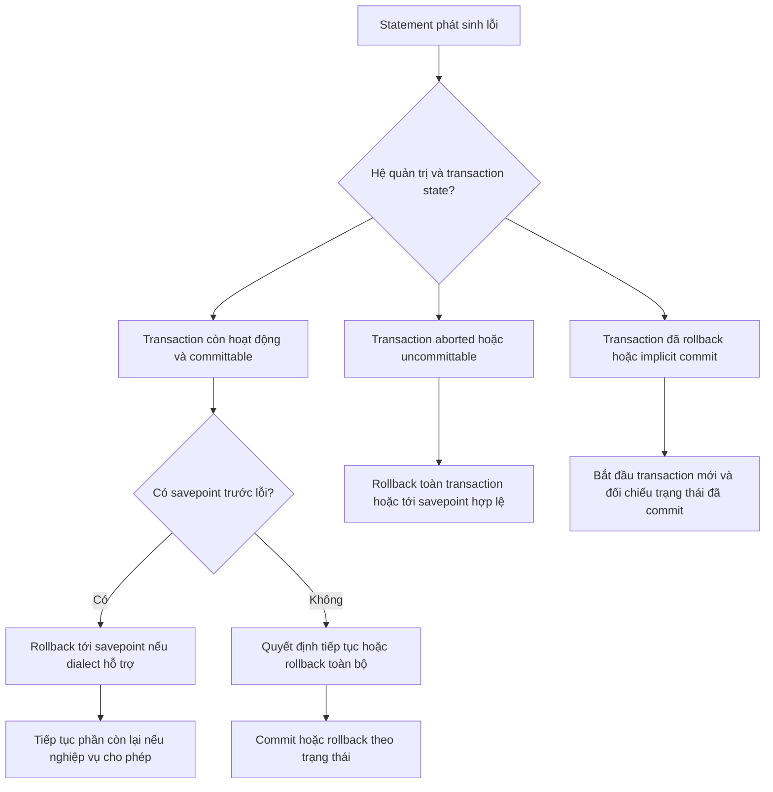

# Đối chiếu DDL, SAVEPOINT và trạng thái giao dịch sau lỗi

## Vì sao cần so sánh hành vi giữa các hệ quản trị?

SQL có nhiều cú pháp được chuẩn hóa, nhưng ranh giới transaction và cách xử lý lỗi vẫn có khác biệt giữa MySQL InnoDB, PostgreSQL, Oracle, SQL Server và SQLite. Một đoạn SQL chạy đúng trên một hệ quản trị không tự động có cùng hành vi khi chuyển sang hệ khác.

Ba vấn đề cần phân biệt:

1. **DDL trong transaction:** các lệnh như `CREATE TABLE`, `ALTER TABLE`, `DROP TABLE` có tham gia transaction hiện tại hay tự tạo implicit commit?
2. **SAVEPOINT:** có thể đánh dấu một điểm trong transaction và rollback một phần công việc bằng cú pháp nào? Có thể giải phóng savepoint hay không?
3. **Trạng thái sau lỗi:** sau khi một câu lệnh thất bại, transaction còn hoạt động, đã bị rollback hay bị đánh dấu không thể commit?

Các khác biệt này ảnh hưởng trực tiếp tới migration schema, xử lý lỗi trong service, quy trình import nhiều bước và khả năng tiếp tục transaction sau một thao tác thất bại.

Một quy tắc quan trọng là **không suy luận trạng thái transaction chỉ từ việc câu lệnh SQL trả lỗi**. Cần biết hệ quản trị, storage engine, isolation level, loại lỗi, cấu hình session và câu lệnh đã chạy trước đó.

## DDL và DML khác nhau ở ranh giới transaction

DDL (Data Definition Language) thay đổi cấu trúc database hoặc đối tượng schema, ví dụ:

```sql
CREATE TABLE audit_events (
    id BIGINT PRIMARY KEY,
    event_type VARCHAR(100) NOT NULL
);

ALTER TABLE audit_events
ADD COLUMN created_at TIMESTAMP;

CREATE INDEX ix_audit_events_type
ON audit_events (event_type);

DROP TABLE audit_events;
```

DML (Data Manipulation Language) thay đổi dữ liệu trong các đối tượng hiện có, ví dụ:

```sql
INSERT INTO audit_events (id, event_type)
VALUES (1, 'USER_CREATED');

UPDATE audit_events
SET event_type = 'USER_UPDATED'
WHERE id = 1;

DELETE FROM audit_events
WHERE id = 1;
```

Trong một transaction thông thường, DML trên bảng transactional có thể được commit hoặc rollback. DDL thì tùy hệ quản trị: có nơi cho phép rollback thay đổi schema, có nơi tự commit transaction hiện tại trước khi chạy DDL.

### Bảng đối chiếu tổng quát

| Hệ quản trị | Hành vi DDL thường gặp | Ảnh hưởng tới transaction hiện tại |
| --- | --- | --- |
| MySQL InnoDB | Nhiều DDL như `CREATE TABLE`, `ALTER TABLE`, `DROP TABLE`, `CREATE INDEX`, `TRUNCATE TABLE` gây implicit commit. | DML trước DDL có thể bị commit; DDL không thể rollback như một phần của transaction người dùng. |
| PostgreSQL | Phần lớn DDL thông thường có thể chạy trong transaction block. | Có thể rollback thay đổi schema cùng DML; một số lệnh đặc biệt không được chạy trong transaction block. |
| Oracle | DDL thông thường phát sinh implicit commit trước và sau khi thực thi thành công. | DML trước DDL được commit trước khi DDL chạy; DDL thành công cũng được commit riêng. |
| SQL Server | Nhiều lệnh DDL hỗ trợ transaction tường minh. | Có thể rollback nhiều thay đổi schema, nhưng một số lệnh quản trị không được chạy trong transaction. |
| SQLite | Nhiều thay đổi schema có thể nằm trong transaction. | DDL có thể rollback cùng DML nếu câu lệnh và chế độ transaction hỗ trợ; một số lệnh như `VACUUM` không chạy trong transaction. |

Bảng này mô tả hành vi phổ biến, không phải danh sách đầy đủ cho mọi câu lệnh hoặc mọi phiên bản. Khi viết migration, hãy kiểm tra chính xác lệnh DDL, phiên bản server và cấu hình đang sử dụng.

## MySQL InnoDB: implicit commit và atomic DDL

### DDL thường commit transaction hiện tại

MySQL có nhiều câu lệnh DDL gây implicit commit. Ví dụ:

```sql
START TRANSACTION;

UPDATE accounts
SET balance = balance - 100
WHERE id = 10;

ALTER TABLE accounts
ADD COLUMN note VARCHAR(100);

ROLLBACK;
```

Không nên kỳ vọng `ROLLBACK` cuối cùng hoàn tác cả việc trừ số dư và thay đổi schema. `ALTER TABLE` thuộc nhóm lệnh gây implicit commit: transaction trước DDL được commit trước khi DDL thực hiện. Sau DDL, `ROLLBACK` không thể hoàn tác phần DML đã được commit đó.

Các lệnh thường gây implicit commit gồm `CREATE TABLE`, `ALTER TABLE`, `DROP TABLE`, `CREATE INDEX`, `DROP INDEX`, `TRUNCATE TABLE` và nhiều lệnh quản trị khác. Danh sách thực tế còn có ngoại lệ và khác biệt theo câu lệnh.

### Atomic DDL không có nghĩa là transactional DDL

MySQL 8.0 giới thiệu atomic DDL cho nhiều thao tác schema được hỗ trợ. Atomic DDL giúp một câu lệnh DDL hoàn tất toàn bộ hoặc được phục hồi an toàn khi server gặp sự cố trong quá trình thực thi. Đây là bảo đảm về tính nguyên tử và khả năng phục hồi của **một DDL statement**.

Atomic DDL không biến `ALTER TABLE` thành một thao tác có thể rollback bằng `ROLLBACK` của transaction người dùng. Hai khái niệm khác nhau:

- **Atomic DDL:** nếu DDL bị gián đoạn do crash, server phục hồi trạng thái schema nhất quán theo cơ chế hỗ trợ của MySQL.
- **Transactional DDL:** DDL tham gia transaction người dùng và có thể bị hoàn tác cùng các thao tác khác.

Không được dùng thuật ngữ atomic DDL để kết luận rằng MySQL hỗ trợ rollback mọi thay đổi schema trong transaction.

### Ngoại lệ với temporary table

`CREATE TEMPORARY TABLE` và `DROP TEMPORARY TABLE` không gây implicit commit theo cách của bảng thông thường. Tuy nhiên, thay đổi temporary table cũng không được rollback như một thay đổi transactional bình thường. Đây là ngoại lệ dễ gây bất ngờ: câu lệnh không commit transaction nhưng hiệu ứng tạo/xóa temporary table vẫn tồn tại sau rollback.

### DDL và SAVEPOINT

Vì DDL gây implicit commit, savepoint được tạo trước DDL có thể bị xóa khi implicit commit xảy ra. Ví dụ:

```sql
START TRANSACTION;
SAVEPOINT before_schema_change;

INSERT INTO audit_log(id, message)
VALUES (1, 'before ddl');

ALTER TABLE audit_log ADD COLUMN source VARCHAR(30);

ROLLBACK TO SAVEPOINT before_schema_change;
```

Không thể dùng savepoint để phục hồi transaction trước implicit commit. Transaction đã kết thúc tại ranh giới commit do DDL gây ra; lệnh rollback tới savepoint cũ sẽ báo không tồn tại savepoint hoặc lỗi tương ứng.

## PostgreSQL: phần lớn DDL có thể rollback

### DDL nằm trong transaction block

PostgreSQL cho phép nhiều lệnh DDL thông thường chạy trong transaction:

```sql
BEGIN;

CREATE TABLE migration_example (
    id BIGINT PRIMARY KEY,
    description TEXT
);

INSERT INTO migration_example(id, description)
VALUES (1, 'created in migration');

ROLLBACK;
```

Sau `ROLLBACK`, cả bảng vừa tạo lẫn dòng vừa chèn đều không còn. Đây là khác biệt quan trọng khi so sánh với MySQL và Oracle.

Một migration có thể gom nhiều thay đổi schema và dữ liệu vào một transaction để bảo đảm tất cả cùng thành công hoặc cùng bị rollback, miễn là các câu lệnh sử dụng đều được phép chạy trong transaction block.

### Những lệnh không được chạy trong transaction block

PostgreSQL có một số lệnh không được phép thực thi trong transaction block. Ví dụ thường gặp:

- `CREATE DATABASE` và `DROP DATABASE`.
- `CREATE INDEX CONCURRENTLY` và `DROP INDEX CONCURRENTLY`.
- `VACUUM`.
- `REINDEX CONCURRENTLY`.
- `ALTER SYSTEM`.

Danh sách có thể thay đổi theo phiên bản và loại lệnh. Nếu chạy một câu lệnh thuộc nhóm này trong transaction block, PostgreSQL trả lỗi. Với migration cần tạo index đồng thời để giảm ảnh hưởng tới thao tác ghi, phải tổ chức migration phù hợp với giới hạn này; không thể bọc tùy tiện mọi bước vào một transaction duy nhất.

### Lỗi làm transaction vào trạng thái aborted

Trong PostgreSQL, khi một statement phát sinh lỗi trong transaction block, transaction chuyển sang trạng thái aborted. Những câu lệnh tiếp theo thường nhận lỗi `current transaction is aborted` cho tới khi ứng dụng rollback transaction hoặc rollback tới savepoint được tạo trước lỗi.

Ví dụ:

```sql
BEGIN;

INSERT INTO users(id, email)
VALUES (1, 'a@example.com');

-- Giả sử email đã tồn tại nên câu lệnh này lỗi unique violation.
INSERT INTO users(id, email)
VALUES (2, 'a@example.com');

-- Câu lệnh này không thể tiếp tục bình thường vì transaction đã aborted.
UPDATE users
SET email = 'new@example.com'
WHERE id = 1;

ROLLBACK;
```

Lỗi unique violation không chỉ làm câu `INSERT` thất bại; nó còn khiến transaction hiện tại không thể tiếp tục cho tới khi được rollback. Đây là điểm khác với hành vi thông thường của InnoDB, nơi lỗi duplicate key thường chỉ rollback statement.

Có thể đặt savepoint trước thao tác có khả năng lỗi để chỉ rollback phần công việc đó. Phần sau sẽ trình bày chi tiết.

## Oracle: DDL implicit commit trước và sau

Oracle thực hiện implicit commit trước khi chạy một DDL statement và commit sau khi DDL thành công. Điều này có nghĩa DML trước DDL có thể đã được commit ngay cả khi DDL sau đó thất bại.

Ví dụ:

```sql
UPDATE accounts
SET balance = balance - 100
WHERE id = 10;

-- DDL phát sinh implicit commit trước khi thực thi.
ALTER TABLE accounts ADD (note VARCHAR2(100));

ROLLBACK;
```

Nếu DDL thành công, thay đổi số dư đã được commit trước đó và DDL cũng được commit sau khi hoàn tất. `ROLLBACK` cuối cùng không hoàn tác các thay đổi này.

Nếu DDL thất bại, implicit commit trước DDL vẫn đã xảy ra. Vì vậy, DML trước câu DDL không còn nằm trong transaction có thể rollback. Đây là điểm đặc biệt cần chú ý khi chạy migration có cả DML và DDL.

Oracle vẫn hỗ trợ savepoint cho các thao tác DML trong transaction. Nhưng một DDL implicit commit sẽ kết thúc transaction và làm mất các savepoint đã tạo trước đó.

## SQL Server: DDL transactional và trạng thái XACT_STATE

### Nhiều DDL hỗ trợ transaction tường minh

SQL Server cho phép nhiều lệnh DDL thông thường chạy trong explicit transaction:

```sql
BEGIN TRANSACTION;

CREATE TABLE dbo.migration_example (
    id BIGINT PRIMARY KEY,
    description NVARCHAR(200)
);

INSERT INTO dbo.migration_example(id, description)
VALUES (1, N'created in migration');

ROLLBACK TRANSACTION;
```

Sau rollback, cả thay đổi schema và dữ liệu thuộc transaction được hoàn tác. Tuy nhiên, không phải mọi lệnh quản trị đều được phép trong explicit hoặc implicit transaction. `CREATE DATABASE` là ví dụ về lệnh không được chạy trong transaction người dùng. Hãy kiểm tra tài liệu cho từng statement thay vì giả định tất cả DDL đều transactional.

### XACT_STATE cho biết transaction còn commit được không

SQL Server phân biệt transaction đang hoạt động và transaction còn có thể commit. Hàm `XACT_STATE()` trả về:

| Giá trị | Ý nghĩa | Hành động |
| ---: | --- | --- |
| `1` | Có transaction đang hoạt động và có thể commit hoặc rollback. | Có thể tiếp tục nếu logic nghiệp vụ cho phép. |
| `-1` | Có transaction đang hoạt động nhưng đã ở trạng thái uncommittable/doomed. | Chỉ có thể đọc hoặc rollback; không thể commit hay ghi tiếp. |
| `0` | Không có transaction người dùng đang hoạt động. | Không còn transaction để commit/rollback. |

`@@TRANCOUNT` chỉ cho biết số mức `BEGIN TRANSACTION` chưa được cân bằng bằng `COMMIT` hoặc `ROLLBACK`; nó không cho biết transaction có thể commit hay không. Vì vậy, trong `TRY...CATCH`, `XACT_STATE()` thường là tín hiệu quan trọng để quyết định cách xử lý.

### Ảnh hưởng của SET XACT_ABORT

Với `SET XACT_ABORT OFF`, là mặc định trong nhiều ngữ cảnh T-SQL, một số lỗi runtime chỉ rollback statement và transaction có thể tiếp tục. Một số lỗi khác khiến transaction trở thành uncommittable hoặc kết thúc transaction.

Với `SET XACT_ABORT ON`, nhiều lỗi runtime khiến toàn bộ transaction hiện tại bị rollback. Tùy chọn này thường được dùng để tránh vô tình commit một phần quy trình sau lỗi. Nó không áp dụng theo cùng cách cho lỗi compile-time; cũng cần xem xét loại lỗi cụ thể.

Ví dụ mẫu xử lý lỗi:

```sql
SET XACT_ABORT ON;

BEGIN TRY
    BEGIN TRANSACTION;

    UPDATE accounts
    SET balance = balance - 100
    WHERE id = 10;

    INSERT INTO audit_events(id, event_type)
    VALUES (1, 'ACCOUNT_DEBITED');

    COMMIT TRANSACTION;
END TRY
BEGIN CATCH
    IF XACT_STATE() <> 0
        ROLLBACK TRANSACTION;

    THROW;
END CATCH;
```

`THROW` chuyển tiếp lỗi để tầng gọi biết thao tác thất bại. Nếu không dùng `XACT_ABORT ON`, nhánh `CATCH` vẫn phải kiểm tra `XACT_STATE()` vì transaction có thể ở trạng thái `-1` hoặc đã kết thúc.

## SQLite: transaction DDL và conflict algorithm

SQLite cho phép nhiều thao tác DDL thông thường chạy trong transaction:

```sql
BEGIN;

CREATE TABLE migration_example (
    id INTEGER PRIMARY KEY,
    description TEXT
);

INSERT INTO migration_example(id, description)
VALUES (1, 'created in migration');

ROLLBACK;
```

Thay đổi schema và dữ liệu có thể cùng rollback. Tuy nhiên, một số lệnh như `VACUUM` không được chạy bên trong transaction. Một số thay đổi `PRAGMA` cũng có giới hạn riêng. SQLite sử dụng khóa ở cấp database/file theo chế độ journal và transaction, nên cạnh tranh ghi có hành vi khác với các server database nhiều writer.

### Conflict resolution ảnh hưởng phạm vi rollback

SQLite có các conflict algorithm cho constraint violation. Với câu lệnh `INSERT` hoặc `UPDATE`, hành vi mặc định `ABORT` rollback các thay đổi của statement gây lỗi nhưng giữ transaction đang hoạt động. Các lựa chọn khác có phạm vi khác nhau:

| Algorithm | Hành vi khái quát |
| --- | --- |
| `ROLLBACK` | Hủy statement và rollback transaction hiện tại. |
| `ABORT` | Hủy statement, hoàn tác các thay đổi của statement; transaction tiếp tục hoạt động. Đây là mặc định. |
| `FAIL` | Dừng statement tại dòng gây lỗi nhưng có thể giữ các thay đổi đã thực hiện trước đó trong cùng statement. |
| `IGNORE` | Bỏ qua dòng vi phạm và tiếp tục xử lý các dòng tiếp theo. |
| `REPLACE` | Với một số constraint, xóa dòng xung đột rồi tiếp tục chèn/cập nhật; cần hiểu rõ tác động xóa. |

Ví dụ:

```sql
CREATE TABLE users (
    id INTEGER PRIMARY KEY,
    email TEXT UNIQUE
);

BEGIN;

INSERT INTO users(id, email)
VALUES (1, 'a@example.com');

-- ABORT: statement thất bại, transaction vẫn hoạt động.
INSERT OR ABORT INTO users(id, email)
VALUES (2, 'a@example.com');

-- Có thể tiếp tục thao tác khác trong transaction.
INSERT INTO users(id, email)
VALUES (3, 'b@example.com');

COMMIT;
```

Với `INSERT OR ROLLBACK`, conflict có thể rollback toàn transaction. Do đó, không thể chỉ nhìn thấy lỗi constraint rồi giả định transaction SQLite luôn còn hoạt động hoặc luôn đã rollback.

Một số lỗi như `SQLITE_FULL`, `SQLITE_IOERR`, `SQLITE_NOMEM`, `SQLITE_BUSY` hoặc `SQLITE_INTERRUPT` có thể khiến SQLite tự rollback transaction trong một số tình huống. Ứng dụng dùng API SQLite nên kiểm tra trạng thái transaction thực tế, ví dụ `sqlite3_get_autocommit()`, thay vì suy luận từ mã lỗi chung.

## SAVEPOINT là gì?

`SAVEPOINT` tạo một điểm khôi phục bên trong transaction hiện tại. Khi một phần công việc thất bại, ứng dụng có thể rollback về điểm đó để hủy các thao tác sau savepoint và tiếp tục phần còn lại nếu transaction vẫn hợp lệ.

Ví dụ:

```sql
START TRANSACTION;

INSERT INTO orders(id, status)
VALUES (100, 'CREATED');

SAVEPOINT optional_step;

-- Một thao tác phụ có thể thất bại.
INSERT INTO order_notes(order_id, note)
VALUES (100, 'optional note');

-- Nếu bước phụ lỗi, ứng dụng có thể rollback về savepoint.
ROLLBACK TO SAVEPOINT optional_step;

-- Tiếp tục phần còn lại của transaction.
UPDATE orders
SET status = 'CONFIRMED'
WHERE id = 100;

COMMIT;
```

Nếu rollback tới `optional_step`, dòng order được tạo trước savepoint vẫn còn trong transaction. Các thao tác sau savepoint bị hoàn tác theo quy tắc của hệ quản trị. Sau đó transaction ngoài vẫn cần `COMMIT` hoặc `ROLLBACK`.

### SAVEPOINT không phải nested transaction độc lập

Savepoint không tạo một transaction con có thể commit độc lập. Nó chỉ đánh dấu một vị trí trong transaction cha:

- `COMMIT` transaction ngoài xác nhận mọi thay đổi còn lại, kể cả thay đổi được thực hiện trước và sau savepoint mà chưa rollback.
- `ROLLBACK` transaction ngoài hoàn tác toàn bộ thay đổi của transaction.
- `ROLLBACK TO SAVEPOINT` hoàn tác một phần và giữ transaction ngoài hoạt động nếu hệ quản trị cho phép tiếp tục.
- `RELEASE SAVEPOINT` xóa mốc savepoint; nó không commit các thay đổi.

Các hệ quản trị không hoàn toàn thống nhất về tên cú pháp, việc có lệnh release hay cách xử lý savepoint trùng tên. Vì vậy, cần dùng cú pháp phù hợp với database dialect.

## Cú pháp SAVEPOINT theo từng hệ quản trị

| Hệ quản trị | Tạo savepoint | Rollback về savepoint | Giải phóng savepoint |
| --- | --- | --- | --- |
| MySQL InnoDB | `SAVEPOINT sp1` | `ROLLBACK TO SAVEPOINT sp1` | `RELEASE SAVEPOINT sp1` |
| PostgreSQL | `SAVEPOINT sp1` | `ROLLBACK TO SAVEPOINT sp1` | `RELEASE SAVEPOINT sp1` |
| Oracle | `SAVEPOINT sp1` | `ROLLBACK TO sp1` | Không có lệnh `RELEASE SAVEPOINT` tương ứng. |
| SQL Server | `SAVE TRANSACTION sp1` | `ROLLBACK TRANSACTION sp1` | Không có lệnh release savepoint riêng. |
| SQLite | `SAVEPOINT sp1` | `ROLLBACK TO SAVEPOINT sp1` | `RELEASE SAVEPOINT sp1` |

### MySQL InnoDB

```sql
START TRANSACTION;

INSERT INTO orders(id, status)
VALUES (200, 'CREATED');

SAVEPOINT before_optional_note;

INSERT INTO order_notes(order_id, note)
VALUES (200, 'optional');

ROLLBACK TO SAVEPOINT before_optional_note;
RELEASE SAVEPOINT before_optional_note;

COMMIT;
```

`ROLLBACK TO SAVEPOINT` không kết thúc transaction. Savepoint mục tiêu vẫn tồn tại sau rollback và có thể được dùng lại; các savepoint được tạo sau nó bị xóa. `RELEASE SAVEPOINT` xóa mốc nhưng không commit. Một implicit commit do DDL sẽ kết thúc transaction và xóa savepoint.

### PostgreSQL

```sql
BEGIN;

INSERT INTO orders(id, status)
VALUES (201, 'CREATED');

SAVEPOINT optional_step;

-- Nếu statement sau đây lỗi, transaction chuyển sang aborted.
INSERT INTO order_notes(order_id, note)
VALUES (201, 'optional');

-- Phải rollback tới savepoint để phục hồi trạng thái transaction.
ROLLBACK TO SAVEPOINT optional_step;

UPDATE orders
SET status = 'CONFIRMED'
WHERE id = 201;

RELEASE SAVEPOINT optional_step;
COMMIT;
```

Trong PostgreSQL, rollback tới savepoint cũng hủy trạng thái lỗi của phần transaction con sau savepoint. Transaction cha có thể tiếp tục. Savepoint mục tiêu vẫn còn sau `ROLLBACK TO` cho tới khi được release hoặc transaction kết thúc.

### Oracle

```sql
INSERT INTO orders(id, status)
VALUES (202, 'CREATED');

SAVEPOINT optional_step;

INSERT INTO order_notes(order_id, note)
VALUES (202, 'optional');

ROLLBACK TO optional_step;

UPDATE orders
SET status = 'CONFIRMED'
WHERE id = 202;

COMMIT;
```

Oracle dùng `SAVEPOINT` và `ROLLBACK TO` nhưng không có câu lệnh release savepoint như PostgreSQL hoặc MySQL. Khi tạo một savepoint trùng tên, vị trí của savepoint đó được đặt lại. DDL implicit commit sẽ kết thúc transaction và xóa các savepoint hiện có.

### SQL Server

```sql
BEGIN TRANSACTION;

INSERT INTO dbo.orders(id, status)
VALUES (203, 'CREATED');

SAVE TRANSACTION optional_step;

INSERT INTO dbo.order_notes(order_id, note)
VALUES (203, 'optional');

ROLLBACK TRANSACTION optional_step;

UPDATE dbo.orders
SET status = 'CONFIRMED'
WHERE id = 203;

COMMIT TRANSACTION;
```

SQL Server dùng `SAVE TRANSACTION` để tạo savepoint và `ROLLBACK TRANSACTION savepoint_name` để rollback về đó. Không có `RELEASE SAVEPOINT`. Rollback tới savepoint không làm giảm `@@TRANCOUNT`; transaction ngoài vẫn cần commit hoặc rollback.

Nếu transaction đang ở trạng thái uncommittable (`XACT_STATE() = -1`), SQL Server không cho rollback tới savepoint như một cách tiếp tục; phải rollback toàn transaction.

### SQLite

```sql
BEGIN;

INSERT INTO orders(id, status)
VALUES (204, 'CREATED');

SAVEPOINT optional_step;

INSERT INTO order_notes(order_id, note)
VALUES (204, 'optional');

ROLLBACK TO SAVEPOINT optional_step;
RELEASE SAVEPOINT optional_step;

COMMIT;
```

SQLite hỗ trợ savepoint kể cả khi cần mô phỏng transaction lồng nhau. `ROLLBACK TO` giữ savepoint mục tiêu tồn tại; `RELEASE` loại bỏ savepoint và các savepoint lồng bên trong nó. `RELEASE` savepoint ngoài cùng có thể kết thúc transaction được mở ngầm bởi savepoint, vì vậy cần hiểu savepoint nào đang là ngoài cùng.

## Savepoint và trạng thái transaction sau lỗi

Khả năng tiếp tục sau lỗi khác nhau đáng kể giữa các hệ quản trị. Bảng sau tóm tắt hành vi thường gặp:

| Hệ quản trị | Lỗi statement thường gặp | Cách phục hồi phổ biến |
| --- | --- | --- |
| MySQL InnoDB | Nhiều lỗi như duplicate key chỉ rollback statement; deadlock thường rollback toàn transaction. Lock wait timeout mặc định thường chỉ rollback statement. | Có thể tiếp tục sau lỗi statement nếu transaction còn hoạt động; kiểm tra lỗi deadlock/timeout và cấu hình. |
| PostgreSQL | Lỗi trong transaction block đánh dấu transaction aborted. | `ROLLBACK` toàn transaction hoặc `ROLLBACK TO SAVEPOINT` đã tạo trước lỗi. |
| Oracle | Statement lỗi được rollback ở cấp statement; transaction thường vẫn hoạt động. | Xử lý exception, tiếp tục nếu phù hợp hoặc rollback tới savepoint. |
| SQL Server | Phụ thuộc loại lỗi, `XACT_ABORT`, và trạng thái transaction. Có thể chỉ lỗi statement hoặc transaction trở thành uncommittable. | Dùng `TRY...CATCH`, kiểm tra `XACT_STATE()`, rollback toàn bộ nếu trạng thái `-1`. |
| SQLite | Phụ thuộc conflict algorithm và loại lỗi. Mặc định `ABORT` chỉ hủy statement; `ROLLBACK` hủy transaction. | Kiểm tra transaction còn hoạt động và dùng `ROLLBACK TO` nếu có savepoint hợp lệ. |

Không nên coi bảng này là bảo đảm cho mọi lỗi. Mất kết nối, lỗi I/O, deadlock, constraint violation, lỗi compile và lỗi từ extension có thể có phạm vi rollback khác nhau.

## MySQL: statement rollback, deadlock và lock wait timeout

Với InnoDB, nhiều lỗi SQL chỉ làm rollback statement hiện tại. Ví dụ, `INSERT` vi phạm unique constraint thường bị rollback nhưng transaction vẫn tiếp tục:

```sql
START TRANSACTION;

INSERT INTO users(id, email)
VALUES (1, 'a@example.com');

-- Lỗi duplicate key: statement này bị rollback.
INSERT INTO users(id, email)
VALUES (2, 'a@example.com');

-- Transaction thường vẫn có thể tiếp tục.
INSERT INTO audit_log(id, message)
VALUES (10, 'handled duplicate');

COMMIT;
```

Tuy nhiên, deadlock là trường hợp khác. Khi InnoDB phát hiện deadlock, nó chọn một transaction làm nạn nhân và rollback toàn transaction đó. Ứng dụng phải chạy lại toàn bộ logic transaction nếu nghiệp vụ cho phép, chứ không chỉ chạy lại câu SQL cuối.

Lock wait timeout mặc định thường rollback statement đang chờ khóa, không tự động rollback toàn transaction. Biến `innodb_rollback_on_timeout` có thể thay đổi hành vi để rollback toàn transaction. Hãy xác nhận cấu hình thực tế và không để transaction tiếp tục nếu trạng thái dữ liệu trong logic ứng dụng không còn đáng tin cậy.

Một điểm khác là DDL implicit commit có thể kết thúc transaction ngay cả khi ứng dụng định dùng savepoint để cô lập lỗi. Không thể khôi phục transaction trước DDL bằng `ROLLBACK TO SAVEPOINT`.

## PostgreSQL: transaction aborted sau lỗi

PostgreSQL yêu cầu transaction tường minh phải được phục hồi sau lỗi trước khi chạy câu lệnh tiếp theo. Nếu không có savepoint, cách an toàn thường là rollback toàn transaction:

```sql
BEGIN;

UPDATE accounts
SET balance = balance - 50
WHERE id = 10;

-- Giả sử câu lệnh này gây lỗi constraint.
INSERT INTO users(id, email)
VALUES (1, 'duplicate@example.com');

-- Transaction đã aborted; thao tác ghi tiếp theo không được thực hiện.
ROLLBACK;
```

Nếu muốn giữ phần công việc trước lỗi, tạo savepoint trước thao tác có rủi ro:

```sql
BEGIN;

UPDATE accounts
SET balance = balance - 50
WHERE id = 10;

SAVEPOINT optional_operation;

-- Ứng dụng thử thao tác có thể vi phạm constraint.
INSERT INTO users(id, email)
VALUES (1, 'duplicate@example.com');

-- Khi nhận lỗi, rollback về savepoint.
ROLLBACK TO SAVEPOINT optional_operation;

-- Transaction cha có thể tiếp tục.
INSERT INTO audit_log(id, message)
VALUES (20, 'optional operation skipped');

COMMIT;
```

Ứng dụng phải bắt lỗi ở tầng thực thi statement, sau đó gửi `ROLLBACK TO SAVEPOINT` trên cùng connection và transaction. Nếu framework tự đánh dấu transaction rollback-only hoặc đã đóng transaction, savepoint có thể không còn dùng được theo cách mong muốn.

## SQL Server: TRY/CATCH và transaction không thể commit

Trong SQL Server, bắt được exception trong `CATCH` không có nghĩa transaction còn có thể commit. Cần kiểm tra `XACT_STATE()`:

```sql
BEGIN TRY
    BEGIN TRANSACTION;

    UPDATE accounts
    SET balance = balance - 50
    WHERE id = 10;

    -- Một thao tác sau có thể phát sinh lỗi.
    INSERT INTO users(id, email)
    VALUES (1, 'duplicate@example.com');

    COMMIT TRANSACTION;
END TRY
BEGIN CATCH
    SELECT
        ERROR_NUMBER() AS error_number,
        ERROR_MESSAGE() AS error_message,
        XACT_STATE() AS transaction_state,
        @@TRANCOUNT AS transaction_count;

    IF XACT_STATE() = -1
    BEGIN
        ROLLBACK TRANSACTION;
    END
    ELSE IF XACT_STATE() = 1
    BEGIN
        -- Có thể rollback toàn transaction hoặc tới savepoint
        -- nếu savepoint phù hợp và nghiệp vụ cho phép tiếp tục.
        ROLLBACK TRANSACTION;
    END;

    THROW;
END CATCH;
```

Nếu `XACT_STATE() = -1`, transaction không thể commit và không thể rollback tới savepoint để tiếp tục. Phải rollback toàn bộ. Nếu trạng thái bằng `1`, transaction còn committable; ứng dụng có thể chọn rollback toàn bộ hoặc rollback tới savepoint đã tạo trước đó. Cần cân nhắc `SET XACT_ABORT` vì nó ảnh hưởng tới việc lỗi runtime có làm transaction bị rollback hay không.

## Oracle: statement-level atomicity

Oracle bảo đảm tính nguyên tử ở cấp statement: nếu một câu DML thất bại, các thay đổi do chính câu lệnh đó thực hiện được hoàn tác, còn transaction trước đó thường vẫn tiếp tục. Ví dụ:

```sql
UPDATE accounts
SET balance = balance - 50
WHERE id = 10;

-- Nếu statement này lỗi, phần thay đổi của statement bị rollback.
INSERT INTO users(id, email)
VALUES (1, 'duplicate@example.com');

-- Transaction vẫn có thể tiếp tục nếu session và transaction còn hợp lệ.
INSERT INTO audit_log(id, message)
VALUES (20, 'duplicate handled');

COMMIT;
```

Nếu ứng dụng cần rollback nhiều statement như một nhóm, hãy dùng savepoint trước nhóm đó. Oracle cũng có thể rollback statement gây deadlock trong khi transaction còn lại vẫn tồn tại; ứng dụng phải xử lý lỗi và quyết định tiếp tục hay rollback.

DDL là ngoại lệ lớn: implicit commit trước DDL làm cho các thay đổi DML trước đó không còn có thể rollback. Do đó, không nên đưa DDL vào giữa một transaction nghiệp vụ với kỳ vọng savepoint sẽ giữ lại ranh giới rollback.

## SQLite: ABORT, FAIL và ROLLBACK

Với SQLite, phải phân biệt lỗi SQL thông thường với conflict algorithm được chọn trong constraint. Ví dụ `ABORT` hoàn tác các thay đổi của statement lỗi và giữ transaction ngoài tiếp tục; `FAIL` có thể giữ các thay đổi của những dòng đã xử lý trước dòng lỗi trong cùng statement; `ROLLBACK` hủy transaction.

Khi ứng dụng dùng batch insert hoặc update nhiều dòng, chọn `OR FAIL` thay vì mặc định `OR ABORT` có thể tạo ra trạng thái một phần trong chính statement. Điều đó có thể không phù hợp nếu nghiệp vụ yêu cầu cả batch cùng thành công hoặc cùng thất bại.

Nếu dùng savepoint để xử lý một phần batch, hãy kiểm tra lỗi, rollback tới savepoint và chỉ release khi đã quyết định giữ các thay đổi còn lại. Không gọi `COMMIT` sau khi cho rằng rollback đã kết thúc transaction: `ROLLBACK TO` không kết thúc transaction ngoài.

## Tác động của DDL tới savepoint và xử lý lỗi

Một savepoint chỉ có ý nghĩa khi transaction chứa nó vẫn còn tồn tại. Vì vậy, DDL implicit commit có thể làm mất savepoint trước khi ứng dụng kịp rollback.

| Hệ quản trị | DDL thông thường và savepoint đã tạo trước đó |
| --- | --- |
| MySQL InnoDB | DDL gây implicit commit kết thúc transaction và xóa savepoint. Temporary table DDL có ngoại lệ về implicit commit nhưng thay đổi temporary table không rollback được. |
| PostgreSQL | DDL transactional được hỗ trợ có thể rollback tới savepoint. Lệnh không được phép trong transaction block sẽ báo lỗi; transaction cần được xử lý theo trạng thái sau lỗi. |
| Oracle | DDL commit trước khi chạy, nên savepoint và transaction trước đó kết thúc. |
| SQL Server | DDL hỗ trợ transaction có thể rollback tới savepoint; lệnh không hỗ trợ transaction phải được chạy ngoài transaction. |
| SQLite | DDL transactional thông thường có thể rollback tới savepoint; các lệnh có giới hạn transaction như `VACUUM` phải chạy theo yêu cầu riêng. |

Đối với migration, một lựa chọn an toàn là tách bước thay đổi schema khỏi transaction nghiệp vụ đang xử lý dữ liệu. Đặc biệt trên MySQL và Oracle, không đặt DDL giữa chuỗi DML nếu ứng dụng cần rollback toàn bộ chuỗi khi bước sau thất bại.

## Xây dựng migration có thể phục hồi

Migration cần được thiết kế theo khả năng transaction của từng database dialect. Một migration đơn giản có thể gồm:

1. Kiểm tra trạng thái schema hiện tại và phiên bản migration.
2. Thực hiện DDL theo nhóm lệnh mà database cho phép chạy transactionally.
3. Thực hiện backfill dữ liệu theo batch có thể retry.
4. Kiểm tra constraint và dữ liệu sau chuyển đổi.
5. Đánh dấu migration hoàn tất theo cơ chế của migration tool.

Với PostgreSQL, có thể gói nhiều DDL thông thường vào transaction, nhưng phải tách những lệnh không được chạy trong transaction block như `CREATE INDEX CONCURRENTLY`.

Với MySQL và Oracle, cần giả định nhiều DDL sẽ tạo implicit commit. Migration phải có khả năng chạy tiếp sau khi một phần DDL đã thành công. Không dựa vào rollback transaction để hoàn tác schema hoặc DML trước DDL. Có thể chia migration thành các bước nhỏ, kiểm tra đối tượng đã tồn tại và dùng quy trình forward-fix khi không thể rollback.

Với SQL Server, nhiều DDL có thể chạy trong transaction, nhưng vẫn phải loại trừ lệnh không được phép và xử lý `XACT_STATE()` khi lỗi. Với SQLite, có thể dùng transaction cho DDL thông thường nhưng cần lưu ý giới hạn của `VACUUM`, locking và journal mode.

### Idempotent migration và kiểm tra trước khi chạy

Một migration có thể bị chạy lại do process dừng sau khi database đã thay đổi nhưng trước khi tool ghi nhận hoàn tất. Vì vậy, cần xác định cách migration tool lưu lịch sử và cách phục hồi khi bước chạy dở.

Không nên chỉ thêm `IF NOT EXISTS` cho mọi DDL mà không kiểm tra định nghĩa đối tượng. Một bảng đã tồn tại nhưng sai kiểu cột hoặc thiếu index không phải trạng thái tương đương với migration đã hoàn tất. Hãy so sánh metadata cần thiết hoặc để migration tool quản lý version/checksum.

Nếu DDL không thể rollback, hãy chuẩn bị thao tác khắc phục theo hướng tiến lên: thêm cột tương thích, backfill, chuyển ứng dụng sang cột mới, sau đó mới loại bỏ cột cũ trong một migration riêng. Cách triển khai theo nhiều giai đoạn giảm nguy cơ phải đảo ngược một thay đổi schema không thể rollback.

## Xử lý savepoint trong ứng dụng Java

JDBC cung cấp API savepoint thông qua `Connection`:

```java
Connection connection = dataSource.getConnection();
connection.setAutoCommit(false);

try {
    insertOrder(connection, order);

    Savepoint optionalStep = connection.setSavepoint("optional_step");
    try {
        insertOptionalNote(connection, order);
        connection.releaseSavepoint(optionalStep);
    } catch (SQLException optionalFailure) {
        connection.rollback(optionalStep);
        // Có thể ghi nhận rằng bước phụ bị bỏ qua,
        // nếu transaction vẫn còn hợp lệ trên database đang dùng.
    }

    connection.commit();
} catch (SQLException failure) {
    connection.rollback();
    throw failure;
} finally {
    connection.close();
}
```

Đây là cấu trúc minh họa. Cần kiểm tra hành vi theo driver và database cụ thể:

- Trên PostgreSQL, rollback tới savepoint là cách phục hồi transaction sau một statement error.
- Trên MySQL InnoDB, nhiều lỗi statement không làm transaction aborted, nhưng deadlock có thể đã rollback toàn transaction; không được tiếp tục dựa trên savepoint đã mất.
- Trên Oracle, statement-level rollback thường giữ transaction hoạt động, nhưng DDL có thể implicit commit và phá vỡ ranh giới savepoint.
- Trên SQL Server, nếu transaction ở trạng thái `XACT_STATE() = -1`, rollback savepoint không thể làm transaction committable trở lại.

Trong ứng dụng Spring, `@Transactional` thường quản lý connection và rollback theo quy tắc exception của framework. Bắt một `DataAccessException` rồi tiếp tục chạy không bảo đảm database transaction có thể tiếp tục. PostgreSQL có thể đã đánh dấu transaction aborted; SQL Server có thể ở trạng thái uncommittable; Spring cũng có thể đã đánh dấu transaction rollback-only.

Nếu cần xử lý lỗi cục bộ bằng savepoint, hãy dùng transaction manager và API hỗ trợ savepoint phù hợp với database/driver. `PROPAGATION_NESTED` thường được triển khai bằng savepoint khi transaction manager hỗ trợ, nhưng không phải mọi transaction manager hoặc JPA provider đều bật hay hỗ trợ nested propagation theo cùng cách. Hãy xác nhận cấu hình trước khi dựa vào nó.

Không nên bắt lỗi rồi bỏ qua mà không rollback tới savepoint hoặc kiểm tra trạng thái transaction. Nếu database đã đánh dấu transaction không thể tiếp tục, các câu lệnh tiếp theo có thể thất bại hoặc commit cuối cùng sẽ không thực hiện được.

## Quy tắc chọn cách xử lý lỗi

Khi một statement thất bại, có thể đi theo trình tự sau:



Trước khi tiếp tục, hãy xác định:

1. Statement lỗi đã tự rollback riêng hay rollback cả transaction?
2. Transaction còn tồn tại không? Nếu còn, có thể commit không?
3. Savepoint được tạo trước lỗi còn tồn tại không?
4. Có implicit commit do DDL hoặc lệnh quản trị không?
5. Có thao tác nào đã được commit hoặc thực hiện ngoài database không?
6. Nếu retry, cần chạy lại statement hay toàn bộ transaction?

Đặc biệt, nếu transaction đã commit một phần do implicit commit, retry toàn bộ workflow có thể lặp DML hoặc tạo đối tượng schema trùng. Cần đọc lại trạng thái database trước khi quyết định chạy lại.

## Bảng quyết định nhanh

| Tình huống | Hướng xử lý |
| --- | --- |
| DDL cần rollback cùng DML trên PostgreSQL | Dùng transaction block nếu lệnh DDL hỗ trợ transactional execution. |
| DDL trên MySQL hoặc Oracle | Tách khỏi transaction nghiệp vụ; giả định implicit commit với các DDL thông thường. |
| PostgreSQL statement lỗi nhưng muốn giữ DML trước đó | Tạo savepoint trước statement và rollback tới savepoint sau lỗi. |
| MySQL InnoDB duplicate key | Thường chỉ rollback statement; kiểm tra lỗi deadlock/timeout riêng. |
| MySQL deadlock | Retry toàn bộ transaction sau khi InnoDB rollback transaction nạn nhân. |
| SQL Server bắt lỗi trong `CATCH` | Kiểm tra `XACT_STATE()` trước khi commit hoặc rollback savepoint. |
| SQLite constraint conflict | Xác định `ABORT`, `FAIL`, `IGNORE`, `REPLACE` hay `ROLLBACK` đang được dùng. |
| DDL không hỗ trợ transaction block | Tách thành migration riêng và chuẩn bị bước phục hồi/forward-fix. |
| Muốn bỏ một bước phụ nhưng giữ transaction chính | Dùng savepoint nếu database và trạng thái transaction cho phép. |

## Những lỗi thiết kế thường gặp

| Cách làm | Hậu quả | Cách xử lý |
| --- | --- | --- |
| Giả định mọi DDL đều rollback được | DML trước DDL có thể đã implicit commit trên MySQL hoặc Oracle. | Đối chiếu hành vi từng database và tách migration. |
| Nhầm atomic DDL của MySQL với transactional DDL | Không thể rollback DDL cùng transaction người dùng. | Phân biệt crash atomicity của statement với transaction rollback. |
| PostgreSQL bắt exception rồi chạy tiếp mà không rollback savepoint | Transaction vẫn ở trạng thái aborted. | Rollback toàn transaction hoặc tới savepoint tạo trước lỗi. |
| SQL Server chỉ kiểm tra `@@TRANCOUNT` | Transaction có thể còn count nhưng đã uncommittable. | Kiểm tra `XACT_STATE()`. |
| Dùng savepoint như nested transaction độc lập | Commit/rollback ngoài có thể tác động toàn bộ thay đổi. | Hiểu savepoint là mốc trong transaction cha. |
| Gọi `RELEASE SAVEPOINT` rồi nghĩ dữ liệu đã commit | Release chỉ xóa mốc, không commit transaction. | Chỉ commit transaction ngoài khi mọi điều kiện nghiệp vụ đã đạt. |
| Bắt mọi lỗi rồi bỏ qua | Transaction có thể đã rollback hoặc không thể commit. | Phân loại lỗi và xác định trạng thái transaction. |
| Retry câu lệnh cuối sau deadlock | Transaction InnoDB bị chọn làm nạn nhân đã rollback toàn bộ. | Retry toàn bộ đơn vị công việc transaction. |
| Đặt DDL giữa DML và rollback tới savepoint sau đó | Implicit commit có thể đã kết thúc transaction và xóa savepoint. | Tách DDL khỏi transaction DML trên dialect có implicit commit. |

## Bài tập vận dụng

Một migration thực hiện ba bước: trừ số dư trong bảng `accounts`, tạo bảng `audit_archive`, sau đó chèn bản ghi audit. Hãy so sánh kết quả khi chạy trên MySQL InnoDB, PostgreSQL, Oracle và SQL Server nếu bước chèn audit bị lỗi.

1. Hệ quản trị nào cho phép rollback cả DML và DDL thông thường trong cùng transaction?
2. Trên MySQL và Oracle, vì sao rollback cuối cùng có thể không hoàn tác số dư đã trừ?
3. Trên PostgreSQL, vì sao câu lệnh sau lỗi không thể chạy cho tới khi rollback transaction hoặc savepoint?
4. Nếu muốn giữ thay đổi trước bước audit nhưng bỏ riêng bước audit lỗi, cần đặt savepoint ở đâu và dùng cú pháp nào trên từng database?
5. Trên SQL Server, vì sao cần kiểm tra `XACT_STATE()` trong `CATCH` trước khi quyết định rollback tới savepoint?

Một cách triển khai an toàn là xác định DDL có thể transactional trên database mục tiêu trước khi viết migration. Với PostgreSQL hoặc SQL Server, có thể gom các lệnh hỗ trợ vào transaction và dùng savepoint cho phần tùy chọn. Với MySQL và Oracle, nên tách DDL ra khỏi chuỗi DML cần rollback cùng nhau, vì implicit commit có thể xác nhận phần DML trước khi DDL chạy. Sau lỗi, ứng dụng phải kiểm tra transaction state và trạng thái dữ liệu/schema đã commit trước khi retry.
