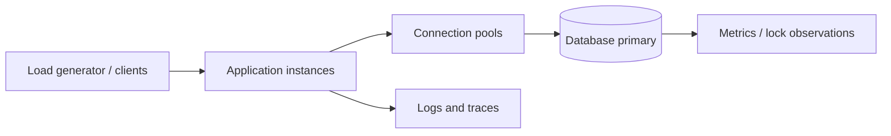

# Viết báo cáo bằng chứng về tính đúng đắn, hiệu năng và giới hạn

## Mục tiêu của báo cáo

Khi đánh giá một thiết kế xử lý đồng thời, câu “test đã pass” hoặc “benchmark chạy nhanh” chưa đủ để người khác quyết định có thể đưa thiết kế vào production hay không. Một báo cáo kỹ thuật cần cho thấy **điều gì đã được kiểm chứng, kiểm chứng trong điều kiện nào, kết quả quan sát được là gì và kết luận không áp dụng tới đâu**.

Với chủ đề database transaction concurrency, báo cáo nên trả lời ba nhóm câu hỏi:

1. **Tính đúng đắn:** Khi nhiều transaction chạy đồng thời hoặc gặp lỗi, các bất biến nghiệp vụ có còn được giữ không? Hệ thống có ngăn được lost update, ghi trùng, đọc dữ liệu không hợp lệ và trạng thái dở dang không?
2. **Hiệu năng:** Thiết kế xử lý được bao nhiêu công việc trong một đơn vị thời gian? Độ trễ ở các percentile ra sao? Khi tăng concurrency, điểm bão hòa xuất hiện ở đâu và bottleneck nằm ở tầng nào?
3. **Giới hạn:** Kết quả phụ thuộc database engine, isolation level, schema, workload, dữ liệu, phần cứng, connection pool và failure model như thế nào? Những tình huống nào chưa được kiểm thử?

Báo cáo tốt giúp người đọc phân biệt dữ kiện đã quan sát với suy luận, và phân biệt kết quả của một môi trường thử nghiệm với cam kết vận hành thực tế.

## Bằng chứng khác với nhận định

Một báo cáo thường có ba loại phát biểu:

| Loại phát biểu | Ví dụ | Cần bằng chứng gì? |
| --- | --- | --- |
| Mô tả điều đã làm | “Hai session cập nhật cùng một sản phẩm.” | Script, cấu hình test, phiên bản code và cách chạy. |
| Kết quả quan sát | “Chỉ một transaction giữ được slot cuối cùng.” | Trạng thái dữ liệu sau commit, số dòng affected, SQL result hoặc log. |
| Kết luận/diễn giải | “Cập nhật có điều kiện giữ quota khi các request cạnh tranh.” | Liên kết giữa invariant, kịch bản, kết quả; nêu rõ phạm vi đã thử. |

Không viết kết luận mạnh hơn bằng chứng. Nếu chỉ chạy 100 lần trong một database test, hãy viết “100 lần chạy trong cấu hình đã nêu đều giữ invariant”, không viết “thiết kế chắc chắn không thể sai”. Nếu benchmark dùng dữ liệu nhỏ trong RAM, không suy ra hiệu năng của workload production có dữ liệu lớn hơn nhiều.

### Một claim cần có điều kiện kiểm chứng

Thay vì viết:

> Cơ chế khóa này an toàn và nhanh.

Hãy viết:

> Với MySQL InnoDB 8.4, isolation `READ COMMITTED`, bảng `inventory` có primary key trên `product_id`, hai worker cập nhật cùng một sản phẩm bằng câu `UPDATE ... WHERE quantity >= ?`. Trong 500 lượt chạy đồng thời với hai connection độc lập, không lượt nào làm `quantity` âm; số dòng cập nhật thành công bằng số lượt đặt hàng được chấp nhận. Throughput và p99 được đo riêng ở phần benchmark.

Phát biểu thứ hai cho người đọc biết engine, isolation, schema, cơ chế, số lần thử và invariant được quan sát. Nó cũng không tuyên bố về các database hoặc workload chưa được thử.

## Xác định câu hỏi và bất biến trước khi chạy test

Đừng bắt đầu bằng cách viết một script SQL bất kỳ. Trước hết, mô tả quy tắc nghiệp vụ mà hệ thống phải giữ dù các transaction xen kẽ nhau.

Ví dụ với kho hàng:

- Số lượng tồn kho không được âm.
- Một đơn hàng chỉ được giữ hàng một lần cho cùng request ID.
- Tổng số lượng giữ chỗ không vượt số lượng khả dụng.
- Nếu transaction tạo order rollback, phần giữ hàng trong cùng database cũng phải rollback.

Ví dụ với thanh toán:

- Một payment reference của đối tác chỉ được ghi nhận một lần.
- Tổng tiền ghi nợ và ghi có phải cân bằng theo quy tắc kế toán.
- Retry cùng idempotency key không tạo thêm giao dịch.
- Nếu kết quả provider chưa rõ sau timeout, hệ thống không được tự kết luận rằng thanh toán chắc chắn thất bại.

Viết invariant thành điều kiện có thể kiểm tra. Ví dụ:

```sql
-- Không có tồn kho âm.
SELECT COUNT(*) AS invalid_rows
FROM inventory
WHERE quantity < 0;

-- Không có hai lần cấp cùng coupon cho một user trong campaign.
SELECT campaign_id, user_id, COUNT(*) AS copies
FROM issued_coupons
GROUP BY campaign_id, user_id
HAVING COUNT(*) > 1;

-- Mỗi idempotency scope chỉ có một record.
SELECT tenant_id, operation, idempotency_key, COUNT(*) AS copies
FROM idempotency_records
GROUP BY tenant_id, operation, idempotency_key
HAVING COUNT(*) > 1;
```

Nếu invariant được bảo vệ bằng `UNIQUE`, `CHECK`, foreign key hoặc atomic update, hãy ghi rõ tên constraint/câu lệnh và kết quả kiểm tra sau test. Đừng chỉ kiểm tra HTTP response; trạng thái database mới cho biết dữ liệu cuối có giữ quy tắc hay không.

## Xác định phạm vi và môi trường thử nghiệm

Một kết quả chỉ có ý nghĩa khi người khác biết nó được tạo ra ở đâu. Ghi lại tối thiểu:

| Nhóm | Thông tin cần ghi |
| --- | --- |
| Ứng dụng | Git commit, build/version, JVM, framework và cấu hình transaction. |
| Database | Engine, phiên bản chính xác, edition nếu liên quan, storage engine, isolation level và cấu hình quan trọng. |
| Schema | DDL, primary/unique/foreign key, index, trigger và kiểu dữ liệu. |
| Hạ tầng | CPU, số core, RAM, storage, filesystem, network và vị trí tương đối giữa app với database. |
| Connection | Pool implementation, min/max, acquisition timeout, số instance và tổng pool tối đa. |
| Dữ liệu | Số dòng, kích thước bảng/index, phân bố key, tỷ lệ hot key và trạng thái cache. |
| Workload | Tỷ lệ đọc/ghi, số worker, transaction mix, think time, thời lượng và tốc độ request đến. |
| Cách chạy | Script/test command, seed, warm-up, số lượt lặp và cách thu thập metric. |

Không cần ghi mọi thông số của máy nếu chúng không liên quan, nhưng phải ghi các yếu tố có thể làm thay đổi kết quả. Đặc biệt, không gộp kết quả từ MySQL, PostgreSQL và SQL Server vào một bảng mà bỏ mất isolation level hoặc schema khác nhau.

### Mô tả topology

Một sơ đồ nhỏ thường làm rõ vị trí concurrency và hàng chờ:



Nếu có read replica, message broker, Redis lock, API provider hoặc object storage, hãy thêm vào sơ đồ. Nêu rõ phần nào nằm trong transaction database và phần nào là tác dụng ngoài transaction.

## Thiết kế bằng chứng về tính đúng đắn

Tính đúng đắn cần được chứng minh bằng kịch bản có thể tái hiện. Mỗi kịch bản nên có:

1. **Mục tiêu:** lỗi hoặc bất biến nào đang được kiểm tra?
2. **Tiền điều kiện:** dữ liệu ban đầu, schema, isolation và transaction state.
3. **Lịch thực thi:** session/thread nào chạy bước nào, điểm nào phải chờ.
4. **Kết quả mong đợi:** điều kiện pass/fail có thể quan sát.
5. **Bằng chứng thu được:** query kết quả, log, SQLState, deadlock trace hoặc metric lock.
6. **Giới hạn:** điều kiện nào chưa được bao phủ.

### Ma trận kiểm thử tính đúng đắn

| ID | Tình huống | Invariant/kỳ vọng | Bằng chứng cần lưu |
| --- | --- | --- | --- |
| C-01 | Hai transaction cập nhật cùng một dòng | Không mất cập nhật hoặc không vi phạm quy tắc số dư/tồn kho. | Giá trị trước/sau, affected rows, transaction schedule. |
| C-02 | Hai request tranh slot cuối cùng | Chỉ số request hợp lệ được chấp nhận theo quota. | Kết quả từng request và trạng thái cuối trong DB. |
| C-03 | Đọc cùng dữ liệu ở hai isolation level | Kết quả phù hợp semantics đã chọn. | Script hai session, isolation, giá trị mỗi lần đọc. |
| C-04 | Transaction giữ khóa, transaction khác cập nhật | Blocking/timeout và thứ tự commit đúng dự kiến. | Lock wait, thời điểm bắt đầu/kết thúc, session ID. |
| C-05 | Deadlock | Có transaction được chọn làm victim; ứng dụng phục hồi theo chính sách. | Error code, deadlock graph/trace, số lần retry. |
| C-06 | Constraint conflict | Database từ chối dữ liệu vi phạm. | Constraint name, SQLState/vendor code, trạng thái cuối. |
| C-07 | Lỗi giữa transaction | Không có một phần dữ liệu được commit ngoài ý muốn. | Trạng thái từng bảng trước/sau rollback. |
| C-08 | Retry cùng idempotency key | Không tạo hiệu ứng nghiệp vụ trùng. | Key, request hash, response lưu và số bản ghi nghiệp vụ. |
| C-09 | Commit xong nhưng mất response | Retry trả lại kết quả đã commit. | Log commit, mô phỏng mất response, kết quả retry. |
| C-10 | Worker commit rồi dừng trước ACK | Message giao lại không áp dụng hiệu ứng lần hai. | Inbox/dedup record, số lần giao và trạng thái nghiệp vụ. |

Không phải dự án nào cũng cần tất cả kịch bản. Chọn các kịch bản liên quan tới rủi ro thực tế và ghi rõ phần không kiểm thử.

## Tạo lịch thực thi có thể tái hiện

Để kiểm tra race condition, cần chủ động tạo interleaving. Một script chạy tuần tự không chứng minh hành vi khi hai transaction thực sự cạnh tranh.

Ví dụ kiểm tra quota cuối cùng với hai session. Giả sử `campaigns.issued_count = 9`, `coupon_limit = 10`:

**Session A**

```sql
START TRANSACTION;

UPDATE campaigns
SET issued_count = issued_count + 1
WHERE id = 42
  AND issued_count < coupon_limit;

-- Ghi lại ROW_COUNT() hoặc số dòng affected từ client.
-- Tạm giữ transaction để session B phải cạnh tranh.
```

**Session B**, chạy khi A chưa commit:

```sql
START TRANSACTION;

UPDATE campaigns
SET issued_count = issued_count + 1
WHERE id = 42
  AND issued_count < coupon_limit;

-- Có thể chờ A nhả khóa; kết quả được xác định sau đó.
```

Sau đó commit A, để B tiếp tục rồi commit B nếu update thành công. Đọc lại:

```sql
SELECT issued_count, coupon_limit
FROM campaigns
WHERE id = 42;
```

Kỳ vọng: chỉ một cập nhật thành công; `issued_count` không vượt `10`. Ghi lại thời điểm B bắt đầu câu lệnh, thời gian chờ khóa và affected rows. Cú pháp lấy số dòng affected tùy client/engine; báo cáo cần ghi chính xác cách đo.

Nếu test dùng hai session trong cùng một process, hãy xác nhận mỗi session có connection riêng. Hai thread dùng chung một connection không tạo ra hai transaction độc lập.

### Kiểm tra lost update

Một kịch bản đọc rồi ghi có thể cho thấy lost update:

1. Session A bắt đầu transaction và đọc `quantity = 10`.
2. Session B đọc cùng giá trị `10`.
3. A tính `9` và ghi `quantity = 9`.
4. B cũng tính `9` từ snapshot/giá trị cũ và ghi `quantity = 9`.
5. Cả hai hoàn tất; số lượng chỉ giảm một thay vì hai.

Để tạo đúng lịch này, dùng latch/barrier ở tầng test sau khi cả hai session đọc xong và trước khi ghi. Sau đó chạy lại cùng kịch bản với atomic update:

```sql
UPDATE inventory
SET quantity = quantity - 1
WHERE product_id = 42
  AND quantity > 0;
```

So sánh kết quả và affected rows. Báo cáo nên giữ script cả phiên bản lỗi lẫn phiên bản đã sửa, vì đối chiếu giúp người đọc thấy cơ chế nào đã loại bỏ race condition.

### Kiểm tra isolation bằng hai session

Nếu claim liên quan tới dirty read, non-repeatable read, phantom hoặc snapshot, ghi lại:

- isolation level được đặt cho từng session;
- thời điểm transaction bắt đầu;
- loại `SELECT` (consistent read hay locking read);
- giá trị từng câu trả về;
- thời điểm transaction kia commit;
- kết quả mong đợi theo semantics của engine.

Không mô tả chung “REPEATABLE READ luôn làm X” nếu chưa nêu database. InnoDB, PostgreSQL và SQL Server có khác biệt về snapshot, predicate/range lock và hành vi locking read. Báo cáo phải nêu engine/version cùng loại câu lệnh.

### Kiểm tra deadlock và phục hồi

Để chứng minh ứng dụng xử lý deadlock, không chỉ ghi “deadlock xảy ra”. Cần lưu:

- hai hoặc nhiều transaction đã lấy những khóa nào;
- thứ tự truy cập tài nguyên;
- transaction nào bị chọn làm victim;
- error code/SQLState;
- ứng dụng retry toàn transaction hay chỉ retry statement;
- kết quả nghiệp vụ sau retry có bị nhân đôi không.

Nếu retry toàn transaction, cần chứng minh phần công việc trước deadlock đã rollback và thao tác retry không tạo side effect ngoài database trùng lặp. Với HTTP/email/provider, cần idempotency hoặc workflow phục hồi riêng.

## Thu thập bằng chứng từ database

Một test chỉ có kết quả cuối đôi khi không giải thích được vì sao transaction chờ hoặc bị rollback. Hãy thu thập metadata và trace phù hợp với engine.

| Engine | Nguồn quan sát thường dùng | Bằng chứng có thể lấy |
| --- | --- | --- |
| MySQL InnoDB | Performance Schema, `SHOW ENGINE INNODB STATUS`, `information_schema.innodb_trx` và lock tables theo phiên bản. | Transaction đang chạy, lock wait, deadlock gần nhất, SQL/session. |
| PostgreSQL | `pg_stat_activity`, `pg_locks`, `pg_stat_statements` và log lock/deadlock. | Blocked/blocking PID, wait event, query duration, thống kê query. |
| SQL Server | DMVs như `sys.dm_exec_requests`, `sys.dm_tran_locks`, `sys.dm_os_waiting_tasks`, Extended Events. | Wait type, lock resource, session, deadlock graph và query. |
| Oracle | Dynamic performance views như `V$SESSION`, `V$LOCK`, `V$SQL`, AWR/ASH nếu được cấp phép. | Blocking session, wait event, SQL ID và lịch sử hiệu năng. |
| SQLite | API/pragma và log từ ứng dụng; khả năng quan sát lock nội bộ hạn chế hơn server database. | Mã lỗi, thời gian chờ busy, transaction state và journal mode. |

Tên view, cột và quyền truy cập có thể thay đổi theo phiên bản hoặc edition. Chỉ chạy truy vấn quan sát được hỗ trợ trên môi trường thử nghiệm; không đưa query monitoring nặng vào production mà chưa đánh giá tác động.

### Lưu bằng chứng có thể truy nguyên

Đặt một `run_id` cho mỗi lần chạy. Gắn nó vào log ứng dụng, test data và benchmark result:

```text
run_id=concurrency-2026-11-14-001
scenario=C-02
engine=mysql-8.4.x
isolation=READ-COMMITTED
worker_count=2
connection_count=2
```

Không dùng timestamp làm định danh duy nhất. Nên có `run_id`, `scenario_id`, request ID và transaction/session ID khi có thể. Đồng bộ thời gian giữa máy ứng dụng và database hoặc ghi rõ nguồn clock; khi đo khoảng thời gian, ưu tiên clock monotonic trong process thay vì trừ timestamp từ các máy có clock lệch.

## Thiết kế bằng chứng về hiệu năng

Benchmark concurrency cần mô tả workload đại diện và phương pháp đo. Một con số TPS không có ý nghĩa nếu người đọc không biết transaction làm gì, dữ liệu có bao nhiêu dòng, bao nhiêu request lỗi hoặc load generator có gửi đủ tải hay không.

### Định nghĩa workload

Ghi rõ:

- tỷ lệ transaction theo loại, ví dụ 70% read, 25% update, 5% insert;
- số câu SQL trong mỗi transaction;
- kích thước dữ liệu và index;
- phân bố key đồng đều hay có hot key;
- transaction có gọi dịch vụ ngoài hay không;
- số client/worker và tốc độ request đến;
- pool maximum và số application instance;
- thời gian warm-up và thời gian đo;
- retry policy, timeout và cách tính lỗi.

Hai benchmark có cùng số worker nhưng phân bố dữ liệu khác nhau có thể tạo lock contention rất khác. Một benchmark cập nhật 10.000 dòng độc lập không đại diện cho workload mà 90% request cùng cập nhật một dòng counter.

### Open-loop và closed-loop

Trong closed-loop test, mỗi worker gửi request mới sau khi request trước hoàn tất. Khi hệ thống chậm, tốc độ gửi giảm theo. Đây là mô hình hữu ích khi số client cố định và mỗi client chờ phản hồi trước khi tiếp tục.

Trong open-loop test, load generator phát request theo arrival rate đã định, độc lập với response time. Nó giúp thấy hàng chờ tích tụ khi tốc độ đến vượt năng lực phục vụ. Cần giới hạn backlog và ghi số request được gửi, hoàn tất, timeout và drop.

Không so sánh trực tiếp hai kiểu test mà không nói rõ mô hình tải. Closed-loop có thể che giấu overload vì client tự giảm tốc độ gửi khi server chậm; open-loop có thể tạo backlog lớn nếu không giới hạn.

### Tăng concurrency theo bậc

Một phép đo đơn giản có thể chạy lần lượt 1, 2, 4, 8, 16, 32 và 64 worker. Mỗi mức cần đủ thời gian warm-up và measurement. Chỉ thay một yếu tố mỗi lần, ví dụ pool size, trong khi giữ workload và database configuration cố định.

```text
Warm-up -> Measure 1 worker -> Cooldown
        -> Measure 2 workers -> Cooldown
        -> Measure 4 workers -> Cooldown
        -> Measure 8 workers -> Cooldown
        -> ...
```

Nếu các mức chạy liên tục trên cùng database, trạng thái cache, buffer pool, autovacuum, checkpoint, log flush và dữ liệu có thể bị ảnh hưởng bởi lần trước. Cần reset hoặc ghi rõ điều kiện; chạy lặp lại theo thứ tự khác nếu có khả năng order effect.

### Chỉ số hiệu năng chính

| Metric | Cách hiểu | Vì sao cần ghi |
| --- | --- | --- |
| Throughput (TPS) | Transaction hoàn tất mỗi giây. | Cho biết năng lực xử lý thực tế. |
| p50 latency | 50% request nhanh hơn hoặc bằng giá trị này. | Mô tả trải nghiệm điển hình. |
| p95 latency | 95% request hoàn tất trong hoặc dưới giá trị này. | Thể hiện phần đuôi chậm. |
| p99 latency | 99% request hoàn tất trong hoặc dưới giá trị này. | Phát hiện tail latency nghiêm trọng. |
| Error/timeout rate | Tỷ lệ transaction không hoàn tất đúng yêu cầu. | TPS cao nhưng lỗi nhiều không phải thành công. |
| Pool acquisition wait | Thời gian chờ mượn connection. | Xác định hàng chờ ở ứng dụng. |
| Lock wait | Thời gian chờ khóa ở database. | Phát hiện tranh chấp dữ liệu. |
| Transaction duration | Từ lúc begin/first operation tới commit/rollback. | Transaction dài làm giữ khóa và connection lâu. |
| CPU, memory, I/O | Mức sử dụng tài nguyên. | Xác định giới hạn năng lực. |
| Deadlock/retry count | Số lần transaction bị rollback/retry. | Đánh giá chi phí cạnh tranh và khả năng phục hồi. |

Percentile phải được tính trên mẫu request đủ lớn và cùng định nghĩa thời gian. Không lấy trung bình của p99 từ các batch nhỏ rồi gọi đó là p99 toàn bộ. Nếu dùng histogram, giữ bucket và đơn vị nhất quán giữa các lần chạy.

### Phân rã thời gian request

Đo riêng các khoảng:

```text
Request arrives
    |
    +--> Wait for pool connection
    |
    +--> Execute SQL / wait for database locks
    |
    +--> Application work while connection is held
    |
    +--> Commit / release connection
    |
    +--> Response completes
```

Một request có thể giữ connection trong lúc xử lý logic ứng dụng hoặc chờ HTTP bên ngoài. Vì vậy, `connection usage duration` không bằng `SQL execution time`. Báo cáo nên đo acquisition time, lease duration và query duration riêng để tìm đúng nguyên nhân.

## Trình bày kết quả benchmark

Bảng kết quả cần có đơn vị và mô tả rõ cấu hình. Ví dụ bảng trống:

| Workers | Pool max | TPS | p50 ms | p95 ms | p99 ms | Error % | DB CPU % | Lock wait ms |
| ---: | ---: | ---: | ---: | ---: | ---: | ---: | ---: | ---: |
| 1 |  |  |  |  |  |  |  |  |
| 2 |  |  |  |  |  |  |  |  |
| 4 |  |  |  |  |  |  |  |  |
| 8 |  |  |  |  |  |  |  |  |
| 16 |  |  |  |  |  |  |  |  |
| 32 |  |  |  |  |  |  |  |  |

Không điền số giả định vào báo cáo kết quả thật. Nếu dùng số minh họa trong tài liệu hoặc slide, gắn nhãn “synthetic/example data” rõ ràng để không bị hiểu nhầm là kết quả đo.

### Ví dụ diễn giải số liệu giả định

Bảng dưới đây chỉ là dữ liệu giả định để minh họa cách diễn giải, không phải kết quả benchmark của một hệ thống thực:

| Workers | TPS | p95 ms | p99 ms | Lock wait ms | Error % |
| ---: | ---: | ---: | ---: | ---: | ---: |
| 4 | 380 | 80 | 120 | 3 | 0.0 |
| 8 | 620 | 110 | 190 | 9 | 0.0 |
| 16 | 760 | 220 | 480 | 65 | 0.1 |
| 32 | 745 | 510 | 1.300 | 240 | 1.8 |

Một diễn giải hợp lý:

- TPS tăng khi worker tăng từ 4 lên 16, nhưng mức tăng nhỏ dần.
- Ở 32 worker, throughput giảm nhẹ trong khi p95/p99 và lock wait tăng mạnh.
- Kết quả gợi ý workload tiến vào vùng contention; cần xem blocking session, hot key và transaction duration trước khi tăng pool tiếp.
- Error rate tăng ở mức 32 worker nên không thể xem TPS gần 16 worker là kết quả tương đương về chất lượng.

Không kết luận lock contention là nguyên nhân duy nhất chỉ từ bảng này. Cần đối chiếu database wait event, query plan, CPU/I/O và phân bố key để xác nhận.

### Biểu đồ nên thể hiện điều gì?

Khi có dữ liệu thực, nên vẽ ít nhất:

- throughput theo concurrency;
- p50, p95 và p99 latency theo concurrency;
- pool wait và database lock wait theo concurrency;
- error rate theo concurrency.

Đánh dấu điểm bắt đầu bão hòa và cấu hình được chọn. Không cắt trục theo cách làm một thay đổi nhỏ trông như biến động rất lớn; nếu dùng trục log hoặc hai trục, ghi rõ trong chú thích.

## Đối chiếu baseline và phương án thay thế

Một báo cáo có giá trị khi so sánh thiết kế với baseline cùng điều kiện. Ví dụ:

| Phương án | Cơ chế | Câu hỏi cần trả lời |
| --- | --- | --- |
| Baseline | Đọc rồi ghi không khóa | Có lost update hoặc vượt quota khi chạy đồng thời không? |
| Phương án A | Atomic `UPDATE` có điều kiện | Invariant có được giữ? Throughput và latency thay đổi ra sao? |
| Phương án B | `SELECT ... FOR UPDATE` | Lock wait và transaction duration tăng bao nhiêu? |
| Phương án C | Optimistic version | Conflict/retry rate có chấp nhận được không? |
| Phương án D | Unique constraint | Tỷ lệ conflict và cách xử lý duplicate có phù hợp nghiệp vụ không? |

Giữ cùng seed, dataset, arrival rate, pool và thời gian đo nếu mục tiêu là so sánh cơ chế. Nếu thay đổi nhiều yếu tố cùng lúc, báo cáo không thể xác định thay đổi nào tạo ra kết quả.

Không chỉ báo cáo phương án thắng. Ghi trade-off: atomic update có thể đơn giản và ít round trip; row lock hữu ích khi phải đọc nhiều trường nhưng giữ lock lâu hơn; optimistic locking giảm thời gian giữ lock nhưng có thể tăng retry khi xung đột cao; unique constraint bảo vệ bất biến nhưng duplicate phải được xử lý thành kết quả nghiệp vụ phù hợp.

## Viết phần giới hạn một cách cụ thể

Phần giới hạn không phải lời miễn trừ chung chung. Nó xác định điều kiện mà kết luận chưa bao phủ.

### Giới hạn môi trường

- Database chạy trên một máy thử nghiệm nhỏ, không đại diện cấu hình production.
- Dữ liệu thử nhỏ hơn nhiều so với kích thước bảng/index thực tế.
- Buffer pool hoặc cache đã warm; chưa đo cold-start hoặc cache miss.
- Network latency giữa application và database thấp hơn môi trường triển khai.
- Chưa thử multi-AZ, failover, replication lag hoặc network partition.

### Giới hạn workload

- Chỉ thử hai worker hoặc một mức concurrency cố định.
- Phân bố key đồng đều, chưa có hot key.
- Chỉ thử transaction ngắn, chưa có báo cáo dài hoặc batch import.
- Không mô phỏng retry burst, client timeout hoặc broker redelivery.
- Chưa thử workload hỗn hợp giữa interactive request và background worker.

### Giới hạn ngữ nghĩa database

- Kết quả chỉ được kiểm tra trên một engine/version và isolation level cụ thể.
- Chưa thử mọi đường truy vấn, index hoặc execution plan.
- DDL/migration có semantics khác giữa các engine.
- Locking read, gap/next-key lock, snapshot và deadlock detection có thể khác theo engine.
- Test không chứng minh mọi interleaving có thể xảy ra đều đã được chạy.

### Giới hạn hệ thống ngoài database

- HTTP provider có thể xử lý request dù client timeout.
- Email provider xác nhận nhận thông điệp không đồng nghĩa email đã được giao tới inbox.
- Redis lease có failure model phụ thuộc replication/failover và cần fencing ở tài nguyên đích.
- Outbox bảo đảm lưu ý định gửi cùng dữ liệu database, nhưng worker có thể gửi lại.
- File storage và database không tự động commit trong một transaction chung.

### Giới hạn thống kê

- Số lượt chạy nhỏ có thể không đại diện biến động dài hạn.
- Một lần benchmark không đủ để khẳng định kết quả ổn định.
- Load generator có thể trở thành bottleneck và không phát đủ tải dự kiến.
- Percentile ở các cửa sổ khác nhau không thể cộng hoặc lấy trung bình tùy ý.
- Các lần chạy có thể bị ảnh hưởng bởi cache, checkpoint, vacuum, backup hoặc tác vụ nền.

Viết giới hạn gắn với kết quả. Ví dụ: “Chúng tôi xác nhận quota không vượt trong hai instance trên PostgreSQL 16 với 20 worker; chưa kiểm tra failover primary hoặc chạy trên MySQL. Do đó kết luận về correctness chỉ áp dụng cho đường ghi và cấu hình đã nêu.”

## Phân biệt correctness evidence và performance evidence

Một test correctness có thể chạy rất ít lần nhưng điều phối interleaving chính xác để tái hiện race. Một benchmark performance có thể chạy hàng triệu request nhưng không tạo đúng lịch để kiểm tra invariant. Hai loại bằng chứng không thay thế nhau.

| Mục tiêu | Thiết kế test phù hợp | Không đủ nếu chỉ có |
| --- | --- | --- |
| Không vượt quota | Hai hoặc nhiều transaction cạnh tranh slot cuối; kiểm tra dữ liệu sau commit. | TPS cao hoặc unit test tuần tự. |
| Không mất cập nhật | Ép hai transaction đọc cùng version trước khi ghi; so sánh atomic update/locking/version. | Chạy nhiều request nhưng không kiểm soát interleaving. |
| Đọc đúng snapshot | Hai session với isolation và commit schedule xác định. | Chỉ đọc kết quả cuối sau khi mọi transaction đã kết thúc. |
| Phục hồi deadlock | Tạo lock order ngược, xác nhận victim và retry an toàn. | Chỉ thấy log “deadlock detected”. |
| Tăng throughput | Workload đại diện, concurrency sweep và metric đầy đủ. | Một lần chạy với số worker lớn. |
| Giữ tail latency | Đo percentile trên mẫu đủ lớn và ghi error/drop. | Chỉ ghi average latency. |

## Cấu trúc báo cáo đề xuất

Một báo cáo hoàn chỉnh có thể dùng bố cục sau:

1. **Tiêu đề và mục tiêu:** vấn đề concurrency nào đang được đánh giá?
2. **Phạm vi:** service, endpoint, bảng, transaction và invariant liên quan.
3. **Thiết kế được thử:** baseline và các phương án, gồm isolation, constraint, lock hoặc retry.
4. **Môi trường:** engine/version, schema, hardware, topology, app build và connection pool.
5. **Phương pháp:** correctness scenarios, benchmark workload, warm-up, số lần lặp và cách đo.
6. **Kết quả correctness:** bảng scenario, kết quả mong đợi/thực tế, artifact tham chiếu.
7. **Kết quả performance:** throughput, percentile latency, error, pool wait, lock wait và tài nguyên.
8. **Phân tích:** kết quả nói lên điều gì; bottleneck được xác nhận bằng dữ kiện nào?
9. **Giới hạn:** môi trường, workload, engine, failure mode và phần chưa kiểm tra.
10. **Khuyến nghị:** chọn phương án nào trong phạm vi nào, điều kiện rollout và metric cần theo dõi.
11. **Phụ lục:** SQL script, test report, log, query plan, deadlock trace và raw benchmark data.

## Mẫu bảng claim – evidence – conclusion

Đây là bảng trung tâm giúp người review truy ngược mỗi kết luận về bằng chứng:

| Claim | Scenario / method | Observed evidence | Conclusion | Limitation |
| --- | --- | --- | --- | --- |
| Quota không vượt giới hạn | C-02, hai connection độc lập |  |  |  |
| Không mất cập nhật | C-01, interleaving được điều phối |  |  |  |
| Retry không tạo payment trùng | C-08/C-09 |  |  |  |
| Throughput đạt mục tiêu | Benchmark B-01 |  |  |  |
| p99 trong SLO | Benchmark B-01 |  |  |  |

Mỗi ô “Observed evidence” nên trỏ tới artifact cụ thể: tên test, file log, run ID, query result hoặc dashboard snapshot. Nếu kết quả không hỗ trợ claim, ghi rõ claim chưa được chứng minh thay vì bỏ qua scenario thất bại.

## Mẫu báo cáo có thể điền

Sao chép mẫu dưới đây cho một bài đánh giá thực tế. Xóa các hướng dẫn trong ngoặc vuông sau khi đã điền dữ liệu.

```markdown
# Báo cáo bằng chứng: [Tên tính năng / transaction]

## 1. Mục tiêu và phạm vi
- Vấn đề cần đánh giá: [...]
- Luồng nghiệp vụ: [...]
- Các bảng / endpoint / worker liên quan: [...]
- Invariant cần giữ: [...]
- Ngoài phạm vi: [...]

## 2. Thiết kế được đánh giá
- Baseline: [...]
- Phương án: [...]
- Isolation level: [...]
- Constraint / index / lock: [...]
- Retry / idempotency: [...]

## 3. Môi trường
- Application build / commit: [...]
- Database engine / version: [...]
- Storage engine: [...]
- Schema revision: [...]
- CPU / RAM / storage: [...]
- Application instances: [...]
- Connection pool per instance / total: [...]
- Dataset size / key distribution: [...]
- Network topology: [...]

## 4. Phương pháp correctness
- Scenario IDs: [...]
- Số session / worker: [...]
- Transaction schedule: [...]
- Expected invariant: [...]
- Cách quan sát: [...]
- Số lần lặp: [...]

## 5. Kết quả correctness
| Scenario | Expected | Observed | Pass/Fail | Evidence artifact |
|---|---|---|---|---|
| C-01 | [...] | [...] | [...] | [...] |

## 6. Phương pháp performance
- Workload mix: [...]
- Arrival model: open-loop / closed-loop
- Warm-up: [...]
- Measurement duration: [...]
- Concurrency levels: [...]
- Runs per level: [...]
- Metrics: [...]

## 7. Kết quả performance
| Workers | Pool max | TPS | p50 | p95 | p99 | Errors | Pool wait | Lock wait |
|---:|---:|---:|---:|---:|---:|---:|---:|---:|
| [...] | [...] | [...] | [...] | [...] | [...] | [...] | [...] | [...] |

## 8. Phân tích
- Correctness finding: [...]
- Throughput / latency trend: [...]
- Bottleneck có bằng chứng: [...]
- Trade-off: [...]

## 9. Giới hạn
- Engine / version chưa thử: [...]
- Workload chưa thử: [...]
- Failure mode chưa thử: [...]
- Khác biệt với production: [...]
- Rủi ro còn lại: [...]

## 10. Kết luận và khuyến nghị
- Kết luận trong phạm vi đã thử: [...]
- Phương án đề xuất: [...]
- Điều kiện rollout: [...]
- Metric / alert cần theo dõi: [...]
- Kiểm thử tiếp theo: [...]

## 11. Artifact
- SQL scripts: [...]
- Test report: [...]
- Logs / traces: [...]
- Query plans / deadlock trace: [...]
- Raw benchmark results: [...]
```

## Cách viết kết luận có trách nhiệm

Kết luận nên có ba phần: điều đã chứng minh, điều chưa chứng minh và quyết định phù hợp với bằng chứng.

Ví dụ cách viết:

> Trong môi trường PostgreSQL 16, với isolation `READ COMMITTED`, hai application instance và 20 worker, phương án atomic update giữ `quantity >= 0` trong toàn bộ 1.000 lượt test có điều phối. Benchmark cùng workload cho thấy throughput tăng tới 16 worker, sau đó gần như không tăng trong khi p99 và lock wait tăng. Chúng tôi đề xuất giới hạn worker ở mức đã đo được hiệu quả và tiếp tục theo dõi lock wait khi rollout. Báo cáo chưa bao phủ failover database, network partition hoặc workload có hot-key distribution lớn hơn dữ liệu thử nghiệm.

Đây là ví dụ về cấu trúc phát biểu; khi viết báo cáo thật, thay mọi con số và điều kiện bằng kết quả đã thu thập. Không sao chép số minh họa thành kết quả dự án.

Tránh các từ tuyệt đối như “luôn”, “không thể”, “hoàn toàn an toàn” nếu chưa có chứng minh phù hợp. Dùng cụm từ có phạm vi: “đã quan sát trong cấu hình…”, “giữ invariant ở các scenario…”, “chưa đánh giá…”, “kết quả gợi ý…”.

## Lưu trữ artifact và khả năng tái lập

Một báo cáo có thể đọc lại nhưng không tái lập nếu thiếu script hoặc cấu hình. Hãy lưu các artifact với `run_id` và tên rõ ràng:

```text
evidence/
  concurrency-2026-11-14-001/
    environment.txt
    schema.sql
    seed.sql
    scenario-c01-session-a.sql
    scenario-c01-session-b.sql
    correctness-results.csv
    benchmark-config.yaml
    benchmark-results.csv
    database-metrics/
    application-logs/
    deadlock-traces/
    report.md
```

Không lưu secret, password, token thật hoặc dữ liệu cá nhân không cần thiết trong artifact. Nếu phải chia sẻ log, hãy redact credential, connection string và payload nhạy cảm nhưng giữ lại run ID, SQLState, thời điểm tương đối và thông tin đủ để truy nguyên.

Ghi checksum hoặc commit hash cho script và schema khi cần đảm bảo người khác đang đọc đúng phiên bản đã chạy. Báo cáo nên nêu đường dẫn hoặc ID artifact; không chỉ chụp một biểu đồ mà bỏ raw data.

## Checklist bàn giao báo cáo

- [ ] Mỗi claim có scenario hoặc phép đo cụ thể.
- [ ] Invariant nghiệp vụ được viết thành điều kiện có thể kiểm tra.
- [ ] Có engine/version, isolation level và schema revision.
- [ ] Các transaction cạnh tranh dùng connection độc lập.
- [ ] Có kết quả trạng thái cuối sau commit/rollback.
- [ ] Có log hoặc trace cho lock wait/deadlock khi liên quan.
- [ ] Benchmark mô tả workload, arrival model, warm-up và số lần lặp.
- [ ] Báo cáo cả TPS, percentile latency và error/drop rate.
- [ ] Tách pool wait khỏi SQL execution và database lock wait.
- [ ] Không dùng số liệu minh họa như kết quả thực.
- [ ] Nêu giới hạn engine, workload, dữ liệu và failure mode.
- [ ] Artifact có run ID và đủ để tái lập.
- [ ] Kết luận không mạnh hơn bằng chứng.

## Bài tập vận dụng

Một nhóm triển khai chức năng giữ chỗ tồn kho bằng `SELECT ... FOR UPDATE`. Họ báo cáo rằng chức năng “an toàn và nhanh” vì 100 request đồng thời đều trả HTTP 200 trên máy phát triển. Hãy lập kế hoạch viết lại báo cáo bằng chứng:

1. Viết các invariant về tồn kho, đơn hàng và idempotency.
2. Xác định scenario correctness để kiểm tra hai request tranh slot cuối, deadlock, rollback giữa chừng và retry sau khi commit nhưng mất response.
3. Ghi rõ engine/version, isolation, schema/index, connection pool, số instance và dữ liệu ban đầu.
4. Đề xuất benchmark theo các mức worker tăng dần và nêu metric cần thu thập.
5. Phân biệt pool acquisition wait, row-lock wait, SQL duration và end-to-end latency.
6. Liệt kê giới hạn của kết quả nếu chỉ chạy trên laptop với một database container.
7. Viết một kết luận chỉ dựa trên bằng chứng đã có và ghi rõ kiểm thử nào còn thiếu.

Một báo cáo tốt sẽ không dùng HTTP 200 làm bằng chứng duy nhất. Nó kiểm tra trạng thái database sau khi mọi transaction kết thúc, chứng minh quota không bị vượt, lưu lịch thực thi và lock evidence, đo p95/p99 cùng throughput dưới workload đại diện, rồi nêu rõ phạm vi môi trường đã thử. Nhờ vậy, người review có thể đánh giá cả tính đúng đắn lẫn chi phí hiệu năng và biết cần kiểm chứng thêm điều gì trước khi mở rộng triển khai.
