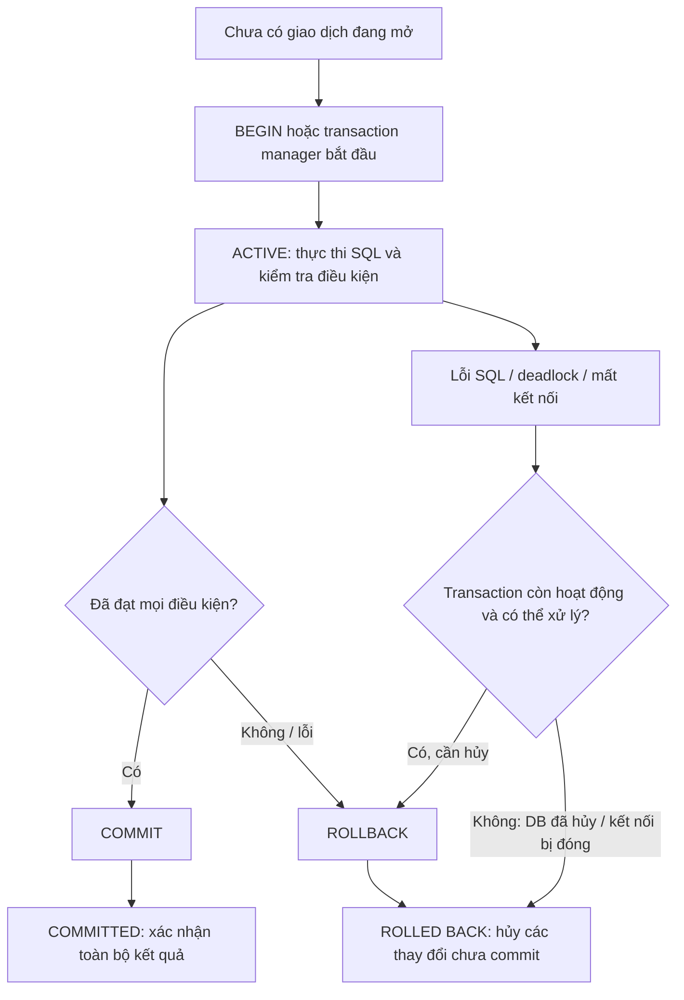

# Bắt đầu, thực thi, xác nhận và hủy giao dịch

Trong hệ quản trị cơ sở dữ liệu, **giao dịch (transaction)** là ranh giới gom các thao tác liên quan thành một đơn vị công việc. Vòng đời giao dịch mô tả điều gì diễn ra từ khi ứng dụng bắt đầu đơn vị công việc, gửi các câu lệnh SQL, cho đến khi cơ sở dữ liệu **xác nhận** (`COMMIT`) hoặc **hủy** (`ROLLBACK`) kết quả.

Hiểu rõ vòng đời giúp lập trình viên trả lời những câu hỏi rất thực tế:

- Khi nào dữ liệu chỉ mới được thay đổi *trong giao dịch*, và khi nào thay đổi đã chính thức được xác nhận?
- Nếu câu lệnh thứ hai thất bại sau khi câu thứ nhất chạy thành công, nên làm gì?
- Một lỗi ứng dụng, mất kết nối hoặc deadlock ảnh hưởng đến giao dịch đang mở thế nào?
- Transaction trong SQL tương ứng ra sao với `Connection`, JDBC và `@Transactional` của Spring?
- Khi mất phản hồi ở thời điểm commit, ứng dụng có thể khẳng định giao dịch thành công hay thất bại không?

## 1. Bức tranh tổng thể về vòng đời

Một vòng đời phổ biến có bốn giai đoạn:

1. **Bắt đầu:** thiết lập ranh giới transaction và tài nguyên phục vụ giao dịch.
2. **Thực thi:** chạy các câu lệnh đọc/ghi, kiểm tra điều kiện và nhận kết quả trung gian.
3. **Xác nhận:** phát lệnh `COMMIT` khi tất cả điều kiện bắt buộc đều đạt.
4. **Hủy:** phát lệnh `ROLLBACK` nếu có lỗi hoặc quyết định không áp dụng các thay đổi.

Giai đoạn 3 và 4 là hai **kết cục thay thế nhau** của một transaction, không phải hai bước luôn chạy nối tiếp.



**Ý nghĩa của kết cục:**

| Kết cục | Các thay đổi trong transaction | Ứng dụng nên hiểu |
|---|---|---|
| `COMMIT` thành công | Được xác nhận như một đơn vị | Nghiệp vụ đã hoàn tất bước ghi DB |
| `ROLLBACK` thành công | Những thay đổi chưa commit của transaction bị hủy | Có thể trả lỗi hoặc sửa đầu vào rồi thử lại |
| Transaction bị DB hủy do lỗi | Thay đổi chưa commit không trở thành kết quả đã xác nhận | Kiểm tra lý do để quyết định có retry |
| Mất phản hồi đúng lúc `COMMIT` | **Chưa xác định được từ phía client** | Cần đối soát; không tự kết luận rollback |

Trạng thái **“chưa rõ kết quả”** là tình huống của *client khi quan sát*, không có nghĩa cơ sở dữ liệu cố ý commit một nửa transaction.

## 2. Bắt đầu giao dịch: xác định ranh giới

### 2.1. Bắt đầu trực tiếp trong SQL

Cú pháp thường gặp:

```sql
-- PostgreSQL hoặc các DBMS có hỗ trợ:
BEGIN;
-- hoặc START TRANSACTION;

-- Thực hiện SQL tại đây.

COMMIT;
-- Hoặc ROLLBACK;
```

Với PostgreSQL, `BEGIN` đánh dấu bắt đầu transaction rõ ràng. Với MySQL/InnoDB, `START TRANSACTION` là cách bắt đầu tường minh phổ biến. Các DBMS có thể khác nhau về tên lệnh, mức cô lập mặc định, cách bắt đầu transaction ngầm và các câu lệnh gây commit ngầm.

Về mặt thực thi, hệ quản trị không nhất thiết phải cấp toàn bộ khóa hoặc ghi mọi cấu trúc transaction ngay tại thời điểm chạy `BEGIN`. Một số tài nguyên chỉ được cấp khi câu SQL cần đến.

### 2.2. Autocommit thay đổi cách hiểu “mỗi câu SQL”

Nhiều công cụ SQL và kết nối JDBC hoạt động với **autocommit bật** theo mặc định. Khi đó, ngoài một transaction tường minh, mỗi câu lệnh riêng thường được xử lý trong transaction của chính nó và được commit khi lệnh hoàn tất thành công.

Ví dụ nghiệp vụ hai bước:

```sql
-- Với autocommit bật và không có BEGIN:
UPDATE accounts SET balance = balance - 100 WHERE id = 1;
UPDATE accounts SET balance = balance + 100 WHERE id = 2;
```

Nếu câu thứ nhất đã commit và câu thứ hai thất bại, `ROLLBACK` ở thời điểm sau **không thể hoàn tác transaction trước đó**. Để hai câu lệnh cùng được quyết định, phải đặt chúng trong một ranh giới transaction:

```sql
BEGIN;

UPDATE accounts SET balance = balance - 100 WHERE id = 1;
UPDATE accounts SET balance = balance + 100 WHERE id = 2;

COMMIT;
```

Trong thực tế, ứng dụng còn phải kiểm tra đủ tiền và bảo đảm cả hai câu `UPDATE` tác động đúng số hàng kỳ vọng trước khi commit. Transaction bảo đảm tính nguyên tử cho những thay đổi nằm trong nó, nhưng không tự phát hiện mọi lỗi nghiệp vụ.

### 2.3. Transaction gắn với connection và transaction manager

Trong mô hình JDBC thông thường, các câu SQL thuộc cùng một transaction được thực thi trên **cùng một kết nối cơ sở dữ liệu**. Nếu mở hai connection độc lập, transaction trên connection thứ nhất không tự bao gồm thao tác của connection thứ hai.

Với Spring, transaction manager phụ trách quản lý ranh giới và gắn tài nguyên phù hợp với ngữ cảnh thực thi. Phương thức ứng dụng có thể không gửi `BEGIN` bằng tay, nhưng vẫn phải bảo đảm các thao tác dữ liệu cùng tham gia transaction mà Spring quản lý.

## 3. Thực thi: điều gì xảy ra khi transaction đang mở?

Sau khi bắt đầu, transaction có thể:

- đọc dữ liệu để kiểm tra tình trạng hiện tại;
- ghi dữ liệu qua `INSERT`, `UPDATE`, `DELETE`;
- cập nhật nhiều bảng;
- kiểm tra số hàng bị tác động, ràng buộc và điều kiện nghiệp vụ;
- chờ khóa, gặp xung đột hoặc bị hủy vì deadlock;
- tạo `SAVEPOINT` để có lựa chọn quay về một mốc trong transaction.

Các lệnh viết dữ liệu có thể đã được cơ sở dữ liệu thực hiện ở thời điểm này, nhưng **chưa đồng nghĩa với commit**.

### 3.1. Dữ liệu “đã thay đổi” và “đã commit” là hai khái niệm khác nhau

Giả sử transaction T1 chạy:

```sql
BEGIN;
UPDATE accounts SET balance = balance - 100 WHERE id = 1;
SELECT balance FROM accounts WHERE id = 1;
-- Trong chính T1, thường thấy số dư đã bị trừ 100.
```

T1 có thể đọc lại thay đổi của chính mình. Nhưng việc transaction T2 đọc được gì phụ thuộc vào **mức cô lập (isolation level)** và cơ chế đồng thời của hệ quản trị, không chỉ phụ thuộc vào lệnh `UPDATE` của T1.

Ở PostgreSQL với `READ COMMITTED`, T2 không đọc thấy phiên bản chưa commit của T1; nếu T2 muốn cập nhật cùng hàng, nó có thể phải đợi khóa. Khi T1 commit, thay đổi được công bố theo các quy tắc visibility của hệ quản trị và mức cô lập tương ứng.

### 3.2. Trong giai đoạn thực thi, phải kiểm tra kết quả nghiệp vụ

Câu SQL thành công về cú pháp **không đảm bảo đã xử lý đúng thực thể**. Ví dụ:

```sql
UPDATE accounts SET balance = balance + 100 WHERE id = 99999;
-- Nếu tài khoản 99999 không tồn tại: 0 hàng được cập nhật.
-- Đây thường không phải lỗi SQL.
```

Nếu nghiệp vụ yêu cầu đúng một tài khoản đích, số hàng cập nhật bằng 0 là lý do **hủy giao dịch**. Điều kiện “mọi câu SQL không ném lỗi” là quá yếu để ra quyết định commit.

### 3.3. Giữ transaction mở có chi phí

Transaction dài có thể giữ khóa lâu, làm chậm các transaction khác, kéo dài thời gian giữ connection và tăng áp lực lên cơ chế quản lý phiên bản dữ liệu. Vì vậy, những phép tính, yêu cầu HTTP hoặc chờ người dùng không cần ở trong transaction nên được tổ chức ngoài ranh giới ghi DB khi phù hợp.

## 4. Ví dụ xuyên suốt: chuyển tiền từ A sang B

Ví dụ sau dùng **PostgreSQL** và giả định các câu lệnh được thực hiện trên cùng một connection. Đơn vị số tiền chỉ là đơn vị minh họa, không dùng số thực nhị phân để lưu tiền.

### 4.1. Dữ liệu ban đầu

```sql
CREATE TABLE accounts (
    id BIGINT PRIMARY KEY,
    owner_name VARCHAR(100) NOT NULL,
    balance NUMERIC(18, 2) NOT NULL CHECK (balance >= 0)
);

INSERT INTO accounts (id, owner_name, balance)
VALUES (1, 'A', 1000.00),
       (2, 'B', 400.00);
```

Nghiệp vụ yêu cầu chuyển 250 từ A sang B. Kết quả hợp lệ sau commit là A = 750 và B = 650.

### 4.2. Bắt đầu rồi thực thi hai thao tác

```sql
BEGIN;

-- Bước 1: Trừ từ A nếu số dư đủ.
UPDATE accounts
SET balance = balance - 250.00
WHERE id = 1 AND balance >= 250.00
RETURNING id, balance;
-- Phải có đúng một hàng trả về; nếu không, ROLLBACK.

-- Bước 2: Cộng vào B.
UPDATE accounts
SET balance = balance + 250.00
WHERE id = 2
RETURNING id, balance;
-- Cũng phải có đúng một hàng trả về; nếu không, ROLLBACK.
```

`RETURNING` là cú pháp của PostgreSQL dùng để trả về các hàng đã thay đổi. Trong ứng dụng, logic kiểm tra số hàng phải được thực hiện **trước** khi gọi commit; các chú thích ở trên mô tả nhánh quyết định, không phải câu lệnh kiểm soát luồng có thể thực thi tự động trong file SQL.

### 4.3. Nhánh thành công: COMMIT

Khi mọi bước và kiểm tra đều hợp lệ:

```sql
COMMIT;

SELECT id, balance
FROM accounts
ORDER BY id;
-- 1 | 750.00
-- 2 | 650.00
```

Sau `COMMIT` thành công, transaction kết thúc. Mọi thay đổi của nó được xác nhận chung. Nếu ứng dụng cần làm một nghiệp vụ ghi DB khác, nó bắt đầu hoặc tham gia một transaction mới theo cấu hình connection/framework.

### 4.4. Nhánh thất bại: ROLLBACK

Giả sử tài khoản đích không tồn tại. Trong một lần chạy độc lập từ dữ liệu ban đầu:

```sql
BEGIN;

UPDATE accounts
SET balance = balance - 250.00
WHERE id = 1 AND balance >= 250.00;
-- Cập nhật 1 hàng.

UPDATE accounts
SET balance = balance + 250.00
WHERE id = 999;
-- Cập nhật 0 hàng: không tìm thấy tài khoản đích.

ROLLBACK;

SELECT id, balance
FROM accounts
ORDER BY id;
-- 1 | 1000.00
-- 2 | 400.00
```

Câu lệnh trừ A đã chạy trong transaction, nhưng chưa được commit. `ROLLBACK` hủy thay đổi đó, đưa dữ liệu quay về trạng thái trước transaction (đối với những thay đổi mà transaction đã thực hiện).

**Tóm tắt luồng bằng bảng trạng thái:**

| Mốc | Trạng thái transaction | Dữ liệu A/B nhìn từ chính transaction |
|---|---|---|
| Trước `BEGIN` | Chưa mở | 1000 / 400 |
| Sau `BEGIN` | Active | 1000 / 400 |
| Sau cập nhật A | Active, chưa commit | 750 / 400 |
| Sau cập nhật B hợp lệ | Active, chưa commit | 750 / 650 |
| Sau `COMMIT` | Đã commit | 750 / 650 được xác nhận |
| Nếu `ROLLBACK` thay cho commit | Đã rollback | 1000 / 400 |

Các hàng “sau cập nhật” là ảnh chụp minh họa trong trường hợp thực thi thành công; chúng không mô tả điều mọi transaction khác đều có thể đọc thấy.

## 5. Khi nào hệ quản trị hoặc ứng dụng buộc phải hủy?

Có hai nhóm nguyên nhân quan trọng.

### 5.1. Lỗi nghiệp vụ do ứng dụng phát hiện

Ví dụ: số dư không đủ, tài khoản đích không tồn tại, hạn mức chuyển tiền bị vượt, hoặc chỉ cập nhật được một trong hai bản ghi bắt buộc. Những lỗi này có thể không tạo lỗi SQL. Ứng dụng phải dừng, ra quyết định hủy và gọi `ROLLBACK`.

Một cách triển khai nguy hiểm là ghi nhận lỗi bằng log rồi vẫn cho hàm trả về thành công. Nếu transaction manager thấy kết thúc bình thường, nó có thể commit những thao tác đã thực hiện.

### 5.2. Lỗi kỹ thuật do DBMS báo về

Có thể là vi phạm ràng buộc `CHECK`/`UNIQUE`/`FOREIGN KEY`, deadlock, xung đột serialization, timeout hoặc mất connection.

Không nên đồng nhất “một SQL bị lỗi” với “toàn bộ transaction chắc chắn đã rollback” trên mọi DBMS:

- **PostgreSQL:** sau một lỗi SQL trong transaction thông thường, transaction thường ở trạng thái *aborted*. Các câu SQL tiếp theo bị từ chối cho đến khi `ROLLBACK`, trừ khi lỗi được xử lý trong phạm vi savepoint phù hợp. Nếu transaction đã aborted, không thể dùng các bước tiếp theo để commit phần thay đổi trước đó.
- **MySQL/InnoDB:** một số lỗi chỉ rollback **câu lệnh** gây lỗi và transaction vẫn còn mở; một số lỗi như deadlock có thể khiến transaction bị rollback. Ứng dụng phải đánh giá mã lỗi và chủ động rollback khi toàn bộ nghiệp vụ thất bại.
- **Mất connection:** ứng dụng có thể không gửi được `ROLLBACK` nữa. Server thường dọn dẹp hoặc phục hồi transaction chưa commit, nhưng tại thời điểm mất phản hồi commit, client cần đối soát kết quả.

Quy tắc an toàn về mặt thiết kế: khi không thể hoàn tất một giao dịch đúng điều kiện, **đừng cố commit phần còn lại**. Kết thúc transaction theo đúng hành vi DBMS rồi cân nhắc thử lại cả nghiệp vụ nếu thích hợp.

## 6. Các trạng thái thường gặp và ý nghĩa

Tên trạng thái bên dưới là **mô hình khái niệm dành cho người phát triển**. Không phải DBMS nào cũng có chính xác các trạng thái nội bộ hoặc API lấy trạng thái tương ứng.

| Trạng thái | Diễn giải | Hành động tiếp theo |
|---|---|---|
| **Idle / Not started** | Không có transaction nghiệp vụ đang mở | Bắt đầu transaction khi cần |
| **Active** | Đang thực thi SQL, giữ những thay đổi chưa commit | Tiếp tục, commit hoặc rollback |
| **Failed / Rollback-only / Aborted** | Giao dịch không còn đủ điều kiện hoặc không còn được phép commit | Rollback, hoặc xử lý savepoint nếu DBMS cho phép |
| **Committed** | DBMS xác nhận transaction | Kết thúc; xử lý bước tiếp theo ngoài transaction |
| **Rolled back** | Thay đổi chưa commit đã được hủy | Kết thúc; trả lỗi hoặc retry có kiểm soát |
| **Outcome unknown to client** | Client mất phản hồi khi commit | Tra cứu trạng thái thực, dùng idempotency/đối soát |

Cần phân biệt **trạng thái DB** với **trạng thái của framework**. Ví dụ, Spring có thể đánh dấu một giao dịch là *rollback-only* khi một tầng xử lý gặp lỗi; ở cuối phạm vi transaction, Spring sẽ rollback thay vì commit, kể cả khi tầng bên ngoài đã bắt exception.

## 7. SAVEPOINT: quay về một mốc khi transaction vẫn đang mở

Ngoài rollback toàn bộ, một số DBMS cho phép tạo **savepoint** để khôi phục *một phần* thao tác và tiếp tục phần còn lại.

```sql
BEGIN;

UPDATE accounts SET balance = balance + 100 WHERE id = 1;

SAVEPOINT optional_bonus;
UPDATE accounts SET balance = balance + 20 WHERE id = 2;

-- Nhận ra phần thưởng cho B không hợp lệ:
ROLLBACK TO SAVEPOINT optional_bonus;

-- Vẫn xác nhận phần tăng 100 cho A:
COMMIT;
```

Kết quả cuối cùng là A tăng 100, B không thay đổi. Đây là ví dụ nghiệp vụ có **bước tùy chọn**. Nếu hai bước bắt buộc phải đi cùng nhau, rollback về savepoint rồi commit phần đầu sẽ làm sai yêu cầu nghiệp vụ; khi đó cần `ROLLBACK` toàn bộ.

Một số DBMS cho phép `RELEASE SAVEPOINT` để bỏ mốc đánh dấu. Việc release savepoint **không đồng nghĩa commit** transaction. Các tính năng transaction lồng nhau của framework cũng không nhất thiết tương ứng với hai commit độc lập; cần xem kiểu propagation cụ thể.

## 8. Vòng đời trong JDBC thuần

JDBC quản lý giao dịch thông qua `java.sql.Connection`. Khi tắt autocommit, các lệnh trên cùng connection có thể được xác nhận bằng `commit()` hoặc hủy bằng `rollback()`.

Dưới đây là ví dụ đầy đủ cho trường hợp chuyển tiền bằng `DataSource`:

```java
import java.math.BigDecimal;
import java.sql.Connection;
import java.sql.PreparedStatement;
import java.sql.SQLException;
import javax.sql.DataSource;

public final class TransferRepository {
    private final DataSource dataSource;

    public TransferRepository(DataSource dataSource) {
        this.dataSource = dataSource;
    }

    public void transfer(long fromId, long toId, BigDecimal amount)
            throws SQLException {
        if (fromId == toId || amount == null || amount.signum() <= 0) {
            throw new IllegalArgumentException("Thông tin chuyển tiền không hợp lệ");
        }

        try (Connection con = dataSource.getConnection()) {
            con.setAutoCommit(false); // Bắt đầu quản lý transaction tường minh.
            try {
                int debited = update(
                    con,
                    "UPDATE accounts SET balance = balance - ? " +
                    "WHERE id = ? AND balance >= ?",
                    amount, fromId, amount
                );
                if (debited != 1) {
                    throw new SQLException("Không đủ tiền hoặc thiếu tài khoản nguồn");
                }

                int credited = update(
                    con,
                    "UPDATE accounts SET balance = balance + ? WHERE id = ?",
                    amount, toId
                );
                if (credited != 1) {
                    throw new SQLException("Không tìm thấy tài khoản đích");
                }

                con.commit(); // Chỉ xác nhận sau khi mọi điều kiện đạt.
            } catch (SQLException | RuntimeException ex) {
                try {
                    con.rollback();
                } catch (SQLException rollbackFailure) {
                    ex.addSuppressed(rollbackFailure);
                }
                throw ex;
            }
        } // Connection được đóng/trả về pool theo DataSource.
    }

    private static int update(
            Connection con, String sql, Object... params) throws SQLException {
        try (PreparedStatement ps = con.prepareStatement(sql)) {
            for (int i = 0; i < params.length; i++) {
                ps.setObject(i + 1, params[i]);
            }
            return ps.executeUpdate();
        }
    }
}
```

**Dòng thời gian trong JDBC:**

1. `getConnection()` lấy kết nối từ `DataSource`.
2. `setAutoCommit(false)` chuyển sang chế độ quản lý commit tường minh.
3. `executeUpdate()` thực thi từng câu SQL trên **cùng connection**.
4. Số hàng bị ảnh hưởng quyết định giao dịch có hợp lệ hay không.
5. Thành công thì gọi `commit()`; phát hiện lỗi thì gọi `rollback()`.
6. `close()` giải phóng connection (hoặc trả về connection pool).

Ở hệ thống dùng pool, trạng thái autocommit và transaction phải được làm sạch khi connection được trả về pool. Ví dụ cho thấy ranh giới giao dịch, nhưng cấu hình pool và hợp đồng quản lý connection thực tế cần bảo đảm phiên làm việc tiếp theo không kế thừa một transaction dang dở. Khi dùng Spring transaction management, nên để framework quản lý phần này.

## 9. Vòng đời khi sử dụng Spring @Transactional

Với Spring, lập trình viên thường khai báo transaction ở tầng service. Transaction manager sẽ kiểm soát bắt đầu/tham gia transaction, commit và rollback dựa vào kết quả thực thi phương thức.

```java
import java.math.BigDecimal;
import org.springframework.jdbc.core.JdbcTemplate;
import org.springframework.stereotype.Service;
import org.springframework.transaction.annotation.Transactional;

@Service
public class TransferService {
    private final JdbcTemplate jdbc;

    public TransferService(JdbcTemplate jdbc) {
        this.jdbc = jdbc;
    }

    @Transactional
    public void transfer(long fromId, long toId, BigDecimal amount) {
        if (fromId == toId || amount == null || amount.signum() <= 0) {
            throw new IllegalArgumentException("Thông tin chuyển tiền không hợp lệ");
        }

        int debited = jdbc.update(
            "UPDATE accounts SET balance = balance - ? " +
            "WHERE id = ? AND balance >= ?",
            amount, fromId, amount
        );
        if (debited != 1) {
            throw new IllegalStateException("Không đủ tiền hoặc không có nguồn");
        }

        int credited = jdbc.update(
            "UPDATE accounts SET balance = balance + ? WHERE id = ?",
            amount, toId
        );
        if (credited != 1) {
            throw new IllegalStateException("Không tồn tại tài khoản đích");
        }
        // Hoàn tất bình thường: transaction manager sẽ commit.
    }
}
```

Ở cấu hình thông thường, nếu lời gọi đi qua Spring proxy và chưa có transaction, Spring bắt đầu transaction; khi phương thức kết thúc bình thường, manager cố gắng commit. Nếu một `RuntimeException` không được xử lý thoát khỏi phương thức, Spring mặc định rollback.

Những chi tiết dễ bị bỏ sót:

- **Checked exception:** mặc định Spring rollback cho `RuntimeException` và `Error`; với checked exception có thể chỉ định `@Transactional(rollbackFor = Exception.class)` khi phù hợp.
- **Exception bị bắt và bỏ qua:** nếu trả về bình thường sau một lỗi nghiệp vụ, transaction có thể commit. Cần ném lại lỗi, yêu cầu rollback hoặc tổ chức phản hồi lỗi thích hợp.
- **Gọi nội bộ (self-invocation):** trong chế độ proxy mặc định, `this.transfer(...)` từ một phương thức khác cùng đối tượng thường không kích hoạt proxy giao dịch.
- **Tham gia transaction bên ngoài:** với propagation mặc định `REQUIRED`, nếu đã có transaction, phương thức có thể **tham gia transaction hiện tại**. Khi phương thức con trả về, transaction tổng thể chưa nhất thiết commit; transaction ngoài mới quyết định lúc kết thúc.
- **Rollback-only:** một tầng bên trong có thể đánh dấu transaction chung chỉ được rollback. Khi tầng ngoài cố commit, Spring có thể ném `UnexpectedRollbackException` thay vì âm thầm giả thành công.
- **Khác nguồn dữ liệu:** `@Transactional` không tự đưa HTTP, message broker hay nhiều database độc lập vào một commit chung.

Như vậy, thời điểm **phương thức Java kết thúc** và thời điểm **transaction thực sự commit** đôi khi khác nhau, đặc biệt khi có lời gọi lồng nhau.

## 10. Vòng đời khi có nhiều transaction đồng thời

Trong môi trường đồng thời, việc một transaction đang ở pha thực thi ảnh hưởng đến khả năng truy cập của transaction khác.

Ví dụ hai phiên:

| Thời điểm | Transaction T1 | Transaction T2 |
|---|---|---|
| t1 | `BEGIN` | `BEGIN` |
| t2 | `UPDATE accounts ... WHERE id = 1` | Chưa cập nhật |
| t3 | Chưa commit, có thể giữ khóa hàng | Muốn `UPDATE` cùng hàng; có thể phải chờ |
| t4 | `COMMIT` hoặc `ROLLBACK` | Tiếp tục theo kết quả và quy tắc DBMS |
| t5 | Đã kết thúc | Xử lý/kiểm tra và quyết định commit hoặc rollback |

Các mức cô lập như `READ COMMITTED`, `REPEATABLE READ`, `SERIALIZABLE` quy định dữ liệu được phép nhìn thấy và các hành vi xung đột khác nhau. Có hệ quản trị triển khai bằng khóa, MVCC hoặc kết hợp. Vòng đời transaction luôn có điểm kết thúc commit/rollback, nhưng **lịch thực thi giữa nhiều transaction** không nhất thiết tuần tự.

### Deadlock và retry

T1 khóa tài khoản A rồi chờ B, trong khi T2 đã khóa B rồi chờ A, có thể gây deadlock. DBMS có cơ chế chọn một transaction làm *nạn nhân* để hủy hoặc báo lỗi. Khi thử lại, ứng dụng thường phải **chạy lại toàn bộ transaction từ đầu**, chứ không chỉ chạy câu SQL vừa bị lỗi.

Để giảm deadlock trong thao tác nhiều bản ghi, có thể thống nhất thứ tự truy cập/khóa, ví dụ luôn thao tác theo ID tăng dần. Cách này làm giảm một lớp xung đột nhưng không loại bỏ mọi nguồn deadlock.

## 11. COMMIT thành công, COMMIT thất bại và trường hợp không rõ kết quả

### 11.1. Commit không chỉ là “gửi câu lệnh”

Một lời gọi `COMMIT` có thể cần các bước kiểm tra cuối cùng, ghi thông tin phục hồi, phối hợp với cơ chế storage và giải phóng tài nguyên transaction. Cơ chế cụ thể khác nhau theo DBMS và mức bền vững cấu hình.

Nếu database trả về kết quả **commit thành công**, ứng dụng có cơ sở coi transaction đã được xác nhận. Thuộc tính **Durability** bổ sung yêu cầu kết quả đã commit được duy trì qua sự cố trong các điều kiện bảo đảm của hệ thống.

### 11.2. Commit có thể báo lỗi

Ví dụ, ràng buộc kiểm tra hoãn tới commit hoặc xung đột ở mức `SERIALIZABLE` có thể khiến DBMS từ chối commit. Sau lỗi, phải tuân theo trạng thái do DBMS báo và quy tắc driver/framework; thường cần retry toàn bộ nghiệp vụ nếu lỗi có thể khắc phục.

### 11.3. Mất phản hồi tại thời điểm commit

Xét luồng:

1. Client gửi `COMMIT`.
2. DBMS xử lý và có thể đã xác nhận giao dịch.
3. Kết nối mạng đứt trước khi client nhận phản hồi.

Client chỉ biết **không nhận được kết quả**, không thể mặc định coi transaction đã rollback. Nếu tự gửi lại cùng một giao dịch chuyển tiền, có nguy cơ chuyển tiền hai lần.

Giải pháp thường dùng là đặt **mã yêu cầu nghiệp vụ duy nhất** và lưu mã đó trong cùng transaction với thay đổi chính, rồi kiểm tra mã để biết yêu cầu đã xử lý chưa. Kết hợp ràng buộc `UNIQUE` và thiết kế idempotent có thể ngăn ghi trùng khi retry. Cần phân biệt “retry được phép” với “retry tạo nghiệp vụ mới”.

## 12. Những ranh giới không thuộc cùng transaction

### 12.1. DDL và implicit commit

Không phải mọi lệnh SQL đều có thể rollback theo cùng cách. Chẳng hạn, nhiều thao tác DDL trên MySQL tạo commit ngầm, kể cả khi đang có transaction. PostgreSQL cho phép thực hiện nhiều loại DDL trong transaction nhưng có ngoại lệ. Trước khi thiết kế quy trình migration/DDL, cần tra cứu đúng DBMS và loại câu lệnh được dùng.

### 12.2. Transaction trong DB không tự kiểm soát email hay REST API

Ví dụ sai kỳ vọng:

```text
BEGIN DB transaction
  UPDATE orders SET status = 'PAID' WHERE id = 123
  Gọi API thanh toán hoặc gửi email
ROLLBACK DB transaction
```

Rollback DB không thể thu hồi email đã gửi hoặc yêu cầu thanh toán đã được hệ thống khác chấp nhận. Trong bài toán nhiều hệ thống, có thể dùng **transactional outbox**, **idempotency** hoặc **saga với hành động bù**. Các cơ chế đó có ranh giới và tính chất riêng, không phải một SQL transaction đơn lẻ bao trùm mọi dịch vụ.

### 12.3. Lệnh gọi bất đồng bộ và luồng khác

Transaction thường gắn với connection hoặc ngữ cảnh do framework quản lý. Công việc chạy trên một thread khác, tác vụ bất đồng bộ hay connection mới không mặc nhiên tham gia cùng transaction. Việc xác nhận một tác vụ tương lai cần được thiết kế rõ về ranh giới và độ nhất quán.

## 13. Những sai lầm thường làm vòng đời giao dịch bị lệch

| Sai lầm | Hệ quả thường gặp | Cách xử lý |
|---|---|---|
| Quên tắt autocommit khi muốn nhiều câu SQL là một đơn vị | Mỗi câu có thể commit riêng | Dùng transaction rõ ràng hoặc transaction manager |
| Kiểm tra SQL không lỗi mà bỏ qua “0 rows affected” | Commit kết quả thiếu thao tác | Kiểm tra kết quả từng bước bắt buộc |
| Bắt exception rồi trả thành công | Framework có thể commit phần thay đổi | Báo lỗi đúng hoặc đặt rollback-only theo quy định |
| Gọi `@Transactional` bằng `this.method()` qua self-invocation | Annotation có thể không được áp dụng | Tổ chức lời gọi qua proxy hoặc sử dụng quản lý transaction phù hợp |
| Giữ transaction mở trong khi gọi API chậm | Khóa/connection bị giữ lâu, tăng tranh chấp | Thu gọn phần thao tác DB trong transaction |
| Retry sau mất phản hồi commit mà không đối soát | Có thể thực hiện trùng nghiệp vụ | Mã yêu cầu duy nhất, truy vấn trạng thái, idempotency |
| Cho rằng `ROLLBACK TO SAVEPOINT` đã hủy mọi thay đổi | Phần trước savepoint vẫn có thể commit | Chọn rollback toàn bộ khi nghiệp vụ yêu cầu |
| Cho rằng transaction bao phủ nhiều hệ thống chỉ bằng annotation | Có các thay đổi bên ngoài không thể hoàn tác | Thiết kế outbox, phối hợp hoặc bù trừ |

## 14. Bài tập phân tích dòng thời gian

### Tình huống A: lỗi giữa hai câu ghi

Tài khoản A = 500, B = 200. Ứng dụng bắt đầu transaction, trừ A 80 thành công; khi cộng B thì điều kiện tài khoản đích không thỏa.

**Hỏi:** Vòng đời nên kết thúc ở nhánh nào?

**Giải thích:** Ứng dụng phải nhận biết việc cập nhật B không thành công về mặt nghiệp vụ, phát `ROLLBACK` và báo thất bại. A trở về 500. Nếu vẫn commit, DB sẽ xác nhận những thao tác đã thực hiện dù nghiệp vụ thiếu bước bắt buộc.

### Tình huống B: phương thức Spring con trả về bình thường

Phương thức `outer()` có `@Transactional` gọi `inner()` cũng khai báo `@Transactional` với propagation mặc định `REQUIRED`, qua proxy phù hợp. `inner()` chạy xong và trả về, nhưng `outer()` sau đó ném lỗi unchecked.

**Hỏi:** Dữ liệu do `inner()` ghi có chắc đã commit lúc `inner()` trả về không?

**Giải thích:** Không. Theo `REQUIRED`, `inner()` có thể tham gia transaction của `outer()`. Khi `outer()` gây rollback, các thay đổi chung cũng bị hủy. Ranh giới transaction thực tế do transaction ngoài quản lý.

### Tình huống C: mất kết nối sau khi gửi COMMIT

Client gửi giao dịch chuyển tiền với mã yêu cầu `TX-1001` rồi mất mạng ngay sau lệnh commit.

**Hỏi:** Có nên gửi ngay giao dịch giống hệt với một mã mới?

**Giải thích:** Không nên. Client chưa biết kết quả commit. Cần đối soát theo mã `TX-1001` hoặc sử dụng quy trình retry idempotent để không tạo lần chuyển tiền thứ hai.

### Tình huống D: rollback về savepoint

Transaction ghi thay đổi A, tạo savepoint, ghi thay đổi B, rollback về savepoint rồi commit.

**Hỏi:** Thay đổi nào được xác nhận?

**Giải thích:** Thay đổi A trước savepoint vẫn có thể được commit; thay đổi B sau savepoint bị hủy. Nếu A và B phải thành công đồng thời, cần rollback toàn transaction.

## 15. Nguyên tắc áp dụng vào thiết kế thực tế

Khi xây dựng chức năng cần transaction, hãy xác định trước:

1. **Điểm bắt đầu:** thành phần nào tạo transaction, nó dùng connection/transaction manager nào, có đang tham gia transaction ngoài không?
2. **Tập thao tác bắt buộc:** bản ghi nào phải thay đổi cùng nhau, điều kiện nghiệp vụ nào phải được kiểm tra và số hàng dự kiến là bao nhiêu?
3. **Điểm commit:** chỉ xác nhận khi tất cả thao tác và điều kiện bắt buộc đã hợp lệ.
4. **Điểm rollback:** lỗi nào phải hủy, lỗi nào có thể xử lý trong savepoint, DBMS có những trạng thái transaction nào sau lỗi?
5. **Sau khi kết thúc:** giải phóng tài nguyên, xử lý retry/deadlock và trường hợp kết quả commit không rõ.
6. **Ranh giới ngoài DB:** API, message, hệ thống khác có cần outbox/idempotency hoặc quy trình bù không?

Vòng đời giao dịch là **một quyết định nhất quán từ lúc bắt đầu đến khi kết thúc**: mọi thay đổi liên quan được thực thi trong ranh giới chung; khi toàn bộ điều kiện đạt, chúng được xác nhận bằng `COMMIT`; khi không đạt, chúng được hủy bằng `ROLLBACK`. Hiểu rõ các giai đoạn này là nền tảng để xử lý đúng lỗi, đồng thời và phục hồi trong ứng dụng sử dụng cơ sở dữ liệu.
