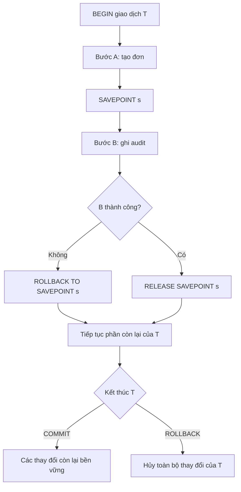
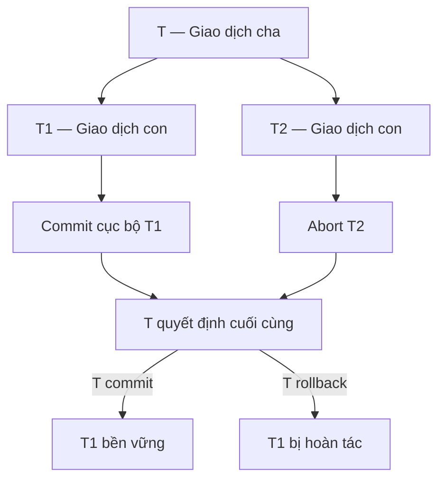

# Phân biệt SAVEPOINT với giao dịch lồng nhau thực sự

Khi xử lý một nghiệp vụ gồm nhiều bước, đôi khi ta muốn **giữ kết quả của bước chính dù bước phụ thất bại**. Ý tưởng đầu tiên thường là tạo một điểm khôi phục bằng `SAVEPOINT` hoặc viết một hàm con có gắn `@Transactional`. Tuy nhiên, tên gọi “giao dịch lồng nhau” (nested transaction) rất dễ dẫn đến một giả định sai: **giao dịch con có thể tự `COMMIT` độc lập, còn giao dịch cha vẫn có thể `ROLLBACK`**.

Thực tế cần phân biệt ba cơ chế:

1. **`SAVEPOINT`**: một mốc để rollback một phần công việc **bên trong cùng một giao dịch**.
2. **Giao dịch lồng nhau thực sự theo mô hình lý thuyết** (*true/closed nested transaction*): giao dịch cha sở hữu các giao dịch con có vòng đời và phạm vi thao tác riêng; con có thể “commit” cục bộ, nhưng kết quả đó thường **chỉ trở nên bền vững khi cha commit**.
3. **Giao dịch độc lập chạy trong lời gọi lồng nhau**, ví dụ Spring `REQUIRES_NEW`: tạm dừng giao dịch đang chạy, mở **giao dịch vật lý thứ hai** rồi commit/rollback riêng. Nếu giao dịch thứ hai commit và giao dịch ngoài rollback thì kết quả thứ hai **vẫn còn**.

Đây là ba cách tổ chức công việc có các hệ quả khác nhau đối với vòng đời, tính nguyên tử, khả năng nhìn thấy dữ liệu và xử lý lỗi. Bài học dùng PostgreSQL cho phần SQL và Spring cho phần ví dụ ở tầng ứng dụng.

## 1. Bài toán dẫn nhập: bước chính thành công, bước phụ thất bại

Giả sử dịch vụ nhận đơn hàng phải:

- **A** — ghi đơn hàng vào bảng `orders` (bắt buộc);
- **B** — ghi một dòng nhật ký tùy chọn vào bảng `audit_entries` (nếu lỗi có thể bỏ qua);
- **C** — trả về kết quả tạo đơn thành công.

Câu hỏi cần trả lời là: khi B gặp lỗi, có thể hủy riêng B mà vẫn commit A không?

**Có**, nếu B chỉ làm việc với cơ sở dữ liệu và ta đặt một `SAVEPOINT` ngay trước B. Nhưng nếu yêu cầu là “ghi audit và commit bền vững bất kể đơn hàng sau đó có bị rollback hay không”, `SAVEPOINT` **không đáp ứng**. Một giao dịch độc lập có thể phục vụ chính sách ghi nhật ký đó, đổi lại ta chấp nhận trạng thái audit và order có thể không cùng commit.

Để chọn đúng, trước tiên phải biết “bước phụ được phép thất bại” nghĩa là **thất bại cục bộ nhưng vẫn phụ thuộc cha**, hay **hoạt động bền vững độc lập với cha**.

## 2. Ba trục khái niệm cần tách bạch

### 2.1 Một transaction không đồng nghĩa một phương thức trong code

`BEGIN` mở một giao dịch vật lý trên một kết nối đến DB; `COMMIT` và `ROLLBACK` kết thúc giao dịch đó. Một hàm Java gọi một hàm Java khác không tự động làm xuất hiện transaction mới. Cũng vậy, gọi hai phương thức đều có annotation `@Transactional` chưa chắc tạo hai giao dịch vật lý.

Phải phân biệt:

- **Phạm vi mã ứng dụng**: hàm nào gọi hàm nào, ngoại lệ được bắt ở đâu.
- **Phạm vi giao dịch vật lý**: thay đổi nào cùng tham gia một `COMMIT` hoặc `ROLLBACK` của DB.
- **Điểm rollback cục bộ**: trong giao dịch vật lý, có mốc nào cho phép quay lui một phần thay đổi hay không.

Một cuộc gọi có vẻ lồng nhau trong mã không đủ để suy ra hệ thống giao dịch cũng lồng nhau theo mô hình lý thuyết.

### 2.2 “Commit cục bộ” khác “commit bền vững”

Với mô hình **closed nested transaction**, giao dịch con báo hoàn thành công việc và chuyển kết quả/trách nhiệm lên cha. Kết quả đó vẫn bị hủy nếu cha cuối cùng rollback. Vì thế “con commit” không nên được hiểu là đã bền vững độc lập.

Với `REQUIRES_NEW`, việc commit giao dịch trong là commit **thực sự của giao dịch vật lý khác**. Cha không sở hữu commit đó và rollback của cha không thể tự động hoàn tác nó.

Với `RELEASE SAVEPOINT`, ta thậm chí chưa thực hiện một commit: chỉ bỏ mốc rollback và tiếp tục ở transaction ban đầu.

### 2.3 Hai nghĩa thường gặp của “nested”

Tài liệu, thư viện và lập trình viên đôi khi dùng cùng từ *nested* cho những thứ khác nhau:

- **Nested về cấu trúc**: một scope gọi nằm trong scope gọi khác.
- **Nested về mô hình transaction**: transaction con là thành phần thực sự trong cây giao dịch, có quan hệ phụ thuộc vào transaction cha.

Trong một số DBMS như PostgreSQL, `SAVEPOINT` được triển khai nội bộ thông qua **subtransaction**. Điều đó không làm SQL `SAVEPOINT` trở thành một transaction vật lý độc lập có thể commit vĩnh viễn trước cha. Khi đánh giá cơ chế, hãy ưu tiên **ngữ nghĩa quan sát được**, thay vì dựa vào tên class/annotation.

## 3. `SAVEPOINT` thực sự làm gì?

`SAVEPOINT` đánh dấu trạng thái bên trong **một giao dịch đang mở**. Sau mốc đó:

- `ROLLBACK TO SAVEPOINT name` hủy các thay đổi giao dịch thuộc phần công việc sau mốc, trong phạm vi các thao tác giao dịch có thể rollback.
- `RELEASE SAVEPOINT name` loại bỏ mốc đó và gộp phần công việc đã làm vào luồng tiếp tục của **chính transaction hiện tại**; nó **không commit** ra ngoài.
- `COMMIT` của giao dịch ngoài quyết định việc các thay đổi còn lại có bền vững hay không.
- `ROLLBACK` của giao dịch ngoài hủy cả thay đổi đã làm **trước và sau** savepoint, kể cả phần đã `RELEASE`.

### 3.1 Sơ đồ vòng đời



Trong sơ đồ này, rollback đến `s` cho phép **giữ lại A trong giao dịch đang mở**, nhưng A vẫn chưa bền vững cho đến khi T commit.

### 3.2 Thử nghiệm PostgreSQL: rollback một bước phụ, giữ bước chính

Chạy toàn bộ ví dụ trong **cơ sở dữ liệu thử nghiệm riêng**. Dùng các bảng mới để tránh ảnh hưởng dữ liệu thật:

```sql
CREATE TABLE lesson_orders (
    id integer PRIMARY KEY,
    description text NOT NULL
);

CREATE TABLE lesson_audit (
    id integer PRIMARY KEY,
    message text NOT NULL
);

BEGIN;

-- Công việc bắt buộc.
INSERT INTO lesson_orders(id, description)
VALUES (1001, 'Tạo đơn hàng');

-- Đánh dấu ngay trước việc tùy chọn.
SAVEPOINT optional_audit;

INSERT INTO lesson_audit(id, message)
VALUES (5001, 'Đã bắt đầu xử lý đơn 1001');

-- Giả lập điều kiện nghiệp vụ khiến phần audit cần bị hủy.
ROLLBACK TO SAVEPOINT optional_audit;

-- Không cần giữ lại mốc này sau khi đã quyết định.
RELEASE SAVEPOINT optional_audit;

COMMIT;

SELECT * FROM lesson_orders WHERE id = 1001;
-- Có đơn 1001.

SELECT * FROM lesson_audit WHERE id = 5001;
-- Không có dòng 5001.
```

Giải thích:

1. `INSERT lesson_orders` nằm trước savepoint nên còn tồn tại trong transaction sau khi `ROLLBACK TO`.
2. `INSERT lesson_audit` nằm sau savepoint nên bị hoàn tác.
3. `COMMIT` cuối cùng khiến đơn hàng 1001 bền vững.
4. `RELEASE` sau `ROLLBACK TO` chỉ bỏ mốc đang còn hiệu lực; nó không thay đổi kết quả giao dịch.

Ở PostgreSQL, sau `ROLLBACK TO SAVEPOINT`, savepoint được chỉ định **vẫn còn tồn tại** để có thể dùng tiếp hoặc release; những savepoint được tạo sau nó sẽ không còn hiệu lực.

### 3.3 `RELEASE SAVEPOINT` không thay thế `COMMIT`

Một minh họa độc lập:

```sql
BEGIN;

INSERT INTO lesson_orders(id, description)
VALUES (1002, 'Đơn hàng sẽ rollback');

SAVEPOINT s1;

INSERT INTO lesson_audit(id, message)
VALUES (5002, 'Audit cũng sẽ rollback');

RELEASE SAVEPOINT s1;

-- Quyết định hủy giao dịch ngoài:
ROLLBACK;

SELECT * FROM lesson_orders WHERE id = 1002;
SELECT * FROM lesson_audit WHERE id = 5002;
-- Cả hai đều không có dòng dữ liệu tương ứng.
```

Nhiều người tưởng `RELEASE s1` tương đương “commit giao dịch con”. Nếu chỉ nhìn cấu trúc chương trình, dễ có cách gọi như vậy; nhưng **trên SQL PostgreSQL, RELEASE không có hiệu lực commit độc lập**.

### 3.4 Khắc phục lỗi câu lệnh trong PostgreSQL

Với PostgreSQL, một lỗi SQL bên trong transaction thường khiến transaction chuyển sang trạng thái **aborted**; các câu SQL tiếp theo không thể tiếp tục bình thường cho đến khi rollback transaction hoặc rollback về savepoint phù hợp.

Ví dụ thử một lệnh vi phạm khóa chính:

```sql
BEGIN;

SAVEPOINT before_risky_insert;

-- id=1001 đã có từ ví dụ đầu.
INSERT INTO lesson_orders(id, description)
VALUES (1001, 'Đơn bị trùng khóa');
-- ERROR: duplicate key value violates unique constraint ...

-- Lúc này không thể cứ INSERT/SELECT tiếp như chưa có lỗi.
ROLLBACK TO SAVEPOINT before_risky_insert;

INSERT INTO lesson_audit(id, message)
VALUES (5003, 'Đã xử lý lỗi trùng khóa');

RELEASE SAVEPOINT before_risky_insert;
COMMIT;
```

Ví dụ trên dùng id trùng một cách có chủ ý. Trong ứng dụng, việc phân loại lỗi rất quan trọng: nếu là lỗi phá vỡ bất biến của bước **bắt buộc**, không nên tự động rollback cục bộ rồi giả vờ nghiệp vụ đã thành công. Savepoint giúp điều khiển phạm vi hoàn tác, **không biến lỗi thành thành công về nghiệp vụ**.

## 4. Giao dịch lồng nhau thực sự: một mô hình khác

Trong lý thuyết hệ giao dịch, **nested transaction** thường mô tả một **cây** có giao dịch cha và các giao dịch con. Mỗi giao dịch con có thể có trạng thái, khả năng abort và quan hệ commit với cha. Trong mô hình **closed nesting** truyền thống:

1. Cha T bắt đầu.
2. T mở giao dịch con T1 làm một phần công việc.
3. T1 hoàn tất và *commit cục bộ*; kết quả được tích hợp vào T.
4. T có thể tiếp tục với con T2, cho T2 thất bại và rollback cục bộ.
5. **Chỉ khi cha gốc commit**, kết quả hợp lệ của các con mới trở thành bền vững toàn cục.
6. Nếu T rollback, thành quả của cả T1 đã “commit cục bộ” cũng bị hủy.



Sơ đồ nhấn mạnh **phụ thuộc commit**: con không có quyền phủ quyết quyết định rollback cuối cùng của cha. Tùy hệ thống hiện thực nested transaction, các giao dịch con có thể có cơ chế quản lý trạng thái, lịch thực thi, khóa và phục hồi riêng; những đặc tính này phải được kiểm chứng qua tài liệu của hệ thống đó.

### 4.1 Điểm giống và khác quan trọng

Giống: `SAVEPOINT` có thể **mô phỏng một phần hành vi rollback cục bộ** của closed nested transaction: phần con thất bại có thể bị bỏ mà công việc trước đó của cha được giữ lại; rollback toàn bộ cha vẫn hủy tất cả.

Khác: một savepoint chỉ là **mốc bên trong một transaction SQL đang hoạt động**. Nó không tự cung cấp một transaction con độc lập với ranh giới commit, isolation, scheduling hay tài nguyên riêng. Mô hình nested transaction thật là một **cấu trúc giao dịch phân cấp**, không thể suy ra chỉ từ việc xuất hiện từ khóa `SAVEPOINT`.

### 4.2 “Open nested transaction” là một trường hợp khác

Một số mô hình **open nesting** cho phép giao dịch con công bố hoặc commit ảnh hưởng riêng sớm hơn cha. Khi cha thất bại, hệ thống có thể phải dùng **hành động bù (compensation)** hoặc quy tắc ngữ nghĩa ứng dụng để xử lý kết quả đã lộ ra.

Đây là mô hình chuyên biệt, không phải ngữ nghĩa mặc định của `SAVEPOINT`. Nó cũng không đồng nghĩa mọi transaction độc lập có gọi hàm lồng nhau đều tự động có cơ chế bù trừ. Nếu một tài liệu chỉ viết “nested transaction”, cần hỏi nó đang nói tới **closed nesting, open nesting, savepoint hay một physical transaction mới**.

### 4.3 Vì sao hai lệnh `BEGIN` liên tiếp không tạo nested transaction trong PostgreSQL?

PostgreSQL không dùng một `BEGIN` mới để bắt đầu transaction vật lý thứ hai nằm trong transaction vật lý thứ nhất trên **cùng một connection**. Nếu đã ở trong transaction block, gọi `BEGIN` lần nữa chỉ dẫn đến thông báo cảnh báo về việc transaction đã tồn tại; nó không mở scope commit độc lập.

```sql
BEGIN;
-- PostgreSQL đã có transaction đang mở.

BEGIN;
-- WARNING: there is already a transaction in progress

-- Muốn hoàn tác cục bộ thì dùng SAVEPOINT;
-- muốn transaction độc lập thì cần kết nối/ngữ cảnh riêng.
ROLLBACK;
```

Dù PostgreSQL có *subtransaction* bên dưới cơ chế savepoint và các block xử lý exception của PL/pgSQL, đó vẫn **không phải** API SQL chung để commit vĩnh viễn một giao dịch con trước cha.

## 5. Giao dịch độc lập trong lời gọi lồng nhau: `REQUIRES_NEW`

Bây giờ đổi yêu cầu: hệ thống phải **ghi một nhật ký lỗi bền vững ngay cả khi giao dịch tạo đơn bị hủy**. Cách nghĩ này hướng tới một **giao dịch vật lý riêng**.

Giả mã:

```text
begin outer transaction T1
    update order

    suspend T1
    begin independent transaction T2
        insert audit event
    commit T2                   <-- đã bền vững độc lập
    resume T1

rollback T1                     <-- T2 không bị rollback theo
```

Về mặt lời gọi, phần T2 xảy ra bên trong hàm xử lý T1. Nhưng về DB, T2 là một transaction **khác**: có điểm commit riêng và thường cần một connection khác. Đây là điểm phân biệt quan trọng nhất với `SAVEPOINT`.

### 5.1 Dùng hai kết nối để quan sát sự độc lập

Chuẩn bị từ trước hai session PostgreSQL A và B, cùng kết nối tới một database có hai bảng mẫu ở trên.

**Session A — giao dịch ngoài (T1):**

```sql
BEGIN;

INSERT INTO lesson_orders(id, description)
VALUES (2001, 'Đơn đang chờ quyết định commit');

-- Chưa COMMIT, giữ session A mở.
```

**Session B — giao dịch độc lập (T2):**

```sql
BEGIN;

INSERT INTO lesson_audit(id, message)
VALUES (6001, 'Thử ghi audit độc lập');

COMMIT;

SELECT * FROM lesson_orders WHERE id = 2001;
-- Không thấy đơn chưa commit của T1 theo MVCC thông thường.
```

**Quay về session A:**

```sql
ROLLBACK;
```

**Kiểm tra bằng một session bất kỳ:**

```sql
SELECT * FROM lesson_orders WHERE id = 2001;
-- Không có.

SELECT * FROM lesson_audit WHERE id = 6001;
-- Có audit 6001, do T2 đã COMMIT.
```

T2 không biết các thay đổi chưa commit của T1 qua SELECT bình thường. Nếu T2 phải ghi một bản ghi có khóa ngoại trỏ tới dữ liệu mới chưa commit của T1, nó có thể phải **chờ** T1 hoàn thành hoặc bị lỗi ràng buộc sau khi T1 rollback. Vì thế không nên dùng transaction độc lập chỉ để “né rollback” khi dữ liệu của hai giao dịch có quan hệ phụ thuộc không thể tách rời.

### 5.2 Một bảng so sánh duy nhất

| Tiêu chí | `SAVEPOINT` trong một transaction | Closed nested transaction theo mô hình | Transaction độc lập kiểu `REQUIRES_NEW` |
| --- | --- | --- | --- |
| Quan hệ | Mốc hoàn tác trong T | T có các giao dịch con theo cây | T1 tạm dừng; T2 chạy độc lập |
| Phạm vi commit | Chỉ `COMMIT T` mới commit dữ liệu | Con commit cục bộ; gốc commit cuối | T2 có `COMMIT` vật lý riêng |
| Cha rollback sau khi con “xong” | Hủy cả công việc trước/sau savepoint | Hủy cả kết quả con chưa bền vững độc lập | Không hủy dữ liệu T2 đã commit |
| Khả năng rollback cục bộ | `ROLLBACK TO savepoint` | Abort/rollback giao dịch con | `ROLLBACK T2` |
| Nhìn thấy thay đổi chưa commit của cha | Có, do cùng transaction | Theo quy tắc của mô hình nested cụ thể | Không, do transaction khác |
| Connection | Vẫn một connection/transaction của DB | Phụ thuộc hệ thống triển khai | Thường cần connection riêng khi T1 còn giữ connection |
| Isolation riêng cho phần con | Không có mức cô lập độc lập tại savepoint | Phụ thuộc mô hình và triển khai | T2 có isolation riêng |
| Có thể phát sinh deadlock với cha | Savepoint không tự tạo giao dịch tranh chấp độc lập với cha | Phụ thuộc cơ chế quản lý con | Có thể, nếu T2 đợi khóa do T1 đang giữ |
| Mục đích thường gặp | Bỏ qua bước tùy chọn, phục hồi lỗi SQL cục bộ | Tổ chức công việc phân cấp có quan hệ commit | Audit độc lập, nhiệm vụ phải hoàn tất dù T1 rollback |

Hai ô “phụ thuộc mô hình” là cố ý: không có một hành vi của mọi triển khai nested transaction để lấy làm chuẩn cho tất cả DBMS.

## 6. Kịch bản kết quả: phân biệt bằng một phép thử

Giả sử bước **A** ghi bản ghi chính, bước **B** ghi bản ghi phụ, và có thể xảy ra lỗi ở B hoặc sau khi B hoàn tất.

| Lịch sử thực thi | SAVEPOINT | Closed nested transaction | REQUIRES_NEW |
| --- | --- | --- | --- |
| A thành công, B thất bại, vẫn muốn giữ A | Rollback tới mốc trước B; commit T | Abort B; commit cha | Rollback T2; T1 có thể commit |
| A thành công, B thành công, rồi cha rollback | A và B đều bị hủy | A và B đều bị hủy | A bị hủy; B đã commit thì vẫn tồn tại |
| B thành công, cần người ngoài nhìn thấy B ngay khi A chưa commit | Không thể chỉ nhờ `RELEASE SAVEPOINT` | Không, với closed nesting chuẩn | Có thể thấy B sau khi T2 commit |
| B cần đọc thay đổi chưa commit do A tạo | Đọc được trong cùng transaction | Phụ thuộc quyền truy cập trong mô hình | Không đọc được qua transaction T2 bình thường |
| B chỉ rollback một phần, tiếp tục A | Phù hợp | Phù hợp với mô hình closed nesting | Có thể làm được, nhưng đổi thành phạm vi độc lập và chi phí riêng |

Nếu muốn tính nguyên tử **toàn bộ A+B**, thường không cần savepoint: đặt cả hai trong một transaction và nếu bất kỳ bước bắt buộc thất bại thì rollback toàn bộ. Savepoint hữu ích khi B **tùy chọn**. Transaction riêng hữu ích khi B **cố ý tách khỏi số phận commit của A**.

## 7. Sử dụng với Spring: ba kiểu propagation hay bị nhầm

Trong Spring, `@Transactional` thể hiện quy tắc kết nối phương thức với transaction đang có. Dù phương thức gọi được lồng nhau trong Java, ba propagation sau có thể tạo hành vi rất khác:

| Propagation | Khi đã có transaction ngoài | Hệ quả |
| --- | --- | --- |
| `REQUIRED` (mặc định) | Tham gia cùng transaction vật lý | Không tạo savepoint hay commit riêng; nếu rollback-only bị đánh dấu thì toàn bộ có thể rollback |
| `NESTED` | Tạo nested scope bằng savepoint **nếu transaction manager/driver hỗ trợ** | Rollback scope trong có thể giữ phần ngoài; commit cuối phụ thuộc transaction ngoài |
| `REQUIRES_NEW` | Tạm dừng transaction ngoài và mở transaction vật lý độc lập | Inner commit vẫn tồn tại ngay cả khi outer rollback |

### 7.1 Ví dụ Spring `NESTED` — lỗi phần phụ được xử lý cục bộ

Minh họa hai Spring bean khác nhau để cuộc gọi qua proxy kích hoạt transaction advice:

```java
@Service
public class OrderService {
    private final OptionalAuditService auditService;
    private final OrderRepository orderRepository;

    public OrderService(
        OptionalAuditService auditService,
        OrderRepository orderRepository
    ) {
        this.auditService = auditService;
        this.orderRepository = orderRepository;
    }

    @Transactional
    public void createOrder(long id) {
        orderRepository.insert(id);

        try {
            auditService.writeOptionalAudit(id);
        } catch (RuntimeException auditFailure) {
            // Nghiệp vụ quy định audit này là tùy chọn.
            // Inner scope đã rollback; outer tiếp tục.
        }

        // Nếu outer commit thành công, đơn hàng mới bền vững.
    }
}

@Service
public class OptionalAuditService {
    private final AuditRepository auditRepository;

    public OptionalAuditService(AuditRepository auditRepository) {
        this.auditRepository = auditRepository;
    }

    @Transactional(propagation = Propagation.NESTED)
    public void writeOptionalAudit(long orderId) {
        auditRepository.insert(orderId);
        // Có thể ném RuntimeException để kích hoạt rollback
        // của nested scope.
    }
}
```

Ngữ nghĩa kỳ vọng trong cấu hình hỗ trợ `NESTED`:

1. Outer tạo order trong T.
2. Spring tạo savepoint trước khi chạy inner.
3. Inner lỗi → Spring rollback tới savepoint khi ngoại lệ thoát khỏi phương thức inner.
4. Outer bắt ngoại lệ, tiếp tục và có thể commit order.
5. Nếu outer sau đó rollback, order cũng bị hủy.

**Điều kiện hỗ trợ:** `NESTED` thường hoạt động với transaction manager JDBC có hỗ trợ savepoint, chẳng hạn `DataSourceTransactionManager` và driver phù hợp. Không được mặc định cho rằng mọi cấu hình JPA, JTA hoặc mọi transaction manager đều hỗ trợ nested transaction. Với JPA/Hibernate, thao tác ở JDBC savepoint có thể không đồng bộ với trạng thái entity đang được giữ trong persistence context; cần kiểm tra cách mapping và transaction manager xử lý.

**Bẫy gọi nội bộ:** nếu `createOrder()` gọi một phương thức `@Transactional(NESTED)` **trên cùng đối tượng** bằng `this.writeOptionalAudit()` trong mô hình Spring proxy thông thường, lời gọi có thể đi vòng qua proxy, khiến nested propagation **không được áp dụng**. Ví dụ dùng bean riêng để tránh nhầm lẫn đó.

### 7.2 Ví dụ `REQUIRES_NEW` — ghi audit tồn tại dù outer rollback

Thay phần inner bằng:

```java
@Service
public class IndependentAuditService {
    private final AuditRepository auditRepository;

    public IndependentAuditService(AuditRepository auditRepository) {
        this.auditRepository = auditRepository;
    }

    @Transactional(propagation = Propagation.REQUIRES_NEW)
    public void writeDurableAttempt(long orderId) {
        auditRepository.insertAttempt(orderId);
    }
}
```

Khi outer gọi `writeDurableAttempt()` qua proxy và inner commit thành công, dữ liệu audit đã commit trong T2. Nếu outer sau đó ném ngoại lệ và rollback T1, audit T2 vẫn còn.

Hãy lựa chọn kiểu ghi audit có **ý nghĩa nghiệp vụ đúng**: “đã cố gắng tạo đơn” có thể được ghi riêng; nhưng “đơn đã tạo thành công” chỉ nên được công bố khi giao dịch tạo đơn đã commit. Nếu inner audit ghi “đã thành công” trong khi outer chưa commit, nhật ký có thể phản ánh một sự kiện không từng xảy ra.

### 7.3 Mấy trường hợp lỗi thường thấy với propagation

- **`REQUIRED`:** inner ném lỗi khiến transaction bị đánh dấu rollback-only, outer bắt lỗi nhưng vẫn cố commit thì có thể nhận `UnexpectedRollbackException`. Bắt ngoại lệ không tự bỏ được trạng thái rollback-only.
- **`NESTED`:** inner rollback tới savepoint thường cho phép outer tiếp tục nếu lỗi được xử lý đúng và manager hỗ trợ; nếu lỗi tiếp tục thoát khỏi outer thì outer vẫn rollback.
- **`REQUIRES_NEW`:** outer tiếp tục chỉ khi ngoại lệ inner được xử lý phù hợp; một inner rollback **không tự bắt buộc** outer rollback, nhưng ngoại lệ không được bắt vẫn có thể khiến outer rollback theo quy tắc rollback hiện hành.
- **Connection pool:** nếu outer đang giữ connection còn inner cần connection khác, pool quá nhỏ có thể gây chờ, cạn kết nối và thậm chí deadlock tài nguyên khi nhiều request đồng thời mở `REQUIRES_NEW`.
- **Dữ liệu chưa commit:** inner transaction độc lập không nhìn thấy order vừa insert trong outer. Nếu inner cố ghi quan hệ phụ thuộc vào order đó, có thể chờ khóa hoặc không vượt qua constraint.

Vì vậy, annotation là **điểm khởi đầu để kiểm tra cấu hình**, không phải bằng chứng hoàn chỉnh về ranh giới transaction vật lý.

## 8. Các savepoint lồng nhau và hành vi khi rollback

Trong PostgreSQL, savepoint có thể tạo nhiều tầng mà vẫn thuộc một transaction:

```sql
BEGIN;

INSERT INTO lesson_orders(id, description)
VALUES (3001, 'A');

SAVEPOINT s1;

INSERT INTO lesson_audit(id, message)
VALUES (7001, 'B');

SAVEPOINT s2;

INSERT INTO lesson_audit(id, message)
VALUES (7002, 'C');

ROLLBACK TO SAVEPOINT s2;
-- Hủy C, còn B và A trong transaction.

RELEASE SAVEPOINT s2;

ROLLBACK TO SAVEPOINT s1;
-- Hủy B, còn A trong transaction.

RELEASE SAVEPOINT s1;

COMMIT;
-- Kết quả: A tồn tại, B và C không tồn tại.
```

Mô hình này có **các mốc rollback lồng nhau**, nhưng vẫn không hề tạo các giao dịch vật lý có commit độc lập.

Trong PostgreSQL:

- Rollback tới một savepoint sẽ loại bỏ hiệu lực của những savepoint tạo sau nó, trong khi chính savepoint đích vẫn dùng được.
- Release một savepoint xóa mốc đó (và các savepoint lồng phía trong nếu còn); sau đó không thể `ROLLBACK TO` mốc đã release.
- Có thể tái sử dụng cùng một tên savepoint; PostgreSQL giữ các mốc cũ bị che khuất, nên nên đặt tên rõ ràng để tránh nhầm.
- Savepoint cần chạy **trong transaction block**. Sau commit/rollback transaction ngoài, các savepoint trước đó không còn tồn tại.

Khi cần xem thứ tự, hãy vẽ trên một trục thời gian:

```text
BEGIN T
  ├─ A
  ├─ SAVEPOINT s1
  │    ├─ B
  │    ├─ SAVEPOINT s2
  │    │    └─ C
  │    └─ ROLLBACK TO s2     => C bị hủy
  └─ ROLLBACK TO s1          => B bị hủy
COMMIT T                     => chỉ A bền vững
```

## 9. Những giới hạn thực tế của `SAVEPOINT`

### 9.1 Không thể “commit riêng” một phần dữ liệu

Sai lầm phổ biến:

```text
BEGIN
    update required data
    SAVEPOINT s
    insert audit
    RELEASE s          # tưởng đã commit audit
    ... error ...
ROLLBACK              # audit thực ra cũng mất
```

Nếu audit phải sống sót, dùng transaction độc lập có thể thích hợp **khi bảo đảm nghiệp vụ cho phép**. Nếu audit phải phản ánh đúng trạng thái đơn hàng đã commit, hãy ghi audit trong cùng transaction hoặc dùng transactional outbox, thay vì commit trước rồi hy vọng cha thành công.

### 9.2 Không có mức cô lập mới

Savepoint không tạo snapshot/isolation riêng; phần sau savepoint tiếp tục nằm trong transaction hiện tại và chịu mức cô lập của transaction đó. Ví dụ, tại `READ COMMITTED` các câu lệnh có thể thấy những dữ liệu đã commit mới giữa các lần chạy. Việc tạo savepoint **không ngăn race condition**, không thay thế khóa, constraint hoặc thiết kế atomic update.

### 9.3 Khóa và tài nguyên không tương đương transaction độc lập

Sau `ROLLBACK TO SAVEPOINT`, PostgreSQL có thể giải phóng những khóa được lấy **sau mốc đó** trong phần công việc đã rollback; khóa có trước mốc vẫn giữ theo vòng đời transaction ngoài. Với hệ DBMS khác, đặc biệt các chi tiết khóa của InnoDB, không nên mặc định cùng hành vi. Điều cần nhớ là rollback cục bộ không làm transaction ngoài kết thúc và không tự giải phóng mọi tài nguyên mà transaction đã giữ.

`RELEASE SAVEPOINT` cũng không có nghĩa mọi khóa của transaction được giải phóng: transaction ngoài vẫn tiếp tục.

### 9.4 Không hoàn tác tác động bên ngoài transaction

Ví dụ:

```text
BEGIN
  SAVEPOINT s
  UPDATE accounts ...
  sendEmail("Chuyển tiền thành công")
  ROLLBACK TO s
COMMIT
```

Update trong DB có thể bị hủy, **email đã gửi thì không**. Tương tự, gọi HTTP API, ghi file, cập nhật cache ngoài DB, đưa message lên queue hoặc gửi push notification không tự động rollback theo savepoint. Một số hành vi của DB cũng không được hoàn tác như cách người học tưởng; ví dụ `nextval()` của PostgreSQL sequence không hoàn trả số đã cấp khi transaction rollback.

Nếu cần đảm bảo sự kiện chỉ phát khi trạng thái nghiệp vụ commit, cân nhắc transactional outbox (ghi thay đổi nghiệp vụ và bản ghi outbox trong cùng transaction, phát sau commit, consumer xử lý sự kiện lặp).

### 9.5 Không phải công cụ để bỏ qua mọi lỗi

Khi savepoint được dùng để “bắt lỗi và tiếp tục”, phải xác định lỗi có thực sự **tùy chọn** hay không. Nếu lỗi thuộc về phần dữ liệu bắt buộc, rollback cục bộ có thể để lại trạng thái được commit nhưng vi phạm nghiệp vụ. Phần kiểm tra bảo mật/quyền truy cập, số dư, tồn kho, dữ liệu cần ràng buộc thường không được coi là bước tùy chọn chỉ vì có savepoint.

## 10. Lựa chọn theo yêu cầu nguyên tử và vòng đời

Áp dụng trình tự ra quyết định sau.

**Bước 1 — Viết câu xác định tính bền vững mong muốn.** Ví dụ:

- “Nếu đơn hàng rollback thì audit về việc **đơn đã tạo** cũng phải mất.”
- “Nếu quá trình tạo đơn rollback, tôi vẫn cần ghi được **nỗ lực xử lý đã xảy ra**.”
- “Nếu phân tích gợi ý thất bại, vẫn tạo đơn thành công.”

**Bước 2 — Xác định quan hệ dữ liệu.** Phần phụ có cần đọc/tham chiếu thay đổi chưa commit của phần chính không? Nếu có, transaction độc lập thường bất lợi và có thể gây chờ khóa hoặc lỗi khóa ngoại.

**Bước 3 — Chọn cơ chế phù hợp.**

| Nhu cầu | Cách thường phù hợp | Lý do |
| --- | --- | --- |
| Tất cả các bước phải cùng thành công/cùng thất bại | Một transaction thông thường | Giữ tính nguyên tử cho toàn bộ nghiệp vụ |
| Bước phụ thuần DB có thể lỗi, nhưng commit cuối vẫn phụ thuộc cha | `SAVEPOINT` / nested scope dựa trên savepoint | Cho phép rollback cục bộ |
| Bước phụ phải sống sót ngay cả khi transaction chính rollback | Transaction vật lý độc lập | Có commit riêng |
| Cần mô hình transaction phân cấp thật, con commit cục bộ và cha quyết định cuối | Hệ thống có hỗ trợ closed nested transaction | Savepoint có thể mô phỏng một phần nhưng không bảo đảm đầy đủ mô hình |
| Cần ghi sự kiện phản ánh trạng thái đã commit và gửi đáng tin cậy | Transaction chính + outbox | Tránh gửi sự kiện trước khi dữ liệu commit |
| Cần thao tác với hệ thống ngoài DB và phục hồi bằng bước bù | Workflow/Saga với compensation rõ ràng | Savepoint không rollback được hệ thống ngoài |

**Bước 4 — Xác nhận cấu hình.** Với framework, kiểm tra loại transaction manager và driver, đường gọi qua proxy, transaction đang mở và chính sách rollback. Với DBMS, kiểm tra ngữ nghĩa SAVEPOINT, DDL, khóa, isolation và lỗi.

**Bước 5 — Kiểm chứng tình huống cha rollback sau khi bước con thành công.** Đây là cách ngắn nhất để phân biệt “scope cùng transaction” với “giao dịch độc lập” khi nhìn kết quả cuối.

## 11. Bài thực hành: tự chứng minh khác biệt

Các bài tập sau dùng lại `lesson_orders` và `lesson_audit`; dùng id mới cho mỗi kịch bản hoặc dọn môi trường thử nghiệm khi làm lại.

### Bài 1 — Rollback cục bộ nhưng commit cha

Thực hiện:

1. `BEGIN`.
2. Thêm order 4001.
3. `SAVEPOINT s`.
4. Thêm audit 8001.
5. `ROLLBACK TO s`; `RELEASE s`.
6. `COMMIT`.

**Dự đoán:** order 4001 có; audit 8001 không có. Giải thích vì sao khác rollback toàn bộ.

### Bài 2 — Release rồi rollback cha

Thực hiện:

1. `BEGIN`.
2. Thêm order 4002.
3. `SAVEPOINT s`; thêm audit 8002.
4. `RELEASE s`.
5. `ROLLBACK`.

**Dự đoán:** cả order 4002 lẫn audit 8002 đều không có. Nêu rõ `RELEASE` đã làm gì và chưa làm gì.

### Bài 3 — Giao dịch độc lập commit trước, cha rollback sau

Mở hai connection. A thêm order 4003 nhưng không commit. B thêm audit 8003 rồi commit. Sau đó A rollback.

**Dự đoán:** order không có, audit có. Chỉ ra vì sao đây không phải một `SAVEPOINT` của A.

### Bài 4 — Cách chọn sai tạo ra kết quả vô nghĩa

Bên trong outer transaction tạo đơn 4004 chưa commit, gọi `REQUIRES_NEW` ghi audit “đơn 4004 đã tạo thành công” rồi để outer rollback.

**Giải thích:** audit vẫn tồn tại nhưng thông tin sai về trạng thái cuối. Đề xuất thay bằng audit “đã thử tạo” hoặc ghi sự kiện `OrderCreated` vào outbox **cùng transaction với order** để chỉ có sự kiện khi order commit.

### Bài 5 — Phạm vi lỗi trong Spring

So sánh ba phương thức inner cùng ném runtime exception dưới `REQUIRED`, `NESTED` và `REQUIRES_NEW`. Outer bắt exception rồi cố commit.

**Trả lời phải nêu điều kiện:** với `REQUIRED`, rollback-only có thể khiến outer commit thất bại; với `NESTED` được hỗ trợ, inner rollback về savepoint và outer có thể commit; với `REQUIRES_NEW`, inner rollback transaction riêng và outer có thể commit nếu xử lý ngoại lệ, nhưng sẽ sử dụng tài nguyên transaction riêng.

## 12. Câu hỏi tự kiểm tra

**1. Có thể `COMMIT` riêng một savepoint không?**

Không. `RELEASE SAVEPOINT` không commit độc lập; quyết định bền vững thuộc transaction ngoài.

**2. Nếu đã `RELEASE SAVEPOINT` rồi cha rollback thì dữ liệu sau savepoint còn không?**

Không, vì các thay đổi vẫn thuộc transaction cha.

**3. Closed nested transaction và `SAVEPOINT` có giống nhau hoàn toàn không?**

Không. Savepoint giống hành vi rollback cục bộ và phụ thuộc commit của cha, nhưng không tự mang lại cấu trúc transaction con có ngữ nghĩa thực thi, isolation hay tài nguyên riêng.

**4. Vì sao `REQUIRES_NEW` thường bị gọi nhầm là “nested transaction thực sự”?**

Vì lời gọi phương thức trong nằm trong phương thức ngoài, song về mặt DB nó khởi tạo transaction **độc lập**. Sự độc lập về commit khiến nó khác closed nested transaction.

**5. Mức cô lập có thay đổi khi tạo savepoint không?**

Không. Savepoint không tạo một transaction isolation mới.

**6. Nếu lỗi SQL đã khiến PostgreSQL đánh dấu transaction bị abort, có thể dùng `RELEASE SAVEPOINT` để tiếp tục ngay không?**

Không. Trước hết phải rollback về savepoint hợp lệ; khi đó mới có thể thực hiện những câu SQL tiếp theo trong transaction.

**7. Transaction độc lập T2 có đọc được row T1 vừa insert nhưng chưa commit không?**

Không qua truy vấn thông thường trong PostgreSQL. Nếu thiết kế T2 phụ thuộc row này, phải xem lại ranh giới transaction.

**8. Khi nào nên dùng savepoint thay vì tách transaction?**

Khi cần rollback cục bộ một bước tùy chọn nhưng vẫn muốn mọi thay đổi được giữ lại chỉ trở nên bền vững **cùng commit của transaction ngoài**.

---

## Kết luận

Để hiểu đúng vòng đời giao dịch, hãy hỏi **“Ai quyết định commit bền vững?”**:

- Với **`SAVEPOINT`**, chỉ có **transaction ngoài**; `ROLLBACK TO` là rollback một phần, `RELEASE` chỉ bỏ mốc.
- Với **closed nested transaction thực sự**, các con có thể hoàn thành và commit cục bộ, nhưng **cha gốc** vẫn quyết định bền vững cuối.
- Với **giao dịch độc lập `REQUIRES_NEW`**, **mỗi transaction vật lý** có commit/rollback riêng; kết quả inner đã commit không bị outer tự động hoàn tác.

Phân biệt ba cơ chế trên giúp quyết định đúng phạm vi nguyên tử, tránh giả định sai về audit, xử lý lỗi, khóa, khả năng nhìn thấy dữ liệu và hành vi của framework khi một nghiệp vụ nhiều bước đi đến `COMMIT` hoặc `ROLLBACK`.
