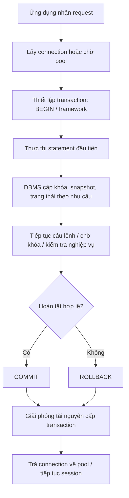
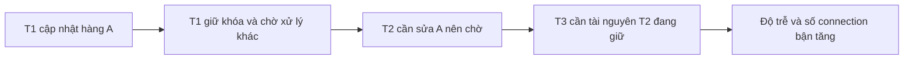

# Vòng đời khóa và tài nguyên trước, trong và sau COMMIT hoặc ROLLBACK

Khi xử lý một giao dịch (transaction), cơ sở dữ liệu không chỉ thực thi các câu lệnh SQL. Nó còn quản lý **khóa (lock)**, **phiên bản dữ liệu hoặc snapshot**, **trạng thái giao dịch**, **connection**, bộ nhớ, cấu trúc phục hồi và những tài nguyên cần thiết để các giao dịch khác không làm hỏng tính nhất quán của dữ liệu.

Những tài nguyên này có **thời điểm được tạo, được giữ và được giải phóng khác nhau**. Hiểu vòng đời đó giúp giải thích một hiện tượng thường gặp: một câu `UPDATE` chạy rất nhanh, nhưng một transaction giữ trạng thái mở thêm 30 giây vẫn có thể khiến nhiều yêu cầu khác bị chặn.

Trọng tâm của bài là ba thời điểm:

- **Trước khi transaction bắt đầu:** đã có những tài nguyên nào, và khi nào chúng thực sự được cấp?
- **Trong lúc transaction thực thi:** những khóa và phiên bản dữ liệu nào được giữ, những giao dịch khác có thể phải chờ ra sao?
- **Khi COMMIT hoặc ROLLBACK:** tài nguyên nào được giải phóng ngay theo ranh giới transaction, tài nguyên nào tiếp tục tồn tại theo vòng đời session hoặc được hệ quản trị dọn dẹp về sau?

Ví dụ chính dùng cơ sở dữ liệu quan hệ, đặc biệt là **PostgreSQL** và **MySQL/InnoDB**. Hành vi chi tiết phụ thuộc hệ quản trị, mức cô lập, engine và loại thao tác SQL.

## 1. Transaction không đồng nghĩa với connection hay câu lệnh

Trước khi phân tích lock, cần phân biệt ba phạm vi:

| Phạm vi | Được tạo/quản lý bởi | Thời điểm kết thúc điển hình | Ví dụ tài nguyên |
|---|---|---|---|
| **Statement** | Một lần thực thi SQL | Sau khi statement hoàn thành và tài nguyên statement được đóng | Kế hoạch thực thi, bộ đệm truy vấn, một số khóa/cursor hoặc snapshot ở cấp statement |
| **Transaction** | `BEGIN`, `COMMIT`, `ROLLBACK` hoặc transaction manager | Khi commit/rollback hoàn tất | Khóa ghi, transaction snapshot, trạng thái giao dịch, thông tin phục hồi cần thiết |
| **Session/Connection** | Client kết nối hoặc connection pool | Khi session thật sự đóng hoặc bị reset | Phiên kết nối, session variables, prepared statements/cursor tùy loại, một số loại advisory lock |

Một transaction thường sử dụng **một connection** để thực thi các câu SQL. Nhưng một connection có thể lần lượt chạy **nhiều transaction**, và khi ứng dụng gọi `close()` trên connection lấy từ pool, đối tượng đó thường chỉ được **trả về pool** chứ kết nối vật lý không bị đóng.

**Quy tắc cần nhớ:** `COMMIT`/`ROLLBACK` giải phóng tài nguyên **thuộc transaction**; chúng không bảo đảm mọi tài nguyên thuộc **session** hoặc mọi cấu trúc nội bộ của DBMS đều biến mất tức thì.

## 2. Các loại khóa và tài nguyên quan trọng

Không phải mọi thứ được gọi là “lock” đều hoạt động như một hàng dữ liệu bị khóa. Bảng sau cung cấp bản đồ khái niệm.

| Loại tài nguyên | Mục đích | Vòng đời thường gặp |
|---|---|---|
| **Row/record lock** | Phối hợp các transaction cập nhật hoặc khóa cùng bản ghi | Nhiều loại khóa ghi được giữ tới cuối transaction |
| **Table-level lock** | Phối hợp thao tác ở cấp bảng, bao gồm một số truy cập DDL và DML | Phụ thuộc loại khóa và câu lệnh; nhiều khóa gắn với transaction |
| **Gap/next-key lock** (InnoDB) | Bảo vệ khoảng chỉ mục, ngăn một số thao tác chèn gây phantom | Tùy mức cô lập và loại câu lệnh; thường gắn với transaction |
| **Metadata/schema lock** | Bảo vệ định nghĩa bảng khi truy vấn hoặc thay đổi cấu trúc | Tùy DBMS, có thể kéo dài tới cuối statement hoặc transaction |
| **Snapshot/read view** | Xác định phiên bản dữ liệu mà truy vấn được phép nhìn thấy | Có thể ở cấp statement hoặc transaction tùy mức cô lập |
| **Transaction ID/trạng thái giao dịch** | Theo dõi transaction đang chạy, đã commit hay bị hủy | Trạng thái được cập nhật khi kết thúc; metadata phục hồi có thể được giữ về sau |
| **Undo/MVCC versions** | Hỗ trợ rollback và đọc phiên bản nhất quán | Việc dọn phiên bản cũ có thể xảy ra sau commit/rollback |
| **WAL/redo log** | Giúp duy trì và phục hồi dữ liệu theo cơ chế của DBMS | Bản ghi log có thể được lưu và dọn theo chính sách riêng, không bị xóa lúc transaction kết thúc |
| **Connection/backend worker** | Chở câu lệnh và lưu ngữ cảnh session | Có thể tồn tại lâu hơn nhiều transaction |
| **Prepared statement/cursor/temp object** | Tái sử dụng thực thi hoặc lưu kết quả/trạng thái tạm | Phụ thuộc cách khai báo và DBMS; không mặc nhiên kết thúc cùng transaction |

### Khóa tường minh và khóa ngầm định

Khóa có thể được lấy **tường minh**:

```sql
BEGIN;
SELECT id, balance
FROM accounts
WHERE id = 1
FOR UPDATE;
-- Giữ khóa thích hợp để bảo vệ hàng đã chọn.
```

Hoặc được lấy **ngầm định** do câu lệnh ghi:

```sql
BEGIN;
UPDATE accounts
SET balance = balance - 100
WHERE id = 1;
-- DBMS lấy các khóa cần thiết khi cập nhật.
```

Người viết ứng dụng không nhất thiết nhìn thấy một lệnh “LOCK” riêng. Một câu `UPDATE` có thể phải chờ khóa, dù mã nguồn chỉ có một lệnh SQL.

### Không nên hiểu “SELECT không khóa” theo nghĩa tuyệt đối

Với PostgreSQL ở mô hình MVCC, một câu `SELECT` thông thường **không lấy khóa hàng kiểu `FOR UPDATE` để chặn người ghi**. Tuy vậy, truy vấn vẫn có thể lấy khóa ở mức bảng nhằm phối hợp với thay đổi cấu trúc. Với InnoDB, consistent read cũng không giống locking read; `SELECT ... FOR UPDATE` lại có yêu cầu khóa riêng.

Do đó, cần phân biệt **khóa hàng để cập nhật**, **khóa metadata/bảng**, và **snapshot đọc**.

## 3. Trước transaction: tài nguyên nào đã tồn tại?

Giả sử ứng dụng dùng một pool gồm các connection tới PostgreSQL:

1. Pool có thể đã mở và xác thực nhiều kết nối vật lý.
2. Một request lấy một connection (ngay lập tức hoặc lúc truy vấn đầu tiên, tùy framework).
3. Ứng dụng hoặc transaction manager cấu hình autocommit, isolation, read-only và các thiết lập khác.
4. Transaction bắt đầu tường minh hoặc ngầm định khi thực thi SQL.
5. DBMS cấp khóa và snapshot theo nhu cầu thực tế của các statement.

Việc **có connection** không đồng nghĩa một transaction nghiệp vụ đã mở, và việc **gọi `BEGIN`** cũng không đồng nghĩa mọi hàng dự kiến thao tác đã bị khóa.



Nếu ứng dụng dùng **autocommit bật**, một câu SQL riêng lẻ thường được chạy như một transaction của chính câu lệnh đó. Khi statement hoàn tất và được commit, khóa thuộc transaction của statement đó không được giữ sang câu lệnh tiếp theo. Ngược lại, khi transaction được mở tường minh, khóa ghi có thể tồn tại giữa các câu lệnh cho đến khi commit hoặc rollback.

Điểm cần kiểm tra khi phân tích sự cố: **transaction bắt đầu trước thời điểm SQL nào, và thực sự kết thúc lúc nào?**

## 4. Trong transaction: lock được lấy, sử dụng và giữ như thế nào?

Hãy giả sử bảng:

```sql
CREATE TABLE accounts (
    id BIGINT PRIMARY KEY,
    owner_name VARCHAR(100) NOT NULL,
    balance NUMERIC(18, 2) NOT NULL CHECK (balance >= 0)
);

INSERT INTO accounts (id, owner_name, balance)
VALUES (1, 'A', 1000.00),
       (2, 'B', 400.00);
```

Hai phiên độc lập T1 và T2 cùng muốn thay đổi tài khoản A.

### 4.1. T1 cập nhật hàng và vẫn giữ transaction mở

**Session T1:**

```sql
BEGIN;

UPDATE accounts
SET balance = balance - 100.00
WHERE id = 1;

-- Chưa COMMIT hoặc ROLLBACK.
-- T1 vẫn ở trong transaction.
```

Câu `UPDATE` đã thực hiện xong, nhưng các khóa ghi cần thiết để bảo vệ cập nhật đó vẫn gắn với transaction đang mở. T1 có thể đọc thấy A = 900 bên trong chính transaction.

### 4.2. T2 muốn cập nhật cùng hàng

**Session T2** (trong một connection khác):

```sql
BEGIN;

UPDATE accounts
SET balance = balance + 50.00
WHERE id = 1;

-- Với PostgreSQL ở READ COMMITTED, câu UPDATE có thể chờ T1.
-- Không chạy COMMIT T2 trước khi UPDATE ở trên kết thúc.
```

Khi T2 chưa thể lấy khóa cần thiết, câu lệnh `UPDATE` có thể ở trạng thái **waiting/blocking**. Điều này xảy ra dù T1 đang không chạy SQL nào.

```text
Thời gian       Session T1                       Session T2
──────────      ─────────────────────────        ─────────────────────────
t0              BEGIN                            BEGIN
t1              UPDATE A: 1000 → 900             -
t2              Giữ transaction mở               UPDATE A: +50 → phải chờ
t3              Không thực thi câu SQL mới       Vẫn chờ khóa của T1
t4              COMMIT hoặc ROLLBACK             Được đánh thức khi có thể tiếp tục
t5              Transaction T1 kết thúc          UPDATE hoàn tất hoặc báo lỗi
t6              -                                COMMIT / ROLLBACK T2
```

**Điểm then chốt:** thời gian **giữ khóa** có thể kéo dài hơn nhiều thời gian **thực thi câu SQL đã lấy khóa**.

### 4.3. Nếu T1 COMMIT

Trong T1:

```sql
COMMIT;
```

T1 xác nhận thay đổi và kết thúc transaction. Khóa thuộc T1 được giải phóng. Trong tình huống PostgreSQL ở `READ COMMITTED`, T2 có thể tiếp tục sau khi chờ, kiểm tra lại điều kiện cập nhật theo quy tắc hệ quản trị và cộng 50 vào giá trị đã commit: A trở thành 950 khi T2 sau đó commit.

Đây là ví dụ với `UPDATE balance = balance + 50`. Nếu T2 đã đọc số dư cũ về ứng dụng rồi ghi bằng câu `SET balance = 1050`, bài toán **lost update** lại phụ thuộc cách kiểm soát cập nhật; chỉ đợi khóa không tự sửa một phép tính dựa trên dữ liệu cũ.

### 4.4. Nếu T1 ROLLBACK

Trong T1:

```sql
ROLLBACK;
```

Thay đổi trừ 100 của T1 bị hủy. Khi có thể tiếp tục, T2 cập nhật trên dữ liệu hợp lệ theo quy tắc DBMS. Với ví dụ cộng 50 ở `READ COMMITTED`, nếu không có thay đổi khác, A trở thành 1050 sau khi T2 commit.

Đây là **hai nhánh riêng** từ cùng dữ liệu ban đầu, không phải một chuỗi chạy đồng thời cả commit và rollback.

### 4.5. Thời gian chờ còn phụ thuộc timeout và isolation

T2 không nhất thiết phải đợi vô hạn:

- Có thể gặp **lock timeout** nếu chờ quá lâu.
- Có thể gặp **deadlock** nếu hình thành vòng chờ khóa; DBMS chọn một transaction để hủy theo cơ chế riêng.
- Ở mức cô lập mạnh hơn, một số DBMS có thể trả **serialization failure** thay vì cho T2 tiếp tục theo đúng nhánh mô tả ở `READ COMMITTED`.
- Với `NOWAIT` hoặc `SKIP LOCKED` khi cú pháp được hỗ trợ, một số thao tác khóa có thể trả lỗi ngay hoặc bỏ qua hàng đang bị khóa, theo mục tiêu nghiệp vụ.

Không được coi “đợi xong là thành công” là bất biến của mọi isolation level.

## 5. Khác biệt giữa khóa và snapshot đọc

**Khóa** giúp điều phối những hành động có thể xung đột. **Snapshot/read view** giúp quyết định một truy vấn đọc được phiên bản dữ liệu nào.

Ví dụ ở PostgreSQL:

- Với `READ COMMITTED`, mỗi statement thường lấy snapshot cho statement đó.
- Với `REPEATABLE READ`, một transaction thường sử dụng snapshot ổn định từ lần cần snapshot đầu tiên; quy tắc xử lý xung đột cập nhật cũng khác.
- Một `SELECT` đọc snapshot cũ không có nghĩa đang giữ khóa ghi trên hàng được đọc.
- Một transaction dài có snapshot lâu đời có thể khiến DBMS trì hoãn dọn các phiên bản dữ liệu cũ dù nó không đang giữ khóa hàng để cập nhật.

Ở InnoDB, **consistent read** dùng read view/MVCC, còn **locking read** như `SELECT ... FOR UPDATE` dùng khóa. Trong `REPEATABLE READ`, read view của consistent read có thể được dùng trong nhiều statement, nhưng locking read có quy tắc nhìn và khóa dữ liệu riêng.

Vì vậy, hai triệu chứng có thể xuất hiện độc lập:

| Triệu chứng | Nguyên nhân có thể | Điều cần xem |
|---|---|---|
| UPDATE khác bị chặn | Transaction trước đang giữ lock xung đột | Lock holder, blocker, transaction age |
| Truy vấn đọc cứ thấy giá trị cũ | Snapshot theo isolation level | Isolation, thời điểm snapshot |
| Dung lượng phiên bản cũ/undo tăng | Transaction hoặc snapshot lâu đời ngăn cleanup | Transaction dài, vacuum/purge |
| Transaction đọc bình thường nhưng DDL không chạy được | Metadata/table lock đang được giữ | Loại câu lệnh, schema lock, session |

Khóa và snapshot đều ảnh hưởng đến concurrency, nhưng không nên gộp chúng thành một đối tượng được giải phóng theo cùng cơ chế.

## 6. Khi COMMIT: điều gì được xác nhận và giải phóng?

Khi ứng dụng gọi `COMMIT`, DBMS cần hoàn tất việc xác nhận transaction theo cơ chế của engine. Quá trình này liên quan đến trạng thái giao dịch, thông tin log/phục hồi và việc công bố kết quả đã commit cho các transaction khác theo quy tắc isolation.

Sau khi **COMMIT thành công và transaction kết thúc**, thông thường:

1. Các thay đổi của transaction được xác nhận như một đơn vị.
2. Những khóa cấp transaction, bao gồm khóa ghi thích hợp, được giải phóng.
3. Các transaction đang đợi có thể được đánh thức và tiếp tục hoặc phát hiện xung đột.
4. Snapshot và ngữ cảnh chỉ thuộc transaction được kết thúc.
5. Connection có thể tiếp tục phục vụ transaction mới hoặc được trả về pool.

Không nên hình dung toàn bộ các bước này diễn ra tuần tự theo một thứ tự vật lý cứng nhắc giữa mọi DBMS. Hợp đồng quan trọng đối với client là: **khi transaction đã kết thúc thành công, nó không còn giữ các khóa thuộc transaction đó**.

### 6.1. COMMIT không đồng nghĩa xóa undo, WAL hay phiên bản dữ liệu cũ ngay lập tức

Một số tài nguyên có vòng đời dài hơn:

- PostgreSQL ghi WAL để phục vụ phục hồi; bản ghi WAL được quản lý theo chính sách checkpoint, lưu trữ và các nhu cầu replication/backup. Chúng không bị xóa chỉ vì transaction vừa commit.
- Phiên bản hàng cũ trong PostgreSQL có thể tiếp tục tồn tại cho đến khi `VACUUM` có thể dọn chúng một cách an toàn.
- InnoDB sử dụng undo/redo và các cơ chế purge; việc dọn undo/history có thể thực hiện bất đồng bộ sau transaction, phụ thuộc các transaction/read view còn cần dữ liệu cũ.
- Dữ liệu nằm trong cache/buffer pool có thể vẫn ở bộ nhớ; bộ đệm không phải khóa transaction và không cần bị xóa ngay khi commit.

**Giải phóng khóa logic** và **thu hồi không gian lưu trữ vật lý** là hai hoạt động khác nhau.

### 6.2. Session vẫn tồn tại sau COMMIT

Giả sử ứng dụng lấy connection từ pool và thực thi:

```sql
BEGIN;
UPDATE accounts SET balance = balance + 10 WHERE id = 2;
COMMIT;
```

Sau `COMMIT`, connection vẫn có thể mở, prepared statements có thể vẫn còn, các biến cấu hình ở mức session có thể giữ giá trị và transaction tiếp theo có thể chạy ngay trên connection đó. Chính vì vậy, một connection **đang mở nhưng idle** không nhất thiết là lỗi; nguy hiểm hơn là connection **idle in transaction**.

## 7. Khi ROLLBACK: điều gì được hoàn tác và giải phóng?

`ROLLBACK` yêu cầu hủy những thay đổi chưa commit thuộc transaction. Sau khi rollback hoàn tất, DBMS giải phóng các khóa cấp transaction để những giao dịch khác có thể tiếp tục.

Đối với ví dụ chuyển tiền:

```sql
BEGIN;

UPDATE accounts
SET balance = balance - 250.00
WHERE id = 1;

UPDATE accounts
SET balance = balance + 250.00
WHERE id = 2;

-- Phát hiện vi phạm điều kiện nghiệp vụ:
ROLLBACK;
```

Cả hai cập nhật chưa commit bị hủy. Về mặt kết quả, dữ liệu được giữ như trước khi transaction thực hiện các thay đổi này.

### 7.1. ROLLBACK có thể cần thời gian

Không nên giả định một lệnh rollback lớn luôn hoàn tất tức thì. Tùy engine và lượng dữ liệu đã ghi, DBMS có thể cần thực hiện công việc phục hồi/undo, xử lý tài nguyên và cập nhật trạng thái trước khi việc hoàn tác hoàn tất. Trong thời gian đó, những khóa cần thiết có thể còn được giữ hoặc transaction chưa được xem là kết thúc.

Vì vậy, sau khi yêu cầu rollback, cần quan sát **rollback đã hoàn tất chưa** trước khi khẳng định mọi blocker đã được giải phóng.

### 7.2. Lỗi SQL không nhất thiết đồng nghĩa toàn bộ transaction đã rollback

Sự khác biệt phổ biến:

- **PostgreSQL:** khi một câu SQL lỗi trong transaction thông thường, transaction thường chuyển sang trạng thái *aborted*. Các câu lệnh tiếp theo sẽ bị từ chối cho đến khi rollback, trừ trường hợp xử lý qua savepoint phù hợp. Nếu ứng dụng bắt lỗi nhưng để connection ở trạng thái đó, tài nguyên transaction có thể tiếp tục bị giữ cho tới khi kết thúc.
- **MySQL/InnoDB:** một số lỗi chỉ rollback câu lệnh bị lỗi, transaction vẫn mở. Với deadlock, InnoDB có thể rollback toàn transaction nạn nhân. Với một số lock wait timeout, mặc định chỉ câu lệnh bị lỗi được rollback; ứng dụng cần chủ động rollback transaction nếu nghiệp vụ không thể tiếp tục.

Không nên dựa vào một quy tắc “cứ có lỗi là lock đã được thả” cho mọi DBMS.

### 7.3. ROLLBACK TO SAVEPOINT không kết thúc transaction

Ví dụ:

```sql
BEGIN;

UPDATE accounts SET balance = balance - 100 WHERE id = 1;

SAVEPOINT before_bonus;

UPDATE accounts SET balance = balance + 50 WHERE id = 2;

ROLLBACK TO SAVEPOINT before_bonus;

-- Transaction vẫn mở.
-- Thay đổi trước savepoint vẫn chưa commit.
COMMIT;
```

`ROLLBACK TO SAVEPOINT` hủy phần thay đổi sau mốc, không thay thế `ROLLBACK` toàn giao dịch. Một số khóa được lấy sau savepoint có thể được giải phóng khi rollback về savepoint theo quy tắc DBMS, nhưng **không được giả định mọi khóa của transaction đều đã mất**. Khóa của phần việc còn lại vẫn có thể tồn tại tới commit/rollback cuối cùng.

## 8. So sánh tài nguyên theo từng giai đoạn

| Tài nguyên | Trước transaction | Trong khi thực thi | Sau COMMIT | Sau ROLLBACK |
|---|---|---|---|---|
| Connection vật lý | Có thể đã tồn tại trong pool | Phục vụ SQL và ngữ cảnh session | Thường vẫn có thể sử dụng | Thường vẫn có thể sử dụng |
| Khóa hàng do ghi | Chưa có cho transaction mới | Được lấy khi cần; có thể giữ tới cuối | Giải phóng khi transaction kết thúc | Giải phóng khi rollback kết thúc |
| Khóa bảng/metadata | Có thể có khóa thuộc session/tác vụ khác | Lấy theo loại statement | Loại khóa thuộc transaction được giải phóng | Loại khóa thuộc transaction được giải phóng |
| Snapshot/read view | Chưa cần hoặc chưa tạo | Tạo theo isolation/statement | Ngữ cảnh snapshot của transaction kết thúc | Ngữ cảnh snapshot của transaction kết thúc |
| Transaction state | Chưa bắt đầu | Active/waiting/failed tùy tình huống | Ghi nhận kết cục commit | Ghi nhận kết cục rollback |
| Undo/phiên bản cũ | Có thể tồn tại từ transaction khác | Được tạo/duy trì theo engine | Dọn dẹp có thể bị trì hoãn | Dọn dẹp có thể bị trì hoãn |
| WAL/redo và dữ liệu trong cache | Có thể đã tồn tại | Ghi/đệm theo engine | Quản lý theo durability/recovery | Quản lý theo recovery/cleanup |
| Session-level advisory lock | Có thể đã được lấy từ trước | Có thể tiếp tục được giữ | **Không nhất thiết tự thả** | **Không nhất thiết tự thả** |

Bảng này mô tả hành vi phổ biến của DBMS giao dịch; phải đối chiếu loại tài nguyên cụ thể khi dùng trong sản phẩm.

## 9. Transaction lock khác với session-level advisory lock

Một số ứng dụng sử dụng **advisory lock** để phối hợp logic nghiệp vụ (ví dụ, chỉ cho phép một worker xử lý một job cùng lúc). Vòng đời khóa advisory có thể khác khóa hàng SQL.

Trong **PostgreSQL**, có hai nhóm cần phân biệt:

```sql
-- Khóa advisory cấp transaction:
BEGIN;
SELECT pg_advisory_xact_lock(12345);
-- Khóa sẽ được thả khi transaction kết thúc.
COMMIT;
```

```sql
-- Khóa advisory cấp session:
SELECT pg_advisory_lock(12345);
-- COMMIT hoặc ROLLBACK của một transaction thông thường
-- không tự động thả khóa cấp session này.

SELECT pg_advisory_unlock(12345);
-- Thả khóa đã lấy ở cấp session.
```

Với MySQL, `GET_LOCK()` cũng có hành vi gắn với session và cần đối chiếu phiên bản cùng quy tắc release. Không nên trông chờ transaction manager tự động thu hồi mọi advisory lock cấp session.

Điều này đặc biệt quan trọng với connection pool: nếu kết nối được trả về pool khi vẫn còn khóa cấp session, các request tiếp theo có thể gặp hành vi khó đoán tùy pool và driver. Nên thiết kế phạm vi khóa rõ ràng, chủ động thả khóa ở cấp session khi cần và tránh giữ chúng vượt quá công việc.

## 10. Quan sát vấn đề bằng hai session PostgreSQL

Có thể thực hành với hai cửa sổ SQL độc lập cùng kết nối tới một database PostgreSQL. Tránh sử dụng dữ liệu sản xuất cho bài tập.

### Bước 1: Tạo bảng minh họa

Trong một session và để lệnh tạo bảng hoàn tất:

```sql
CREATE TABLE lock_demo (
    id INTEGER PRIMARY KEY,
    value INTEGER NOT NULL
);

INSERT INTO lock_demo (id, value) VALUES (1, 100);
```

### Bước 2: T1 lấy khóa và giữ transaction mở

**Session 1:**

```sql
BEGIN;

UPDATE lock_demo
SET value = value + 10
WHERE id = 1;

-- Không COMMIT ngay.
-- Lệnh UPDATE đã hoàn thành nhưng transaction vẫn mở.
```

### Bước 3: T2 thử cập nhật hàng đang được T1 bảo vệ

**Session 2:**

```sql
BEGIN;

UPDATE lock_demo
SET value = value + 20
WHERE id = 1;
-- Có thể phải chờ T1 kết thúc.
```

Từ session thứ ba, nếu có, kiểm tra trạng thái chờ:

```sql
SELECT
    pid,
    state,
    wait_event_type,
    wait_event,
    now() - xact_start AS transaction_age,
    pg_blocking_pids(pid) AS blocking_pids,
    query
FROM pg_stat_activity
WHERE datname = current_database()
  AND xact_start IS NOT NULL
ORDER BY xact_start;
```

Nếu T2 đang chờ khóa, kết quả có thể cho thấy `wait_event_type = 'Lock'` và `blocking_pids` chứa PID của session gây chặn. Thông tin mà người dùng được phép quan sát có thể bị giới hạn bởi quyền truy cập.

**Lưu ý:** không phải mọi khóa hàng PostgreSQL đều hiện thành một dòng trực tiếp dễ nhận diện trong `pg_locks`. Đôi khi cơ chế chờ transaction ID và kết hợp các view giám sát mới giúp xác định blocker.

### Bước 4: Kết thúc T1 và quan sát T2

**Session 1:**

```sql
COMMIT;
```

Khi T1 kết thúc, T2 có thể tiếp tục chạy `UPDATE`. Sau khi câu lệnh ở session 2 thực sự hoàn tất, dùng:

```sql
COMMIT;

SELECT id, value FROM lock_demo;
-- Trong ví dụ không có thay đổi khác: value = 130.
```

Nếu ở session 1 dùng `ROLLBACK` thay cho `COMMIT`, sau T2 hoàn tất và commit, giá trị sẽ là 120. Hai kết quả này áp dụng cho **hai lần thực hành độc lập**, đều xuất phát từ giá trị ban đầu 100.

### Bước 5: Nhận biết “idle in transaction”

Nếu T1 đã chạy một lệnh rồi đứng yên không gửi thêm SQL, trong `pg_stat_activity` có thể thấy trạng thái `idle in transaction`. Đây không phải connection “rảnh hoàn toàn”: transaction vẫn mở và có thể đang giữ khóa hoặc snapshot cần dọn sau khi kết thúc.

## 11. Quan sát trên MySQL/InnoDB

MySQL/InnoDB hỗ trợ các công cụ quan sát phù hợp với phiên bản và cấu hình:

```sql
-- MySQL 8.x với Performance Schema phù hợp:
SELECT * FROM performance_schema.data_locks;
SELECT * FROM performance_schema.data_lock_waits;
```

Có thể sử dụng các view trong schema `sys`, ví dụ `sys.innodb_lock_waits` nếu có sẵn, để liên hệ waiting transaction với blocking transaction.

Một số khác biệt cần biết:

- InnoDB có **record lock**, **gap lock** và **next-key lock**; các loại này liên quan đến index và mức cô lập. Vì vậy, lệnh cập nhật hoặc locking read theo khoảng giá trị có thể ảnh hưởng đến thao tác chèn vào một khoảng chỉ mục, không chỉ một hàng đã tồn tại.
- **Metadata lock** có thể khiến một lệnh `ALTER TABLE` bị chặn bởi transaction đang truy cập bảng; cần quan sát cả metadata lock thay vì chỉ data row lock.
- Với `REPEATABLE READ`, consistent read và locking read không hoàn toàn giống nhau về phiên bản dữ liệu được đọc và loại lock.
- Một số câu DDL gây **implicit commit**. Không thể giả định tất cả lệnh thao tác schema thuộc cùng một transaction DML bình thường.

Các view giám sát phụ thuộc quyền truy cập và việc bật Performance Schema; ví dụ minh họa không có nghĩa chúng luôn sẵn trên mọi hệ thống MySQL.

## 12. Tác động của COMMIT/ROLLBACK trong JDBC và Spring

### 12.1. JDBC: statement xong không có nghĩa khóa đã được thả

Ví dụ:

```java
import java.sql.Connection;
import java.sql.PreparedStatement;
import java.sql.SQLException;
import javax.sql.DataSource;

public final class AccountUpdater {
    private final DataSource dataSource;

    public AccountUpdater(DataSource dataSource) {
        this.dataSource = dataSource;
    }

    public void addAmount(long accountId, int amount) throws SQLException {
        try (Connection connection = dataSource.getConnection()) {
            connection.setAutoCommit(false);
            try {
                try (PreparedStatement statement = connection.prepareStatement(
                        "UPDATE accounts SET balance = balance + ? WHERE id = ?")) {
                    statement.setInt(1, amount);
                    statement.setLong(2, accountId);

                    if (statement.executeUpdate() != 1) {
                        throw new SQLException("Không tìm thấy tài khoản");
                    }
                } // Statement đóng; transaction vẫn đang mở.

                connection.commit(); // Transaction kết thúc, khóa DB được thả.
            } catch (SQLException | RuntimeException failure) {
                try {
                    connection.rollback();
                } catch (SQLException rollbackError) {
                    failure.addSuppressed(rollbackError);
                }
                throw failure;
            }
        } // Connection được đóng hoặc trả về pool.
    }
}
```

Dấu ngoặc đóng của `PreparedStatement` không ra lệnh `COMMIT` và không mặc nhiên giải phóng khóa ghi cấp transaction. Phần `commit()` hoặc `rollback()` mới quyết định kết cục đơn vị công việc. Tương tự, đóng `ResultSet` không thể thay thế kết thúc transaction.

Với một số driver/pool, ứng dụng cần thiết lập quy trình reset trạng thái autocommit khi trả connection. Ví dụ sử dụng một connection riêng trong phạm vi ngắn; trong hệ thống Spring có quản lý transaction, tránh điều khiển `setAutoCommit` thủ công bên trong phạm vi framework sở hữu.

### 12.2. Spring: thời gian giữ khóa đi theo transaction thực tế

Ví dụ với `JdbcTemplate`:

```java
import java.math.BigDecimal;
import org.springframework.jdbc.core.JdbcTemplate;
import org.springframework.stereotype.Service;
import org.springframework.transaction.annotation.Transactional;

@Service
public class AccountTransferService {
    private final JdbcTemplate jdbc;

    public AccountTransferService(JdbcTemplate jdbc) {
        this.jdbc = jdbc;
    }

    @Transactional
    public void transfer(long fromId, long toId, BigDecimal amount) {
        if (fromId == toId || amount == null || amount.signum() <= 0) {
            throw new IllegalArgumentException("Số tiền hoặc tài khoản không hợp lệ");
        }

        int debit = jdbc.update(
            "UPDATE accounts SET balance = balance - ? " +
            "WHERE id = ? AND balance >= ?",
            amount, fromId, amount
        );
        if (debit != 1) {
            throw new IllegalStateException("Không có tài khoản hoặc không đủ tiền");
        }

        int credit = jdbc.update(
            "UPDATE accounts SET balance = balance + ? WHERE id = ?",
            amount, toId
        );
        if (credit != 1) {
            throw new IllegalStateException("Không tìm thấy tài khoản nhận");
        }
    }
}
```

Khi transaction manager điều khiển đúng connection, các khóa do hai câu `UPDATE` tạo ra có thể được giữ cho đến khi transaction thực sự kết thúc. Trong chế độ Spring proxy mặc định, `@Transactional` cần được gọi qua proxy phù hợp để có hiệu lực.

Nếu phương thức tham gia **transaction đã tồn tại** theo propagation `REQUIRED`, việc phương thức con trả về **không nhất thiết kết thúc transaction**. Khóa có thể được giữ đến khi transaction ngoài commit hoặc rollback. Đặt `@Transactional` trên một phương thức bao quanh cả phần gọi HTTP chậm có thể vô tình kéo dài thời gian giữ khóa.

Nếu một exception bị bắt rồi bỏ qua, transaction ngoài có thể vẫn commit hoặc transaction bị đánh dấu **rollback-only** tùy cách framework xử lý. Quy tắc rollback mặc định của Spring bao gồm unchecked exceptions và `Error`; checked exceptions cần cấu hình phù hợp nếu muốn rollback theo chúng.

### 12.3. JPA/Hibernate: flush không đồng nghĩa COMMIT

Với JPA/Hibernate, thay đổi entity có thể được giữ trong persistence context trước khi SQL thực sự gửi tới DBMS. Việc `flush()` gửi các lệnh SQL đang chờ không đồng nghĩa với xác nhận transaction:

```java
@Transactional
public void updateBalance(EntityManager entityManager, long accountId) {
    Account account = entityManager.find(Account.class, accountId);
    account.setBalance(account.getBalance().add(new BigDecimal("10.00")));

    entityManager.flush(); // SQL có thể đã chạy; transaction chưa commit.
    // Khóa và trạng thái giao dịch vẫn có thể tồn tại cho đến khi kết thúc.
}
```

Đây là đoạn minh họa, giả định có entity `Account` và mapping thích hợp. Việc flush sớm hơn có thể khiến lock được lấy sớm hơn, từ đó tăng thời gian giữ khóa nếu transaction còn nhiều công việc phía sau. `clear()` persistence context cũng không tương đương `ROLLBACK`.

## 13. Thời gian giữ khóa và chuỗi chờ

Trong sản phẩm nhiều request, một transaction chậm có thể tạo thành chuỗi ảnh hưởng:



Vấn đề không chỉ là transaction T1 chạy lâu. Khi các request bị chặn mà vẫn chiếm connection hoặc worker thread, pool có thể cạn, gây timeout hàng loạt.

Các đại lượng thường hữu ích để quan sát:

| Đại lượng | Ý nghĩa |
|---|---|
| **Transaction age** | Transaction đã tồn tại bao lâu |
| **Time idle in transaction** | Thời gian transaction đang mở nhưng ứng dụng không chạy SQL |
| **Lock wait duration** | Một statement đã chờ lock bao lâu |
| **Blocking session / blocking PID** | Phiên nào đang cản trở phiên khác |
| **Connection pool in-use / waiting** | Có bao nhiêu kết nối đang phục vụ hoặc đang được yêu cầu |
| **Deadlock/lock timeout rate** | Mức độ xung đột nghiêm trọng |
| **MVCC history / vacuum-purge pressure** | Tác động của transaction/snapshot dài đến việc dọn phiên bản cũ |

Không nên chỉ tối ưu thời gian xử lý của từng `UPDATE`. Nếu ứng dụng thực thi `UPDATE` 2 ms rồi giữ transaction mở 20 giây để gọi một dịch vụ khác, thời gian khóa có thể gần 20 giây.

## 14. Deadlock, timeout và đóng kết nối

### 14.1. Deadlock

Ví dụ hai transaction cập nhật theo thứ tự ngược nhau:

```text
T1: khóa A  ──► đợi khóa B
                 ▲       │
                 │       ▼
T2: đợi khóa A ◄── khóa B
```

DBMS có cơ chế phát hiện deadlock trong những trường hợp được hỗ trợ và chọn một transaction làm nạn nhân. Khi đó, vòng đời của transaction nạn nhân kết thúc theo quy tắc DBMS; các khóa được giải phóng khi việc hủy hoàn tất, cho phép transaction còn lại tiếp tục.

Ở ứng dụng, retry thường phải áp dụng cho **toàn bộ đơn vị nghiệp vụ**, đi kèm kiểm soát retry và idempotency, thay vì chỉ chạy lại một SQL đơn lẻ mà không xác định trạng thái transaction.

### 14.2. Lock timeout

Lock timeout giới hạn thời gian một statement được phép chờ. Nó **không có nghĩa** mọi DBMS sẽ rollback toàn transaction ngay khi timeout. Ví dụ, ở PostgreSQL một statement bị lỗi có thể khiến transaction ở trạng thái aborted, trong khi ở InnoDB một lock wait timeout thường chỉ làm statement thất bại theo cấu hình mặc định.

Vì vậy, ứng dụng cần thực hiện đúng bước kết thúc transaction sau timeout, không giữ connection ở trạng thái mở rồi trả nó về pool.

### 14.3. Mất kết nối hoặc tiến trình chết

Khi session mất kết nối thật sự, DBMS thường có cơ chế kết thúc các transaction chưa commit và thu hồi tài nguyên liên quan. Nhưng việc phát hiện mất kết nối không nhất thiết tức thì; thời gian nhận biết có thể phụ thuộc mạng, driver, TCP và timeout của server.

Nếu client mất kết nối đúng lúc gửi `COMMIT`, nó có thể không biết giao dịch đã commit hay chưa. **Không tự động retry nghiệp vụ ghi có thể gây tác dụng hai lần**; cần mã yêu cầu duy nhất hoặc bước đối soát trạng thái.

### 14.4. Hủy query không giống hủy transaction

Một số DBMS/API cho phép hủy statement đang chạy. Hủy statement không mặc nhiên bảo đảm transaction được rollback và khóa trước đó đã giải phóng. Sau thao tác cancel, phải xác định transaction hiện vẫn mở hay đã bị hủy rồi kết thúc ranh giới đó một cách rõ ràng.

## 15. Những thói quen giúp quản lý vòng đời tài nguyên

1. **Thu hẹp transaction vào công việc DB cần tính nguyên tử.** Chuẩn bị dữ liệu, xác thực độc lập và tính toán không cần khóa trước khi bắt đầu transaction khi an toàn về nghiệp vụ.
2. **Kết thúc mọi transaction ở mọi nhánh.** Bao gồm lỗi validation sau một lệnh cập nhật, lỗi SQL, timeout và ngoại lệ trong ứng dụng.
3. **Tránh gọi API, chờ người dùng hoặc làm I/O chậm khi đang giữ khóa.** Nếu cần tích hợp hệ thống khác, thiết kế outbox/saga/idempotency thay vì kéo transaction DB qua ranh giới dịch vụ.
4. **Kiểm tra số hàng bị ảnh hưởng.** Một `UPDATE` trả về 0 hàng thường không phải lỗi SQL; ứng dụng phải tự đánh giá có được phép commit không.
5. **Giữ thứ tự truy cập bản ghi nhất quán khi có thể.** Ví dụ cập nhật tài khoản theo ID tăng dần để giảm khả năng tạo vòng chờ.
6. **Cấu hình timeout hợp lý và xử lý rõ kết cục.** Phân biệt statement timeout, lock timeout, transaction timeout, idle-in-transaction timeout và timeout lấy connection từ pool.
7. **Quan sát blocker trước khi chỉ tăng kích thước pool.** Pool lớn hơn không sửa được một transaction vẫn giữ khóa; nó còn có thể cho thêm nhiều request cùng chờ.
8. **Dùng scope của khóa đúng mục đích.** Lock hàng và transaction-level advisory lock có thời hạn khác session-level advisory lock.
9. **Để transaction manager và connection pool hoàn tất trách nhiệm của chúng.** Không trộn nhiều cơ chế quản lý transaction trên cùng connection khi không có thiết kế rõ ràng.
10. **Tách thời điểm thả khóa khỏi thời điểm cleanup vật lý.** Việc WAL, undo, phiên bản cũ còn tồn tại sau commit không có nghĩa transaction vẫn đang giữ lock ghi.

## 16. Tình huống luyện tập

### Tình huống 1: Lệnh UPDATE nhanh nhưng request khác bị treo

T1 chạy `BEGIN`, cập nhật tài khoản A trong 5 ms, sau đó gọi HTTP mất 10 giây mới `COMMIT`. T2 cần cập nhật A ở giây thứ hai.

**Phân tích:** T2 có thể phải chờ khóa của T1 trong nhiều giây. Thời gian giữ khóa được tính đến lúc transaction T1 kết thúc, không dừng ở thời điểm câu `UPDATE` hoàn thành. Cần xem lại ranh giới transaction và vị trí lời gọi HTTP.

### Tình huống 2: Đã đóng PreparedStatement, sao khóa vẫn còn?

Ứng dụng sử dụng JDBC, `setAutoCommit(false)` rồi chạy `executeUpdate()`. Sau khi đóng `PreparedStatement`, ứng dụng chưa gọi `commit()` hoặc `rollback()`.

**Phân tích:** Statement đã đóng nhưng transaction vẫn có thể mở. Khóa ghi gắn với transaction tiếp tục tồn tại tới khi kết thúc transaction.

### Tình huống 3: Transaction đã COMMIT nhưng WAL còn tồn tại

DBMS đã xác nhận giao dịch; người vận hành vẫn thấy file WAL hoặc các phiên bản dữ liệu cũ.

**Phân tích:** WAL phục vụ recovery/replication và phiên bản cũ có thể cần cơ chế dọn độc lập. Sự tồn tại của chúng không đồng nghĩa khóa ghi thuộc transaction đó vẫn đang được giữ.

### Tình huống 4: Rollback về savepoint rồi xảy ra khóa chờ

T1 cập nhật A, tạo savepoint, cập nhật B rồi `ROLLBACK TO SAVEPOINT`. T1 tiếp tục mở đến vài giây sau mới commit.

**Phân tích:** Phần thay đổi trước savepoint vẫn thuộc transaction đang mở, và những khóa liên quan vẫn có thể được giữ. Rollback về savepoint không thay thế kết thúc transaction.

### Tình huống 5: Connection pool còn kết nối sau khi transaction kết thúc

Sau `COMMIT`, ứng dụng trả connection về pool nhưng database vẫn hiển thị session đang tồn tại.

**Phân tích:** Đó có thể là hành vi bình thường của pool. Cần xem session có transaction đang mở và giữ lock hay chỉ đang idle ngoài transaction. Hai trạng thái có tác động khác nhau.

### Tình huống 6: Thêm @Transactional mà vẫn bị deadlock

Hai request cập nhật A rồi B và B rồi A trong hai transaction khác nhau.

**Phân tích:** `@Transactional` tạo ranh giới commit/rollback, không loại trừ deadlock. Cần thiết kế thứ tự truy cập, giới hạn độ dài transaction và retry đúng loại lỗi.

## 17. Hình dung cuối cùng

Vòng đời khóa gắn với **ranh giới transaction**, nhưng vòng đời tài nguyên DB nói chung có nhiều lớp:

```text
Connection/Session:  |--------------------------------------------|
Transaction T1:           |------- BEGIN ... COMMIT -------|
Transaction T2:                                              |---|
Khóa ghi của T1:                |====== giữ khóa ======|
Snapshot T1:                |====== tùy isolation ====|
WAL / undo / MVCC history:        |====== tồn tại và dọn về sau... =====>
Connection trả về pool:                                       ^
```

- **Trước transaction:** connection có thể đã tồn tại; không nhất thiết đã giữ khóa của công việc mới.
- **Trong transaction:** DBMS lấy và giữ các khóa/snapshot cần thiết; các transaction khác có thể chờ, nhìn dữ liệu theo snapshot hoặc gặp xung đột.
- **Sau `COMMIT`:** kết quả được xác nhận, transaction kết thúc và những khóa cấp transaction được giải phóng; session hoặc dữ liệu phục hồi có thể tiếp tục tồn tại.
- **Sau `ROLLBACK`:** thay đổi chưa commit bị hủy, các khóa transaction được giải phóng khi rollback kết thúc; việc cleanup vật lý có thể tiếp tục.
- **Sau khi trả connection về pool:** phiên kết nối có thể vẫn mở, nên phải quản lý cẩn thận tài nguyên cấp session và tránh `idle in transaction`.

Hiểu rõ **ai sở hữu tài nguyên** (statement, transaction, session hay DBMS) và **sự kiện nào giải phóng nó** là nền tảng để phân tích lock wait, deadlock, transaction dài và lỗi hiệu năng trong Database Transaction Concurrency.
