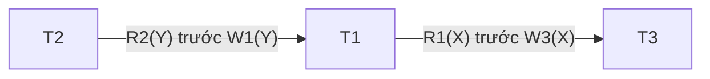
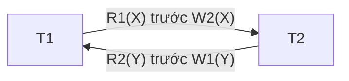
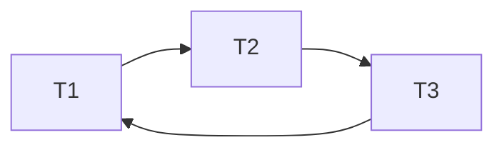

# Đồ thị ưu tiên và kiểm tra khả tuần tự theo xung đột

Khi nhiều giao dịch cùng truy cập cơ sở dữ liệu, database có thể xen kẽ các câu lệnh của chúng để phục vụ nhiều yêu cầu cùng lúc. Việc xen kẽ giúp tăng mức sử dụng tài nguyên, nhưng cũng tạo ra những lịch thực thi mà kết quả khác với bất kỳ cách chạy từng giao dịch một. **Đồ thị ưu tiên** (*precedence graph*, còn gọi là *serialization graph* trong ngữ cảnh lịch thực thi một phiên bản) là công cụ để nhìn thấy quan hệ phụ thuộc giữa các giao dịch và kiểm tra liệu lịch đó có **khả tuần tự theo xung đột** (*conflict serializability*) hay không.

Ý tưởng cốt lõi: nếu một thao tác của giao dịch T1 buộc phải đứng trước một thao tác xung đột của T2, ta vẽ cạnh **T1 → T2**. Sau khi xét tất cả xung đột, một đồ thị **không có chu trình** cho biết lịch thực thi có thể được biến đổi thành một lịch tuần tự tương đương theo xung đột.

Bài học tập trung vào cách lập lịch, nhận diện xung đột, dựng đồ thị, tìm chu trình, suy ra thứ tự tuần tự tương đương và hiểu giới hạn của phép kiểm tra trong database thực tế.

## 1. Từ giao dịch đến lịch thực thi

Một **transaction** (giao dịch) gồm các thao tác được thực hiện theo thứ tự nội bộ do chương trình quy định. Khi nhiều transaction chạy đồng thời, các thao tác của chúng tạo thành một **schedule** (lịch thực thi) nếu giữ nguyên thứ tự bên trong mỗi transaction nhưng cho phép thao tác của các transaction khác nhau xen vào nhau.

Để phân tích, dùng ký hiệu:

| Ký hiệu | Ý nghĩa |
|---|---|
| `R1(X)` | Transaction `T1` đọc mục dữ liệu `X`. |
| `W1(X)` | Transaction `T1` ghi mục dữ liệu `X`. |
| `R2(Y)` | Transaction `T2` đọc `Y`. |
| `W3(X)` | Transaction `T3` ghi `X`. |
| `C1` | `T1` commit. |
| `A1` | `T1` abort/rollback. |

Chỉ số transaction có thể viết là `R_1(X)` hoặc `R1(X)`; hai cách cùng có ý nghĩa. Một **mục dữ liệu** (*data item*) có thể là một hàng, một giá trị logic hoặc đơn vị truy cập mà bài toán lựa chọn. Việc chọn đơn vị dữ liệu phải phản ánh những xung đột thực sự cần phân tích.

Ví dụ hai giao dịch:

```text
T1: R1(X) → W1(X) → R1(Y) → C1
T2: R2(Y) → W2(Y) → C2
```

Một lịch xen kẽ hợp lệ:

```text
S = R1(X), R2(Y), W1(X), W2(Y), R1(Y), C2, C1
```

Trong lịch này, các thao tác của T1 vẫn giữ thứ tự `R1(X)`, `W1(X)`, `R1(Y)` và các thao tác của T2 vẫn giữ thứ tự `R2(Y)`, `W2(Y)`. Dù giao dịch chạy xen kẽ, thứ tự của từng giao dịch không bị đảo.

### Lịch tuần tự là gì?

Một **lịch tuần tự** (*serial schedule*) đặt toàn bộ các thao tác của một transaction trước các thao tác của transaction tiếp theo. Chẳng hạn:

```text
T1 chạy hết: R1(X), W1(X), R1(Y), C1
T2 chạy hết: R2(Y), W2(Y), C2
```

hoặc ngược lại T2 trước T1. Dễ suy luận về một lịch tuần tự vì không có sự chen ngang ở cấp transaction.

Tuy nhiên, hệ thống thực tế thường muốn có **lịch không tuần tự** (*non-serial schedule*) để cải thiện thông lượng. Điều cần chứng minh không phải “các transaction đã chạy nối đuôi nhau” mà là **lịch xen kẽ có tạo hiệu ứng tương đương với một lịch tuần tự hợp lệ không**.

## 2. Khi nào hai thao tác xung đột?

Hai thao tác thuộc **hai transaction khác nhau** được gọi là **xung đột** (*conflict*) khi thỏa đồng thời ba điều kiện:

1. Chúng truy cập **cùng một mục dữ liệu**.
2. Chúng thuộc **hai transaction khác nhau**.
3. **Ít nhất một** trong hai thao tác là ghi (`W`).

Với hai transaction T1 và T2 cùng truy cập `X`, bảng sau tóm tắt:

| Cặp thao tác theo thứ tự xuất hiện | Có xung đột? | Vì sao? |
|---|---|---|
| `R1(X)` rồi `R2(X)` | Không | Hai lần đọc không thay đổi dữ liệu. |
| `R1(X)` rồi `W2(X)` | Có | Ghi của T2 có thể làm thay đổi điều T1 có thể đọc nếu đổi thứ tự. |
| `W1(X)` rồi `R2(X)` | Có | Giá trị T2 đọc có thể phụ thuộc vào ghi của T1. |
| `W1(X)` rồi `W2(X)` | Có | Thứ tự các lần ghi có thể quyết định giá trị cuối cùng. |
| `W1(X)` rồi `W2(Y)` | Không nếu `X ≠ Y` và không có phụ thuộc logic khác được mô hình hóa | Hai thao tác tác động lên hai mục dữ liệu độc lập trong mô hình đang xét. |
| `R1(X)` rồi `W1(X)` | Không tạo cạnh giữa transaction | Cùng T1; thứ tự nội bộ T1 vốn phải được giữ nguyên. |

Điểm quan trọng là xung đột được xác định theo **thao tác và dữ liệu được truy cập**, không phải theo giá trị cuối. Hai giao dịch cùng ghi giá trị `1` vào `X` vẫn tạo xung đột ghi–ghi trong mô hình này, vì việc đảo thứ tự các ghi không được tự động coi là tương đương theo định nghĩa conflict equivalence.

### Vì sao đọc–đọc không xung đột?

Xét:

```text
R1(X), R2(X)
```

Đảo thành:

```text
R2(X), R1(X)
```

Nếu chỉ có hai thao tác đọc trên cùng trạng thái dữ liệu và không có ghi xen giữa, việc đổi thứ tự không làm thay đổi giá trị đọc. Hai thao tác này có thể hoán đổi vị trí trong lập luận về khả tuần tự theo xung đột.

Ngược lại, với:

```text
W1(X), R2(X)
```

đổi vị trí thành:

```text
R2(X), W1(X)
```

có thể khiến T2 đọc một phiên bản khác của `X`. Vì vậy thứ tự này cần được bảo toàn khi tìm lịch tuần tự tương đương.

### Một ví dụ dễ nhầm

```text
R1(X), W1(X), R2(Y), W2(Y)
```

Dù có cả thao tác đọc và ghi, **không có cặp xung đột xuyên transaction** nếu `X` và `Y` độc lập. Giao dịch T1 và T2 có thể thực hiện theo bất kỳ thứ tự tuần tự nào mà vẫn tương đương theo xung đột.

Ngược lại:

```text
R1(X), W2(X)
```

đã đủ để tạo một ràng buộc thứ tự, dù T1 không hề ghi `X`.

## 3. Tương đương theo xung đột và khả tuần tự theo xung đột

Hai lịch `S` và `S'` được gọi là **tương đương theo xung đột** (*conflict equivalent*) khi:

- Chúng chứa cùng các thao tác của những transaction đang xét.
- Chúng giữ nguyên thứ tự tương đối của mọi **cặp thao tác xung đột**.

Có thể hình dung phép biến đổi từ lịch này sang lịch kia bằng cách nhiều lần **đổi chỗ hai thao tác kề nhau không xung đột**, trong khi vẫn giữ thứ tự thao tác bên trong mỗi transaction. Nếu đổi chỗ hai thao tác xung đột, ta có thể làm đổi giá trị đọc hoặc thứ tự ghi; phép đổi đó không được phép trong chứng minh conflict equivalence.

Một lịch được gọi là **conflict-serializable** nếu có ít nhất một **lịch tuần tự** tương đương theo xung đột với nó.

Ví dụ:

```text
S  = R1(X), R2(Y), W1(X), W2(Y)
```

T1 chỉ truy cập `X` và T2 chỉ truy cập `Y`. Có thể đổi vị trí các thao tác không xung đột để được:

```text
S' = R1(X), W1(X), R2(Y), W2(Y)
```

`S'` là lịch tuần tự T1 rồi T2. Vì vậy `S` conflict-serializable, dù các thao tác ban đầu xen kẽ.

**Lưu ý:** “Tương đương theo xung đột” là một tiêu chuẩn chặt, có thể kiểm tra bằng đồ thị. Nó không đồng nghĩa mọi lịch tạo cùng giá trị cuối đều conflict equivalent; phần sau sẽ thấy một lịch có thể không conflict-serializable nhưng vẫn *view-serializable*.

## 4. Đồ thị ưu tiên: từ xung đột đến ràng buộc thứ tự

Với lịch `S`, dựng đồ thị có hướng `G(S) = (V, E)`:

- **Đỉnh `V`:** mỗi transaction phân biệt trong lịch tương ứng một đỉnh.
- **Cạnh `Ti → Tj`:** tồn tại thao tác `Oi(X)` của Ti xuất hiện **trước** thao tác `Oj(X)` của Tj trong lịch; hai thao tác này xung đột.

Nói cách khác, cạnh `Ti → Tj` có ý nghĩa: **trong bất kỳ lịch tuần tự tương đương theo xung đột nào, Ti phải đứng trước Tj**.

### Ba mẫu cạnh thường gặp

```text
R1(X) ... W2(X)   ⇒ T1 → T2   (read–write)
W1(X) ... R2(X)   ⇒ T1 → T2   (write–read)
W1(X) ... W2(X)   ⇒ T1 → T2   (write–write)
```

Dấu `...` biểu thị những thao tác khác có thể nằm ở giữa. Không bắt buộc hai thao tác xung đột phải **kề nhau** trong lịch. Khi xây đồ thị, phải xét mọi cặp thao tác xung đột của hai transaction, không chỉ cặp đứng liền nhau.

Nếu nhiều cặp khác nhau cùng dẫn đến `T1 → T2`, chỉ cần **một cạnh** trong đồ thị; có thể gắn chú thích nguyên nhân để giải thích. Nếu cũng tìm thấy `T2 → T1`, cả hai cạnh đều phải giữ: chúng tạo chu trình dài 2.

### Ví dụ về cạnh từ nhiều thao tác

```text
S = W1(X), R2(X), W1(Y), W2(Y)
```

Các cạnh:

- `W1(X)` trước `R2(X)` ⇒ `T1 → T2`.
- `W1(Y)` trước `W2(Y)` ⇒ `T1 → T2` một lần nữa.

Đồ thị có hai đỉnh và một cạnh `T1 → T2`. Vì không có chu trình, lịch conflict-serializable theo thứ tự T1 rồi T2.

Không cần vẽ các cạnh bắt nguồn từ `R1(X)` và `W1(X)` nếu chúng thuộc cùng T1; những thứ tự này đã được bảo toàn trong transaction.

## 5. Định lý kiểm tra: không có chu trình ⇔ conflict-serializable

Trong mô hình lịch đọc/ghi một phiên bản đang xét:

> **Một lịch khả tuần tự theo xung đột khi và chỉ khi đồ thị ưu tiên của nó không chứa chu trình có hướng.**

Đây là tiêu chuẩn cốt lõi để giải bài toán.

- **Đồ thị vô chu trình** (*DAG – Directed Acyclic Graph*): tồn tại ít nhất một **thứ tự topo** của các transaction. Thứ tự đó tạo ra một lịch tuần tự tương đương theo xung đột.
- **Đồ thị có chu trình**: không tồn tại thứ tự tuần tự nào thỏa tất cả những ràng buộc xung đột cùng lúc; lịch **không** conflict-serializable.

### Trực giác của định lý

Giả sử cạnh `T1 → T2` xuất hiện do một cặp thao tác xung đột. Trong lịch tuần tự tương đương, toàn bộ T1 phải được đặt trước toàn bộ T2; nếu đặt T2 trước, ta đảo thứ tự cặp xung đột đó.

Nếu có:

```text
T1 → T2
T2 → T3
T3 → T1
```

ta phải đồng thời thỏa T1 trước T2, T2 trước T3, T3 trước T1. Không có thứ tự tuyến tính nào làm được. Chu trình chứng minh lịch không thể tuần tự hóa theo xung đột.

Nếu đồ thị là DAG, thuật toán sắp xếp topo tìm được thứ tự tuyến tính tôn trọng mọi cạnh. Khi ghép các transaction thành lịch tuần tự theo thứ tự topo, tất cả cặp thao tác xung đột vẫn giữ thứ tự cũ. Vì vậy hai lịch conflict equivalent.

Không phải chỉ cần đếm số cạnh: đồ thị có nhiều cạnh vẫn có thể vô chu trình, còn đồ thị chỉ có **hai cạnh ngược chiều** đã có chu trình.

## 6. Ví dụ đầy đủ: lịch xen kẽ nhưng vẫn conflict-serializable

Xét ba transaction T1, T2, T3 và các mục dữ liệu `X`, `Y`, `Z`, `K`. Lịch thực thi:

| Bước | Thao tác | Transaction | Giải thích |
|---:|---|---|---|
| 1 | `R2(Y)` | T2 | T2 đọc Y. |
| 2 | `R1(X)` | T1 | T1 đọc X. |
| 3 | `R3(Z)` | T3 | T3 đọc Z. |
| 4 | `W2(K)` | T2 | T2 ghi K. |
| 5 | `W1(Y)` | T1 | T1 ghi Y. |
| 6 | `W3(X)` | T3 | T3 ghi X. |
| 7 | `W3(Z)` | T3 | T3 ghi Z. |
| 8 | `C2` | T2 | T2 commit. |
| 9 | `C1` | T1 | T1 commit. |
| 10 | `C3` | T3 | T3 commit. |

Các transaction có thao tác xen kẽ, nhưng lịch này vẫn có thể tương đương một lịch tuần tự. Ta dựng đồ thị theo từng mục dữ liệu.

**Bước A: xét Y.** `R2(Y)` (bước 1) đứng trước `W1(Y)` (bước 5): khác transaction, cùng Y, có ghi ⇒ **T2 → T1**.

**Bước B: xét X.** `R1(X)` (bước 2) đứng trước `W3(X)` (bước 6) ⇒ **T1 → T3**.

**Bước C: xét Z.** `R3(Z)` và `W3(Z)` đều thuộc T3, nên không tạo cạnh giữa các transaction. Với K chỉ có `W2(K)`, cũng không có cạnh xuyên transaction.

Đồ thị:



Không có chu trình. Thứ tự topo duy nhất là:

```text
T2 → T1 → T3
```

Lịch tuần tự tương đương:

```text
T2: R2(Y), W2(K), C2
T1: R1(X), W1(Y), C1
T3: R3(Z), W3(X), W3(Z), C3
```

Về thứ tự các cặp thao tác xung đột, lịch xen kẽ và lịch tuần tự trên tương đương nhau. Đây là ví dụ cho thấy **không cần chạy tuần tự trong thời gian thực vẫn có thể bảo đảm khả tuần tự theo xung đột**.

### Một đồ thị có thể có nhiều thứ tự topo

Nếu chỉ có cạnh `T1 → T3`, còn T2 hoàn toàn độc lập, những thứ tự dưới đây đều hợp lệ:

```text
T1, T2, T3
T2, T1, T3
T1, T3, T2
```

Mỗi thứ tự topo tạo một lịch tuần tự tương đương theo xung đột. Thuật toán không bắt buộc trả về một thứ tự duy nhất; điều quan trọng là tất cả cạnh đều đi từ transaction đứng trước sang transaction đứng sau.

## 7. Ví dụ có chu trình: lịch không conflict-serializable

Bây giờ xét lịch:

```text
S = R1(X), R2(Y), W1(Y), W2(X), C1, C2
```

Theo thứ tự thực thi:

| Bước | Thao tác | Xung đột liên quan |
|---:|---|---|
| 1 | `R1(X)` | Đứng trước `W2(X)` ở bước 4. |
| 2 | `R2(Y)` | Đứng trước `W1(Y)` ở bước 3. |
| 3 | `W1(Y)` | Tạo cạnh **T2 → T1** từ `R2(Y)`. |
| 4 | `W2(X)` | Tạo cạnh **T1 → T2** từ `R1(X)`. |
| 5–6 | `C1, C2` | Hai transaction commit. |

Đồ thị:



Có chu trình **T1 → T2 → T1**.

Nếu chọn lịch tuần tự T1 trước T2, ta đảo thứ tự `R2(Y)` trước `W1(Y)` vốn có trong lịch gốc. Nếu chọn T2 trước T1, ta đảo thứ tự `R1(X)` trước `W2(X)`. Không có lựa chọn thứ ba với hai transaction. Lịch không conflict-serializable.

### Liên hệ thực tế: write skew

Giả sử hệ thống trực bệnh viện yêu cầu **luôn có ít nhất một bác sĩ trực**:

```text
Bác sĩ A: on_call = true
Bác sĩ B: on_call = true
```

Hai giao dịch cùng dựa vào trạng thái lúc đầu:

- T1 đọc bác sĩ B đang trực, rồi cho A nghỉ.
- T2 đọc bác sĩ A đang trực, rồi cho B nghỉ.

Lịch logic:

```text
R1(B)  -- T1 thấy B đang trực
R2(A)  -- T2 thấy A đang trực
W1(A)  -- T1 đặt A = false
W2(B)  -- T2 đặt B = false
C1, C2
```

Ta có **T1 → T2** vì `R1(B)` trước `W2(B)` và **T2 → T1** vì `R2(A)` trước `W1(A)`. Nếu cả hai commit, kết quả không còn bác sĩ trực. Dạng lệch ghi (*write skew*) này là ví dụ rõ ràng của một lịch không tuần tự hóa được.

Trong PostgreSQL, mức `REPEATABLE READ` triển khai snapshot isolation và có thể cho phép trường hợp hai giao dịch cập nhật hai hàng khác nhau này cùng commit; mức `SERIALIZABLE` dùng cơ chế phát hiện phụ thuộc cần thiết để loại trừ lịch không thể tuần tự hóa bằng cách hủy một giao dịch. Điều đó đòi hỏi ứng dụng có chính sách xử lý `serialization_failure` và retry toàn transaction khi phù hợp.

## 8. Chu trình ba transaction: không cần hai cạnh ngược chiều trực tiếp

Một lỗi phổ biến khi đọc đồ thị là chỉ tìm cặp `T1 → T2` và `T2 → T1`. Nhưng chu trình có thể đi qua **ba hoặc nhiều transaction**.

```text
S = R1(X), R2(Y), R3(Z), W2(X), W3(Y), W1(Z), C1, C2, C3
```

Từ từng mục dữ liệu:

- `R1(X)` trước `W2(X)` ⇒ **T1 → T2**.
- `R2(Y)` trước `W3(Y)` ⇒ **T2 → T3**.
- `R3(Z)` trước `W1(Z)` ⇒ **T3 → T1**.



Ta thu được chu trình `T1 → T2 → T3 → T1`. Dù không có cặp đỉnh nào nối ngược chiều trực tiếp, đồ thị vẫn có chu trình; lịch không conflict-serializable.

Để kiểm tra đúng, cần thuật toán phát hiện chu trình tổng quát hoặc sắp xếp topo, không chỉ dò cạnh đảo chiều.

## 9. Quy trình dựng đồ thị ưu tiên bằng tay

Với một lịch dài, quy trình rõ ràng giúp tránh bỏ sót xung đột.

### Bước 1: liệt kê transaction và thao tác

Ghi lịch theo thứ tự thời gian, giữ nguyên tên transaction và mục dữ liệu. Ví dụ:

```text
R1(A), W2(A), R3(B), W1(B), R2(C), W3(C)
```

Các đỉnh là `T1`, `T2`, `T3`.

### Bước 2: gom thao tác theo từng mục dữ liệu

| Mục dữ liệu | Các thao tác theo thứ tự lịch |
|---|---|
| A | `R1(A)`, `W2(A)` |
| B | `R3(B)`, `W1(B)` |
| C | `R2(C)`, `W3(C)` |

Gom theo mục dữ liệu là một mẹo thực hành vì hai thao tác trên hai mục độc lập không xung đột theo mô hình thông thường.

### Bước 3: xét từng cặp xung đột

- A: `R1(A)` trước `W2(A)` ⇒ **T1 → T2**.
- B: `R3(B)` trước `W1(B)` ⇒ **T3 → T1**.
- C: `R2(C)` trước `W3(C)` ⇒ **T2 → T3**.

Nhớ xét **mọi cặp** trên cùng mục nếu mục đó có nhiều thao tác, chẳng hạn `R1(A), W2(A), W3(A)`. Ở ví dụ này còn có cạnh `T1 → T3` từ `R1(A)` trước `W3(A)` nếu cả ba thao tác đều truy cập A.

### Bước 4: vẽ đồ thị có hướng


### Bước 5: tìm chu trình hoặc thứ tự topo

Có `T3 → T1 → T2 → T3`, nên lịch không conflict-serializable. Nếu không thấy chu trình, hãy sắp xếp topo để xuất ra ít nhất một lịch tuần tự tương đương.

Không cần biết giá trị cụ thể của A, B, C để làm các bước này. Phân tích dựa trên **thứ tự truy cập** và **loại thao tác**.

## 10. Thuật toán kiểm tra bằng đồ thị

Với lịch có `n` thao tác đọc/ghi và `t` transaction, cách đơn giản nhất là so sánh từng cặp thao tác theo thứ tự xuất hiện.

### Thuật toán dựng cạnh

```text
Input:
  schedule = [op1, op2, ..., opN]
  mỗi op có transactionId, kind ∈ {R, W}, itemId

V = tập mọi transactionId trong schedule
E = tập rỗng

for i = 1 .. N:
    for j = i+1 .. N:
        a = schedule[i]
        b = schedule[j]

        if a.transactionId == b.transactionId:
            continue

        if a.itemId != b.itemId:
            continue

        if a.kind == R and b.kind == R:
            continue

        E.add(a.transactionId → b.transactionId)

return (V, E)
```

Chú ý chỉ tạo cạnh theo hướng **từ thao tác xuất hiện sớm tới thao tác xuất hiện muộn**; tuyệt đối không suy hướng từ tên transaction hay thứ tự commit. Một transaction có thể phát sinh cả cạnh đi và cạnh đến.

Với cách so sánh cặp trực tiếp, thời gian dựng cạnh là `O(n²)`, chưa tính chi phí lưu cạnh; có thể tối ưu khi gom thao tác theo item hoặc quản lý phụ thuộc phát sinh. Tập cạnh nên loại bỏ trùng lặp.

### Phát hiện chu trình bằng Kahn (sắp xếp topo)

Sau khi dựng đồ thị:

1. Tính **bậc vào** (*in-degree*) của từng đỉnh: số cạnh hướng vào đỉnh đó.
2. Đưa tất cả đỉnh có bậc vào bằng 0 vào hàng đợi.
3. Lấy một đỉnh ra, thêm vào thứ tự topo và lần lượt xóa ảnh hưởng của các cạnh đi ra bằng cách giảm bậc vào của đỉnh đích.
4. Khi một đỉnh mới có bậc vào bằng 0, đưa nó vào hàng đợi.
5. Nếu xử lý được **toàn bộ t đỉnh**, đồ thị vô chu trình; thứ tự đã lấy ra là thứ tự tuần tự tương đương.
6. Nếu không thể xử lý hết đỉnh mà hàng đợi đã hết, đồ thị có chu trình.

```text
topologicalSort(G):
    indegree[v] = số cạnh đi vào v
    ready = mọi v có indegree[v] = 0
    order = []

    while ready không rỗng:
        u = lấy một đỉnh khỏi ready
        order.append(u)

        for mỗi cạnh u → v:
            indegree[v] -= 1
            if indegree[v] == 0:
                ready.add(v)

    if |order| == |V|:
        return (CONFLICT_SERIALIZABLE, order)
    else:
        return (NOT_CONFLICT_SERIALIZABLE, "Có chu trình")
```

Sau khi có đồ thị, thuật toán Kahn chạy trong `O(|V| + |E|)` với cấu trúc hàng đợi và danh sách kề phù hợp. Nếu cần một thứ tự topo ổn định để hiển thị, có thể ưu tiên transaction ID nhỏ hơn; việc chọn đỉnh hợp lệ nào trước không ảnh hưởng đến tính đúng đắn.

### Mô tả bằng DFS

Một cách khác là duyệt sâu (*depth-first search*) với ba trạng thái:

- **Chưa thăm**: đỉnh chưa được duyệt.
- **Đang trên đường duyệt**: đỉnh thuộc ngăn xếp đệ quy hiện tại.
- **Đã hoàn tất**: tất cả đỉnh đi tới từ nó đã được xử lý.

Nếu đang duyệt một cạnh và gặp đỉnh **đang trên đường duyệt**, ta phát hiện chu trình có hướng. Chỉ gặp một đỉnh **đã hoàn tất** không tự chứng minh có chu trình. DFS cũng có độ phức tạp `O(|V| + |E|)`.

## 11. Minh họa bằng Python: từ schedule tới câu trả lời

Đoạn code dưới đây hiện thực trực tiếp hai bước: dựng đồ thị từ thao tác đọc/ghi và dùng Kahn để tìm thứ tự topo. Nó là công cụ học thuật để hiểu thuật toán, không phải cơ chế thay thế bộ điều khiển giao dịch của database.

```python
from collections import deque


def build_precedence_graph(schedule):
    """
    schedule: list[(transaction_id, operation, item)]
    operation là "R" hoặc "W".
    Bỏ qua C/A vì đang xét thứ tự xung đột đọc/ghi.
    """
    graph = {transaction: set() for transaction, _, _ in schedule}

    for i, (tx1, op1, item1) in enumerate(schedule):
        for tx2, op2, item2 in schedule[i + 1:]:
            if tx1 == tx2:
                continue
            if item1 != item2:
                continue
            if op1 == "R" and op2 == "R":
                continue
            graph[tx1].add(tx2)

    return graph


def topological_transaction_order(graph):
    indegree = {transaction: 0 for transaction in graph}

    for destinations in graph.values():
        for destination in destinations:
            indegree[destination] += 1

    # sort() để bài toán có kết quả hiển thị ổn định.
    ready = deque(sorted(tx for tx, d in indegree.items() if d == 0))
    order = []

    while ready:
        tx = ready.popleft()
        order.append(tx)

        for destination in sorted(graph[tx]):
            indegree[destination] -= 1
            if indegree[destination] == 0:
                ready.append(destination)

    return order if len(order) == len(graph) else None


acyclic_schedule = [
    ("T2", "R", "Y"),
    ("T1", "R", "X"),
    ("T3", "R", "Z"),
    ("T2", "W", "K"),
    ("T1", "W", "Y"),
    ("T3", "W", "X"),
    ("T3", "W", "Z"),
]

cyclic_schedule = [
    ("T1", "R", "X"),
    ("T2", "R", "Y"),
    ("T1", "W", "Y"),
    ("T2", "W", "X"),
]

for schedule in (acyclic_schedule, cyclic_schedule):
    graph = build_precedence_graph(schedule)
    order = topological_transaction_order(graph)
    print("Edges:", sorted(
        (source, target)
        for source, targets in graph.items()
        for target in targets
    ))
    if order is None:
        print("Không conflict-serializable")
    else:
        print("Conflict-serializable:", " -> ".join(order))
```

Với `acyclic_schedule`, đồ thị có các cạnh `T2 → T1` và `T1 → T3`, nên thứ tự topo là `T2, T1, T3`. Với `cyclic_schedule`, đồ thị có `T1 → T2` và `T2 → T1`, nên thuật toán không trả về thứ tự topo.

Code cố ý nhận lịch đọc/ghi đơn giản. Nếu cần mô hình hóa các câu lệnh SQL phức tạp, việc xác định chính xác *item* và loại phụ thuộc có thể đòi hỏi thông tin về hàng, khóa, phạm vi truy vấn và phiên bản dữ liệu.

## 12. Phân biệt conflict-serializable và view-serializable

**View serializability** là khái niệm rộng hơn. Hai lịch *view equivalent* khi giữ được những quan sát quan trọng, chẳng hạn:

1. Nếu một phép đọc lấy **giá trị ban đầu** của mục dữ liệu, nó cũng lấy giá trị ban đầu trong lịch tương đương.
2. Nếu một phép đọc lấy giá trị từ lần ghi của transaction nào, nó vẫn đọc từ transaction đó.
3. **Transaction ghi cuối cùng** lên mỗi mục dữ liệu phải giống nhau.

Mọi lịch conflict-serializable đều view-serializable, nhưng chiều ngược lại **không luôn đúng**.

### Ví dụ có blind write

```text
S = W1(X), W2(X), W1(X)
```

Cả T1 và T2 chỉ ghi `X`, không đọc `X` trước khi ghi; đây là những *blind writes* (ghi không dựa trên một lần đọc trong lịch đang xét).

Theo đồ thị ưu tiên:

- `W1(X)` đầu tiên đứng trước `W2(X)` ⇒ `T1 → T2`.
- `W2(X)` đứng trước `W1(X)` cuối cùng ⇒ `T2 → T1`.

Có chu trình, nên lịch **không conflict-serializable**.

Tuy nhiên, xét lịch tuần tự **T2 rồi T1**:

```text
S_serial = W2(X), W1(X), W1(X)
```

Cả hai lịch không chứa phép đọc nào và đều có **lần ghi cuối lên X thuộc T1**, do đó chúng tương đương theo góc nhìn đã mô tả. Vậy lịch `S` **view-serializable** dù không conflict-serializable.

Không nên kết luận “đồ thị có chu trình ⇒ hoàn toàn không có lịch tuần tự tương đương theo mọi nghĩa”. Kết luận chính xác là **không có lịch tuần tự tương đương theo xung đột**. Conflict serializability là tiêu chuẩn mạnh và thuận tiện để quyết định bằng kiểm tra chu trình.

## 13. Khả tuần tự và khả phục hồi là hai tính chất khác nhau

Đồ thị ưu tiên trả lời câu hỏi về **thứ tự xung đột**. Nó không tự chứng minh các transaction có commit theo thứ tự an toàn cho việc phục hồi sau lỗi hay không.

Xét:

```text
W1(X), R2(X), C2, C1
```

Ở đây, T2 đọc giá trị của `X` do T1 ghi khi T1 **chưa commit**. Cạnh duy nhất là `T1 → T2`, không có chu trình; lịch đọc/ghi này conflict-serializable theo thứ tự T1 rồi T2.

Nhưng T2 đã commit **trước** T1. Nếu T1 sau đó abort thay vì commit, T2 đã commit dựa trên dữ liệu không tồn tại trong trạng thái đã xác nhận. Đây là lịch **không recoverable** theo nghĩa kiểm soát phụ thuộc đọc từ giao dịch khác; lịch cũng chứa dirty read.

Các khái niệm liên quan:

| Tính chất | Bảo đảm tập trung vào |
|---|---|
| **Conflict serializability** | Thứ tự xung đột giữa các thao tác có tương đương với một thứ tự chạy tuần tự không? |
| **Recoverable schedule** | Nếu T2 đã đọc giá trị do T1 ghi, T2 chỉ commit **sau khi T1 commit**. |
| **Cascadeless schedule** | Transaction chỉ đọc dữ liệu của các transaction khác **sau khi chúng commit**, tránh việc rollback kéo theo các transaction đã đọc bẩn. |
| **Strict schedule** | Transaction khác không được đọc hoặc ghi đè một item do transaction chưa commit đã ghi; giúp đơn giản hóa phục hồi. |

Một hệ thống transaction đáng tin cậy thường yêu cầu đồng thời khả tuần tự hoặc bảo đảm cô lập phù hợp **và** chính sách phục hồi/commit an toàn. Không thể thay toàn bộ phân tích ACID bằng một phép kiểm tra đồ thị duy nhất.

### Commit và rollback có làm đổi cách dựng đồ thị không?

Trong bài toán conflict serializability nhập môn, các cạnh được tạo từ thứ tự **R/W**; ký hiệu `C` và `A` giúp hiểu vòng đời và tính recoverable, nhưng bản thân `C1` trước `C2` không tạo cạnh `T1 → T2` chỉ vì thứ tự commit.

Đối với lịch có aborted transaction, cần nêu rõ đang phân tích **toàn bộ lịch thô**, lịch các thao tác của **transaction đã commit**, hay một mô hình phục hồi cụ thể. Không được tùy tiện bỏ các thao tác đã ảnh hưởng tới transaction khác, rồi coi kết luận đồ thị là chứng cứ hệ thống đã xử lý rollback an toàn.

## 14. Từ đồ thị học thuật đến database có MVCC

Các ví dụ trên xét lịch đơn giản của thao tác đọc/ghi trên mục dữ liệu theo **mô hình một phiên bản**. Trong PostgreSQL và nhiều hệ quản trị hiện đại, **MVCC** (*multi-version concurrency control*) cho phép nhiều phiên bản logic của một hàng tồn tại, để một transaction đọc snapshot phù hợp với thời điểm của nó.

Điều này làm phân tích phụ thuộc phong phú hơn:

- **Write → Read (wr):** T2 đọc phiên bản do T1 ghi. T2 có phụ thuộc đọc từ T1.
- **Write → Write (ww):** T2 ghi một phiên bản sau phiên bản do T1 ghi; thứ tự ghi quan trọng.
- **Read → Write (rw, anti-dependency):** T1 đọc phiên bản cũ trong khi T2 tạo phiên bản mới mà T1 không thấy trong snapshot. Đây là dạng cạnh rất quan trọng với bất thường kiểu write skew.

Vì có nhiều phiên bản, một bộ phân tích thực tế cần biết **lần đọc nhìn thấy phiên bản nào**, không chỉ thứ tự thời gian của dòng SQL. Các hệ quản trị cũng có thể đọc dữ liệu qua index, scan tập hàng, khóa predicate hoặc những cấu trúc nội bộ khác. Không thể suy ra toàn bộ tính serializable của một lịch MVCC chỉ bằng cách gom tên bảng hoặc so sánh các câu SQL ở mức văn bản.

### Predicate và phantom

Xét nghiệp vụ:

```sql
SELECT COUNT(*)
FROM reservations
WHERE room_id = 10
  AND start_time < :requested_end
  AND end_time > :requested_start;
```

Transaction T1 đọc tập reservation giao nhau với một khoảng thời gian. Transaction T2 có thể **chèn hàng mới** thỏa điều kiện đó. Dù T1 chưa từng đọc chính hàng mới (vì lúc đọc hàng chưa tồn tại), kết quả đếm hoặc quyết định của T1 có thể bị ảnh hưởng nếu chạy theo thứ tự khác.

Một đồ thị chỉ ghi `R1(rowA)` và `W2(rowB)` rồi kết luận không xung đột vì khác ID sẽ bỏ sót **phụ thuộc trên điều kiện truy vấn**. Với lịch mức SQL, phải mô hình hóa phạm vi đọc predicate/range và cách ghi ảnh hưởng đến nó.

### Snapshot isolation không tương đương Serializable

Snapshot isolation có thể cho mỗi transaction một góc nhìn dữ liệu ổn định và ngăn hai transaction cập nhật cùng một hàng theo cơ chế xung đột ghi nhất định. Tuy vậy, hai giao dịch **đọc cùng một bất biến, ghi hai hàng khác nhau** vẫn có thể cùng commit và tạo write skew.

Ví dụ bác sĩ trực ở mục 7 tạo ra chu trình phụ thuộc đọc–ghi. Với một hệ quản trị cung cấp serializable đúng nghĩa, **chỉ những lịch có hiệu ứng tương đương một lịch tuần tự mới có thể commit hoàn toàn**. Database có thể trì hoãn, khóa hoặc hủy một transaction; vì thế khi phân tích thực nghiệm phải phân biệt **lịch các thao tác đã thử thực hiện** với **lịch những transaction thực sự commit thành công**.

Trong PostgreSQL, cơ chế *Serializable Snapshot Isolation* (SSI) theo dõi các mẫu phụ thuộc nguy hiểm và có thể phát sinh lỗi `40001`; ứng dụng cần retry toàn transaction với dữ liệu được đọc lại. Đồ thị ưu tiên giúp giải thích tại sao cần loại trừ chu trình, còn cách database cụ thể phát hiện và xử lý phụ thuộc là vấn đề triển khai.

## 15. Không nhầm đồ thị ưu tiên với đồ thị chờ khóa

Hai loại đồ thị có đỉnh là transaction nhưng **cạnh mang ý nghĩa khác nhau**:

| Đặc điểm | Đồ thị ưu tiên (*precedence graph*) | Đồ thị chờ (*wait-for graph*) |
|---|---|---|
| Ý nghĩa cạnh `Ti → Tj` | Một thao tác xung đột của Ti xảy ra trước thao tác của Tj, buộc thứ tự Ti trước Tj trong lịch tuần tự tương đương. | Ti đang **chờ** tài nguyên/khóa do Tj nắm giữ. |
| Dùng để | Kiểm tra **conflict serializability** của một lịch. | Phát hiện **deadlock** trong cơ chế chờ tài nguyên. |
| Ý nghĩa chu trình | Lịch **không conflict-serializable**. | Có vòng chờ; trong mô hình chờ khóa phù hợp, đây là dấu hiệu deadlock. |
| Có cần transaction đang bị chặn? | Không. | Có, cạnh thể hiện quan hệ chờ hiện tại. |

Ví dụ hai transaction có thể đọc snapshot cũ rồi ghi **hai hàng khác nhau**, tạo chu trình phụ thuộc biểu diễn bất thường write skew nhưng không có deadlock khóa hàng. Ngược lại, một deadlock có thể xảy ra trước khi cả hai transaction được phép hoàn tất; hệ quản trị phải giải quyết chờ bằng cách hủy một bên.

Do đó **“đồ thị có chu trình” phải gắn với loại đồ thị** mới suy ra đúng kết luận. Không được dùng trực tiếp kết quả tìm deadlock để thay cho chứng minh conflict serializability, hoặc ngược lại.

## 16. Những sai lầm thường gặp khi giải bài

### Sai lầm 1: chỉ xét hai thao tác đứng cạnh nhau

```text
W1(X), R3(Y), R2(X)
```

`W1(X)` và `R2(X)` cách nhau một thao tác nhưng vẫn xung đột, tạo `T1 → T2`. Phải xét các cặp có cùng item **ở bất cứ vị trí nào**.

### Sai lầm 2: coi đọc–đọc là xung đột

`R1(X), R2(X)` không tạo cạnh. Nếu tự vẽ cạnh từ mọi cặp cùng item, đồ thị có thể xuất hiện chu trình giả.

### Sai lầm 3: vẽ cạnh giữa thao tác của cùng transaction

`R1(X), W1(X)` không sinh cạnh `T1 → T1`. Thứ tự nội bộ transaction được giữ sẵn; self-loop đó không phản ánh xung đột giữa các transaction.

### Sai lầm 4: bỏ qua cạnh ngược chiều

Nếu lịch có cả `W1(X)` trước `R2(X)` lẫn `W2(Y)` trước `R1(Y)`, đồ thị có `T1 → T2` và `T2 → T1`. Việc đã vẽ một cạnh giữa hai transaction **không** cho phép bỏ cạnh ngược lại.

### Sai lầm 5: cho rằng phải có cạnh cho mọi cặp transaction

Hai transaction không truy cập dữ liệu xung đột có thể không có cạnh nối. Đồ thị không cần liên thông. Mỗi thứ tự topo hợp lệ vẫn là một thứ tự tuần tự tương đương theo xung đột.

### Sai lầm 6: dùng thứ tự commit thay thứ tự thao tác

`C1` trước `C2` không tự tạo cạnh `T1 → T2`. Cạnh ưu tiên bắt nguồn từ **thứ tự các thao tác đọc/ghi xung đột**. Commit có vai trò quan trọng khi đánh giá khả phục hồi và kết quả transaction, nhưng không thay thế quy tắc dựng cạnh.

### Sai lầm 7: thấy đồ thị có chu trình rồi kết luận mọi nghĩa tuần tự hóa đều thất bại

Đồ thị có chu trình chứng minh lịch **không conflict-serializable**. Nó có thể vẫn view-serializable trong những trường hợp blind write như đã xét. Phải trả lời đúng loại “khả tuần tự” mà đề bài hỏi.

### Sai lầm 8: đồng nhất một hàng SQL với toàn bộ phạm vi phụ thuộc

Một truy vấn điều kiện có thể đọc **một tập hàng** hoặc khoảng khóa; câu `INSERT` có thể ảnh hưởng đến kết quả truy vấn trước dù không cùng ID. Nếu phân tích lịch thực tế, cần mô hình hóa phạm vi predicate/phân phiên bản, không chỉ so sánh tên bảng hoặc tên hàng được viết trên bảng.

## 17. Cách tự kiểm tra một lịch khi gặp đề thi hoặc phỏng vấn

Khi được đưa lịch `S`, có thể trình bày lời giải theo bốn đoạn ngắn:

**1. Định nghĩa các đỉnh.** Liệt kê toàn bộ transaction xuất hiện: `V = {T1, T2, T3, ...}`.

**2. Liệt kê từng cặp thao tác xung đột.** Ghi rõ `Ri(X)` trước `Wj(X)` hoặc `Wi(X)` trước `Rj(X)`/`Wj(X)`, theo đúng thứ tự của lịch. Dù nhiều cặp tạo cùng cạnh, việc ghi nguyên nhân giúp người đọc kiểm chứng được kết luận.

**3. Dựng cạnh có hướng và phát hiện chu trình.** Nếu có chu trình, nêu đường đi cụ thể như `T1 → T3 → T2 → T1`. Nếu không có chu trình, đưa ra một thứ tự topo.

**4. Kết luận đúng phạm vi.** “Lịch conflict-serializable, tương đương theo xung đột với lịch tuần tự T2 → T1 → T3” hoặc “Lịch không conflict-serializable vì có chu trình ...”. Nếu câu hỏi còn hỏi recoverability, dirty read, phantom hay deadlock, phải phân tích chúng như các thuộc tính riêng.

Đừng kết luận chỉ dựa vào giá trị cuối hoặc cảm giác “các transaction có vẻ độc lập”; kiểm tra xung đột là một quy trình có thể chứng minh bằng lịch và cạnh.

## 18. Bài tập thực hành

### Bài 1: Một đồ thị có nhiều thứ tự topo

```text
S1 = R1(A), R2(B), W1(A), R3(A), W2(B), C1, C2, C3
```

Hãy liệt kê các cặp xung đột và dựng đồ thị. Có cạnh giữa T1 và T3 không? T2 có phụ thuộc vào transaction nào khác không? Liệt kê tất cả thứ tự tuần tự tương đương theo xung đột.

*Gợi ý:* `R3(A)` đứng sau `W1(A)` nên có `T1 → T3`, còn truy cập B trong ví dụ chỉ thuộc T2.

### Bài 2: Chu trình dài ba

```text
S2 = R1(X), R2(Y), R3(Z), W2(X), W3(Y), W1(Z)
```

Hãy giải thích vì sao chỉ tìm cạnh ngược chiều giữa **một cặp** transaction không đủ phát hiện lỗi. Viết đường đi chu trình cụ thể.

### Bài 3: Có xung đột nhưng không có chu trình

```text
S3 = W1(X), R2(X), W2(Y), R3(Y), W1(Z), C1, C2, C3
```

Liệt kê cạnh, xác định xem có chu trình hay không, và thử đưa ra một lịch tuần tự tương đương. `W1(Z)` có tạo thêm cạnh nào không?

### Bài 4: Blind write

```text
S4 = W1(X), W2(X), W1(X)
```

Dựng đồ thị ưu tiên và kết luận về conflict serializability. Sau đó tìm một lịch tuần tự có cùng transaction ghi cuối `X` và giải thích vì sao phải phân biệt *view equivalence* với *conflict equivalence*.

### Bài 5: Khả tuần tự và khả phục hồi

```text
S5 = W1(X), R2(X), C2, C1
```

Hãy trả lời riêng hai câu: (a) lịch đọc/ghi có conflict-serializable không? (b) lịch có recoverable theo thứ tự commit không? Vì sao hai đáp án có thể khác nhau?

### Bài 6: Tình huống thực tế

Hai giao dịch đều thực hiện “nếu chưa có booking trùng khoảng giờ thì tạo booking mới”:

```text
T1: đếm booking trùng khoảng I → thấy 0
T2: đếm booking trùng khoảng I → thấy 0
T1: INSERT booking cho I
T2: INSERT booking cho I
```

Nếu chỉ mô hình hóa thao tác trên từng row booking có sẵn, điều gì có thể bị bỏ sót? Hãy đề xuất cách biểu diễn *predicate read* và phân tích vì sao nghiệp vụ cần một cơ chế bảo vệ bất biến mạnh hơn việc chỉ đọc rồi insert bằng hai câu SQL không có đồng bộ hóa phù hợp.

## 19. Ghi nhớ khi áp dụng

Đồ thị ưu tiên chuyển một lịch thực thi phức tạp thành các ràng buộc **transaction nào phải đứng trước transaction nào**. Mỗi cạnh xuất phát từ một cặp thao tác thuộc hai transaction khác nhau, truy cập cùng mục dữ liệu và có ít nhất một thao tác ghi. **Không có chu trình** đồng nghĩa tồn tại thứ tự topo, từ đó suy ra lịch tuần tự tương đương theo xung đột. **Có chu trình** đồng nghĩa không thể tìm được thứ tự tuần tự thỏa toàn bộ xung đột.

Trong ứng dụng database thực tế, hãy dùng mô hình này để lý giải các hiện tượng concurrency, sau đó bổ sung những yếu tố mà lịch R/W cơ bản không thể hiện hết: commit/rollback, recoverability, các phiên bản MVCC, truy vấn theo predicate, phantom và hành vi đặc thù của mức cô lập. Hiểu rõ ý nghĩa của **cạnh**, **chu trình** và **thứ tự topo** là nền tảng để giải thích vì sao một số lịch đồng thời là an toàn, còn một số lịch phải bị ngăn hoặc yêu cầu một transaction thử lại.
