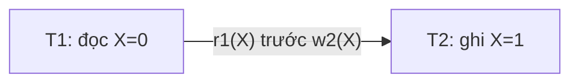
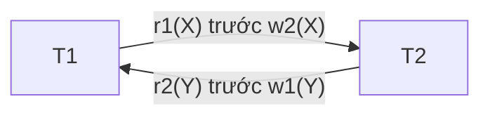

# Phân biệt thứ tự bắt đầu, thứ tự hoàn tất và thứ tự tuần tự tương đương

Trong hệ thống cơ sở dữ liệu có nhiều yêu cầu chạy đồng thời, ba câu dưới đây **không đồng nghĩa**:

1. **Giao dịch nào bắt đầu trước?**
2. **Giao dịch nào hoàn tất trước?**
3. **Nếu lịch thực thi là khả tuần tự hóa, giao dịch nào đứng trước trong một lịch chạy tuần tự tương đương?**

Một giao dịch có thể bắt đầu sớm, kết thúc muộn nhưng vẫn có vị trí **đứng trước** trong lịch tuần tự tương đương. Ngược lại, có tình huống nó bắt đầu sớm, kết thúc sớm nhưng lại **đứng sau** giao dịch kia trong thứ tự tuần tự tương đương. Cũng có lịch cho phép **nhiều** thứ tự tuần tự tương đương, hoặc **không tồn tại** thứ tự nào.

Đây là sự phân biệt cốt lõi của chương **Mô hình thực thi** trong chủ đề **Database Transaction Concurrency**: thứ tự theo đồng hồ mô tả *khi nào* một giao dịch đi vào và ra khỏi hệ thống; thứ tự tuần tự tương đương mô tả *các kết quả đọc/ghi có thể được giải thích như thể các giao dịch chạy tuần tự theo thứ tự nào*.

## 1. Các khái niệm trước khi đọc lịch thực thi

### 1.1 Giao dịch và lịch thực thi

Giao dịch (transaction) là đơn vị gồm một chuỗi thao tác trên dữ liệu, chẳng hạn:

```text
T1:
  BEGIN
  READ X
  WRITE Y
  COMMIT

T2:
  BEGIN
  WRITE X
  COMMIT
```

Trong mỗi giao dịch, thứ tự thao tác nội bộ được giữ nguyên. Khi hai giao dịch chạy đồng thời, bộ lập lịch (scheduler) và cơ chế đồng thời của DB có thể **xen kẽ** các thao tác của T1 và T2.

Ta gọi chuỗi thao tác xen kẽ đó là **lịch thực thi** (*schedule* hoặc *history*, tùy ngữ cảnh lý thuyết). Với một lịch hoàn tất, ta có thể quan sát việc đọc giá trị nào, ghi giá trị nào, giao dịch nào commit hoặc abort.

Một lịch **tuần tự** (*serial schedule*) chạy hết T1 rồi mới đến T2, hoặc ngược lại. Một lịch **không tuần tự** có các thao tác của T1 và T2 xen kẽ nhau. Lịch không tuần tự **có thể vẫn đúng** nếu nó tương đương với một lịch tuần tự theo tiêu chí phù hợp.

### 1.2 Ký hiệu dùng trong bài

| Ký hiệu | Cách đọc |
| --- | --- |
| `b₁` | T1 bắt đầu; tương ứng một mốc `BEGIN` trong mô hình đơn giản |
| `r₁(X)=0` | T1 đọc X và nhận giá trị 0 |
| `w₁(X←1)` | T1 ghi giá trị 1 vào X |
| `c₁` | T1 commit thành công |
| `a₁` | T1 abort/rollback |
| `T1 → T2` | Quan hệ có hướng “T1 phải đứng trước T2” trong đồ thị phụ thuộc hoặc thứ tự tuần tự đang xét |
| `X=0, Y=0` | Trạng thái dữ liệu ban đầu của ví dụ |

Chỉ số dưới ký hiệu là **mã giao dịch**, không phải thứ tự bắt đầu, thứ tự commit hay thứ hạng của một phiên bản dữ liệu. Tên T1 và T2 chỉ phục vụ phân biệt hai luồng.

**Quy ước:** trong các ví dụ đầu tiên, “hoàn tất” nghĩa là transaction đã **commit thành công** tại DB. Khi giao dịch bị rollback, ký hiệu kết thúc là `aᵢ`. Trong hệ thống thật, thời điểm DB commit thành công và thời điểm ứng dụng/client **nhận phản hồi** có thể khác nhau vì độ trễ mạng, timeout hoặc mất kết nối; cần xác định đang đo mốc nào trước khi so thứ tự.

### 1.3 Ba quan hệ thứ tự

**Thứ tự bắt đầu (start order):** T1 bắt đầu trước T2 nếu mốc `b₁` xuất hiện trước `b₂` trên dòng thời gian đã chọn.

**Thứ tự hoàn tất (completion order):** T1 hoàn tất trước T2 nếu sự kiện commit/abort được xác định của T1 xảy ra trước sự kiện kết thúc của T2. Với các giao dịch thành công, ta có thể gọi riêng **thứ tự commit** (*commit order*).

**Thứ tự tuần tự tương đương (equivalent serial order hoặc serialization order):** một thứ tự chạy toàn bộ các giao dịch tuần tự mà cho **quan sát phù hợp** với lịch thực tế. Thế nào là “phù hợp” phải gắn với tiêu chí tương đương, chẳng hạn *conflict equivalence*, *view equivalence* hoặc mô hình serializability của DB.

Thứ tự này là **kết luận logic về các phụ thuộc dữ liệu**; nó không nhất thiết là thứ tự được lưu trong một cột, số transaction ID, thời điểm `BEGIN` hoặc thứ tự `COMMIT`.

| Câu hỏi | Dựa trên bằng chứng nào? | Có thể suy ra từ tên T1/T2 không? |
| --- | --- | --- |
| Ai bắt đầu trước? | Thời điểm bắt đầu/được chấp nhận | Không |
| Ai hoàn tất trước? | Thời điểm kết thúc/commit thực tế | Không |
| Ai phải đứng trước khi tuần tự hóa? | Các giá trị đã đọc, thứ tự ghi, xung đột và ràng buộc của lịch | Không |
| Có duy nhất một thứ tự tuần tự không? | Đồ thị/quan hệ phụ thuộc giữa các giao dịch | Không; có thể có nhiều |

## 2. Vì sao ba thứ tự dễ bị nhầm?

Khi chạy một request đơn lẻ, ta thường thấy:

```text
b1 → ...toàn bộ công việc T1... → c1
b2 → ...toàn bộ công việc T2... → c2
```

Trong lịch tuần tự đơn giản này, thứ tự bắt đầu, thứ tự hoàn tất và thứ tự của chính lịch đều là **T1 rồi T2**. Thói quen quan sát như vậy khiến người học dễ tưởng ba thứ tự luôn trùng nhau.

Nhưng khi giao dịch chồng lấn, ta có thể có:

```text
Thời gian ────────────────────────────────────────────────────>

T1:  BEGIN ───── READ X ───────────────── WRITE Y ── COMMIT
T2:             BEGIN ── WRITE X ── COMMIT

Bắt đầu: T1 → T2
Hoàn tất: T2 → T1
Phụ thuộc đọc/ghi: cần phân tích; không nhìn đồng hồ để đoán
```

T1 còn hoạt động khi T2 hoàn tất. Từ lịch trên **chưa đủ** để kết luận thứ tự tuần tự tương đương nếu không biết T1 đọc giá trị nào và các giao dịch đọc/ghi những dữ liệu nào.

Có ba nguyên nhân nền tảng:

- **Chồng lấn thời gian:** DB có thể chuyển giữa các transaction và cho một transaction ngắn kết thúc trước transaction dài bắt đầu sớm.
- **Cơ chế khóa và snapshot:** thao tác đọc của một transaction có thể quan sát một phiên bản khác với transaction khác. Thời điểm bắt đầu transaction không nhất thiết là thời điểm tạo snapshot, tùy DBMS và isolation level.
- **Tương đương theo hành vi:** thứ tự tuần tự cần giải thích **các giá trị đọc và kết quả cuối**; thời điểm ứng dụng bắt đầu hay nhận `COMMIT` tự nó không thể chứng minh điều đó.

## 3. Ví dụ A — Bắt đầu T1 trước, hoàn tất T2 trước, nhưng tuần tự tương đương T1 → T2

Giả sử trạng thái đầu:

```text
X = 0
Y = 0
```

T1 cần đọc X rồi ghi Y; T2 cần thay đổi X.

| Thứ tự thời gian | T1 | T2 | Quan sát |
| --- | --- | --- | --- |
| 1 | `b₁` | | T1 bắt đầu |
| 2 | `r₁(X)=0` | | T1 đọc X cũ |
| 3 | | `b₂` | T2 bắt đầu |
| 4 | | `w₂(X←1)` | T2 sửa X |
| 5 | | `c₂` | T2 commit trước |
| 6 | `w₁(Y←1)` | | T1 sửa Y |
| 7 | `c₁` | | T1 commit sau |

Lịch rút gọn:

```text
b1  r1(X)=0  b2  w2(X←1)  c2  w1(Y←1)  c1
```

Ba thứ tự:

- **Bắt đầu:** T1 trước T2.
- **Hoàn tất:** T2 trước T1.
- **Tuần tự tương đương:** **T1 trước T2**.

**Tại sao?** T1 đã đọc X bằng 0 trước khi T2 ghi X thành 1. Nếu chạy toàn bộ T2 trước T1, T1 sẽ đọc X bằng 1, không tái hiện được kết quả đọc đã xảy ra. Ngược lại, nếu chạy toàn bộ T1 trước T2:

```text
T1: r1(X)=0; w1(Y←1); c1
T2: w2(X←1); c2
```

thì T1 vẫn đọc X bằng 0 và trạng thái cuối vẫn là `X=1, Y=1`.

T2 commit trước **không có nghĩa** T2 phải đứng trước trong lịch tuần tự tương đương. T1 có một **phụ thuộc đọc-ghi** đối với T2: T1 đọc phiên bản X mà T2 sau đó thay thế.

Có thể ghi:



Nếu chỉ nhìn thời điểm commit, người ta có thể đoán nhầm `T2 → T1`. Nếu chỉ nhìn thời điểm bắt đầu, tình cờ đoán đúng trong ví dụ này nhưng **lý do suy luận vẫn sai**: bằng chứng đúng là quan hệ phụ thuộc trên X.

**Lưu ý về thay đổi ví dụ:** nếu T1 đọc lại X sau khi T2 commit và được giá trị 1, ta đã thêm một quan sát mới. Quan sát mới đó có thể làm thay đổi tính khả tuần tự hóa của toàn bộ lịch. Vì vậy mỗi kết luận cần gắn với **lịch đầy đủ**, không chỉ hai mốc begin/commit.

## 4. Ví dụ B — T1 bắt đầu trước và hoàn tất trước, nhưng tuần tự tương đương T2 → T1

Lấy lại trạng thái đầu `X=0, Y=0`, lần này thay đổi vị trí thao tác:

| Thứ tự thời gian | T1 | T2 | Quan sát |
| --- | --- | --- | --- |
| 1 | `b₁` | | T1 bắt đầu nhưng chưa đọc/ghi |
| 2 | | `b₂` | T2 bắt đầu |
| 3 | | `r₂(X)=0` | T2 đọc X cũ |
| 4 | `w₁(X←1)` | | T1 thay đổi X |
| 5 | `c₁` | | T1 commit trước |
| 6 | | `w₂(Y←1)` | T2 ghi Y |
| 7 | | `c₂` | T2 commit sau |

Lịch:

```text
b1  b2  r2(X)=0  w1(X←1)  c1  w2(Y←1)  c2
```

Ba thứ tự:

- **Bắt đầu:** T1 trước T2.
- **Hoàn tất:** T1 trước T2.
- **Tuần tự tương đương:** **T2 trước T1**.

T2 phải xuất hiện trước thao tác ghi X của T1 khi ta sắp xếp thành lịch tuần tự, vì T2 cần đọc được giá trị cũ `X=0`. Lịch tuần tự:

```text
T2: r2(X)=0; w2(Y←1); c2
T1: w1(X←1); c1
```

cho đúng các kết quả đọc/ghi được quan sát. Việc T1 bắt đầu và commit trước T2 **không tạo một ràng buộc “T1 phải tuần tự trước”** trong tiêu chí serializability thông thường, bởi hai transaction đã **chồng lấn**: T2 bắt đầu trước khi T1 kết thúc.

Điều đáng nhớ ở ví dụ này là cả **start order** lẫn **commit order** đều cùng hướng T1 → T2 nhưng **serialization order lại ngược hướng**.

## 5. Ví dụ C — Không tồn tại một thứ tự tuần tự duy nhất

Giả sử T1 chỉ thay đổi X, T2 chỉ thay đổi Y và không đọc dữ liệu của nhau:

```text
Ban đầu: X=0, Y=0

b1  w1(X←1)  b2  w2(Y←1)  c2  c1
```

Lịch này có:

- Start order: `T1 → T2`.
- Completion order: `T2 → T1`.
- Không có xung đột dữ liệu giữa T1 và T2.

Cả hai lịch tuần tự sau đều cho cùng kết quả:

```text
Lịch tuần tự 1:
  T1: X←1
  T2: Y←1

Lịch tuần tự 2:
  T2: Y←1
  T1: X←1
```

Nếu không có quan sát/ràng buộc nào khác, cả hai đều hợp lệ. Vì thế câu “**thứ tự tuần tự tương đương**” không luôn chỉ về **một** thứ tự duy nhất.

Một cách diễn đạt chính xác hơn là: “Lịch thực tế tương đương với **ít nhất một lịch tuần tự**; những quan hệ bắt buộc được suy ra từ các phụ thuộc dữ liệu. Những giao dịch không bị ràng buộc tương đối với nhau có thể đổi chỗ”.

Điều này đặc biệt quan trọng khi log ứng dụng in các dòng theo một thứ tự cố định: log có thể cho ta **một thứ tự thời gian**, nhưng lịch có thể tương đương với **nhiều thứ tự tuần tự**.

## 6. Khi nào không tồn tại bất kỳ thứ tự tuần tự tương đương nào?

Hãy xét hai giao dịch:

- T1: đọc X; nếu quyết định tiếp tục thì ghi Y.
- T2: đọc Y; nếu quyết định tiếp tục thì ghi X.

Ban đầu `X=0, Y=0`. Lịch:

| Bước | T1 | T2 |
| --- | --- | --- |
| 1 | `b₁` | |
| 2 | | `b₂` |
| 3 | `r₁(X)=0` | |
| 4 | | `r₂(Y)=0` |
| 5 | `w₁(Y←1)` | |
| 6 | | `w₂(X←1)` |
| 7 | `c₁` | |
| 8 | | `c₂` |

Hai quan hệ bắt buộc:

1. T1 đọc X trước khi T2 ghi X, nên để giữ `r₁(X)=0`, thứ tự tuần tự phải cho **T1 trước T2**.
2. T2 đọc Y trước khi T1 ghi Y, nên để giữ `r₂(Y)=0`, thứ tự tuần tự phải cho **T2 trước T1**.



Có chu trình `T1 → T2 → T1`: không thể đồng thời xếp T1 trước T2 **và** T2 trước T1 trong một lịch tuần tự.

Kiểm chứng trực tiếp bằng cách thử hai khả năng:

| Thứ tự tuần tự giả định | Giá trị đọc bắt buộc trong lịch tuần tự | Có trùng quan sát thật không? |
| --- | --- | --- |
| T1 rồi T2 | T1 đọc X=0; sau T1 ghi Y=1, T2 phải đọc Y=1 | **Không**: lịch thật T2 đã đọc Y=0 |
| T2 rồi T1 | T2 đọc Y=0; sau T2 ghi X=1, T1 phải đọc X=1 | **Không**: lịch thật T1 đã đọc X=0 |

Vậy lịch này **không serializable** theo chính các quan sát đọc/ghi đã nêu, bất kể ta cố sắp xếp theo thứ tự bắt đầu hay hoàn tất.

Đây là cấu trúc của một dạng **write skew**: hai giao dịch đọc một điều kiện chung rồi ghi **hai hàng khác nhau**. Trong PostgreSQL `REPEATABLE READ` với snapshot isolation, hai giao dịch viết những hàng khác nhau như ví dụ này có thể cùng commit. Ở `SERIALIZABLE`, PostgreSQL phải bảo vệ tính khả tuần tự hóa, nên khi tạo được lịch xung đột như trên, ít nhất một giao dịch không thể commit thành công với những quan sát đó; ứng dụng có thể nhận lỗi serialization `40001` và phải retry toàn bộ giao dịch.

## 7. Đồ thị phụ thuộc: cách suy ra thứ tự tuần tự tương đương

Với những lịch đọc/ghi đơn giản theo mô hình một phiên bản, có thể dùng **đồ thị tuần tự hóa** (*precedence graph* hay *serialization graph*) để nhận biết conflict serializability.

### 7.1 Cách dựng đồ thị

1. Mỗi giao dịch là **một đỉnh**.
2. Tìm các cặp thao tác thuộc **hai giao dịch khác nhau** trên **cùng dữ liệu**.
3. Nếu ít nhất một thao tác là **ghi**, hai thao tác đó xung đột. Khi thao tác của Ti đứng trước thao tác của Tj trong lịch, tạo cạnh `Ti → Tj`.
4. Làm với mọi cặp thao tác có xung đột, thu được đồ thị phụ thuộc.
5. Nếu đồ thị **không có chu trình**, lịch *conflict-serializable*; mỗi thứ tự topo của đồ thị tương ứng với một lịch tuần tự tương đương theo conflict equivalence. Nếu **có chu trình**, lịch không conflict-serializable.

Ba dạng xung đột cơ bản:

| Thứ tự thao tác trên cùng X | Cạnh | Ý nghĩa trực quan |
| --- | --- | --- |
| `w₁(X)` rồi `r₂(X)` | `T1 → T2` | T1 ghi phiên bản mà T2 có thể quan sát |
| `r₁(X)` rồi `w₂(X)` | `T1 → T2` | T1 đọc trước khi T2 thay thế giá trị đó |
| `w₁(X)` rồi `w₂(X)` | `T1 → T2` | Thứ tự ghi cùng dữ liệu ảnh hưởng kết quả |

Hai thao tác chỉ đọc cùng X (`r₁(X)` và `r₂(X)`) **không tạo xung đột đọc/ghi** trong mô hình cơ bản.

Ví dụ A tạo cạnh `T1 → T2`. Ví dụ B tạo cạnh `T2 → T1`. Ví dụ C không có cạnh, nên có hai thứ tự topo. Ví dụ write skew tạo cạnh hai chiều, nên không có thứ tự topo.

### 7.2 Ba điểm cần biết khi áp dụng vào DB thực

**Thứ nhất, conflict serializability là một tiêu chí cụ thể.** Nếu đồ thị xung đột có chu trình, điều đó chứng minh lịch không *conflict-serializable*. Về lý thuyết có những lịch vẫn *view-serializable* nhưng không *conflict-serializable*, chẳng hạn trong một số lịch có các thao tác ghi không cần đọc giá trị cũ (*blind writes*). Không nên dùng một đồ thị conflict đơn giản để kết luận sai cho mọi mô hình tương đương.

**Thứ hai, MVCC làm lịch thực tế phong phú hơn.** Một câu SELECT có thể đọc **phiên bản cũ** do snapshot cho phép, kể cả lúc một phiên bản mới đã commit. Vì vậy, khi phân tích PostgreSQL hoặc các DB dùng MVCC, cần xác định **đọc từ phiên bản nào**, quan hệ *read-from*, thứ tự ghi phiên bản và các *read–write anti-dependencies*; chỉ nhìn thứ tự xuất hiện của câu SQL trong log có thể không đủ.

**Thứ ba, điều kiện truy vấn cũng là dữ liệu phụ thuộc.** Nếu T1 truy vấn “có bao nhiêu nhân viên đang trực?” rồi T2 thêm/xóa một hàng làm đổi kết quả, đó là phụ thuộc trên **tập hàng/predicate**, dù không nhất thiết cùng chạm một khóa chính. Cơ chế serializable của DB phải xét các tương tác như vậy, không chỉ mỗi ô dữ liệu X trong ví dụ giấy bút.

### 7.3 Chỉ xét những giao dịch đã commit có đủ không?

Trong các ví dụ của bài, ta đang xét **các giao dịch đã commit** để hỏi liệu hiệu ứng quan sát cuối có tương đương một thực thi tuần tự hay không. Lịch có giao dịch abort, transaction đang chạy dở hoặc transaction đọc dữ liệu chưa commit còn yêu cầu phân tích:

- Ảnh hưởng của việc rollback đối với các đọc đã xảy ra.
- Có transaction nào phụ thuộc vào dữ liệu chưa commit dẫn đến *cascading abort* hay không.
- Khả năng phục hồi (*recoverability*), strictness và việc cô lập các giao dịch đang chạy.
- Kết quả trả về cho caller trước hoặc sau commit.

Không thể chỉ bỏ qua giao dịch abort trong mọi lịch rồi tuyên bố toàn hệ thống an toàn. Tuy nhiên, việc bắt đầu với các giao dịch commit trong ví dụ ngắn giúp làm rõ ba thứ tự đang cần phân biệt.

## 8. Phân biệt serializability với strict serializability

**Serializability** yêu cầu lịch thực thi đồng thời có hành vi tương đương **một lịch tuần tự nào đó**. Tiêu chí này nói về khả năng **sắp xếp logic**, nhưng tự nó **không bắt buộc** thứ tự tuần tự phải giữ quan hệ thời gian thực giữa các giao dịch không chồng lấn.

**Strict serializability** thêm điều kiện **real-time order**:

> Nếu T1 **đã hoàn tất trước khi T2 bắt đầu**, thứ tự tuần tự tương đương bắt buộc phải có T1 đứng trước T2.

Điều kiện này chỉ ràng buộc các giao dịch có thứ tự thời gian thực xác định rõ. Nếu T1 và T2 **chồng lấn**, strict serializability vẫn có thể chọn T2 trước T1 hoặc T1 trước T2, miễn các quan sát dữ liệu và các ràng buộc khác cho phép.

### 8.1 “Bắt đầu trước” chưa phải real-time precedence

Xét:

```text
T1: BEGIN ─────────────────────────────── COMMIT
T2:          BEGIN ───── COMMIT
```

T1 bắt đầu trước T2, nhưng hai transaction **chồng lấn**. Không có điều kiện “T1 hoàn tất trước khi T2 bắt đầu”, nên chỉ dựa vào thời gian thực **không buộc** T1 phải đứng trước T2 trong lịch tuần tự của strict serializability.

Điều kiện có hiệu lực trong lịch sau:

```text
T1: BEGIN ── WRITE X ── COMMIT
T2:                            BEGIN ── READ X ── COMMIT
```

T1 hoàn tất trước khi T2 bắt đầu; theo strict serializability, **T1 phải đứng trước T2** trong lịch tuần tự. Đó là một ràng buộc bổ sung ngoài việc tìm một thứ tự tuần tự bất kỳ.

### 8.2 Ví dụ serializable nhưng không strict-serializable

Xét lịch ở mức **dịch vụ dữ liệu trừu tượng** có thể trả về một bản sao stale:

```text
Ban đầu X=0.

T1: BEGIN; WRITE X←1; COMMIT thành công.
    [T1 đã hoàn tất; client biết T1 thành công]

T2: BEGIN; READ X=0; COMMIT thành công.
    [T2 chỉ bắt đầu sau khi T1 kết thúc]
```

Để T2 đọc X=0 từ trạng thái đầu, một lịch tuần tự tương đương theo quan sát đọc sẽ đặt **T2 trước T1**:

```text
T2: đọc X=0
T1: ghi X=1
```

Thứ tự tuần tự này giải thích kết quả đọc và giá trị cuối `X=1`, nên lịch có thể *serializable* theo tiêu chí không bảo toàn thời gian thực. Tuy nhiên, nó **không strict-serializable**: thời gian thực buộc `T1 → T2`, ngược với thứ tự cần để giải thích việc T2 đọc dữ liệu cũ.

Ví dụ phù hợp khi suy nghĩ về dịch vụ đọc từ replica trễ hoặc hệ thống trả snapshot stale; **không được xem đây là hành vi mặc định của một truy vấn mới trên primary PostgreSQL với cấu hình thông thường**.

> **Điểm mấu chốt:** thời gian thực chỉ áp đặt thứ tự khi một giao dịch đã **hoàn thành trước lúc** giao dịch kia bắt đầu. Hai giao dịch bắt đầu theo thứ tự nào trong khoảng chồng lấn không đủ để định vị chúng trong lịch tuần tự.

### 8.3 Liên hệ với linearizability

*Linearizability* thường được diễn đạt cho các thao tác đồng thời trên một đối tượng: mỗi thao tác có vẻ xảy ra nguyên tử tại một điểm logic giữa lúc được gọi và lúc trả kết quả, đồng thời giữ quan hệ thời gian thực.

*Strict serializability* có thể hiểu là mở rộng tinh thần đó cho **các transaction đa thao tác**, kết hợp tính khả tuần tự hóa với thứ tự thời gian thực. Không nên coi hai từ là đồng nghĩa hoàn toàn trong mọi ngữ cảnh API: đơn vị của linearizability thường là **một operation**, còn đơn vị của strict serializability là **một transaction**.

## 9. Thứ tự bắt đầu và hoàn tất còn khác thời điểm snapshot

Trong cơ sở dữ liệu thực, người học thường quan sát các mốc:

1. Request đến API.
2. Ứng dụng gọi `BEGIN` hoặc framework tạo transaction scope.
3. DB cấp transaction ID nếu và khi cần.
4. DB xác định snapshot để đọc.
5. Các câu SQL đọc/ghi chạy; có thể đợi khóa hoặc đụng xung đột.
6. DB nhận `COMMIT`, xử lý kiểm tra và quyết định commit/abort.
7. Driver trả kết quả; API gửi response; client nhận response.

Các mốc này **không luôn trùng nhau**. Chẳng hạn:

- Trên PostgreSQL `READ COMMITTED`, mỗi câu lệnh nhìn dữ liệu phù hợp snapshot của **câu lệnh đó**, nên hai SELECT trong cùng transaction có thể thấy dữ liệu khác nhau.
- Trên PostgreSQL `REPEATABLE READ`, snapshot cho các truy vấn được thiết lập theo quy tắc của mức cô lập, thường ở **câu lệnh đầu tiên cần snapshot**, không nên đánh đồng tuyệt đối với timestamp ứng dụng gọi `BEGIN`.
- Một transaction bắt đầu sớm có thể bị chờ khóa lâu và commit muộn. Giao dịch đến sau nhưng ít xung đột có thể kết thúc trước.
- Việc transaction có mã ID nhỏ hơn không phải là **chứng cứ chung** rằng nó đứng trước trong serial order.
- Commit thành công ở DB và response thành công được client nhận là hai sự kiện; nếu mất response, client có thể không biết liệu giao dịch đã commit. Đây là vấn đề riêng của giao thức và idempotency.

Do đó, khi đọc log, hãy đặt tên rõ mốc: **request_received, tx_begin, first_read, snapshot, first_write, commit_accepted, response_sent, response_received** (chỉ ghi mốc nào thật sự đo được). Nếu không có độ chính xác đó, log dễ tạo ra “thứ tự” gây hiểu nhầm.

## 10. Thực hành với PostgreSQL bằng hai kết nối

Các thí nghiệm dưới đây chỉ nhằm **quan sát sự khác biệt về thứ tự**. Sử dụng một database thử nghiệm và hai cửa sổ `psql` riêng (Session A và Session B), vì một connection duy nhất không tạo hai transaction đang hoạt động độc lập.

### 10.1 Chuẩn bị dữ liệu

Chạy một lần ngoài transaction thử nghiệm:

```sql
CREATE TABLE IF NOT EXISTS tx_order_lab (
    item text PRIMARY KEY,
    value integer NOT NULL
);

INSERT INTO tx_order_lab (item, value)
VALUES ('X', 0), ('Y', 0)
ON CONFLICT (item) DO UPDATE SET value = EXCLUDED.value;
```

Trước **mỗi kịch bản** sau, đợi mọi transaction trước đã commit/rollback, rồi reset:

```sql
UPDATE tx_order_lab
SET value = 0
WHERE item IN ('X', 'Y');
```

Để tránh nhầm các kịch bản, ghi rõ thứ tự thao tác do người chạy điều phối. Các cửa sổ không chạy một script tuần tự chung.

### 10.2 Kịch bản A: bắt đầu A trước, commit B trước, serial tương đương A → B

**Session A:**

```sql
BEGIN ISOLATION LEVEL READ COMMITTED;

SELECT value FROM tx_order_lab WHERE item = 'X';
-- X=0. Giữ transaction A mở, chuyển sang session B.
```

**Session B:**

```sql
BEGIN ISOLATION LEVEL READ COMMITTED;

UPDATE tx_order_lab SET value = 1 WHERE item = 'X';

COMMIT;
-- B hoàn tất trước A.
```

**Quay về Session A:**

```sql
UPDATE tx_order_lab SET value = 1 WHERE item = 'Y';

COMMIT;
```

Kiểm tra sau khi cả hai đã hoàn tất:

```sql
SELECT item, value
FROM tx_order_lab
ORDER BY item;

-- X=1, Y=1.
```

Quan trọng hơn trạng thái cuối là ghi lại rằng **A đã đọc X=0** trước khi B cập nhật X. Để giữ kết quả đọc đó, thứ tự tuần tự tương đương là **A trước B**, mặc dù B commit trước.

### 10.3 Kịch bản B: A bắt đầu và commit trước, nhưng serial tương đương B → A

Reset dữ liệu về `X=0, Y=0`.

**Session A:**

```sql
BEGIN ISOLATION LEVEL READ COMMITTED;
-- Tạm dừng ở đây: A đã BEGIN, chưa đọc/ghi.
```

**Session B:**

```sql
BEGIN ISOLATION LEVEL READ COMMITTED;

SELECT value FROM tx_order_lab WHERE item = 'X';
-- X=0. Giữ B mở.
```

**Quay về Session A:**

```sql
UPDATE tx_order_lab SET value = 1 WHERE item = 'X';

COMMIT;
-- A hoàn tất trước B.
```

**Quay về Session B:**

```sql
UPDATE tx_order_lab SET value = 1 WHERE item = 'Y';

COMMIT;
```

Đối chiếu:

| Thứ tự | Quan sát |
| --- | --- |
| Bắt đầu | A → B |
| Hoàn tất | A → B |
| Tuần tự tương đương | B → A |
| Ràng buộc quyết định | B đọc X=0 trước khi A ghi X=1 |

Ở đây, thời điểm A chạy `BEGIN` không buộc dữ liệu của A xuất hiện trước B trong serial order. A và B đã chồng lấn, còn kết quả B đọc X=0 yêu cầu B đứng trước hành động ghi X của A.

### 10.4 Kịch bản không serializable: hai lần đọc trước hai lần ghi

Reset dữ liệu về `X=0, Y=0`.

**Session A:**

```sql
BEGIN ISOLATION LEVEL REPEATABLE READ;

SELECT value FROM tx_order_lab WHERE item = 'X';
-- X=0.
```

**Session B:**

```sql
BEGIN ISOLATION LEVEL REPEATABLE READ;

SELECT value FROM tx_order_lab WHERE item = 'Y';
-- Y=0.
```

**Session A:**

```sql
UPDATE tx_order_lab SET value = 1 WHERE item = 'Y';
-- Giữ transaction mở.
```

**Session B:**

```sql
UPDATE tx_order_lab SET value = 1 WHERE item = 'X';
-- Hai session ghi hai hàng khác nhau.
```

Sau đó commit lần lượt A rồi B:

```sql
-- Session A:
COMMIT;

-- Session B:
COMMIT;
```

Trong PostgreSQL `REPEATABLE READ`, lịch này có thể hoàn tất cả hai transaction vì không có tranh chấp cập nhật **cùng một hàng**. Nhưng không có serial order nào giải thích đồng thời hai lần đọc `A:X=0` và `B:Y=0` cùng hai cập nhật.

Muốn thấy hệ quản trị bảo vệ khả tuần tự hóa, reset dữ liệu và chạy lại cùng lịch với:

```sql
BEGIN ISOLATION LEVEL SERIALIZABLE;
```

ở cả A và B. PostgreSQL `SERIALIZABLE` có thể kết thúc một giao dịch bằng lỗi `40001` khi phát hiện chu trình phụ thuộc khiến cả hai không thể commit cùng một lịch tương đương tuần tự. Đó là tín hiệu ứng dụng phải **retry toàn bộ transaction**, không chỉ chạy lại lệnh `COMMIT`.

Lưu ý: kết quả từng phiên có thể thay đổi theo lịch thật; mục tiêu là giữ đúng thứ tự **A và B đều đọc trước khi hai lần ghi xảy ra**.

## 11. Phân tích lịch thực thi theo một quy trình nhất quán

Khi gặp bất kỳ sơ đồ hoặc log concurrency nào, hãy trả lời theo trình tự:

### Bước 1 — Xác định ranh giới của mỗi giao dịch

Liệt kê `BEGIN`, mỗi lần đọc/ghi và `COMMIT` hoặc `ROLLBACK`. Ghi kết quả các lần đọc; chỉ ghi “SELECT X” mà không biết nó **đọc phiên bản nào** thì thường chưa đủ để kết luận.

### Bước 2 — Ghi hai thứ tự thời gian quan sát được

Tạo bảng:

| Giao dịch | Bắt đầu lúc | Hoàn tất lúc | Kết quả |
| --- | --- | --- | --- |
| T1 | `b₁` | `c₁` hoặc `a₁` | Commit hoặc abort |
| T2 | `b₂` | `c₂` hoặc `a₂` | Commit hoặc abort |

Từ đó ghi rõ **start order** và **completion order**. Không suy ra serial order ở bước này.

### Bước 3 — Lập quan hệ phụ thuộc dữ liệu

Với lịch một phiên bản, tìm các cặp đọc/ghi hoặc ghi/ghi cùng dữ liệu; lập các cạnh phụ thuộc. Với snapshot/MVCC, ghi thêm phiên bản được đọc và những cập nhật làm thay đổi phiên bản hoặc tập kết quả của truy vấn.

Các câu hỏi trọng tâm:

- T1 đọc giá trị do T2 đã ghi, hay đọc giá trị **trước khi** T2 thay đổi?
- Hai giao dịch ghi cùng một dữ liệu hay hai dữ liệu khác nhau?
- Giao dịch nào kiểm tra điều kiện/predicate mà giao dịch kia làm thay đổi?
- Ràng buộc nghiệp vụ có phụ thuộc tập nhiều hàng, không chỉ một biến X?

### Bước 4 — Tìm các lịch tuần tự có thể tái hiện quan sát

Với hai giao dịch, thử cả `T1 rồi T2` và `T2 rồi T1`. Với nhiều giao dịch, dùng thứ tự topo của đồ thị phụ thuộc khi tiêu chí conflict serializability phù hợp.

Các khả năng:

1. **Chỉ một thứ tự** giải thích quan sát: có một thứ tự tương đương bắt buộc.
2. **Nhiều thứ tự** cùng giải thích: serialization order không duy nhất.
3. **Không thứ tự nào** giải thích: lịch không serializable theo tiêu chí đang xét.

### Bước 5 — Kiểm tra yêu cầu thời gian thực nếu cần

Nếu hệ thống hứa **strict serializability**, thêm cạnh thực thời `T1 → T2` khi **T1 hoàn tất trước T2 bắt đầu**. Lịch tuần tự đã chọn phải giữ các cạnh này cùng các phụ thuộc dữ liệu.

### Bước 6 — Kiểm tra kết quả nghiệp vụ

Serializability giúp lập luận về thứ tự tương đương, nhưng **không tự sửa mã nghiệp vụ sai**. Nếu giao dịch tuần tự đơn lẻ vốn vẫn cho phép tồn kho âm do thiếu kiểm tra, lịch serializable vẫn có thể tạo kết quả sai. Luôn đối chiếu với invariant, ví dụ:

- Tồn kho không âm, không cấp hai đơn cho một suất hàng cuối.
- Chuyển tiền không mất/cộng lặp giá trị.
- Không có hai booking hiệu lực cho cùng ghế.
- Luôn giữ lại ít nhất một người trực ca.

## 12. Những suy luận sai cần loại bỏ

### “T1 gọi BEGIN trước nên T1 sẽ tuần tự trước”

Sai. Thời điểm BEGIN chỉ cho biết T1 **đã bắt đầu**; vị trí tương đương phụ thuộc các thao tác và quan sát. Ví dụ B cho thấy T1 BEGIN trước nhưng vị trí serial bắt buộc là T2 trước T1.

### “Ai commit trước thì hẳn đứng trước trong serial order”

Sai. Ví dụ A có T2 commit trước nhưng T1 phải đứng trước T2 để giải thích lần đọc X=0. Commit order là sự kiện thời gian, không phải phép tính đồ thị phụ thuộc.

### “Transaction ID nhỏ hơn nghĩa là thực thi tuần tự sớm hơn”

Không có quy tắc tổng quát như vậy. Cách cấp ID tùy DBMS, transaction có thể đợi khóa, rollback, được cấp ID ở thời điểm khác BEGIN, và snapshot/serial order có ngữ nghĩa riêng.

### “Một lịch không chạy tuần tự thì chắc không serializable”

Sai. Các thao tác xen kẽ vẫn có thể tương đương một lịch tuần tự; đó chính là điều serializability cho phép để hệ thống vừa đúng vừa có concurrency.

### “Serializable đồng nghĩa hoàn tất trước phải được nhìn thấy trước”

Cần phân biệt. **Strict serializability** thêm điều kiện giữ thời gian thực khi một giao dịch hoàn tất trước lúc giao dịch khác bắt đầu. Không nên tự gán điều kiện đó cho mọi lời hứa chỉ ghi “serializable” mà chưa xem mô hình hệ thống.

### “Không có đồ thị conflict chu trình thì mọi nghiệp vụ đã an toàn”

Đồ thị không chu trình chứng minh *conflict serializability* cho các thao tác/mô hình đã đưa vào đồ thị. Nếu bỏ sót predicate read, version đã đọc, dữ liệu ngoài DB hoặc quy tắc nghiệp vụ chưa được cưỡng chế, kết luận không bao trùm các yếu tố đó.

### “Chỉ nhìn dữ liệu cuối là biết serial order”

Không đủ. Cùng trạng thái cuối `X=1, Y=1` có thể hình thành bởi nhiều lịch; kết quả **đã được trả về ở những lần đọc** mới cho biết phụ thuộc bắt buộc. Vì thế trong bài phân tích lịch, luôn ghi kết quả đọc, không chỉ các lệnh UPDATE/COMMIT.

### “Hai giao dịch commit thành công chứng minh lịch serializable”

Không đủ. Ví dụ write skew cho hai giao dịch cùng commit dưới một mức cô lập nhất định nhưng không tồn tại lịch tuần tự tương đương với các kết quả đọc đã quan sát.

## 13. Bài tập luyện phân biệt ba thứ tự

Với các bài dưới đây, giả sử mọi dữ liệu ban đầu đều bằng 0, các giao dịch commit thành công trừ khi đề bài ghi khác, và mỗi lần đọc được ghi rõ giá trị. Hãy xác định **(a) start order; (b) completion order; (c) một hoặc tất cả thứ tự tuần tự tương đương; (d) lý do phụ thuộc dữ liệu**.

### Bài 1 — Commit sau nhưng phải đứng trước

```text
b1
r1(X)=0
b2
w2(X←7)
c2
w1(Y←9)
c1
```

**Đáp án:** start T1 → T2; completion T2 → T1; serial tương đương **T1 → T2** vì `r₁(X)` phải có trước `w₂(X)`.

### Bài 2 — Bắt đầu trước và commit trước vẫn đứng sau

```text
b1
b2
r2(X)=0
w1(X←4)
c1
w2(Y←8)
c2
```

**Đáp án:** start T1 → T2; completion T1 → T2; serial tương đương **T2 → T1** vì `r₂(X)` nhận giá trị cũ trước `w₁(X)`.

### Bài 3 — Không có một đáp án serial duy nhất

```text
b1
b2
w1(X←11)
w2(Y←22)
c1
c2
```

**Đáp án:** start T1 → T2; completion T1 → T2; cả **T1 → T2** và **T2 → T1** đều tương đương theo đọc/ghi đã nêu, vì hai giao dịch không đụng dữ liệu chung. Nếu thêm một lần đọc tạo phụ thuộc, tập thứ tự hợp lệ có thể thu hẹp.

### Bài 4 — Chu trình hai chiều

```text
b1
b2
r1(X)=0
r2(Y)=0
w1(Y←1)
w2(X←1)
c1
c2
```

**Đáp án:** start T1 → T2; completion T1 → T2; **không tồn tại serial order tương đương** cho những giá trị đọc được báo cáo. T1 phải đứng trước T2 do X, nhưng T2 lại phải đứng trước T1 do Y.

### Bài 5 — Ba giao dịch, chỉ một quan hệ bắt buộc

```text
Ban đầu X=0, Y=0, Z=0.

b1
b2
b3
r1(X)=0
w2(X←1)
w3(Z←1)
w1(Y←1)
c3
c2
c1
```

**Đáp án:** start T1 → T2 → T3; completion T3 → T2 → T1. Phụ thuộc bắt buộc là **T1 → T2** vì lần đọc X. T3 độc lập với cả hai, nên có ba thứ tự tuần tự tương đương: **T1,T2,T3**; **T1,T3,T2**; **T3,T1,T2**.

### Bài 6 — Thời gian thực tạo ràng buộc mới

```text
T1: BEGIN; WRITE X←1; COMMIT (đã trả thành công).
[Chỉ sau khi T1 hoàn tất, T2 mới bắt đầu.]
T2: BEGIN; READ X=0; COMMIT.
```

**Đáp án:** về quan sát dữ liệu, cách xếp T2 trước T1 giải thích việc T2 đọc giá trị cũ. Nhưng thời gian thực đòi T1 trước T2. Vì vậy lịch **không strict-serializable**. Cần nhớ đây là ví dụ khái niệm cho hệ thống có thể cung cấp dữ liệu cũ, không phải kết luận rằng một primary PostgreSQL sẽ trả kết quả như vậy.

## 14. Mẫu ghi chép để phân tích bất kỳ lịch nào

Khi học hoặc kiểm tra hệ thống, có thể lưu một mẫu nhỏ cho mỗi kịch bản:

```text
Bài toán:
Invariant nghiệp vụ:

Giao dịch T1:
  BEGIN:
  READ (đã đọc từ phiên bản / giá trị):
  WRITE:
  COMMIT/ROLLBACK:

Giao dịch T2:
  BEGIN:
  READ (đã đọc từ phiên bản / giá trị):
  WRITE:
  COMMIT/ROLLBACK:

Lịch xen kẽ thực tế:
  1. ...
  2. ...

Thứ tự bắt đầu:
Thứ tự hoàn tất:
Các quan hệ phụ thuộc:
Có chu trình không:
Các thứ tự tuần tự tương đương:
Có yêu cầu bảo toàn real-time order không:
Kết quả đối chiếu invariant:
Giới hạn của quan sát / mốc thời gian chưa đo được:
```

Khi phân tích incident ở production, trường “**các phiên bản/giá trị đã đọc**” thường là phần thiếu nhất nhưng lại quyết định việc xác định nguyên nhân của lỗi đồng thời. Nếu log không ghi đủ, cần tái hiện bằng test hai connection hoặc có cơ chế tracing hợp lý trước khi khẳng định một thứ tự serial cụ thể.

---

## Điều cần ghi nhớ

**Start order** trả lời “ai bước vào trước”; **completion order** trả lời “ai rời đi trước”; **equivalent serial order** trả lời “các kết quả của lịch đồng thời có thể được giải thích bằng thứ tự tuần tự nào”. Hai thứ tự đầu thuộc về dòng thời gian thực thi, còn thứ tự thứ ba dựa trên phụ thuộc và quan sát dữ liệu.

Muốn kết luận đúng, cần đọc **toàn bộ lịch**, ghi các giá trị đọc/ghi, dựng quan hệ phụ thuộc và tìm lịch tuần tự tương đương. Chỉ sau đó mới xét thêm **real-time order** nếu mục tiêu là strict serializability. Việc ba thứ tự tình cờ trùng nhau trong một ví dụ không tạo thành quy luật cho mọi hệ giao dịch đồng thời.
