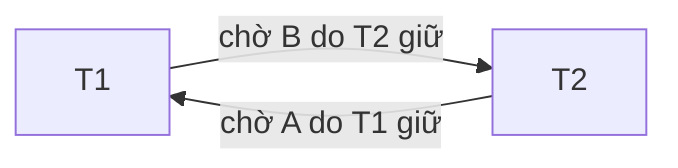

# Quan hệ giữa 2PL, chờ khóa và bế tắc

Trong cơ sở dữ liệu có nhiều giao dịch chạy đồng thời, khóa (lock) giúp kiểm soát việc đọc và ghi lên cùng dữ liệu. Khi một giao dịch yêu cầu khóa không tương thích với khóa đang được giao dịch khác giữ, nó phải chờ. Nếu nhiều giao dịch chờ lẫn nhau theo một chu trình, hệ thống rơi vào bế tắc (deadlock).

**Two-Phase Locking (2PL – khóa hai pha)** quy định thứ tự một giao dịch được lấy và giải phóng khóa. Quy tắc này bảo đảm lịch thực thi có thể tuần tự hóa theo xung đột (conflict-serializable), nhưng tự nó không ngăn được deadlock. Trên thực tế, việc các giao dịch tuân thủ 2PL và giữ khóa trong thời gian chồng lấn chính là một trong những điều kiện khiến chúng có thể chặn nhau hoặc tạo thành chu trình chờ.

Để hiểu mối quan hệ này, cần phân biệt ba vấn đề: 2PL quy định vòng đời khóa trong từng giao dịch; blocking mô tả một giao dịch đang chờ khóa do giao dịch khác; deadlock mô tả một nhóm giao dịch chờ tạo thành chu trình không thể tự tháo gỡ.

## 1. Nhắc lại quy tắc Two-Phase Locking

Một giao dịch theo 2PL có hai pha liên tiếp:

1. **Pha tăng trưởng (growing phase):** giao dịch có thể lấy thêm khóa và nâng cấp khóa, nhưng không được giải phóng khóa.
2. **Pha thu hẹp (shrinking phase):** giao dịch có thể giải phóng hoặc hạ cấp khóa, nhưng không được lấy khóa mới hay nâng cấp khóa.

Điểm chuyển giữa hai pha được gọi là **lock point**: thời điểm giao dịch lấy khóa cuối cùng. Sau thời điểm này, giao dịch chỉ có thể nhả hoặc hạ cấp các khóa đang giữ.

```text
Thời gian của một giao dịch theo 2PL  -------------------------------->

Pha tăng trưởng                    Pha thu hẹp
Lấy S(A) -> lấy X(B) -> lấy S(C) -> nhả S(A) -> nhả X(B) -> COMMIT
                              ^
                              |
                           Lock point

Sau khi nhả S(A), giao dịch không được lấy khóa mới.
```

Ví dụ, giao dịch T1 có thể lấy S(A), sau đó lấy X(B), rồi mới bắt đầu nhả khóa. Nếu T1 nhả S(A) trước và sau đó lại yêu cầu X(C), T1 đã vi phạm 2PL vì nó lấy khóa mới sau khi bước vào pha thu hẹp.

2PL điều chỉnh thứ tự lấy và nhả khóa, chứ không bắt buộc một giao dịch phải lấy được khóa ngay lập tức. Nếu khóa cần thiết đang xung đột với khóa khác, yêu cầu vẫn phải chờ theo ma trận tương thích và chính sách hàng đợi của lock manager.

## 2. Vì sao 2PL tạo ra blocking?

Blocking xảy ra khi một yêu cầu khóa chưa thể được cấp. Chẳng hạn, T1 giữ X trên hàng A. T2 muốn đọc hoặc cập nhật A nên cần S hoặc X; cả hai chế độ đều không tương thích với X đang được giữ. T2 phải chờ cho đến khi T1 giải phóng khóa hoặc hệ thống hủy yêu cầu.

Xét hai giao dịch:

```text
T1                                      T2
-----------------------------------     -----------------------------------
BEGIN                                   BEGIN
UPDATE Account SET balance = ...
  WHERE id = 10;  -- giữ X(A)
                                        SELECT balance
                                        FROM Account
                                        WHERE id = 10;
                                        -- cần S(A), phải chờ X(A)
COMMIT                                  -- tiếp tục sau khi T1 nhả khóa
```

Trong ví dụ này, T2 bị chặn nhưng chưa có deadlock. T2 chỉ phụ thuộc vào T1. Khi T1 commit và giải phóng X(A), yêu cầu của T2 có thể được cấp và T2 tiếp tục.

2PL ảnh hưởng đến thời gian blocking vì giao dịch không được tùy ý nhả rồi lấy lại khóa. Khi một giao dịch còn ở pha tăng trưởng, nó có thể giữ nhiều khóa đã lấy trong khi tiếp tục yêu cầu khóa khác. Khi đã bước vào pha thu hẹp, nó không thể quay lại lấy khóa mới. Do đó, một giao dịch có thể giữ khóa trên tài nguyên này trong lúc chờ khóa trên tài nguyên khác.

Đặc biệt, các biến thể như Strict 2PL giữ khóa ghi đến cuối giao dịch. Quy tắc này giúp bảo vệ dữ liệu chưa commit, nhưng một giao dịch ghi lâu có thể tiếp tục chặn các giao dịch khác trong toàn bộ khoảng thời gian đó.

## 3. Hàng đợi khóa quyết định ai được tiếp tục

Lock manager quản lý các khóa đã được cấp và các yêu cầu đang chờ. Khi một giao dịch yêu cầu khóa, hệ thống kiểm tra chế độ yêu cầu với những khóa đang giữ trên cùng tài nguyên. Nếu có xung đột, yêu cầu được đưa vào trạng thái chờ.

Ví dụ:

```text
Tài nguyên A

Đang giữ:
  T1: X(A) [GRANTED]

Đang chờ:
  T2: S(A) [WAITING]
  T3: X(A) [WAITING]
```

Khi T1 giải phóng X(A), lock manager xem xét hàng đợi và cấp những yêu cầu đủ điều kiện theo chính sách của DBMS. Thứ tự xử lý có thể ảnh hưởng đến thời gian chờ. Một số chính sách ưu tiên yêu cầu cũ để tránh một giao dịch bị bỏ đói; trong trường hợp đó, yêu cầu mới có thể phải đứng sau một yêu cầu đang chờ dù nó tương thích với khóa hiện tại.

Hàng đợi khóa giúp giải thích blocking trên từng tài nguyên. Nó chưa đủ để kết luận có deadlock hay không. Muốn nhận ra deadlock, cần xem giao dịch đang chờ ai và các giao dịch đó lại đang chờ những ai.

## 4. Vì sao tuân thủ 2PL vẫn có thể deadlock?

2PL giới hạn việc lấy và nhả khóa trong từng giao dịch. Nó không áp đặt một thứ tự toàn cục mà tất cả giao dịch phải dùng khi truy cập nhiều tài nguyên. Vì vậy, hai giao dịch có thể lấy khóa theo thứ tự ngược nhau, mỗi giao dịch giữ một khóa mà giao dịch còn lại cần.

Giả sử có hai tài nguyên A và B:

```text
T1                                      T2
-----------------------------------     -----------------------------------
BEGIN                                   BEGIN
UPDATE A;  -- lấy X(A)                  UPDATE B;  -- lấy X(B)
UPDATE B;  -- yêu cầu X(B), chờ          UPDATE A;  -- yêu cầu X(A), chờ
```

Trạng thái lúc này:

- T1 giữ X(A), nhưng cần X(B) đang do T2 giữ.
- T2 giữ X(B), nhưng cần X(A) đang do T1 giữ.
- T1 không thể tiếp tục để commit và nhả A; T2 cũng không thể tiếp tục để commit và nhả B.

Hai giao dịch đều đang trong pha tăng trưởng của 2PL: mỗi giao dịch đã lấy khóa và chưa nhả khóa nào. Do đó, lịch trên tuân thủ quy tắc hai pha nhưng vẫn tạo deadlock.

Đây là điểm cần nhớ: **2PL bảo đảm tính tuần tự hóa theo xung đột, không bảo đảm không có deadlock.** Deadlock là vấn đề về thứ tự chờ và quyền sở hữu tài nguyên, không phải bằng chứng rằng giao dịch đã vi phạm 2PL.

## 5. Biểu diễn deadlock bằng đồ thị chờ

Đồ thị chờ (wait-for graph) biểu diễn quan hệ phụ thuộc giữa các giao dịch:

- Mỗi nút đại diện cho một giao dịch.
- Cạnh `Ti → Tj` có nghĩa là Ti đang chờ một tài nguyên hoặc quyền khóa hiện do Tj giữ.
- Một chu trình trong đồ thị cho biết có deadlock trong mô hình khóa được biểu diễn.

Với ví dụ T1 và T2 ở trên:



Chu trình `T1 → T2 → T1` cho thấy hai giao dịch chờ lẫn nhau. Nếu chỉ có cạnh `T2 → T1` mà không có đường quay lại T2, T2 đang bị T1 chặn nhưng chưa hình thành chu trình deadlock.

Khi có nhiều giao dịch, chu trình có thể dài hơn hai nút. Ví dụ T1 chờ T2, T2 chờ T3 và T3 chờ T1. Vì vậy, chỉ tìm một giao dịch đang chờ là chưa đủ; cần theo dõi toàn bộ chuỗi giao dịch giữ khóa và yêu cầu khóa.

Trong hệ thống thực tế, cách xây dựng đồ thị và thời điểm phát hiện phụ thuộc DBMS. Khi hàng đợi có chính sách ưu tiên, công cụ giám sát có thể thể hiện thêm quan hệ chờ do yêu cầu đứng trước. Cần dùng thông tin deadlock graph hoặc công cụ chẩn đoán của DBMS để xác nhận chính xác các bên tham gia.

## 6. Phân biệt blocking, deadlock và starvation

Ba khái niệm có liên quan nhưng mô tả các tình trạng khác nhau:

| Hiện tượng | Điều gì xảy ra? | Có thể tự kết thúc không? |
|---|---|---|
| Blocking | Một giao dịch chờ khóa do giao dịch khác đang giữ khóa xung đột. | Có, khi giao dịch giữ khóa giải phóng khóa hoặc yêu cầu chờ bị hủy. |
| Deadlock | Một nhóm giao dịch tạo thành chu trình chờ lẫn nhau. | Không, nếu không có giao dịch nào bị hủy hoặc có can thiệp phá chu trình. |
| Starvation | Một giao dịch liên tục không được cấp tài nguyên vì các yêu cầu khác luôn được ưu tiên. | Có thể kéo dài vô hạn nếu chính sách lập lịch không bảo đảm công bằng. |

Blocking có thể là bình thường: T2 chờ T1 commit rồi tiếp tục. Deadlock cần cơ chế phát hiện hoặc phòng tránh vì các giao dịch trong chu trình không thể tự giải phóng khóa. Starvation có thể xảy ra khi một yêu cầu liên tục bị các yêu cầu mới vượt qua; chính sách hàng đợi công bằng giúp giảm nguy cơ này.

Một chuỗi chờ dài cũng chưa chắc là deadlock. Ví dụ T3 chờ T2, T2 chờ T1, nhưng T1 không chờ giao dịch nào và có thể hoàn tất. Khi T1 commit, chuỗi chờ được tháo gỡ từ đầu.

## 7. Các biến thể 2PL và tác động đến chờ khóa

2PL có một số biến thể thường được dùng để tăng khả năng phục hồi hoặc thay đổi thời điểm giải phóng khóa.

### 7.1. Basic 2PL

Basic 2PL chỉ yêu cầu giao dịch tuân thủ hai pha: pha tăng trưởng không nhả khóa; pha thu hẹp không lấy khóa mới. Khóa có thể được nhả trước khi giao dịch kết thúc, miễn là giao dịch không lấy thêm khóa sau đó.

Basic 2PL bảo đảm conflict serializability, nhưng một số lịch có thể phát sinh cascading rollback nếu giao dịch khác đọc dữ liệu do giao dịch chưa commit ghi ra rồi giao dịch ghi bị rollback. Nó cũng không ngăn deadlock.

### 7.2. Strict 2PL

Strict 2PL giữ tất cả khóa độc quyền (X) đến khi giao dịch commit hoặc rollback. Khóa chia sẻ có thể được nhả sớm hơn tùy cách triển khai.

Giữ X đến cuối giao dịch ngăn giao dịch khác đọc hoặc ghi dữ liệu chưa commit do giao dịch đó thay đổi. Nhờ vậy, lịch tránh cascading rollback do đọc dữ liệu chưa commit. Đổi lại, khóa ghi được giữ lâu hơn và có thể làm tăng thời gian blocking.

Strict 2PL vẫn có thể deadlock. Ví dụ T1 giữ X(A) đến cuối giao dịch rồi yêu cầu B; T2 giữ X(B) đến cuối giao dịch rồi yêu cầu A. Hai giao dịch vẫn có thể chờ nhau trước khi đến commit.

### 7.3. Rigorous 2PL

Rigorous 2PL giữ cả khóa S và X đến khi giao dịch commit hoặc rollback. Vì mọi khóa đều được giữ đến cuối giao dịch, thứ tự commit của các giao dịch tương ứng với thứ tự tuần tự hóa trong mô hình này.

Việc giữ cả khóa đọc lẫn khóa ghi đến cuối giao dịch có thể làm thời gian chờ tăng lên so với những cách giải phóng khóa sớm hơn. Rigorous 2PL cũng không tự loại bỏ deadlock.

| Quy tắc | Khóa có thể được nhả trước khi kết thúc giao dịch? | Mục tiêu nổi bật |
|---|---|---|
| Basic 2PL | Có, sau khi bắt đầu pha thu hẹp; không được lấy khóa mới nữa. | Conflict serializability. |
| Strict 2PL | Khóa X được giữ đến commit/rollback; khóa S tùy quy tắc. | Tránh cascading rollback do đọc dữ liệu chưa commit. |
| Rigorous 2PL | Không; giữ cả S và X đến commit/rollback. | Ràng buộc chặt thời điểm giải phóng mọi khóa. |

Các tên gọi và chi tiết triển khai có thể khác nhau giữa tài liệu hoặc DBMS. Cần phân biệt quy tắc lý thuyết của từng biến thể với isolation level và cơ chế MVCC mà một sản phẩm cụ thể cung cấp.

## 8. Chuyển đổi khóa có thể gây deadlock

Một trường hợp dễ gặp là hai giao dịch cùng đọc rồi cùng muốn cập nhật một tài nguyên. Ban đầu, cả hai đều giữ S nên không xung đột. Sau đó, mỗi bên yêu cầu nâng cấp S thành X.

```text
T1                                      T2
-----------------------------------     -----------------------------------
Lấy S(A)                                Lấy S(A)
Đọc A                                  Đọc A
Yêu cầu nâng cấp lên X(A), chờ          Yêu cầu nâng cấp lên X(A), chờ
```

T1 không thể lấy X vì T2 còn giữ S; T2 cũng không thể lấy X vì T1 còn giữ S. Nếu cả hai tiếp tục giữ S trong lúc chờ nâng cấp, hệ thống có thể phát hiện deadlock.

Việc nâng cấp khóa (lock upgrade) thường được thực hiện trong pha tăng trưởng. Khi giao dịch đã nhả khóa và bước vào pha thu hẹp, nó không được nâng cấp hoặc lấy khóa mới mà vẫn tuân thủ Basic 2PL. Một số DBMS quản lý yêu cầu chuyển đổi bằng hàng đợi riêng hoặc chỉ cho một yêu cầu nâng cấp giữ vị trí chuyển đổi tại một thời điểm.

Một số hệ thống có chế độ U (update lock). Giao dịch lấy U khi đọc với ý định có thể cập nhật sau đó. U tương thích với S nhưng không tương thích với U khác, nên chỉ một giao dịch có thể giữ U trên cùng tài nguyên trong mô hình tương ứng. Cách này có thể ngăn hai giao dịch cùng giữ S rồi đồng thời nâng cấp lên X. Nó làm giảm một dạng deadlock chuyển đổi, nhưng không loại bỏ deadlock giữa nhiều tài nguyên.

## 9. Cách phòng tránh deadlock khi dùng 2PL

Vì 2PL không bảo đảm tránh deadlock, hệ thống và ứng dụng thường kết hợp thêm các chiến lược sau.

### 9.1. Khóa tài nguyên theo một thứ tự thống nhất

Nếu mọi giao dịch đều lấy khóa theo cùng một thứ tự, chẳng hạn A trước B rồi C, sẽ khó hình thành chu trình kiểu T1 giữ A chờ B trong khi T2 giữ B chờ A.

Ví dụ, khi chuyển tiền giữa hai tài khoản, hãy xác định thứ tự tài khoản ổn định (theo ID tăng dần) rồi cập nhật theo thứ tự đó ở mọi luồng xử lý. Thứ tự thống nhất giúp tránh một nhóm giao dịch khóa hai tài khoản theo chiều ngược nhau.

Quy tắc này cần được áp dụng nhất quán ở mọi đường đi trong ứng dụng, kể cả các thủ tục, trigger và tác vụ nền có thể lấy khóa trên cùng dữ liệu.

### 9.2. Conservative (Static) 2PL

Conservative 2PL yêu cầu giao dịch khai báo hoặc lấy được tất cả khóa cần thiết trước khi bắt đầu thực thi. Nếu chưa lấy được toàn bộ, giao dịch chờ mà không giữ một phần khóa.

Vì giao dịch không giữ một tập con tài nguyên trong khi chờ phần còn lại, conservative 2PL tránh deadlock do chờ khóa trong mô hình giả định mọi tài nguyên đã được khai báo chính xác. Đổi lại, cách này khó áp dụng khi chưa biết trước tất cả hàng hoặc tài nguyên mà truy vấn sẽ truy cập, và có thể làm giảm mức đồng thời.

### 9.3. Dùng chính sách dựa trên timestamp

Một số thuật toán phòng tránh deadlock gán timestamp cho giao dịch và dùng tuổi giao dịch để quyết định giao dịch nào được chờ hoặc phải rollback. Hai ví dụ kinh điển là:

- **Wait-die:** giao dịch cũ hơn được phép chờ giao dịch trẻ hơn; giao dịch trẻ hơn yêu cầu khóa do giao dịch cũ giữ sẽ bị hủy (die) và có thể chạy lại.
- **Wound-wait:** giao dịch cũ hơn có thể buộc giao dịch trẻ hơn đang giữ khóa phải rollback (wound); giao dịch trẻ hơn yêu cầu khóa do giao dịch cũ giữ thì phải chờ.

Các quy tắc này áp đặt hướng chờ theo timestamp để tránh tạo chu trình. Khi một giao dịch được chạy lại, hệ thống thường giữ hoặc tái sử dụng timestamp theo thuật toán để tránh nó liên tục bị bất lợi. Đây là các chiến lược lý thuyết/phổ biến; không nên mặc định DBMS đang dùng chúng nếu tài liệu sản phẩm không xác nhận.

### 9.4. Giảm thời gian giữ khóa

Một transaction ngắn thường giảm thời gian các giao dịch khác phải chờ. Ứng dụng nên thực hiện các công việc không cần cơ sở dữ liệu trước khi mở transaction, tránh chờ người dùng hoặc gọi dịch vụ mạng trong khi vẫn giữ khóa, và commit/rollback ngay khi công việc dữ liệu hoàn tất.

Chỉ mục phù hợp cũng có thể giúp truy vấn tìm đúng phạm vi dữ liệu nhanh hơn, từ đó giảm số tài nguyên và thời gian bị khóa. Tuy nhiên, tác động thực tế phụ thuộc kế hoạch thực thi, isolation level và cách DBMS khóa dữ liệu.

## 10. Phát hiện và xử lý deadlock

Phòng tránh deadlock không phải lúc nào cũng khả thi. Hệ thống thường có cơ chế phát hiện deadlock hoặc timeout để xử lý các giao dịch chờ quá lâu.

### 10.1. Phát hiện chu trình

DBMS có thể xây dựng wait-for graph từ các giao dịch đang chờ và các giao dịch giữ khóa xung đột. Khi phát hiện chu trình, hệ thống xác định một hoặc nhiều giao dịch tham gia deadlock.

Ví dụ:

```text
T1 giữ A, chờ B
T2 giữ B, chờ C
T3 giữ C, chờ A

Đồ thị chờ: T1 -> T2 -> T3 -> T1
```

### 10.2. Chọn nạn nhân và rollback

Sau khi phát hiện deadlock, DBMS thường chọn một giao dịch làm nạn nhân (deadlock victim), hủy hoặc rollback giao dịch đó để giải phóng khóa. Những giao dịch còn lại sau đó có thể tiếp tục.

Việc chọn nạn nhân có thể dựa trên chi phí rollback, lượng công việc đã thực hiện, mức ưu tiên hoặc tiêu chí riêng của DBMS. Ứng dụng cần xử lý lỗi deadlock bằng cách rollback đúng transaction và có thể thử lại toàn bộ đơn vị công việc khi phù hợp. Việc thử lại nên có giới hạn và cần bảo đảm thao tác có thể lặp an toàn, đặc biệt nếu transaction có tác động ngoài cơ sở dữ liệu.

### 10.3. Timeout khác với phát hiện deadlock

Lock timeout giới hạn thời gian một yêu cầu được phép chờ. Khi hết thời gian, DBMS hoặc ứng dụng hủy yêu cầu hay transaction theo cấu hình. Timeout có thể kết thúc một tình trạng blocking kéo dài, nhưng không chứng minh rằng có chu trình deadlock.

Deadlock detection tìm chu trình chờ; lock timeout chỉ kiểm tra thời gian chờ vượt ngưỡng. Một giao dịch có thể chờ lâu mà không có deadlock, và deadlock có thể được phát hiện trước khi timeout xảy ra.

## 11. Ví dụ hoàn chỉnh: từ 2PL đến deadlock recovery

Giả sử hai giao dịch cập nhật hai bản ghi theo thứ tự khác nhau:

```sql
-- T1
BEGIN;
UPDATE Account SET balance = balance - 100 WHERE id = 1;
-- T1 giữ X(Account 1)

UPDATE Account SET balance = balance + 100 WHERE id = 2;
-- T1 cần X(Account 2)
```

```sql
-- T2
BEGIN;
UPDATE Account SET balance = balance - 50 WHERE id = 2;
-- T2 giữ X(Account 2)

UPDATE Account SET balance = balance + 50 WHERE id = 1;
-- T2 cần X(Account 1)
```

Nếu T1 đã khóa tài khoản 1 và T2 đã khóa tài khoản 2 trước khi mỗi bên yêu cầu khóa còn lại, trạng thái có thể là:

| Giao dịch | Khóa đang giữ | Yêu cầu đang chờ |
|---|---|---|
| T1 | X(Account 1) | X(Account 2), do T2 giữ |
| T2 | X(Account 2) | X(Account 1), do T1 giữ |

Wait-for graph có chu trình `T1 → T2 → T1`. Cả hai giao dịch đều đang lấy thêm khóa và chưa nhả khóa, nên chúng có thể cùng tuân thủ pha tăng trưởng của 2PL. DBMS phát hiện deadlock, chọn một giao dịch làm nạn nhân và rollback. Khi khóa của nạn nhân được giải phóng, giao dịch còn lại có thể tiếp tục.

Ứng dụng có thể giảm nguy cơ bằng cách luôn cập nhật tài khoản theo ID tăng dần. Khi đó cả T1 và T2 đều cố lấy khóa tài khoản 1 trước rồi mới đến tài khoản 2. Một giao dịch có thể phải chờ ngay ở khóa đầu tiên, nhưng nó không giữ khóa tài khoản 2 trong lúc chờ tài khoản 1, nên chu trình ngược thứ tự ở ví dụ trên không hình thành.

Ví dụ SQL mô tả ý tưởng khóa. Cú pháp transaction, mức khóa thực tế, thời điểm DBMS lấy khóa và hành vi deadlock cụ thể phụ thuộc hệ quản trị, isolation level, chỉ mục và kế hoạch thực thi.

## 12. Cách điều tra một tình huống chờ khóa

Khi một request hoặc câu lệnh chạy lâu, hãy lần lượt tìm câu trả lời cho các câu hỏi sau:

1. **Giao dịch nào đang chờ?** Xác định session, transaction và câu lệnh có trạng thái chờ khóa.
2. **Ai đang chặn nó?** Tìm giao dịch đang giữ khóa xung đột trên tài nguyên đó.
3. **Tài nguyên và chế độ khóa là gì?** Xác định hàng, trang, bảng, khóa chỉ mục hoặc phạm vi; đối chiếu chế độ đang giữ với chế độ được yêu cầu.
4. **Giao dịch giữ khóa đã chạy bao lâu?** Kiểm tra transaction mở lâu, câu lệnh chậm, ứng dụng chưa commit/rollback hoặc đang đợi một thao tác bên ngoài.
5. **Chuỗi chờ có tạo chu trình không?** Theo dõi các giao dịch chặn lẫn nhau hoặc đọc deadlock graph do DBMS cung cấp.
6. **Đây là blocking, deadlock hay timeout?** Dùng trạng thái chờ và thông tin chẩn đoán để phân biệt, không chỉ dựa vào thời gian câu lệnh chạy.
7. **Có thể thay đổi thứ tự truy cập hoặc rút ngắn transaction không?** Kiểm tra đường đi trong ứng dụng, chỉ mục, phạm vi cập nhật và thời điểm commit.

Khi sửa lỗi, nên giữ nguyên yêu cầu nhất quán dữ liệu. Hạ isolation level, bỏ qua khóa hoặc dùng một chế độ đọc yếu hơn có thể thay đổi kết quả mà ứng dụng quan sát được. Chỉ chọn thay đổi đó khi ngữ nghĩa dữ liệu cho phép và đã hiểu rõ hệ quả.

## 13. Những quan hệ cần nhớ

- **2PL** quy định giao dịch lấy khóa trong pha tăng trưởng và nhả khóa trong pha thu hẹp. Nó bảo đảm conflict serializability.
- **Blocking** xảy ra khi yêu cầu khóa xung đột với khóa đã cấp hoặc phải chờ theo chính sách hàng đợi. Blocking có thể kết thúc bình thường khi khóa được nhả.
- **Deadlock** xảy ra khi các giao dịch tạo thành chu trình chờ. 2PL không loại bỏ deadlock vì nó không quy định một thứ tự tài nguyên chung cho mọi giao dịch.
- **Strict 2PL** giữ khóa X đến cuối transaction, giúp tránh cascading rollback nhưng có thể kéo dài blocking. **Rigorous 2PL** giữ cả S và X đến cuối transaction.
- **Lock upgrade** có thể tạo deadlock nếu nhiều giao dịch cùng giữ S rồi cùng yêu cầu X.
- Có thể giảm deadlock bằng thứ tự lấy khóa thống nhất, conservative 2PL, chính sách timestamp và transaction ngắn.
- DBMS có thể phát hiện chu trình, chọn nạn nhân và rollback. Timeout là giới hạn thời gian chờ, không đồng nghĩa với phát hiện deadlock.

Khi phân tích một lịch giao dịch, hãy kiểm tra hai lớp riêng: mỗi giao dịch có tuân thủ quy tắc 2PL hay không, và quan hệ chờ giữa các giao dịch có tạo thành chu trình hay không. Một lịch có thể tuân thủ 2PL nhưng vẫn deadlock; hiểu rõ sự khác biệt này giúp thiết kế thứ tự truy cập dữ liệu và xử lý lỗi đồng thời chính xác hơn.
