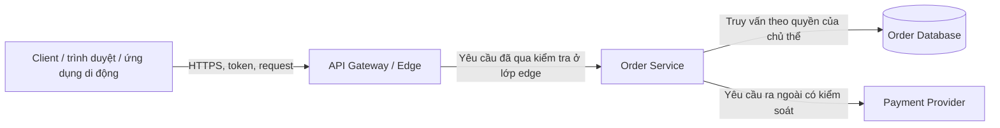

# API là trust boundary giữa client, service và dữ liệu

Trong một hệ thống có API, client gửi yêu cầu đến service để đọc hoặc thay đổi dữ liệu. Mỗi yêu cầu đi qua một ranh giới tin cậy (*trust boundary*): dữ liệu, danh tính và ý định đến từ một miền bảo mật phải được kiểm tra trước khi miền tiếp nhận cho phép chúng tác động đến tài nguyên của mình.

API Security vì vậy phải được thiết kế theo từng endpoint, đối tượng dữ liệu và luồng nghiệp vụ. Đăng nhập thành công chỉ cho biết hệ thống đã nhận diện được chủ thể của yêu cầu. HTTPS chỉ bảo vệ dữ liệu khi truyền. Cả hai đều chưa chứng minh rằng chủ thể được phép gọi một chức năng cụ thể, truy cập một bản ghi cụ thể hay thực hiện một thay đổi hợp lệ.

## 1. Trust boundary là gì?

Trust boundary là điểm mà dữ liệu hoặc quyền hạn đi từ một miền có mức tin cậy này sang miền có mức tin cậy khác. Ở phía nhận, hệ thống phải xác minh những gì cần thiết trước khi dựa vào thông tin vừa đi qua ranh giới.

Ví dụ, một ứng dụng mua sắm có thể có các miền sau:



Các mũi tên biểu diễn những lần thông tin đi qua ranh giới. Chúng không có nghĩa là thành phần phía sau mặc nhiên được tin tưởng. Gateway có thể lọc lưu lượng và xác minh token, nhưng service vẫn phải kiểm tra quyền đối với đơn hàng. Service có thể được phép truy cập database, nhưng câu truy vấn vẫn phải giới hạn đúng tenant và đúng bản ghi. Khi service gọi một hệ thống bên ngoài, URL và dữ liệu phản hồi cũng cần được kiểm soát.

Mức tin cậy không phải một nhãn nhị phân “đã đăng nhập” hoặc “nội bộ”. Một request có thể đã được xác thực nhưng vẫn không đáng tin ở các khía cạnh khác:

- Người gọi là ai có thể đã được xác minh, nhưng họ có quyền thực hiện hành động này không vẫn cần kiểm tra.
- ID trong đường dẫn có thể đúng định dạng, nhưng bản ghi tương ứng có thuộc phạm vi truy cập của người gọi không vẫn cần kiểm tra.
- JSON có thể parse thành công, nhưng giá trị có hợp lệ theo quy tắc nghiệp vụ không vẫn cần kiểm tra.
- Một service nội bộ có thể được xác thực, nhưng dữ liệu nó gửi sang service khác vẫn cần được kiểm tra theo hợp đồng và quyền được cấp.

## 2. Vì sao API là ranh giới bảo mật quan trọng?

API thường là nơi một hệ thống mở các khả năng nghiệp vụ và dữ liệu của mình cho client hoặc hệ thống khác. Service phía sau có thể sở hữu thông tin xác thực database, quyền gọi dịch vụ nội bộ hoặc quyền thực hiện giao dịch. Nếu API tin quá nhiều vào request, một lỗi nhỏ ở ranh giới có thể dẫn đến việc đọc dữ liệu của người khác, thay đổi trạng thái trái phép hoặc khiến tài nguyên bị tiêu hao.

Những phần của request cần được xem là đầu vào do bên gọi kiểm soát gồm:

- Path và query parameters, chẳng hạn `orderId`, `page`, `sort` hoặc bộ lọc tìm kiếm.
- Headers, gồm token, tenant hint, `Origin`, `Forwarded` và các header do proxy chuyển tiếp.
- Body JSON, form data, tệp tải lên và nội dung webhook.
- URL hoặc hostname mà client yêu cầu service truy cập.
- Tần suất gọi, kích thước payload, số lượng phần tử trong một batch và thứ tự gọi endpoint.

Ngay cả khi request đến từ một ứng dụng chính thức, người dùng vẫn có thể sửa request bằng công cụ phát triển trình duyệt, proxy hoặc script. Không được coi giao diện người dùng là cơ chế phân quyền. Việc ẩn nút “Xóa” không ngăn người dùng gửi trực tiếp `DELETE /api/orders/{id}`.

Tương tự, không nên tin một request chỉ vì nó đến từ mạng nội bộ. Service có thể bị gọi bởi một workload khác, một tài khoản dịch vụ bị lộ hoặc một thành phần đã bị xâm nhập. Mỗi service cần xác minh danh tính của caller và chỉ cấp quyền cần thiết cho từng thao tác.

## 3. Phân tích một request qua bốn câu hỏi

Trước khi triển khai một endpoint, hãy xác định ít nhất bốn yếu tố:

| Yếu tố | Câu hỏi cần trả lời | Ví dụ với `GET /api/orders/{orderId}` |
|---|---|---|
| Chủ thể (*actor*) | Ai đang gọi? | Người dùng có subject `user-123` trong access token đã được xác minh |
| Hành động (*action*) | Họ muốn làm gì? | Đọc chi tiết đơn hàng |
| Đối tượng (*object*) | Tài nguyên nào bị tác động? | Đơn hàng có ID trong path |
| Phạm vi và ngữ cảnh (*scope/context*) | Họ được phép làm việc đó trong phạm vi nào? | Đơn hàng thuộc người dùng hoặc tenant mà họ được cấp quyền truy cập |

Với thao tác ghi dữ liệu, cần xem thêm những thuộc tính nào được phép thay đổi và trạng thái nghiệp vụ hiện tại có cho phép thao tác hay không. Ví dụ, người mua có thể được xem đơn hàng của mình nhưng không được tự đổi `customerId`, `totalAmount` hoặc trạng thái thanh toán.

Một quyết định cho phép truy cập thường cần đồng thời thỏa mãn các điều kiện sau:

1. Danh tính của caller đã được xác thực.
2. Caller có quyền gọi chức năng tương ứng.
3. Caller có quyền trên đúng đối tượng và đúng tenant.
4. Các trường dữ liệu được gửi lên nằm trong phạm vi được phép cập nhật.
5. Trạng thái và ngữ cảnh hiện tại cho phép thực hiện hành động.

Nếu chỉ kiểm tra vai trò chung như `USER` hoặc `ADMIN`, hệ thống có thể bỏ sót quyền trên từng đối tượng. Đây là nguyên nhân phổ biến của lỗi *Broken Object Level Authorization* (BOLA), còn thường được gọi là IDOR: người dùng thay ID trong URL và đọc hoặc sửa được bản ghi của người khác.

## 4. Xác thực danh tính không thay thế phân quyền

**Xác thực (authentication)** trả lời “caller là ai?”. Với access token dạng JWT, resource server cần xác minh chữ ký bằng khóa tin cậy và kiểm tra các claim phù hợp với hợp đồng phát hành token, chẳng hạn `iss`, `aud`, `exp` và `nbf`. Chỉ decode payload JWT không phải là xác thực. Hệ thống cũng cần quản lý vòng đời khóa, thu hồi hoặc giới hạn thời gian sống token theo yêu cầu bảo mật.

**Phân quyền (authorization)** trả lời “caller được làm gì trên tài nguyên nào?”. Phân quyền nên được kiểm tra ở nơi có đủ ngữ cảnh nghiệp vụ. Có thể chia thành các lớp:

- **Quyền chức năng:** caller có được gọi chức năng đọc, tạo, hoàn tiền hoặc xóa không?
- **Quyền đối tượng:** bản ghi có thuộc caller hoặc nằm trong phạm vi mà caller được giao quản lý không?
- **Quyền thuộc tính:** caller có được sửa trường cụ thể như địa chỉ giao hàng hay giá trị thanh toán không?
- **Quyền theo trạng thái nghiệp vụ:** đơn hàng đã thanh toán hoặc đã giao có còn được hủy không?

Không lấy `userId`, `ownerId`, `role` hoặc `tenantId` trong body làm bằng chứng về danh tính hay quyền hạn. Các giá trị đó có thể là dữ liệu nghiệp vụ cần kiểm tra, nhưng danh tính caller phải đến từ security context đã được xác minh. Nếu ứng dụng hỗ trợ quản trị viên hoặc ủy quyền, hãy kiểm tra quyền quản trị/ủy quyền bằng một quy tắc rõ ràng và có thể kiểm toán.

### Ví dụ: kiểm tra quyền đọc đơn hàng trong Spring

Ví dụ sau minh họa hai lớp kiểm tra: quyền gọi chức năng và quyền truy cập đúng bản ghi. Giả sử Spring Security Resource Server đã xác minh JWT, method security đã được bật và claim `sub` được quy ước ánh xạ sang ID khách hàng nội bộ.

```java
@RestController
@RequestMapping("/api/orders")
@RequiredArgsConstructor
class OrderController {
    private final OrderService orderService;

    @GetMapping("/{orderId}")
    @PreAuthorize("hasAuthority('SCOPE_orders:read')")
    OrderResponse getOrder(
            @PathVariable UUID orderId,
            @AuthenticationPrincipal Jwt jwt) {
        UUID customerId = UUID.fromString(jwt.getSubject());
        return orderService.getOrderForCustomer(orderId, customerId);
    }
}
```

Service giới hạn truy vấn theo cả ID đơn hàng và ID khách hàng:

```java
@Service
@RequiredArgsConstructor
class OrderService {
    private final OrderRepository orderRepository;
    private final OrderMapper orderMapper;

    @Transactional(readOnly = true)
    OrderResponse getOrderForCustomer(UUID orderId, UUID customerId) {
        Order order = orderRepository
                .findByIdAndCustomerId(orderId, customerId)
                .orElseThrow(OrderNotFoundException::new);

        return orderMapper.toResponse(order);
    }
}
```

Phương thức repository có thể được Spring Data JPA tạo từ tên:

```java
Optional<Order> findByIdAndCustomerId(UUID id, UUID customerId);
```

Kiểm tra scope chặn người không có quyền đọc đơn hàng. Điều kiện `id` và `customerId` trong truy vấn ngăn người dùng có scope hợp lệ đọc đơn hàng của khách hàng khác. Ứng dụng thực tế cần xử lý trường hợp `sub` không phải UUID hoặc không trực tiếp là ID khách hàng bằng cách ánh xạ principal sang tài khoản nội bộ. Nếu có quyền truy cập được ủy quyền, điều kiện truy vấn cần phản ánh quan hệ ủy quyền đó.

Tùy chính sách sản phẩm, service có thể trả `404 Not Found` cho cả trường hợp không tồn tại và trường hợp caller không có quyền trên bản ghi để tránh tiết lộ sự tồn tại của tài nguyên. Nếu trả `403 Forbidden`, cần cân nhắc liệu việc tiết lộ tài nguyên tồn tại có phù hợp hay không. Dù chọn cách nào, không được trả dữ liệu của bản ghi trước khi hoàn tất kiểm tra quyền.

## 5. Kiểm tra dữ liệu ở ranh giới vào và ra

Validation xác nhận dữ liệu có đúng cấu trúc và hợp lệ theo quy tắc mà endpoint chấp nhận. Nên kiểm tra ở nhiều mức:

- **Kiểu và định dạng:** UUID có parse được không, ngày có đúng định dạng không, enum có thuộc tập giá trị hỗ trợ không?
- **Giới hạn:** chuỗi tối đa bao nhiêu ký tự, số lượng phần tử tối đa bao nhiêu, kích thước request và tệp tải lên tối đa là bao nhiêu?
- **Ngữ nghĩa:** số lượng đặt hàng phải lớn hơn 0, ngày kết thúc không trước ngày bắt đầu, trạng thái chuyển đổi có hợp lệ không?
- **Quan hệ dữ liệu:** sản phẩm có tồn tại và còn được phép đặt không, địa chỉ có thuộc tài khoản hiện tại không?

Ưu tiên DTO đầu vào có danh sách trường cho phép. Không bind trực tiếp request vào entity có các trường nội bộ như `ownerId`, `tenantId`, `role`, `approved`, `balance` hoặc `paymentStatus`. Đây là cách giảm lỗi *mass assignment*: caller thêm trường ngoài ý muốn vào JSON và ghi đè thuộc tính mà họ không được phép điều khiển.

Ví dụ, endpoint cập nhật địa chỉ giao hàng chỉ nên nhận các trường địa chỉ:

```java
public record UpdateShippingAddressRequest(
        @NotBlank @Size(max = 120) String recipientName,
        @NotBlank @Size(max = 200) String street,
        @NotBlank @Size(max = 80) String city,
        @NotBlank @Size(max = 20) String postalCode) {
}
```

Sau khi validate, service vẫn phải xác minh caller có quyền cập nhật địa chỉ của đơn hàng và trạng thái đơn hàng cho phép thay đổi. Validation không thay thế authorization.

Khi truy vấn database, dùng parameterized query hoặc cơ chế binding của ORM thay vì nối chuỗi SQL từ input. Khi trả response, ánh xạ sang response DTO chỉ chứa trường cần thiết cho caller. Không serialize toàn bộ entity nếu entity có dữ liệu nội bộ hoặc dữ liệu cá nhân không cần công khai.

## 6. Kiểm soát lời gọi ra ngoài và nguy cơ SSRF

Một endpoint có thể nhận URL từ người dùng để tải ảnh, kiểm tra webhook hoặc lấy dữ liệu từ một nguồn khác. Nếu service gọi URL tùy ý bằng quyền mạng của chính nó, attacker có thể khiến service truy cập tài nguyên nội bộ hoặc endpoint metadata của hạ tầng. Đây là rủi ro *Server-Side Request Forgery* (SSRF).

Các biện pháp quan trọng gồm:

- Chỉ cho phép scheme cần thiết, thường là HTTPS, và ưu tiên allowlist hostname/dịch vụ đã được phê duyệt thay vì chấp nhận URL tùy ý.
- Kiểm tra địa chỉ IP sau phân giải DNS; chặn loopback, private, link-local và các dải địa chỉ hạ tầng nhạy cảm nếu không có nhu cầu hợp lệ.
- Xử lý redirect một cách nghiêm ngặt; không để URL được allowlist chuyển hướng sang một đích bị cấm.
- Đặt timeout, giới hạn kích thước phản hồi và số lần redirect; không đọc phản hồi không giới hạn vào bộ nhớ.
- Dùng egress policy hoặc proxy kiểm soát kết nối ra ngoài để giới hạn tác động nếu kiểm tra ở ứng dụng bị bỏ sót.

Chỉ kiểm tra chuỗi hostname ban đầu là chưa đủ trong mọi tình huống, vì DNS có thể trả về địa chỉ khác và redirect có thể thay đổi đích đến. Quy tắc kiểm tra phải áp dụng cho địa chỉ thực sự được kết nối.

## 7. Ngăn lạm dụng tài nguyên và phá vỡ luồng nghiệp vụ

Một request hợp lệ về cú pháp vẫn có thể gây thiệt hại nếu nó tiêu tốn quá nhiều tài nguyên hoặc gọi sai thứ tự nghiệp vụ. API cần giới hạn theo khả năng xử lý và giá trị nghiệp vụ của từng endpoint.

Ví dụ về kiểm soát tài nguyên:

- Giới hạn page size, độ sâu phân trang, số ID trong batch và kích thước body.
- Giới hạn loại tệp, kích thước tệp, thời gian xử lý và số tác vụ chạy đồng thời.
- Áp dụng rate limit hoặc quota theo tài khoản, API key, tenant và loại thao tác; endpoint tốn kém có thể cần giới hạn riêng.
- Đặt timeout cho truy vấn database và lời gọi dịch vụ phụ thuộc; tránh để một request giữ kết nối hoặc worker quá lâu.
- Trả `429 Too Many Requests` khi caller vượt giới hạn phù hợp và có thể cung cấp thông tin retry an toàn.

Đối với luồng nghiệp vụ, server phải tự xác định giá, chủ sở hữu và trạng thái hiện tại từ nguồn dữ liệu đáng tin cậy. Ví dụ, không nhận `totalAmount` từ client làm số tiền phải thu. Khi tạo thanh toán hoặc thực hiện thao tác có thể được gửi lặp lại do retry mạng, cân nhắc idempotency key và ràng buộc duy nhất ở database để tránh tạo giao dịch trùng.

Hãy mô hình hóa chuyển trạng thái một cách tường minh. Một đơn hàng có thể chuyển từ `PENDING` sang `PAID` sau khi xác minh kết quả thanh toán, nhưng không nên cho phép client tự gửi `status: "PAID"` để bỏ qua bước xác nhận. Mỗi chuyển trạng thái cần kiểm tra chủ thể, quyền, trạng thái hiện tại và điều kiện nghiệp vụ.

## 8. Bảo vệ dữ liệu qua toàn bộ vòng đời request

Khi dữ liệu đi qua API, cần kiểm soát cả lúc truyền, lúc lưu, lúc xử lý và lúc ghi log:

- Dùng TLS cho kết nối bên ngoài và xác thực phù hợp giữa các service; không coi mã hóa đường truyền là thay thế cho phân quyền.
- Áp dụng quyền database tối thiểu cho từng service và giới hạn truy vấn theo tenant hoặc phạm vi dữ liệu cần thiết.
- Chỉ trả các trường caller cần. Che hoặc loại bỏ thông tin nhạy cảm khỏi response, thông báo lỗi và log.
- Không ghi access token, mật khẩu, secret, dữ liệu thẻ hoặc payload chứa dữ liệu cá nhân đầy đủ vào log.
- Lưu secret trong hệ thống quản lý secret; có quy trình xoay vòng và thu hồi thông tin xác thực.
- Mã hóa dữ liệu nhạy cảm khi lưu trữ theo yêu cầu của hệ thống và quản lý khóa tách biệt với dữ liệu.

Thông báo lỗi cho client nên đủ để xử lý nhưng không tiết lộ stack trace, câu SQL, đường dẫn nội bộ hoặc cấu hình hạ tầng. Chi tiết phục vụ điều tra nên nằm trong log nội bộ có kiểm soát truy cập.

## 9. Kiểm thử và giám sát theo ranh giới tin cậy

Kiểm thử API Security cần tập trung vào cả trường hợp được phép và trường hợp bị từ chối. Với mỗi endpoint, hãy kiểm tra ít nhất các tình huống sau:

| Tình huống | Kết quả cần xác minh |
|---|---|
| Không có token hoặc token sai chữ ký/hết hạn | Request bị từ chối trước khi truy cập dữ liệu |
| Token hợp lệ nhưng thiếu quyền chức năng | Không thực hiện thao tác; trả mã trạng thái phù hợp |
| Người dùng A thay ID để truy cập dữ liệu của B | Không đọc, sửa hoặc xóa được dữ liệu của B |
| Caller gửi thêm `ownerId`, `role` hoặc `status` ngoài DTO | Trường bị từ chối hoặc bỏ qua theo hợp đồng; không thay đổi quyền hay trạng thái trái phép |
| Caller gửi dữ liệu sai định dạng hoặc vượt giới hạn | Request bị từ chối có kiểm soát, không làm service quá tải |
| Caller yêu cầu service truy cập URL nội bộ | Kết nối bị chặn theo chính sách SSRF |
| Caller lặp lại thao tác thanh toán hoặc gửi request đồng thời | Không tạo giao dịch trùng hoặc chuyển trạng thái không hợp lệ |
| Caller truy cập tenant khác | Không thể đọc hoặc làm thay đổi dữ liệu ngoài tenant được cấp |

Nên có test riêng cho từng endpoint và từng loại đối tượng, thay vì chỉ kiểm tra rằng middleware xác thực hoạt động. Kiểm thử tích hợp cần xác minh điều kiện phân quyền thực sự được áp dụng ở service hoặc truy vấn dữ liệu. Với luồng quan trọng, bổ sung kiểm thử đồng thời và retry.

Giám sát production nên ghi nhận actor đã được xác minh, endpoint, hành động, mã tham chiếu tài nguyên, quyết định cho phép/từ chối, correlation ID và kết quả xử lý ở mức phù hợp. Không ghi bí mật hoặc payload nhạy cảm. Theo dõi các dấu hiệu như số lượng `401`/`403` tăng bất thường, nhiều lần thử truy cập ID khác nhau, `429` tăng cao, request có kích thước bất thường, truy vấn chậm và lỗi khi gọi hệ thống ngoài. Log cần được bảo vệ khỏi sửa đổi và chỉ người có thẩm quyền mới được truy cập.

## 10. Checklist thiết kế cho từng endpoint

Trước khi đưa endpoint vào sử dụng, hãy trả lời các câu hỏi sau:

- [ ] Ai là caller hợp lệ và hệ thống xác minh danh tính của họ bằng cách nào?
- [ ] Caller cần quyền chức năng nào để thực hiện thao tác?
- [ ] Quyền trên từng object và tenant được kiểm tra ở đâu?
- [ ] Những trường nào caller được phép gửi hoặc cập nhật?
- [ ] Quy tắc định dạng, giới hạn và nghiệp vụ nào được áp dụng cho input?
- [ ] Response có tiết lộ dữ liệu ngoài nhu cầu của caller không?
- [ ] Endpoint có gọi URL hoặc dịch vụ bên ngoài không; đích đến được giới hạn thế nào?
- [ ] Có giới hạn kích thước, tần suất, thời gian xử lý và số tác vụ đồng thời không?
- [ ] Retry hoặc gọi đồng thời có thể tạo giao dịch trùng hay phá vỡ trạng thái không?
- [ ] Có test cho truy cập trái phép, sai tenant, input độc hại và lạm dụng tài nguyên không?
- [ ] Log và metric có đủ để phát hiện hành vi bất thường mà không làm lộ dữ liệu nhạy cảm không?

## Kết luận

Hãy xem mỗi API endpoint là một cổng thực thi chính sách bảo mật giữa caller và năng lực của service. Hệ thống phải xác minh danh tính, quyền chức năng, quyền trên object, dữ liệu được phép thay đổi và điều kiện nghiệp vụ trước khi truy cập hoặc cập nhật dữ liệu. Gateway, service, database và các kết nối ra ngoài đều cần thực thi phần kiểm soát phù hợp với ranh giới mà chúng quản lý. Cách tiếp cận này giúp API Security bảo vệ đúng tài nguyên và luồng nghiệp vụ, thay vì chỉ dựa vào việc người dùng đã đăng nhập hoặc kết nối đã được mã hóa.
