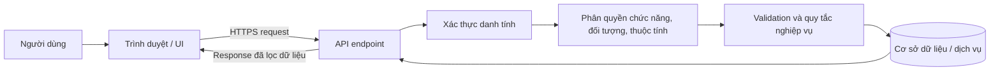

# API security khác bảo mật giao diện người dùng ở điểm nào?

Hãy tưởng tượng một ứng dụng quản lý đơn hàng có nút **Hủy đơn**. Giao diện chỉ hiển thị nút này cho người tạo đơn và ẩn nó với những người dùng khác. Cách làm đó giúp màn hình dễ hiểu, nhưng chưa bảo vệ được đơn hàng: người dùng vẫn có thể mở Developer Tools, sửa mã JavaScript hoặc tự gửi `DELETE /api/orders/123` bằng một công cụ HTTP.

Nếu API chỉ kiểm tra người gửi đã đăng nhập mà không kiểm tra họ có quyền hủy chính đơn hàng `123` hay không, dữ liệu vẫn có thể bị truy cập hoặc thay đổi trái phép. Đây là điểm khác biệt cốt lõi: **bảo mật giao diện kiểm soát trải nghiệm và hành vi trong trình duyệt; API security bảo vệ các thao tác và dữ liệu ở ranh giới phía máy chủ, kể cả khi request được tạo bên ngoài giao diện chính thức.**

Hai lớp bảo vệ cùng cần thiết trong một sản phẩm. Giao diện tốt giúp giảm thao tác sai và hạn chế một số tấn công trên trình duyệt. API an toàn bảo đảm mọi client — web, mobile, ứng dụng đối tác, script hay công cụ dòng lệnh — đều phải tuân theo cùng chính sách bảo mật.

## 1. Phân biệt phạm vi bảo vệ

### Bảo mật giao diện người dùng (UI security)

UI security tập trung vào môi trường nơi người dùng tương tác với ứng dụng, thường là trình duyệt. Nó bảo vệ nội dung được hiển thị, cách JavaScript thao tác với trang, phiên làm việc của người dùng và các tương tác giữa trang web với trình duyệt.

Các vấn đề thường gặp gồm:

- **Cross-Site Scripting (XSS):** dữ liệu không đáng tin cậy bị đưa vào trang như mã có thể thực thi, khiến kẻ tấn công chạy JavaScript trong ngữ cảnh của website.
- **Clickjacking:** người dùng bị lừa nhấn vào một phần tử bị che hoặc nhúng trong trang khác.
- **Lộ bí mật phía client:** token, khóa bí mật hoặc dữ liệu nhạy cảm bị đóng gói trong JavaScript, source map, biến môi trường frontend hay bộ nhớ trình duyệt.
- **Lưu trữ phiên không an toàn:** thông tin xác thực bị lưu ở nơi có thể bị script độc hại đọc, hoặc cookie thiếu thuộc tính bảo vệ phù hợp.
- **Thao tác DOM không an toàn:** ứng dụng chèn HTML chưa được làm sạch hoặc xử lý URL không đúng cách.

Các biện pháp như output encoding, sanitization, Content Security Policy (CSP), cấu hình cookie an toàn và kiểm soát nội dung nhúng giúp giảm rủi ro trong môi trường trình duyệt.

### API security

API security tập trung vào các endpoint, dữ liệu và luồng nghiệp vụ được máy chủ cung cấp. Một API có thể được gọi bởi nhiều loại client, vì vậy máy chủ phải tự xác minh từng request theo chính sách đã định nghĩa.

Các vấn đề thường gặp gồm:

- **Xác thực yếu hoặc sai:** token không được kiểm tra đầy đủ, phiên hết hạn vẫn được chấp nhận, hoặc thông tin xác thực bị xử lý không an toàn.
- **Phân quyền thiếu ở mức đối tượng:** người dùng đã đăng nhập có thể đọc hoặc sửa tài nguyên thuộc người khác (Broken Object Level Authorization — BOLA, thường được gọi là IDOR trong một số ngữ cảnh).
- **Phân quyền thiếu ở mức chức năng:** người dùng thường gọi được endpoint quản trị dù giao diện không hiển thị chức năng đó (Broken Function Level Authorization — BFLA).
- **Phân quyền thiếu ở mức thuộc tính:** API trả về trường nhạy cảm hoặc cho phép client cập nhật trường mà họ không được phép sửa.
- **Validation không đầy đủ:** dữ liệu đầu vào gây injection, phá vỡ quy tắc nghiệp vụ hoặc kích hoạt xử lý ngoài dự kiến.
- **SSRF:** API bị dụ gửi request đến máy chủ nội bộ hoặc địa chỉ không được phép.
- **Lạm dụng tài nguyên:** request tốn CPU, bộ nhớ, băng thông, kết nối hoặc chi phí dịch vụ vượt quá giới hạn hợp lý.
- **Lạm dụng luồng nghiệp vụ:** tự động hóa hoặc gọi lặp các thao tác hợp lệ theo cách gây thiệt hại, chẳng hạn dò mã khuyến mại hoặc đặt chỗ hàng loạt.

API security vì thế không dừng ở việc bật HTTPS hay yêu cầu đăng nhập. Nó phải kiểm soát quyền trên từng endpoint, từng đối tượng dữ liệu, từng thuộc tính và từng luồng nghiệp vụ.

## 2. Request đi qua những ranh giới nào?

Trong một ứng dụng web điển hình, người dùng tương tác với UI; UI gửi request đến API; API xác thực danh tính, kiểm tra quyền, xác thực dữ liệu rồi mới thực hiện nghiệp vụ và truy cập dữ liệu.



Mỗi bước có trách nhiệm riêng:

1. **UI** quyết định cách trình bày, hướng dẫn người dùng và chỉ đưa ra các hành động phù hợp với trạng thái hiện tại. UI có thể ẩn nút hoặc vô hiệu hóa biểu mẫu để tránh thao tác không hợp lệ.
2. **API** nhận request từ một ranh giới không đáng tin cậy. Máy chủ xác minh credential, xác định principal (người dùng hoặc service account), rồi kiểm tra quyền đối với hành động và tài nguyên cụ thể.
3. **Validation và nghiệp vụ** xác minh kiểu, định dạng, kích thước, miền giá trị và điều kiện nghiệp vụ. Một request hợp lệ về cú pháp vẫn có thể không hợp lệ về nghiệp vụ.
4. **Lớp dữ liệu** thực hiện truy vấn trong phạm vi tenant hoặc chủ sở hữu đã được xác định, đồng thời chỉ trả về những trường được phép công khai.

Ranh giới quan trọng nằm ở API: bất kỳ dữ liệu nào đến từ trình duyệt đều có thể bị người dùng sửa. Không được coi trạng thái giao diện, trường ẩn, nút bị disable hoặc biến JavaScript là bằng chứng về quyền hạn.

## 3. Khác biệt qua từng khía cạnh

| Khía cạnh | Bảo mật UI | API security |
|---|---|---|
| Đối tượng được bảo vệ | Trang, DOM, script, phiên và tương tác trong trình duyệt | Endpoint, dữ liệu, thao tác và luồng nghiệp vụ phía máy chủ |
| Ranh giới tin cậy | Nội dung trang và các nguồn script, dữ liệu được đưa vào trình duyệt | Mọi request, header, query, path và body từ client đều không đáng tin cậy cho đến khi được xác minh |
| Xác thực | Hiển thị trạng thái đăng nhập, điều hướng và trải nghiệm phiên | Xác minh credential, chữ ký, issuer, audience, thời hạn và trạng thái phiên ở phía máy chủ |
| Phân quyền | Ẩn/hiện điều khiển, giới hạn thao tác trong trải nghiệm | Kiểm tra quyền với từng chức năng, đối tượng, thuộc tính và tenant ở mỗi request phù hợp |
| Validation | Kiểm tra sớm để hướng dẫn người dùng nhập đúng | Kiểm tra bắt buộc ở máy chủ trước khi xử lý hoặc lưu dữ liệu |
| Dữ liệu | Tránh XSS, rò rỉ dữ liệu trong DOM, bộ nhớ hoặc storage | Giảm dữ liệu trả về, bảo vệ trường nhạy cảm, kiểm soát cập nhật và truy vấn |
| Lạm dụng | Giảm thao tác vô tình và một số hành vi tự động trên UI | Giới hạn tần suất, kích thước, độ đồng thời, chi phí và tốc độ của luồng nghiệp vụ |
| Kiểm thử | Kiểm thử trình duyệt, DOM, cookie, CSP, điều hướng và tương tác | Gọi trực tiếp endpoint với nhiều danh tính, vai trò, ID đối tượng và payload khác nhau |

Điểm cần nhớ là một biện pháp có thể liên quan đến cả hai lớp. Ví dụ, cookie bảo vệ phiên được trình duyệt gửi đi nhưng máy chủ vẫn phải xác minh phiên; CSRF liên quan đến cách trình duyệt tự động gửi cookie và cách máy chủ chấp nhận request; XSS xảy ra ở UI nhưng có thể khiến API bị gọi bằng phiên của nạn nhân.

## 4. Ví dụ: ẩn nút không thay thế được phân quyền API

Giả sử hệ thống có endpoint đọc đơn hàng:

```http
GET /api/orders/order-1001
Authorization: Bearer <access-token>
```

Giao diện có thể chỉ hiển thị liên kết đến đơn hàng của người dùng hiện tại. Tuy nhiên, người dùng có thể thay `order-1001` thành `order-1002` rồi gửi lại request. Nếu endpoint chỉ xác thực token và truy vấn theo ID, người dùng có thể đọc đơn hàng của người khác.

### Cách triển khai thiếu an toàn

```pseudo
principal = authenticate(request.authorization)
if principal is invalid:
    return 401

order = database.orders.findById(request.path.orderId)
return order
```

Đoạn xử lý trên xác nhận người gọi đã đăng nhập nhưng không kiểm tra họ có quyền đọc đối tượng `order` hay không. Đây là lỗi phân quyền mức đối tượng.

### Cách xử lý an toàn hơn

```pseudo
principal = authenticateAndValidate(request.authorization)
if principal is invalid:
    return 401

order = database.orders.findById(request.path.orderId)
if order does not exist:
    return 404

if not authorization.can(principal, "order:read", order):
    return 404  // hoặc 403 theo chính sách tiết lộ sự tồn tại của tài nguyên

response = serializeOrder(order, allowedFieldsFor(principal, order))
return 200 with response
```

Trong hệ thống đa tenant, điều kiện tenant phải được ràng buộc ngay trong truy vấn hoặc được kiểm tra bằng chính sách tương đương. Không nên lấy `tenantId` hay `ownerId` từ body do client gửi rồi coi đó là sự thật. Máy chủ cần suy ra danh tính và phạm vi truy cập từ principal đã xác thực, sau đó đối chiếu với tài nguyên.

Việc trả `404` hay `403` phụ thuộc chính sách: `403` nói rằng tài nguyên tồn tại nhưng người gọi không có quyền; `404` có thể được chọn để tránh tiết lộ sự tồn tại của tài nguyên. Dù chọn cách nào, điều kiện phân quyền vẫn phải được thực thi.

## 5. Ba lớp phân quyền API cần kiểm tra

### Quyền chức năng (function-level authorization)

Quyền chức năng trả lời câu hỏi: **người gọi có được thực hiện loại thao tác này không?**

Ví dụ, chỉ quản trị viên được gọi:

```http
POST /api/admin/users/user-42/disable
```

Ẩn mục **Quản trị người dùng** khỏi menu của người dùng thường chỉ cải thiện UI. Endpoint vẫn phải kiểm tra permission hoặc role tương ứng ở máy chủ. Quyền nên được kiểm tra tại điểm thực thi nghiệp vụ, áp dụng cho mọi đường gọi đến chức năng đó.

### Quyền đối tượng (object-level authorization)

Quyền đối tượng trả lời câu hỏi: **người gọi có được thực hiện thao tác trên chính tài nguyên này không?**

Một nhân viên có thể được phép xem đơn hàng nói chung nhưng chỉ được xem đơn hàng thuộc cửa hàng hoặc tenant của mình. Vì vậy, kiểm tra role `employee` là chưa đủ; API phải kiểm tra quan hệ giữa principal và đối tượng đang truy cập.

Không nên dựa vào việc ID khó đoán như UUID để thay thế phân quyền. ID khó đoán có thể giảm khả năng dò tìm, nhưng không chứng minh người gọi có quyền.

### Quyền thuộc tính (property-level authorization)

Quyền thuộc tính trả lời câu hỏi: **người gọi được đọc hoặc thay đổi những trường nào của tài nguyên?**

Ví dụ, response hồ sơ người dùng có thể chứa `id`, `displayName`, `email`, `role`, `isLocked` và `internalNotes`. Một người dùng có thể được xem `displayName` và `email` nhưng không được đọc `internalNotes`; họ cũng không được tự gửi `role: "admin"` trong request cập nhật hồ sơ.

API nên dùng schema/DTO cho phép rõ các trường được đọc và ghi, ánh xạ từng trường được phép vào model nội bộ, và tạo response bằng danh sách trường được phép. Tránh bind trực tiếp toàn bộ request body vào entity hoặc trả nguyên entity từ cơ sở dữ liệu. Cách làm này giảm rủi ro mass assignment và excessive data exposure.

## 6. Validation ở UI và validation ở API có vai trò khác nhau

Validation phía UI giúp người dùng phát hiện lỗi sớm: email sai định dạng, trường bắt buộc bị bỏ trống, số lượng vượt giới hạn hiển thị. Nó cải thiện trải nghiệm và giảm request không cần thiết.

Nhưng người dùng có thể bỏ qua hoàn toàn validation đó bằng cách gửi request tự tạo. Do vậy, API phải tự kiểm tra:

- Kiểu dữ liệu, định dạng, độ dài và kích thước payload.
- Giá trị nằm trong miền được phép; ví dụ số lượng phải dương và không vượt hạn mức.
- Các trường được phép xuất hiện trong request; trường không được phép cập nhật phải bị bỏ qua hoặc từ chối theo hợp đồng API.
- Quan hệ giữa các trường và điều kiện nghiệp vụ; ví dụ không thể hủy đơn đã giao hoặc chuyển trạng thái khi chưa đáp ứng điều kiện.
- Dữ liệu trước khi đưa vào truy vấn, lệnh hệ thống, template hoặc URL. Dùng truy vấn tham số hóa và API an toàn của thư viện thay vì nối chuỗi đầu vào.

Validation không thay thế authorization. Một request có JSON hoàn toàn hợp lệ vẫn có thể yêu cầu xem dữ liệu của người khác hoặc thực hiện chức năng mà người gọi không được phép.

## 7. Các vấn đề giao nhau giữa UI và API

### XSS và phiên đăng nhập

XSS thường bắt đầu từ cách UI đưa dữ liệu vào DOM hoặc thực thi script. Nếu script độc hại chạy trong origin của ứng dụng, nó có thể đọc dữ liệu mà trang truy cập được, thay mặt người dùng gửi request hoặc khai thác token có thể đọc từ JavaScript.

UI cần output encoding theo ngữ cảnh, sanitization khi thực sự cần hiển thị HTML, tránh các sink nguy hiểm và triển khai CSP phù hợp. Với cookie phiên, nên cân nhắc `HttpOnly`, `Secure` và `SameSite` theo kiến trúc. `HttpOnly` ngăn JavaScript đọc cookie nhưng không ngăn script XSS gửi request bằng cookie mà trình duyệt tự đính kèm. API vẫn cần authorization cho từng thao tác.

### CSRF và CORS

CSRF có thể xảy ra khi trình duyệt tự động gửi cookie xác thực đến website đích trong lúc người dùng đang đăng nhập. Với cơ chế xác thực bằng cookie, ứng dụng cần thiết kế biện pháp chống CSRF phù hợp, chẳng hạn token chống CSRF, kiểm tra `Origin`/`Referer` khi thích hợp và cấu hình `SameSite` đúng với luồng sử dụng.

CORS là cơ chế trình duyệt kiểm soát việc JavaScript từ origin khác có được đọc response hay không. CORS không xác thực người gọi, không cấp quyền truy cập dữ liệu và không ngăn một client ngoài trình duyệt gọi API trực tiếp. Vì vậy, không được dùng danh sách origin trong CORS làm cơ chế authorization.

### HTTPS và quản lý credential

HTTPS bảo vệ dữ liệu trên đường truyền và xác minh máy chủ theo cơ chế TLS; nó không tự chứng minh người gọi có quyền với endpoint hoặc đối tượng dữ liệu. API vẫn cần xác thực và phân quyền ở tầng ứng dụng.

Không đặt khóa bí mật dùng chung cho server-to-server vào mã JavaScript được tải xuống trình duyệt. Bất kỳ bí mật nào gửi tới client đều có thể bị trích xuất. Với OAuth/OIDC hoặc access token, API phải kiểm tra đầy đủ chữ ký hoặc cơ chế xác minh tương ứng, issuer, audience, thời hạn và scope/claim cần thiết; không chỉ giải mã token rồi tin nội dung bên trong.

## 8. Những kiểm soát API mà UI không thể thay thế

Ngoài xác thực và phân quyền, API cần các kiểm soát gắn với cách endpoint hoạt động:

### Chống SSRF

Nếu API nhận URL để tải ảnh, lấy dữ liệu hoặc gọi webhook, người dùng có thể thử cung cấp URL trỏ đến `localhost`, mạng nội bộ, dịch vụ metadata của cloud hoặc địa chỉ ngoài phạm vi dự kiến. Giao diện có thể kiểm tra định dạng URL để hướng dẫn người dùng, nhưng quyết định an toàn phải nằm ở máy chủ.

API nên giới hạn scheme và host bằng allowlist khi có thể; chặn địa chỉ loopback, private, link-local và dải nội bộ không được phép; kiểm tra kết quả DNS và địa chỉ đích sau phân giải; xử lý redirect có kiểm soát; đặt timeout, giới hạn kích thước phản hồi và áp dụng egress policy ở tầng mạng. Chỉ kiểm tra chuỗi URL ban đầu là chưa đủ vì DNS, redirect và cách chuẩn hóa địa chỉ có thể làm thay đổi đích kết nối.

### Chống lạm dụng tài nguyên và luồng nghiệp vụ

Một endpoint hợp lệ vẫn có thể bị lạm dụng. Ví dụ, API tìm kiếm cho phép `pageSize=100000`, endpoint xuất báo cáo tạo truy vấn nặng, hoặc luồng gửi OTP có thể bị gọi liên tục để phát sinh chi phí.

Các biện pháp thường cần gồm:

- Giới hạn kích thước request và response, số phần tử trong batch, độ sâu truy vấn và kích thước trang.
- Đặt timeout, giới hạn concurrency và ngân sách cho các tác vụ tốn tài nguyên.
- Rate limit hoặc quota theo nhiều chiều phù hợp như user, API key, tenant, IP và loại thao tác; tránh chỉ dựa vào IP vì nhiều người dùng có thể dùng chung NAT.
- Thiết kế idempotency cho thao tác có thể được gửi lại khi mạng lỗi; chống xử lý trùng đối với thanh toán, đặt hàng hoặc tạo giao dịch.
- Phát hiện hành vi bất thường trong các luồng nhạy cảm như đăng ký, đăng nhập, khôi phục mật khẩu, mua hàng hoặc đổi điểm.

Rate limit là một lớp bảo vệ, không thay thế kiểm soát quyền và quy tắc nghiệp vụ. Một người dùng có quyền gọi endpoint vẫn có thể không được phép thực hiện một hành động với tần suất hoặc quy mô không giới hạn.

### Bảo vệ dữ liệu và tích hợp bên ngoài

API cần chỉ trả về dữ liệu tối thiểu cho tác vụ, tránh đưa thông tin nội bộ vào response hoặc thông báo lỗi. Log cần đủ để điều tra nhưng phải che hoặc loại bỏ access token, mật khẩu, khóa API, dữ liệu cá nhân và payload nhạy cảm.

Khi API gọi dịch vụ bên ngoài, response từ dịch vụ đó cũng cần được xem là dữ liệu không đáng tin cậy. Hãy xác thực schema, giới hạn kích thước và thời gian chờ, xử lý lỗi có kiểm soát, đồng thời không chuyển tiếp mù quáng nội dung bên ngoài vào truy vấn, HTML hoặc lệnh hệ thống.

## 9. Cách kiểm thử để chứng minh API thực sự được bảo vệ

Kiểm thử chỉ đi qua giao diện thường bỏ sót lỗi phân quyền vì UI đã tự ẩn những chức năng không phù hợp. Cần gọi trực tiếp API, bỏ qua hoàn toàn UI, rồi kiểm tra nhiều danh tính và trạng thái.

Một ma trận kiểm thử cơ bản cho endpoint đọc/cập nhật đơn hàng:

| Tình huống | Kỳ vọng cần xác minh |
|---|---|
| Không có credential | Bị từ chối; không tiết lộ dữ liệu |
| Token sai, hết hạn hoặc sai audience | Bị từ chối xác thực |
| Người dùng A truy cập đơn của A | Chỉ được thực hiện thao tác đúng quyền |
| Người dùng A đổi ID sang đơn của B | Không đọc hoặc sửa được đơn của B |
| Người dùng thuộc tenant A truy cập tenant B | Bị chặn ở mọi endpoint liên quan |
| Người dùng thường gọi endpoint quản trị | Bị từ chối ở tầng API |
| Gửi thêm trường `role`, `ownerId` hoặc `isAdmin` | Không thể tự nâng quyền hoặc đổi chủ sở hữu |
| Gửi payload quá lớn hoặc gọi quá nhanh | Bị giới hạn theo chính sách tài nguyên |
| Cung cấp URL nội bộ cho chức năng tải dữ liệu | Không thể khiến máy chủ truy cập đích bị cấm |

Khi rà soát một endpoint, hãy trả lời lần lượt:

1. Endpoint thực hiện hành động gì và tác động đến loại dữ liệu nào?
2. Ai được phép gọi chức năng này? API xác minh danh tính và quyền chức năng ở đâu?
3. Người gọi được truy cập những đối tượng nào? Quyền có được kiểm tra với từng đối tượng và tenant không?
4. Người gọi được đọc hoặc cập nhật những thuộc tính nào? Response có loại bỏ trường nhạy cảm không?
5. Input, output, kích thước, thời gian xử lý và các lời gọi mạng ra ngoài được giới hạn ra sao?
6. Có log và cảnh báo đủ để phát hiện truy cập trái phép, dò tài nguyên, lạm dụng nghiệp vụ hoặc lỗi bất thường không?

Nên kết hợp kiểm thử âm tính (negative tests), kiểm thử phân quyền tự động theo ma trận role/object/property, kiểm thử bảo mật động và giám sát production. Mỗi endpoint mới hoặc thay đổi hợp đồng API cần được rà soát lại vì một thay đổi nhỏ trong response hay query có thể tạo ra đường truy cập dữ liệu mới.

## 10. Khi nào một vấn đề thuộc UI, API hay cả hai?

Có thể dùng các câu hỏi sau để xác định nơi cần xử lý:

- Nếu vấn đề là người dùng nhìn thấy nút, trường hoặc dữ liệu không phù hợp, hãy kiểm tra UI và dữ liệu API trả về.
- Nếu vấn đề là người dùng có thể tự tạo request để đọc, sửa hoặc xóa tài nguyên trái phép, hãy sửa authorization và xử lý dữ liệu ở API.
- Nếu vấn đề là script độc hại chạy trong trình duyệt, hãy xử lý XSS ở UI; đồng thời đánh giá tác động lên phiên và các API mà script có thể gọi.
- Nếu trình duyệt tự gửi cookie trong request ngoài ý muốn, hãy xem xét CSRF ở cả cấu hình client và xác minh request phía máy chủ.
- Nếu request hợp lệ về quyền nhưng tiêu tốn quá nhiều tài nguyên hoặc lạm dụng quy trình, hãy áp dụng giới hạn và kiểm soát nghiệp vụ ở API.

Một nguyên tắc thực tế là: **UI có thể giúp người dùng chỉ nhìn thấy và chọn những gì họ nên làm; API phải bảo đảm họ chỉ thực hiện được những gì họ được phép làm.** Nếu một hành động trái phép vẫn thành công khi gọi endpoint bằng `curl`, Postman hoặc một client tự viết, thì bảo mật phía máy chủ chưa hoàn thành.

## Tài liệu tham khảo

- OWASP API Security Top 10 (2023): các nhóm rủi ro như BOLA, broken authentication, broken object property level authorization, unrestricted resource consumption, broken function level authorization và SSRF.
- OWASP Cheat Sheet Series: các hướng dẫn về Authorization, Input Validation, Cross-Site Request Forgery Prevention, Cross-Site Scripting Prevention và Server Side Request Forgery Prevention.
- MDN Web Security: kiến thức nền về bảo mật trình duyệt, same-origin policy, CORS, CSP, cookie và các cơ chế web liên quan.
