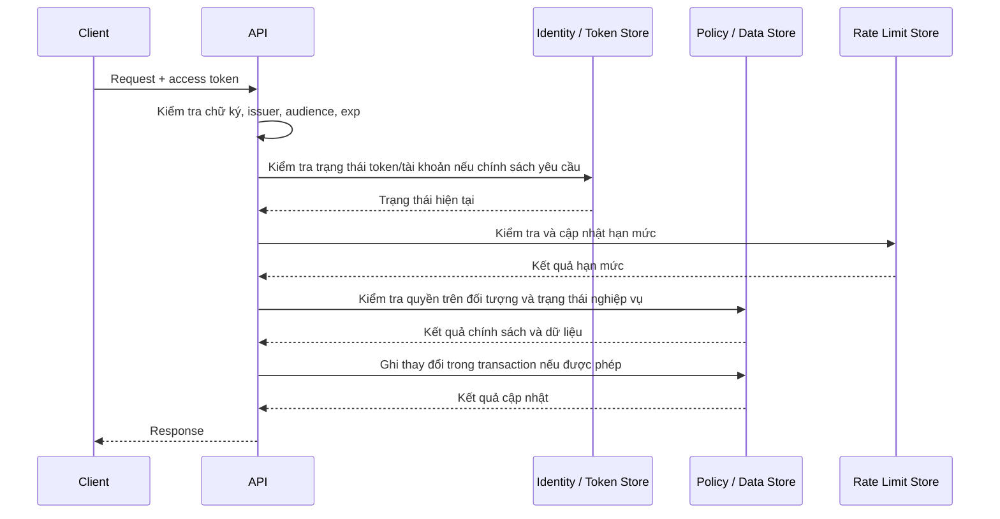

# Tính stateless không loại bỏ trạng thái bảo mật

> Một API có thể xử lý mỗi request độc lập mà vẫn phải biết người dùng có còn hoạt động hay không, họ được phép truy cập đối tượng nào, đơn hàng đang ở trạng thái gì và giới hạn sử dụng còn bao nhiêu. **Stateless là cách tổ chức giao tiếp giữa các request; nó không có nghĩa hệ thống không có trạng thái bảo mật.**

Trong API Security, nếu đồng nhất “stateless” với “không cần lưu trạng thái”, hệ thống rất dễ tin vào thông tin cũ trong token, bỏ sót quyền truy cập ở mức đối tượng, cho phép lặp lại thao tác nhạy cảm hoặc áp dụng giới hạn tài nguyên không nhất quán giữa các máy chủ.

## 1. Hiểu đúng về stateless

HTTP được thiết kế theo mô hình stateless: một request không mặc nhiên phụ thuộc vào request trước đó. Máy chủ nhận request, xử lý và trả response; giao thức không yêu cầu máy chủ phải nhớ toàn bộ cuộc hội thoại của client.

Một API thường tận dụng đặc tính này bằng cách yêu cầu mỗi request mang đủ thông tin để xác định ngữ cảnh, chẳng hạn:

```http
GET /api/orders/ord-782 HTTP/1.1
Host: api.example.com
Authorization: Bearer eyJ...
Accept: application/json
```

Access token cho phép API xác định chủ thể và một số thuộc tính đã được cấp tại thời điểm phát hành. Máy chủ có thể xác minh chữ ký token mà không cần giữ một HTTP session riêng cho từng client.

Tuy nhiên, cần phân biệt ba khái niệm:

| Khái niệm | Ý nghĩa | Điều không thể suy ra |
|---|---|---|
| HTTP stateless | Request được xử lý độc lập ở cấp giao thức | Ứng dụng không có dữ liệu thay đổi theo thời gian |
| Không dùng server-side session | Máy chủ không cần lưu một session hội thoại cho từng client | Không cần tra cứu tài khoản, quyền hoặc dữ liệu nghiệp vụ |
| JWT tự chứa thông tin | Token mang các claim có thể được xác minh bằng chữ ký | Mọi claim luôn mới nhất hoặc token không thể bị thu hồi |

Một hệ thống stateless ở lớp giao tiếp vẫn có thể sử dụng cơ sở dữ liệu, Redis, dịch vụ định danh, policy engine và kho sự kiện. Các thành phần này lưu trạng thái cần thiết để đưa ra quyết định bảo mật.

## 2. Những trạng thái bảo mật vẫn tồn tại

Trạng thái bảo mật là dữ liệu có thể thay đổi và ảnh hưởng đến việc một request có được chấp nhận hay không. Một số nhóm thường gặp:

| Nhóm trạng thái | Ví dụ | Quyết định bị ảnh hưởng |
|---|---|---|
| Vòng đời danh tính | Tài khoản đang hoạt động, bị khóa, đã vô hiệu hóa; mật khẩu vừa được đặt lại | Có chấp nhận danh tính và thông tin xác thực hay không |
| Quyền hiện tại | Vai trò, scope, quyền theo tổ chức, quyền được ủy quyền | Chủ thể có được gọi chức năng hoặc thực hiện hành động hay không |
| Quan hệ với dữ liệu | Chủ sở hữu bản ghi, thành viên tenant, người được chia sẻ tài liệu | Chủ thể có được đọc hoặc sửa đúng đối tượng hay không |
| Trạng thái nghiệp vụ | Đơn hàng chờ duyệt, thanh toán đã hoàn tất, yêu cầu đã bị hủy | Hành động có hợp lệ tại thời điểm hiện tại hay không |
| Phiên và token | Token bị thu hồi, refresh token đã dùng, phiên đăng nhập bị kết thúc | Thông tin xác thực còn hiệu lực hay không |
| Chống lạm dụng | Số request trong cửa sổ thời gian, số lần đăng nhập sai, hạn mức còn lại | Request có vượt ngưỡng hoặc cần thêm bước xác minh hay không |
| Tính toàn vẹn thao tác | Idempotency key đã được xử lý, nonce đã xuất hiện | Request có phải là thao tác lặp hoặc phát lại hay không |

Không phải request nào cũng cần đọc tất cả các nhóm trạng thái. API cần xác định nhóm nào liên quan đến endpoint và lấy dữ liệu từ nguồn có thẩm quyền tương ứng.

Ví dụ, endpoint `GET /orders/{id}` cần xác minh token, trạng thái tài khoản, quyền đọc và quan hệ giữa người gọi với đơn hàng. Endpoint `POST /payments/{id}/capture` còn phải kiểm tra trạng thái thanh toán, quyền thực hiện thao tác, hạn mức và khả năng request đã được xử lý trước đó.

## 3. Token tự chứa không đồng nghĩa với quyền luôn mới nhất

JWT thường chứa các claim như `sub`, `iss`, `aud`, `exp`, `jti`, `scope` hoặc `tenant_id`. Chữ ký giúp API phát hiện token bị sửa đổi; các claim giúp API biết token được phát hành cho ai, bởi ai, dùng ở đâu và trong khoảng thời gian nào.

Điểm quan trọng là claim phản ánh thông tin tại thời điểm token được phát hành. Giả sử một quản trị viên được cấp token có claim `role=ADMIN` lúc 09:00. Đến 09:05, quản trị viên bị gỡ quyền hoặc tài khoản bị khóa. Nếu API chỉ kiểm tra chữ ký và hạn `exp` của token, token vẫn có thể được chấp nhận cho đến khi hết hạn.

Đây là vấn đề **độ mới của trạng thái**. Chữ ký hợp lệ chứng minh token chưa bị sửa đổi; nó không chứng minh các quyền bên trong token vẫn đúng với dữ liệu hiện tại.

### Chọn cách quản lý hiệu lực token

Các hệ thống có thể kết hợp một hoặc nhiều cách sau:

| Cách làm | Cách hoạt động | Đánh đổi chính |
|---|---|---|
| Access token có thời hạn ngắn | Giảm khoảng thời gian token cũ còn được chấp nhận | Người dùng có thể phải làm mới token thường xuyên hơn |
| Token introspection | API hỏi máy chủ định danh xem token còn hiệu lực không | Tăng phụ thuộc mạng và độ trễ vào dịch vụ định danh |
| Danh sách thu hồi theo `jti` | Lưu mã token bị thu hồi và kiểm tra khi nhận request | Cần kho trạng thái dùng chung và chính sách dọn dữ liệu hết hạn |
| Token version hoặc security stamp | So sánh phiên bản trong token với phiên bản hiện tại của tài khoản | Phải truy xuất hoặc cache phiên bản hiện tại |
| Kiểm tra quyền hiện tại tại thời điểm hành động | Đọc quyền từ nguồn dữ liệu có thẩm quyền trước thao tác nhạy cảm | Tốn thêm truy vấn và cần xử lý lỗi của nguồn dữ liệu |

Không có lựa chọn nào miễn phí. Token sống lâu và chỉ xác minh cục bộ có độ trễ thấp, nhưng thu hồi quyền tức thời khó hơn. Kiểm tra trạng thái trực tiếp giúp quyết định mới hơn, nhưng tăng chi phí và phụ thuộc vào dịch vụ lưu trạng thái. Thiết kế cần dựa trên mức độ rủi ro của endpoint.

Với thao tác nhạy cảm như thay đổi thông tin thanh toán, cấp quyền quản trị, xuất dữ liệu lớn hoặc phê duyệt giao dịch, không nên dựa duy nhất vào một claim quyền có thể đã cũ. Có thể yêu cầu kiểm tra quyền hiện tại, xác minh lại danh tính hoặc xác nhận bổ sung theo chính sách của hệ thống.

## 4. Xác thực mỗi request chưa đủ: phải phân quyền trên từng đối tượng

Xác thực trả lời câu hỏi “ai đang gửi request?”. Phân quyền trả lời “chủ thể này được phép làm gì trên tài nguyên cụ thể nào?”. Hai bước này có liên quan nhưng không thay thế nhau.

Một token hợp lệ có thể chứng minh người gọi là `user-17`. Nó không tự chứng minh người đó được đọc mọi đơn hàng trong hệ thống. Nếu API chỉ kiểm tra `isAuthenticated()` rồi tải bản ghi theo ID do client cung cấp, endpoint có thể mắc lỗi Broken Object Level Authorization (BOLA).

Ví dụ, endpoint đọc đơn hàng cần ràng buộc truy vấn với tenant hoặc phạm vi truy cập của người gọi:

```java
@GetMapping("/orders/{id}")
public OrderDto getOrder(
        @PathVariable UUID id,
        @AuthenticationPrincipal Jwt jwt) {

    String tenantId = jwt.getClaimAsString("tenant_id");
    String subject = jwt.getSubject();

    Order order = orderRepository
            .findByIdAndTenantId(id, tenantId)
            .orElseThrow(() -> new ResponseStatusException(
                    HttpStatus.NOT_FOUND));

    authorizationService.requireCanReadOrder(subject, order);
    return orderMapper.toDto(order);
}
```

Đây là ví dụ minh họa. Trong ứng dụng thực tế, cách lấy tenant và kiểm tra quyền phải phù hợp với mô hình dữ liệu, chính sách ẩn tài nguyên và cơ chế phân quyền của hệ thống.

Một số nguyên tắc cần giữ:

- Không xem ID tài nguyên, `tenant_id` hoặc `user_id` do client gửi là bằng chứng về quyền sở hữu.
- Kiểm tra quyền ở mức đối tượng trên mọi endpoint đọc, cập nhật, xóa, tải tệp hoặc thực hiện hành động với tài nguyên.
- Khi hệ thống có nhiều tenant, ràng buộc tenant phải được áp dụng xuyên suốt truy vấn và thao tác ghi; không chỉ kiểm tra ở giao diện hoặc một endpoint.
- Chỉ trả về các trường dữ liệu mà chủ thể được phép xem. Quyền truy cập một đối tượng không mặc nhiên đồng nghĩa quyền đọc mọi thuộc tính của đối tượng đó.
- Kiểm tra quyền lại ở thời điểm thực hiện thao tác có rủi ro cao, nhất là khi quyền có thể bị thay đổi trong lúc request đang chạy.

Việc token chứa `tenant_id` có thể giúp định tuyến hoặc tạo ngữ cảnh ban đầu. Quan hệ thực tế giữa chủ thể, tenant và tài nguyên vẫn cần được đối chiếu với dữ liệu có thẩm quyền.

## 5. Trạng thái nghiệp vụ quyết định hành động có hợp lệ hay không

Một request có thể đến từ người dùng đã xác thực và có quyền chức năng, nhưng hành động vẫn không hợp lệ vì đối tượng đã chuyển sang trạng thái khác.

Ví dụ, nhân viên có quyền duyệt đơn hàng. Đơn hàng `ord-782` đang ở trạng thái `PENDING`, nên thao tác duyệt có thể hợp lệ. Nhưng nếu một nhân viên khác đã duyệt hoặc hủy đơn trước đó, request đến sau không được tiếp tục dựa trên trạng thái cũ mà client nhìn thấy.

Nên mô hình hóa các chuyển trạng thái được phép một cách rõ ràng:

```text
PENDING  --approve-->  APPROVED
PENDING  --reject-->   REJECTED
PENDING  --cancel-->   CANCELLED
APPROVED --ship---->   SHIPPED
```

Mỗi chuyển trạng thái cần kiểm tra đồng thời:

1. Chủ thể có quyền thực hiện hành động trên đối tượng này không?
2. Trạng thái hiện tại của đối tượng có cho phép chuyển trạng thái không?
3. Điều kiện nghiệp vụ liên quan, như hạn mức, thời hạn hoặc phê duyệt bổ sung, có còn thỏa mãn không?
4. Một request khác có vừa thay đổi đối tượng hay thực hiện cùng thao tác không?

Kiểm tra rồi cập nhật theo hai bước tách rời có thể tạo ra race condition. Hai request cùng đọc trạng thái `PENDING`, cùng vượt qua kiểm tra, rồi cùng thực hiện thao tác. Cần bảo vệ chuyển trạng thái bằng transaction, khóa phù hợp hoặc cập nhật có điều kiện.

Ví dụ SQL dùng điều kiện trạng thái:

```sql
UPDATE orders
SET status = 'APPROVED', approved_by = :actor_id
WHERE id = :order_id
  AND tenant_id = :tenant_id
  AND status = 'PENDING';
```

Ứng dụng phải kiểm tra số dòng được cập nhật. Nếu bằng `0`, đối tượng có thể không tồn tại trong phạm vi truy cập hoặc trạng thái đã thay đổi; API cần trả kết quả phù hợp với chính sách tiết lộ thông tin của hệ thống. Việc kiểm tra quyền và cập nhật cũng cần được đặt trong một ranh giới transaction nhất quán để tránh lỗi kiểm tra xong nhưng dữ liệu đã đổi trước khi ghi.

## 6. Chống phát lại và bảo đảm thao tác không bị thực hiện lặp

Một API stateless có thể nhận cùng một request nhiều lần. Điều này xảy ra do client retry khi timeout, proxy gửi lại request hoặc một request bị kẻ tấn công phát lại.

Với thao tác chỉ đọc, việc lặp lại thường ít rủi ro hơn. Với tạo đơn, chuyển tiền, thanh toán hoặc cấp quyền, lặp lại có thể gây ra hậu quả đáng kể.

**Idempotency key** là một cách quản lý trạng thái để nhận diện các lần gửi lại của cùng một thao tác. Client gửi một khóa duy nhất trong phạm vi thao tác; máy chủ lưu khóa cùng kết quả xử lý. Khi nhận lại khóa đã được xử lý, máy chủ trả kết quả đã lưu hoặc trạng thái đang xử lý theo hợp đồng API, thay vì tạo hiệu ứng phụ lần nữa.

```http
POST /api/payments
Authorization: Bearer eyJ...
Idempotency-Key: 9d3a8b0e-7d1c-4f1a-ae54-2f5c6d9f1a22
Content-Type: application/json

{"orderId":"ord-782","amount":1250000}
```

Kho idempotency cần xác định phạm vi khóa, thời gian lưu, cách xử lý hai request đồng thời và cách ràng buộc khóa với chủ thể cùng nội dung request. Nếu cùng một khóa được dùng lại với payload khác, API nên từ chối thay vì coi đó là cùng thao tác.

Với giao thức yêu cầu chống phát lại ở mức thông điệp, có thể cần timestamp, nonce, chữ ký request hoặc cơ chế ràng buộc token với client. Nonce đã dùng phải được ghi nhận trong một khoảng thời gian phù hợp để máy chủ phát hiện request lặp. Chỉ kiểm tra timestamp không đủ nếu cùng một request vẫn có thể được phát lại nhiều lần trong cửa sổ thời gian chấp nhận.

## 7. Giới hạn tài nguyên cũng cần trạng thái dùng chung

Rate limiting, giới hạn số lần đăng nhập sai, giới hạn kích thước hoặc số lượng tài nguyên tạo mới đều dựa trên dữ liệu tích lũy qua nhiều request.

Nếu mỗi instance API tự đếm trong bộ nhớ, người dùng có thể nhận thêm hạn mức khi request được phân phối sang instance khác. Khởi động lại instance cũng có thể xóa bộ đếm. Với hệ thống nhiều máy chủ, bộ đếm cần được chia sẻ hoặc được quản lý bởi một lớp chuyên trách, chẳng hạn Redis hay API gateway.

Khóa giới hạn phải phản ánh đúng chính sách: theo IP, tài khoản, API key, tenant, endpoint hoặc kết hợp nhiều chiều. Chỉ giới hạn theo IP có thể ảnh hưởng người dùng chung mạng; chỉ giới hạn theo tài khoản có thể bỏ sót lạm dụng phân tán qua nhiều tài khoản.

Đối với thao tác tiêu thụ hạn mức, cần cập nhật bộ đếm theo cách nguyên tử để hai request đồng thời không cùng nhìn thấy một lượng hạn mức còn lại rồi đều được chấp nhận. Hệ thống cũng cần xác định hành vi khi kho đếm bị lỗi: từ chối tạm thời, dùng hạn mức dự phòng hay chuyển sang chế độ giới hạn nghiêm ngặt hơn, tùy mức độ rủi ro của endpoint.

## 8. Đưa trạng thái bảo mật vào luồng xử lý request

Một luồng xử lý điển hình có thể được tổ chức như sau:



Không phải API nào cũng cần gọi tất cả dịch vụ trong sơ đồ. Các bước có thể được gộp trong cùng một ứng dụng hoặc triển khai qua middleware, gateway và dịch vụ chuyên biệt. Điều quan trọng là mỗi quyết định phải dựa trên nguồn dữ liệu phù hợp và có quy tắc rõ ràng về độ mới của dữ liệu.

### Xác định nguồn sự thật và độ mới cần thiết

Với từng loại trạng thái, đội phát triển nên trả lời:

- Nguồn nào là nơi có thẩm quyền? Ví dụ: cơ sở dữ liệu tài khoản, dịch vụ định danh, kho quyền hoặc hệ thống nghiệp vụ.
- Dữ liệu được đọc trực tiếp hay qua cache? Cache có thể cũ tối đa bao lâu?
- Sự kiện nào làm dữ liệu thay đổi và cơ chế nào cập nhật hoặc vô hiệu hóa cache?
- Nếu không truy cập được nguồn trạng thái, endpoint có được phép tiếp tục không?
- Nhiều instance hoặc nhiều dịch vụ có nhìn thấy cùng một trạng thái nhất quán không?

Không phải mọi dữ liệu đều cần nhất quán tức thời. Một dashboard thống kê có thể chấp nhận dữ liệu trễ. Việc thu hồi quyền quản trị, kiểm tra chủ sở hữu trước khi tải dữ liệu riêng tư hoặc xác nhận trạng thái thanh toán thường cần độ mới cao hơn. Quyết định dùng cache cần xét hậu quả của việc chấp nhận một trạng thái đã lỗi thời.

Với kiểm tra bảo mật quan trọng, nếu không thể xác minh điều kiện bắt buộc thì cần từ chối hoặc yêu cầu thử lại theo chính sách. Không nên tự động coi lỗi kết nối đến dịch vụ định danh hoặc kho quyền là bằng chứng rằng người dùng được phép.

### Tách dữ liệu phục vụ quyết định khỏi dữ liệu kiểm toán

Audit log ghi lại ai đã làm gì, trên đối tượng nào, vào thời điểm nào và kết quả ra sao. Đây là nguồn quan trọng để điều tra và phát hiện bất thường, nhưng log thông thường không nên được dùng thay cho nguồn trạng thái có thẩm quyền trong quyết định cho phép request hiện tại.

Ghi nhận sự kiện bảo mật cần tránh lưu access token, refresh token, mật khẩu, khóa bí mật hoặc dữ liệu cá nhân vượt quá nhu cầu. Có thể ghi `jti` đã được xử lý, mã chủ thể nội bộ, loại hành động, mã đối tượng đã được kiểm soát và kết quả quyết định. Quyền đọc log cũng cần được giới hạn và giám sát.

## 9. Kiểm thử các thay đổi trạng thái và tình huống đồng thời

Kiểm thử API Security cần vượt ra ngoài trường hợp token hợp lệ và token sai. Với mỗi endpoint, hãy thử các tình huống liên quan đến trạng thái hiện tại và trạng thái thay đổi giữa các request:

| Tình huống | Kết quả cần xác minh |
|---|---|
| Tài khoản bị khóa sau khi access token được phát hành | Request tiếp theo bị từ chối trong khoảng thời gian theo chính sách thu hồi |
| Quyền quản trị vừa bị gỡ | Token cũ không duy trì quyền vượt quá giới hạn độ mới đã chấp nhận |
| Người dùng thay ID đơn hàng sang ID của người khác | Không đọc hoặc sửa được đối tượng ngoài phạm vi quyền |
| Tenant trong token không khớp tenant của tài nguyên | Truy vấn và thao tác ghi đều bị giới hạn đúng tenant |
| Hai request cùng duyệt một đơn hàng | Chỉ một chuyển trạng thái hợp lệ được ghi nhận |
| Client gửi lại request thanh toán với cùng idempotency key | Không tạo thêm giao dịch hoặc hiệu ứng phụ |
| Cùng idempotency key nhưng payload khác | Request bị từ chối theo hợp đồng API |
| Request được phân phối qua nhiều API instance | Rate limit vẫn áp dụng nhất quán theo chính sách |
| Kho trạng thái hoặc dịch vụ định danh tạm thời không truy cập được | API xử lý theo chính sách lỗi đã xác định, không vô tình mở quyền |
| Cache quyền chưa được cập nhật sau khi thu hồi | Độ trễ thực tế nằm trong giới hạn rủi ro đã chấp nhận |

Nên có kiểm thử tích hợp cho luồng thu hồi quyền, chuyển trạng thái nghiệp vụ và xử lý request đồng thời. Kiểm thử đơn vị cho một hàm xác minh JWT không thể chứng minh rằng toàn bộ API đang sử dụng quyền và trạng thái mới nhất.

## 10. Các ngộ nhận thường gặp

**“Dùng JWT thì không cần lưu session.”** Có thể không cần session hội thoại truyền thống, nhưng vẫn có thể cần trạng thái thu hồi, phiên bản bảo mật, refresh token, quyền hiện tại và dữ liệu nghiệp vụ.

**“Token có chữ ký hợp lệ thì request an toàn.”** Chữ ký chỉ xác minh tính toàn vẹn và nguồn phát hành theo khóa tin cậy. API vẫn phải kiểm tra các điều kiện như `iss`, `aud`, `exp`, trạng thái tài khoản, quyền và phạm vi tài nguyên.

**“Có role trong token là đủ phân quyền.”** Role thường chỉ mô tả quyền ở mức chức năng. API còn phải kiểm tra quyền trên từng đối tượng, từng tenant và từng trường dữ liệu khi cần.

**“API stateless không cần Redis hay database cho bảo mật.”** Bộ đếm rate limit, danh sách thu hồi, nonce, idempotency key và trạng thái tài khoản đều có thể cần kho lưu trữ dùng chung.

**“Mỗi request độc lập nên không cần quan tâm request trước.”** Các request có thể cùng thay đổi một tài nguyên hoặc cùng tiêu thụ một hạn mức. Trạng thái hiện tại và tính nguyên tử của thao tác vẫn quyết định kết quả.

## 11. Nguyên tắc thiết kế

Khi thiết kế một endpoint, hãy bắt đầu từ hành động và dữ liệu mà endpoint tác động. Xác định danh tính cần được xác thực, quyền chức năng, quyền trên đối tượng, trạng thái nghiệp vụ và các giới hạn tài nguyên liên quan. Sau đó chỉ rõ nguồn dữ liệu có thẩm quyền, độ mới cần thiết, cách đồng bộ giữa các instance và hành vi khi không thể xác minh.

Stateless giúp API dễ mở rộng và giảm phụ thuộc vào session của từng máy chủ. Bảo mật vẫn cần quản lý trạng thái ở đúng nơi, kiểm tra trạng thái phù hợp cho từng quyết định và xử lý an toàn khi nhiều request xảy ra đồng thời. **Một API stateless an toàn là API không phụ thuộc vào ký ức của request trước, nhưng luôn kiểm tra đúng trạng thái hiện tại cần thiết để quyết định request hiện tại có được phép hay không.**
