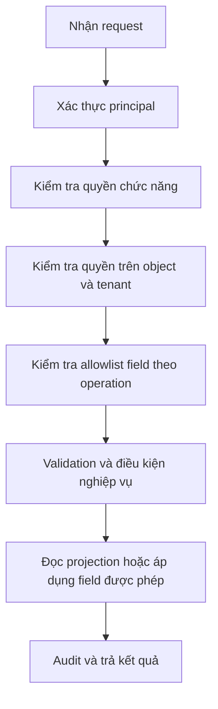

# Allowlist field được phép đọc và ghi

Một endpoint có thể xác thực người dùng, kiểm tra họ được truy cập đúng đối tượng, nhưng vẫn để lộ hoặc cho sửa những thuộc tính không được phép. Ví dụ, khách hàng được xem hồ sơ của mình nhưng response trả cả `riskScore` và `internalNote`; hoặc khách hàng được cập nhật tên hiển thị nhưng request có thể thêm `role`, `tenantId` hay `emailVerified` để thay đổi dữ liệu quản trị.

Đây là vấn đề authorization ở mức thuộc tính (property-level authorization). Cần xác định rõ field nào được đọc và field nào được ghi cho từng operation, principal, resource và ngữ cảnh nghiệp vụ. Allowlist giúp biến quyết định đó thành quy tắc rõ ràng: chỉ những field được cho phép mới được đưa vào response hoặc áp dụng vào dữ liệu.

Trong module `SECURITY_API_SECURITY`, bảo mật API được thiết kế theo từng endpoint, đối tượng dữ liệu và luồng nghiệp vụ. Vì vậy, kiểm tra quyền ở mức route hoặc object chưa đủ. Mỗi API cần kiểm soát cả dữ liệu được trả ra, dữ liệu được nhận vào và các thuộc tính lồng nhau có thể thay đổi.

## Mục tiêu học tập

Sau bài này, người học có thể:

- Giải thích vì sao quyền truy cập object không đồng nghĩa với quyền đọc hoặc sửa mọi field của object.
- Thiết kế allowlist đọc và allowlist ghi riêng theo operation, principal và resource.
- Phân biệt field không được phép, field không được gửi và field có giá trị `null`.
- Xử lý an toàn mass assignment, over-posting, excessive data exposure và nested property.
- Áp dụng allowlist cho `POST`, `PUT`, `PATCH`, JSON Patch, export và response projection.
- Kết hợp property authorization với object authorization, tenant isolation và trạng thái nghiệp vụ.
- Viết kiểm thử âm tính để chứng minh field nhạy cảm không bị đọc hoặc thay đổi ngoài quyền.

## 1. Property-level authorization là gì?

Property-level authorization là quyết định một principal có được đọc hoặc thay đổi một thuộc tính cụ thể của một resource hay không. Quyết định này chi tiết hơn quyền gọi endpoint và quyền truy cập object.

Ví dụ với hồ sơ khách hàng:

| Field | Khách hàng | Nhân viên hỗ trợ | Nhân viên quản trị |
|---|---|---|---|
| `displayName` | Đọc, sửa của mình | Đọc, sửa khi được giao hỗ trợ | Đọc, sửa theo phạm vi quản trị |
| `email` | Đọc; yêu cầu thay đổi qua luồng xác minh | Đọc một phần theo nhiệm vụ | Đọc, sửa theo quyền và audit |
| `phoneNumber` | Đọc, yêu cầu thay đổi qua luồng xác minh | Đọc một phần | Đọc, sửa theo quyền |
| `role` | Không đọc, không sửa | Không sửa | Chỉ role được cấp mới được thay đổi |
| `tenantId` | Không sửa | Không sửa trực tiếp | Chỉ thao tác quản trị chuyên biệt |
| `riskScore` | Không đọc, không sửa | Chỉ đọc nếu nhiệm vụ cho phép | Đọc theo quyền chuyên biệt |
| `internalNote` | Không đọc, không sửa | Đọc, thêm hoặc sửa theo phạm vi ticket | Đọc, sửa theo quyền quản trị |

Bảng chỉ là ví dụ. Quyền thực tế phụ thuộc chính sách dữ liệu và nghiệp vụ của hệ thống. Điều quan trọng là quyền đọc và quyền ghi cần được định nghĩa độc lập. Một nhân viên có thể được xem `riskScore` để xử lý cảnh báo nhưng không được thay đổi điểm này. Một người dùng có thể sửa `displayName` nhưng không được sửa `emailVerified`.

### 1.1. Ba lớp kiểm tra cần phối hợp

Một request thường cần ít nhất ba quyết định:

1. **Function authorization:** principal có được gọi hành động/endpoint này không? Ví dụ có `customer:update-profile`.
2. **Object authorization:** principal có được thao tác trên hồ sơ khách hàng cụ thể này không? Ví dụ hồ sơ thuộc user hoặc tenant mà principal được phép truy cập.
3. **Property authorization:** principal có được đọc hoặc ghi từng field trong operation này không? Ví dụ được sửa `displayName` nhưng không được sửa `role`.

Ngoài ra, service cần kiểm tra trạng thái và điều kiện nghiệp vụ. Dù có quyền sửa địa chỉ, người dùng có thể không được sửa sau khi đơn hàng đã bàn giao cho đơn vị vận chuyển.



Không dùng allowlist field để thay thế kiểm tra object. User có thể được sửa `displayName` trên hồ sơ của chính mình, nhưng không vì thế được sửa `displayName` của một user khác.

## 2. Vì sao cần allowlist thay vì denylist?

Với denylist, ứng dụng nhận mọi field rồi cố gắng loại bỏ một số field bị cấm như `role`, `tenantId` hoặc `isAdmin`. Cách này dễ bỏ sót khi entity có thêm field mới, tên field thay đổi, nested object xuất hiện hoặc một endpoint mới dùng lại mapper cũ.

Với allowlist, ứng dụng chỉ chấp nhận hoặc trả ra những field đã được xác định rõ. Field mới trong entity không tự động trở thành field có thể đọc hoặc ghi qua API.

Ví dụ entity có thể chứa:

```java
class Customer {
    UUID id;
    UUID tenantId;
    String displayName;
    String email;
    boolean emailVerified;
    String role;
    BigDecimal creditLimit;
    BigDecimal riskScore;
    String internalNote;
}
```

Nếu controller bind toàn bộ request JSON vào entity rồi lưu, bất kỳ field nào framework có thể bind đều có nguy cơ bị thay đổi. Khi entity được mở rộng trong tương lai, endpoint có thể vô tình nhận thêm quyền ghi mà không ai chủ động thiết kế.

Allowlist làm cho quyền mới phải được xem xét rõ ràng. Khi thêm field `creditLimit`, nhà phát triển cần quyết định operation nào được phép đọc hoặc ghi field này trước khi đưa nó vào API contract.

## 3. Thiết kế allowlist đọc và ghi riêng biệt

### 3.1. Allowlist đọc (read allowlist)

Read allowlist xác định field nào có thể xuất hiện trong response cho một principal và operation cụ thể. Không serialize trực tiếp entity hoặc trả toàn bộ database row.

Ví dụ response hồ sơ công khai trong tài khoản:

```json
{
  "id": "cus-1001",
  "displayName": "Mai",
  "email": "m***@example.com"
}
```

Response có thể không chứa `tenantId`, `role`, `riskScore` hoặc `internalNote`. Nếu nhân viên hỗ trợ có quyền đọc một phần `internalNote`, đó nên là response/use case riêng với policy, audit và DTO rõ ràng.

### 3.2. Allowlist ghi (write allowlist)

Write allowlist xác định field nào request được phép thay đổi trong operation hiện tại. Ví dụ endpoint đổi tên hiển thị chỉ nhận:

```json
{
  "displayName": "Mai Nguyen"
}
```

Không nhận một `Customer` entity đầy đủ rồi cố gắng bỏ `role`, `tenantId`, `emailVerified` sau khi bind. Tạo request DTO riêng cho use case này để giới hạn ngay cấu trúc đầu vào.

### 3.3. Không dùng chung một allowlist cho mọi operation

Quyền field phụ thuộc hành động:

| Operation | Allowlist ghi ví dụ | Allowlist đọc ví dụ |
|---|---|---|
| `GET /me/profile` | Không có | `id`, `displayName`, `emailMasked`, `phoneMasked` |
| `PATCH /me/profile` | `displayName` | `id`, `displayName`, `emailMasked`, `phoneMasked` |
| `POST /me/email-change` | `newEmail` trong command riêng | Trạng thái xác minh và thông tin hướng dẫn |
| `GET /support/customers/{id}` | Không có | Các field được phép cho ticket và vai trò hỗ trợ |
| `PATCH /admin/customers/{id}/role` | `role` qua operation quản trị riêng | `id`, `role`, metadata audit được phép |

Không nên tạo một endpoint `PATCH /customers/{id}` cho phép thay mọi thuộc tính rồi dựa vào role để lọc thủ công trong một đoạn code lớn. Các use case nhạy cảm nên có operation và DTO riêng để policy dễ review và kiểm thử.

## 4. Kiểm soát field đầu vào

### 4.1. Dùng request DTO theo use case

DTO đầu vào nên chứa đúng những field mà operation cần. Ví dụ Java/Spring:

```java
public record UpdateProfileRequest(
    @NotBlank
    @Size(max = 80)
    String displayName
) {}
```

Controller:

```java
@PatchMapping("/me/profile")
@PreAuthorize("isAuthenticated()")
public ProfileResponse updateProfile(
        @Valid @RequestBody UpdateProfileRequest request,
        Authentication authentication) {
    return profileService.updateDisplayName(authentication, request);
}
```

Service lấy principal đã xác thực, tìm profile thuộc đúng user/tenant và chỉ cập nhật field được DTO cho phép:

```java
public ProfileResponse updateDisplayName(
        Authentication authentication,
        UpdateProfileRequest request) {
    CurrentUser actor = currentUser(authentication);
    Customer customer = customerRepository
        .findByIdAndTenantId(actor.customerId(), actor.tenantId())
        .orElseThrow(NotFoundException::new);

    customer.setDisplayName(request.displayName());
    customerRepository.save(customer);

    return profileMapper.toSelfProfileResponse(customer);
}
```

Ví dụ rút gọn này cho thấy request không thể gán `role`, `tenantId` hoặc `emailVerified` qua DTO. Ứng dụng thực tế vẫn cần xử lý transaction, optimistic locking nếu có và policy sở hữu object phù hợp với mô hình dữ liệu.

### 4.2. Xử lý field lạ trong request

Nếu client gửi:

```json
{
  "displayName": "Mai Nguyen",
  "role": "ADMIN"
}
```

server nên có hành vi được định nghĩa rõ. Với operation nhạy cảm, thường nên từ chối request chứa field không được khai báo để phát hiện over-posting và lỗi client sớm. Một số contract có thể chọn bỏ qua field lạ để hỗ trợ forward compatibility, nhưng điều đó chỉ an toàn khi parser không bind field lạ vào entity, không làm thay đổi dữ liệu và hành vi được tài liệu hóa.

Không để framework tự động bind các thuộc tính không biết trước vào object domain. Nếu schema dùng `additionalProperties: false`, hãy bảo đảm runtime validation thực sự thực thi quy tắc đó; khai báo OpenAPI/JSON Schema mà không validate ở server không tạo ra bảo vệ.

### 4.3. Field không gửi, field null và field có giá trị

Với PATCH, cần phân biệt ba trạng thái:

```json
{}
```

```json
{"displayName": null}
```

```json
{"displayName": "Mai Nguyen"}
```

Contract phải quy định rõ:

- Field vắng mặt: giữ nguyên giá trị hiện tại.
- Field có `null`: từ chối nếu không cho phép null, hoặc thực hiện thao tác xóa nếu use case cho phép.
- Field có giá trị: validate rồi cập nhật nếu field nằm trong allowlist.

Không dùng giá trị mặc định của ngôn ngữ hoặc DTO để suy ra field có được gửi hay không nếu điều đó làm mất khác biệt giữa absent và null. Với yêu cầu phức tạp, dùng command hoặc kiểu dữ liệu biểu diễn rõ trạng thái field.

### 4.4. Không cho client cập nhật trạng thái hệ thống qua field tổng quát

Các field như `status`, `ownerId`, `tenantId`, `approvedAt`, `emailVerified`, `balance` hoặc `role` thường đại diện cho chuyển trạng thái nghiệp vụ hoặc quyền quản trị. Không đưa chúng vào DTO cập nhật chung chỉ vì chúng là property của entity.

Tạo operation chuyên biệt như `POST /orders/{id}/cancel`, `POST /users/{id}/verify-email` hoặc `POST /admin/users/{id}/role-change`. Operation đó phải xác minh principal, object, quyền chức năng, trạng thái hiện tại và các điều kiện bổ sung. Không coi allowlist field đơn thuần là đủ cho một chuyển trạng thái có side effect.

## 5. Kiểm soát field đầu ra

### 5.1. Dùng response DTO hoặc projection

Không trả entity JPA trực tiếp. Tạo response DTO thể hiện đúng các field được phép đọc:

```java
public record SelfProfileResponse(
    UUID id,
    String displayName,
    String emailMasked,
    String phoneMasked
) {}
```

Mapper chỉ lấy các field được phép:

```java
public SelfProfileResponse toSelfProfileResponse(Customer customer) {
    return new SelfProfileResponse(
        customer.getId(),
        customer.getDisplayName(),
        maskEmail(customer.getEmail()),
        maskPhone(customer.getPhoneNumber())
    );
}
```

Response DTO giúp review rõ dữ liệu được phát ra. Với danh sách lớn, có thể dùng database projection để chỉ truy vấn field cần thiết, giảm nguy cơ vô tình serialize field nhạy cảm và giảm lượng dữ liệu phải xử lý.

### 5.2. Read allowlist phải áp dụng cho mọi representation

Một API có thể trả JSON đã lọc nhưng endpoint export CSV, PDF, XML, GraphQL hoặc download lại trả nhiều field hơn. Cần áp dụng cùng policy đọc cho mọi đường xuất dữ liệu, bao gồm:

- Response chi tiết và response danh sách.
- Export, report, download và file đính kèm.
- Nested object và collection.
- API version cũ và endpoint nội bộ.
- Cache, search index, event và background job tạo dữ liệu cho consumer.

Nếu cho phép client chọn field bằng query như `?fields=id,displayName,email`, hãy coi đó là yêu cầu lọc response chứ không phải cấp quyền. Server phải giao tập field yêu cầu với allowlist của principal và operation; field không được phép phải bị từ chối hoặc loại bỏ theo contract nhất quán.

### 5.3. Không để metadata hoặc error response làm lộ field

Thông tin như `tenantId`, internal ID, moderation flag, risk score, trạng thái xác minh, lý do khóa tài khoản và ghi chú nội bộ cũng có thể nhạy cảm. Kiểm tra cả header, error body, validation message, debug endpoint và log có thể được client truy cập. Không giả định chỉ response thành công mới có nguy cơ lộ dữ liệu.

## 6. Field lồng nhau, collection và patch path

### 6.1. Nested object cần allowlist đệ quy

Giả sử request có cấu trúc:

```json
{
  "profile": {
    "displayName": "Mai",
    "preferences": {
      "language": "vi",
      "isStaff": true
    }
  }
}
```

Cho phép cập nhật `profile.displayName` không có nghĩa được cập nhật mọi field trong `profile.preferences`. Cần xác định allowlist cho từng cấp, validate kiểu và kiểm tra quyền trên field nhạy cảm lồng nhau. Tránh deserialize nguyên cây JSON vào entity rồi lưu toàn bộ.

### 6.2. Collection và phần tử con

Với request cập nhật danh sách địa chỉ, quyền ghi collection không tự động cấp quyền với mọi thuộc tính của từng địa chỉ. Cần xác định:

- Có được thêm hoặc xóa phần tử không?
- Có được sửa phần tử hiện có hay chỉ được sửa địa chỉ mặc định?
- Field nào được ghi trong mỗi phần tử?
- ID phần tử có thuộc object cha và tenant hiện tại không?
- Số phần tử tối đa, kích thước và thứ tự có bị giới hạn không?

Khi nhận danh sách ID, phải kiểm tra từng phần tử thuộc phạm vi được phép. Không tin `customerId`, `ownerId` hoặc `tenantId` lặp lại trong từng item của payload.

### 6.3. JSON Patch và JSON Merge Patch

JSON Patch cho phép thao tác theo path như `add`, `remove`, `replace`, `move`, `copy` và `test`. Nếu endpoint hỗ trợ JSON Patch, cần allowlist cả operation lẫn path. Ví dụ, cho phép `replace /displayName` không có nghĩa cho phép `replace /role` hoặc `move /tenantId`.

Với mỗi patch operation:

1. Chuẩn hóa và parse path theo đúng chuẩn; từ chối path sai định dạng.
2. Kiểm tra path nằm trong allowlist của principal và operation.
3. Kiểm tra operation được phép trên path đó; không mặc định cho `copy`/`move` vì chúng có thể đọc hoặc ghi field khác.
4. Kiểm tra quyền trên object và phần tử collection được tham chiếu.
5. Áp dụng patch trên bản sao hoặc aggregate đã kiểm soát, validate kết quả cuối cùng rồi mới lưu.

JSON Merge Patch có quy tắc riêng: field vắng mặt thường giữ nguyên, còn `null` biểu thị xóa field. Chỉ hỗ trợ nếu semantics xóa phù hợp với nghiệp vụ; allowlist phải kiểm soát cả field bị xóa. Không xử lý mọi patch format như một object update thông thường.

## 7. Mô hình policy cho allowlist

### 7.1. Allowlist tĩnh theo operation

Đây là lựa chọn đơn giản và dễ kiểm thử khi quyền field ít thay đổi. Mỗi endpoint có request DTO và response DTO riêng. Ví dụ `UpdateProfileRequest` chỉ có `displayName`, còn `ChangeEmailRequest` chỉ có `newEmail` và được xử lý qua bước xác minh.

### 7.2. Allowlist động theo principal và resource

Một số hệ thống có quyền phụ thuộc vai trò, quan hệ và trạng thái. Khi đó, policy có thể tạo tập field cho phép từ principal, action, resource và context:

```text
readableFields = policy.readableFields(actor, "customer:read", customer)
writableFields = policy.writableFields(actor, "customer:update", customer)
```

Ví dụ, nhân viên hỗ trợ chỉ được đọc `internalNote` khi ticket được giao cho họ; quản lý có thể đọc thêm `riskScore`; user chỉ đọc thông tin hồ sơ đã được lọc. Policy cần trả allowlist cụ thể, mặc định là tập rỗng khi không có rule.

### 7.3. Field mask không phải quyền truy cập

Một số API cho client gửi `fields` hoặc `updateMask` để chọn thuộc tính cần đọc/ghi. Field mask có thể giảm payload và làm rõ ý định, nhưng không tự cấp quyền. Server phải kiểm tra từng path được yêu cầu với allowlist của principal và resource.

Ví dụ:

```http
PATCH /api/customers/cus-1001?updateMask=displayName,role
```

Nếu user chỉ được sửa `displayName`, request này phải bị từ chối hoặc xử lý theo hợp đồng rõ ràng mà không thay đổi `role`. Không âm thầm bỏ field bị cấm nếu client có thể hiểu nhầm rằng toàn bộ cập nhật đã thành công.

### 7.4. Fail closed và kiểm soát policy lỗi

Nếu policy engine không sẵn sàng, principal không xác định, field path không nhận diện được hoặc allowlist chưa được cấu hình, không suy ra quyền cho phép. Với thao tác ghi, từ chối request. Với thao tác đọc, không trả field ngoài tập được phép. Ghi nhận lỗi policy ở log an toàn để vận hành có thể xử lý.

## 8. Ví dụ policy và triển khai tổng hợp

Giả sử một khách hàng được xem hồ sơ của mình và sửa tên hiển thị. Nhân viên hỗ trợ được đọc thêm ghi chú nội bộ khi ticket được giao. Quản trị viên có operation riêng để đổi role.

| Principal/action | Object condition | Read allowlist | Write allowlist |
|---|---|---|---|
| Customer / `profile:read` | Hồ sơ thuộc user hiện tại | `id`, `displayName`, `emailMasked`, `phoneMasked` | Không có |
| Customer / `profile:update` | Hồ sơ thuộc user hiện tại | Response self-profile | `displayName` |
| Support / `customer:read` | Ticket được giao cho support | `id`, `displayName`, `emailMasked`, `internalNote` | Không có |
| Support / `note:add` | Ticket được giao cho support | `id`, `internalNote` | `internalNote` qua command riêng |
| Admin / `customer:change-role` | Có quyền quản trị phù hợp | `id`, `role` | `role` qua operation riêng |

Ví dụ pseudocode:

```text
function updateCustomer(request, customerId, actor):
    require(actor.isAuthenticated)
    customer = loadCustomer(customerId)
    require(objectPolicy.canUpdate(actor, customer))

    allowed = propertyPolicy.writableFields(
        actor, "customer:update", customer
    )
    supplied = parseSuppliedFieldPaths(request.body)

    if supplied is not a subset of allowed:
        reject request

    command = mapOnlyAllowedFields(request.body, allowed)
    validate(command)
    validateBusinessState(actor, customer, command)
    apply(command, customer)
    save(customer)

    readable = propertyPolicy.readableFields(
        actor, "customer:read", customer
    )
    return projectResponse(customer, readable)
```

Pseudocode nhấn mạnh rằng field được gửi phải là tập con của allowlist. Trong triển khai thực tế, cần xử lý riêng field vắng mặt và null, nested path, collection, concurrency và audit. Không nên dùng hàm `mapOnlyAllowedFields` tự viết mà không có test cho parser và mapper.

## 9. Kiểm thử property authorization

Kiểm thử phải chứng minh cả field được phép lẫn field bị cấm. Với mỗi principal, object và operation, tạo request chứa field hợp lệ, field nhạy cảm, field lạ, nested path và giá trị null.

| Nhóm kiểm thử | Tình huống | Kết quả mong đợi |
|---|---|---|
| Read allowlist | User gọi hồ sơ có `role`, `riskScore`, `internalNote` | Response không chứa field không được phép |
| Write allowlist | User gửi `displayName` cùng `role=ADMIN` | Từ chối toàn bộ request; `role` và `displayName` đều không thay đổi |
| Object boundary | User có quyền sửa `displayName` nhưng gửi ID hồ sơ của user khác | Bị từ chối trước khi cập nhật |
| Tenant boundary | Payload có `tenantId` của tenant khác | Không thay đổi tenant hoặc truy cập dữ liệu tenant khác |
| Null semantics | PATCH gửi field absent, `null` và value | Mỗi trường hợp đúng contract; không xóa ngoài ý muốn |
| Unknown property | Gửi field chưa có trong DTO/schema | Bị từ chối hoặc bỏ qua theo contract, không mass assign |
| Nested object | Gửi `preferences.isStaff` hoặc `address.ownerId` | Path không được phép bị từ chối |
| Collection | Thay ID phần tử trong danh sách sang phần tử của user khác | Không cập nhật phần tử ngoài phạm vi |
| JSON Patch | `replace /role`, `copy /internalNote` hoặc `move /tenantId` | Operation/path không nằm trong allowlist bị từ chối |
| Field mask | Yêu cầu `updateMask=displayName,role` | Không thể cập nhật `role` bằng quyền profile thông thường |
| Export/download | CSV chứa field bị ẩn trong JSON | Export cũng tuân theo read allowlist |
| Policy failure | Policy engine timeout hoặc trả kết quả không xác định | Fail closed; không trả hoặc ghi field ngoài quyền |
| Side effect | Request bị từ chối có chứa field nhạy cảm | Database, event và downstream không thay đổi field bị cấm |

Đối với write test, không chỉ kiểm tra HTTP status. Hãy đọc lại dữ liệu sau request và kiểm tra event/audit để chắc chắn field bị cấm không thay đổi. Đối với read test, kiểm tra raw response, export và cache để phát hiện field rò rỉ ở đường khác.

## 10. Logging, audit và vận hành

Với thao tác trên field nhạy cảm, audit nên ghi principal, tenant, resource ID, operation, tên field đã thay đổi, kết quả allow/deny và correlation ID. Chỉ ghi giá trị cũ/mới nếu chính sách dữ liệu cho phép; thường nên tránh ghi nội dung nhạy cảm nguyên văn vào log.

Theo dõi các dấu hiệu:

- Request liên tục gửi field quản trị như `role`, `tenantId`, `isAdmin`, `creditLimit`.
- Tỷ lệ từ chối property authorization tăng bất thường.
- Một principal bắt đầu đọc hoặc ghi nhiều field hơn baseline.
- Endpoint export hoặc API version cũ trả thêm field so với response chuẩn.
- Policy engine lỗi hoặc endpoint không có allowlist được cấu hình.
- Request PATCH/JSON Patch có path lạ, nested path sâu hoặc collection lớn bất thường.

Log phải được redaction, phân quyền truy cập và giới hạn thời gian lưu. Không ghi token, secret hoặc toàn bộ payload chỉ để biết field nào bị từ chối; có thể ghi tên path và mã policy an toàn.

## 11. Checklist trước khi phát hành

- [ ] Mỗi operation có read allowlist và write allowlist riêng; không mặc định dùng toàn bộ entity.
- [ ] Function authorization và object/tenant authorization được kiểm tra trước khi đọc hoặc ghi field.
- [ ] Request dùng DTO/command theo use case, không bind trực tiếp entity domain.
- [ ] Response dùng DTO/projection, không serialize entity hoặc database row tùy tiện.
- [ ] Field nhạy cảm và field do hệ thống quản lý không xuất hiện trong allowlist ghi thông thường.
- [ ] Quy tắc field absent, null và value được định nghĩa rõ cho PATCH.
- [ ] Unknown field có hành vi được tài liệu hóa và không thể mass assign.
- [ ] Nested object, collection, JSON Patch và field mask được kiểm tra theo path.
- [ ] Export, download, cache, API version cũ và background job tuân theo cùng read policy.
- [ ] Policy mặc định từ chối; lỗi policy không chuyển thành allow.
- [ ] Có test cho field bị cấm và xác minh database/event không thay đổi ngoài quyền.
- [ ] Audit ghi được field/action liên quan mà không làm lộ dữ liệu nhạy cảm.

## Kết luận

Allowlist field biến property-level authorization thành quy tắc rõ ràng cho từng operation, principal và resource. Read allowlist giới hạn dữ liệu được trả ra; write allowlist giới hạn dữ liệu được thay đổi. Khi kết hợp DTO/command riêng, response projection, kiểm tra object/tenant, xử lý PATCH có định nghĩa và kiểm thử âm tính, hệ thống tránh được mass assignment, excessive data exposure và các đường vòng qua field lồng nhau hoặc export. Mặc định từ chối mọi field chưa được cấp quyền.
