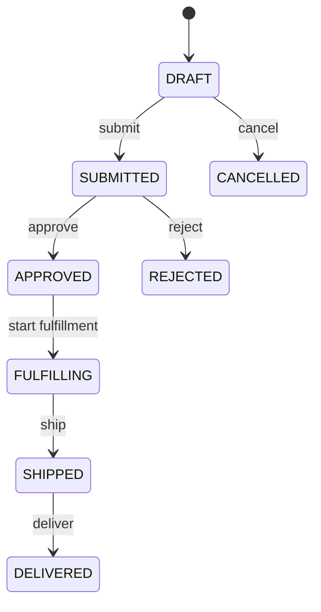

# Phân quyền theo trạng thái và từng thuộc tính

Một request có thể đến từ người dùng đã xác thực, có quyền gọi endpoint và có quyền truy cập bản ghi, nhưng vẫn không được phép đọc hoặc thay đổi mọi thuộc tính của bản ghi đó. Quyền trên một đối tượng không tự động đồng nghĩa với quyền trên tất cả trường dữ liệu của đối tượng. Tương tự, quyền thực hiện một hành động có thể thay đổi theo trạng thái nghiệp vụ hiện tại.

Ví dụ, nhân viên hỗ trợ có thể xem hồ sơ khách hàng nhưng không được xem số giấy tờ định danh đầy đủ; nhân viên bán hàng có thể sửa địa chỉ giao hàng khi đơn còn ở trạng thái `DRAFT`, nhưng không được đổi địa chỉ sau khi đơn đã `SHIPPED`. API cần quyết định quyền theo chủ thể, hành động, đối tượng, thuộc tính và trạng thái tại thời điểm xử lý request.

## 1. Vì sao phân quyền ở mức endpoint là chưa đủ?

Kiểm tra quyền ở mức endpoint thường trả lời câu hỏi: “Chủ thể có được gọi chức năng này không?”. Kiểm tra quyền ở mức đối tượng trả lời: “Chủ thể có được truy cập bản ghi cụ thể này không?”. Nhưng ngay cả hai lớp đó vẫn có thể quá rộng.

Một đối tượng thường chứa các trường có độ nhạy cảm và quy tắc thay đổi khác nhau:

| Đối tượng | Thuộc tính | Quy tắc có thể áp dụng |
|---|---|---|
| Hồ sơ nhân viên | `displayName` | Nhân viên có thể tự sửa; quản lý có thể sửa trong đơn vị phụ trách |
| Hồ sơ nhân viên | `salary` | Chỉ HR hoặc người có quyền đặc biệt được xem; chỉ nhóm được ủy quyền được cập nhật |
| Hồ sơ khách hàng | `phone` | Nhân viên phụ trách có thể xem; thay đổi cần kiểm tra quyền và audit |
| Hồ sơ khách hàng | `nationalId` | Chỉ vai trò có nhu cầu nghiệp vụ được xem; response có thể che một phần |
| Đơn hàng | `shippingAddress` | Được sửa khi đơn chưa được đóng gói hoặc gửi đi |
| Đơn hàng | `paymentStatus` | Chỉ luồng thanh toán được phép cập nhật |
| Yêu cầu phê duyệt | `approvedBy` | Chỉ hệ thống ghi nhận sau khi hành động phê duyệt hợp lệ |

Nếu API chỉ kiểm tra `hasRole("USER")` rồi serialize toàn bộ entity, dữ liệu nhạy cảm có thể bị lộ. Nếu API nhận một entity từ JSON và lưu trực tiếp, người gọi có thể tự sửa các trường như `role`, `ownerId`, `tenantId`, `status` hoặc `approvedBy`.

Vì vậy, phân quyền cần được áp dụng theo nhiều chiều:

- **Chức năng:** chủ thể được gọi hành động hoặc endpoint nào?
- **Đối tượng:** chủ thể được truy cập bản ghi nào?
- **Thuộc tính:** chủ thể được đọc hoặc ghi trường nào?
- **Trạng thái:** hành động có được phép ở trạng thái hiện tại không?
- **Ngữ cảnh:** quyền có phụ thuộc tenant, quan hệ sở hữu, thời gian, kênh hoặc điều kiện nghiệp vụ không?

## 2. Phân biệt RBAC, ABAC và quan hệ giữa các đối tượng

Không có một mô hình phân quyền duy nhất phù hợp cho mọi endpoint. Nhiều hệ thống kết hợp các mô hình để diễn đạt chính sách chính xác.

| Mô hình | Dựa trên | Ví dụ |
|---|---|---|
| RBAC (Role-Based Access Control) | Vai trò được gán cho chủ thể | `HR` được xem hồ sơ lương |
| ABAC (Attribute-Based Access Control) | Thuộc tính của chủ thể, tài nguyên, hành động và môi trường | Quản lý được xem nhân viên thuộc phòng ban mình phụ trách |
| ReBAC (Relationship-Based Access Control) | Quan hệ giữa chủ thể và tài nguyên | Người tạo tài liệu hoặc người được chia sẻ có thể đọc tài liệu |
| Policy theo trạng thái | Trạng thái nghiệp vụ và chuyển trạng thái được phép | Chỉ được hủy đơn khi đơn chưa gửi hàng |

RBAC hữu ích để xác định quyền nền tảng, nhưng thường không đủ để biểu diễn quan hệ động. ABAC có thể kết hợp role, tenant, department, classification, thời gian và thuộc tính tài nguyên. ReBAC phù hợp khi quyền xuất phát từ quan hệ như owner, member, reviewer hoặc delegate.

Ví dụ một chính sách có thể được diễn đạt như sau:

> Quản lý được xem trường `salary` của nhân viên nếu quản lý thuộc cùng tenant, đang phụ trách phòng ban của nhân viên và hồ sơ chưa bị khóa theo quy trình điều tra.

Chính sách này dùng vai trò, quan hệ quản lý, tenant và trạng thái hồ sơ. Chỉ kiểm tra role `MANAGER` sẽ không đủ.

## 3. Xác định quyền theo từng thuộc tính

### 3.1. Tách quyền đọc và quyền ghi

Một thuộc tính có thể được đọc nhưng không được sửa, được sửa nhưng không được đọc toàn bộ, hoặc chỉ được sửa trong một số điều kiện. Không nên gom mọi thao tác thành một quyền chung như `profile:update`.

Ví dụ ma trận quyền:

| Thuộc tính | Người dùng sở hữu hồ sơ | Nhân viên hỗ trợ | HR | Hệ thống |
|---|---|---|---|---|
| `displayName` | Đọc, sửa | Đọc | Đọc | Đọc, sửa |
| `phone` | Đọc, sửa | Đọc theo nhiệm vụ | Đọc | Đọc, sửa |
| `nationalId` | Đọc dạng che | Không đọc mặc định | Đọc theo quyền | Đọc, sửa theo luồng xác minh |
| `salary` | Đọc nếu chính sách cho phép | Không đọc | Đọc, sửa theo phân công | Đọc, sửa theo nghiệp vụ |
| `role` | Không đọc đầy đủ, không sửa | Không sửa | Chỉ đề xuất theo quy trình | Gán qua luồng quản trị riêng |
| `tenantId` | Không sửa | Không sửa | Không sửa trực tiếp | Gán từ ngữ cảnh tin cậy |

Ma trận chỉ là ví dụ. Chính sách thực tế cần phản ánh chức năng, phân tách nhiệm vụ, quy định dữ liệu và mô hình tổ chức. Đặc biệt, quyền đọc không tự động cấp quyền ghi, và quyền ghi không có nghĩa client được phép tự quyết định mọi giá trị mới.

### 3.2. Phân loại dữ liệu và mức độ nhạy cảm

Trước khi viết policy, hãy phân loại trường dữ liệu:

- Công khai: có thể trả cho mọi caller hợp lệ.
- Nội bộ: chỉ trả cho người dùng hoặc client trong phạm vi tổ chức.
- Nhạy cảm: chỉ một số vai trò hoặc mục đích nghiệp vụ được xem.
- Bí mật hoặc có ràng buộc pháp lý: cần hạn chế chặt, có thể yêu cầu xác minh bổ sung và audit riêng.

Phân loại cần gắn với mục đích sử dụng. Một trường có thể được hiển thị một phần cho hỗ trợ khách hàng nhưng chỉ được hiển thị đầy đủ trong quy trình xác minh danh tính. Masking là biện pháp giảm lộ dữ liệu, không thay thế quyết định authorization. Nếu chủ thể hoàn toàn không có quyền xem trường đó, API nên bỏ trường hoặc từ chối theo hợp đồng thay vì chỉ che một phần.

### 3.3. Không để serialization quyết định quyền

Entity persistence thường chứa nhiều trường hơn response contract. Trả thẳng entity qua JSON serializer có thể làm lộ trường mới được thêm vào sau này mà không ai rà soát quyền.

Nên dùng DTO hoặc response model có danh sách trường cho phép rõ ràng. Khi xây dựng response, chỉ gán thuộc tính mà policy cho phép. Với dữ liệu nhạy cảm, có thể dùng các mapper riêng cho từng nhóm quyền hoặc một lớp projection có kiểm soát.

Ví dụ:

```java
public record EmployeePublicView(
        UUID id,
        String displayName,
        String departmentName) {}

public record EmployeeHrView(
        UUID id,
        String displayName,
        String departmentName,
        BigDecimal salary,
        String nationalId) {}
```

Không nên dùng một DTO chứa mọi trường rồi hy vọng annotation hoặc serializer tự loại bỏ đúng mọi dữ liệu trong tất cả trường hợp. Một response model rõ ràng giúp reviewer nhìn thấy chính xác dữ liệu endpoint có thể trả về.

## 4. Phân quyền theo trạng thái nghiệp vụ

Trạng thái là thuộc tính của tài nguyên, nhưng ý nghĩa bảo mật của nó nằm ở các hành động được phép tại từng thời điểm. Cùng một chủ thể có thể được phép sửa đối tượng ở trạng thái `DRAFT` nhưng bị từ chối khi đối tượng chuyển sang `SUBMITTED` hoặc `APPROVED`.

Ví dụ vòng đời đơn hàng:



Mỗi chuyển trạng thái phải xác định:

1. Ai được phép yêu cầu chuyển trạng thái?
2. Đối tượng phải ở trạng thái nào trước khi chuyển?
3. Những thuộc tính nào được phép thay đổi trong chuyển trạng thái đó?
4. Có cần người phê duyệt khác với người tạo hoặc người yêu cầu không?
5. Điều kiện nghiệp vụ nào phải được đáp ứng?
6. Có cần ghi audit event, gửi thông báo hoặc tạo tác vụ phụ không?

Không nên cho client gửi trực tiếp trường `status` rồi lưu nó như một cập nhật thông thường. Thay đổi trạng thái nên đi qua hành động có tên rõ ràng như `submit`, `approve`, `reject`, `cancel` hoặc `ship`. Service kiểm tra trạng thái hiện tại, quyền của actor và điều kiện nghiệp vụ trước khi thực hiện chuyển đổi.

## 5. Không tin thuộc tính do client gửi lên

Một trong những lỗi phổ biến là bind JSON request trực tiếp vào entity hoặc domain object rồi lưu toàn bộ. Đây là dạng mass assignment: client có thể gửi thêm thuộc tính ngoài giao diện, bao gồm trường nội bộ hoặc trường dùng để điều khiển quyền.

Ví dụ request hợp lệ có thể chỉ cho phép:

```json
{
  "displayName": "Nguyen An",
  "phone": "+84-900-000-000"
}
```

Nhưng client độc hại có thể gửi thêm:

```json
{
  "displayName": "Nguyen An",
  "phone": "+84-900-000-000",
  "role": "ADMIN",
  "tenantId": "other-tenant",
  "ownerId": "other-user",
  "status": "APPROVED",
  "approvedBy": "attacker"
}
```

API không được bind những trường ngoài hợp đồng vào entity. Có thể từ chối trường không được hỗ trợ hoặc bỏ qua theo hợp đồng rõ ràng; với trường nhạy cảm, từ chối thường giúp client phát hiện lỗi và làm rõ hành vi. Dù chọn cách nào, server phải tự quyết định giá trị của trường được bảo vệ.

Ví dụ request DTO:

```java
public record UpdateProfileRequest(
        @NotBlank @Size(max = 120) String displayName,
        @Pattern(regexp = "^[0-9+() .-]{7,24}$") String phone) {}
```

Service chỉ cập nhật các trường được khai báo và đã được policy cho phép:

```java
public Employee updateOwnProfile(
        UUID employeeId,
        UpdateProfileRequest request,
        AuthenticatedActor actor) {

    Employee employee = employeeRepository.findById(employeeId)
            .orElseThrow(NotFoundException::new);

    authorization.requireCanEditProfile(actor, employee);

    employee.setDisplayName(request.displayName());
    employee.setPhone(request.phone());
    return employeeRepository.save(employee);
}
```

Đây là ví dụ minh họa. Trong ứng dụng thực tế, truy vấn lấy đối tượng nên được giới hạn theo tenant hoặc phạm vi truy cập phù hợp; validation định dạng không thay thế authorization. `role`, `tenantId`, `ownerId` và `status` không xuất hiện trong request DTO nên không thể bị ghi đè qua luồng cập nhật hồ sơ này.

## 6. Kiểm soát PATCH và cập nhật một phần

PATCH thường tạo ra rủi ro property authorization cao hơn PUT vì client chỉ gửi một tập trường cần thay đổi. API cần xác định rõ semantics của từng trường:

- Trường bị bỏ qua: giữ nguyên giá trị hiện tại.
- Trường có giá trị `null`: xóa giá trị hay đặt thành null theo hợp đồng?
- Trường không được phép sửa: từ chối hay bỏ qua?
- Trường chỉ được sửa ở một trạng thái nhất định: kiểm tra trạng thái tại thời điểm ghi.
- Trường lồng nhau: quyền được áp dụng ở cấp object con và từng property ra sao?

Không dùng một hàm sao chép toàn bộ map từ JSON vào entity. Hãy parse payload thành cấu trúc đã kiểm soát, kiểm tra danh sách trường được gửi, rồi áp dụng từng thay đổi qua policy.

Ví dụ pseudo-code:

```java
for (PatchOperation operation : patch.operations()) {
    String property = operation.path();

    propertyAuthorization.requireCanWrite(
            actor, employee, property, employee.getStatus());

    applyAllowedOperation(employee, operation);
}
```

Trong triển khai thật, phải chuẩn hóa JSON Pointer hoặc tên trường để tránh các cách biểu diễn khác nhau vượt qua allowlist. Kiểm soát đường dẫn lồng nhau, array index, thao tác `copy`/`move` và trường ẩn. Không cho phép patch vào các trường hệ thống như `id`, `tenantId`, `createdAt`, `ownerId`, `role` hoặc `status` trừ khi có endpoint và policy riêng cho nghiệp vụ tương ứng.

Nếu API hỗ trợ JSON Merge Patch hoặc JSON Patch, hãy xác định semantics theo chuẩn được chọn và kiểm thử trường hợp `null`, array, nested object, path escaping và thao tác không hợp lệ. Không được giả định mọi thư viện patch tự động thực thi property authorization.

## 7. Đánh giá policy bằng ngữ cảnh đáng tin cậy

Một quyết định authorization có thể được mô hình hóa như hàm:

\[
Decision = Policy(Subject, Action, Resource, Property, Environment)
\]

Trong đó:

- `Subject`: người dùng, client hoặc service principal đã xác thực.
- `Action`: read, create, update, delete, approve, export hoặc hành động cụ thể.
- `Resource`: bản ghi và quan hệ của nó với tenant, owner, project.
- `Property`: trường dữ liệu đang được đọc hoặc thay đổi.
- `Environment`: thời gian, kênh, mức xác minh, trạng thái rủi ro hoặc ngữ cảnh triển khai.

Nguồn thuộc tính phải đáng tin cậy. `subjectId` nên lấy từ principal đã xác thực; tenant và role phải lấy từ claim đã xác minh hoặc kho dữ liệu có thẩm quyền; trạng thái resource phải lấy từ database; không lấy `ownerId`, `tenantId`, `role` hay `status` trong body làm cơ sở cho quyết định quyền.

Với claim trong token, cần xem xét độ mới. Nếu quyền hoặc quan hệ có thể thay đổi nhanh, token cũ có thể không phản ánh trạng thái hiện tại. Endpoint nhạy cảm nên kiểm tra nguồn dữ liệu có thẩm quyền hoặc áp dụng cơ chế version/revocation/cache invalidation phù hợp.

### 7.1. Ví dụ policy theo thuộc tính

Một policy đọc lương có thể yêu cầu đồng thời:

```text
ALLOW read employee.salary IF
    subject.role IN {HR, PAYROLL_ADMIN}
    AND subject.tenantId == resource.tenantId
    AND subject.departmentScope CONTAINS resource.departmentId
    AND resource.status != UNDER_INVESTIGATION
```

Một policy sửa địa chỉ giao hàng có thể là:

```text
ALLOW update order.shippingAddress IF
    subject.id == resource.customerId
    AND subject.tenantId == resource.tenantId
    AND resource.status IN {DRAFT, SUBMITTED}
    AND resource.fulfillmentStarted == false
```

Các điều kiện là ví dụ nghiệp vụ. Hệ thống cần quy định rõ thứ tự ưu tiên, xử lý deny, quyền ngoại lệ và cách cập nhật policy. Thông thường nên áp dụng nguyên tắc deny-by-default: nếu policy không xác định rõ quyền thì từ chối.

### 7.2. Tách policy khỏi controller

Controller nên điều phối request và response; quyết định quyền phức tạp nên nằm trong service hoặc policy component có thể kiểm thử độc lập. Tránh rải các điều kiện role, tenant và status khác nhau ở nhiều controller vì dễ tạo ra endpoint có hành vi không nhất quán.

Có thể xây dựng các hàm có tên diễn đạt mục đích:

```java
authorization.requireCanReadProperty(actor, employee, "salary");
authorization.requireCanUpdateProperty(actor, order, "shippingAddress");
authorization.requireCanTransition(actor, order, OrderAction.APPROVE);
```

Tên hàm không tự bảo đảm an toàn; phần triển khai phải lấy dữ liệu từ nguồn tin cậy, kiểm tra toàn bộ điều kiện và có unit test cho từng policy. Nếu dùng policy engine bên ngoài, cần kiểm soát phiên bản policy, khả năng cache, audit quyết định và hành vi khi engine không sẵn sàng.

## 8. Bảo đảm tính nhất quán khi ghi dữ liệu

Kiểm tra quyền rồi cập nhật sau đó có thể tạo race condition. Ví dụ, một đơn hàng còn ở `DRAFT` khi API kiểm tra quyền sửa địa chỉ. Một request khác chuyển đơn sang `SHIPPED` trước khi request đầu ghi dữ liệu. Nếu thao tác cập nhật không kiểm tra lại trạng thái, địa chỉ vẫn có thể bị thay đổi sau khi gửi hàng.

Có thể dùng transaction, optimistic locking hoặc cập nhật có điều kiện. Ví dụ:

```sql
UPDATE orders
SET shipping_address = :new_address,
    version = version + 1
WHERE id = :order_id
  AND tenant_id = :tenant_id
  AND status IN ('DRAFT', 'SUBMITTED')
  AND fulfillment_started = FALSE
  AND version = :expected_version;
```

Ứng dụng phải kiểm tra số dòng cập nhật. Nếu không có dòng nào được cập nhật, trạng thái hoặc version có thể đã thay đổi, hoặc đối tượng không nằm trong phạm vi truy cập. Không nên tiếp tục trả response thành công như thể thay đổi đã được áp dụng.

Với thao tác nhiều bước, transaction cần bao phủ việc kiểm tra trạng thái và ghi thay đổi ở mức có thể bảo đảm nhất quán. Nếu policy phụ thuộc dịch vụ ngoài, cân nhắc chốt dữ liệu đầu vào, version policy và version resource để tránh quyết định dựa trên các snapshot không đồng bộ.

## 9. Phân quyền khi đọc response

Property authorization không chỉ áp dụng cho request ghi. API cũng phải kiểm soát dữ liệu được trả về. Có thể có ba cách phổ biến:

1. **Projection theo vai trò hoặc use case:** truy vấn chỉ lấy các cột được phép cho response đó.
2. **DTO mapping có điều kiện:** mapper tạo response model theo policy đã đánh giá.
3. **Masking có quy tắc:** trả một phần dữ liệu khi chủ thể có quyền xem dạng che, ví dụ chỉ hiển thị bốn chữ số cuối.

Ví dụ:

```java
public EmployeeView toView(Employee employee, AuthenticatedActor actor) {
    boolean canReadSalary = authorization.canReadProperty(
            actor, employee, "salary");

    return new EmployeeView(
            employee.getId(),
            employee.getDisplayName(),
            canReadSalary ? employee.getSalary() : null,
            maskNationalId(employee.getNationalId()));
}
```

Ví dụ trên minh họa mapping; hợp đồng response cần quy định rõ trường không có quyền sẽ bị bỏ, trả `null` hay được mask. Không dùng cùng một giá trị `null` để phân biệt trường không tồn tại, bị ẩn và thực sự không có dữ liệu nếu điều đó gây nhầm lẫn cho client hoặc làm lộ thông tin.

Với dữ liệu nhạy cảm, projection ở tầng truy vấn giúp giảm khả năng vô tình tải và log dữ liệu không cần thiết. Dù dùng projection hay mapper, vẫn phải kiểm tra quyền trên đối tượng trước khi trả response.

## 10. Xử lý từ chối và ghi audit

Khi một thuộc tính bị từ chối, response cần nhất quán với hợp đồng API và chính sách tiết lộ thông tin. Có thể dùng `403 Forbidden` khi caller được nhận biết nhưng không có quyền; dùng `404 Not Found` nếu chính sách yêu cầu che giấu sự tồn tại của tài nguyên. Với một request chứa trường không được phép cập nhật, API có thể trả `403` hoặc lỗi validation theo hợp đồng, nhưng không được âm thầm áp dụng một phần theo cách khiến client hiểu nhầm.

Audit event cho thao tác nhạy cảm nên ghi:

- Actor hoặc client principal đã thực hiện request.
- Action, resource ID, tenant và property liên quan.
- Quyết định allow/deny và policy/version đã đánh giá nếu có.
- Trạng thái resource trước và sau ở mức cần thiết.
- Thời điểm, correlation ID và nguồn request theo chính sách.

Không ghi giá trị nhạy cảm đầy đủ vào audit log nếu không cần thiết. Với thay đổi trường lương, giấy tờ định danh hoặc thông tin thanh toán, có thể ghi tên trường, mã bản ghi và mã tham chiếu thay đổi thay vì lưu plaintext cũ/mới trong log chung. Audit store cũng cần phân quyền đọc, bảo vệ tính toàn vẹn và thời hạn lưu phù hợp.

## 11. Kiểm thử property và state authorization

Kiểm thử nên bao phủ từng nhóm chủ thể, hành động, đối tượng, thuộc tính và trạng thái. Không chỉ kiểm tra role có được phép vào endpoint hay không.

| Tình huống | Kết quả cần xác minh |
|---|---|
| Người dùng đọc trường công khai của hồ sơ thuộc phạm vi | Được phép theo policy |
| Người dùng đọc trường lương của người khác | Bị từ chối hoặc trường không xuất hiện theo hợp đồng |
| Nhân viên hỗ trợ đọc `nationalId` đầy đủ | Bị từ chối hoặc chỉ nhận dạng đã che theo policy |
| Người dùng gửi thêm `role=ADMIN` trong JSON | Không thể thay đổi role |
| Client gửi `tenantId` hoặc `ownerId` khác | Không thể chuyển quyền sở hữu hoặc tenant |
| Sửa địa chỉ khi đơn ở `DRAFT` | Được phép nếu actor và tenant hợp lệ |
| Sửa địa chỉ khi đơn ở `SHIPPED` | Bị từ chối |
| Hai request đồng thời đổi trạng thái và sửa thuộc tính | Không xảy ra cập nhật trái với trạng thái cuối cùng |
| PATCH chứa trường không được phép | Bị từ chối hoặc xử lý theo hợp đồng đã công bố |
| PATCH dùng đường dẫn JSON lồng nhau bất thường | Không vượt qua allowlist property |
| Quyền trong token đã cũ sau khi bị thu hồi | Endpoint nhạy cảm áp dụng giới hạn độ mới đã định nghĩa |
| Policy engine hoặc kho quyền bị lỗi | Hành vi theo chính sách an toàn; không tự động cấp quyền |

Nên dùng kiểm thử ma trận hoặc kiểm thử dựa trên dữ liệu để kết hợp vai trò, tenant, quan hệ và trạng thái. Thêm kiểm thử tích hợp ở API thực tế để phát hiện trường bị lộ qua serializer, nested object, export, search, bulk endpoint và các đường cập nhật thay thế.

## 12. Checklist thiết kế endpoint

Trước khi phát hành endpoint đọc hoặc ghi dữ liệu, hãy xác nhận:

- [ ] Đã xác định actor là user, client hay service principal.
- [ ] Đã kiểm tra quyền chức năng và quyền trên đúng đối tượng.
- [ ] Đã phân loại thuộc tính và định nghĩa quyền đọc riêng với quyền ghi.
- [ ] Đã xác định trạng thái nào cho phép hành động hoặc chuyển trạng thái.
- [ ] Các thuộc tính nhạy cảm như `role`, `tenantId`, `ownerId`, `status` không thể bị mass assignment.
- [ ] Request DTO chỉ chứa trường client được phép gửi.
- [ ] PATCH có quy tắc rõ cho trường bị bỏ qua, `null`, nested path và trường không được phép.
- [ ] Response DTO/projection không serialize toàn bộ entity ngoài ý muốn.
- [ ] Quyết định quyền dùng dữ liệu từ nguồn tin cậy và có giới hạn độ cũ rõ ràng.
- [ ] Kiểm tra quyền và cập nhật có bảo vệ trước race condition.
- [ ] Từ chối truy cập nhất quán và không tiết lộ dữ liệu không cần thiết.
- [ ] Audit ghi đủ thông tin quyết định mà không làm lộ giá trị nhạy cảm.
- [ ] Đã kiểm thử ma trận role, tenant, property, state và request đồng thời.

## 13. Nguyên tắc thiết kế

Phân quyền theo trạng thái và từng thuộc tính giúp API bảo vệ dữ liệu sát với nghiệp vụ. Hãy định nghĩa rõ ai được làm gì, trên đối tượng nào, với thuộc tính nào và trong trạng thái nào. Dùng RBAC cho quyền nền tảng, ABAC hoặc ReBAC khi cần kết hợp thuộc tính và quan hệ; dùng state transition riêng cho hành động nghiệp vụ; và giữ request/response DTO ở đúng phạm vi dữ liệu được phép.

Không tin các trường quyền do client gửi, không serialize entity một cách mặc định và không để kiểm tra trạng thái tách rời khỏi thao tác ghi nhạy cảm. **Một endpoint chỉ an toàn khi cả hành động, đối tượng, từng thuộc tính và trạng thái nghiệp vụ đều được kiểm tra bằng dữ liệu đáng tin cậy tại thời điểm quyết định.**
