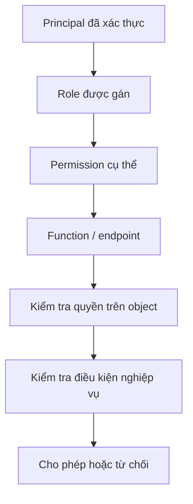

# Tách function của user, operator và administrator

Một API có thể xác thực đúng người gọi nhưng vẫn cho phép người đó thực hiện chức năng vượt quá nhiệm vụ của mình. Ví dụ, người dùng thông thường gọi được endpoint khóa tài khoản của người khác; nhân viên hỗ trợ có thể tự đổi role của khách hàng; hoặc tài khoản quản trị có thể truy cập mọi dữ liệu cá nhân dù công việc chỉ cần quản lý cấu hình. Đây là lỗi phân quyền chức năng (Broken Function Level Authorization – BFLA), thường xuất hiện khi hệ thống chỉ kiểm tra đăng nhập hoặc dùng một role quá rộng.

Thiết kế an toàn cần tách rõ chức năng của `user`, `operator` và `administrator`, sau đó ánh xạ từng chức năng thành permission cụ thể và kiểm tra ở server trên mỗi request. Role chỉ là cách gom nhóm permission. Việc người dùng có role nào không tự động chứng minh họ được truy cập mọi đối tượng dữ liệu; API còn phải kiểm tra quyền ở mức object, tenant và điều kiện nghiệp vụ.

## 1. Function authorization là gì?

Authentication trả lời câu hỏi “ai đang gọi API?”. Function authorization trả lời câu hỏi “principal này được phép thực hiện hành động nào?”. Object authorization trả lời “principal có được thực hiện hành động đó trên đối tượng cụ thể này không?”. Ba câu hỏi liên quan nhưng độc lập.

Ví dụ một hệ thống quản lý đơn hàng có các endpoint:

```http
GET    /api/orders/{id}
POST   /api/orders
POST   /api/orders/{id}/cancel
POST   /api/operator/orders/{id}/refund
PATCH  /api/admin/users/{id}/roles
```

Một người dùng đã đăng nhập có thể được phép xem và tạo đơn hàng của chính mình. Điều đó không có nghĩa họ được gọi chức năng hoàn tiền hoặc thay đổi role. Ngược lại, operator có thể được phép xử lý yêu cầu hỗ trợ hoặc hoàn tiền trong hạn mức được giao, nhưng không có quyền tự cấp quyền administrator cho bản thân.

Function authorization cần được kiểm tra cho từng hành động, bao gồm:

- Đọc, tạo, cập nhật, xóa hoặc xuất dữ liệu.
- Thực hiện thao tác nghiệp vụ như hủy đơn, hoàn tiền, phê duyệt hoặc khóa tài khoản.
- Quản lý danh tính, role, permission, API key và cấu hình hệ thống.
- Truy cập chức năng vận hành, hỗ trợ, kiểm tra trạng thái hoặc xem audit log.
- Gọi chức năng nội bộ qua API, message consumer, scheduled job hoặc service-to-service.

Ẩn nút trên giao diện hoặc không hiển thị đường dẫn quản trị không phải là kiểm soát phân quyền. Người dùng có thể gọi endpoint trực tiếp bằng curl, Postman hoặc sửa request từ trình duyệt. Server phải kiểm tra quyền ngay cả khi client không hiển thị chức năng đó.

## 2. Phân biệt user, operator và administrator

Ba nhóm này có mục đích và phạm vi trách nhiệm khác nhau. Tên role không phải là policy hoàn chỉnh; cần xác định nhiệm vụ cụ thể và dữ liệu mỗi nhóm được phép thao tác.

### 2.1. User – người dùng nghiệp vụ

`user` là người sử dụng sản phẩm hoặc dịch vụ. Các chức năng thường gồm:

- Xem và cập nhật thông tin cá nhân trong phạm vi được phép.
- Tạo đơn hàng, yêu cầu dịch vụ hoặc giao dịch cho chính mình.
- Xem trạng thái, lịch sử và tài liệu thuộc tài khoản của mình.
- Hủy hoặc thay đổi yêu cầu nếu trạng thái nghiệp vụ cho phép.
- Quản lý thiết bị, session và tùy chọn riêng.

User không được tự xem dữ liệu của user khác, thay đổi role, truy cập chức năng vận hành hoặc dùng endpoint quản trị. Quyền của user thường cần gắn với quan hệ sở hữu/ủy quyền đối với object, không chỉ với role `USER`.

### 2.2. Operator – nhân viên vận hành hoặc hỗ trợ

`operator` là nhân viên thực hiện nhiệm vụ hỗ trợ khách hàng, vận hành quy trình hoặc xử lý sự cố. Các chức năng có thể gồm:

- Tìm ticket và xem thông tin tối thiểu cần thiết để xử lý yêu cầu.
- Cập nhật trạng thái ticket, ghi chú nội bộ hoặc yêu cầu bổ sung thông tin.
- Xem trạng thái đơn hàng/giao dịch theo phạm vi được phân công.
- Thực hiện một số thao tác nghiệp vụ có giới hạn, ví dụ hủy yêu cầu chưa xử lý hoặc đề xuất hoàn tiền.
- Chuyển vụ việc cho nhóm chuyên trách hoặc yêu cầu administrator phê duyệt.

Operator không mặc nhiên có toàn quyền trên dữ liệu khách hàng. Quyền truy cập có thể bị giới hạn theo queue, nhóm, tenant, khu vực, ca trực, loại ticket hoặc quan hệ phân công. Một operator hỗ trợ khách hàng không cần quyền tạo administrator, thay đổi chính sách xác thực, xem secret, tải toàn bộ dữ liệu hoặc tự phê duyệt khoản hoàn tiền vượt hạn mức.

### 2.3. Administrator – người quản trị hệ thống

`administrator` quản lý cấu hình, danh tính và hoạt động kiểm soát của hệ thống. Chức năng có thể gồm:

- Quản lý user, trạng thái tài khoản, nhóm và phân quyền.
- Quản lý cấu hình tích hợp, chính sách bảo mật và tham số vận hành.
- Quản lý service account, credential, API key hoặc cấu hình xác thực theo quy trình được kiểm soát.
- Xem audit log và điều tra sự cố trong phạm vi trách nhiệm.
- Thực hiện thao tác quản trị có tác động rộng, theo cơ chế phê duyệt và ghi nhận.

Administrator cũng cần quyền tối thiểu. Quản trị tài khoản không đồng nghĩa với quyền đọc mọi nội dung riêng tư của khách hàng. Nếu cần hỗ trợ truy cập dữ liệu nhạy cảm để điều tra, nên có permission riêng, lý do truy cập, thời hạn, audit và phê duyệt phù hợp.

### 2.4. Không gom mọi quyền đặc biệt vào một role

Role `ADMIN` quá rộng thường trở thành lối tắt trong code: bất kỳ chức năng nào khó phân loại đều được cho administrator. Cách làm này làm tăng thiệt hại khi tài khoản admin bị chiếm và khiến việc kiểm toán khó hơn.

Hãy tách các nhiệm vụ quản trị thành permission riêng, ví dụ `user:read`, `user:disable`, `role:assign`, `security-policy:update`, `audit-log:read` và `credential:rotate`. Một người có thể cần một số permission nhưng không cần toàn bộ quyền quản trị. Với thao tác có rủi ro cao, dùng quy trình phê duyệt hoặc phân tách nhiệm vụ thay vì chỉ thêm permission vào role.

## 3. Ma trận chức năng và quyền

Trước khi viết code, hãy lập ma trận thể hiện vai trò nào được gọi chức năng nào. Ma trận dưới đây là ví dụ cho một hệ thống quản lý đơn hàng; cần điều chỉnh theo nghiệp vụ thực tế.

| Chức năng | User | Operator | Administrator |
|---|---|---|---|
| Xem hồ sơ của chính mình | Cho phép | Không mặc định | Không mặc định |
| Cập nhật hồ sơ của chính mình | Cho phép theo field | Không mặc định | Theo permission quản trị riêng |
| Xem đơn hàng của mình | Cho phép | Theo ticket/phạm vi phân công | Chỉ khi có nhu cầu và permission riêng |
| Xem đơn hàng bất kỳ | Từ chối | Chỉ theo phạm vi được giao | Chỉ khi có permission và lý do phù hợp |
| Tạo đơn hàng | Cho phép theo nghiệp vụ | Không mặc định | Không mặc định |
| Hủy đơn hàng | Đơn của mình, nếu trạng thái cho phép | Theo nhiệm vụ/hạn mức | Theo permission riêng |
| Hoàn tiền | Từ chối | Theo hạn mức hoặc cần phê duyệt | Theo quyền và kiểm soát phân tách nhiệm vụ |
| Quản lý ticket hỗ trợ | Không | Ticket/queue được phân công | Quản lý queue theo permission |
| Khóa tài khoản | Không | Có thể yêu cầu hoặc khóa tạm theo quy trình | Permission riêng và audit |
| Gán role cho user | Không | Không | Permission riêng; thao tác nhạy cảm có thể cần phê duyệt |
| Thay đổi security policy | Không | Không | Chỉ nhóm quản trị bảo mật được ủy quyền |
| Xem audit log | Không | Sự kiện liên quan nhiệm vụ nếu được phép | Permission riêng, có kiểm soát |

Ma trận phải thể hiện cả ba trạng thái: cho phép, từ chối và cho phép khi thỏa điều kiện. Ví dụ operator có thể được xem đơn hàng khi ticket được gán cho họ và ticket thuộc queue họ phụ trách. Chỉ ghi “operator được xem đơn hàng” là chưa đủ cụ thể.

### 3.1. Từ role sang permission

Một mô hình RBAC cơ bản ánh xạ user vào role và role vào permission:



Ví dụ ánh xạ:

| Role | Permission minh họa |
|---|---|
| `USER` | `profile:read:self`, `profile:update:self`, `order:create`, `order:read:self`, `order:cancel:self` |
| `OPERATOR` | `ticket:read:assigned`, `ticket:update:assigned`, `order:read:support-scope`, `refund:request` |
| `REFUND_APPROVER` | `refund:approve:within-limit` |
| `USER_ADMIN` | `user:read`, `user:disable`, `role:assign:non-privileged` |
| `SECURITY_ADMIN` | `security-policy:read`, `security-policy:update`, `credential:revoke` |
| `AUDITOR` | `audit-log:read`, `access-review:read` |

Tên permission nên diễn đạt hành động và tài nguyên. Tránh permission mơ hồ như `manage`, `full_access` hoặc `isAdmin` nếu không có định nghĩa phạm vi rõ ràng. Cần xác định permission áp dụng cho mọi object hay chỉ object thuộc phạm vi của principal.

## 4. Kết hợp RBAC với điều kiện và thuộc tính

RBAC (Role-Based Access Control) phù hợp để quản lý nhóm chức năng theo vai trò. Tuy nhiên, role thường chưa đủ để mô tả phạm vi dữ liệu và điều kiện động. ABAC (Attribute-Based Access Control) cho phép quyết định dựa trên thuộc tính của principal, object, action và environment.

Ví dụ operator chỉ được xem ticket khi:

- Ticket thuộc queue mà operator được phân công.
- Ticket thuộc tenant hoặc khu vực operator phụ trách.
- Ticket đang ở trạng thái cho phép xử lý.
- Operator đang có ca trực hoặc assignment còn hiệu lực.
- Yêu cầu không vượt mức dữ liệu được phép xem.

Một policy có thể được mô tả như sau:

```text
ALLOW ticket:read IF
    principal.role includes OPERATOR
    AND principal is assigned to ticket.queue
    AND principal.tenantId == ticket.tenantId
    AND ticket.status in [OPEN, IN_PROGRESS]
```

Với administrator, policy có thể yêu cầu permission cụ thể, MFA gần đây và lý do truy cập đối với dữ liệu nhạy cảm. Với user, policy thường kiểm tra quan hệ sở hữu hoặc ủy quyền giữa user và object.

RBAC và ABAC có thể kết hợp: role xác định nhóm chức năng có thể thực hiện; thuộc tính và quan hệ xác định phạm vi object và điều kiện tại thời điểm request. Khi không có policy cho phép rõ ràng, mặc định từ chối (*deny by default*).

## 5. Phòng chống leo thang quyền theo chức năng

Broken Function Level Authorization xảy ra khi người gọi truy cập được chức năng không dành cho họ. Lỗi có thể xuất hiện ở endpoint quản trị, endpoint nội bộ bị lộ, HTTP method ít được kiểm tra hoặc chức năng mới được thêm nhưng quên gắn policy.

### 5.1. Leo thang quyền theo chiều dọc

Vertical privilege escalation là khi principal có quyền thấp gọi được chức năng của role cao hơn. Ví dụ:

```http
PATCH /api/admin/users/U-100/roles HTTP/1.1
Authorization: Bearer <user-access-token>
Content-Type: application/json

{
  "roles": ["ADMIN"]
}
```

Nếu endpoint chỉ kiểm tra token hợp lệ hoặc chỉ kiểm tra user đã đăng nhập, người dùng thường có thể tự gán role admin. Server phải kiểm tra permission `role:assign`, giới hạn loại role có thể gán, kiểm tra người thực hiện có quyền trên đối tượng đích và áp dụng phê duyệt cho thay đổi đặc quyền.

### 5.2. Gọi endpoint quản trị trực tiếp

Việc giao diện không hiển thị nút admin không ngăn người dùng gọi `/api/admin/...`. Mọi route admin/operator phải có authorization server-side. Đường dẫn `/admin` hoặc subdomain `internal` không phải ranh giới bảo mật; endpoint vẫn có thể bị gọi từ mạng ngoài nếu gateway hoặc cấu hình định tuyến thay đổi.

### 5.3. Bỏ sót HTTP method hoặc route phụ

Đội phát triển có thể bảo vệ `GET /users/{id}` nhưng quên `PATCH`, `DELETE`, `POST /users/{id}/disable` hoặc endpoint bulk export. Hãy kiểm kê theo cả method và route, kể cả:

- Endpoint bulk, batch, import/export.
- Endpoint version cũ hoặc alias.
- Endpoint hỗ trợ/debug, health detail hoặc admin nội bộ.
- GraphQL mutation, RPC method, message consumer và scheduled job.
- Chức năng được gọi gián tiếp từ service khác.

### 5.4. Quyền bị kế thừa hoặc gán nhầm

Nếu role được kế thừa hoặc một user có nhiều role, cần định nghĩa cách hợp nhất quyền và xử lý xung đột. Không để một role ít đặc quyền vô tình cấp quyền cao hơn hoặc một claim cũ còn hiệu lực sau khi user bị hạ quyền. Khi role/permission thay đổi, cần có cơ chế cập nhật cache, token/session hoặc version quyền theo thời gian chấp nhận được.

### 5.5. Mass assignment không phải function authorization

Một endpoint user cập nhật hồ sơ có thể bị lợi dụng nếu bind trực tiếp body vào entity và cho phép field `role`, `status`, `isAdmin` hoặc `tenantId`. Đây là vấn đề kiểm soát field đầu vào/mass assignment, có thể dẫn đến leo thang quyền. Dùng request DTO allowlist và kiểm tra riêng mọi thao tác thay đổi đặc quyền.

## 6. Thiết kế endpoint theo vai trò và hành động

Nên xác định quyền ở cấp chức năng cụ thể thay vì chỉ chia URL thành `/user`, `/operator`, `/admin`. Namespace có thể giúp tổ chức API nhưng không thay thế policy.

Một bảng thiết kế ví dụ:

| Endpoint | Permission cần có | Kiểm tra bổ sung |
|---|---|---|
| `GET /api/me` | `profile:read:self` | Principal lấy từ token/session |
| `PATCH /api/me` | `profile:update:self` | DTO chỉ cho phép field người dùng tự sửa |
| `GET /api/orders/{id}` | `order:read:self` hoặc `order:read:support-scope` | Kiểm tra owner, tenant hoặc ticket assignment |
| `POST /api/orders/{id}/cancel` | `order:cancel:self` hoặc permission operator riêng | Trạng thái đơn, thời hạn hủy, hạn mức |
| `GET /api/operator/tickets/{id}` | `ticket:read:assigned` | Queue, tenant, assignment và trạng thái |
| `POST /api/operator/tickets/{id}/refund-request` | `refund:request` | Order thuộc phạm vi; số tiền và lý do hợp lệ |
| `POST /api/operator/refunds/{id}/approve` | `refund:approve:within-limit` | Người tạo không tự phê duyệt; hạn mức và trạng thái |
| `PATCH /api/admin/users/{id}/roles` | `role:assign` | Không tự cấp quyền cao hơn; audit/phê duyệt |
| `PATCH /api/admin/security-policy` | `security-policy:update` | MFA gần đây, change approval, audit |

### 6.1. Kiểm tra theo từng HTTP method

Không nên gán một quyền chung cho cả resource nếu các method có tác động khác nhau. `GET` có thể chỉ đọc; `POST` tạo tài nguyên; `PATCH` thay đổi dữ liệu; `DELETE` xóa; một action endpoint như `/approve` hoặc `/refund` có thể mang tác động nghiệp vụ cao hơn cập nhật thông thường.

Ví dụ, `order:read` không nên tự động cho phép `order:cancel`. `user:read` không bao gồm `user:disable`, và `role:read` không bao gồm `role:assign`. Permission cần phản ánh tác động thực tế.

### 6.2. Không tin role hoặc user ID do client gửi

Role, subject và tenant phải lấy từ token/session đã được xác minh hoặc từ dữ liệu server gắn với principal. Không chấp nhận các cách như:

```json
{
  "userId": "U-100",
  "role": "ADMIN",
  "isOperator": true
}
```

như bằng chứng về danh tính hoặc quyền. Request body chỉ chứa dữ liệu nghiệp vụ mà client được phép cung cấp. Server tự xác định principal và quyền hiện hành.

## 7. Triển khai với Spring Security

Spring Security cung cấp authorization ở mức request qua `authorizeHttpRequests` và ở mức method qua method security. Có thể dùng cả hai: request-level policy làm lớp kiểm soát đầu vào, method/service-level policy bảo vệ nghiệp vụ kể cả khi service được gọi từ đường khác.

### 7.1. Cấu hình quyền theo route

Ví dụ cấu hình:

```java
@Bean
SecurityFilterChain apiSecurity(HttpSecurity http) throws Exception {
    return http
            .authorizeHttpRequests(auth -> auth
                    .requestMatchers("/api/public/**").permitAll()
                    .requestMatchers(HttpMethod.GET, "/api/me/**")
                        .hasAuthority("profile:read:self")
                    .requestMatchers(HttpMethod.PATCH, "/api/me/**")
                        .hasAuthority("profile:update:self")
                    .requestMatchers("/api/operator/**")
                        .hasAuthority("operator:access")
                    .requestMatchers("/api/admin/security-policy/**")
                        .hasAuthority("security-policy:update")
                    .requestMatchers("/api/admin/**")
                        .hasAuthority("admin:access")
                    .anyRequest().authenticated())
            .oauth2ResourceServer(oauth -> oauth.jwt())
            .build();
}
```

Thứ tự matcher rất quan trọng: rule cụ thể cần đứng trước rule tổng quát. Nếu một matcher rộng được đặt trước, nó có thể bắt request trước khi rule chi tiết được xét. Cấu hình trên chỉ minh họa phân vùng route; `operator:access` hoặc `admin:access` chưa đủ để cho phép mọi hành động trong namespace. Những endpoint nhạy cảm vẫn cần permission cụ thể và kiểm tra object ở service.

Trong ứng dụng thực tế, hãy đặt các permission nhất quán trong authority mapping. Nếu dùng `hasRole("ADMIN")`, Spring mặc định thêm prefix `ROLE_`; nếu dùng `hasAuthority`, chuỗi phải khớp chính xác authority đã cấp. Tránh trộn hai quy ước mà không có chủ đích.

### 7.2. Bật method security và kiểm tra chức năng

```java
@Configuration
@EnableMethodSecurity
class MethodSecurityConfiguration {
}
```

Ví dụ service chỉ cho principal có permission yêu cầu tạo yêu cầu hoàn tiền:

```java
@Service
class RefundService {

    @PreAuthorize("hasAuthority('refund:request')")
    public RefundRequest requestRefund(
            UUID orderId,
            BigDecimal amount,
            String reason,
            AuthenticatedPrincipal principal) {

        Order order = orderRepository
                .findByIdAndTenantId(orderId, principal.tenantId())
                .orElseThrow(NotFoundException::new);

        authorizationService.requirePermission(
                principal, "refund:request", order);

        refundPolicy.validateRequest(order, amount, reason, principal);
        return refundRepository.save(
                RefundRequest.create(order, amount, reason, principal.subjectId()));
    }
}
```

`@PreAuthorize` kiểm tra quyền chức năng trước khi gọi method. Phần `authorizationService` tiếp tục kiểm tra object/tenant; `refundPolicy` xác minh điều kiện nghiệp vụ như trạng thái đơn, số tiền và hạn mức. Ví dụ này minh họa cấu trúc, cần điều chỉnh transaction boundary, idempotency và xử lý lỗi theo ứng dụng.

Không chỉ dựa vào method annotation nếu method có thể bị gọi qua self-invocation trong cùng bean hoặc một đường gọi không đi qua proxy Spring. Đặt policy ở ranh giới service phù hợp và kiểm thử cả đường gọi HTTP lẫn đường gọi nội bộ. Với thao tác có side effect, không dùng hậu kiểm sau khi method đã thực hiện thay đổi để thay thế kiểm tra trước hành động.

### 7.3. Phản hồi khi bị từ chối

- `401 Unauthorized`: request thiếu credential hợp lệ hoặc credential không thể xác thực.
- `403 Forbidden`: principal đã xác thực nhưng không có quyền thực hiện chức năng.
- `404 Not Found`: có thể dùng khi policy cần tránh tiết lộ sự tồn tại của object ngoài phạm vi; phải nhất quán với thiết kế API.

Không trả chi tiết nội bộ như tên policy, role đặc quyền, stack trace hoặc danh sách user được phép. Ghi log sự kiện từ chối với request ID, principal ID đã kiểm soát, permission cần thiết và endpoint; không ghi token hoặc secret.

## 8. Operator access và administrator access có kiểm soát

Operator và administrator thường cần quyền cao hơn user, vì vậy cần quy trình cấp, sử dụng, rà soát và thu hồi rõ ràng.

### 8.1. Quyền operator theo nhiệm vụ

Operator chỉ nên thấy dữ liệu tối thiểu để xử lý nhiệm vụ. Ví dụ:

- Ticket được gán cho operator hoặc queue họ phụ trách.
- Thông tin khách hàng được che bớt, chỉ hiển thị field cần thiết.
- Không cho phép tải hàng loạt dữ liệu khách hàng nếu nhiệm vụ chỉ cần một hồ sơ.
- Không cho phép tự thay đổi role, policy hoặc credential.
- Thao tác hoàn tiền, hủy giao dịch hoặc mở khóa tài khoản phải theo hạn mức và trạng thái.

Nếu cần truy cập thay mặt khách hàng (impersonation), phải có cơ chế riêng: lý do, ticket liên quan, sự đồng ý hoặc căn cứ được phép, thời hạn ngắn, banner/nhật ký nhận diện phiên hỗ trợ và audit đầy đủ. Không dùng mật khẩu khách hàng hoặc chia sẻ session/token của khách hàng cho operator. Impersonation không được phép vượt qua policy dữ liệu hoặc thực hiện thao tác mà operator vốn không có quyền.

### 8.2. Administrator theo quyền chuyên trách

Tách administrator theo miền trách nhiệm, ví dụ `USER_ADMIN`, `SECURITY_ADMIN`, `BILLING_ADMIN` và `AUDITOR`. Quản trị role không đồng nghĩa với quyền đọc dữ liệu thanh toán; quản trị billing không đồng nghĩa với quyền thay đổi security policy.

Tài khoản đặc quyền nên:

- Dùng MFA mạnh, ưu tiên phương thức chống phishing.
- Không dùng chung tài khoản; định danh riêng từng người và từng workload.
- Dùng tài khoản thường cho công việc hằng ngày, chỉ kích hoạt quyền đặc quyền khi cần.
- Cấp quyền Just-in-Time (JIT) có thời hạn, lý do và người phê duyệt khi phù hợp.
- Giới hạn session quản trị, thiết bị và mạng truy cập theo chính sách.
- Ghi audit bất biến hoặc có kiểm soát chống sửa đổi cho thao tác đặc quyền.

### 8.3. Break-glass access

Trong sự cố nghiêm trọng, có thể cần quyền khẩn cấp để khôi phục dịch vụ. Break-glass phải là cơ chế được thiết kế trước, có người chịu trách nhiệm, thời hạn rất ngắn, cảnh báo ngay khi sử dụng, audit và hậu kiểm bắt buộc. Không để một endpoint bí mật hoặc một API key vĩnh viễn trở thành lối truy cập khẩn cấp không kiểm soát.

### 8.4. Phân tách nhiệm vụ và phê duyệt hai người

Với thay đổi quyền quản trị, thanh toán lớn, thay đổi người thụ hưởng hoặc thao tác khó hoàn tác, áp dụng separation of duties: người khởi tạo không tự phê duyệt. Policy có thể yêu cầu hai principal khác nhau, mỗi người có permission riêng, và cả hai thao tác được gắn với cùng một request/change ID.

## 9. Quản lý vòng đời role và permission

Phân quyền không kết thúc khi tạo role. Quyền cần được cấp đúng, rà soát định kỳ, cập nhật khi thay đổi công việc và thu hồi kịp thời khi người dùng rời tổ chức hoặc đổi nhiệm vụ.

### Cấp quyền

- Xác định chủ sở hữu nghiệp vụ của từng role/permission.
- Dùng role theo nhiệm vụ và nhóm quyền nhỏ; tránh role `SUPER_ADMIN` dùng cho hoạt động thường ngày.
- Yêu cầu phê duyệt cho quyền nhạy cảm và ghi nhận lý do cấp.
- Không cho phép user tự sửa claim, role hoặc permission của chính mình.

### Thay đổi và thu hồi

- Khi hạ quyền hoặc khóa tài khoản, thu hồi session/token hoặc cập nhật version quyền để thay đổi có hiệu lực theo SLA.
- Xóa assignment hết hạn và quyền tạm thời sau khi nhiệm vụ kết thúc.
- Kiểm tra quyền kế thừa và role chồng lấn để tránh cấp quyền ngoài dự kiến.
- Rà soát service account, API client và quyền của operator/admin giống như tài khoản con người.

### Rà soát định kỳ

Định kỳ đối chiếu danh sách principal, role, permission, owner, thời điểm dùng gần nhất và lý do nghiệp vụ. Tìm quyền không dùng, role quá rộng, tài khoản mồ côi, operator có phạm vi quá lớn và administrator không còn nhiệm vụ tương ứng.

Nếu quyền được nhúng trong JWT, cần cân nhắc thời hạn token, token version, introspection hoặc cơ chế thu hồi phù hợp. Một role bị xóa trong database nhưng JWT cũ vẫn còn hiệu lực có thể khiến quyền cũ tồn tại đến khi token hết hạn nếu resource server không kiểm tra trạng thái mới.

## 10. Audit, giám sát và phát hiện lạm dụng

Log authorization cần giúp trả lời ai đã thực hiện hành động gì, trên đối tượng nào, khi nào, theo permission nào và kết quả ra sao. Với thao tác đặc quyền, ghi thêm lý do, ticket/change ID, approver và trạng thái step-up nếu có.

Các sự kiện nên giám sát:

- User gọi endpoint operator/admin hoặc thử nhiều route đặc quyền.
- Operator truy cập object ngoài queue/tenant hoặc tìm kiếm nhiều hồ sơ không liên quan ticket.
- Administrator tự cấp role cao hơn, thay đổi policy, tắt MFA hoặc tạo credential mới.
- Một principal đột ngột gọi endpoint bulk/export hoặc thực hiện nhiều thao tác nhạy cảm.
- Tỷ lệ `403` tăng cao, request thử ID tuần tự hoặc thay đổi HTTP method để dò chức năng.
- Quyền JIT, break-glass hoặc impersonation được kích hoạt ngoài quy trình.

Log nên chứa principal ID, role/permission liên quan, action, resource type/ID, tenant đã kiểm soát, request ID, kết quả và timestamp. Không ghi access token, session cookie, mật khẩu hoặc dữ liệu nhạy cảm đầy đủ nếu không cần thiết. Giới hạn người được xem audit log và bảo vệ log khỏi sửa/xóa.

## 11. Kiểm thử function authorization

Kiểm thử cần bao phủ từng endpoint và từng role, bao gồm trường hợp bị từ chối. Không chỉ kiểm thử user hợp lệ gọi thành công.

| Nhóm kiểm thử | Tình huống | Kết quả mong đợi |
|---|---|---|
| Anonymous | Không có token gọi endpoint user/operator/admin | Bị từ chối xác thực |
| User gọi admin | User gọi endpoint gán role hoặc đổi security policy | `403` hoặc phản hồi che giấu tài nguyên theo policy |
| User gọi operator | User gọi endpoint xử lý ticket hoặc refund | Bị từ chối |
| Operator vượt phạm vi | Operator A truy cập ticket của queue/tenant B | Bị từ chối |
| Operator tự phê duyệt | Người tạo refund request tự gọi approve | Bị từ chối theo separation of duties |
| Admin thiếu permission chuyên trách | `USER_ADMIN` gọi security policy update | Bị từ chối nếu không có permission đó |
| Hạ quyền | User bị gỡ role nhưng dùng JWT/session cũ | Quyền cũ bị thu hồi theo SLA thiết kế |
| Method khác | Kiểm tra GET, POST, PATCH, DELETE và action endpoint | Mỗi hành động áp dụng permission riêng |
| Route phụ/bulk | Gọi export, batch, version cũ và endpoint nội bộ | Không có đường vòng qua policy |
| Mass assignment | User gửi field `role`, `isAdmin`, `tenantId` trong body | Field không được phép bị bỏ qua hoặc từ chối |
| UI bypass | Gọi trực tiếp endpoint dù nút đã bị ẩn | Server vẫn từ chối nếu thiếu quyền |
| JIT/break-glass | Quyền hết hạn hoặc phiên khẩn cấp kết thúc | Quyền bị thu hồi, có audit và cảnh báo |
| Audit | Thao tác đặc quyền thành công/thất bại | Có log truy vết, không chứa secret |

Nên tạo test matrix từ permission matrix và tự động hóa các cặp role/endpoint quan trọng. Khi thêm endpoint mới, yêu cầu khai báo permission và có test cho ít nhất một trường hợp được phép cùng một trường hợp bị từ chối. Kiểm thử tích hợp phải đi qua security filter chain thật; unit test riêng cho hàm policy không đủ để phát hiện cấu hình matcher sai thứ tự.

## 12. Checklist thiết kế trước khi phát hành

- [ ] Mỗi chức năng đã có permission rõ ràng và chủ sở hữu nghiệp vụ.
- [ ] Role `USER`, `OPERATOR`, `ADMIN` được tách theo nhiệm vụ thực tế, không gom mọi quyền đặc biệt vào một role.
- [ ] Mọi route và HTTP method đều có authorization server-side; không dựa vào việc ẩn UI hoặc namespace URL.
- [ ] Có kiểm tra riêng quyền chức năng và quyền trên object/tenant.
- [ ] User chỉ thao tác trên dữ liệu của mình hoặc được ủy quyền.
- [ ] Operator chỉ truy cập queue, tenant, ticket và dữ liệu tối thiểu theo nhiệm vụ.
- [ ] Administrator được tách theo miền trách nhiệm; thao tác đặc quyền có MFA, JIT, audit hoặc phê duyệt khi cần.
- [ ] Không tin role, user ID, tenant ID hoặc owner do client gửi.
- [ ] Request DTO giới hạn field, tránh mass assignment và tự gán quyền.
- [ ] Có deny-by-default, xử lý `401`/`403` nhất quán và không tiết lộ thông tin nội bộ.
- [ ] Role/permission có quy trình cấp, rà soát, thay đổi và thu hồi.
- [ ] JWT/session cũ không giữ quyền quá thời gian chấp nhận sau khi hạ quyền.
- [ ] Có audit và cảnh báo cho truy cập đặc quyền, impersonation, JIT và break-glass.
- [ ] Có test matrix cho user/operator/admin, endpoint, HTTP method, object và trường hợp bị từ chối.

Tách function của user, operator và administrator là việc xác định rõ trách nhiệm, permission và phạm vi hành động ở server. Role giúp quản lý nhóm quyền; policy theo thuộc tính và quan hệ giới hạn dữ liệu; kiểm tra object bảo đảm principal chỉ thao tác trên tài nguyên được phép; còn audit, MFA, JIT và phê duyệt giúp kiểm soát quyền đặc biệt. Khi mọi endpoint đều được thiết kế theo các lớp này, việc một người đăng nhập thành công không còn đồng nghĩa họ có thể gọi mọi chức năng trong hệ thống.
