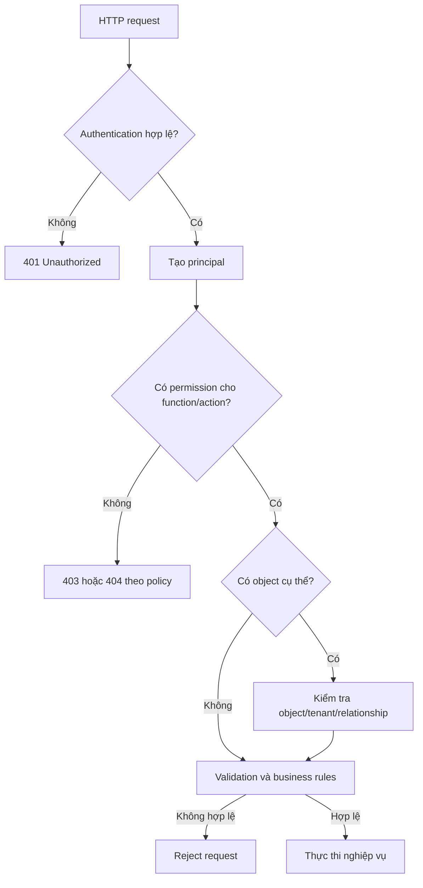

# Không dùng URL khó đoán làm kiểm soát

Một hệ thống có thể đặt trang quản trị tại `/internal/console-9f81a7` hoặc tạo đường dẫn tải báo cáo bằng một chuỗi dài ngẫu nhiên. Những URL khó đoán có thể giảm khả năng người ngoài tìm thấy tài nguyên, nhưng chúng không chứng minh người truy cập có quyền sử dụng chức năng đó.

Nếu API trả dữ liệu hoặc thực hiện thao tác chỉ vì caller biết đúng URL, hệ thống đang dựa vào bí mật của đường dẫn thay cho authorization. URL có thể bị chia sẻ, lưu trong lịch sử trình duyệt, ghi vào access log, gửi qua referrer, xuất hiện trong ảnh chụp màn hình hoặc bị lộ từ một nguồn khác. Một người đã đăng nhập cũng có thể tự gọi endpoint bằng `curl`, Postman hoặc một client khác mà không đi qua giao diện chính thức.

**Function-level authorization phải được kiểm tra ở phía máy chủ trên mỗi request:** principal đã xác thực có được phép gọi chức năng cụ thể này trong ngữ cảnh hiện tại hay không. Việc ẩn menu, đặt route khó đoán, dùng UUID hoặc chỉ công bố endpoint cho một số người không thay thế được kiểm tra đó.

## 1. URL xác định đích đến, không tự chứng minh quyền

URL giúp client chỉ ra tài nguyên hoặc chức năng muốn truy cập. Một URL có thể chứa path, query, fragment và các thành phần định tuyến. Những thành phần này là dữ liệu định tuyến; bản thân chúng không phải bằng chứng rằng caller được phép thực hiện thao tác.

Ví dụ:

```http
POST /admin/users/user-42/disable
```

Đường dẫn `/admin/` cho biết endpoint có vẻ thuộc khu vực quản trị. Nó không cho biết người gửi có phải quản trị viên hay không. API cần xác minh principal và permission như `user:disable` trước khi vô hiệu hóa tài khoản.

Tương tự, các đường dẫn sau không tự tạo ra quyền:

```text
/secret-dashboard
/reports/7f83d5a9c4
/api/v1/maintenance/rebuild-index
/ops/rotate-keys
```

Ngay cả khi path chứa UUID, chuỗi ngẫu nhiên dài hoặc tên không được công bố, endpoint vẫn phải thực thi policy. Nếu một route có thể gây tác động quan trọng, giả định an toàn là người khác có thể tìm ra hoặc nhận được route đó.

### 1.1. Security by obscurity không phải authorization

Security by obscurity là dựa vào việc chi tiết triển khai khó biết hoặc khó đoán để kỳ vọng hệ thống an toàn. Việc không công khai URL quản trị có thể làm giảm lượng request dò tìm thông thường, nhưng không kiểm soát được người đã biết URL.

Một URL khó đoán có thể hữu ích như lớp giảm nhiễu hoặc giảm khả năng dò tìm. Tuy nhiên, nếu quyền truy cập biến mất ngay khi URL bị lộ, hệ thống chưa có authorization đúng nghĩa.

| Cách làm | Có thể giúp gì? | Có thay thế function authorization không? |
|---|---|---|
| Đổi `/admin` thành `/hidden-admin-83x` | Giảm khả năng đoán route | Không |
| Dùng UUID thay ID tuần tự | Giảm khả năng liệt kê ID | Không |
| Ẩn nút quản trị trong UI | Giảm thao tác không phù hợp trong giao diện | Không |
| Chặn menu bằng JavaScript | Cải thiện điều hướng | Không |
| Không ghi endpoint trong tài liệu công khai | Giảm mức độ dễ khám phá | Không |
| Kiểm tra permission ở server trên mỗi request | Xác định principal có quyền gọi chức năng | Có, đây là một phần cốt lõi của authorization |

Không cần bỏ các biện pháp giảm khả năng khám phá. Chỉ cần hiểu đúng vai trò của chúng và không xem chúng là ranh giới bảo mật.

## 2. Function-level authorization kiểm soát điều gì?

Function-level authorization trả lời câu hỏi: **principal này có được phép thực hiện loại thao tác này không?** Nó áp dụng cho chức năng, hành động hoặc endpoint, ví dụ:

- Xem dashboard quản trị.
- Tạo, khóa hoặc xóa tài khoản người dùng.
- Hoàn tiền hoặc hủy giao dịch.
- Xuất dữ liệu khách hàng.
- Thay đổi cấu hình bảo mật hoặc API key.
- Chạy tác vụ bảo trì, đồng bộ hoặc rebuild index.
- Quản lý role, permission và thành viên tenant.

Ví dụ, chỉ người có permission `user:disable` mới được gọi endpoint vô hiệu hóa tài khoản. Một user đã đăng nhập nhưng chỉ có `profile:read` không được gọi chức năng này, dù họ biết URL chính xác.

### 2.1. Phân biệt function-level và object-level authorization

Hai loại kiểm tra thường đi cùng nhau nhưng trả lời hai câu hỏi khác nhau:

| Loại kiểm soát | Câu hỏi | Ví dụ |
|---|---|---|
| Function-level authorization | Principal có được gọi chức năng này không? | Nhân viên thường không được gọi `POST /admin/users/{id}/disable` |
| Object-level authorization | Principal có được thao tác trên object cụ thể này không? | Quản trị viên tenant A không được khóa user thuộc tenant B |
| Property-level authorization | Principal được đọc hoặc thay đổi những trường nào? | Người quản lý được đổi trạng thái nhưng không được sửa trường `isSuperAdmin` |

Chỉ kiểm tra role quản trị là chưa đủ nếu chức năng còn giới hạn theo tenant hoặc object. Ngược lại, chỉ kiểm tra object thuộc tenant hiện tại cũng chưa đủ nếu endpoint thực hiện chức năng chỉ dành cho nhóm vận hành đặc biệt.

Ví dụ, một người có thể được phép xem hồ sơ người dùng trong tenant nhưng không được gọi chức năng khóa tài khoản. Một tenant admin có thể khóa thành viên tenant mình nhưng không được gọi chức năng thay đổi cấu hình hệ thống toàn cục.

## 3. Vì sao endpoint khó đoán vẫn có thể bị gọi?

Có nhiều cách để một URL không được công bố đến tay người không có quyền:

- Một nhân viên gửi link quản trị cho đồng nghiệp hoặc vô tình dán vào kênh chat không phù hợp.
- URL xuất hiện trong browser history, bookmark, proxy log, analytics, ticket hoặc ảnh chụp màn hình.
- Một route bị lộ qua JavaScript bundle, source map, mobile application, tài liệu API hoặc thông báo lỗi.
- Một tài khoản có quyền thấp truy cập được trang khác rồi suy ra endpoint từ network request.
- Endpoint được tìm thấy qua route enumeration, crawler, cấu hình gateway hoặc response của một API khác.
- Một endpoint cũ vẫn tồn tại sau khi UI đã bỏ liên kết đến nó.
- Người dùng tự sửa request hoặc gọi endpoint trực tiếp mà không sử dụng giao diện.

Ngay cả khi URL chưa từng bị lộ, hệ thống vẫn không thể dựa vào giả định “không ai biết route”. Một endpoint có thể bị gọi bởi client hợp lệ nhưng đang bị chiếm quyền, hoặc bởi một người dùng nội bộ không có nhiệm vụ thực hiện chức năng đó.

### 3.1. Ẩn UI chỉ thay đổi trải nghiệm

Giả sử menu quản trị chỉ hiển thị cho `ADMIN`:

```javascript
if (currentUser.role === "ADMIN") {
  showAdminMenu();
}
```

Đoạn mã này chỉ kiểm soát những gì trình duyệt hiển thị. Người dùng có thể sửa JavaScript, tự nhập URL hoặc phát lại request đã quan sát từ một tài khoản khác. Vì vậy, API phải kiểm tra quyền độc lập:

```http
POST /api/admin/users/user-42/disable
Authorization: Bearer <user-access-token>
```

Nếu server chỉ dựa vào việc UI đã ẩn menu, người dùng thường vẫn có thể gọi chức năng bằng HTTP client.

## 4. Kiểm tra permission ở phía máy chủ trên từng request

Một request nên được xử lý theo thứ tự rõ ràng:

1. Xác thực credential và tạo principal tin cậy.
2. Xác định route, HTTP method và action nghiệp vụ thực tế.
3. Kiểm tra principal có permission cho action đó trong context hiện tại không.
4. Nếu thao tác nhắm đến object cụ thể, tiếp tục kiểm tra quyền trên object và tenant.
5. Kiểm tra input, trạng thái nghiệp vụ và các điều kiện còn lại.
6. Chỉ thực hiện side effect sau khi tất cả kiểm tra cần thiết thành công.



Điểm kiểm tra nên nằm ở nơi không thể bị bỏ qua khi có một đường gọi mới. Có thể đặt ở controller/middleware, policy layer hoặc service layer tùy kiến trúc. Với chức năng nhạy cảm, service nghiệp vụ cần bảo đảm mọi caller đều phải đi qua kiểm tra quyền, kể cả khi được gọi từ REST controller, GraphQL resolver, message consumer hoặc job nội bộ.

### 4.1. Deny by default

Nếu hệ thống không tìm thấy permission phù hợp, mặc định từ chối. Không nên mặc định cho phép rồi mới liệt kê một số role bị cấm.

```pseudo
function authorizeFunction(principal, action, context):
    permission = policy.findPermission(principal, action, context)
    if permission is missing:
        return DENY
    if permission.isExplicitlyDenied:
        return DENY
    return ALLOW
```

Trong thực tế, policy có thể có thứ tự ưu tiên giữa deny và allow, kế thừa role hoặc điều kiện ABAC. Quy tắc cần được định nghĩa nhất quán; một lỗi không tải được policy hoặc không xác định được principal không nên biến thành allow.

### 4.2. Permission nên mô tả hành động cụ thể

Tên permission như `admin` hoặc `access` thường quá rộng. Nên mô tả hành động:

```text
user:read
user:disable
user:invite
invoice:refund
report:export
security-policy:update
maintenance:index-rebuild
```

Điều này giúp phân biệt một người có thể xem dashboard với người được phép chạy tác vụ nguy hiểm. Có thể gán nhiều permission cho một role, nhưng policy của endpoint nên kiểm tra permission cụ thể mà chức năng cần.

## 5. Ví dụ: URL quản trị khó đoán nhưng thiếu function authorization

Giả sử một hệ thống có endpoint:

```http
POST /ops-console-7f3a/users/user-42/disable
```

Đội phát triển nghĩ rằng URL này đủ an toàn vì không ai biết tên route. Server chỉ kiểm tra token hợp lệ rồi thực hiện thao tác.

### 5.1. Cách triển khai không an toàn

```pseudo
function disableUser(request):
    principal = authenticate(request.token)
    if principal is invalid:
        return 401

    user = userRepository.findById(request.userId)
    if user is missing:
        return 404

    user.status = DISABLED
    userRepository.save(user)
    return 200
```

Đoạn xử lý chỉ xác thực caller. Bất kỳ user nào có token hợp lệ và biết URL đều có thể vô hiệu hóa tài khoản. Đổi URL thành một chuỗi dài hơn không thay đổi kết quả này.

### 5.2. Cách triển khai có function authorization

```pseudo
function disableUser(request):
    principal = authenticate(request.authorization)
    if principal is invalid:
        return 401

    if not authorization.can(principal, "user:disable", context):
        return 403

    user = userRepository.findById(request.userId)
    if user is missing:
        return 404

    if not authorization.can(principal, "user:disable", user, context):
        return 404  // nếu policy cần che giấu object

    validateDisableTransition(user)
    user.status = DISABLED
    userRepository.save(user)
    audit.record(principal, "user:disable", user.id)
    return 200
```

Trong ví dụ này có hai lớp quyền: principal phải được phép dùng chức năng vô hiệu hóa user; sau đó principal phải được phép thực hiện chức năng đó trên đúng user. Việc có `user:disable` toàn cục không tự cho phép vô hiệu hóa user ở mọi tenant.

## 6. Bảo vệ mọi đường dẫn đến cùng một chức năng

Một chức năng có thể được phơi bày qua nhiều endpoint hoặc giao thức. Nếu chỉ bảo vệ một route, caller có thể tìm đường khác thực hiện cùng thao tác.

Ví dụ chức năng xuất báo cáo có thể có:

```text
POST /api/reports/export
POST /api/v2/reports/download
POST /graphql  (mutation exportReport)
POST /internal/jobs/report-export
```

Các endpoint có thể khác nhau về transport nhưng vẫn phải tuân theo cùng policy nghiệp vụ. Hãy xác định action ở service/policy layer, sau đó gọi từ mọi entry point. Không nên sao chép một số điều kiện role vào controller rồi để một resolver hoặc background job bỏ qua.

### 6.1. HTTP method và method override

Không nên giả định chỉ một HTTP method mới có thể gây side effect. Cần kiểm tra các phương thức được route hỗ trợ và cấu hình method override của framework/proxy. Ví dụ, nếu endpoint cho phép `POST` và `DELETE`, policy phải bảo vệ cả hai. Nếu middleware chuyển `X-HTTP-Method-Override` thành method khác, authorization cần đánh giá method sau khi chuẩn hóa.

Không dựa vào việc một đường dẫn thường được gọi bằng `GET` để cho phép bỏ kiểm tra quyền. `GET` cũng có thể trả dữ liệu nhạy cảm hoặc kích hoạt side effect nếu API thiết kế sai. Những thao tác thay đổi trạng thái nên dùng HTTP method và semantics phù hợp, đồng thời được bảo vệ như các action khác.

### 6.2. Route alias, version cũ và endpoint nội bộ

Các alias, API version cũ, route debug, endpoint maintenance và internal endpoint cũng là bề mặt chức năng. Chúng cần cùng baseline authorization hoặc phải bị vô hiệu hóa nếu không còn sử dụng.

Một route chỉ truy cập được từ mạng nội bộ vẫn có thể bị gọi bởi workload bị xâm nhập, người dùng có quyền truy cập mạng hoặc một proxy cấu hình sai. Network segmentation là một lớp bổ sung, không thay thế kiểm tra permission cho chức năng nhạy cảm.

## 7. Kết hợp role, scope và context

Function authorization thường sử dụng role, permission hoặc scope từ principal đã xác thực. Tuy nhiên, cần hiểu đúng nguồn gốc và phạm vi của chúng.

- **Role:** nhóm trách nhiệm như `SUPPORT_AGENT`, `TENANT_ADMIN` hoặc `PLATFORM_OPERATOR`.
- **Permission:** hành động cụ thể được cấp, như `report:export`.
- **Scope:** quyền mà client/token được cấp trong một ngữ cảnh OAuth, ví dụ `reports.export`.
- **Context:** tenant hiện tại, môi trường, mức xác thực, thời gian, trạng thái yêu cầu hoặc quan hệ với object.

Ví dụ policy:

```pseudo
allow report:export when:
    principal has permission "report:export"
    AND principal.tenantId == request.tenantId
    AND principal.authenticationLevel >= REQUIRED_LEVEL
    AND exportJob.size <= principal.exportLimit
```

Scope trong access token cho biết token được cấp quyền ở mức nào; nó không tự thay thế policy nội bộ. API cần xác minh token trước, sau đó kiểm tra permission/scope cùng các điều kiện nghiệp vụ. Nếu endpoint yêu cầu `reports.export` mà token chỉ có `reports.read`, phải từ chối.

Không lấy role hoặc scope từ header do client tự khai báo. Chỉ sử dụng claims từ credential đã được xác minh và theo đúng issuer/audience/token profile.

## 8. Đặc biệt chú ý chức năng quản trị và chức năng nguy hiểm

Các chức năng quản trị thường có tác động rộng, nên permission cần tách nhỏ và có thể yêu cầu điều kiện bổ sung:

| Chức năng | Permission ví dụ | Kiểm soát bổ sung có thể cần |
|---|---|---|
| Xem danh sách user | `user:list` | Giới hạn tenant và trường dữ liệu |
| Khóa user | `user:disable` | Kiểm tra tenant, trạng thái và audit |
| Gán role | `user:role:assign` | Chỉ được gán role trong phạm vi cho phép; không tự nâng quyền cao hơn |
| Xuất dữ liệu | `data:export` | Step-up authentication, quota, phê duyệt hoặc audit |
| Hoàn tiền | `payment:refund` | Kiểm tra giao dịch, hạn mức và trạng thái |
| Xoay signing key | `security:key:rotate` | Quy trình change control, xác nhận mạnh và audit bất biến |
| Chạy tác vụ bảo trì | `maintenance:execute` | Chỉ service/operator cụ thể, môi trường được phép và thời gian giới hạn |

Với thao tác có rủi ro cao, có thể yêu cầu re-authentication, MFA/step-up, phê duyệt hai người hoặc quy trình break-glass. Những biện pháp này bổ sung điều kiện cho phép; chúng không thay thế permission cơ bản.

## 9. URL token và signed URL là một trường hợp khác

Không phải mọi credential xuất hiện trong URL đều giống một path khó đoán. Một signed URL hoặc capability URL được thiết kế có chủ đích để người nắm giữ URL có thể thực hiện một hành động giới hạn. Ví dụ, sau khi kiểm tra quyền tải file, server tạo URL có chữ ký cho phép `GET` một object trong vài phút.

Đây là một **bearer capability**: quyền được biểu diễn bằng một token có entropy/chữ ký bảo mật, scope và thời hạn, chứ không chỉ bởi một đường dẫn bí mật. Tuy vậy, ai lấy được URL có thể sử dụng nó trong thời gian hiệu lực. Do đó:

- Server phải xác minh quyền trước khi phát hành signed URL.
- Chữ ký phải được kiểm tra bằng cơ chế mật mã đúng, gắn với object key, HTTP method và các điều kiện cần thiết.
- Giới hạn thời gian hiệu lực, quyền thao tác, phạm vi object và khả năng sử dụng lại.
- Không tạo URL rộng hơn quyền của caller; không cho phép đổi object key hoặc method ngoài phạm vi ký.
- Tránh ghi URL đầy đủ vào logs, analytics, ticket hoặc referrer; dùng `Referrer-Policy` phù hợp cho trang có link nhạy cảm.
- Khi cần thu hồi ngay, hiểu rõ giới hạn của nhà cung cấp; có thể cần proxy download, xóa object, đổi signing key hoặc cơ chế thu hồi khác.

Signed URL vì thế là một credential có chủ đích và phải được quản lý như credential. Một URL `/private-file/8d92f...` không có chữ ký, không có xác minh quyền khi phát hành và chỉ an toàn vì khó đoán thì không tương đương với signed URL.

## 10. Không dùng CORS, IP hoặc mạng nội bộ làm quyền chức năng duy nhất

Một số hệ thống chỉ cho phép gọi endpoint quản trị từ origin hoặc IP cụ thể. Những hạn chế này có thể hữu ích để giảm bề mặt tấn công, nhưng không chứng minh principal có permission.

- **CORS** là cơ chế trình duyệt kiểm soát việc JavaScript từ origin khác đọc response. Client ngoài trình duyệt vẫn có thể gọi API trực tiếp; CORS không phải authentication hay authorization.
- **IP allowlist** có thể giới hạn nguồn mạng nhưng IP có thể dùng chung, thay đổi hoặc bị chiếm quyền. Nó không xác định user nào đang gọi.
- **VPN/private network** giới hạn khả năng tiếp cận mạng nhưng không đảm bảo mọi workload bên trong mạng đều được phép chạy mọi chức năng.
- **UI route guard** cải thiện trải nghiệm điều hướng nhưng không bảo vệ API khỏi request tự tạo.

Có thể kết hợp các lớp này với authentication và function authorization. Ví dụ, endpoint quản trị chỉ nhận request từ mạng vận hành và vẫn yêu cầu principal có `security-policy:update`.

## 11. Kiểm thử function authorization

Kiểm thử phải gọi trực tiếp API, không chỉ đi qua UI. Với mỗi chức năng, lập ma trận principal, permission, context và kết quả kỳ vọng.

| Principal | Permission | Endpoint | Kết quả mong đợi |
|---|---|---|---|
| Anonymous | Không có | `POST /admin/users/{id}/disable` | `401` |
| User thường | `profile:read` | `POST /admin/users/{id}/disable` | Bị từ chối |
| Support agent | `user:read` | `POST /admin/users/{id}/disable` | Bị từ chối |
| Support agent được cấp `user:disable` | Đúng tenant và object | `POST /admin/users/{id}/disable` | Cho phép theo policy |
| Tenant admin A | `user:disable` | Disable user thuộc tenant B | Bị từ chối ở object/tenant policy |
| Platform operator | `security-policy:update` | Cập nhật policy trong môi trường được phép | Cho phép theo điều kiện vận hành |
| Token thiếu scope | Chỉ `reports.read` | `POST /reports/export` | Bị từ chối |

Các nhóm test nên có:

1. Gọi endpoint khi không có credential.
2. Gọi bằng token hợp lệ nhưng thiếu permission hoặc scope.
3. Gọi bằng role có quyền đọc nhưng không có quyền ghi hoặc quản trị.
4. Gọi đúng URL khó đoán bằng principal không có quyền.
5. Gọi cùng chức năng qua route alias, API version cũ, GraphQL hoặc RPC.
6. Thử HTTP method khác, method override và các biến thể path được gateway chuẩn hóa.
7. Thử thay đổi tenant/object để xác minh object authorization bổ sung.
8. Kiểm tra khi policy service lỗi hoặc không tải được role: endpoint nhạy cảm phải fail closed.
9. Kiểm tra chức năng nhạy cảm yêu cầu MFA/step-up hoặc approval nếu policy quy định.
10. Xác minh request bị từ chối không tạo side effect, event, job hoặc thay đổi dữ liệu.

Đặc biệt, test cần chứng minh rằng biết URL không đủ. Giữ nguyên URL, thay principal từ người có quyền sang người không có quyền; request thứ hai phải bị từ chối. Sau đó thử lại qua endpoint thay thế để bảo đảm không có đường vòng.

## 12. Log và giám sát truy cập chức năng

Log nên ghi lại:

- Principal đã xác thực và loại principal.
- Action hoặc permission được yêu cầu.
- Route template, HTTP method và API version.
- Kết quả `ALLOW`/`DENY` cùng reason code.
- Tenant/object context cần thiết cho điều tra, đã xử lý theo chính sách dữ liệu.
- Request ID, trace ID, thời điểm và client.

Không ghi access token, API key, session cookie hoặc signed URL đầy đủ. Log cần được bảo vệ khỏi sửa đổi, giới hạn người truy cập và có thời hạn lưu rõ ràng.

Một số tín hiệu có thể cảnh báo:

- User thường gọi lặp các route `/admin`, `/ops`, `/internal` hoặc endpoint quản trị.
- Nhiều lần `403` trên cùng một chức năng từ một principal hoặc client.
- Một client gọi cùng action qua nhiều alias/version khác nhau.
- Có request thành công trên endpoint nhạy cảm từ principal không thường thực hiện action đó.
- Permission hoặc role thay đổi ngay trước một thao tác quản trị quan trọng.
- Endpoint bí mật được gọi từ nguồn hoặc client chưa đăng ký.

URL không được công bố có thể là một tín hiệu để điều tra khi bị truy cập, nhưng không nên là căn cứ duy nhất để kết luận tấn công. Hãy đối chiếu principal, permission, nguồn gọi, lịch sử thay đổi và kết quả nghiệp vụ.

## 13. Checklist trước khi phát hành chức năng

- [ ] Mỗi endpoint/action có permission cụ thể và owner nghiệp vụ rõ ràng.
- [ ] Authentication tạo principal tin cậy trước khi authorization chạy.
- [ ] Server kiểm tra permission trên mỗi request; không dựa vào menu, route guard hoặc URL khó đoán.
- [ ] Policy mặc định deny khi không có rule phù hợp hoặc policy service gặp lỗi.
- [ ] Object-level và property-level authorization được áp dụng thêm khi chức năng thao tác dữ liệu cụ thể.
- [ ] Mọi alias, API version, GraphQL resolver, RPC, job và internal route đều dùng cùng policy.
- [ ] Role, scope và context được lấy từ nguồn đã xác minh, không từ header/body tùy ý.
- [ ] Chức năng quản trị/nguy hiểm có permission nhỏ, hạn mức và step-up/approval nếu cần.
- [ ] Signed URL được xem như bearer capability, chỉ phát hành sau authorization và có scope/thời hạn phù hợp.
- [ ] CORS, IP allowlist và private network chỉ là lớp bổ sung.
- [ ] Có test gọi trực tiếp endpoint bằng principal không có quyền dù biết URL chính xác.
- [ ] Test xác minh không có side effect khi request bị từ chối.
- [ ] Log và alert ghi nhận được action, principal, route, kết quả và reason code mà không lộ credential.

## 14. Nguyên tắc cần ghi nhớ

URL chỉ cho biết client muốn đi tới đâu. URL khó đoán có thể giảm khả năng khám phá, nhưng không chứng minh caller có quyền gọi chức năng. Mọi endpoint cần xác thực principal và kiểm tra function permission ở server trên mỗi request, theo nguyên tắc deny by default.

Ẩn nút, đổi tên route, dùng UUID, giới hạn CORS hoặc đặt endpoint trong mạng nội bộ không thay thế function-level authorization. Cần bảo vệ mọi đường gọi đến cùng chức năng, gồm route alias, version cũ, GraphQL, RPC và background job. Khi chức năng nhắm đến object cụ thể, tiếp tục kiểm tra object và tenant; khi trả về field nhạy cảm, kiểm tra property-level permission.

Signed URL là trường hợp riêng: nó có thể là bearer capability được bảo vệ bằng chữ ký, phạm vi và thời hạn, nhưng phải được phát hành sau khi server xác minh quyền. Một path ngẫu nhiên không có cơ chế xác thực mật mã và không có kiểm tra quyền không thể được xem là signed capability.

## Tài liệu tham khảo

- OWASP API Security Top 10 (2023) — API5:2023 Broken Function Level Authorization.
- OWASP Authorization Cheat Sheet — deny by default và kiểm tra quyền ở phía server.
- OWASP REST Security Cheat Sheet — kiểm soát truy cập và bảo vệ endpoint.
- OWASP Access Control Cheat Sheet — thiết kế permission và kiểm thử access control.
- RFC 9110 — HTTP Semantics: method và status code của HTTP.
