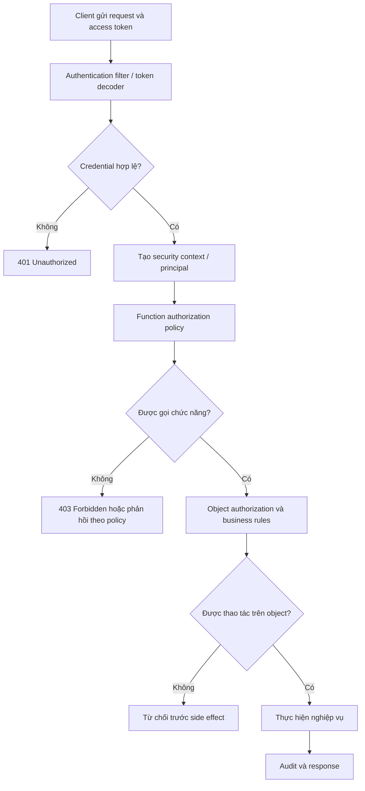

# Authorization phải chạy server-side sau authentication

Authentication (xác thực) xác định caller là ai. Function authorization (phân quyền chức năng) quyết định caller có được phép thực hiện một thao tác cụ thể hay không, chẳng hạn xem báo cáo, tạo hóa đơn, hoàn tiền, quản lý người dùng hoặc thay đổi cấu hình bảo mật.

Hai bước này phải được thực thi ở phía server theo đúng thứ tự: trước tiên xác minh danh tính và credential; sau đó dùng principal đã được xác minh cùng policy của hệ thống để quyết định có cho phép chức năng được yêu cầu hay không. Việc đăng nhập thành công, có access token hợp lệ hoặc nhìn thấy một nút trên giao diện không tự cấp quyền gọi mọi endpoint.

Trong API Security, mỗi endpoint là một năng lực nghiệp vụ mà service cung cấp. Nếu server chỉ kiểm tra authentication mà không kiểm tra quyền chức năng, người dùng thông thường có thể gọi trực tiếp endpoint dành cho quản trị viên hoặc nhân viên vận hành. Đây là lỗi *Broken Function Level Authorization* (BFLA), thường xuất hiện ở các API quản trị, endpoint ít được giao diện sử dụng, thao tác nhạy cảm và các đường truy cập phụ.

## 1. Authentication và function authorization giải quyết hai câu hỏi khác nhau

| Bước | Câu hỏi | Ví dụ |
|---|---|---|
| Authentication | Caller là ai và credential có hợp lệ không? | Access token có chữ ký hợp lệ, đúng issuer/audience và chưa hết hạn; principal là `user-123` |
| Function authorization | Principal có được gọi chức năng này không? | `user-123` có quyền `reports:export` để xuất báo cáo hay không |
| Object authorization | Principal được thao tác trên object nào? | Người dùng có quyền xuất báo cáo thuộc tenant A hay chỉ báo cáo của chính mình |
| Business rule | Trạng thái hiện tại có cho phép hành động không? | Báo cáo đã khóa hoặc kỳ kế toán đã đóng thì không được sửa |

Một request có thể vượt qua authentication nhưng vẫn phải bị từ chối ở các bước authorization tiếp theo. Ví dụ:

- Alice có access token hợp lệ nhưng không có quyền `users:delete`.
- Bob có quyền `invoices:read` nhưng chỉ được đọc hóa đơn trong tenant được cấp.
- Support agent có quyền xem yêu cầu hỗ trợ nhưng không có quyền hoàn tiền.
- Admin có quyền quản lý tài khoản nhưng vẫn không được bỏ qua điều kiện phê duyệt giao dịch theo quy trình.

Vì vậy, không gộp mọi quyết định vào một điều kiện “đã đăng nhập”. Hãy mô hình hóa riêng quyền chức năng, quyền trên object và điều kiện nghiệp vụ.

## 2. Trình tự xử lý request ở phía server

Một luồng API điển hình gồm các bước:



Authentication phải hoàn tất trước khi policy dựa vào principal. Authorization phải được quyết định trước khi service đọc/trả dữ liệu nhạy cảm hoặc thực hiện side effect. Với thao tác ghi, kiểm tra quyền trước khi cập nhật database, phát event, gửi email, tạo thanh toán hoặc gọi dịch vụ ngoài.

Không để client tự gửi một trường như `isAdmin: true` rồi server dùng trường đó để quyết định quyền. Principal và authority phải được tạo từ credential đã xác minh hoặc từ cơ chế workload identity được tin cậy.

## 3. Vì sao kiểm tra ở giao diện là không đủ?

Giao diện thường ẩn nút hoặc menu mà người dùng không được phép sử dụng. Đây là cách cải thiện trải nghiệm, không phải ranh giới bảo mật. Người dùng có thể sửa JavaScript, gọi API bằng `curl`, Postman, script hoặc công cụ phát triển trình duyệt.

Ví dụ, giao diện chỉ hiển thị nút xóa tài khoản cho admin:

```javascript
// Chỉ là điều khiển giao diện, không phải authorization.
if (currentUser.role === "ADMIN") {
  showDeleteUserButton();
}
```

Attacker vẫn có thể gửi request trực tiếp:

```http
DELETE /api/admin/users/user-456
Authorization: Bearer <valid-user-token>
```

Nếu endpoint chỉ yêu cầu token hợp lệ, server có thể xóa tài khoản dù giao diện đã ẩn nút. Kiểm soát bắt buộc phải nằm ở server:

```java
@DeleteMapping("/api/admin/users/{userId}")
@PreAuthorize("hasAuthority('SCOPE_users:delete')")
void deleteUser(@PathVariable UUID userId) {
    userService.delete(userId);
}
```

Ví dụ này kiểm tra quyền chức năng. Service vẫn cần xác minh caller có quyền trên user cụ thể và thao tác có hợp lệ theo quy trình nghiệp vụ hay không.

## 4. Xác định quyền theo chức năng, không theo tên màn hình

Quyền nên mô tả hành động nghiệp vụ cụ thể. Không nên đặt policy dựa trên việc người dùng có truy cập một trang hoặc một nhóm menu hay không.

Ví dụ một hệ thống hóa đơn có thể định nghĩa:

| Permission | Chức năng được cấp |
|---|---|
| `invoices:read` | Đọc thông tin hóa đơn (vẫn cần kiểm tra quyền trên từng hóa đơn) |
| `invoices:create` | Tạo hóa đơn |
| `invoices:update` | Cập nhật trường được phép của hóa đơn |
| `invoices:cancel` | Hủy hóa đơn khi trạng thái cho phép |
| `invoices:export` | Xuất dữ liệu hóa đơn trong phạm vi được cấp |
| `payments:refund` | Khởi tạo hoàn tiền theo policy và quy trình phê duyệt |
| `users:manage` | Quản lý tài khoản người dùng theo phạm vi quản trị |

Một permission không nên rộng hơn nhu cầu của chức năng. Ví dụ `invoices:read` không tự động bao gồm export; `payments:read` không đồng nghĩa được hoàn tiền; `users:manage` cần được phân rã nếu thao tác khóa tài khoản, đặt lại yếu tố xác thực hoặc cấp quyền admin có mức ảnh hưởng khác nhau.

Hãy lập danh sách endpoint và action thực tế. Một HTTP method không luôn tương đương với một permission: `POST` có thể tạo bản ghi, hoàn tiền, gửi lời mời hoặc thực hiện thao tác quản trị. Cần xét ý nghĩa nghiệp vụ của route.

## 5. Deny by default và nguyên tắc quyền tối thiểu

Một policy an toàn nên bắt đầu từ trạng thái từ chối. Chỉ cấp quyền khi có quy tắc rõ ràng cho phép caller thực hiện action.

Các nguyên tắc chính:

- **Deny by default:** endpoint mới hoặc action chưa có policy phải bị từ chối cho đến khi được cấp quyền rõ ràng.
- **Least privilege:** caller chỉ nhận permission cần cho công việc; không cấp `ADMIN` để giải quyết một nhu cầu chỉ cần `reports:read`.
- **Explicit policy:** mỗi endpoint/action có yêu cầu quyền được mô tả và review.
- **Separation of duties:** các thao tác quan trọng có thể cần người tạo và người phê duyệt khác nhau.
- **Fail closed:** khi không đọc được policy, principal hoặc thông tin cần để ra quyết định, không mặc định cho phép.
- **Revalidation:** quyền có thể thay đổi; không giữ một quyết định cũ vô thời hạn nếu vai trò, tenant hoặc trạng thái tài khoản đã bị thu hồi.

Không dùng logic kiểu “nếu không phải guest thì cho phép” cho endpoint nhạy cảm. Cách đó có thể vô tình cấp quyền cho mọi role mới được thêm trong tương lai.

## 6. Role, permission và scope

Các khái niệm này có liên quan nhưng không giống nhau:

- **Role:** nhóm trách nhiệm hoặc vị trí trong hệ thống, ví dụ `SUPPORT`, `FINANCE`, `ADMIN`.
- **Permission:** hành động cụ thể mà principal được phép thực hiện, ví dụ `payments:refund`.
- **OAuth scope:** phạm vi quyền mà authorization server cấp cho client/token, ví dụ `invoices:read`.

Role có thể được ánh xạ thành nhiều permission. Ví dụ:

```text
Role FINANCE
  -> invoices:read
  -> invoices:export
  -> payments:refund:request

Role SUPPORT
  -> tickets:read
  -> tickets:update
  -> invoices:read:limited
```

Scope trong access token thường giới hạn những API mà client có thể gọi. Ứng dụng vẫn cần quyết định principal có quyền nghiệp vụ tương ứng hay không, đặc biệt khi quyền phụ thuộc vào tenant, object, trạng thái tài khoản hoặc grant được ủy quyền.

Không xem chuỗi role hoặc scope do client gửi trong header/body là nguồn quyền đáng tin cậy. Nếu dùng JWT, chỉ đọc claims sau khi token đã được xác minh chữ ký, issuer, audience, thời hạn và các điều kiện cần thiết khác. Nếu quyền thay đổi thường xuyên, cân nhắc tra cứu policy hoặc trạng thái phiên thay vì dựa vào claim cũ có thời hạn quá dài.

## 7. Kiểm tra function authorization trong Spring Security

Spring Security hỗ trợ kiểm tra quyền ở request level và method level. Hai lớp này có thể phối hợp để bảo vệ endpoint và service.

### Bật method security

```java
@Configuration
@EnableMethodSecurity
class SecurityConfiguration {
}
```

### Bảo vệ route ở request level

```java
@Bean
SecurityFilterChain apiSecurity(HttpSecurity http) throws Exception {
    return http
            .authorizeHttpRequests(auth -> auth
                    .requestMatchers("/api/public/**").permitAll()
                    .requestMatchers(HttpMethod.GET, "/api/reports/**")
                        .hasAuthority("SCOPE_reports:read")
                    .requestMatchers(HttpMethod.POST, "/api/reports/export")
                        .hasAuthority("SCOPE_reports:export")
                    .requestMatchers("/api/admin/**")
                        .hasAuthority("SCOPE_admin:access")
                    .anyRequest().denyAll())
            .oauth2ResourceServer(oauth -> oauth.jwt(Customizer.withDefaults()))
            .build();
}
```

Đoạn cấu hình dùng quy ước authority mặc định của Spring Resource Server: scope được ánh xạ thành authority có tiền tố `SCOPE_`. Chỉ các route công khai được khai báo mới `permitAll`; route chưa có matcher bị từ chối bởi `denyAll()`. Khi thêm endpoint, nhóm phát triển phải thêm matcher và scope/permission phù hợp trước khi phát hành. Cần bảo đảm thứ tự matcher không để một quy tắc rộng che mất quy tắc cụ thể.

### Bảo vệ method/service

```java
@Service
@RequiredArgsConstructor
class ReportService {
    private final ReportRepository reportRepository;

    @PreAuthorize("hasAuthority('SCOPE_reports:read')")
    ReportResponse getReport(UUID reportId) {
        Report report = reportRepository.findById(reportId)
                .orElseThrow(ReportNotFoundException::new);
        return ReportResponse.from(report);
    }

    @PreAuthorize("hasAuthority('SCOPE_reports:export')")
    byte[] exportReport(ReportFilter filter) {
        return createExport(filter);
    }
}
```

Method security bảo vệ service khi được gọi từ nhiều controller hoặc entry point khác nhau, miễn là lời gọi đi qua Spring proxy và security context phù hợp. Không nên dựa vào self-invocation trong cùng bean để kích hoạt `@PreAuthorize`, vì lời gọi nội bộ có thể không đi qua proxy. Với thao tác quan trọng, thiết kế method/service boundary rõ ràng và có test cho cách gọi thực tế.

Không phải ứng dụng nào cũng cần kiểm tra trùng lặp ở mọi lớp. Chọn điểm thực thi có thể bao phủ tất cả đường gọi; thường route security bảo vệ API boundary và method security bảo vệ năng lực nghiệp vụ dùng chung.

## 8. Ánh xạ quyền từ JWT đã được xác minh

Resource server cần xác minh JWT trước khi tạo `Authentication`. Không chỉ decode payload rồi tin các claim. Cần cấu hình issuer, audience, chữ ký, thời hạn và thuật toán theo hợp đồng tin cậy.

Ví dụ access token có thể chứa:

```json
{
  "iss": "https://identity.example.test",
  "aud": ["security-api"],
  "sub": "user-123",
  "scope": "reports:read reports:export",
  "exp": 1900000000
}
```

Sau khi decoder xác minh token, ứng dụng có thể ánh xạ scope thành authority. Cần thống nhất quy ước tên: Spring Resource Server mặc định thường thêm tiền tố `SCOPE_` cho scope, trong khi role có thể dùng `ROLE_` hoặc authority riêng. Ví dụ annotation phải khớp chính xác với cách ánh xạ:

```java
@PreAuthorize("hasAuthority('SCOPE_reports:export')")
byte[] exportReport(ReportFilter filter) {
    // ...
}
```

Hoặc cấu hình converter để tạo authority `reports:export` rồi dùng đúng chuỗi đó. Không trộn hai quy ước trong cùng hệ thống mà không có lý do và tài liệu.

Nếu token chứa claim role do identity provider cấp, hãy chỉ tin claim từ issuer đã xác minh và theo hợp đồng được thống nhất. Không nhận role từ query parameter, request body hoặc header tùy ý. Khi người dùng bị hạ quyền, token cũ có thể còn claim quyền đến lúc hết hạn; hãy cân nhắc access token TTL, introspection, session version hoặc kiểm tra trạng thái đối với thao tác nhạy cảm.

## 9. Kết hợp function authorization với object authorization

Function authorization trả lời caller có được gọi chức năng. Object authorization trả lời caller được thao tác trên tài nguyên cụ thể nào. Một quyết định cho phép thường cần cả hai.

Ví dụ `invoices:read` không có nghĩa người dùng được đọc mọi hóa đơn:

```java
@PreAuthorize("hasAuthority('SCOPE_invoices:read')")
InvoiceResponse getInvoice(UUID invoiceId, UUID customerId) {
    Invoice invoice = repository
            .findByIdAndCustomerId(invoiceId, customerId)
            .orElseThrow(InvoiceNotFoundException::new);
    return mapper.toResponse(invoice);
}
```

`customerId` phải được lấy từ principal hoặc ánh xạ danh tính đáng tin cậy, không lấy từ dữ liệu client tự khai. Nếu có quyền chia sẻ hoặc delegated access, service phải kiểm tra grant và action tương ứng.

Một policy có thể được biểu diễn như sau:

```text
ALLOW khi:
  authentication hợp lệ
  AND principal có permission invoices:read
  AND invoice thuộc tenant được phép
  AND principal là owner hoặc có grant READ còn hiệu lực
  AND invoice ở trạng thái cho phép đọc
```

Tách các điều kiện này giúp tránh hai lỗi ngược nhau: chỉ kiểm tra role chung rồi truy cập mọi object, hoặc kiểm tra owner nhưng quên quyền chức năng. Với thao tác ghi, thêm kiểm tra trường được phép thay đổi và trạng thái nghiệp vụ trước khi thực hiện.

## 10. Bảo vệ các chức năng nhạy cảm và đặc quyền cao

Các chức năng như quản lý người dùng, cấp role, thay đổi cấu hình, xuất dữ liệu, hoàn tiền, reset MFA và xem audit log cần permission riêng. Không nên gộp tất cả vào một quyền `admin` nếu mỗi hành động có mức rủi ro khác nhau.

Ví dụ ma trận quyền:

| Chức năng | Permission gợi ý | Kiểm soát bổ sung có thể cần |
|---|---|---|
| Xem danh sách người dùng | `users:read` | Giới hạn tenant và trường response |
| Khóa tài khoản | `users:disable` | Audit reason, kiểm tra trạng thái và quyền trên target user |
| Cấp role | `users:grant-role` | Không tự cấp quyền cao hơn quyền của người cấp; có thể yêu cầu phê duyệt |
| Reset MFA | `users:reset-mfa` | Re-authentication hoặc quy trình hỗ trợ đã xác minh |
| Xuất dữ liệu | `reports:export` | Quota, audit, giới hạn phạm vi và dữ liệu nhạy cảm |
| Hoàn tiền | `payments:refund` | Kiểm tra object, hạn mức, trạng thái và dual approval khi cần |
| Thay đổi cấu hình bảo mật | `security-config:update` | Re-authentication, audit và quy trình change control |

Với hành động có tác động lớn, cân nhắc *step-up authentication* (yêu cầu xác thực lại hoặc yếu tố mạnh hơn), xác nhận ý định, hạn mức, phê duyệt hai người và audit trail. Những kiểm soát này bổ sung cho permission; không thay thế việc kiểm tra permission ở server.

## 11. Không tin header và dữ liệu do client tự khai

Một số ứng dụng gửi header như `X-User-Role`, `X-Tenant-Id` hoặc `X-Internal-Request` để truyền ngữ cảnh. Nếu client bên ngoài có thể tự đặt các header đó và server tin trực tiếp, attacker có thể giả mạo quyền.

Các nguyên tắc:

- Không dùng `X-User-Role`, `isAdmin`, `ownerId` hoặc `tenantId` từ request làm bằng chứng quyền.
- Nếu gateway ghi đè header định danh, phải loại bỏ header cùng tên do client gửi trước khi thêm giá trị đã xác minh; backend chỉ nhận traffic từ gateway tin cậy theo network/authentication policy.
- Service-to-service nên xác thực workload identity hoặc credential riêng; không chỉ tin header `X-Internal-Request: true`.
- Không cho client chọn actor bằng cách truyền `userId` trong body cho thao tác “thay mặt người dùng”, trừ khi có cơ chế delegation rõ ràng và được kiểm tra.
- Không coi request đến từ IP nội bộ là mặc nhiên được phép gọi chức năng đặc quyền.

Security context phải được tạo từ nguồn đã xác minh và truyền qua các lớp ứng dụng theo cơ chế framework kiểm soát.

## 12. Bảo vệ endpoint phụ, HTTP method và API khác

Một chức năng có thể được phơi lộ qua nhiều route. Ví dụ quản lý người dùng có thể có endpoint REST, GraphQL mutation, endpoint batch, route phiên bản cũ hoặc tác vụ nội bộ. Chỉ bảo vệ một route không đủ nếu cùng hành động còn có đường khác.

Khi review function authorization, hãy tìm:

- Tất cả HTTP method trên cùng path (`GET`, `POST`, `PUT`, `PATCH`, `DELETE`).
- Route alias, version cũ, endpoint admin và endpoint debug/maintenance.
- GraphQL resolver/mutation và field có thể truy cập dữ liệu nhạy cảm.
- Batch/import/export và endpoint thực hiện nhiều action trong một request.
- Webhook/callback; cần xác thực nguồn gửi và giới hạn loại sự kiện được phép.
- Message consumer, scheduled job và background worker; chúng cần service identity và quyền riêng.
- API gateway và service downstream; policy ở gateway không thay thế kiểm tra ở service khi service có thể được gọi trực tiếp hoặc qua entry point khác.

Không dựa vào việc frontend không gọi một route cũ để kết luận route đó không còn được sử dụng. Endpoint không dùng cần được deprecate và gỡ bỏ theo quy trình, hoặc vẫn phải có policy đúng cho đến khi bị loại bỏ.

## 13. Thứ tự kiểm tra và side effect

Function authorization phải chạy trước hành động có tác dụng phụ. Ví dụ một endpoint hoàn tiền nên thực hiện theo trình tự:

1. Xác thực caller và client.
2. Kiểm tra permission `payments:refund`.
3. Kiểm tra quyền trên payment/order cụ thể và tenant.
4. Kiểm tra trạng thái, số tiền, hạn mức và quy tắc phê duyệt.
5. Ghi nhận quyết định/audit phù hợp.
6. Thực hiện hoàn tiền hoặc tạo command có kiểm soát.

Không gọi payment provider trước rồi mới kiểm tra caller có quyền hay không. Không tạo job hoặc phát event trước khi authorization hoàn tất. Với luồng bất đồng bộ, ghi nhận actor, scope, object và quyết định đã xác minh trong command; worker vẫn cần xác thực service identity và chỉ thực hiện loại hành động được cấp.

Nếu quyết định authorization phụ thuộc dữ liệu có thể thay đổi đồng thời, hãy cân nhắc thực hiện kiểm tra và cập nhật trong transaction hoặc cơ chế concurrency phù hợp. Ví dụ, quyền hoàn tiền có thể phụ thuộc vào trạng thái payment và số tiền còn được hoàn.

## 14. Xử lý 401, 403 và lỗi policy

Thông thường:

- `401 Unauthorized`: request thiếu credential hoặc credential không hợp lệ; response có thể kèm `WWW-Authenticate` theo cơ chế xác thực.
- `403 Forbidden`: caller đã được xác thực nhưng không có quyền gọi chức năng.

Nếu việc trả `403` làm lộ thông tin nhạy cảm, một số endpoint có thể dùng `404` theo policy che giấu tài nguyên. Tuy nhiên, cần phân biệt quyết định function authorization với object existence policy; không tùy tiện đổi mọi lỗi thành `404`.

Response cho client nên ổn định và không tiết lộ policy nội bộ, danh sách role đặc quyền, cấu hình hoặc tên service. Log nội bộ có thể ghi permission bị thiếu, policy ID, principal, endpoint, decision và correlation ID, nhưng không ghi access token hoặc secret.

Khi policy engine hoặc permission store gặp lỗi, hệ thống cần fail closed cho chức năng được bảo vệ. Không chuyển sang chế độ allow-all để duy trì khả năng phục vụ.

## 15. Kiểm thử function authorization

Với mỗi endpoint, cần kiểm thử cả caller được phép và caller bị từ chối. Một bộ test cơ bản:

| Tình huống | Kết quả cần xác minh |
|---|---|
| Không có token | Request bị từ chối ở authentication (`401` theo contract) |
| Token sai chữ ký, issuer, audience hoặc hết hạn | Không tạo principal hợp lệ và không chạy nghiệp vụ |
| Token hợp lệ nhưng thiếu permission chức năng | Bị từ chối (`403` hoặc policy response đã định) |
| Caller có permission phù hợp | Chức năng chạy nếu object và business rules cũng cho phép |
| Caller chỉ có quyền đọc gọi endpoint xóa | Bị từ chối và không có side effect |
| Caller giả mạo `role` hoặc `X-User-Role` | Không làm thay đổi quyết định authorization |
| Endpoint alias hoặc HTTP method khác | Cùng policy phù hợp được áp dụng |
| Endpoint admin qua GraphQL/bulk/legacy route | Không có đường vòng bỏ qua permission |
| Permission bị thu hồi | Request tiếp theo bị từ chối theo thời hạn hiệu lực policy/token |
| Policy service không khả dụng | Chức năng nhạy cảm fail closed |
| Request bị từ chối | Không cập nhật database, phát event, tạo job hoặc gọi downstream |

Ví dụ với MockMvc và Spring Security Test:

```java
@SpringBootTest
@AutoConfigureMockMvc
class ReportFunctionAuthorizationIT {
    @Autowired
    MockMvc mockMvc;

    @MockBean
    ReportExportService exportService;

    @Test
    void userWithoutExportPermissionIsForbidden() throws Exception {
        mockMvc.perform(post("/api/reports/export")
                        .with(jwt().jwt(token -> token.subject("user-123"))
                                .authorities(new SimpleGrantedAuthority(
                                        "SCOPE_reports:read"))))
                .andExpect(status().isForbidden());

        verifyNoInteractions(exportService);
    }

    @Test
    void userWithExportPermissionCanCallExportFunction()
            throws Exception {
        mockMvc.perform(post("/api/reports/export")
                        .with(jwt().jwt(token -> token.subject("user-123"))
                                .authorities(new SimpleGrantedAuthority(
                                        "SCOPE_reports:export"))))
                .andExpect(status().isOk());

        verify(exportService).export(any());
    }
}
```

Đây là ví dụ khung; điều chỉnh status code, route, service và kiểu request theo ứng dụng. `jwt()` tạo principal giả lập trong test MVC, không kiểm tra chữ ký token thực tế. Vì vậy cần có test riêng cho decoder/issuer/audience/expiry và test end-to-end qua cấu hình xác thực thật ở môi trường kiểm thử.

Với method security, hãy test lời gọi service qua Spring proxy và xác minh lời gọi trực tiếp từ các entry point khác nhau cũng bị bảo vệ. Không chỉ test một helper policy riêng rồi cho rằng tất cả endpoint đều gọi helper đó.

## 16. Giám sát và kiểm toán quyết định phân quyền

Với các chức năng nhạy cảm, ghi nhận quyết định authorization để có thể điều tra và phát hiện lạm dụng. Audit event nên có:

- Principal hoặc service identity đã xác minh.
- Action/permission được yêu cầu.
- Endpoint, service và phiên bản API.
- Object reference hoặc tenant reference ở dạng phù hợp.
- Decision `ALLOW`/`DENY`, policy ID hoặc lý do nội bộ.
- Thời điểm, correlation ID và kết quả side effect.
- Người phê duyệt hoặc step-up context nếu luồng yêu cầu.

Không ghi access token, refresh token, secret hoặc payload nhạy cảm đầy đủ. Bảo vệ log khỏi sửa đổi, giới hạn người truy cập và đặt retention theo chính sách.

Theo dõi các dấu hiệu:

- Nhiều lần gọi chức năng admin hoặc export bị từ chối.
- Một principal thử nhiều permission hoặc endpoint đặc quyền trong thời gian ngắn.
- Thay đổi role/permission bất thường hoặc cấp quyền cao ngoài quy trình.
- Tỷ lệ `401`/`403` tăng sau một đợt phát hành.
- Service account gọi chức năng ngoài phạm vi được cấp.
- Một endpoint mới được gọi nhưng chưa có policy hoặc test tương ứng.

Kết hợp alert với quy trình review và thu hồi quyền. Log chỉ giúp phát hiện và điều tra; nó không thay thế kiểm tra authorization trước khi request được thực thi.

## 17. Checklist thiết kế function authorization

- [ ] Authentication xác minh credential trước khi tạo principal.
- [ ] Mỗi endpoint/action có permission cụ thể và owner chịu trách nhiệm.
- [ ] Server kiểm tra quyền; giao diện chỉ điều khiển trải nghiệm người dùng.
- [ ] Chính sách deny-by-default và fail-closed được áp dụng cho endpoint chưa khai báo hoặc policy lỗi.
- [ ] Role được ánh xạ rõ sang permission; scope/claim chỉ được tin sau khi token được xác minh.
- [ ] Không tin role, tenant hoặc cờ admin do client tự gửi.
- [ ] Function authorization được kết hợp với object authorization và business rules.
- [ ] Quyền được kiểm tra trước khi đọc dữ liệu nhạy cảm hoặc tạo side effect.
- [ ] Các route alias, HTTP method, GraphQL, bulk, legacy endpoint và background worker đều có policy.
- [ ] Chức năng đặc quyền có kiểm soát bổ sung như re-authentication, approval hoặc audit khi cần.
- [ ] Có test cho token thiếu/sai, thiếu permission, quyền hợp lệ, giả mạo header và không có side effect.
- [ ] Có audit log và cảnh báo cho quyết định truy cập nhạy cảm.
- [ ] Khi quyền thay đổi, thời gian hiệu lực của token/cache/policy được xử lý rõ ràng.

## Kết luận

Function authorization phải được thực thi ở server sau khi authentication đã xác minh caller. Server dùng principal đáng tin cậy để kiểm tra permission của chức năng, sau đó tiếp tục kiểm tra object và điều kiện nghiệp vụ trước khi thực hiện hành động. Deny-by-default, quyền tối thiểu, kiểm tra trước side effect và test qua endpoint thật giúp ngăn người dùng đã đăng nhập gọi các chức năng ngoài quyền hạn. Giao diện, ID khó đoán hoặc header do client gửi không thể thay thế quyết định phân quyền ở phía server.
