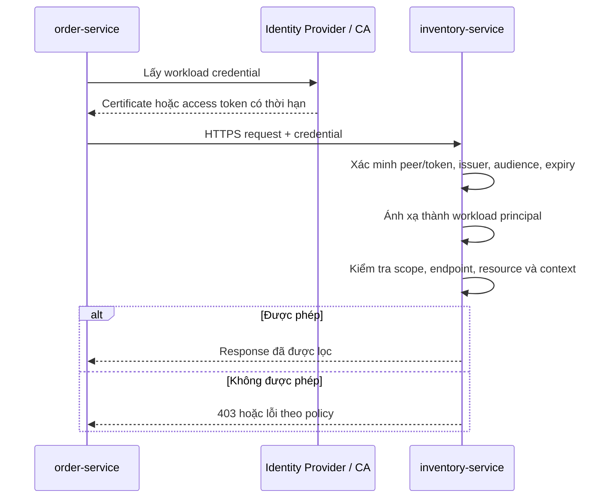
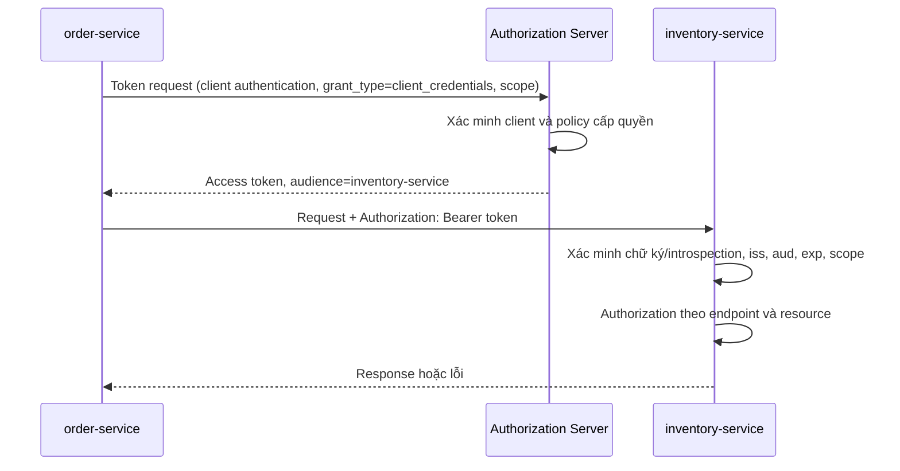

# Xác thực workload gọi API nội bộ

Các service trong cùng một private network vẫn cần xác minh danh tính khi gọi API của nhau. Một request đến từ subnet nội bộ, Kubernetes cluster hoặc service mesh không tự chứng minh caller là workload hợp lệ. Nếu một service bị chiếm quyền, kẻ tấn công có thể dùng vị trí mạng đó để dò endpoint, giả mạo header hoặc gọi các API nội bộ bằng quyền quá rộng.

Trong module `SECURITY_API_SECURITY`, bảo mật API được thiết kế theo từng endpoint, đối tượng dữ liệu và luồng nghiệp vụ. Vì vậy, service nhận cần xác minh workload nào đang gọi, credential có hợp lệ và dành cho đúng service đích hay không, rồi mới quyết định workload đó được thực hiện operation nào trên resource nào. Xác thực workload là nền tảng của service-to-service security; nó không thay thế authorization.

## Mục tiêu học tập

Sau bài này, người học có thể:

- Phân biệt workload identity với user identity và application/client identity.
- Giải thích vì sao private network, IP allowlist hoặc header tự khai báo không đủ để xác thực service.
- Chọn và triển khai mTLS, OAuth 2.0 Client Credentials hoặc workload identity federation phù hợp.
- Xác minh certificate, token, issuer, audience, thời hạn và scope tại service nhận.
- Quản lý vòng đời certificate, token và trust bundle; thu hồi credential khi workload bị xâm phạm.
- Phân quyền theo workload, endpoint, action, tenant và resource sau khi xác thực thành công.
- Kiểm thử giả mạo danh tính, token sai audience, lateral movement, replay và lỗi cấu hình.

## 1. Workload identity là gì?

Workload là một thành phần phần mềm đang chạy và thực hiện công việc thay cho hệ thống, ví dụ một Kubernetes pod, container, VM, serverless function, batch worker hoặc service chạy trên máy chủ. Workload identity là danh tính được cấp cho thành phần đó để các hệ thống khác có thể xác minh nó.

Ví dụ, `order-service` cần gọi `inventory-service` để giữ hàng. `order-service` phải chứng minh mình là workload đã được cấp danh tính. Sau khi xác minh, `inventory-service` mới kiểm tra danh tính đó có quyền gọi operation `inventory:reserve` hay không.

Workload identity khác với các danh tính sau:

| Loại danh tính | Đại diện cho | Ví dụ | Câu hỏi cần trả lời |
|---|---|---|---|
| Workload identity | Service hoặc process đang thực hiện request | `spiffe://prod.example/ns/orders/sa/order-service` | Workload nào đang kết nối? |
| User identity | Người dùng khởi tạo nghiệp vụ | `user-1842` | Người dùng nào yêu cầu hành động? |
| Application/client identity | Ứng dụng hoặc đối tác tích hợp | `partner-reporting-prod` | Ứng dụng nào đang sử dụng API? |
| Tenant context | Phạm vi tổ chức hoặc khách hàng | `tenant-42` | Request đang hoạt động trong phạm vi dữ liệu nào? |

Một request có thể có cả workload identity và user context. Ví dụ `order-service` gọi `payment-service` thay mặt cho user `user-1842`. Service đích cần biết cả workload gọi lẫn người dùng gốc nếu nghiệp vụ yêu cầu delegation. Không biến workload identity thành user identity và không tin một `X-User-Id` hoặc `X-Service-Name` do caller tự gửi.

## 2. Vì sao mạng nội bộ không phải bằng chứng xác thực?

Private network giúp giảm khả năng truy cập trực tiếp từ Internet, nhưng không chứng minh process gửi request là đúng service. Những rủi ro thường gặp gồm:

- Một workload public bị khai thác rồi dùng quyền mạng nội bộ để gọi service khác.
- Nhiều service dùng chung service account, API key hoặc certificate nên không thể phân biệt caller.
- Một endpoint quản trị chỉ kiểm tra IP hoặc subnet, cho phép mọi workload trong vùng mạng truy cập.
- Proxy hoặc gateway chuyển tiếp header định danh do client bên ngoài kiểm soát.
- Token được phát cho service A nhưng service B cũng chấp nhận vì không kiểm tra audience.
- Credential dài hạn bị lộ trong image, environment variable, log, file cấu hình hoặc pipeline.
- Service bị xâm phạm dùng quyền của chính nó để di chuyển ngang sang các service khác.

IP allowlist, network policy và service mesh là các lớp giảm bề mặt tấn công. Chúng không thay thế việc xác minh danh tính ở phía nhận. Một request có IP nội bộ vẫn có thể mang credential giả, token bị đánh cắp hoặc quyền không phù hợp.

## 3. Luồng xác thực workload-to-workload

Một luồng gọi nội bộ nên có các bước rõ ràng:

1. Workload nguồn lấy credential hoặc identity assertion từ nền tảng tin cậy.
2. Workload gửi request qua kênh bảo vệ, thường là TLS; có thể dùng mTLS để xác thực hai phía.
3. Service nhận xác minh certificate hoặc access token, bao gồm issuer, audience, thời hạn và các điều kiện bắt buộc.
4. Service nhận ánh xạ credential sang workload principal ổn định.
5. Authorization kiểm tra principal có quyền gọi endpoint và thực hiện action trên resource hay không.
6. Request được validate, thực thi trong giới hạn tài nguyên và ghi audit.



Điểm quan trọng là service nhận phải tự xác minh credential. Không dựa vào việc một gateway trước đó đã xác thực nếu request có thể đi đường khác, gateway không chuyển tiếp bằng chứng đáng tin hoặc service nhận không ràng buộc request với danh tính đã xác minh.

## 4. Các cơ chế xác thực workload phổ biến

Không có một cơ chế duy nhất phù hợp với mọi môi trường. Có thể dùng một cơ chế hoặc kết hợp nhiều lớp, miễn là trách nhiệm và trust boundary được xác định rõ.

| Cơ chế | Cách xác minh | Phù hợp khi | Điểm cần chú ý |
|---|---|---|---|
| Mutual TLS (mTLS) | Hai bên xác minh certificate trong TLS handshake | Service có kết nối trực tiếp hoặc service mesh quản lý certificate | Quản lý CA, SAN, rotation, trust bundle và thu hồi |
| OAuth 2.0 Client Credentials | Client workload xác thực với authorization server để lấy access token | Cần scope, audience, policy tập trung và token cho API | Xác thực client, token lifetime, audience và key rotation |
| Workload identity federation | Nền tảng tin cậy phát assertion để đổi lấy credential của hệ thống đích | Kubernetes/cloud/serverless cần tránh secret tĩnh | Ràng buộc issuer, subject, audience và trust policy chặt |
| Signed request (ví dụ HMAC) | Service nhận kiểm tra chữ ký, timestamp và nonce | Tích hợp đặc thù hoặc giao thức có yêu cầu ký request | Canonicalization, chống replay, quản lý shared secret |
| API key/service secret | Service nhận tra cứu credential được cấp | Hệ thống đơn giản hoặc tích hợp cũ có phạm vi hẹp | Secret tĩnh dễ lộ, khó phân biệt instance, cần scope và rotation |

Với workload production, ưu tiên danh tính riêng và credential ngắn hạn được cấp tự động. Tránh một API key tĩnh dùng chung cho cả cluster hoặc nhiều service.

## 5. Xác thực bằng mutual TLS (mTLS)

### 5.1. mTLS hoạt động như thế nào?

TLS thông thường giúp client xác minh server và mã hóa kết nối. Với mTLS, server cũng yêu cầu client trình certificate để xác minh danh tính phía gọi. Hai phía thiết lập kênh TLS sau khi kiểm tra certificate theo trust configuration.

Khi `order-service` gọi `inventory-service`:

1. `order-service` kết nối tới endpoint TLS của `inventory-service`.
2. `inventory-service` trình server certificate; client xác minh certificate chain, hostname/SAN và thời hạn.
3. Server yêu cầu client certificate.
4. `order-service` trình certificate workload của mình.
5. Server xác minh chain, trust anchor, thời hạn, key usage/EKU và danh tính trong SAN theo policy.
6. Nếu hợp lệ, TLS handshake hoàn tất và server gắn request với workload principal đã xác minh.

Certificate cần có danh tính đủ cụ thể để phân biệt workload, thường dùng URI SAN hoặc DNS SAN theo trust model. Không nên chỉ dựa vào Common Name cũ hoặc một chuỗi tên tùy ý do caller gửi. Nếu dùng SPIFFE, workload identity thường được biểu diễn bằng SPIFFE ID trong URI SAN, ví dụ `spiffe://prod.example/ns/orders/sa/order-service`.

### 5.2. Certificate không tự quyết định quyền nghiệp vụ

mTLS chứng minh peer giữ private key tương ứng với certificate được CA tin cậy cấp. Điều này không tự cấp quyền đọc mọi bảng dữ liệu hoặc gọi mọi endpoint. Sau khi xác minh certificate, service nhận cần ánh xạ danh tính sang policy:

```text
principal = verifyClientCertificate(tlsPeer)
require(principal == "spiffe://prod.example/ns/orders/sa/order-service")
require(policy.allows(principal, "inventory:reserve", inventoryItem))
```

Ví dụ trên chỉ minh họa. Trong hệ thống lớn, policy có thể lưu ở authorization service hoặc cấu hình được quản lý; không nên hardcode danh sách workload vào nhiều controller khác nhau.

### 5.3. Quản lý certificate lifecycle

Certificate cần được cấp, gia hạn, xoay vòng và thu hồi theo quy trình tự động:

- Cấp certificate riêng cho từng workload hoặc identity unit; tránh chia sẻ private key giữa nhiều service.
- Private key cần được tạo và giữ trong môi trường phù hợp, hạn chế export nếu nền tảng hỗ trợ.
- Dùng thời hạn ngắn và tự động renew trước khi hết hạn.
- Trust bundle/CA root được phân phối và cập nhật có kiểm soát; hỗ trợ giai đoạn overlap khi thay CA.
- Xác minh certificate mới đã được các service nhận tin cậy trước khi ngừng certificate cũ.
- Khi workload bị xâm phạm, thu hồi identity/credential và giới hạn thời gian cache hoặc trạng thái thu hồi.

Không dùng certificate hết hạn hoặc sai SAN chỉ vì request đến từ subnet nội bộ. Không tắt client certificate validation để khắc phục lỗi triển khai.

### 5.4. Service mesh có ích ở đâu?

Service mesh có thể tự động cấp certificate, thực hiện mTLS giữa sidecar/proxy, áp dụng policy giao tiếp và tạo telemetry. Điều này giảm việc mỗi service tự viết TLS plumbing. Tuy nhiên, mesh policy vẫn cần được thiết kế theo danh tính và endpoint; cấu hình allow toàn namespace hoặc toàn cluster có thể tạo quyền quá rộng.

Ứng dụng cần hiểu trust boundary của mesh. Nếu proxy kết thúc mTLS rồi chuyển request vào ứng dụng qua HTTP nội bộ, chỉ tin header identity do proxy đặt khi:

- Ứng dụng chỉ nhận traffic từ proxy được tin cậy.
- Proxy xóa header identity do client gửi trước khi đặt giá trị đã xác minh.
- Kênh proxy-to-application được bảo vệ và không thể bị workload khác giả mạo.
- Cấu hình bypass proxy hoặc direct pod access đã bị chặn theo thiết kế.

Nếu các điều kiện đó không được bảo đảm, ứng dụng không nên coi header như `X-Forwarded-Client-Cert` là bằng chứng độc lập.

## 6. Xác thực bằng OAuth 2.0 Client Credentials

### 6.1. Khi nào dùng Client Credentials?

OAuth 2.0 Client Credentials phù hợp khi một workload gọi API thay mặt chính nó, không có người dùng cuối trực tiếp tham gia vào grant. Workload là confidential client và phải xác thực với authorization server bằng phương thức được hỗ trợ, chẳng hạn private key JWT, mTLS client authentication hoặc client secret được quản lý an toàn.

Luồng khái quát:



Client Credentials token đại diện cho client/workload, không đại diện cho một người dùng. Không thêm `userId` vào claim rồi xem đó là delegation nếu không có quy trình ủy quyền và kiểm chứng nguồn claim rõ ràng.

### 6.2. Access token cần ràng buộc với service đích

Một token dành cho `inventory-service` không nên được chấp nhận ở `admin-service`. Service nhận cần xác minh ít nhất:

- `iss` (issuer) là authorization server được tin cậy.
- `aud` (audience) bao gồm đúng API/service nhận.
- `exp` chưa hết hạn; kiểm tra `nbf` nếu có và xử lý clock skew trong giới hạn nhỏ.
- Chữ ký hợp lệ với thuật toán được cho phép và key thuộc issuer đã cấu hình.
- `scope`, `roles` hoặc claims quyền đáp ứng operation, nếu hệ thống dùng các claim đó.
- `client_id`/`azp` hoặc claim tương đương xác định workload theo contract token.
- Token type và profile phù hợp; không chấp nhận ID token thay cho access token.

Không chỉ decode JWT rồi tin claim. Phải xác minh chữ ký và các claim bắt buộc. Nếu dùng opaque token, resource server có thể introspect với authorization server và cần xử lý timeout/cache theo policy. Token validation không nên tự động tải key từ URL do token hoặc request cung cấp; chỉ dùng issuer/JWKS endpoint đã cấu hình và kiểm tra `kid` theo key set tin cậy.

### 6.3. Scope cần nhỏ và gắn với API

Scope nên mô tả quyền ở mức operation, ví dụ `inventory:read` hoặc `inventory:reserve`. Không cấp `admin:*` chỉ vì workload cần một thao tác. Service nhận vẫn phải kiểm tra resource và ngữ cảnh; scope `inventory:read` không có nghĩa được đọc tồn kho của mọi tenant nếu policy còn giới hạn theo tenant.

Ví dụ payload JWT minh họa:

```json
{
  "iss": "https://identity.example.internal",
  "sub": "order-service",
  "aud": ["inventory-service"],
  "client_id": "order-service",
  "scope": "inventory:reserve",
  "iat": 1795000000,
  "exp": 1795000300
}
```

Payload trên chỉ là ví dụ về claims. Nó không có giá trị xác thực nếu chữ ký không hợp lệ và không thay thế kiểm tra authorization trên item, tenant hoặc trạng thái kho.

### 6.4. Bảo vệ token

Access token là bearer credential nếu ai sở hữu token có thể sử dụng nó. Vì vậy:

- Truyền token qua TLS và không ghi token đầy đủ vào log, trace hoặc exception.
- Giữ token trong bộ nhớ cần thiết và tránh lưu vào file hoặc cache dùng chung không an toàn.
- Dùng thời hạn ngắn phù hợp với rủi ro và chi phí cấp token.
- Không gửi token tới service khác audience.
- Hạn chế token forwarding; mỗi service nên lấy token dành cho downstream bằng client credentials hoặc token exchange theo thiết kế.
- Có quy trình rotate signing key, xử lý key compromise và invalidation theo khả năng của hệ thống.

## 7. Workload identity federation

Workload identity federation cho phép workload chứng minh danh tính với một identity provider dựa trên nền tảng đang chạy, sau đó đổi assertion lấy credential cho API đích. Mục tiêu là tránh lưu client secret dài hạn trong pod, VM hoặc pipeline.

Ví dụ, Kubernetes workload có service account token được ký bởi cluster issuer. Cloud identity provider hoặc broker xác minh issuer, subject và audience của token, rồi cấp access token ngắn hạn cho API. Tương tự, workload trên cloud có thể dùng instance identity hoặc managed identity để lấy credential.

Một trust policy cần ràng buộc:

- Issuer cụ thể của cluster/platform.
- Subject chính xác, ví dụ namespace và service account được phép.
- Audience dành riêng cho federation target.
- Điều kiện môi trường, project/account hoặc workload pool nếu có.
- Thời hạn assertion và cách xử lý token bị thu hồi hoặc cluster bị xâm phạm.

Không tin mọi service account trong cluster chỉ vì token được ký bởi cùng cluster issuer. Nếu federation policy chỉ kiểm tra issuer mà không kiểm tra subject và audience, workload bất kỳ có thể đổi assertion lấy quyền của service khác.

## 8. Signed request và API key trong tích hợp nội bộ

Một số giao thức dùng HMAC hoặc chữ ký số trên request. Cơ chế này có thể xác minh request được tạo bởi bên giữ khóa và nội dung không bị sửa theo quy tắc canonicalization. Để giảm replay, chữ ký thường gắn với timestamp, nonce hoặc request ID; server phải lưu/truy vấn trạng thái nonce trong cửa sổ thời gian cho phép.

HMAC yêu cầu hai phía chia sẻ secret. Nếu nhiều service dùng chung secret, việc xác định nguồn và thu hồi trở nên khó khăn. Chữ ký bất đối xứng giúp bên xác minh chỉ cần public key, nhưng vẫn cần quản lý private key, key ID và trust registry. Cả hai cách đều cần scope và authorization riêng.

API key tĩnh có thể nhận diện client đơn giản, nhưng không nên dùng như credential toàn cluster. Nếu buộc phải hỗ trợ hệ thống cũ:

- Cấp key riêng cho từng workload và môi trường.
- Sinh key ngẫu nhiên với entropy cao, lưu giá trị dẫn xuất ở server khi chỉ cần xác minh.
- Đặt scope và expiry; có owner và lịch rotate/revoke.
- Không truyền key trong URL hoặc log.
- Có kế hoạch chuyển sang mTLS, workload identity hoặc OAuth client credentials.

## 9. Authorization sau khi workload đã được xác thực

Xác thực trả lời “caller là workload nào?”. Authorization trả lời “workload đó được làm gì?”. Hai bước cần tách biệt.

Ví dụ `order-service` có thể được phép gọi `inventory-service`, nhưng chỉ được:

- Đọc số lượng tồn khả dụng cho một order flow hợp lệ.
- Tạo reservation trong giới hạn và tenant được ủy quyền.
- Không được sửa mức tồn thực tế, cấu hình kho hoặc đọc dữ liệu quản trị.

Service nhận cần kiểm tra:

| Lớp policy | Ví dụ kiểm tra |
|---|---|
| Workload identity | Caller có đúng là `order-service` production không? |
| Endpoint/action | Có scope/quyền `inventory:reserve` và endpoint có cho phép action này không? |
| Resource | Item/warehouse được yêu cầu có nằm trong phạm vi workload được phép không? |
| Tenant/context | Request có tenant context được ủy quyền và nhất quán với resource không? |
| Business state | Đơn hàng còn ở trạng thái được phép giữ hàng không? |
| Resource limits | Số lượng, batch size, timeout và concurrency có nằm trong giới hạn không? |

Không dùng role chung `INTERNAL_SERVICE` để cấp mọi quyền cho tất cả workload. Cần danh tính riêng và policy theo từng cặp caller-callee, endpoint và operation. Một workload hợp lệ nhưng không có rule cho operation cụ thể phải bị từ chối.

### 9.1. Request thay mặt người dùng

Nếu một service gọi downstream để hoàn tất yêu cầu do user khởi tạo, hãy giữ hai principal:

- Workload principal xác định service thực hiện kết nối.
- User/delegated principal xác định người khởi tạo và phạm vi được ủy quyền.

Có thể dùng OAuth Token Exchange hoặc cơ chế delegation được ký và xác minh. Token cho service đích nên có audience và scope tối thiểu. Service đích cần kiểm tra cả quyền của workload lẫn quyền của user trên object. Không chuyển tiếp token gốc tới mọi service một cách mặc định.

Nếu tác vụ nền được hệ thống khởi tạo, dùng system principal riêng với quyền và mục đích rõ ràng; không tạo một user giả để bỏ qua policy.

## 10. Những kiểu tấn công và lỗi cấu hình thường gặp

### 10.1. Giả mạo identity bằng header

Một ứng dụng tin `X-Service-Name: order-service` hoặc `X-Internal-Caller: trusted` mà không xác minh nguồn header sẽ cho phép caller tự nhận danh tính. Header định danh chỉ đáng tin khi được một proxy xác thực đặt lại trong trust boundary được bảo vệ, hoặc được ký/xác minh theo giao thức đã định nghĩa.

### 10.2. Token sai audience hoặc issuer

Nếu service chấp nhận mọi JWT có chữ ký hợp lệ từ một issuer mà không kiểm tra `aud`, token dành cho service khác có thể bị dùng lại. Luôn kiểm tra issuer, audience, thời hạn, thuật toán, key và token type theo profile của API.

### 10.3. Lateral movement sau khi một workload bị chiếm

Nếu mọi workload có thể gọi mọi service và dùng chung credential, attacker có thể di chuyển ngang. Giảm rủi ro bằng identity riêng, allowlist caller-callee, scope tối thiểu, network policy, egress control, authorization tại service nhận và giám sát đường gọi bất thường.

### 10.4. Credential theft và replay

Token hoặc private key bị lấy cắp có thể được sử dụng từ workload khác. Giảm thời gian sử dụng bằng credential ngắn hạn, private key được bảo vệ, token audience hẹp, mTLS hoặc cơ chế sender-constrained phù hợp, rotation và phát hiện hành vi bất thường. Với signed request, chống replay bằng timestamp/nonce và lưu dấu nonce đã dùng.

### 10.5. SSRF tạo đường gọi nội bộ

Một endpoint nhận URL tùy ý có thể khiến backend gọi tới service nội bộ hoặc endpoint metadata bằng quyền mạng của chính workload. Không để người dùng điều khiển host/port cho HTTP client nội bộ; dùng destination allowlist, kiểm tra DNS/IP, chặn loopback/private/link-local và kiểm soát redirect/egress. Xác thực workload ở service đích vẫn cần thiết vì SSRF có thể phát sinh request từ mạng nội bộ.

### 10.6. Trust bundle hoặc CA policy quá rộng

Nếu một CA cấp certificate cho nhiều loại workload nhưng service nhận chỉ tin bất kỳ certificate nào từ CA đó, danh tính có thể bị chấp nhận quá rộng. Ràng buộc SAN/SPIFFE ID, trust domain, namespace và workload attributes; tách CA/trust domain khi ranh giới bảo mật yêu cầu.

### 10.7. Fail-open khi identity provider lỗi

Nếu không lấy được token hoặc không kiểm tra được certificate mà ứng dụng vẫn cho request chạy, attacker có thể lợi dụng lỗi dependency để bỏ qua authentication. Với API nhạy cảm, không xác minh được identity phải từ chối request. Có thể cache credential đã xác minh trong giới hạn thời gian rõ ràng, nhưng không dùng cache để duy trì quyền vô thời hạn.

## 11. Ví dụ cấu hình và triển khai

### 11.1. Spring Security Resource Server với JWT

Ví dụ cấu hình rút gọn cho service nhận access token JWT:

```java
@Configuration
@EnableMethodSecurity
class SecurityConfig {
    @Bean
    SecurityFilterChain api(HttpSecurity http) throws Exception {
        return http
            .authorizeHttpRequests(auth -> auth
                .requestMatchers("/actuator/health").permitAll()
                .anyRequest().authenticated())
            .oauth2ResourceServer(oauth -> oauth.jwt(jwt -> {}))
            .build();
    }
}
```

Resource server cần được cấu hình issuer/JWK set tin cậy và audience validator phù hợp với `inventory-service`; cấu hình chỉ bật JWT decoder mà thiếu audience validation là chưa đủ. Không lấy `jwk-set-uri` hoặc issuer từ request. Endpoint cụ thể tiếp tục kiểm tra scope và resource:

```java
@PostMapping("/inventory/{itemId}/reservations")
@PreAuthorize("hasAuthority('SCOPE_inventory:reserve')")
ReservationResponse reserve(
        @PathVariable UUID itemId,
        @Valid @RequestBody ReserveRequest request,
        JwtAuthenticationToken authentication) {
    WorkloadPrincipal caller = workloadPrincipal(authentication.getToken());
    return inventoryService.reserve(caller, itemId, request);
}
```

Trong service, kiểm tra workload principal có đúng cặp caller-callee và resource scope được cấp. Annotation scope là kiểm tra chức năng; nó không tự kiểm tra item, tenant, số lượng hoặc trạng thái reservation.

### 11.2. mTLS ở ingress hoặc service mesh

Nếu mTLS được terminate ở proxy/mesh, cấu hình cần:

- Yêu cầu client certificate ở listener dành cho service nội bộ.
- Xác minh certificate chain và danh tính SAN theo trust domain.
- Chỉ cho workload identity được phép kết nối tới service đích.
- Xóa header identity do client tự gửi rồi mới tạo metadata đã xác minh.
- Bảo vệ kết nối từ proxy tới ứng dụng và chặn bypass proxy.
- Đồng bộ certificate rotation và trust bundle.

Không coi ví dụ cấu hình mesh hoặc annotation là policy hoàn chỉnh. Cần kiểm tra hành vi thực tế của dataplane, gateway và service khi có request trực tiếp tới pod/VM.

## 12. Kiểm thử xác thực workload

Kiểm thử cần có cả trường hợp hợp lệ, không hợp lệ và đường đi ngoài dự kiến:

| Nhóm kiểm thử | Tình huống | Kết quả mong đợi |
|---|---|---|
| Identity | Workload hợp lệ gọi đúng service đích | Xác thực thành công, principal được ghi nhận |
| Unknown workload | Certificate/token không được cấp hoặc subject không được tin cậy | Bị từ chối |
| mTLS | Certificate hết hạn, sai SAN, sai EKU hoặc chain không tin cậy | TLS handshake hoặc policy validation thất bại |
| JWT | Sai chữ ký, issuer, audience, token type, `exp` hoặc `nbf` | Bị từ chối |
| Scope | `order-service` có token nhưng thiếu `inventory:reserve` | Bị từ chối ở endpoint |
| Resource authorization | Workload hợp lệ yêu cầu warehouse ngoài phạm vi | Không truy cập resource ngoài scope |
| Header spoofing | Client tự gửi `X-Service-Name` giả | Header bị bỏ qua/xóa; principal lấy từ credential đã xác minh |
| Lateral movement | Workload A gọi API chỉ dành cho workload B | Bị từ chối và có audit |
| Federation | Assertion đúng issuer nhưng sai subject hoặc audience | Không đổi được credential |
| Replay | Signed request dùng lại nonce hoặc timestamp quá cũ | Bị từ chối |
| Revocation | Certificate/key/token bị thu hồi | Credential không còn được chấp nhận trong giới hạn đã thiết kế |
| IdP outage | Authorization server hoặc identity provider không sẵn sàng | API nhạy cảm fail closed; lỗi được quan sát |
| Direct path | Gọi thẳng pod/instance bỏ qua gateway/mesh | Không bypass được authentication và authorization |
| Delegation | Workload hợp lệ nhưng user gốc không có quyền trên object | Bị từ chối theo user/object policy |

Kiểm tra cả response và side effect. Request bị từ chối không được tạo reservation, ghi dữ liệu, phát message hoặc gọi downstream. Test cần chạy qua đường mạng và proxy gần với production để phát hiện trust boundary bị cấu hình sai.

## 13. Logging, monitoring và phản ứng sự cố

Log và trace nên cho biết workload nào gọi service nào, bằng identity nào, tới endpoint/action nào và kết quả ra sao. Các trường hữu ích gồm:

- Workload principal/SPIFFE ID hoặc client ID đã xác minh.
- Service đích, endpoint, action và resource ID ở mức cần thiết.
- Issuer, audience hoặc key ID ở dạng metadata không bí mật.
- Kết quả authentication và authorization, mã lý do an toàn.
- Correlation ID/trace ID, latency, response status và số lần retry.
- Sự kiện cấp mới, rotate, revoke certificate/token hoặc thay đổi trust policy.

Không log private key, client secret, access token đầy đủ hoặc raw authorization header. Nếu cần đối chiếu token, dùng token ID hoặc fingerprint không thể dùng lại làm credential.

Theo dõi các tín hiệu:

- Workload mới gọi một service hoặc endpoint nhạy cảm lần đầu.
- Tăng đột biến authentication failure, token sai audience hoặc certificate không hợp lệ.
- Một workload gọi service ngoài allowlist hoặc hoạt động ở tenant/resource bất thường.
- Credential được sử dụng sau thời điểm rotate/revoke.
- Tăng egress tới host/port nội bộ không dự kiến, retry, timeout hoặc request fan-out.
- Một service account hoặc workload identity được dùng từ nhiều nơi không phù hợp với deployment model.

Khi nghi ngờ workload bị xâm phạm, xác định identity và credential liên quan, thu hồi hoặc rotate, cô lập đường gọi, rà soát các service mà workload có thể truy cập, kiểm tra dữ liệu và side effect, rồi khôi phục policy theo allowlist tối thiểu. Cập nhật trust policy và threat model sau sự cố.

## 14. Checklist trước khi phát hành

- [ ] Mỗi workload có identity riêng, owner rõ ràng và mục đích sử dụng được ghi nhận.
- [ ] Service nhận xác minh credential; private network hoặc IP không được coi là bằng chứng duy nhất.
- [ ] mTLS kiểm tra chain, SAN/SPIFFE ID, thời hạn và trust domain; hoặc token kiểm tra chữ ký, issuer, audience, expiry và scope.
- [ ] Credential được cấp tự động, ngắn hạn khi có thể, và có quy trình rotate/revoke.
- [ ] Workload federation ràng buộc issuer, subject và audience chính xác.
- [ ] Service-to-service authorization được giới hạn theo caller-callee, endpoint, action và resource.
- [ ] User context được delegation có kiểm soát khi service gọi thay mặt người dùng.
- [ ] Header định danh tự khai báo bị xóa hoặc không được tin cậy qua trust boundary.
- [ ] Network policy và egress control giới hạn đường đi; direct path không bypass xác thực.
- [ ] API nội bộ có timeout, quota, giới hạn payload và chống retry storm phù hợp.
- [ ] Có test token sai audience, certificate sai SAN, header spoofing, lateral movement, replay và revocation.
- [ ] Log/trace truy vết được workload và action mà không làm lộ credential.

## Kết luận

Xác thực workload giúp service nhận biết chính xác thành phần nào đang gọi API nội bộ. mTLS, OAuth 2.0 Client Credentials và workload identity federation cung cấp những cách thiết lập danh tính khác nhau; lựa chọn phụ thuộc nền tảng, trust boundary và yêu cầu vận hành. Sau khi xác minh credential, service nhận vẫn phải phân quyền theo endpoint, action, resource và ngữ cảnh nghiệp vụ. Danh tính riêng, credential ngắn hạn, kiểm tra audience/SAN, policy least privilege, rotation và giám sát giúp giới hạn tác động khi một workload bị xâm phạm.
