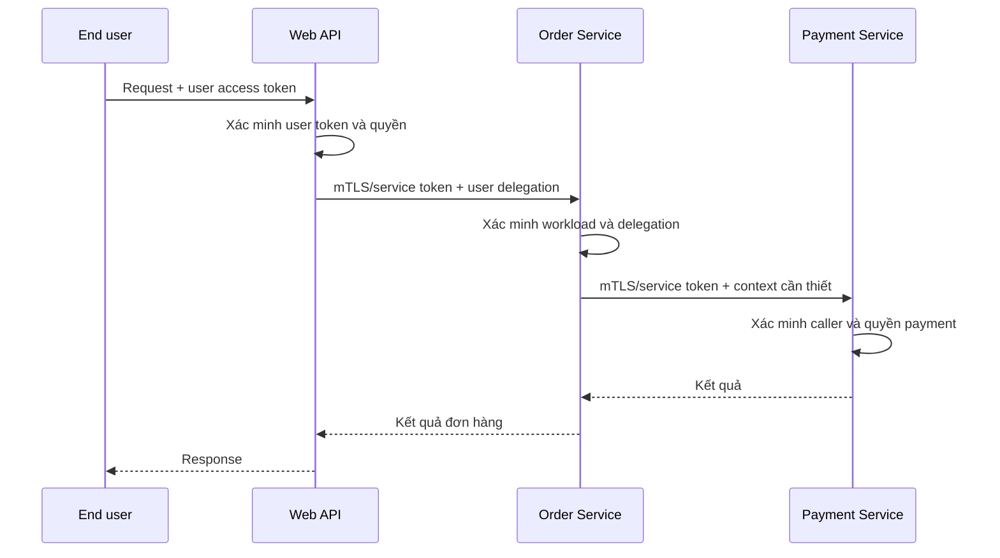

# Phân biệt service identity và end-user identity

## 1. Vì sao API cần phân biệt hai loại danh tính?

Một request đến API có thể được gửi bởi người dùng đang thao tác trên giao diện hoặc bởi một ứng dụng/dịch vụ tự động gọi sang hệ thống khác. Trong nhiều luồng nghiệp vụ, cả hai cùng tham gia: người dùng yêu cầu một hành động, frontend gửi request đến backend, backend gọi service thanh toán, rồi service thanh toán gọi cổng thanh toán bên ngoài.

Nếu hệ thống chỉ ghi nhận một danh tính chung như “backend-service”, sẽ khó trả lời ai đã yêu cầu hành động. Nếu hệ thống chỉ ghi nhận user ID mà bỏ qua service thực sự gửi request, sẽ khó xác định thành phần kỹ thuật nào đã thực hiện lời gọi. Hai thông tin trả lời hai câu hỏi khác nhau:

- **Service identity** xác định workload, ứng dụng hoặc dịch vụ đang kết nối và thực hiện lời gọi kỹ thuật.
- **End-user identity** xác định người dùng cuối đã đăng nhập hoặc được ủy quyền thực hiện hành động nghiệp vụ.

Một request có thể có service identity mà không có end-user identity, ví dụ tác vụ đồng bộ chạy theo lịch. Một request khác có cả hai, ví dụ backend gọi service hóa đơn thay mặt khách hàng. Cũng có request chỉ có end-user identity ở tầng ứng dụng đầu tiên, nhưng khi đi qua các service nội bộ thì từng lời gọi mạng vẫn cần được xác thực bằng workload identity.

Trong phạm vi **SECURITY_API_SECURITY**, phân biệt đúng hai loại danh tính là nền tảng để thiết kế xác thực, phân quyền theo endpoint/object/tenant, validation, bảo vệ dữ liệu, kiểm thử và giám sát. Việc một service đã được xác thực không có nghĩa người dùng được phép thực hiện mọi hành động mà service có thể làm.

Sau bài học này, người học có thể:

1. Phân biệt service identity, end-user identity và client/application identity.
2. Chọn cơ chế xác thực phù hợp cho người dùng và workload.
3. Mô hình hóa request có người dùng, service và quan hệ ủy quyền.
4. Truyền danh tính qua nhiều service mà không tin header do caller tự khai.
5. Thiết kế authorization chống confused deputy, privilege escalation và truy cập chéo tenant.
6. Ghi audit, kiểm thử và giám sát để xác định được cả người khởi tạo lẫn service thực thi.

## 2. Hai loại identity trả lời hai câu hỏi khác nhau

### 2.1. Service identity

Service identity là danh tính đại diện cho một workload hoặc thành phần phần mềm khi nó giao tiếp với một hệ thống khác. Ví dụ:

- order-api gọi inventory-service.
- invoice-worker chạy tác vụ xuất hóa đơn theo lịch.
- payment-orchestrator gọi dịch vụ thanh toán.
- Một ứng dụng đối tác gọi API của tổ chức.
- Một job trong Kubernetes gọi API nội bộ.

Service identity thường được gắn với một workload, deployment, service account hoặc client đăng ký. Nó cho biết “thành phần nào đang kết nối?”, từ đó hệ thống có thể áp dụng quyền gọi service, chính sách mạng, giới hạn tài nguyên và audit.

Các cơ chế thường dùng gồm:

- OAuth 2.0 Client Credentials để service lấy access token bằng client authentication.
- Mutual TLS (mTLS) để xác thực workload bằng chứng thư client.
- Workload identity của nền tảng cloud hoặc orchestration.
- Signed request bằng HMAC hoặc chữ ký bất đối xứng trong một giao thức được thiết kế rõ ràng.
- API key cho một số tích hợp đơn giản, nếu có quản lý vòng đời và phân quyền phù hợp.

Service identity phải gắn với credential có thể xác minh. Một header X-Service-Name: order-api do caller tự gửi không chứng minh caller thật sự là order-api.

### 2.2. End-user identity

End-user identity đại diện cho một cá nhân đang sử dụng sản phẩm hoặc được ủy quyền thao tác trong hệ thống. Ví dụ:

- Khách hàng xem đơn hàng của chính họ.
- Nhân viên hỗ trợ tra cứu một đơn hàng được phân công.
- Quản trị viên phê duyệt một giao dịch.
- Người dùng doanh nghiệp truy cập dữ liệu thuộc tenant của tổ chức.

Danh tính người dùng thường được xác lập qua đăng nhập và phiên làm việc, chẳng hạn OpenID Connect, OAuth 2.0 authorization code flow, session cookie hoặc một cơ chế xác thực phù hợp với ứng dụng.

User identity có thể chứa các thuộc tính như:

- subject (sub) hoặc user identifier do identity provider cấp.
- Tenant hoặc tổ chức người dùng đang hoạt động.
- Vai trò, nhóm hoặc quyền đã được cấp.
- Trạng thái tài khoản và mức độ xác minh.
- Thông tin xác thực bổ sung như MFA hoặc mức assurance, nếu chính sách cần.

Không nên coi email hoặc username do client gửi là bằng chứng danh tính. Các giá trị này có thể thay đổi, không duy nhất toàn cục hoặc bị giả mạo. Hệ thống cần dùng subject ổn định từ issuer đáng tin cậy và xác minh token/session tương ứng.

### 2.3. Phân biệt client identity với service identity

Trong OAuth, client_id nhận diện một OAuth client đã đăng ký. Tùy kiến trúc, client đó có thể đại diện cho một ứng dụng hoặc workload. Tuy nhiên, client_id chỉ là tên định danh trong hệ thống cấp quyền; giá trị tự gửi trong request không chứng minh quyền sở hữu client.

Service identity thường là khái niệm rộng hơn, có thể gắn với workload cụ thể, môi trường triển khai, service account, certificate hoặc workload attestation. Một client registration có thể được dùng bởi nhiều instance; nếu cần phân biệt từng workload, cần một cơ chế identity chi tiết hơn.

| Khái niệm | Câu hỏi | Ví dụ |
|---|---|---|
| End-user identity | Ai là người dùng? | user-4821 |
| OAuth client identity | Ứng dụng OAuth nào được đăng ký? | billing-portal-client |
| Service/workload identity | Workload nào đang gọi? | spiffe://prod.example/ns/payments/sa/payment-api |
| Tenant identity | Request hoạt động trong tổ chức nào? | tenant-77 |
| Resource identity | Đối tượng nào đang được truy cập? | invoice-9001 |

Một hệ thống có thể có tất cả các identity này trong cùng một request context, nhưng phải xác định nguồn tin cậy và vai trò của từng giá trị.

## 3. Authentication và authorization trong bối cảnh hai identity

Authentication xác minh danh tính hoặc credential. Authorization quyết định danh tính đã xác minh được phép thực hiện hành động nào, trên tài nguyên nào và trong điều kiện nào.

| Câu hỏi | Lớp xử lý | Ví dụ |
|---|---|---|
| Workload nào đang kết nối? | Service authentication | order-api có certificate hoặc token hợp lệ |
| Người dùng nào yêu cầu thao tác? | User authentication | Token người dùng có chữ ký hợp lệ |
| Service có được gọi endpoint nội bộ? | Service authorization | order-api được gọi inventory:reserve |
| User có được xem đơn hàng này? | User/object authorization | User là chủ đơn hàng hoặc được phân công |
| Service có được thao tác thay mặt user? | Delegation authorization | order-api được phép chuyển tiếp yêu cầu xem đơn |
| Hành động có hợp lệ ở trạng thái hiện tại? | Business authorization | Chỉ đơn đã thanh toán mới được hoàn tiền |

Một request có thể qua authentication ở nhiều tầng. Ví dụ, gateway xác thực user token, sau đó backend dùng mTLS để gọi service nội bộ. Service nhận request cần xác minh workload caller và, nếu hành động thay mặt user, xác minh thông tin ủy quyền người dùng được truyền theo một cơ chế đáng tin cậy.

Không nên gộp tất cả thành một cờ isAuthenticated. Việc service đã xác thực không làm cho user tự động được xác thực; việc user đã đăng nhập không làm cho mọi service nội bộ được phép gọi nhau.

## 4. Ba mô hình request phổ biến

### 4.1. Service gọi thay mặt chính nó

Một job đồng bộ dữ liệu chạy theo lịch không có người dùng đang đăng nhập. Request chỉ có service identity.

Ví dụ: inventory-reconciliation-worker gọi endpoint đọc số lượng tồn kho để đối soát.

Trong trường hợp này:

- Caller là workload đã được xác thực.
- Không có end-user identity.
- Quyền được gắn với nhiệm vụ của workload.
- Phạm vi object và tenant phải bị giới hạn theo cấu hình.
- Audit ghi service/client identity và job/correlation ID.

Không tạo một user giả như system-admin rồi dùng tài khoản đó cho mọi job. Tài khoản dùng chung làm mờ trách nhiệm và dễ tích lũy quyền quá mức. Nên tạo workload principal riêng với quyền tối thiểu.

### 4.2. Service gọi thay mặt người dùng

Một khách hàng đăng nhập vào ứng dụng, yêu cầu xem hóa đơn. web-api nhận request rồi gọi invoice-service.

Trong trường hợp này có ít nhất hai danh tính:

- End-user identity: khách hàng đã đăng nhập.
- Service identity: web-api đang gọi invoice-service.

Authorization cần trả lời cả hai câu hỏi: web-api có được gọi operation này không, và người dùng có quyền xem hóa đơn cụ thể không? Việc web-api có quyền đọc hóa đơn không có nghĩa mọi user đi qua nó đều có quyền đọc mọi hóa đơn.

### 4.3. Service thực hiện tác vụ hệ thống có liên quan đến user

Một worker gửi email xác nhận đơn hàng sau khi giao dịch hoàn tất. Worker được xác thực bằng service identity. User ID hoặc customer ID có thể xuất hiện trong event để xác định người nhận, nhưng event đó không tự biến worker thành người dùng.

Hệ thống cần xác minh event đến từ producer đáng tin cậy, dữ liệu sự kiện có toàn vẹn và worker chỉ được thực hiện hành động trong phạm vi nhiệm vụ. Nếu worker gọi API khác, nó dùng service identity của chính nó và chỉ truyền user context khi có mục đích nghiệp vụ cùng cơ chế xác minh phù hợp.

## 5. Mô hình end-to-end: giữ cả caller và subject

Một mô hình hữu ích là tách:

- **Caller/actor:** workload trực tiếp gửi request đến service hiện tại.
- **Subject:** người dùng hoặc principal mà hành động đang được thực hiện thay mặt.
- **Delegation:** bằng chứng cho biết actor được phép hành động thay mặt subject trong phạm vi nào.
- **Resource context:** tenant, object và trạng thái nghiệp vụ đang được truy cập.

Ví dụ request qua ba service:



Trong sơ đồ này, mỗi service xác thực workload gọi trực tiếp nó. User identity có thể được truyền theo token được giới hạn audience, token exchange hoặc một cơ chế delegation đã được xác định. Không nên mặc định mọi service đều nhận và tin cùng một header X-User-Id.

### 5.1. Request context không phải bằng chứng tự thân

Một object trong memory có thể chứa userId, serviceName, tenantId và roles, nhưng các trường đó chỉ đáng tin khi được tạo từ thông tin đã xác minh. Nếu gateway hoặc middleware tạo context từ header do client gửi mà không xác thực, toàn bộ quyết định authorization phía sau có thể bị giả mạo.

Quy tắc quan trọng:

- Chỉ lấy service identity từ mTLS, access token hoặc workload identity đã xác minh.
- Chỉ lấy user identity từ token/session có chữ ký và issuer hợp lệ.
- Tenant context phải được suy ra hoặc kiểm tra với identity và policy.
- Object ID từ request vẫn cần authorization theo object.
- Không cho phép client tự đặt role, scope, actor hoặc isAdmin.

## 6. Các cơ chế xác thực service identity

### 6.1. OAuth 2.0 Client Credentials

Client Credentials flow thường phù hợp khi một workload cần access token để gọi API bằng danh tính ứng dụng của chính nó.

Luồng tổng quát:

1. Service xác thực với authorization server bằng client authentication.
2. Authorization server kiểm tra client và chính sách.
3. Service nhận access token có audience và scope phù hợp.
4. Service gửi token đến resource server.
5. Resource server xác minh token và áp dụng authorization.

Token service-to-service không nên được coi là token của người dùng. Trong client credentials flow, principal thường đại diện cho client/application; không có end-user identity trừ khi một cơ chế ủy quyền riêng được sử dụng.

Các phương thức client authentication có thể gồm client_secret_basic, private_key_jwt hoặc mTLS tùy cấu hình authorization server. Không dùng client secret tĩnh như mật khẩu chia sẻ cho mọi workload nếu có cơ chế workload identity an toàn hơn.

### 6.2. Mutual TLS

mTLS yêu cầu cả client và server xác thực certificate trong TLS handshake. Service có thể dùng certificate gắn với workload identity để chứng minh danh tính ở tầng kết nối.

Cần kiểm tra:

- Certificate chain có dẫn đến trust anchor được chấp nhận không?
- Certificate còn hiệu lực và chưa bị thu hồi theo chính sách không?
- SAN/URI hoặc subject được ánh xạ đến service principal nào?
- Workload đó có được phép gọi service đích không?
- Proxy hoặc service mesh có chuyển danh tính đã xác minh theo cách đáng tin cậy không?

Chỉ kiểm tra certificate được ký bởi CA tin cậy là chưa đủ nếu CA đó cấp certificate cho nhiều workload với quyền khác nhau. Cần mapping danh tính và authorization rõ ràng.

### 6.3. Workload identity của nền tảng

Cloud provider, Kubernetes hoặc service mesh có thể cấp identity cho workload dựa trên service account, metadata hoặc token được phát hành tự động. Ưu điểm là giảm việc lưu client secret dài hạn trong file cấu hình.

Tuy nhiên, cần giới hạn trust domain, namespace, service account, audience và quyền trao đổi token. Một workload trong namespace không đáng tin không được mặc định nhận quyền như workload production chỉ vì nó chạy trong cùng cluster.

### 6.4. API key và HMAC

API key có thể nhận diện client trong một số tích hợp. HMAC request signing bổ sung khả năng kiểm tra tính toàn vẹn request nếu chữ ký bao phủ các thành phần cần thiết như method, path, body digest, timestamp và nonce.

Các cơ chế này không tự cung cấp end-user identity. Nếu API key đại diện cho một đối tác, hệ thống chỉ biết đối tác đã gọi; nếu cần biết người dùng cuối của đối tác, phải có token hoặc assertion được ủy quyền và có thể xác minh riêng.

## 7. Các cơ chế xác thực end-user identity

### 7.1. OpenID Connect và user session

OIDC thường dùng để xác thực người dùng và cung cấp ID Token chứa thông tin về quá trình đăng nhập. ID Token chủ yếu dành cho client OIDC để xác minh kết quả authentication; không nên tự động dùng ID Token làm access token gọi mọi API.

API thường nhận access token được phát hành cho resource server cụ thể. Resource server cần xác minh chữ ký, issuer, audience, thời hạn và các claim cần thiết theo profile của token.

Nếu dùng session cookie, server cần kiểm tra session ở mỗi request, bảo vệ cookie bằng các thuộc tính phù hợp như Secure, HttpOnly, SameSite, và áp dụng biện pháp chống CSRF khi mô hình cookie yêu cầu.

### 7.2. User access token

Một user access token có thể mang thông tin subject, audience, scope, role hoặc tenant context. Resource server cần xác minh token theo cấu hình tin cậy:

- Chữ ký và thuật toán nằm trong allowlist.
- Issuer đúng với identity provider được chấp nhận.
- Audience bao gồm API đích.
- exp, nbf và các thời điểm liên quan hợp lệ.
- Subject được ánh xạ đúng sang user record.
- Scope/role phù hợp với operation.
- Trạng thái tài khoản hoặc quyền bị thu hồi được xử lý theo chính sách.

Không chỉ decode JWT rồi tin các claim. Decode chỉ đọc payload; nó không xác minh chữ ký hay nguồn phát hành.

### 7.3. Danh tính người dùng có thể thay đổi theo tenant

Một user có thể thuộc nhiều tenant và có vai trò khác nhau ở từng tenant. Vì vậy, user ID toàn cục không đủ để quyết định quyền.

Ví dụ user u-123 là viewer trong tenant A nhưng là approver trong tenant B. Request cần xác định tenant context và kiểm tra quan hệ thành viên, role và object trong tenant đó. Không tin tenantId do client gửi nếu chưa xác minh user có membership hợp lệ.

## 8. Delegation: service được hành động thay mặt user

Delegation là cơ chế cho phép một actor thực hiện hành động trong phạm vi được một subject hoặc authority cho phép. Trong API, delegation giúp backend gọi service khác thay mặt người dùng mà không biến service thành user và không phải chia sẻ mật khẩu người dùng.

### 8.1. Delegation khác impersonation

- **Delegation:** service giữ danh tính riêng và có bằng chứng rằng nó được phép thực hiện một số hành động thay mặt user.
- **Impersonation:** hệ thống hành xử như thể service chính là user; cách này có thể làm mất thông tin về actor thực tế nếu audit không lưu riêng.
- **Service autonomy:** service tự thực hiện nhiệm vụ hệ thống, không có user subject.

Delegation thường dễ audit hơn vì có thể lưu cả actor và subject. Nếu một framework yêu cầu tạo security context đại diện user, cần giữ thêm actor identity ở context/audit và giới hạn rõ phạm vi impersonation.

### 8.2. Token exchange và delegated token

OAuth 2.0 Token Exchange (RFC 8693) định nghĩa cách đổi một token đầu vào lấy token khác cho mục tiêu cụ thể. Tùy authorization server và profile triển khai, token mới có thể thể hiện subject, actor, audience hoặc scope được thu hẹp.

Ví dụ khái niệm:

1. web-api nhận user access token dành cho web-api.
2. web-api xác thực chính nó với authorization server.
3. web-api yêu cầu token mới cho order-service, với scope cần thiết.
4. Authorization server kiểm tra policy và phát token phù hợp.
5. order-service xác minh token, audience và quan hệ actor/subject.
6. order-service kiểm tra quyền trên order cụ thể.

Không phải mọi authorization server đều hỗ trợ token exchange; cách biểu diễn actor và subject phụ thuộc profile và cấu hình. Không tự tạo JWT với claim tùy ý rồi coi đó là token exchange chuẩn.

### 8.3. Giảm scope và audience

Token được chuyển tiếp nên có:

- Audience chỉ dành cho service đích.
- Scope tối thiểu cho operation cần thực hiện.
- Thời hạn ngắn phù hợp với luồng.
- Subject và actor được biểu diễn rõ ràng theo profile.
- Ràng buộc tenant hoặc context nếu chính sách yêu cầu.

Không phát một token có audience rộng cho toàn bộ microservice nếu mỗi service có thể nhận token dành riêng cho nó. Điều này giảm nguy cơ token bị đánh cắp ở một service rồi dùng ở service khác.

### 8.4. Không chuyển tiếp token người dùng một cách vô điều kiện

Chuyển tiếp nguyên access token của người dùng qua nhiều service có thể tạo ra một bearer token có phạm vi và audience không phù hợp. Trước khi forward, cần xác minh token được phát hành cho service nhận hay không và chính sách có cho phép delegation không.

Nếu token chỉ dành cho web-api, order-service không nên chấp nhận nó như token dành cho order-service. Hãy dùng token exchange, delegated token hoặc một cơ chế truyền identity được ký và giới hạn phù hợp.

## 9. Rủi ro khi gộp hoặc nhầm lẫn identity

### 9.1. Confused deputy

Confused deputy xảy ra khi một service có quyền rộng bị caller thuyết phục sử dụng quyền của chính service đó cho mục đích caller không được phép.

Ví dụ:

- document-service có quyền đọc mọi tài liệu.
- web-api gọi document-service và truyền X-User-Id: user-A.
- document-service tin header và trả tài liệu của user A.
- Attacker có thể sửa header thành user B và nhận tài liệu của B.

document-service đã xác thực web-api, nhưng không xác minh được user B có quyền trên tài liệu. Service trở thành deputy có quyền rộng bị sử dụng sai.

Biện pháp:

- Xác minh service caller.
- Xác minh user/delegation context bằng token hoặc assertion đáng tin.
- Kiểm tra object authorization tại service sở hữu dữ liệu.
- Giới hạn quyền service theo operation và phạm vi cần thiết.
- Không tin user ID hoặc tenant ID trong header không được ký/xác minh.
- Ghi actor và subject riêng trong audit.

### 9.2. Privilege escalation qua service account

Nếu nhiều workload dùng chung một service account có quyền admin, compromise một workload có thể mở rộng thành quyền truy cập của mọi workload.

Nên:

- Dùng identity riêng cho từng service hoặc workload group có cùng trách nhiệm.
- Giới hạn scope và audience.
- Tách quyền production khỏi staging/development.
- Hạn chế khả năng mint hoặc exchange token.
- Theo dõi workload nào sử dụng quyền nhạy cảm.
- Xoay vòng và thu hồi credential theo vòng đời.

### 9.3. Tin header danh tính do client gửi

Các header như X-User-Id, X-Role, X-Tenant-Id, X-Service-Name, X-Authenticated-User có thể hữu ích như metadata sau khi một trusted gateway đã xác minh và ghi đè chúng. Nhưng nếu public client có thể gửi cùng header và gateway chuyển nguyên vẹn vào backend, attacker có thể giả mạo identity.

Nếu dùng identity propagation qua header nội bộ:

1. Gateway phải xóa header cùng tên do client gửi.
2. Gateway xác minh nguồn identity.
3. Gateway tạo header mới từ context đã xác minh.
4. Backend chỉ chấp nhận header từ gateway trên kênh được bảo vệ và xác thực.
5. Service-to-service trust phải được giới hạn bằng mTLS, network policy hoặc token.
6. Không để một đường truy cập trực tiếp bypass gateway vẫn tin header đó.

Trong kiến trúc nhiều service, token ký số hoặc token exchange thường dễ xác định trust boundary hơn một chuỗi header tự do.

### 9.4. Dùng user token như service credential

Một user token thường có audience, scope, lifetime và chính sách gắn với người dùng. Dùng nó như credential chung của service có thể làm lẫn lộn danh tính và mở rộng phạm vi nếu token bị lưu hoặc tái sử dụng.

Service nên xác thực chính nó bằng workload identity. Khi cần user context, truyền riêng bằng delegation. Hai lớp credential phục vụ hai mục đích khác nhau.

### 9.5. Dùng service token để bỏ qua quyền người dùng

Một backend có quyền đọc mọi hóa đơn không được tự động dùng quyền đó cho mọi user request. Nếu user chỉ được xem hóa đơn của mình, backend phải kiểm tra user/object authorization hoặc dùng delegated token có scope và policy tương ứng.

Nếu service chỉ kiểm tra “token nội bộ hợp lệ”, attacker có thể lợi dụng endpoint public làm proxy để truy cập dữ liệu mà service có quyền nhưng user không có.

## 10. Thiết kế authorization với actor, subject và resource

Một quyết định authorization đầy đủ cần có ít nhất:

- Actor: workload trực tiếp gọi service.
- Subject: người dùng hoặc principal được đại diện, nếu có.
- Action: thao tác cần thực hiện.
- Resource: object và tenant liên quan.
- Context: trạng thái, thời gian, nguồn, mức assurance hoặc điều kiện nghiệp vụ.
- Delegation: bằng chứng và giới hạn ủy quyền nếu actor hành động thay mặt subject.

Có thể mô hình hóa:

\[
Decision = Policy(Actor, Subject, Action, Resource, Context)
\]

Không phải request nào cũng có subject là người dùng. Với job hệ thống, subject có thể vắng mặt và policy chỉ cho phép một tập hành động được xác định cho service principal.

### 10.1. Ví dụ chính sách

| Actor/service | Subject/user | Action | Resource | Quyết định |
|---|---|---|---|---|
| order-api | User A | Read | Order của A | Cho phép nếu user có quyền |
| order-api | User A | Read | Order của B | Từ chối |
| invoice-worker | Không có | Generate | Batch được giao | Cho phép trong phạm vi job |
| payment-api | User A qua delegation | Charge | Payment intent của A | Cho phép nếu delegation và trạng thái hợp lệ |
| report-worker | Không có | Export | Tenant khác | Từ chối |
| admin-api | Admin B | Approve | Transaction được phân công | Cho phép nếu tách nhiệm vụ được đáp ứng |

### 10.2. Không mặc định quyền của actor và subject cộng lại

Một sai lầm là gộp quyền service và user thành một tập hợp rồi cho phép nếu một trong hai có quyền. Điều đó dễ làm quyền service rộng hơn lấn át quyền user.

Policy cần xác định rõ mô hình:

- Service có quyền gọi operation hay không.
- User có quyền yêu cầu hành động hay không.
- Delegation có cho phép service thực hiện đúng hành động thay mặt user không.
- Object có thuộc phạm vi của subject hoặc client không.
- Các điều kiện nghiệp vụ có thỏa mãn không.

Trong nhiều luồng, cần đồng thời thỏa quyền service và quyền user/delegation. Không dùng phép OR tùy tiện để hợp nhất hai principal.

### 10.3. Quyền theo object và tenant

Ngay cả khi service và user đều được xác thực, server vẫn cần kiểm tra object. Ví dụ, invoice-service nhận invoiceId và delegated user token. Service phải xác minh invoice thuộc tenant mà user được phép truy cập và user có quyền đọc loại hóa đơn đó.

Không dựa vào ID khó đoán, UUID hoặc việc API Gateway đã xác thực user để thay thế kiểm tra tại service sở hữu tài nguyên. Đây là biện pháp chống BOLA và tenant isolation failure.

## 11. Mô hình dữ liệu identity trong ứng dụng

Có thể tạo request context rõ ràng thay vì truyền các string ID rời rạc.

Ví dụ Java minh họa:

```java
public record ServicePrincipal(
        String serviceId,
        String clientId,
        Set<String> scopes
) {}

public record UserPrincipal(
        String issuer,
        String subject,
        String tenantId,
        Set<String> authorities
) {}

public record DelegationContext(
        String actorServiceId,
        String subjectUserId,
        String audience,
        Instant expiresAt
) {}

public record RequestIdentity(
        ServicePrincipal caller,
        UserPrincipal subject,
        DelegationContext delegation
) {}
```

Đây là mô hình khái niệm; cần thêm validation, nullability và cách biểu diễn request không có user. Không nên tạo các record này từ JSON do public client gửi. Chúng phải được dựng từ security context đã xác minh và từ delegation token có nguồn tin cậy.

### 11.1. Tách thông tin xác thực khỏi dữ liệu nghiệp vụ

Không đưa raw access token, API key hoặc certificate private key vào RequestIdentity. Context chỉ nên chứa các thuộc tính đã xác minh cần cho authorization và audit. Credential gốc nên được giữ trong tầng xác thực và không lan truyền vào service nghiệp vụ.

### 11.2. Tránh principal chung chung

Một Principal dạng chuỗi có thể gây nhầm lẫn nếu giá trị sub của user và tên service có cùng định dạng. Dùng kiểu dữ liệu riêng như ServicePrincipal và UserPrincipal giúp compiler và code review phát hiện trường hợp truyền nhầm.

Nếu framework chỉ cung cấp một interface principal chung, có thể dùng type/claim rõ ràng hoặc wrapper có kiểu để phân biệt. Không suy đoán loại principal từ prefix chuỗi hoặc email.

## 12. Ví dụ với Spring Security

Spring Security có thể xác thực nhiều loại request khác nhau, nhưng kiến trúc ứng dụng cần quyết định rõ loại principal nào được chấp nhận ở từng endpoint.

### 12.1. Endpoint dành cho end user

Một resource server có thể xác minh JWT access token. Sau khi xác minh, ứng dụng lấy subject và authorities từ authentication đã được framework tạo.

Ví dụ khái niệm:

```java
@GetMapping("/v1/me/invoices")
public List<InvoiceDto> myInvoices(
        @AuthenticationPrincipal Jwt jwt
) {
    String issuer = jwt.getIssuer().toString();
    String subject = jwt.getSubject();

    return invoiceService.findVisibleToUser(issuer, subject);
}
```

Ví dụ này chỉ lấy subject từ JWT đã được resource server xác minh. invoiceService vẫn cần kiểm tra tenant, quyền và phạm vi object; không được trả mọi hóa đơn chỉ dựa trên subject có mặt.

### 12.2. Endpoint dành cho service principal

Một endpoint nội bộ có thể chấp nhận access token được phát hành theo client credentials hoặc identity được xác minh bằng mTLS. Authorization cần kiểm tra service principal và scope được cấp.

Ví dụ logic:

```java
public ReportResult generateReport(
        ServicePrincipal caller,
        ReportRequest request
) {
    if (!caller.scopes().contains("reports:generate")) {
        throw new AccessDeniedException("Insufficient service permission");
    }

    return reportService.generateForAllowedScope(caller, request);
}
```

Đây là ví dụ minh họa policy, không phải cấu hình đầy đủ Spring Security. ServicePrincipal phải được tạo từ token/certificate đã xác minh, không phải từ header tùy ý.

### 12.3. Endpoint yêu cầu cả service và user delegation

Với endpoint nội bộ nhận request thay mặt user, có thể yêu cầu đồng thời:

- Workload caller đã được xác thực.
- Delegated subject token hoặc assertion được xác minh.
- Audience đúng service nhận.
- Scope phù hợp operation.
- Object thuộc phạm vi subject.
- Service được phép thực hiện delegation đó.

Không chỉ kiểm tra một Authentication duy nhất rồi suy ra cả hai danh tính nếu framework hoặc custom filter đã gộp chúng. Cần giữ cả caller và subject trong một context có cấu trúc rõ ràng.

## 13. Truyền identity qua message queue và background job

Không phải mọi luồng đều là HTTP request đồng bộ. Event hoặc message có thể được phát ra sau khi request kết thúc và được xử lý bởi worker khác.

### 13.1. Event chứa user ID không tự xác thực user

Ví dụ event:

```json
{
  "eventId": "evt-9001",
  "eventType": "InvoiceRequested",
  "requestedBy": "user-4821",
  "tenantId": "tenant-77",
  "invoiceId": "invoice-9001"
}
```

Trường requestedBy chỉ là dữ liệu trong event. Worker không được coi nó là bằng chứng rằng user đó đã đăng nhập hoặc có quyền. Worker cần tin producer qua cơ chế xác thực message broker, chữ ký hoặc trust boundary phù hợp; sau đó kiểm tra event có hợp lệ với nghiệp vụ không.

### 13.2. Lưu actor và subject trong event

Nếu cần audit ai yêu cầu và service nào xử lý, event nên lưu:

- actorServiceId: service phát event.
- subjectUserId: user khởi tạo, nếu có.
- tenantId: tenant đã được xác minh.
- delegationReference: tham chiếu đến bằng chứng ủy quyền nếu cần.
- correlationId và causationId: liên kết chuỗi xử lý.
- eventId, timestamp và version.
- Dữ liệu nghiệp vụ tối thiểu cần cho consumer.

Không lưu access token hoặc API key trong event. Credential có thời hạn và phạm vi riêng; message có thể tồn tại lâu trong queue, DLQ, backup hoặc log. Nếu consumer cần tiếp tục hành động thay mặt user, thiết kế delegation cho background processing riêng, với quyền và thời hạn phù hợp.

### 13.3. Background job có thể không còn user session

Một job có thể chạy sau khi user token hết hạn hoặc phiên đăng nhập kết thúc. Không nên kéo dài user token vô thời hạn chỉ để job hoàn tất. Có thể lưu yêu cầu đã được phê duyệt và cấp một job/service authority có phạm vi cụ thể, đồng thời giữ subject và actor attribution trong audit.

## 14. Audit và truy vết trách nhiệm

Một audit event tốt cần phân biệt ai yêu cầu, service nào thực hiện và đối tượng nào bị tác động.

| Trường audit | Ý nghĩa |
|---|---|
| actor_service_id | Workload trực tiếp thực hiện lời gọi |
| subject_user_id | Người dùng được đại diện, nếu có |
| issuer | Nguồn phát hành user token hoặc delegated token |
| client_id | OAuth client hoặc integration được xác minh |
| tenant_id | Tenant context đã được xác minh |
| action | Hành động nghiệp vụ |
| resource_type, resource_id | Object bị truy cập hoặc thay đổi |
| authorization_result | Cho phép/từ chối và policy reason code phù hợp |
| correlation_id | Liên kết request giữa nhiều service |
| delegation_id | Tham chiếu delegation nếu có |
| timestamp | Thời điểm sự kiện |

Không ghi raw token, API key, private key, session cookie hoặc toàn bộ payload nhạy cảm. Log cần có quyền truy cập giới hạn, retention phù hợp và bảo vệ tính toàn vẹn.

Khi điều tra sự cố, có thể trả lời:

- User nào đã khởi tạo hành động?
- Service nào trực tiếp gọi API?
- Service nào đã gọi tiếp service khác?
- Token hoặc delegation nào được dùng?
- Object và tenant nào bị ảnh hưởng?
- Quyết định authorization được đưa ra dựa trên policy nào?
- Có service nào sử dụng quyền rộng hơn phạm vi user không?

Nếu chỉ log user ID, khó xác định workload bị compromise. Nếu chỉ log service ID, khó xác định hành động có xuất phát từ người dùng nào.

## 15. Vòng đời và quản trị identity

### 15.1. Service identity lifecycle

Service identity cần được quản lý theo vòng đời workload:

1. Đăng ký service hoặc workload với owner rõ ràng.
2. Cấp identity và credential phù hợp.
3. Gắn audience, scope và policy tối thiểu.
4. Cấp phát identity cho đúng deployment/environment.
5. Theo dõi việc sử dụng và thay đổi quyền.
6. Xoay vòng certificate/secret hoặc refresh token theo cơ chế.
7. Thu hồi khi workload bị loại bỏ, compromise hoặc không còn cần quyền.

Không tái sử dụng identity production cho môi trường test. Không dùng một service account chung cho nhiều ứng dụng độc lập nếu cần phân tách quyền và audit.

### 15.2. End-user identity lifecycle

User identity có thể thay đổi theo trạng thái tài khoản:

- Đăng nhập, đăng xuất và hết hạn session.
- Tài khoản bị khóa hoặc xóa.
- Membership tenant bị thu hồi.
- Vai trò hoặc quyền được thay đổi.
- Phiên hoặc token bị thu hồi.
- MFA hoặc mức assurance thay đổi.

API cần xác định độ trễ chấp nhận được khi quyền thay đổi. JWT tự chứa có thể còn hiệu lực đến khi hết hạn nếu không có cơ chế revocation/introspection hoặc kiểm tra trạng thái bổ sung. Không giả định thay đổi role trong database lập tức cập nhật mọi token đang phát hành.

### 15.3. Delegation lifecycle

Delegation cần có:

- Người hoặc policy cấp quyền.
- Actor được phép hành động.
- Subject được đại diện.
- Resource/action scope.
- Audience và thời hạn.
- Khả năng thu hồi hoặc vô hiệu hóa.
- Audit trail.

Delegation không nên rộng hơn quyền cần thiết của subject hoặc policy cho phép. Khi user bị khóa hoặc quyền bị thu hồi, hệ thống cần xác định delegated token còn hiệu lực trong bao lâu và cách chặn tiếp.

## 16. Kiểm thử bảo mật cho service và user identity

Kiểm thử phải xác minh cả danh tính caller và subject, cũng như quan hệ giữa chúng.

| Nhóm | Kịch bản kiểm thử | Kết quả mong đợi |
|---|---|---|
| Service authentication | Không có service token/certificate | Từ chối |
| Service authentication | Certificate sai trust domain hoặc token sai issuer | Từ chối |
| Service authorization | Service hợp lệ nhưng thiếu scope | Từ chối |
| User authentication | User token hết hạn hoặc sai audience | Từ chối |
| User authorization | User không có membership tenant | Từ chối |
| Object authorization | User A truy cập object của B | Từ chối |
| Delegation | Token không có actor/delegation hợp lệ | Từ chối |
| Audience | Token dành cho service A được gửi tới service B | Từ chối |
| Header spoofing | Client tự gửi X-User-Id hoặc X-Service-Name | Header không được tin |
| Confused deputy | Service có quyền rộng bị user thiếu quyền yêu cầu truy cập | Từ chối |
| Background job | Event giả mạo hoặc producer không đáng tin | Từ chối |
| Revocation | Workload/user/delegation bị thu hồi | Từ chối trong SLA thu hồi |
| Audit | Request qua nhiều service | Có actor, subject và correlation chain |

### 16.1. Test ma trận actor-subject

Nên kiểm thử nhiều tổ hợp:

- Service A + User A + Object A.
- Service A + User A + Object B.
- Service A + User B + Object A.
- Service B + User A + Object A.
- Service A không có user + object trong phạm vi job.
- Service A có user delegation nhưng scope không đủ.

Những trường hợp chéo giúp phát hiện lỗi chỉ kiểm tra một principal hoặc chỉ kiểm tra role chung.

### 16.2. Test trust boundary

Kiểm thử gateway và service trực tiếp:

- Header identity từ public client phải bị loại bỏ hoặc ghi đè.
- Service không thể gọi trực tiếp backend rồi giả mạo header trusted.
- Token phải có audience đúng.
- Service chỉ tin issuer/certificate đã cấu hình.
- Không thể dùng token staging ở production.
- Delegation không được mở rộng scope qua các service.

## 17. Những lỗi thiết kế thường gặp

1. **Coi service identity là user identity.** Một service đã xác thực không chứng minh người dùng cuối có quyền.
2. **Chỉ log service ID.** Không truy được user đã khởi tạo hành động.
3. **Chỉ log user ID.** Không truy được workload nào thực sự thực hiện lời gọi.
4. **Tin X-User-Id hoặc X-Tenant-Id.** Header do client tự gửi có thể bị giả mạo.
5. **Dùng một service account chung.** Một workload bị compromise có thể chiếm quyền của nhiều service.
6. **Dùng client credentials như user login.** Client credentials xác thực ứng dụng, không xác thực người dùng cuối.
7. **Forward user token tới mọi service.** Token có thể sai audience và quyền quá rộng.
8. **Không dùng token exchange/delegation khi cần.** Service nhận không có bằng chứng rõ ràng về actor và subject.
9. **Dùng quyền service để bỏ qua quyền user.** Đây là một dạng confused deputy.
10. **Gộp quyền actor và subject bằng phép OR.** Quyền rộng của service có thể lấn át giới hạn của user.
11. **Không kiểm tra object ở service sở hữu dữ liệu.** Gateway đã xác thực không thay thế BOLA protection.
12. **Không kiểm tra tenant context.** User hợp lệ vẫn có thể truy cập dữ liệu tenant khác.
13. **Không kiểm tra audience và issuer.** Token hợp lệ ở service này có thể bị dùng sai ở service khác.
14. **Đưa token vào message queue.** Credential có thể tồn tại lâu trong queue, DLQ và backup.
15. **Không có kế hoạch thu hồi.** Certificate, token hoặc delegation cũ tiếp tục hoạt động sau khi quyền thay đổi.

## 18. Checklist thiết kế

Trước khi phát hành một API hoặc luồng service-to-service, hãy xác nhận:

- [ ] Đã xác định caller trực tiếp là service/workload nào.
- [ ] Đã xác định có end-user subject hay đây là tác vụ hệ thống độc lập.
- [ ] Service identity được xác thực bằng cơ chế tin cậy.
- [ ] User identity được xác minh từ token/session có issuer và audience phù hợp.
- [ ] Không dùng header do public client tự gửi làm bằng chứng danh tính.
- [ ] Service chỉ có quyền gọi operation cần thiết.
- [ ] User được kiểm tra quyền trên object và tenant cụ thể.
- [ ] Nếu thay mặt user, delegation có actor, subject, audience, scope và expiry rõ ràng.
- [ ] Token được giới hạn audience và scope theo service đích.
- [ ] Không dùng service token để bỏ qua user authorization.
- [ ] Event/message không chứa raw credential và có producer trust phù hợp.
- [ ] Audit lưu riêng actor service, subject user, resource và correlation ID.
- [ ] Có kiểm thử confused deputy, header spoofing, audience mismatch và cross-tenant.
- [ ] Có vòng đời cấp phát, rotation, revocation và owner cho từng identity.
- [ ] Có monitoring cho service bất thường, delegation thất bại và truy cập ngoài phạm vi.

## 19. Kết luận

Service identity và end-user identity đại diện cho hai vai trò khác nhau trong một request. Service identity cho biết workload nào đang kết nối và thực hiện lời gọi kỹ thuật; end-user identity cho biết người dùng nào đang được đại diện trong hành động nghiệp vụ. Một request có thể chỉ có service identity khi là tác vụ hệ thống; request thay mặt người dùng cần giữ cả workload caller và subject cùng bằng chứng delegation.

Thiết kế an toàn cần xác thực service và user theo cơ chế phù hợp, giữ rõ actor và subject, giới hạn token theo audience/scope, kiểm tra quyền theo object và tenant, đồng thời không tin các header tự khai. Khi service có quyền rộng hơn người dùng, authorization phải ngăn service trở thành confused deputy.

Cuối cùng, audit và kiểm thử cần giữ được mối liên hệ giữa người khởi tạo, workload thực thi, delegation, tài nguyên và quyết định policy. Nhờ đó, hệ thống có thể kiểm soát quyền ở từng endpoint, điều tra được sự cố và giảm nguy cơ một service hợp lệ bị lợi dụng để vượt qua quyền của người dùng.

