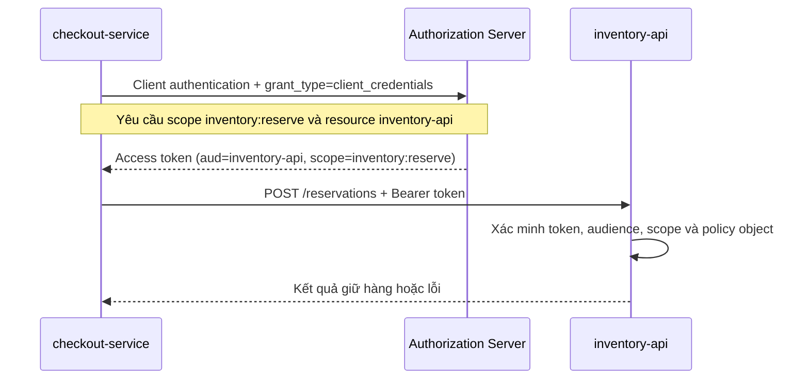

# Service-to-service scope và audience

Trong kiến trúc nhiều service, một service thường phải gọi API của service khác để hoàn thành một luồng nghiệp vụ. Ví dụ, `checkout-service` gọi `inventory-service` để giữ hàng và `payment-service` để tạo giao dịch. Những request nội bộ này vẫn cần xác thực và phân quyền: một workload bị xâm nhập không nên mặc nhiên gọi được mọi API hoặc đọc mọi dữ liệu trong hệ thống.

Hai thành phần quan trọng của access token là **scope** và **audience (`aud`)**. Scope mô tả những hành động hoặc quyền mà token cho phép; audience xác định API hoặc resource server mà token được phát hành để sử dụng. Scope giới hạn token được làm gì, còn audience giới hạn token được dùng ở đâu. Cả hai phải được kiểm tra tại service nhận request.

Trong API Security, service-to-service authorization cần kết hợp workload identity, access token có phạm vi hẹp, quyền tối thiểu và kiểm tra nghiệp vụ trên tài nguyên cụ thể. mTLS bảo vệ và xác thực kết nối giữa workload; scope và audience giới hạn quyền của token; ứng dụng vẫn phải kiểm tra quyền trên object và trạng thái nghiệp vụ.

## 1. Phân biệt workload identity, scope và audience

Khi một service gọi service khác, cần trả lời ba câu hỏi riêng:

1. **Workload nào đang mở kết nối?** Đây là danh tính của service hoặc workload gọi, thường được xác thực bằng chứng thư mTLS, workload identity hoặc credential của OAuth client.
2. **Token được phép làm gì?** Đây là phạm vi quyền thể hiện qua scope hoặc claim quyền tương đương.
3. **Token dành cho API nào?** Đây là audience của access token, giúp resource server xác định token có được phát hành cho mình hay không.

| Thành phần | Vai trò | Ví dụ |
| --- | --- | --- |
| Workload identity | Nhận diện service gọi | `spiffe://prod.example/ns/checkout/sa/checkout` hoặc OAuth client `checkout-service`. |
| Scope | Giới hạn hành động | `inventory:reserve`, `orders:read`. |
| Audience (`aud`) | Giới hạn nơi token được sử dụng | `https://inventory-api.example.internal`. |
| Object authorization | Giới hạn đối tượng cụ thể | Chỉ giữ hàng cho đơn hàng thuộc tenant và luồng checkout hợp lệ. |

Không nên coi các giá trị này là thay thế cho nhau. mTLS thành công không chứng minh service được quyền gọi mọi endpoint. Scope `orders:read` không có nghĩa token có thể gửi đến `payment-api`. Audience hợp lệ cũng không tự cấp quyền đọc mọi đơn hàng.

## 2. Luồng OAuth 2.0 client credentials

Với giao tiếp máy-với-máy không đại diện cho người dùng cuối, một confidential client có thể dùng OAuth 2.0 Client Credentials Grant để lấy access token từ authorization server. Client xác thực với authorization server, yêu cầu các scope cần thiết và nhận token dành cho resource server đích.

Ví dụ, `checkout-service` cần gọi `inventory-api` để giữ hàng. Authorization server cấp token với scope `inventory:reserve` và audience `inventory-api`.



Client Credentials phù hợp khi quyền gắn với chính service gọi. Nó không tự đại diện cho một người dùng cuối. Token thường phản ánh client hoặc workload, không phải user đang đăng nhập ở đầu luồng.

### 2.1. Ví dụ yêu cầu token

Một authorization server có thể nhận yêu cầu dạng:

```http
POST /oauth2/token HTTP/1.1
Host: identity.example.internal
Authorization: Basic <client-credentials>
Content-Type: application/x-www-form-urlencoded

grant_type=client_credentials&scope=inventory:reserve&resource=https%3A%2F%2Finventory-api.example.internal
```

`resource` là tham số được định nghĩa trong cơ chế Resource Indicators (RFC 8707) để chỉ định resource đích nếu authorization server hỗ trợ. Một số nhà cung cấp dùng tham số riêng như `audience`; cần theo đúng hợp đồng của authorization server, không tự giả định tên tham số là giống nhau ở mọi sản phẩm.

Client phải xác thực bằng phương thức phù hợp với môi trường, chẳng hạn `private_key_jwt`, mTLS hoặc client secret được lưu trữ an toàn. Với hệ thống production, nên ưu tiên credential có thể luân chuyển và thu hồi, hạn chế quyền của client, và tránh lưu secret trong source code hoặc image.

### 2.2. Access token minh họa

Một access token dạng JWT sau khi giải mã có thể chứa các claim tương tự:

```json
{
  "iss": "https://identity.example.internal/",
  "sub": "checkout-service",
  "aud": "https://inventory-api.example.internal",
  "client_id": "checkout-service",
  "scope": "inventory:reserve",
  "iat": 1795000000,
  "exp": 1795000300
}
```

Đây chỉ là ví dụ claim đã giải mã, không phải token có chữ ký hợp lệ. Resource server phải xác minh chữ ký hoặc introspect token theo cơ chế được cấu hình. Không được tin dữ liệu chỉ vì có thể base64-decode JWT.

## 3. Scope: giới hạn hành động của service

Scope là chuỗi quyền mà client yêu cầu và authorization server cấp trong access token. Resource server dùng scope để quyết định client có thể gọi nhóm chức năng nào. Scope thường phù hợp với quyền ở mức API hoặc chức năng, chẳng hạn:

| Scope | Hành động có thể được cấp |
| --- | --- |
| `inventory:read` | Đọc thông tin tồn kho được API công bố. |
| `inventory:reserve` | Tạo hoặc giữ chỗ tồn kho. |
| `inventory:release` | Giải phóng lượng hàng đã giữ. |
| `orders:read` | Đọc thông tin đơn hàng trong phạm vi được phép. |
| `orders:status:update` | Cập nhật một số trạng thái đơn hàng theo quy tắc nghiệp vụ. |
| `payments:authorize` | Khởi tạo bước xác thực thanh toán. |

Scope nên mô tả quyền theo ngôn ngữ nghiệp vụ, có ranh giới rõ và được cấp tối thiểu. Tránh scope quá rộng như `admin`, `all`, `internal:full-access` hoặc `service:invoke-anything` nếu không có lý do đặc biệt và kiểm soát bổ sung.

### 3.1. Scope được yêu cầu và scope được cấp

Client có thể yêu cầu một hoặc nhiều scope, nhưng authorization server quyết định scope nào được cấp dựa trên client registration, policy, resource và các điều kiện khác. Resource server chỉ được dùng những quyền thực sự có trong token. Không được suy luận rằng client đã yêu cầu `inventory:reserve` thì chắc chắn đã được cấp quyền đó.

Nếu token không có scope bắt buộc, service nhận phải từ chối hành động. Tùy hợp đồng API, phản hồi có thể là `403 Forbidden` hoặc một lỗi OAuth phù hợp. Không tự nâng quyền bằng cách đọc role từ header do client gửi.

### 3.2. Scope không thay thế object-level authorization

Scope thường là quyền ở mức chức năng. Token có `orders:read` chỉ thể hiện client được phép dùng chức năng đọc đơn hàng trong phạm vi token; nó không tự chứng minh client có quyền đọc mọi object.

Ví dụ, `reporting-service` có scope `orders:read` để tạo báo cáo. `orders-service` vẫn phải kiểm tra tenant, phạm vi dữ liệu mà reporting được cấp, loại báo cáo và các giới hạn theo nghiệp vụ. Nếu service được phép đọc mọi đơn hàng của một tenant cụ thể, phạm vi tenant phải được cấp và xác minh rõ ràng.

Scope cũng không nên được dùng để thay thế property-level authorization. Quyền đọc một đơn hàng không có nghĩa service được xem token thanh toán, ghi chú nội bộ hoặc dữ liệu cá nhân không cần thiết.

## 4. Audience: giới hạn API nhận token

Audience (`aud`) xác định một hoặc nhiều đối tượng nhận token. Trong access token JWT, resource server phải kiểm tra audience của token có bao gồm định danh của chính nó hay không. Nếu token được phát hành cho `inventory-api`, `payment-api` không được chấp nhận token đó chỉ vì chữ ký và thời hạn hợp lệ.

Ví dụ:

| Token | Resource server | Kết quả kiểm tra audience |
| --- | --- | --- |
| `aud=inventory-api` | `inventory-api` | Có thể tiếp tục kiểm tra scope và policy. |
| `aud=inventory-api` | `payment-api` | Từ chối token. |
| `aud=payment-api` | `inventory-api` | Từ chối token. |
| `aud=orders-api` | `orders-api` | Có thể tiếp tục kiểm tra scope và policy. |

Audience giúp ngăn token confusion và giảm nguy cơ token bị tái sử dụng ở API khác. Nếu mọi service cùng chấp nhận một audience chung như `internal-api`, một token có thể được dùng ở nhiều nơi hơn dự định. Nên định danh resource server rõ ràng, ổn định và cấu hình khớp giữa authorization server với từng API.

Một JWT có thể có `aud` là chuỗi hoặc danh sách tùy profile token và authorization server. Resource server phải xác minh chính xác theo cấu hình được tin cậy; không dùng kiểm tra chuỗi con hoặc so khớp một phần. Khi một token có nhiều audience, cần xác định rõ vì sao nhiều resource server cùng được phép nhận token và liệu mỗi bên có thật sự cần quyền đó hay không.

### 4.1. Audience không phải issuer hoặc client ID

Ba claim này có ý nghĩa khác nhau:

- `iss` (issuer): authorization server đã phát hành token.
- `sub` hoặc `client_id`: chủ thể hoặc client mà token đại diện theo profile token.
- `aud` (audience): resource server được phép nhận token.

Một service không nên chấp nhận token chỉ vì `iss` đúng hoặc `client_id` là service quen thuộc. Nó phải kiểm tra audience, scope và các claim bắt buộc khác. Tương tự, `aud` đúng không chứng minh token đến từ issuer đáng tin cậy.

## 5. Kết hợp scope và audience

Một quyết định cơ bản ở resource server có thể mô tả như sau:

```text
ALLOW khi:
  token được xác minh thành công
  AND issuer thuộc danh sách tin cậy
  AND audience chứa định danh của API hiện tại
  AND token chưa hết hạn và thỏa các claim thời gian
  AND có scope bắt buộc cho endpoint
  AND workload/caller đáp ứng policy giao tiếp
  AND object authorization và quy tắc nghiệp vụ cho phép
```

Ví dụ, endpoint `POST /internal/inventory/reservations` có thể yêu cầu:

- Audience `inventory-api`.
- Scope `inventory:reserve`.
- Workload identity thuộc `checkout-service` hoặc client khác được cấp quyền tương đương.
- Request tham chiếu đến đơn hàng hợp lệ trong tenant mà caller được phép xử lý.
- Số lượng cần giữ dương, không vượt tồn kho và không vượt quota.

Những điều kiện này tạo ra nhiều lớp kiểm soát. Nếu token có scope đúng nhưng audience sai, request bị từ chối. Nếu audience và scope đúng nhưng object nằm ngoài tenant được cấp, request vẫn bị từ chối.

## 6. Triển khai kiểm tra token trong Spring Security

Với Spring Security Resource Server, `JwtDecoder` có thể xác minh chữ ký và issuer; cần bổ sung kiểm tra audience và các điều kiện khác theo chính sách của API. Ví dụ cấu hình dưới đây minh họa cách yêu cầu issuer và audience cụ thể:

```java
@Bean
JwtDecoder jwtDecoder() {
    String issuer = "https://identity.example.internal/";
    String audience = "https://inventory-api.example.internal";

    NimbusJwtDecoder decoder = NimbusJwtDecoder.withIssuerLocation(issuer).build();

    OAuth2TokenValidator<Jwt> issuerValidator =
        JwtValidators.createDefaultWithIssuer(issuer);

    OAuth2TokenValidator<Jwt> audienceValidator = token ->
        token.getAudience().contains(audience)
            ? OAuth2TokenValidatorResult.success()
            : OAuth2TokenValidatorResult.failure(
                new OAuth2Error("invalid_token", "Invalid audience", null));

    decoder.setJwtValidator(new DelegatingOAuth2TokenValidator<>(
        issuerValidator, audienceValidator));

    return decoder;
}
```

Đây là ví dụ rút gọn; ứng dụng thực tế cần cấu hình thêm clock skew hợp lý, thuật toán và khóa tin cậy theo thư viện, kiểm tra claim bắt buộc và xử lý lỗi. Không tự chấp nhận thuật toán yếu hoặc lấy khóa từ URL do token cung cấp. Nếu dùng opaque token, resource server có thể introspect token qua authorization server và xác minh trạng thái active, audience/resource cùng quyền theo hợp đồng introspection.

### 6.1. Ánh xạ scope thành authority

Spring Security thường ánh xạ scope trong claim `scope` hoặc `scp` thành authority có tiền tố `SCOPE_`. Ví dụ scope `inventory:reserve` có thể được kiểm tra như sau:

```java
@RestController
@RequestMapping("/internal/inventory")
class InventoryReservationController {

    @PostMapping("/reservations")
    @PreAuthorize("hasAuthority('SCOPE_inventory:reserve')")
    ReservationView reserve(@Valid @RequestBody ReserveRequest request,
                            Authentication authentication) {
        return reservationService.reserve(request, authentication);
    }
}
```

Tên claim và cách ánh xạ có thể khác giữa các authorization server. Cần kiểm tra token thực tế trong môi trường test và cấu hình `JwtGrantedAuthoritiesConverter` nếu issuer dùng claim khác. Không lấy scope từ request header tùy ý.

`@PreAuthorize` kiểm tra quyền chức năng. `reservationService` vẫn cần xác minh object, tenant, quan hệ với đơn hàng và trạng thái tồn kho trước khi ghi dữ liệu.

## 7. Khi service gọi thay mặt người dùng

Không phải mọi service-to-service call đều là hành động thuần máy-với-máy. Trong luồng người dùng, một service có thể gọi service khác thay mặt Alice. Khi đó, cần phân biệt:

- **Workload identity:** service đang mở kết nối, ví dụ `checkout-service`.
- **User identity:** người dùng cuối đã khởi tạo luồng, ví dụ Alice.
- **Delegated authority:** quyền mà service được phép thực hiện thay mặt Alice ở API đích.

Client Credentials chỉ đại diện cho client/service, không tự mang quyền người dùng cuối. Nếu `checkout-service` dùng token của chính nó để gọi `orders-service`, service đích biết caller là checkout; nó không thể suy ra Alice có quyền trên đơn hàng nào trừ khi có thêm ngữ cảnh đáng tin cậy.

Có một số cách truyền ngữ cảnh người dùng:

1. **Token exchange / delegated token:** service đổi token đầu vào lấy token mới có audience của API đích và quyền được ủy quyền tối thiểu. OAuth 2.0 Token Exchange (RFC 8693) là một cơ chế tiêu chuẩn có thể được authorization server hỗ trợ.
2. **On-behalf-of flow của nhà cung cấp:** một số nền tảng có cơ chế tương đương để cấp token downstream đại diện cho user với audience và scope phù hợp.
3. **Context có chữ ký từ thành phần tin cậy:** chỉ dùng khi kiến trúc định nghĩa rõ issuer, audience, thời hạn, tính toàn vẹn và cách service đích xác minh context. Header tự do không có chữ ký không đủ tin cậy.

Ví dụ, gateway xác thực Alice và cấp token cho `checkout-service`. Checkout cần gọi `orders-api` để đọc một đơn hàng. Authorization server có thể cấp token downstream với `aud=orders-api` và scope đã được giới hạn theo quyền của Alice. `orders-api` vẫn kiểm tra Alice có quyền đọc đúng order ID và tenant hay không.

Không chuyển tiếp access token gốc đến mọi service theo mặc định. Token gốc có thể có audience hoặc scope không phù hợp với service đích. Không dùng ID token của OpenID Connect thay cho access token; ID token dành cho client để xác nhận kết quả đăng nhập, không phải credential truy cập resource server.

## 8. Kết hợp với mTLS và workload identity

mTLS cho phép hai đầu kết nối xác thực chứng thư của nhau và mã hóa lưu lượng. Service mesh hoặc nền tảng workload identity có thể cấp danh tính cho từng workload, chẳng hạn dựa trên namespace, service account hoặc SPIFFE ID.

Kết hợp mTLS với OAuth access token có thể tạo ra hai lớp kiểm soát:

- mTLS xác nhận workload mở kết nối và bảo vệ kênh truyền.
- Access token xác định quyền được cấp cho resource server, gồm audience và scope.
- Runtime policy kiểm tra object và ngữ cảnh nghiệp vụ.

Ví dụ, `inventory-api` chỉ chấp nhận kết nối mTLS từ workload trong trust domain được quản lý, đồng thời yêu cầu token có audience `inventory-api` và scope `inventory:reserve`. Nếu workload `reporting-service` có chứng thư hợp lệ nhưng không có scope này, request vẫn bị từ chối.

Nếu gateway hoặc service mesh truyền thông tin workload qua header, backend chỉ được tin header khi nguồn phát hành đã được xác thực, header do client bên ngoài bị loại bỏ và đường truyền được bảo vệ. Không coi `X-Service-Name: checkout` do request tự khai báo là bằng chứng danh tính service.

## 9. Quản lý vòng đời token và credential

Token và credential của service cần được quản lý như tài sản bảo mật:

- **Thời hạn ngắn:** access token chỉ nên sống đủ lâu cho nhu cầu gọi API; token có quyền cao hoặc dữ liệu nhạy cảm cần thời hạn ngắn hơn.
- **Quyền tối thiểu:** mỗi client chỉ được cấp scope và audience cần thiết cho nhiệm vụ của nó.
- **Credential an toàn:** lưu client secret hoặc private key trong secret manager/KMS, giới hạn quyền đọc và tránh ghi vào log, image hoặc repository.
- **Rotation:** luân chuyển secret, private key và certificate theo lịch hoặc khi có dấu hiệu lộ lọt; hỗ trợ giai đoạn chuyển tiếp có kiểm soát.
- **Revocation:** có quy trình thu hồi client, key, certificate và token; với JWT tự chứa, thu hồi tức thời khó hơn nên cần TTL ngắn hoặc cơ chế denylist/introspection khi yêu cầu nghiệp vụ cần.
- **Tách môi trường:** client ID, issuer, audience, key và scope của dev/test/staging/production phải được phân tách.
- **Không dùng token làm session dài hạn:** service lấy access token mới theo quy trình chuẩn khi cần; không lưu token vô thời hạn trong cấu hình.

Nếu một service bị xâm nhập, cần có khả năng thu hồi credential và giảm phạm vi tác động. Client có quyền `inventory:reserve` không nên đồng thời có `payments:refund` chỉ vì cả hai đều là API nội bộ.

## 10. Lỗi thiết kế thường gặp

- **Bỏ qua audience:** mọi API chấp nhận token có chữ ký hợp lệ, dẫn đến token bị dùng nhầm ở resource server khác.
- **Dùng một audience chung cho toàn bộ hệ thống:** giảm khả năng phân tách quyền giữa service và tăng phạm vi ảnh hưởng khi token bị lộ.
- **Scope quá rộng:** cấp `admin` hoặc `internal:*` cho mọi service, khiến một workload có thể thực hiện nhiều hành động không cần thiết.
- **Nhầm client credentials với quyền người dùng:** token đại diện cho service bị dùng như thể user cuối đã được ủy quyền.
- **Chỉ kiểm tra scope:** service cho phép truy cập mọi object khi scope đúng, bỏ qua tenant và ownership.
- **Chỉ dựa vào mTLS:** workload có kết nối hợp lệ được mặc nhiên phép gọi mọi endpoint.
- **Tin header identity:** backend chấp nhận service name hoặc user ID do client tự gửi.
- **Chuyển tiếp token gốc:** token dành cho API A được gửi sang API B mà không kiểm tra audience hoặc đổi token.
- **Dùng ID token để gọi API:** nhầm token đăng nhập với access token.
- **Không thu hồi credential:** service ngừng hoạt động hoặc bị xâm nhập nhưng key và quyền cũ vẫn còn hiệu lực.

## 11. Kiểm thử service-to-service scope và audience

Kiểm thử phải xác nhận cả trường hợp được phép và bị từ chối. Không chỉ test JWT hợp lệ có chữ ký.

| Trường hợp | Token hoặc kết nối | Kết quả mong đợi |
| --- | --- | --- |
| Đúng audience, đúng scope | `aud=inventory-api`, `scope=inventory:reserve` | Có thể tiếp tục kiểm tra policy và nghiệp vụ. |
| Sai audience | `aud=payment-api` gửi đến `inventory-api` | Từ chối token. |
| Thiếu scope | Audience đúng nhưng không có `inventory:reserve` | Từ chối hành động. |
| Sai issuer | Token từ issuer không tin cậy | Từ chối token. |
| Token hết hạn | `exp` đã qua | Từ chối token. |
| Chữ ký sai hoặc thuật toán không được phép | Token không xác minh được | Từ chối token. |
| Nhiều audience ngoài dự kiến | Token có thêm resource server không cần thiết | Từ chối hoặc kiểm tra theo allowlist và policy đã định nghĩa. |
| Workload không được phép | mTLS identity không thuộc allowlist | Từ chối kết nối hoặc request. |
| Scope và audience hợp lệ nhưng sai tenant/object | Object ngoài phạm vi caller | Từ chối theo object authorization. |
| Token client credentials dùng ở luồng cần user | Không có delegated user context | Không suy diễn quyền của người dùng; yêu cầu token/context ủy quyền phù hợp. |

Nên có test tích hợp cho resource server, test policy trên object và test đường truyền qua gateway/mesh. Kiểm tra cả side effect: request bị từ chối không được tạo reservation, thay đổi trạng thái hoặc phát hành dữ liệu. Khi thay đổi scope hoặc audience, chạy contract test với các client đang tích hợp để phát hiện thay đổi gây gián đoạn.

## 12. Giám sát và audit

Resource server nên ghi nhận route template, client/workload identity, issuer, audience đã xác minh, scope cần thiết, quyết định allow/deny, object hoặc tenant ở dạng phù hợp, policy version và correlation ID. Không ghi access token, client secret, private key hoặc payload nhạy cảm nguyên vẹn.

Các tín hiệu nên theo dõi:

- Một client gọi API không thuộc audience của token hoặc liên tục gửi token sai audience.
- Tỷ lệ `401` và `403` tăng bất thường theo client, scope hoặc route.
- Một service sử dụng scope ngoài chức năng bình thường hoặc bắt đầu gọi API mới.
- Token có nhiều audience hoặc quyền rộng hơn cấu hình baseline.
- Lỗi mTLS, certificate sắp hết hạn, workload identity không hợp lệ hoặc kết nối bypass mesh.
- Lượng request và số object được truy cập tăng đột biến.

Khi phát hiện credential bị lộ hoặc service có hành vi bất thường, xác định token/client/key liên quan, thu hồi hoặc rotation, giới hạn scope và audience, kiểm tra log của resource server downstream và đánh giá dữ liệu đã truy cập. Sau xử lý, cập nhật policy và thêm regression test.

## 13. Checklist thiết kế service-to-service authorization

- [ ] Mỗi workload có danh tính riêng và credential được quản lý an toàn.
- [ ] Client Credentials chỉ được dùng cho hành động thuần service-to-service, không bị nhầm với user delegation.
- [ ] Mỗi access token có audience rõ ràng cho resource server đích.
- [ ] Resource server xác minh chữ ký/introspection, issuer, audience và claim thời gian.
- [ ] Scope được đặt theo hành động cụ thể và cấp tối thiểu cho từng client.
- [ ] Resource server kiểm tra scope ở endpoint và object authorization ở dữ liệu cụ thể.
- [ ] Nếu gọi thay mặt user, có token exchange hoặc context ủy quyền được xác minh.
- [ ] Không dùng ID token thay access token và không chuyển tiếp token gốc tùy tiện.
- [ ] mTLS/workload identity được kết hợp với token khi kiến trúc yêu cầu.
- [ ] Credential có TTL, rotation, revocation và tách biệt giữa các môi trường.
- [ ] Test bao gồm sai audience, thiếu scope, sai issuer, token hết hạn, workload không hợp lệ và object ngoài quyền.
- [ ] Log, metric và cảnh báo hỗ trợ điều tra mà không làm lộ token hoặc secret.

Scope và audience giải quyết hai giới hạn khác nhau của access token: quyền được thực hiện và resource server được phép nhận token. Khi kết hợp chúng với workload identity, mTLS, quyền tối thiểu và object authorization tại service đích, giao tiếp service-to-service có thể được giới hạn theo đúng nhiệm vụ và luồng nghiệp vụ thay vì dựa vào niềm tin mặc định giữa các service nội bộ.
