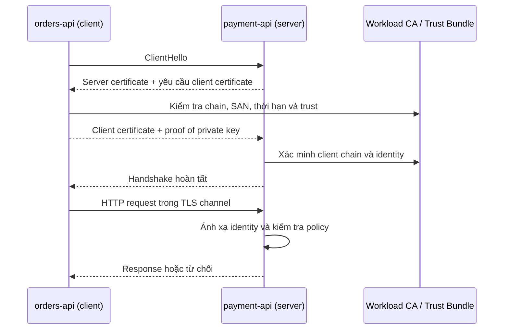
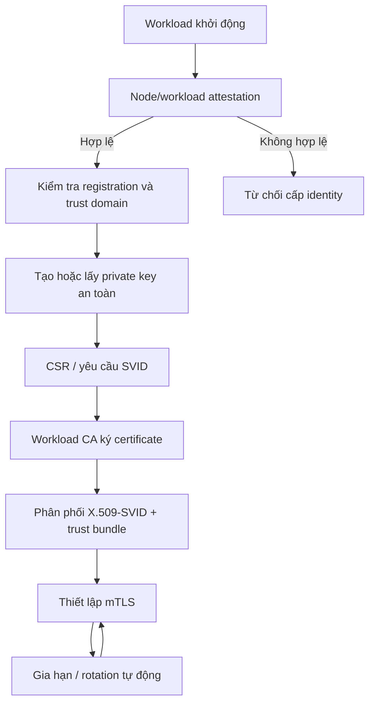
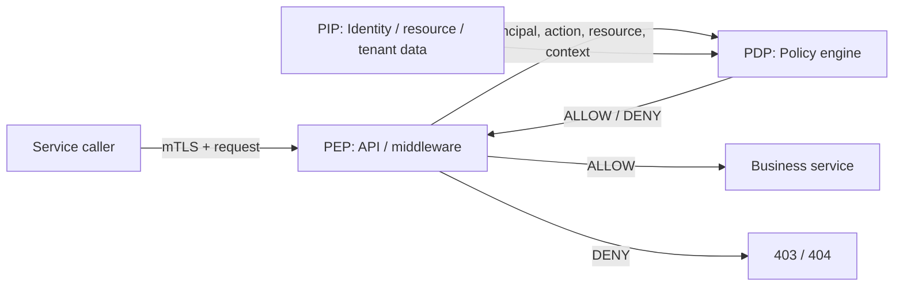

# mTLS, workload identity và policy binding

Trong một hệ thống gồm nhiều service, request không chỉ đến từ người dùng. `orders-api` có thể gọi `payment-api`, `report-worker` có thể đọc dữ liệu từ `storage-api`, và một workload trong Kubernetes có thể gọi dịch vụ quản lý bí mật. Các service cần biết chính xác workload nào đang kết nối, sau đó quyết định workload đó được phép làm gì.

**mTLS xác thực danh tính ở tầng kết nối; workload identity biểu diễn danh tính ổn định của một workload; policy binding liên kết danh tính đã xác minh với hành động và tài nguyên được phép.** Ba phần này phối hợp để bảo vệ service-to-service communication. Chỉ bật mTLS chưa đủ để cấp quyền cho mọi endpoint.

Ví dụ, `invoice-worker` cần đọc trạng thái thanh toán từ `billing-api`. Hệ thống có thể cấp certificate cho workload với danh tính `spiffe://prod.example/ns/finance/sa/invoice-worker`. Khi kết nối bằng mTLS, `billing-api` xác minh certificate và nhận diện workload. Policy sau đó cho phép danh tính này gọi `payment:read` trong phạm vi cần thiết, đồng thời từ chối các action như `payment:refund` hoặc `user:disable`.

## 1. Vì sao service cần danh tính riêng?

Trong kiến trúc phân tán, một service thường gọi nhiều service khác. Nếu mọi service dùng chung một API key hoặc một tài khoản kỹ thuật, hệ thống khó biết thành phần nào thực sự tạo request. Khi một workload bị xâm nhập, kẻ tấn công có thể sử dụng credential chung để truy cập các dịch vụ khác với phạm vi rộng.

Mỗi workload nên có identity riêng, được cấp bởi một nguồn tin cậy và có vòng đời quản lý rõ ràng. Identity này cho phép hệ thống:

- Nhận diện workload gọi request mà không dựa vào hostname hoặc header tự khai báo.
- Áp dụng quyền tối thiểu theo service, namespace, environment và mục đích.
- Thu hồi hoặc xoay credential cho một workload mà không phải thay credential của mọi service.
- Ghi audit theo nguồn gọi cụ thể và phát hiện workload có hành vi bất thường.
- Ràng buộc quyền truy cập với trạng thái triển khai hoặc thuộc tính đã được nền tảng xác minh.

### 1.1. Phân biệt user identity và workload identity

User identity đại diện cho người dùng cuối. Workload identity đại diện cho một ứng dụng hoặc tiến trình đang chạy, chẳng hạn service, pod, virtual machine, job hoặc function.

| Danh tính | Ví dụ | Câu hỏi được trả lời |
|---|---|---|
| User identity | `user-42` | Ai đang sử dụng ứng dụng? |
| Client identity | `mobile-app` | Ứng dụng client nào đang gửi request? |
| Workload identity | `spiffe://prod.example/ns/payments/sa/settlement-worker` | Workload nào đang thực hiện kết nối? |
| Host identity | `vm-183` hoặc machine certificate | Máy chủ hoặc node nào đang kết nối? |

Một request có thể mang cả workload identity và user context. Ví dụ, `orders-api` nhận request của Alice rồi gọi `payment-api` để tạo giao dịch. `payment-api` cần biết caller trực tiếp là `orders-api`; nếu nghiệp vụ cần kiểm tra người khởi tạo, nó cũng cần một user context được ủy quyền và xác minh. Không nên thay workload identity bằng một header `X-User-Id` do service gọi tự thêm.

### 1.2. Authentication và authorization vẫn là hai quyết định riêng

mTLS có thể chứng minh peer đang sở hữu private key tương ứng với certificate được CA tin cậy cấp. Nó không tự trả lời peer được phép đọc bảng dữ liệu nào, gọi action nào hoặc truy cập tenant nào.

```text
Kết nối TLS
    |
    v
Xác minh certificate của peer
    |
    v
Principal = workload identity đã xác minh
    |
    v
Policy binding: principal + action + resource + context
    |
    +---- ALLOW: xử lý request
    |
    +---- DENY: từ chối request
```

Nếu mọi certificate do nội bộ CA cấp đều được quyền gọi mọi API, hệ thống đã biến xác thực kết nối thành quyền toàn cục. Cách làm đó tạo ra một phạm vi tin cậy quá rộng và làm giảm giá trị của workload identity.

## 2. mTLS hoạt động như thế nào?

TLS thông thường giúp client xác minh server bằng certificate của server. Với mutual TLS (mTLS), server cũng yêu cầu client trình certificate để xác minh danh tính phía client trong quá trình handshake.

Trong kết nối mTLS:

1. Client kết nối tới server và bắt đầu TLS handshake.
2. Server trình certificate; client kiểm tra certificate chain, hostname/SAN, thời hạn và trust anchor.
3. Server yêu cầu client certificate theo cấu hình.
4. Client trình certificate và chứng minh quyền sở hữu private key bằng chữ ký trong handshake.
5. Server xác minh certificate chain, thời hạn, mục đích sử dụng, danh tính và các điều kiện trust.
6. Khi handshake thành công, hai bên có kênh TLS được mã hóa và server có thể ánh xạ certificate đã xác minh thành workload principal.



Certificate không chỉ là một file để gửi đi. Private key phải được giữ bí mật và client phải chứng minh đang sở hữu key đó. Một certificate bị sao chép nhưng không có private key tương ứng không đủ để hoàn tất mTLS handshake.

### 2.1. Certificate chain và trust anchor

Certificate thường được ký bởi intermediate CA, rồi intermediate CA được ký bởi root CA. Server xác minh chain tới trust anchor đã cấu hình. Việc một certificate có chữ ký hợp lệ không có nghĩa mọi hệ thống đều phải tin nó; peer chỉ được tin khi chain dẫn đến CA nằm trong trust bundle phù hợp với môi trường và mục đích kết nối.

Nên tách trust domain hoặc CA cho production, staging và development. Tránh cấu hình một root CA dùng chung cho mọi môi trường nếu điều đó khiến certificate dev có thể được chấp nhận ở production.

### 2.2. Xác minh danh tính trong certificate

Certificate có thể chứa danh tính trong Subject Alternative Name (SAN). Với workload identity, URI SAN thường phù hợp để biểu diễn một định danh có cấu trúc. Ví dụ:

```text
spiffe://prod.example/ns/finance/sa/invoice-worker
```

Định danh này có thể thể hiện trust domain, namespace và service account. Server nên kiểm tra đúng URI SAN theo policy đã cấu hình, không chỉ kiểm tra certificate được ký bởi một CA nội bộ.

Không nên dựa vào Common Name (CN) làm cơ chế nhận diện workload mới. Các client/server hiện đại nên xác minh danh tính theo SAN và profile certificate phù hợp. Cũng không nên parse chuỗi subject tùy tiện rồi suy ra quyền từ một phần tên mà không có quy tắc chuẩn hóa rõ ràng.

### 2.3. mTLS bảo vệ điều gì?

mTLS cung cấp:

- Xác thực hai chiều ở tầng TLS giữa client và server.
- Mã hóa và bảo vệ tính toàn vẹn dữ liệu trên kết nối.
- Bằng chứng rằng peer sở hữu private key tương ứng với certificate được chấp nhận.
- Cơ sở để ánh xạ certificate sang một principal workload.

mTLS không tự cung cấp:

- Quyền gọi mọi endpoint hoặc mọi action.
- Quyền truy cập mọi object hoặc tenant.
- Xác thực người dùng cuối đang đứng sau service.
- Bảo vệ khỏi một service hợp lệ nhưng đã bị xâm nhập.
- Bảo vệ request sau khi TLS kết thúc nếu dữ liệu bị xử lý hoặc chuyển tiếp không an toàn.

## 3. Workload identity là gì?

Workload identity là danh tính được cấp cho một ứng dụng hoặc workload đang chạy, để các hệ thống khác có thể xác minh nó mà không phải dựa vào credential tĩnh dùng chung. Identity cần gắn với một workload cụ thể, có issuer hoặc trust domain rõ ràng và có cách cấp phát/thu hồi.

Một workload có thể chạy trên Kubernetes, VM, container platform, serverless runtime hoặc hạ tầng cloud. Cách chứng minh workload nào đang chạy sẽ khác nhau theo nền tảng, nhưng mục tiêu chung là lấy identity từ bằng chứng mà nền tảng tin cậy.

### 3.1. SPIFFE và SPIRE

SPIFFE (Secure Production Identity Framework For Everyone) định nghĩa một mô hình identity cho workload. SPIFFE ID thường có dạng URI:

```text
spiffe://trust-domain/workload-path
```

Ví dụ:

```text
spiffe://prod.example/ns/orders/sa/orders-api
spiffe://prod.example/ns/payments/sa/payment-worker
spiffe://prod.example/ns/reports/sa/report-exporter
```

Trust domain xác định miền quản lý danh tính. Phần path định danh workload theo quy ước của tổ chức. Một SPIFFE ID không tự có quyền; nó là tên principal được xác minh. Quyền phải được cấp trong policy riêng.

SPIRE là một implementation của SPIFFE, có thể thực hiện node/workload attestation và cấp SVID. Trong triển khai điển hình:

- SPIRE Server quản lý trust domain, registration entries, CA và cấp identity material.
- SPIRE Agent chạy trên node, xác minh node và workload theo cơ chế attestation.
- Workload lấy SVID và trust bundle thông qua Workload API.
- X.509-SVID có thể được dùng cho mTLS; JWT-SVID có thể được dùng để xác thực workload trong một số giao thức/token flow.

X.509-SVID thường phù hợp với mTLS vì nó mang certificate và public key. JWT-SVID là token có chữ ký, có thể dùng làm bearer credential; nó cần được xác minh theo issuer, audience, thời hạn và profile tương ứng. Hai loại này không thay thế cho nhau trong mọi giao thức.

### 3.2. Workload attestation

Trước khi cấp identity, hệ thống cần xác minh workload thực sự là workload được phép nhận danh tính đó. Đây là workload attestation.

Tùy nền tảng, bằng chứng có thể bao gồm:

- Node hoặc VM thuộc cloud account/project/subscription đã đăng ký.
- Kubernetes workload chạy trong cluster và namespace được phép.
- Service account, pod attributes hoặc workload selector khớp registration policy.
- Image digest, runtime identity hoặc metadata do nền tảng cung cấp và được xác minh.
- Một workload agent hoặc platform identity chứng minh đang chạy trên node tin cậy.

Không nên cấp certificate chỉ vì caller tự khai báo `namespace=payments` hoặc gửi header `X-Service-Name: payment-api`. Những giá trị này có thể bị giả mạo. Attestation phải dựa vào bằng chứng mà issuer kiểm tra được, chẳng hạn token service account được xác minh, metadata service được bảo vệ hoặc node identity đã được thiết lập.

### 3.3. Workload identity trên nền tảng cloud

Các cloud provider thường có cơ chế identity cho workload, ví dụ IAM role/service account gắn với VM, Kubernetes workload identity federation hoặc identity cho serverless function. Workload có thể dùng credential ngắn hạn do nền tảng cấp hoặc đổi identity thành token cho dịch vụ đích.

Nguyên tắc quan trọng:

- Gắn identity với workload cụ thể và chỉ cấp role cần thiết.
- Ưu tiên credential ngắn hạn thay vì access key tĩnh được lưu trong image hoặc environment file.
- Xác minh issuer, audience và subject của federation token.
- Không tin metadata endpoint hoặc token endpoint nếu workload có thể bị SSRF tới đó; bảo vệ metadata service và giới hạn quyền của identity được cấp.
- Phân biệt identity của node với identity của workload. Nếu mọi pod cùng dùng một node role rộng, compromise một pod có thể mở rộng phạm vi truy cập.

Cloud workload identity và SPIFFE có thể cùng tồn tại. Ví dụ, nền tảng cloud xác minh workload, sau đó cấp một SPIFFE SVID cho service-to-service mTLS. Điều quan trọng là trust chain từ bằng chứng runtime tới identity cuối cùng phải rõ ràng.

## 4. Cấp phát và vòng đời certificate cho workload

Certificate workload nên được cấp tự động, có thời hạn ngắn phù hợp và được xoay trước khi hết hạn. Quy trình cấp phát thường gồm:

1. Workload khởi động trong môi trường được quản lý.
2. Agent hoặc workload identity provider xác minh node/workload bằng attestation.
3. Workload tạo private key tại nơi kiểm soát được; ưu tiên key không phải xuất ra khỏi workload hoặc agent bảo vệ.
4. Workload gửi CSR hoặc yêu cầu cấp SVID qua kênh Workload API được xác thực.
5. CA kiểm tra registration/policy rồi cấp certificate với SPIFFE ID hoặc SAN đã được quy định.
6. Workload dùng certificate và private key cho mTLS.
7. Agent tự động làm mới certificate trước thời điểm hết hạn và phân phối bản mới theo cơ chế an toàn.



### 4.1. Private key phải được bảo vệ

Private key là bằng chứng quan trọng nhất trong mTLS. Nếu nhiều workload dùng chung một private key, hệ thống mất khả năng phân biệt từng workload và khó thu hồi riêng lẻ.

Nên:

- Tạo key riêng cho workload hoặc identity instance theo profile được chọn.
- Hạn chế quyền đọc key trong filesystem, volume hoặc process memory.
- Dùng hardware-backed key hoặc KMS/HSM khi yêu cầu assurance cao và nền tảng hỗ trợ.
- Không đưa private key vào container image, source code, repository hoặc log.
- Không chia sẻ key giữa dev, staging và production.
- Hủy key khi workload bị loại bỏ hoặc identity bị thu hồi.

### 4.2. Rotation và thời hạn certificate

Certificate dài hạn làm tăng khoảng thời gian credential bị lợi dụng nếu bị sao chép. Certificate ngắn hạn giúp giảm cửa sổ rủi ro nhưng yêu cầu cơ chế cấp phát, refresh và đồng bộ ổn định.

Rotation nên có khoảng overlap để workload có thể chuyển sang certificate mới mà không làm gián đoạn kết nối. Server cần tin CA/trust bundle trong giai đoạn chuyển tiếp; certificate cũ chỉ bị loại bỏ sau khi workload đã đổi và các kết nối cũ đã được xử lý theo chính sách.

Không đặt một thời hạn duy nhất cho mọi hệ thống. Thời hạn cần dựa trên khả năng cấp mới, tải của CA, mức rủi ro, độ ổn định mạng và cách xử lý kết nối dài. Cần cảnh báo trước khi certificate sắp hết hạn và kiểm thử rotation khi tải thực tế.

### 4.3. Thu hồi và xử lý compromise

Khi workload bị xâm nhập hoặc private key bị lộ, cần có cách ngăn identity tiếp tục được chấp nhận. Có thể dùng certificate revocation list (CRL), OCSP, denylist theo serial/SPIFFE ID, loại bỏ registration entry, thu hồi trust bundle hoặc giảm thời hạn certificate. Cách áp dụng phụ thuộc PKI và service mesh.

Certificate ngắn hạn giúp giới hạn thời gian tồn tại của credential nhưng không thay thế quy trình incident response. Nếu một workload đang bị xâm nhập, cần cô lập workload, chặn traffic, thu hồi identity và điều tra các request đã được chấp nhận.

## 5. Policy binding: liên kết workload identity với quyền

Sau khi mTLS xác minh được peer, server cần ánh xạ danh tính đó thành principal rồi kiểm tra policy. Policy binding là quy tắc liên kết identity đã xác minh với một tập action/resource/context cụ thể.

Ví dụ:

```text
Principal:
  spiffe://prod.example/ns/finance/sa/invoice-worker

Allowed actions:
  payment:read

Resources:
  payment-status in tenant assigned to finance workflow

Conditions:
  environment = production
  certificate trust domain = prod.example
  request audience = billing-api
```

Binding không nên chỉ dựa vào một chuỗi tên service chung như `worker` hoặc `backend`. Danh tính cần được định danh đầy đủ trong trust domain và môi trường. Nếu staging và production cùng dùng tên `invoice-worker`, policy phải phân biệt được hai principal.

### 5.1. Mô hình PEP, PDP và PIP

Một cách tổ chức authorization phổ biến gồm:

- **PEP (Policy Enforcement Point):** điểm thực thi policy, thường ở API gateway, middleware hoặc service nghiệp vụ. PEP chặn request nếu không có quyết định cho phép.
- **PDP (Policy Decision Point):** thành phần đánh giá policy và trả `ALLOW` hoặc `DENY`.
- **PIP (Policy Information Point):** nguồn cung cấp thuộc tính cần thiết như workload identity, tenant, resource metadata, trạng thái nghiệp vụ hoặc relationship.



PEP phải áp dụng quyết định trước side effect. Nếu PDP không khả dụng, endpoint nhạy cảm nên fail closed; không tự động cho phép vì policy service timeout. Với hệ thống yêu cầu availability cao, có thể dùng policy snapshot hoặc cache decision có TTL ngắn, nhưng phải có quy tắc invalidation và giới hạn độ trễ thu hồi.

### 5.2. Ví dụ policy binding theo SPIFFE ID

Một policy minh họa:

```yaml
principals:
  - id: "spiffe://prod.example/ns/finance/sa/invoice-worker"
    permissions:
      - action: "payment:read"
        resource: "billing/payment-status/*"
      - action: "invoice:status:update"
        resource: "finance/invoices/assigned"

  - id: "spiffe://prod.example/ns/reports/sa/report-exporter"
    permissions:
      - action: "report:read"
        resource: "reports/approved"
```

Đây là ví dụ mô tả, không phải schema tiêu chuẩn của SPIFFE hay một policy engine cụ thể. Khi triển khai, cần xác định rõ cách match principal, wildcard, resource, deny precedence và context. Tránh wildcard rộng như `spiffe://prod.example/*` có thể cấp quyền cho mọi workload trong trust domain.

### 5.3. Binding phải ràng buộc action và resource

Không nên gán quyền kiểu:

```text
IF certificate is valid THEN allow all requests
```

Thay vào đó, policy cần giới hạn:

```text
IF principal == invoice-worker
AND action == payment:read
AND resource belongs to assigned finance scope
AND environment == production
THEN ALLOW
ELSE DENY
```

Một workload có thể cần gọi nhiều API, nhưng không nhất thiết cần mọi permission của các API đó. Hãy cấp theo từng action và resource. Ví dụ, `report-exporter` có thể đọc báo cáo đã duyệt nhưng không được thay đổi trạng thái thanh toán hoặc tạo user.

## 6. Ánh xạ certificate thành principal an toàn

Khi TLS kết thúc tại service, framework có thể cung cấp peer certificate đã xác minh. Khi TLS kết thúc ở gateway hoặc sidecar, service phía sau có thể chỉ nhận metadata do proxy chuyển tiếp. Cả hai mô hình đều cần ranh giới tin cậy rõ ràng.

### 6.1. Khi service tự kết thúc mTLS

Service nhận certificate từ TLS stack và chỉ sử dụng peer identity sau khi handshake và chain validation thành công. Không parse certificate do request body hoặc header gửi lên. Không dùng một certificate chưa được TLS stack xác minh để tạo principal.

Một luồng khái niệm:

```pseudo
peerCertificate = tlsConnection.verifiedPeerCertificate
if peerCertificate is missing:
    rejectConnection

identity = extractAndValidateWorkloadIdentity(peerCertificate.uriSan)
if identity.trustDomain not in configuredTrustDomains:
    rejectConnection

principal = WorkloadPrincipal(identity)
decision = policy.authorize(principal, request.action, request.resource, context)
if decision != ALLOW:
    rejectRequest
```

Việc extract URI SAN cần theo profile đã định nghĩa, xử lý nhiều SAN, định dạng không hợp lệ và trust domain chính xác. Không nên dùng regex lỏng để nhận diện workload hoặc lấy một phần chuỗi tùy tiện làm quyền.

### 6.2. Khi TLS kết thúc tại gateway hoặc service mesh proxy

Nếu gateway xác minh certificate rồi truyền `X-Workload-Identity` cho service, service chỉ được tin header đó khi:

- Kết nối giữa gateway và service được bảo vệ, ví dụ bằng mTLS nội bộ.
- Service không thể bị gọi trực tiếp từ nguồn không tin cậy để giả mạo header.
- Gateway xóa header cùng tên do client gửi trước khi ghi identity đã xác minh.
- Có cơ chế xác định gateway/proxy nào được tin và identity assertion nào được chấp nhận.
- Policy của service biết rõ identity đại diện cho peer trực tiếp hay một caller ở xa được ủy quyền.

Nếu không đáp ứng các điều kiện này, một caller có thể gửi `X-Workload-Identity: spiffe://prod.example/ns/admin/sa/operator` và giả làm workload quyền cao.

### 6.3. TLS termination không làm mất ranh giới bảo mật

Trong service mesh, sidecar hoặc proxy có thể thiết lập mTLS giữa các workload. Ứng dụng phía sau proxy cần nhận identity đã xác minh qua một kênh mà chỉ proxy tin cậy mới ghi được. Nếu proxy kết thúc TLS rồi chuyển request qua HTTP không bảo vệ trên mạng dùng chung, identity và dữ liệu có thể bị giả mạo hoặc nghe lén ở đoạn sau.

Nên dùng mTLS xuyên suốt các trust boundary cần bảo vệ, hoặc bảo vệ proxy-to-service bằng cơ chế tương đương. Cần tài liệu hóa hop nào kết thúc TLS, hop nào thiết lập lại TLS và nơi nào thực thi authorization.

## 7. Workload identity trong service mesh

Service mesh có thể tự động cấp certificate, xoay key và thiết lập mTLS giữa các workload. Điều này giảm việc mỗi ứng dụng tự triển khai PKI, nhưng không tự giải quyết mọi policy nghiệp vụ.

Một service mesh thường có các thành phần:

- Control plane quản lý CA, trust bundle, certificate và cấu hình proxy.
- Data plane proxy hoặc sidecar xử lý kết nối và mTLS.
- Workload identity được gắn với workload theo metadata/attestation của nền tảng.
- Authorization policy xác định source identity nào được gọi destination service hoặc port/action nào.

Ví dụ, policy mesh có thể chỉ cho `orders-api` kết nối tới `payment-api` trên port phục vụ nội bộ. Tuy nhiên, nếu `payment-api` có nhiều action như đọc trạng thái, hoàn tiền và cập nhật phương thức thanh toán, cần kiểm tra authorization ở mức HTTP method/route/action hoặc trong ứng dụng để phân biệt các nghiệp vụ.

### 7.1. Network policy và authorization policy bổ sung nhau

Network policy giới hạn workload nào có thể tạo kết nối tới workload nào. mTLS xác minh danh tính peer khi kết nối được thiết lập. Authorization policy giới hạn action/resource mà principal được phép sử dụng.

| Lớp | Kiểm soát | Ví dụ |
|---|---|---|
| Network policy | Khả năng kết nối ở tầng mạng | Chỉ namespace `orders` được kết nối port của `payments` |
| mTLS | Danh tính peer và bảo vệ kênh | `orders-api` xác minh `payment-api` và ngược lại |
| Service authorization | Action/resource được phép | `orders-api` chỉ được gọi `payment:read` |
| Business authorization | Quy tắc nghiệp vụ | Chỉ được đọc giao dịch thuộc đơn hàng đã xác minh |

Một lớp có thể giảm bề mặt tấn công cho lớp khác, nhưng không nên gộp chúng thành một quyết định. Ví dụ, pod ở namespace được phép kết nối chưa chắc có permission hoàn tiền.

## 8. Ủy quyền qua nhiều service và tránh confused deputy

Trong chuỗi gọi `frontend -> orders-api -> payment-api -> ledger-api`, mỗi service cần biết ai là caller trực tiếp. Nếu `payment-api` chỉ thấy certificate của `orders-api`, nó xác thực được service gọi trực tiếp, nhưng chưa chắc biết user ban đầu là ai.

Có hai mô hình phổ biến:

1. **Service identity:** service gọi hành động bằng quyền của chính workload. Policy chỉ dựa trên workload principal và resource context đã xác minh.
2. **Delegated user context:** service gọi thay mặt user. Cần một cơ chế ủy quyền có thể xác minh, ví dụ token exchange hoặc access token có subject/delegation claims theo hợp đồng; service nhận phải kiểm tra issuer, audience, actor và scope phù hợp.

Không truyền user ID qua header tùy ý rồi tin nó. Nếu cần truyền context, phải ràng buộc context với workload caller hoặc token đã được issuer tin cậy ký. Cũng không nên chuyển tiếp access token dành cho `orders-api` sang `payment-api` nếu audience không cho phép.

### 8.1. Confused deputy

Confused deputy xảy ra khi một service có quyền rộng bị lừa sử dụng quyền của chính nó để thực hiện hành động mà caller không được phép. Ví dụ, `report-api` có thể đọc toàn bộ dữ liệu tài chính để tạo báo cáo. User thường không có quyền đọc dữ liệu thô, nhưng có thể gửi yêu cầu khiến `report-api` tạo một báo cáo tùy ý rồi trả dữ liệu nhạy cảm.

Để giảm rủi ro:

- Ràng buộc action và resource với yêu cầu của caller, không chỉ quyền rộng của service.
- Kiểm tra quyền user/delegation nếu service đang hành động thay mặt user.
- Chỉ cho phép report template, tenant và phạm vi dữ liệu được phê duyệt.
- Tránh endpoint nhận truy vấn hoặc filter tùy ý có thể mở rộng quyền của service.
- Ghi audit cả workload principal lẫn user/delegation context đã xác minh.

## 9. Policy binding trong môi trường đa tenant

Workload identity thường xác định service, không nhất thiết xác định tenant cuối cùng mà request được phép thao tác. Một service có thể phục vụ nhiều tenant. Do đó, không nên cấp quyền truy cập toàn bộ tenant chỉ vì caller là một workload hợp lệ.

Ví dụ, `invoice-worker` có thể được phép đọc trạng thái thanh toán cho những tenant nằm trong assignment của job. Policy cần kiểm tra:

- Workload principal đã xác minh có permission `payment:read`.
- Tenant trong request thuộc phạm vi workload được giao.
- Resource thực sự thuộc tenant đó.
- Job hoặc message được ký/xác minh và có context cần thiết.
- Action phù hợp với trạng thái nghiệp vụ.

Không lấy `tenantId` từ message queue hoặc request body rồi mặc định tin cậy. Message cần được xác minh nguồn gửi và quyền; resource cần được truy vấn hoặc ràng buộc với tenant ở server.

## 10. Những lỗi cấu hình thường gặp

| Lỗi | Tác động | Cách xử lý |
|---|---|---|
| Mọi certificate nội bộ đều được quyền gọi mọi API | Một workload bị xâm nhập có thể di chuyển ngang | Binding theo exact identity, action và resource |
| Dùng chung certificate/private key cho nhiều service | Không phân biệt caller và khó thu hồi riêng | Cấp identity/key riêng cho từng workload hoặc nhóm có cùng trust boundary |
| Chỉ kiểm tra CA nhưng không kiểm tra SAN/identity | Certificate của workload khác vẫn được chấp nhận | Xác minh URI SAN/trust domain theo policy |
| Dựa vào CN hoặc chuỗi tên không chuẩn hóa | Identity matching mơ hồ hoặc lỗi thời | Dùng SAN và profile rõ ràng |
| Tin header identity từ request | Caller có thể giả mạo workload quyền cao | Chỉ tin assertion từ proxy đã xác minh qua kênh bảo vệ |
| Cấp quyền wildcard toàn trust domain | Mở rộng blast radius | Binding cụ thể, deny by default |
| Certificate sống quá lâu, không rotation | Credential bị lộ có thời gian khai thác dài | Short-lived SVID/certificate và rotation tự động |
| Không tách môi trường | Credential staging có thể truy cập production | Tách trust domain/CA/binding và resource |
| Service mesh chỉ bảo vệ network, ứng dụng không kiểm tra action | Caller được kết nối có thể gọi nghiệp vụ nhạy cảm | Thêm authorization ở service/application layer |
| PDP lỗi thì cho phép request | Lỗi policy thành bypass | Fail closed hoặc dùng cache policy có TTL/invalidation chặt |

## 11. Kiểm thử mTLS, workload identity và policy binding

Kiểm thử nên bao gồm cả handshake, identity mapping và quyết định policy. Chỉ kiểm tra kết nối TLS thành công là chưa đủ.

| Tình huống | Kết quả mong đợi |
|---|---|
| Client không trình certificate khi server yêu cầu mTLS | Handshake bị từ chối |
| Certificate tự ký hoặc chain không nằm trong trust bundle | Bị từ chối |
| Certificate hết hạn hoặc chưa có hiệu lực | Bị từ chối |
| Certificate hợp lệ nhưng URI SAN không đúng workload đã đăng ký | Bị từ chối hoặc principal không có quyền |
| Certificate từ trust domain staging gọi production | Bị từ chối |
| Workload hợp lệ gọi action ngoài permission | Authorization từ chối |
| Workload hợp lệ gọi object thuộc tenant khác | Object/tenant policy từ chối |
| Header identity giả mạo được gửi trực tiếp | Bị xóa, bị từ chối hoặc không được tin |
| Private key của workload khác được sử dụng | Không thể hoàn tất proof-of-possession nếu không có key tương ứng |
| Certificate rotation trong thời gian overlap | Workload tiếp tục hoạt động và certificate cũ bị loại đúng lịch |
| Certificate bị thu hồi | Kết nối/request mới bị từ chối theo cơ chế revoke đã thiết kế |
| PDP hoặc identity provider không khả dụng | Endpoint nhạy cảm fail closed theo policy |
| Workload bị xóa nhưng certificate cũ còn hiệu lực | Registration/revocation ngăn identity tiếp tục được chấp nhận |

### 11.1. Kiểm thử negative authorization

Tạo hai workload:

```text
spiffe://prod.example/ns/orders/sa/orders-api
spiffe://prod.example/ns/reports/sa/report-exporter
```

Giả sử `orders-api` được phép `payment:read`, còn `report-exporter` chỉ được phép `report:read`. Hãy kiểm tra:

1. `orders-api` gọi `payment:read`: được phép.
2. `orders-api` gọi `payment:refund`: bị từ chối.
3. `report-exporter` gọi `payment:read`: bị từ chối dù certificate hợp lệ.
4. `report-exporter` gọi `report:read` trên report được duyệt: được phép.
5. Workload staging giả làm identity production: handshake hoặc policy bị từ chối.

Các test này chứng minh rằng mTLS nhận diện workload và policy binding giới hạn quyền. Nếu mọi workload có certificate đều gọi được mọi action, phần authorization chưa được thiết kế đúng.

### 11.2. Kiểm thử rotation và sự cố

Thử xoay certificate khi có request liên tục, restart pod, mất kết nối tạm thời tới CA và cập nhật trust bundle. Kiểm tra workload không bị treo với certificate sắp hết hạn, không tiếp tục dùng certificate cũ quá thời gian cho phép và không rơi vào trạng thái fail-open khi không thể làm mới identity.

Diễn tập private key bị lộ: cô lập workload, thu hồi certificate, cập nhật policy/registration, xác minh request mới bị chặn và rà soát audit log để xác định phạm vi truy cập trước khi thu hồi.

## 12. Logging, monitoring và vận hành

Để điều tra request service-to-service, log nên ghi:

- Workload principal đã xác minh, trust domain và issuer/CA.
- Identity của peer trực tiếp và user/delegation context nếu có.
- Action, resource type, tenant context và kết quả `ALLOW`/`DENY`.
- Certificate serial hoặc fingerprint phù hợp để truy vết, không ghi private key.
- Request ID, trace ID, destination service, thời gian và reason code.
- Sự kiện cấp, refresh, rotation, hết hạn và thu hồi certificate.

Không ghi private key, bearer token, JWT-SVID đầy đủ hoặc secret. URI SAN và principal ID có thể là dữ liệu nhạy cảm trong một số môi trường; giới hạn quyền đọc log và thời hạn lưu theo chính sách.

Các chỉ số cần theo dõi:

- Số handshake mTLS thành công/thất bại theo service và trust domain.
- Certificate sắp hết hạn, lỗi rotation và thời gian cấp SVID.
- Request bị từ chối do trust domain, SAN, issuer hoặc policy binding không hợp lệ.
- Tần suất workload gọi action ngoài permission hoặc truy cập tenant bất thường.
- PDP latency, timeout, cache hit và lỗi policy evaluation.
- Số identity/certificate hoạt động không còn workload owner hoặc registration tương ứng.

Alert nên tập trung vào bất thường có ý nghĩa: một workload đột nhiên gọi nhiều service mới, certificate production xuất hiện từ môi trường staging, một principal có nhiều quyết định deny liên tiếp, hoặc certificate sắp hết hạn mà agent không refresh được.

## 13. Checklist triển khai

- [ ] Mỗi workload có identity riêng, owner và mục đích rõ ràng.
- [ ] Trust domain/CA được phân tách theo môi trường và phạm vi tin cậy.
- [ ] Workload attestation dựa trên bằng chứng nền tảng, không dựa vào header tự khai báo.
- [ ] Private key được tạo và lưu ở nơi an toàn, không chia sẻ giữa workload không cùng trust boundary.
- [ ] mTLS xác minh chain, thời hạn, SAN/URI identity và trust domain.
- [ ] Không dùng CN hoặc tên service mơ hồ làm căn cứ cấp quyền.
- [ ] Certificate/SVID có thời hạn hợp lý, rotation tự động và quy trình revoke đã kiểm thử.
- [ ] Certificate đã xác minh được ánh xạ thành principal theo quy tắc rõ ràng.
- [ ] Policy binding giới hạn action, resource, tenant và environment; mặc định deny.
- [ ] PEP thực thi policy trước side effect; PDP lỗi không làm request được tự động cho phép.
- [ ] Gateway/mesh proxy truyền identity qua kênh tin cậy và loại bỏ header giả mạo.
- [ ] Mỗi hop trong service chain có xác định caller trực tiếp và user delegation nếu cần.
- [ ] Network policy, mTLS và business authorization có trách nhiệm riêng, không thay thế lẫn nhau.
- [ ] Có negative tests cho certificate hợp lệ nhưng thiếu permission, sai tenant hoặc sai trust domain.
- [ ] Logs/metrics/alerts hỗ trợ điều tra identity, policy decision, rotation và compromise.
- [ ] Có runbook cô lập workload, thu hồi identity và xác minh hiệu lực containment.

## 14. Nguyên tắc cần ghi nhớ

mTLS xác thực peer ở tầng kết nối và bảo vệ kênh truyền. Workload identity cung cấp tên principal có thể xác minh cho service, pod, VM hoặc job. Policy binding liên kết principal đó với action, resource và context cụ thể. Cả ba cần được thiết kế cùng nhau.

Certificate hợp lệ không có nghĩa workload được gọi mọi API. Một workload thuộc trust domain production vẫn chỉ nên có những permission cần thiết. Nếu service gọi thay mặt user, cần một cơ chế delegation được xác minh; không tin user ID hoặc workload identity do request tự khai báo. Khi TLS kết thúc ở gateway/mesh, phải bảo vệ đường truyền identity assertion tới service phía sau.

Một phép thử thực tế là dùng certificate hợp lệ của workload A gọi action chỉ dành cho workload B. Kết nối có thể xác thực thành công nhưng policy phải từ chối action. Đó là dấu hiệu cho thấy hệ thống đã tách đúng authentication khỏi authorization và giới hạn quyền service-to-service theo nguyên tắc tối thiểu.

## Tài liệu tham khảo

- SPIFFE Specifications — SPIFFE ID, X.509-SVID, JWT-SVID và Workload API.
- SPIRE Documentation — node/workload attestation, registration entries và cấp phát SVID.
- RFC 8705 — OAuth 2.0 Mutual-TLS Client Authentication and Certificate-Bound Access Tokens.
- RFC 5280 — Internet X.509 Public Key Infrastructure Certificate and CRL Profile.
- RFC 8446 — The Transport Layer Security (TLS) Protocol Version 1.3.
- OWASP Microservices Security Cheat Sheet — xác thực, authorization và bảo vệ giao tiếp service-to-service.
