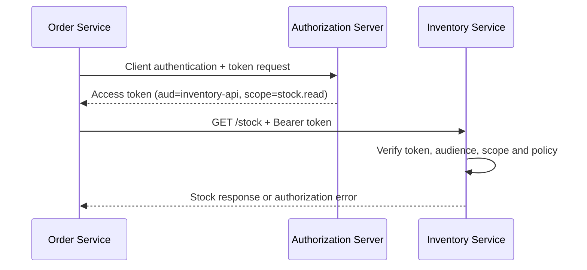

# Không tin request nội bộ chỉ vì đi qua network

Một request đi từ service này sang service khác vẫn là request cần được xác thực và phân quyền. Việc hai service nằm trong cùng VPC, cùng Kubernetes cluster, cùng subnet hoặc cùng trung tâm dữ liệu không chứng minh rằng caller đáng tin cậy. Một workload có thể bị chiếm quyền, credential có thể bị đánh cắp, cấu hình mạng có thể thay đổi và một endpoint nội bộ có thể bị gọi thông qua SSRF hoặc một service trung gian.

Đối với API Security, cần xem giao tiếp service-to-service là một ranh giới bảo mật thực sự. Mỗi service phải có danh tính riêng, chỉ nhận request từ caller được xác thực, kiểm tra quyền theo hành động và tài nguyên, giới hạn phạm vi token, bảo vệ dữ liệu trên đường truyền và ghi lại hoạt động đủ để điều tra. Network segmentation và private network là lớp giảm bề mặt tấn công; chúng không thay thế identity và authorization ở cấp ứng dụng.

## 1. Vì sao request nội bộ vẫn có thể nguy hiểm?

Trong một kiến trúc nhiều service, request có thể đi qua nhiều thành phần:

```text
Mobile/Web Client
       |
       v
  API Gateway
       |
       v
  Order Service ------> Inventory Service
       |                       |
       v                       v
 Payment Service          Product Service
       |
       v
 External Payment Provider
```

Các service thường gọi nhau qua HTTP, gRPC, message broker hoặc một giao thức nội bộ khác. Nếu hệ thống mặc định tin mọi request đến từ mạng nội bộ, chỉ cần một workload bị chiếm quyền là kẻ tấn công có thể thử gọi các endpoint nội bộ khác, đọc dữ liệu hoặc thực hiện hành động vượt quyền.

Một số tình huống thường gặp:

- Một pod bị khai thác qua lỗ hổng ứng dụng. Kẻ tấn công dùng pod đó dò DNS nội bộ và gọi trực tiếp các service khác.
- Một endpoint nhận URL để tải ảnh hoặc webhook bị khai thác SSRF, khiến server gửi request tới địa chỉ quản trị hoặc API nội bộ.
- Một service có quyền quá rộng bị xâm nhập. Kẻ tấn công sử dụng credential của service để đọc dữ liệu hoặc gọi chức năng không liên quan.
- Gateway xác thực người dùng nhưng backend tin các header như `X-User-Id` hoặc `X-Role` mà caller có thể tự đặt.
- Một token hợp lệ được phát hành cho `inventory-service` lại được chấp nhận tại `payment-service` vì resource server không kiểm tra audience.
- Một message được gửi vào queue có thể bị giả mạo hoặc phát lại nếu consumer không xác minh producer, chữ ký hoặc quyền xử lý.

Do đó, câu hỏi bảo mật không chỉ là “request có đến từ mạng nội bộ không?” mà là “workload nào đang gọi, nó đại diện cho ai, được phép thực hiện hành động gì, trên tài nguyên nào và trong ngữ cảnh nào?”.

## 2. Phân biệt network trust, authentication và authorization

Ba lớp này giải quyết các vấn đề khác nhau:

| Lớp | Câu hỏi | Ví dụ kiểm soát |
|---|---|---|
| Network security | Kết nối có được phép đi tới service không? | Firewall, security group, network policy, private subnet |
| Authentication | Ai hoặc workload nào đang kết nối? | mTLS, workload identity, OAuth 2.0 client authentication |
| Authorization | Caller được phép làm gì trên tài nguyên nào? | Scope, role, policy theo service, tenant, object và hành động |

Network policy có thể chặn một workload không cần thiết kết nối tới database. Nhưng nếu một service được phép kết nối tới `payment-service`, điều đó chưa có nghĩa service đó được phép hoàn tiền hoặc xem thông tin thẻ. Authentication xác định caller; authorization quyết định quyền của caller.

TLS bảo vệ tính bí mật và toàn vẹn của dữ liệu trên kết nối. mTLS bổ sung xác thực certificate ở cả client và server. Tuy nhiên, một certificate hợp lệ chỉ chứng minh danh tính gắn với certificate theo trust configuration; nó không tự cấp mọi quyền trong ứng dụng.

## 3. Mỗi workload cần một danh tính riêng

Service identity là danh tính đại diện cho một ứng dụng hoặc workload, ví dụ `order-service`, `inventory-service` hoặc `report-worker`. Mỗi workload nên có identity riêng để server có thể phân biệt caller và áp dụng chính sách phù hợp.

Không nên dùng một credential chung cho toàn bộ cluster hoặc nhiều service không liên quan. Nếu mọi workload dùng cùng một API key, client secret hoặc certificate, khi một service bị xâm nhập sẽ khó giới hạn phạm vi ảnh hưởng và khó xác định nguồn request.

Một service identity có thể được biểu diễn bằng:

- Service account hoặc workload identity do nền tảng cấp.
- Subject trong certificate mTLS.
- OAuth 2.0 client ID và token được phát hành cho client đó.
- SPIFFE ID hoặc một định danh workload theo chuẩn của hạ tầng.
- Danh tính producer/consumer được xác minh khi giao tiếp qua message broker.

Ví dụ, hai workload có thể có danh tính riêng:

```text
spiffe://company.example/ns/orders/sa/order-service
spiffe://company.example/ns/inventory/sa/inventory-service
```

Định danh cần ổn định theo workload và môi trường, không phụ thuộc vào IP hoặc tên pod có thể thay đổi. IP giúp định tuyến và có thể hỗ trợ network policy, nhưng không nên được dùng làm danh tính duy nhất của service.

### Service identity khác user identity

`order-service` là workload đang gửi request. Người dùng `user-42` có thể là người khởi tạo thao tác đặt hàng. Hai danh tính này trả lời hai câu hỏi khác nhau:

- Service identity: service nào chịu trách nhiệm gửi request tới service đích?
- User identity: thao tác đang được thực hiện thay mặt người dùng nào, nếu có?

Không nên gộp hai danh tính thành một chuỗi header tự khai báo. Resource server cần xác minh service principal và, khi nghiệp vụ yêu cầu, xác minh ngữ cảnh người dùng được ủy quyền.

## 4. Xác thực service-to-service bằng mTLS

Mutual TLS (mTLS) là TLS trong đó cả server và client đều xác thực certificate. Khi `order-service` kết nối tới `inventory-service`, server kiểm tra certificate của client theo CA hoặc trust bundle được cấu hình. Client đồng thời kiểm tra certificate của server để tránh kết nối tới endpoint giả mạo.

Luồng khái quát:

1. Client mở kết nối TLS tới service đích.
2. Server gửi certificate để client xác minh danh tính server.
3. Server yêu cầu client gửi certificate.
4. Client gửi certificate và chứng minh quyền sở hữu private key trong handshake.
5. Hai phía xác minh chuỗi certificate, thời hạn, mục đích sử dụng và trust policy.
6. Service đích ánh xạ identity của certificate thành service principal.
7. Ứng dụng kiểm tra principal đó có quyền gọi endpoint và hành động tương ứng không.

Ví dụ một certificate có thể mang Subject Alternative Name (SAN) nhận diện workload. Chính sách cần ràng buộc SAN hoặc SPIFFE ID với service cụ thể, tránh chỉ kiểm tra certificate được ký bởi một CA chung rồi cho phép mọi workload.

### mTLS không thay thế authorization

Giả sử `report-service` có certificate hợp lệ và kết nối được tới `payment-service`. Điều đó không có nghĩa `report-service` được phép gọi `POST /refunds`. `payment-service` vẫn phải kiểm tra service identity có quyền `payments:read` hay `refunds:create` hay không, đồng thời kiểm tra phạm vi object và điều kiện nghiệp vụ.

### Quản lý certificate

Certificate workload nên có thời hạn ngắn phù hợp, được cấp và gia hạn tự động, có rotation và thu hồi. Private key phải được bảo vệ bằng cơ chế của nền tảng hoặc secret manager; không đóng gói private key production trong source code hay image container dùng chung.

Khi certificate hết hạn hoặc bị thu hồi, service phải từ chối kết nối theo chính sách. Cần giám sát lỗi gia hạn và thời gian còn lại trước expiry để tránh sự cố vận hành khiến toàn bộ giao tiếp nội bộ bị gián đoạn.

## 5. Xác thực service bằng OAuth 2.0 Client Credentials

Với giao tiếp máy-với-máy không có người dùng trực tiếp, OAuth 2.0 Client Credentials Grant là một lựa chọn phổ biến. Client xác thực với authorization server, xin access token cho resource server và gửi token trong header `Authorization`.

Luồng cơ bản:



Token nên được giới hạn theo:

- `client_id` hoặc service subject nhận diện workload gọi.
- `aud` xác định resource server được nhận token.
- `scope` giới hạn hành động được cấp.
- `exp` giới hạn thời gian token có hiệu lực.
- Các claim bổ sung cần thiết để áp dụng policy như tenant, environment hoặc delegation context.

Ví dụ request token theo Client Credentials:

```http
POST /oauth2/token HTTP/1.1
Host: identity.example.com
Content-Type: application/x-www-form-urlencoded
Authorization: Basic <client-credentials>

grant_type=client_credentials&scope=stock.read
```

Client secret trong ví dụ chỉ là một phương thức client authentication. Với hệ thống có khả năng, có thể dùng `private_key_jwt`, mTLS client authentication hoặc workload identity để giảm việc lưu secret tĩnh. Không đưa client secret vào frontend hoặc ứng dụng phân phối cho người dùng cuối.

Khi gọi API:

```http
GET /api/v1/stock/SKU-100 HTTP/1.1
Host: inventory.internal.example
Authorization: Bearer <access-token>
Accept: application/json
```

`inventory-service` cần xác minh token, issuer, audience, thời hạn, loại token và scope. Token phát hành cho `inventory-api` không được tự động chấp nhận tại `payment-api`.

## 6. Giới hạn audience và scope cho từng service

Audience trả lời token được phát hành cho resource server nào. Scope trả lời token được phép thực hiện hành động chức năng nào. Hai điều kiện này nên được dùng đồng thời.

Ví dụ policy:

| Caller | Resource server | Scope được cấp | Ví dụ hành động |
|---|---|---|---|
| `order-service` | `inventory-api` | `stock.read`, `reservation.create` | Đọc tồn kho và giữ hàng |
| `order-service` | `payment-api` | `payment.intent.create` | Tạo yêu cầu thanh toán |
| `report-service` | `orders-api` | `orders.summary.read` | Đọc dữ liệu tổng hợp |
| `report-service` | `payment-api` | Không cấp | Không được truy cập dữ liệu thanh toán |
| `notification-worker` | `notification-api` | `message.send` | Gửi thông báo qua service thông báo |

Không cấp một token `internal:full_access` cho mọi service chỉ để đơn giản hóa tích hợp. Khi một service cần thêm chức năng, hãy cấp scope cụ thể và đánh giá lại lý do, resource server cùng tác động nếu credential bị lộ.

Scope vẫn chưa đủ để quyết định quyền trên từng object. `order-service` có thể được phép gọi `reservation.create`, nhưng chỉ được giữ hàng cho đơn hàng thuộc tenant hoặc project được phép. Service đích cần kiểm tra resource constraint và trạng thái nghiệp vụ.

## 7. Phân quyền tại service đích

Service đích là nơi cuối cùng thực thi hành động và có trách nhiệm áp dụng policy cho tài nguyên mà nó sở hữu. Gateway hoặc caller có thể kiểm tra trước để giảm request không hợp lệ, nhưng không nên là lớp duy nhất quyết định quyền.

Một quyết định authorization thường xét:

1. **Principal:** service identity nào đang gọi?
2. **Action:** đang đọc, tạo, cập nhật, xóa, phê duyệt hay thực hiện lệnh nào?
3. **Resource:** object hoặc tập dữ liệu nào bị tác động?
4. **Context:** tenant, environment, trạng thái nghiệp vụ, thời gian và mục đích gọi là gì?
5. **Delegation:** request có đang thay mặt user hoặc service khác không, và quyền ủy quyền có hợp lệ không?

Ví dụ `inventory-service` có thể cho `order-service` tạo reservation nhưng không cho `report-service` thay đổi tồn kho. `report-service` có thể đọc dữ liệu tổng hợp đã được lọc nhưng không được đọc từng bản ghi có dữ liệu cá nhân.

Nên áp dụng nguyên tắc mặc định từ chối (deny by default). Chỉ cấp quyền khi policy xác định rõ caller, hành động và resource. Nếu không xác minh được danh tính, token thiếu claim bắt buộc hoặc policy engine không sẵn sàng, hãy chọn hành vi fail-closed cho hành động nhạy cảm.

## 8. Không tin header danh tính do caller tự gửi

Một lỗi thường gặp là gateway xác thực người dùng rồi thêm header:

```http
X-User-Id: user-42
X-Role: ADMIN
X-Tenant-Id: tenant-a
```

Backend đọc các header này và tin rằng chúng do gateway tạo. Nếu backend có thể được truy cập trực tiếp, hoặc gateway không xóa header do client gửi trước khi ghi giá trị đáng tin cậy, caller có thể tự đặt `X-Role: ADMIN` hoặc đổi tenant.

Biện pháp cần thiết:

- Backend không nên tin các header identity từ mọi kết nối. Chỉ tin metadata được tạo bởi proxy/gateway đã xác thực và có ranh giới tin cậy được bảo vệ.
- Gateway phải xóa hoặc ghi đè các header danh tính do client cung cấp trước khi thêm thông tin đã xác minh.
- Hạn chế truy cập trực tiếp backend bằng network policy và đồng thời yêu cầu service authentication ở backend.
- Khi cần truyền danh tính người dùng qua nhiều service, dùng token đã ký, có audience, thời hạn và claim rõ ràng hoặc cơ chế token exchange.
- Không dùng `X-Request-Id`, `X-Forwarded-For` hay header tùy chỉnh làm bằng chứng xác thực.

Private network không làm cho header trở nên đáng tin cậy. Một workload nội bộ bị chiếm quyền cũng có thể tự tạo request với header giả mạo.

## 9. Truyền ngữ cảnh người dùng giữa các service

Nhiều luồng bắt đầu từ người dùng và đi qua nhiều service. Ví dụ:

```text
User -> API Gateway -> Order Service -> Inventory Service
                                  \-> Payment Service
```

`order-service` cần gọi `inventory-service` và `payment-service` để hoàn thành đơn hàng. Có hai danh tính cần phân biệt: `order-service` là caller kỹ thuật, còn user là chủ thể khởi tạo hành động.

### Service gọi bằng danh tính riêng

Với Client Credentials, `order-service` lấy access token đại diện cho chính nó. Service đích biết caller là `order-service`. Nếu nghiệp vụ chỉ cần service-to-service, đây có thể là mô hình phù hợp.

### Service gọi thay mặt người dùng

Nếu quyền người dùng phải được duy trì ở service đích, hệ thống cần truyền user context theo cách có thể xác minh. Có thể dùng token exchange hoặc cơ chế delegation phù hợp của authorization server để đổi token đầu vào thành token dành cho resource server đích, với audience và scope giới hạn.

Không nên gửi một access token bất kỳ tới tất cả service. Token có audience cho `orders-api` không mặc nhiên được dùng ở `inventory-api`. Cũng không nên chuyển tiếp raw token của người dùng nếu service đích không phải audience dự kiến.

### Tránh confused deputy

Confused deputy xảy ra khi service có quyền rộng sử dụng quyền của chính nó để thực hiện yêu cầu thay mặt một caller không có quyền tương ứng. Ví dụ, `report-service` có quyền đọc dữ liệu toàn công ty; một user thông thường yêu cầu báo cáo cho tenant khác; service dùng quyền rộng của nó mà không kiểm tra quyền của user hoặc phạm vi báo cáo.

Để giảm rủi ro:

- Xác minh caller service và ngữ cảnh user/delegation riêng biệt.
- Giới hạn token hoặc quyền của service theo đúng chức năng.
- Kiểm tra tenant/object theo cả quyền service lẫn quyền người dùng khi thao tác được thực hiện thay mặt user.
- Không nhận `userId`, `tenantId` hoặc `role` do caller tự khai báo làm bằng chứng duy nhất.
- Ghi audit cả actor (người dùng), client/caller (service) và hành động thực tế.

## 10. Ví dụ cấu hình Resource Server trong Spring Security

Một service Spring Boot có thể xác minh JWT access token bằng Spring Security Resource Server. Ví dụ cấu hình cơ bản:

```yaml
spring:
  security:
    oauth2:
      resourceserver:
        jwt:
          issuer-uri: https://identity.example.com
```

Sau đó cấu hình audience và quyền ở cấp HTTP:

```java
@Bean
JwtDecoder jwtDecoder(
        @Value("${spring.security.oauth2.resourceserver.jwt.issuer-uri}") String issuer) {

    NimbusJwtDecoder decoder = NimbusJwtDecoder.withIssuerLocation(issuer).build();

    OAuth2TokenValidator<Jwt> issuerAndTime =
        JwtValidators.createDefaultWithIssuer(issuer);

    OAuth2TokenValidator<Jwt> audience = jwt ->
        jwt.getAudience().contains("inventory-api")
            ? OAuth2TokenValidatorResult.success()
            : OAuth2TokenValidatorResult.failure(
                new OAuth2Error("invalid_token", "Invalid audience", null));

    decoder.setJwtValidator(
        new DelegatingOAuth2TokenValidator<>(issuerAndTime, audience));
    return decoder;
}
```

```java
@Bean
SecurityFilterChain apiSecurity(HttpSecurity http) throws Exception {
    return http
        .authorizeHttpRequests(auth -> auth
            .requestMatchers(HttpMethod.GET, "/api/v1/stock/**")
                .hasAuthority("SCOPE_stock.read")
            .requestMatchers(HttpMethod.POST, "/api/v1/reservations")
                .hasAuthority("SCOPE_reservation.create")
            .anyRequest().denyAll())
        .oauth2ResourceServer(oauth2 -> oauth2.jwt(Customizer.withDefaults()))
        .build();
}
```

Ví dụ minh họa cần các import và dependency Spring Security OAuth2 Resource Server phù hợp với phiên bản dự án. `issuer-uri` phải trỏ tới authorization server được tin cậy; decoder cần xác minh chữ ký, issuer, thời hạn và audience. Cấu hình `denyAll()` cho các route còn lại giúp tránh vô tình mở endpoint mới mà chưa có policy.

Kiểm tra scope ở filter chain chỉ là kiểm tra chức năng. Service vẫn phải kiểm tra quyền object và tenant:

```java
@PreAuthorize("hasAuthority('SCOPE_reservation.create')")
public Reservation createReservation(
        UUID orderId,
        UUID tenantId,
        List<ReservationItem> items) {

    Order order = orderRepository.findByIdAndTenantId(orderId, tenantId)
        .orElseThrow(() -> new AccessDeniedException("Order is not accessible"));

    if (!order.canReserveInventory()) {
        throw new IllegalStateException("Order cannot reserve inventory");
    }

    return reservationRepository.save(Reservation.from(order, items));
}
```

Trong code thực tế, `tenantId` phải đến từ principal hoặc context đã xác minh, không phải tham số tùy ý do client gửi. Nếu đây là service-to-service call thay mặt user, service phải xác minh delegation context theo token hoặc policy tương ứng.

Nếu dùng `@PreAuthorize` trên service method, cần bật method security bằng `@EnableMethodSecurity` trong cấu hình Spring. Không bật annotation rồi mặc định rằng mọi method đã được bảo vệ; nên có test xác nhận proxy method security đang hoạt động trong cấu hình thực tế.

## 11. Service mesh và network policy là lớp bổ sung

Service mesh có thể cung cấp mTLS giữa workload, cấp identity, quản lý certificate, mã hóa kết nối và áp dụng một số policy ở proxy sidecar hoặc node proxy. Network policy, firewall và security group giúp giới hạn workload nào có thể kết nối tới cổng nào.

Các lớp này hữu ích nhưng cần hiểu đúng giới hạn:

- mTLS xác thực peer và bảo vệ kết nối; application authorization vẫn cần xác định hành động, resource và object.
- Policy ở mesh có thể giới hạn service A gọi service B, nhưng thường không đủ để phân biệt `GET /orders` với `POST /refunds` hoặc quyền trên từng order ID.
- Nếu sidecar, node, control plane hoặc trust bundle bị cấu hình sai, ranh giới bảo mật có thể bị suy yếu.
- Nếu service có thể bị gọi qua một đường mạng khác không đi qua mesh, policy mesh không bảo vệ đường đó.
- Network segmentation làm giảm khả năng di chuyển ngang nhưng không ngăn một caller hợp lệ lạm dụng quyền ứng dụng.

Nên kết hợp network policy, mTLS/workload identity, token có audience/scope và authorization ở service đích. Đảm bảo mọi đường vào service đều đi qua cơ chế kiểm soát tương đương.

## 12. Bảo vệ giao tiếp qua message broker

Không phải giao tiếp nội bộ nào cũng là HTTP. Service có thể gửi command hoặc event qua Kafka, RabbitMQ, cloud queue hay hệ thống streaming. Việc message nằm trong broker riêng không tự chứng minh producer đáng tin cậy.

Consumer cần xác minh:

- Producer nào được phép publish vào topic/queue này?
- Consumer/service account nào được phép đọc và xử lý message?
- Message có đúng schema, kích thước và phiên bản được hỗ trợ không?
- Message có chữ ký hoặc nguồn gốc đáng tin khi nghiệp vụ yêu cầu không?
- Có thể phát lại message không, và consumer xử lý idempotent thế nào?
- Tenant, object ID và actor trong payload có được xác minh theo dữ liệu server-side không?

Broker ACL giúp giới hạn producer/consumer ở cấp topic. Tuy nhiên, quyền trên object và nghiệp vụ vẫn cần được kiểm tra trong consumer. Không tin `userId`, `tenantId`, `approvedBy` hoặc trạng thái do payload tự khai báo nếu producer chưa được xác thực và policy chưa cho phép.

Với event quan trọng, nên ghi nhận producer identity, event ID, correlation ID, actor/delegation context và thời điểm phát sinh. Chống phát lại bằng event ID/idempotency và trạng thái xử lý đã lưu, không chỉ dựa vào timestamp do message gửi lên.

## 13. SSRF và đường gọi nội bộ

Một endpoint cho phép server tải URL, gọi webhook, tạo preview hoặc nhập dữ liệu từ địa chỉ bên ngoài có thể trở thành cầu nối tới service nội bộ. Nếu ứng dụng không giới hạn đích, attacker có thể khiến server gửi request tới metadata endpoint, control plane hoặc API nội bộ.

Các biện pháp giảm SSRF:

1. Ưu tiên allowlist hostname/service đích đã biết.
2. Chỉ cho phép scheme cần thiết và từ chối URL không hợp lệ.
3. Phân giải DNS và kiểm tra IP đích; chặn loopback, private, link-local và dải hạ tầng nhạy cảm theo chính sách.
4. Kiểm tra lại đích sau redirect và xử lý thay đổi DNS/rebinding.
5. Đặt timeout, giới hạn response size và số redirect.
6. Giới hạn outbound network của workload bằng network policy hoặc egress gateway.
7. Nếu phải gọi service nội bộ, vẫn yêu cầu workload identity và authorization tại service đích.

Không coi việc endpoint chỉ truy cập được từ private network là đủ. SSRF chạy từ chính một workload nội bộ có thể vượt qua ranh giới mạng đó.

## 14. Quản lý credential, rotation và thu hồi

Credential service-to-service cần có vòng đời tương tự credential người dùng, nhưng thường được tự động hóa theo workload:

- Ưu tiên workload identity hoặc certificate ngắn hạn thay vì secret tĩnh dài hạn.
- Nếu dùng client secret, lưu trong secret manager, giới hạn quyền đọc và xoay vòng định kỳ.
- Cấp token ngắn hạn theo audience/scope; không lưu token trong image, source code hoặc log.
- Thu hồi credential khi service bị xâm nhập, owner thay đổi hoặc integration không còn cần thiết.
- Theo dõi certificate/token sắp hết hạn và lỗi refresh để rotation không gây outage.
- Tách identity giữa development, staging và production.
- Có quy trình cấp lại identity khi workload được tạo mới, scale hoặc di chuyển môi trường.

Khi thu hồi một service identity, cần xác minh tất cả instance, gateway, cache và consumer đều ngừng chấp nhận credential cũ. Với JWT tự xác minh, cân nhắc thời hạn ngắn, introspection, denylist hoặc cơ chế thu hồi theo session/workload tùy yêu cầu.

## 15. Kiểm thử authorization giữa các service

Kiểm thử cần bao phủ cả danh tính service, token, object và đường mạng:

| Nhóm test | Tình huống |
|---|---|
| Service identity | Service không có credential, certificate sai, workload identity không hợp lệ |
| Audience | Token của `inventory-api` gửi tới `payment-api` |
| Scope | `report-service` thử gọi `reservation.create` hoặc `refunds.create` |
| Object/tenant | Service có scope hợp lệ nhưng truy cập order hoặc tenant ngoài phạm vi |
| Header spoofing | Caller tự gửi `X-User-Id`, `X-Role`, `X-Tenant-Id` hoặc `X-Forwarded-For` |
| Delegation | User token sai audience, token exchange thiếu scope, service dùng quyền rộng thay mặt user không đủ quyền |
| Network | Pod không thuộc allowlist thử kết nối trực tiếp service; thử đường vào bỏ qua gateway/mesh |
| SSRF | URL trỏ tới loopback, private IP, metadata endpoint, redirect hoặc DNS rebinding |
| Message broker | Producer trái phép publish, consumer không có ACL, message bị phát lại hoặc giả actor |
| Rotation/revocation | Token/certificate cũ vẫn được chấp nhận sau thu hồi hoặc cache chưa invalidated |
| Failure mode | Authorization server hoặc policy engine không sẵn sàng; xác nhận hành động nhạy cảm fail-closed |

Test tích hợp nên dùng ít nhất hai service identity với quyền khác nhau và dữ liệu thuộc nhiều tenant. Kiểm tra cả status code, response body, database và side effect. Một request trả `403` nhưng vẫn tạo reservation hoặc phát message là lỗi nghiêm trọng.

## 16. Giám sát và audit giao tiếp nội bộ

Log và telemetry cần cho biết service nào gọi service nào, dùng identity nào, thực hiện hành động gì và kết quả ra sao. Các trường hữu ích gồm:

- Caller service identity và resource server identity.
- Subject/actor của người dùng nếu có delegation.
- Audience, scope đã ánh xạ và policy decision.
- Route template, HTTP method hoặc tên RPC/topic.
- Tenant/resource identifier ở dạng được phép ghi log.
- Request/correlation ID, event ID và thời điểm.
- Status code, latency, số lần retry và lý do từ chối đã chuẩn hóa.

Không ghi raw access token, client secret, private key, certificate private material hoặc dữ liệu nhạy cảm đầy đủ. Bảo vệ audit log khỏi chỉnh sửa và giới hạn người có quyền đọc. Với hành động như thanh toán, hoàn tiền, thay đổi quyền hoặc xuất dữ liệu, audit cần nối được actor, caller service và resource bị tác động.

Các dấu hiệu cần cảnh báo có thể gồm một service gọi endpoint ngoài baseline, số lần `401`/`403` tăng, token sai audience, một workload kết nối tới service chưa từng gọi, lượng dữ liệu đọc tăng đột biến hoặc nhiều request truy cập object chéo tenant. Cần xem xét bối cảnh triển khai và thay đổi lưu lượng hợp lệ trước khi kết luận có xâm nhập.

## 17. Checklist thiết kế service authorization

- [ ] Mỗi workload có service identity riêng, không dùng credential chung cho toàn cluster.
- [ ] Mọi kết nối service-to-service được xác thực; private network không được coi là bằng chứng tin cậy.
- [ ] TLS được cấu hình đúng; dùng mTLS khi cần xác thực hai chiều và bảo vệ danh tính workload.
- [ ] OAuth token hoặc credential có audience, scope, thời hạn và issuer rõ ràng.
- [ ] Resource server kiểm tra danh tính, token, audience và scope trước khi xử lý.
- [ ] Service đích kiểm tra quyền theo action, object, tenant và trạng thái nghiệp vụ.
- [ ] Service identity và user identity được phân biệt; delegation được xác minh bằng token hoặc cơ chế tin cậy.
- [ ] Backend không tin header identity do caller tự gửi; gateway xóa/ghi đè header không đáng tin.
- [ ] Network policy, service mesh và egress control được dùng như lớp phòng thủ bổ sung.
- [ ] Message producer/consumer có identity và ACL; consumer kiểm tra schema, object, replay và nghiệp vụ.
- [ ] Endpoint gọi URL ngoài có biện pháp chống SSRF và hạn chế outbound network.
- [ ] Credential được lưu an toàn, rotation/expiry/revocation được kiểm soát và giám sát.
- [ ] Có test cho caller trái quyền, token sai audience, object chéo tenant, header spoofing và đường gọi bỏ qua gateway.
- [ ] Log/audit ghi nhận caller, actor, resource và quyết định quyền mà không lưu bí mật.

## Kết luận

Request nội bộ vẫn có thể đến từ workload bị chiếm quyền, credential bị đánh cắp hoặc một đường gọi bị khai thác. Mỗi service cần xác minh danh tính của caller, giới hạn token theo audience và scope, rồi tự kiểm tra quyền trên hành động, object và ngữ cảnh nghiệp vụ mà nó xử lý. mTLS, workload identity, OAuth 2.0, service mesh và network policy tạo thành các lớp bảo vệ bổ sung; không lớp nào thay thế trách nhiệm authorization của service đích. Khi phân biệt rõ service identity với user identity, kiểm soát delegation và giám sát giao tiếp nội bộ, hệ thống sẽ hạn chế được di chuyển ngang và giảm tác động khi một thành phần bị xâm nhập.
