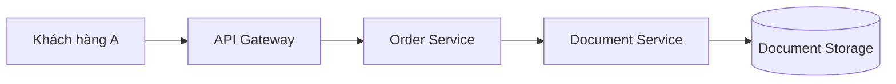

# End-user-to-resource authorization vẫn cần kiểm tra

Trong hệ thống microservices, một service có thể xác thực thành công service gọi nó bằng OAuth 2.0 Client Credentials, mTLS hoặc danh tính workload. Điều đó chứng minh request đến từ một service được tin cậy. Nó chưa chứng minh người dùng cuối khởi tạo request có quyền truy cập tài nguyên được yêu cầu.

Ví dụ, khách hàng A đăng nhập vào ứng dụng và yêu cầu xem đơn hàng `ORD-200`. API Gateway gọi `order-service` bằng danh tính `gateway-service`. Service này lại gọi `document-service` bằng danh tính `order-service` để lấy hóa đơn. Các kết nối service-to-service đều hợp lệ, nhưng nếu `document-service` chỉ kiểm tra `order-service` có quyền đọc tài liệu nói chung mà không kiểm tra hóa đơn `ORD-200` có thuộc phạm vi khách hàng A hay không, dữ liệu của khách hàng khác vẫn có thể bị lộ.

Đây là lý do **end-user-to-resource authorization vẫn phải được kiểm tra** ở service sở hữu hoặc bảo vệ tài nguyên. Danh tính service và quyền của người dùng cuối là hai lớp khác nhau. Một service có thể được phép gọi một API, nhưng request cụ thể vẫn phải được đánh giá theo người dùng, hành động, object và ngữ cảnh nghiệp vụ.

Sau bài học, người đọc có thể:

- Phân biệt xác thực service-to-service với phân quyền người dùng cuối trên tài nguyên.
- Nhận diện rủi ro confused deputy khi service có quyền rộng thay mặt người dùng.
- Truyền ngữ cảnh người dùng và quyền ủy quyền qua nhiều service một cách đáng tin cậy.
- Chọn token relay, token exchange hoặc danh tính service phù hợp với luồng gọi.
- Thực thi authorization tại service sở hữu dữ liệu, kể cả khi request đến từ nội bộ.
- Thiết kế kiểm thử cho trường hợp service được phép gọi nhưng end user không được phép truy cập object.

## 1. Hai câu hỏi bảo mật khác nhau trong một request

Khi một service nhận request từ service khác, nó cần trả lời ít nhất hai câu hỏi:

1. **Ai đang kết nối tới tôi?** Đây là xác thực caller service/workload. Ví dụ `api-gateway` có đúng là workload được cấp danh tính không?
2. **Người dùng hoặc chủ thể cuối cùng có được phép thực hiện hành động trên tài nguyên này không?** Đây là authorization end-user-to-resource. Ví dụ khách hàng A có được đọc đơn hàng `ORD-200` không?

Hai câu hỏi có thể được thể hiện như sau:

| Lớp | Chủ thể được xác minh | Điều được chứng minh | Điều chưa được chứng minh |
|---|---|---|---|
| Service authentication | `api-gateway` hoặc `order-service` | Caller là workload được tin cậy | Người dùng cuối có quyền trên mọi object |
| Service authorization | Service principal | Service được gọi API/chức năng nào | User được truy cập tài nguyên nào |
| End-user authentication | User A | Danh tính người dùng đã được xác minh | User A được phép làm mọi thao tác |
| End-user-to-resource authorization | User A + action + object | User A được phép làm hành động cụ thể trên object cụ thể | Các quyền khác hoặc object khác |

Ví dụ, `document-service` có thể cho phép `order-service` gọi endpoint tải tài liệu. Quyền gọi service đó là điều kiện cần để giao tiếp nội bộ. Khi request yêu cầu `invoiceId=INV-200`, service vẫn phải xác minh user cuối có quyền xem invoice đó, hoặc có một chính sách ủy quyền rõ ràng cho phép service thực hiện thay mặt user.

**Không suy ra quyền người dùng từ việc service caller đã được xác thực.** Nội bộ, private network, mTLS hay API Gateway không làm mất yêu cầu kiểm tra quyền trên từng tài nguyên.

## 2. Ví dụ luồng microservices và điểm dễ bỏ sót

Giả sử ứng dụng bán hàng có luồng:



Khách hàng A gửi request xem hóa đơn của một đơn hàng. Gateway xác thực user và gọi `order-service`; `order-service` xác thực gateway và gọi `document-service`; document service đọc file từ storage.

Một triển khai sai có thể diễn ra như sau:

1. Gateway xác thực user A.
2. Gateway gọi order service bằng service token của gateway.
3. Order service gọi document service bằng service token có quyền đọc mọi hóa đơn.
4. Document service nhận `invoiceId` và chỉ kiểm tra service token.
5. Nếu caller thay invoice ID thành hóa đơn của user B, document service vẫn trả file.

Trong chuỗi này, từng service đều xác thực caller đúng. Lỗi nằm ở chỗ quyền service đã bị dùng thay cho quyền của người dùng cuối. `document-service` trở thành một **confused deputy**: nó có quyền rộng và bị điều khiển để sử dụng quyền đó cho một request không được user cuối cho phép.

### 2.1. Confused deputy trong service nội bộ

Confused deputy xảy ra khi một thành phần có thẩm quyền cao thực hiện hành động bằng quyền của chính nó nhưng không xác minh người yêu cầu có quyền tương ứng. Một service nội bộ có thể có quyền đọc tất cả tài liệu để hoàn thành công việc của hệ thống. Nếu endpoint nhận object ID tùy ý và tin rằng caller service đã được phép, attacker có thể lợi dụng service đó làm trung gian truy cập dữ liệu.

Các dấu hiệu rủi ro:

- Service dùng một service account có quyền rộng cho mọi request của mọi end user.
- Downstream chỉ nhận `userId` hoặc `tenantId` trong header do upstream tự đặt mà không xác minh nguồn.
- Service kiểm tra `scope=document:read` nhưng không kiểm tra quyền trên document cụ thể.
- Gateway đã kiểm tra quyền ở endpoint đầu tiên, nhưng downstream cho phép truy cập object khác bằng ID mới.
- Worker hoặc internal API được coi là đáng tin chỉ vì nằm trong private network.

## 3. Phân biệt các loại danh tính trong chuỗi gọi

Một request nhiều tầng có thể có nhiều danh tính cùng lúc. Thiết kế nên giữ rõ các vai trò sau:

- **End user / subject:** người dùng cuối mà hành động phục vụ hoặc tác động tới, ví dụ `user-A`.
- **Actor / calling service:** workload trực tiếp gửi request, ví dụ `order-service`.
- **Client application:** ứng dụng hoặc gateway khởi tạo luồng OAuth, ví dụ `web-bff`.
- **Resource server / audience:** service nhận token và quyết định có chấp nhận token cho API của mình hay không, ví dụ `document-service`.
- **Resource:** object cụ thể, ví dụ invoice `INV-200` thuộc tenant `T-1`.

Trong một luồng delegated, document service có thể cần biết cả user A và order service đang hành động thay mặt user A. Việc chỉ giữ user ID làm mất thông tin về actor; chỉ giữ service ID lại làm mất chủ thể cuối cùng. Cả hai thông tin có thể cần cho authorization và audit.

Một quyết định quyền có thể mô tả như sau:

```text
subject = user-A
actor   = order-service
action  = invoice:read
resource = invoice INV-200
context = tenant T-1, request-id R-123

ALLOW khi:
  actor được phép gọi document-service cho hành động delegated này
  AND subject có quyền invoice:read
  AND invoice INV-200 thuộc phạm vi subject được truy cập
  AND các điều kiện nghiệp vụ hiện tại đều hợp lệ
```

Chính sách có thể cho phép một service xử lý thay mặt user, nhưng phải giới hạn service, action, audience và phạm vi dữ liệu. Không nên biến service account thành chủ thể thay thế cho tất cả người dùng.

## 4. Truyền ngữ cảnh người dùng qua service một cách đáng tin cậy

Downstream cần nhận được bằng chứng đáng tin cậy về chủ thể cuối cùng và phạm vi ủy quyền. Có một số mẫu triển khai phổ biến; lựa chọn phụ thuộc kiến trúc, IdP và mô hình quyền.

### 4.1. Token relay — chuyển tiếp access token của user

Gateway hoặc BFF chuyển tiếp access token của người dùng tới downstream. Downstream tự xác minh chữ ký, issuer, audience, thời hạn và scope/claim cần thiết rồi áp dụng policy trên object.

Ưu điểm là downstream có thể đánh giá quyền theo user mà không cần tin một header user ID tự khai báo. Tuy nhiên:

- Token phải có audience phù hợp với resource server nhận nó. Token chỉ dành cho gateway không mặc nhiên dùng được ở document service.
- Scope phải đủ hẹp cho API và action cần thiết.
- Không chuyển tiếp token đến service không nằm trong luồng tin cậy hoặc không cần dữ liệu đó.
- Không ghi token vào log, URL hoặc message không được bảo vệ.
- Downstream vẫn phải kiểm tra quyền trên object; token hợp lệ không tự cấp quyền cho mọi ID.

Không dùng ID token dành cho client đăng nhập làm access token để gọi API. Resource server cần access token được phát hành cho audience phù hợp.

### 4.2. Token exchange / delegated token

Khi access token ban đầu không có audience hoặc scope phù hợp cho downstream, một thành phần được phép có thể yêu cầu authorization server phát hành token mới dành cho resource server đó. Token mới thể hiện chủ thể cuối cùng và phạm vi quyền được ủy quyền, đồng thời có thể ghi nhận actor/caller theo mô hình của hệ thống.

Với OAuth 2.0 Token Exchange (RFC 8693), một service có thể trao đổi token đầu vào để lấy token cho audience/scope downstream. Cần cấu hình authorization server để giới hạn client được phép exchange, subject token, actor token, resource/audience và scope được cấp. Không phải mọi hệ thống OAuth đều hỗ trợ token exchange; không tự tạo token giả bằng cách sao chép claim hoặc ký lại token người dùng trong service.

Ví dụ về ý định của luồng:

```text
Access token ban đầu:
  subject = user-A
  audience = order-api
  scope = order:read

Order service exchange token:
  requested audience = document-api
  requested scope = invoice:read

Delegated token được cấp:
  subject = user-A
  actor/client = order-service (theo profile token của hệ thống)
  audience = document-api
  scope = invoice:read
```

Ví dụ chỉ minh họa nội dung logic; tên claim và cách biểu diễn actor phụ thuộc profile token/authorization server. Document service phải xác minh token và vẫn kiểm tra invoice cụ thể.

### 4.3. Service token kết hợp user context đã xác minh

Một số kiến trúc dùng service access token để xác thực workload và truyền user context riêng. Cách này chỉ an toàn khi user context có nguồn gốc được xác minh bằng cơ chế mật mã hoặc một trust boundary chặt chẽ.

Ví dụ, gateway có thể tạo assertion có chữ ký chứa subject, tenant, audience, thời hạn ngắn và request ID; downstream xác minh chữ ký bằng khóa tin cậy và ràng buộc assertion với service caller. Nếu chỉ gửi `X-User-Id: user-A`, `X-Tenant-Id: T-1` qua HTTP mà không bảo đảm header đến từ gateway đáng tin, bất kỳ caller nào có thể giả mạo chúng.

Nếu dùng header nội bộ:

- Gateway phải xóa các header cùng tên do client bên ngoài gửi trước khi tự tạo header tin cậy.
- Chỉ chấp nhận header qua kết nối và danh tính service được xác thực.
- Ràng buộc assertion với audience, thời hạn, request hoặc nonce phù hợp để giảm replay.
- Bảo đảm mọi đường truy cập downstream đều đi qua lớp tạo context đáng tin cậy.
- Không coi user ID là bằng chứng quyền; service vẫn cần policy check.

Token delegation thường dễ chuẩn hóa hơn khi nhiều service và nhiều đội phát triển cùng tham gia. Header context có thể phù hợp trong một boundary hẹp, nhưng cần hợp đồng và xác minh rõ ràng.

### 4.4. Khi nào dùng client credentials?

OAuth 2.0 Client Credentials phù hợp khi service thực hiện công việc bằng quyền của chính workload, không có end user cụ thể cần được ủy quyền. Ví dụ, job định kỳ tổng hợp số liệu hệ thống hoặc service health check.

Nếu một user khởi tạo hành động trên dữ liệu của họ, client credentials đơn thuần không mang quyền user. Khi đó cần token delegated hoặc một cơ chế user context có xác minh và policy tương đương. Không nên lấy service token có scope rộng rồi truyền `userId` trong body để giả lập quyền user.

## 5. Kiểm tra authorization ở service sở hữu tài nguyên

Service sở hữu dữ liệu hoặc là resource server chịu trách nhiệm cuối cùng cho việc truy cập dữ liệu phải thực thi policy phù hợp. Gateway có thể kiểm tra token, route và quyền chức năng ở mức tổng quát, nhưng không nên là nơi duy nhất quyết định user có quyền trên mọi object downstream.

Một thứ tự xử lý thường dùng:

1. Xác minh caller service/workload bằng mTLS, access token hoặc cơ chế workload identity.
2. Xác minh user context/delegated token: issuer, chữ ký, audience, thời hạn và claim cần thiết.
3. Xác định subject, actor, tenant và action từ dữ liệu đã xác minh.
4. Kiểm tra service actor được phép thực hiện loại delegated call này.
5. Truy vấn object trong phạm vi tenant/owner/relationship có thể truy cập.
6. Kiểm tra quyền end-user trên object và action, cùng trạng thái nghiệp vụ.
7. Chỉ trả về các property được phép; ghi audit với subject và actor phù hợp.

Ví dụ minh họa Spring Boot:

```java
@GetMapping("/invoices/{id}")
@PreAuthorize("hasAuthority('invoice:read')")
public InvoiceResponse getInvoice(
        @PathVariable UUID id,
        @AuthenticationPrincipal DelegatedUserPrincipal principal) {

    Invoice invoice = invoiceRepository
            .findByIdAndTenantId(id, principal.tenantId())
            .orElseThrow(InvoiceNotFoundException::new);

    authorizationService.requireCanReadInvoice(
            principal.subject(),
            principal.actor(),
            invoice);

    return invoiceMapper.toResponse(invoice);
}
```

`DelegatedUserPrincipal` là kiểu principal minh họa được tạo sau khi token/assertion đã được xác minh. `subject()` đại diện user cuối; `actor()` ghi nhận service đang gọi. `@PreAuthorize` kiểm tra quyền chức năng; `requireCanReadInvoice` kiểm tra quyền trên invoice cụ thể và quan hệ hiện tại. Nếu hệ thống dùng một token service riêng cùng signed user assertion, principal phải được tạo từ cả hai bằng chứng đã xác minh.

Không được chỉ kiểm tra `principal.actor() == "order-service"` rồi trả mọi invoice. Việc service được phép gọi API không có nghĩa mọi subject hoặc object đều hợp lệ.

## 6. Chống confused deputy và quyền service quá rộng

Một service có thể cần quyền kỹ thuật rộng để phục vụ nhiều người dùng, nhưng quyền đó phải được giới hạn theo ngữ cảnh request. Các biện pháp quan trọng:

- Cấp scope service tối thiểu theo API và action; tránh `admin:*` hoặc quyền đọc mọi dữ liệu nếu không cần.
- Tách endpoint vận hành nội bộ khỏi endpoint phục vụ user; áp dụng policy và workload identity riêng.
- Kiểm tra actor service có được phép đại diện cho subject/action này không.
- Giới hạn delegated token theo audience, scope, thời hạn và resource nếu hệ thống hỗ trợ.
- Không chấp nhận `userId`, `tenantId`, `ownerId` hoặc role tùy ý từ body/header bên ngoài.
- Không để downstream suy ra quyền user từ tên service, network zone hoặc service account.
- Giữ audit trail để biết cả ai yêu cầu và service nào thực hiện.

Ví dụ, `report-service` có thể được phép tạo báo cáo cho user, nhưng không được tự ý export mọi tenant. Request cần chứa subject đã xác minh; query phải giới hạn dữ liệu theo quyền của subject; quyền export có thể là action riêng so với quyền xem dashboard.

## 7. Nhiều hop và delegation chain

Một request có thể đi qua `web-bff → order-service → document-service → storage-adapter`. Cần quyết định rõ service nào giữ token user, service nào được phép exchange token và service nào chỉ nhận tác vụ hệ thống.

Nguyên tắc thiết kế:

1. Giữ nguyên chủ thể cuối cùng trong suốt luồng delegated; không thay user A bằng service account ở hop sau nếu hành động vẫn được thực hiện thay mặt A.
2. Mỗi downstream nhận token có audience phù hợp với chính nó, không dùng một token audience rộng cho mọi service.
3. Actor/caller cần được ghi nhận để audit và policy có thể giới hạn service được phép hành động.
4. Không mở rộng scope khi exchange token; downstream chỉ nhận quyền tối thiểu cần thiết.
5. Nếu một hop chuyển sang công việc hệ thống độc lập, xác định rõ điểm chuyển từ delegated action sang system action và ghi lại nguồn khởi tạo.
6. Khi không thể chứng minh user context hoặc delegation chain, từ chối truy cập nhạy cảm theo nguyên tắc deny by default.

Không phải mọi hop đều phải mang toàn bộ thông tin cá nhân người dùng. Chỉ truyền các claim cần cho quyết định quyền và audit; tránh lan truyền dữ liệu nhạy cảm không cần thiết.

## 8. Tác vụ bất đồng bộ và message queue

Một request có thể tạo message để xử lý sau. Khi đó, HTTP request ban đầu kết thúc trước khi worker truy cập tài nguyên. Nếu message chỉ lưu service account hoặc `orderId`, worker có thể thực hiện bằng quyền quá rộng và mất thông tin người yêu cầu.

Message cần mang đủ provenance để xác minh:

- Actor/user đã khởi tạo hành động và tenant liên quan.
- Service tạo message và định danh correlation/request.
- Action được yêu cầu, object hoặc phạm vi object.
- Bằng chứng delegation hoặc reference đến authorization context có thể xác minh.
- Thời điểm tạo, thời hạn và chính sách xử lý khi quyền thay đổi.

Không đưa raw bearer token vào queue mặc định. Token có thể hết hạn trước lúc worker chạy, bị lưu lâu trong broker hoặc xuất hiện trong công cụ quản trị. Có thể dùng signed message/assertion có thời hạn, token exchange tại thời điểm thực thi hoặc lưu một authorization grant tham chiếu được bảo vệ.

Trước khi worker thực hiện thao tác nhạy cảm, hãy xác minh nguồn message và kiểm tra lại điều kiện quyền có thể thay đổi như owner, membership, assignment, trạng thái tài nguyên hoặc việc user bị khóa. Nếu nghiệp vụ quy định quyền được chốt tại thời điểm submit, cần lưu bằng chứng quyết định, policy version và phạm vi đã duyệt; không tự mặc định rằng quyền cũ luôn còn hiệu lực.

Với tác vụ thuần hệ thống như dọn dữ liệu hết hạn, dùng system principal và policy riêng. Không gán một user ngẫu nhiên hoặc service account chung để làm cho thao tác trông giống delegated request.

## 9. Cache và dữ liệu trả về trong luồng delegated

Response phụ thuộc user/tenant phải được cache theo đúng phạm vi. Cache key chỉ chứa URL hoặc object ID có thể làm user A nhận response đã tạo cho user B. Cache cần phân biệt subject, tenant, scope hoặc policy context khi các yếu tố đó làm thay đổi kết quả; với dữ liệu nhạy cảm có thể chọn `private, no-store`.

Nếu cache lưu quyết định authorization, cần xác định thời hạn, invalidation và tác động khi role, assignment, membership hoặc owner thay đổi. Không dùng một quyết định allow cũ vô thời hạn. Một lựa chọn an toàn là cache dữ liệu nền nhưng đánh giá lại quyền trước khi trả response.

Downstream cũng cần lọc property theo quyền của subject. Ví dụ, order service có thể được phép đọc toàn bộ invoice để tính toán, nhưng response trả về user chỉ được chứa trường họ được phép xem. Quyền service đọc dữ liệu phục vụ xử lý nội bộ không tự động cho phép chuyển toàn bộ dữ liệu đó ra ngoài.

## 10. Audit và giám sát end-user-to-resource authorization

Audit log cần giữ được hai chiều danh tính:

| Trường | Ví dụ | Mục đích |
|---|---|---|
| `subject_id` | `user-A` | Ai là người dùng cuối được đại diện |
| `actor_service` | `order-service` | Service nào trực tiếp thực hiện request |
| `client_id` | `web-bff` | Ứng dụng/client khởi tạo luồng |
| `action` | `invoice:read` | Hành động được yêu cầu |
| `resource_type`, `resource_id` | `invoice`, `INV-200` | Object được truy cập |
| `tenant_id` | `T-1` | Phạm vi tenant đã xác minh |
| `decision` | `ALLOW` hoặc `DENY` | Kết quả policy |
| `request_id` | `R-123` | Liên kết các hop trong cùng request |

Không ghi access token, refresh token, secret hoặc toàn bộ payload nhạy cảm. Log từ nhiều service nên dùng correlation ID để tái dựng chuỗi gọi, nhưng phải bảo đảm dữ liệu log được bảo vệ và quyền đọc phù hợp.

Theo dõi các tín hiệu như một service account truy cập nhiều tenant bất thường, service caller được phép nhưng end user thường xuyên bị deny, số lần token exchange tăng đột biến, audience/scope sai, hoặc một actor gọi nhiều object ID không liên quan. Phân tích cả subject lẫn actor để phát hiện confused deputy và lạm dụng quyền service.

## 11. Kiểm thử service authorization và end-user authorization

Test phải tách hai lớp quyền để tránh kết luận sai. Một service caller hợp lệ và một user có quyền trên object là hai điều kiện độc lập.

| Service caller | End user | Object | Kết quả mong đợi |
|---|---|---|---|
| Không hợp lệ | User có quyền | Object thuộc user | Từ chối ở lớp service authentication/authorization |
| Hợp lệ | User chưa xác thực hoặc delegated context không hợp lệ | Object bất kỳ | Từ chối |
| Hợp lệ | User hợp lệ, có quyền | Object trong phạm vi user | Cho phép |
| Hợp lệ | User hợp lệ, không có quyền | Object thuộc user khác | Từ chối dù service caller có quyền đọc API |
| Hợp lệ | User có scope chức năng nhưng không có quyền object | Object ngoài tenant/assignment | Từ chối |
| Hợp lệ | User có quyền đọc | Gọi action approve/refund | Từ chối nếu thiếu action permission |
| Hợp lệ | User context bị giả mạo qua header | Object bất kỳ | Từ chối; header bên ngoài không được tin |
| Hợp lệ | Token sai audience/issuer/hết hạn | Object bất kỳ | Từ chối |
| Hợp lệ | User bị thu hồi membership trước worker chạy | Object đã đổi phạm vi | Xử lý theo policy thời điểm thực thi; không tự động allow |
| Hợp lệ | User có quyền ở tenant A | Object thuộc tenant B | Từ chối, không lộ dữ liệu |

Các bài test cụ thể nên gồm:

- Gọi trực tiếp downstream bằng service identity không hợp lệ.
- Gọi downstream bằng service identity hợp lệ nhưng user context thiếu hoặc sai.
- Gửi user A và object của user B qua cùng service account; xác minh bị từ chối.
- Thử thay `userId`, `tenantId`, `ownerId` trong body và các header do client kiểm soát.
- Dùng token đúng chữ ký nhưng sai audience hoặc scope.
- Kiểm tra token exchange không thể yêu cầu scope lớn hơn quyền được cấp.
- Kiểm tra actor service không được phép thực hiện delegated action ngoài allowlist.
- Kiểm tra mọi hop giữ đúng subject, actor và request ID.
- Kiểm tra batch, file download, export, GraphQL và async worker.
- Kiểm tra response, cache và audit không làm lộ dữ liệu chéo user/tenant.

Với test tích hợp, dùng service credential và user fixture riêng. Test quan trọng nhất là: **service caller hợp lệ nhưng user cuối không có quyền trên object** phải bị từ chối, và database/response không được có side effect trái phép.

## 12. Status code và xử lý lỗi

Tùy kiến trúc, có thể phân biệt các lỗi:

- `401 Unauthorized`: thiếu hoặc token service/user không hợp lệ, hết hạn hay không xác minh được.
- `403 Forbidden`: service hoặc end user đã được xác thực nhưng không có quyền thực hiện action.
- `404 Not Found`: dùng khi chính sách cần che giấu sự tồn tại của object ngoài phạm vi caller.
- `409 Conflict`: thao tác không phù hợp với trạng thái hiện tại của tài nguyên.
- `429 Too Many Requests`: caller hoặc subject vượt quota/rate limit.
- `5xx`: lỗi nội bộ hoặc phụ thuộc xác thực/ủy quyền không khả dụng; không tự động cho phép truy cập khi policy service gặp lỗi.

Nếu authorization service hoặc token exchange endpoint tạm thời không khả dụng, các thao tác nhạy cảm nên fail closed. Không chuyển sang tin `X-User-Id` hoặc bỏ qua object check như một fallback. Thông báo lỗi cho client cần đủ dùng nhưng không tiết lộ token, claim nội bộ hoặc chi tiết policy nhạy cảm.

## 13. Checklist thiết kế trước khi phát hành

- [ ] Đã xác định rõ end user/subject và service actor trong từng luồng gọi.
- [ ] Service authentication được thực hiện riêng với end-user authorization.
- [ ] Token/assertion được xác minh chữ ký, issuer, audience, thời hạn và scope phù hợp.
- [ ] Không dùng ID token thay access token để gọi API.
- [ ] Không tin user ID/tenant ID tùy ý trong body hoặc header từ client.
- [ ] Token relay hoặc token exchange có audience và scope tối thiểu cho từng downstream.
- [ ] Service actor chỉ được phép thực hiện delegated action đã định nghĩa.
- [ ] Service sở hữu tài nguyên kiểm tra quyền trên object, tenant, relationship và property.
- [ ] Không suy ra quyền user từ mTLS, private network hoặc service account.
- [ ] Chuỗi nhiều hop giữ subject, actor, request ID và provenance phù hợp.
- [ ] Async worker xác minh nguồn message và xử lý quyền thay đổi theo policy.
- [ ] Cache không chia sẻ response giữa user/tenant có phạm vi quyền khác nhau.
- [ ] Audit ghi cả subject lẫn actor nhưng không lưu token/secret.
- [ ] Có test service hợp lệ + user không có quyền trên object và các trường hợp giả mạo context.
- [ ] Khi không xác minh được delegation hoặc policy, hệ thống từ chối thao tác nhạy cảm.

## Kết luận

Service-to-service authentication chứng minh workload nào đang kết nối; nó không chứng minh end user được phép truy cập tài nguyên nào. Khi một service hành động thay mặt người dùng, hệ thống phải giữ được subject và actor đáng tin cậy, giới hạn delegation theo audience/scope/action và kiểm tra quyền trên từng object tại service sở hữu tài nguyên. Kiểm tra riêng hai lớp này giúp ngăn confused deputy, truy cập chéo người dùng và việc service account có quyền rộng bị lợi dụng qua API nội bộ.
