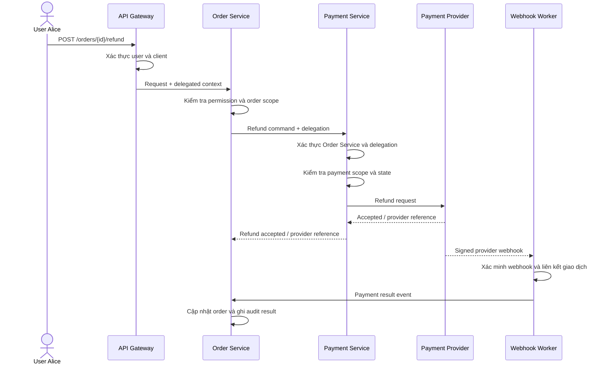

# Audit chain của service và user

Trong một hệ thống API gồm gateway, nhiều service và worker bất đồng bộ, một hành động nghiệp vụ có thể đi qua nhiều thành phần trước khi hoàn tất. Ví dụ, người dùng yêu cầu hoàn tiền qua Order API; Order Service gọi Payment Service; Payment Service gửi lệnh đến cổng thanh toán; một worker nhận webhook rồi cập nhật trạng thái đơn hàng. Nếu audit log chỉ ghi `Payment Service đã gọi refund`, đội vận hành khó xác định ai khởi tạo yêu cầu, service nào thực hiện từng bước, quyền nào được sử dụng và kết quả cuối cùng thuộc về request nào.

**Audit chain của service và user** là cách ghi nhận nguồn gốc và chuỗi thực thi của một hành động xuyên qua các ranh giới service. Mỗi sự kiện cần phân biệt người dùng khởi tạo, service trực tiếp thực hiện, service ủy quyền hoặc gọi tiếp, tài nguyên bị tác động và kết quả. Chuỗi này phải có thể truy vết, kiểm chứng tính toàn vẹn và bảo vệ khỏi giả mạo.

Trong phạm vi `SECURITY_API_SECURITY`, audit chain bổ sung cho xác thực và phân quyền. Nó giúp trả lời ai đã yêu cầu hành động, service nào đã chấp nhận và thực hiện, quyền nào được kiểm tra, object/tenant nào bị tác động và các bước tiếp theo có cùng nguồn gốc hay không. Audit không tự cấp quyền; mọi service vẫn phải xác thực caller và thực thi authorization tại ranh giới của mình.

## 1. Vì sao cần ghi cả user identity và service identity?

Trong hệ thống phân tán, một request thường có ít nhất hai góc nhìn danh tính:

- **User/initiator:** người dùng hoặc hệ thống bên ngoài khởi tạo ý định nghiệp vụ.
- **Service actor:** workload/service trực tiếp gửi request hoặc thực hiện thao tác ở hop hiện tại.

Hai danh tính này không thay thế nhau. Nếu chỉ ghi user, ta không biết service nào đã thực hiện hành động. Nếu chỉ ghi service, ta mất nguồn gốc người dùng và khó điều tra việc một user yêu cầu thao tác gì.

Ví dụ:

```text
Alice
  -> API Gateway
  -> Order Service
  -> Payment Service
  -> Payment Provider
  -> Payment Webhook Worker
  -> Order Service
```

Ở bước đầu, Alice là người khởi tạo và Gateway/Order Service là các service xử lý. Khi Order Service gọi Payment Service, Payment Service phải biết caller trực tiếp là Order Service. Nếu nghiệp vụ yêu cầu thực hiện thay mặt Alice, nó cũng cần nhận được bằng chứng ủy quyền hợp lệ để ghi nhận Alice là subject/initiator. Khi webhook đến từ payment provider, caller trực tiếp là provider; không được coi webhook như request mới do Alice gửi.

| Trường hợp | Actor trực tiếp | User/initiator |
|---|---|---|
| User gọi Order API | Order Service | Alice |
| Order Service gọi Payment Service | Payment Service | Alice, nếu có delegation context hợp lệ |
| Scheduled job đối soát thanh toán | Reconciliation Worker | System/job; không có user nếu không có |
| Provider gửi webhook | Payment Provider | Initiator của giao dịch gốc, nếu reference được xác minh; receiver được ghi riêng |
| Admin yêu cầu rotate key | Key Management Service | Admin đã xác thực và được cấp quyền |

Không nên gán một user giả cho hoạt động tự động. Khi không có user khởi tạo, hãy ghi rõ actor là service/system và định danh job, scheduler hoặc trigger tương ứng.

## 2. Phân biệt identity, delegation và trace context

Ba loại dữ liệu thường bị trộn lẫn nhưng có ý nghĩa khác nhau:

| Dữ liệu | Trả lời câu hỏi | Có thể dùng để xác thực/ủy quyền? |
|---|---|---|
| Service identity | Workload nào đang kết nối? | Có, sau khi xác minh credential như mTLS/workload identity/token |
| User identity | User nào được xác thực? | Có, nếu được mang trong credential/delegation đã xác minh |
| Delegation context | Service đang hành động thay mặt ai, theo giới hạn nào? | Có, nếu được issuer tin cậy ký/cấp và resource server xác minh |
| Trace/correlation ID | Request hoặc luồng xử lý nào có liên quan? | Không; chỉ dùng để liên kết telemetry |
| Header tự khai báo như `X-User-Id` | Client muốn server tin user nào? | Không; đây là dữ liệu không tin cậy nếu không có cơ chế bảo vệ |

`traceparent`, `tracestate`, `X-Request-ID` hoặc `correlationId` hữu ích để nối log và distributed trace. Chúng không chứng minh danh tính người dùng hoặc service. Attacker có thể tự gửi một trace ID bất kỳ; vì vậy không được dùng trace ID làm căn cứ cấp quyền, tra cứu secret hoặc xác định actor.

Tương tự, `X-User-Id`, `X-Actor`, `X-Tenant-Id` hoặc `X-Forwarded-User` không tự nhiên đáng tin chỉ vì request đến từ mạng nội bộ. Nếu cần truyền user context qua nhiều service, phải dùng credential/delegation context có nguồn phát hành được xác minh, audience phù hợp, thời hạn và tính toàn vẹn.

## 3. Mô hình audit chain qua nhiều service

Một luồng xử lý có thể được mô hình hóa thành các sự kiện liên kết với nhau. Mỗi service tạo audit event khi nó chấp nhận, từ chối hoặc thực hiện một hành động có ý nghĩa bảo mật/nghiệp vụ.



Trong luồng này, mỗi service ghi event riêng. Các event được nối bằng identifiers và delegation chain; không yêu cầu một log file duy nhất chứa toàn bộ câu chuyện. Khi truy vấn audit, hệ thống ghép các event theo correlation, parent/causation và operation ID, đồng thời xác minh các quan hệ nguồn gốc.

### 3.1. Một event không nên cố kể toàn bộ lịch sử

Payment Service chỉ nên khẳng định điều mà nó biết và có bằng chứng: Order Service đã gọi nó bằng service identity hợp lệ; delegation context chỉ ra hành động được yêu cầu thay mặt Alice; Payment Service đã kiểm tra quyền và trạng thái thanh toán; provider trả về reference/kết quả nào.

Payment Service không nên tự khẳng định Alice trực tiếp kết nối với nó nếu thực tế caller là Order Service. Phân biệt `actor` và `subject` giúp tránh nhầm nguồn kết nối với người khởi tạo.

### 3.2. Chuỗi liên kết nên có parent và causation

Một schema audit nên có các trường liên kết như:

- `event_id`: định danh duy nhất của event.
- `operation_id`: định danh nghiệp vụ xuyên nhiều bước, ví dụ một lần refund.
- `correlation_id`: liên kết các log/event thuộc cùng một request hoặc luồng xử lý.
- `causation_id`: event trực tiếp gây ra event hiện tại.
- `parent_event_id`: event cha trong chuỗi thực thi, nếu mô hình có quan hệ cây.
- `trace_id`/`span_id`: liên kết với distributed tracing nếu có.

Không nhất thiết phải dùng tất cả trường trong mọi hệ thống. Cần định nghĩa rõ ý nghĩa và quy tắc tạo ID. `correlation_id` thường giữ xuyên suốt một business operation; `causation_id` thay đổi theo từng event được kích hoạt. Tránh tái sử dụng một request ID cho nhiều operation không liên quan.

## 4. Thiết kế audit event schema

Một audit event nên trả lời được: ai thực hiện, ai khởi tạo, làm gì, trên tài nguyên nào, bằng quyền nào, ở đâu trong chuỗi, khi nào và kết quả ra sao.

Ví dụ schema khái niệm:

```json
{
  "eventId": "evt-01J...",
  "eventType": "payment.refund.requested",
  "occurredAt": "2026-11-18T12:30:15.123Z",
  "operationId": "op-refund-8421",
  "correlationId": "corr-01J...",
  "causationId": "evt-order-refund-requested",
  "traceId": "4bf92f3577b34da6a3ce929d0e0e4736",
  "actor": {
    "type": "service",
    "id": "payment-service",
    "workloadId": "spiffe://prod/ns/payments/sa/payment-api"
  },
  "caller": {
    "type": "service",
    "id": "order-service"
  },
  "receiverService": "payment-service",
  "subject": {
    "type": "user",
    "issuer": "https://identity.example.com",
    "id": "user-1842"
  },
  "delegation": {
    "delegatingService": "order-service",
    "chain": ["api-gateway", "order-service", "payment-service"],
    "grantId": "grant-77"
  },
  "action": "payments:refund",
  "resource": {
    "type": "payment",
    "id": "pay-8421",
    "tenantId": "tenant-15"
  },
  "authorization": {
    "decision": "allow",
    "policy": "payment-refund-policy-v3",
    "permissions": ["payments:refund"]
  },
  "result": {
    "status": "accepted",
    "reasonCode": null
  }
}
```

Đây là ví dụ minh họa; chỉ lưu các trường cần thiết và được phép theo chính sách dữ liệu. `subject` chỉ xuất hiện khi có user context được xác minh. `delegation.chain` là thông tin nguồn gốc đã được xác thực, không phải danh sách header tùy ý do client gửi. Không ghi access token, API key, refresh token, mật khẩu, payment secret hoặc toàn bộ request body.

### 4.1. Actor và subject

Nên dùng định nghĩa ổn định:

- `actor`: principal trực tiếp thực hiện hành động tại service ghi event.
- `caller`: principal/service gửi request đến service ghi event; có thể trùng actor trong một số luồng.
- `subject`: người dùng hoặc principal mà hành động đang được thực hiện thay mặt, nếu có.
- `initiator`: principal khởi tạo business operation ban đầu.
- `client`: ứng dụng hoặc integration gửi request ban đầu, nếu khác user.

Trong một số hệ thống, `subject` và `initiator` có thể là cùng một user. Trong hệ thống delegated workflow, user khởi tạo có thể khác service actor và người phê duyệt. Đừng ép tất cả vào một trường `userId` duy nhất.

### 4.2. Ghi quyền và quyết định authorization

Audit event nên ghi kết quả quyết định ở mức đủ để giải thích:

- Action/permission được yêu cầu.
- Policy hoặc policy version đã đánh giá.
- Quyết định `allow`, `deny` hoặc `indeterminate`.
- Phạm vi resource/tenant đã được kiểm tra.
- Lý do/mã lý do có thể công khai trong nội bộ.

Không nhất thiết phải ghi toàn bộ policy input hoặc các thuộc tính nhạy cảm. Có thể ghi policy ID/version, permission name và reason code. Nếu policy có dữ liệu cá nhân, bí mật thương mại hoặc thuộc tính nhạy cảm, cần giảm thiểu và kiểm soát quyền truy cập log.

### 4.3. Event type và kết quả

Định nghĩa event type theo danh mục ổn định, ví dụ:

```text
authn.succeeded
authn.failed
authz.allowed
authz.denied
order.refund.requested
payment.refund.accepted
payment.refund.failed
api_key.revoked
admin.role.assigned
```

Phân biệt event về quyết định bảo mật với event về kết quả nghiệp vụ. `authz.allowed` có nghĩa policy cho phép hành động; nó không chứng minh hành động đã hoàn tất. Event `payment.refund.accepted` cũng có thể chỉ có nghĩa provider đã nhận lệnh, chưa chắc tiền đã được hoàn thành công. Dùng event type và result state rõ ràng để không diễn giải quá mức.

## 5. Truyền user context an toàn giữa các service

Khi một service gọi service khác thay mặt user, cần quyết định rõ mô hình ủy quyền. Hai cách thường gặp:

### 5.1. Token exchange hoặc on-behalf-of token

Service nguồn dùng credential của chính nó để yêu cầu authorization server cấp token dành cho service đích, đồng thời giữ ngữ cảnh user/delegation theo giao thức và policy đã cấu hình. Token mới nên có:

- Issuer được resource server tin cậy.
- Audience đúng service nhận.
- Subject/user identity nếu hành động được thực hiện thay mặt user.
- Actor/client identity của service gọi.
- Scope tối thiểu cho action cần thực hiện.
- Expiry ngắn và giới hạn delegation phù hợp.

Service đích xác minh chữ ký, issuer, audience, thời gian, token profile và scope. Nó cũng xác minh caller service identity theo cơ chế đã chọn. Sau đó service đích thực hiện authorization trên object và trạng thái của chính nó.

Không forward nguyên access token của user đến mọi service nếu token có audience không phù hợp hoặc quyền quá rộng. Token exchange/on-behalf-of giúp cấp credential giới hạn theo resource server và action. Cách triển khai cụ thể phụ thuộc authorization server và profile OAuth được sử dụng.

### 5.2. Delegation envelope có chữ ký

Một số hệ thống nội bộ cần truyền business context ngoài claims chuẩn. Có thể dùng delegation envelope được ký bởi thành phần tin cậy, gồm operation ID, initiator, service actor, audience, action, tenant, expiry và reference đến grant. Resource server phải xác minh chữ ký, issuer, audience, expiry và ràng buộc action/resource.

Không tự tạo một JSON `X-User-Context` rồi tin nó chỉ vì request đến từ subnet nội bộ. Nếu dùng envelope, phải có định dạng, phiên bản, khóa ký, rotation, chống replay và quy tắc canonicalization được thiết kế rõ. Không cho service trung gian tự sửa `subject`, `tenant` hoặc `permissions` mà không có quyền phát hành delegation tương ứng.

### 5.3. Không truyền danh tính bằng header tự khai báo

Ví dụ nguy hiểm:

```http
POST /internal/payments/refund
X-User-Id: admin-1
X-Role: ADMIN
X-Tenant-Id: tenant-15
```

Nếu Payment Service tin các header này mà không xác minh nguồn và tính toàn vẹn, caller có thể giả mạo user hoặc tenant. Gateway xóa header do client gửi rồi tự chèn header mới cũng chỉ an toàn khi:

- Gateway là thành phần được xác thực và bảo vệ.
- Đường từ gateway đến service đích xác thực gateway bằng mTLS/workload identity.
- Service đích chỉ tin header từ gateway đã xác minh.
- Không có đường mạng khác cho phép caller giả mạo cùng header.
- Header/context được ký hoặc ràng buộc theo cơ chế tin cậy khi đi qua nhiều hop.

Trong hệ thống nhiều service, token exchange hoặc signed delegation thường rõ ràng và dễ kiểm tra hơn việc dựa vào một nhóm header không có hợp đồng mật mã.

## 6. Service phải xác thực caller và ủy quyền ở từng hop

Mỗi service nhận request cần xác minh caller trực tiếp. Nếu caller là service khác, dùng workload identity, mTLS, OAuth client credentials hoặc cơ chế service authentication đã thống nhất. Không mặc định request nội bộ là đáng tin.

Quyết định authorization có thể cần kết hợp:

1. Service caller có được phép gọi endpoint/action này không?
2. Nếu là delegated call, delegation có hợp lệ và còn hiệu lực không?
3. User subject có được phép thực hiện action nghiệp vụ không?
4. Resource có thuộc tenant/phạm vi mà delegation cho phép không?
5. Field và workflow state có đáp ứng policy không?

Ví dụ Order Service được phép gọi Payment Service để tạo refund command. Điều đó không có nghĩa Order Service có thể dùng cùng service identity để đọc toàn bộ thẻ thanh toán hoặc thay đổi cấu hình Payment Service. Scope của service credential cần giới hạn theo API/action, còn delegation giới hạn theo user, tenant và giao dịch.

Không để service downstream tin rằng user đã được service upstream kiểm tra đầy đủ rồi bỏ qua policy của mình. Upstream có thể có lỗi hoặc bị xâm nhập; service sở hữu tài nguyên cần bảo vệ vẫn phải thực thi policy cục bộ.

## 7. Liên kết audit chain với trace và message bất đồng bộ

### 7.1. Correlation ID không phải delegation proof

Correlation ID và trace ID nên được truyền qua HTTP header hoặc message metadata để ghép log. Khi nhận ID từ bên ngoài, có thể kiểm tra định dạng/kích thước và tạo ID nội bộ mới nếu cần. Không dùng giá trị này làm định danh user, tenant hay quyền.

Khi tạo một operation mới, sinh `operation_id` nội bộ và liên kết nó với trace ban đầu. Với mỗi event, tạo `event_id` mới; `causation_id` trỏ đến event đã kích hoạt nó. Điều này giúp phân biệt nhiều retry hoặc nhiều message cùng nằm trong một operation.

### 7.2. Message queue và worker

Khi service publish message, message envelope có thể mang:

- `event_id`, `operation_id`, `correlation_id`, `causation_id`.
- Producer service identity đã xác thực qua broker ACL hoặc signature.
- Delegation context được ký/cấp nếu worker cần thực hiện thay mặt user.
- Tenant/resource/action reference và thời hạn delegation.
- Schema version và timestamp.

Worker cần xác minh producer, quyền đọc queue, integrity của envelope và delegation. Không tin các trường `userId`, `role` hoặc `tenantId` chỉ vì chúng nằm trong message. Broker authentication chứng minh producer nào publish message; nó không tự chứng minh user ban đầu có quyền trên object ở thời điểm worker xử lý.

Quyền có thể thay đổi giữa lúc user yêu cầu và lúc worker thực thi. Với thao tác nhạy cảm, worker cần quyết định policy được kiểm tra tại thời điểm nhận lệnh, tại thời điểm thực thi hay cả hai. Ví dụ, lệnh export được chấp nhận lúc 10:00 nhưng user bị khóa lúc 10:05; nếu job chạy lúc 10:10, hệ thống có thể phải kiểm tra lại trạng thái user hoặc grant trước khi xuất dữ liệu.

### 7.3. Retry và xử lý trùng

Message queue thường có thể giao message nhiều lần. Audit chain phải phân biệt event gốc, lần giao message và lần xử lý. Dùng `event_id`/idempotency key để worker không tạo side effect hoặc audit event nghiệp vụ trùng ngoài ý muốn.

Một event `payment.refund.requested` có thể dẫn đến nhiều event thử lại kỹ thuật, nhưng chỉ một kết quả nghiệp vụ cuối cùng. Ghi `attempt`, `delivery_id` hoặc retry metadata riêng; không tạo một `operation_id` mới mỗi lần retry nếu đó vẫn là cùng business operation.

## 8. Tính toàn vẹn và khả năng chống sửa đổi của audit log

Audit chain cần bảo đảm log khó bị sửa, xóa hoặc giả mạo. Có thể áp dụng nhiều lớp:

- Append-only storage hoặc quyền ghi chỉ dành cho audit collector/service.
- Tách quyền quản trị audit khỏi quyền quản trị service nghiệp vụ.
- Gửi log đến hệ thống lưu trữ độc lập, hạn chế quyền xóa/sửa.
- Retention policy, backup, kiểm soát truy cập và giám sát hoạt động đọc log.
- Chữ ký số hoặc MAC cho batch/event khi cần xác minh nguồn phát hành.
- Hash chain hoặc Merkle tree để phát hiện thay đổi sau khi ghi.

### 8.1. Hash chaining

Một cách đơn giản để phát hiện sửa đổi là liên kết event với hash của event trước đó trong cùng một partition/stream:

```text
H0 = HASH(stream_id || genesis_value)
H1 = HASH(H0 || canonical(event_1))
H2 = HASH(H1 || canonical(event_2))
H3 = HASH(H2 || canonical(event_3))
```

Nếu một event cũ bị sửa, hash của event đó và các event sau sẽ không còn khớp. Để cơ chế có ý nghĩa, cần canonical serialization ổn định, thứ tự event được xác định, thuật toán hash được chọn rõ và checkpoint được lưu ở nơi khó sửa cùng kho log.

Trong hệ thống phân tán, không nên cố tạo một chuỗi toàn cục duy nhất nếu nhiều service ghi song song. Có thể tạo chain theo service/partition hoặc theo stream, sau đó ký/checkpoint định kỳ và liên kết các stream bằng operation/correlation ID. Việc thiếu event hoặc reorder cần được phát hiện bằng sequence number, offset hoặc checkpoint.

Hash chain không ngăn người có toàn quyền thay cả log và toàn bộ hash/checkpoint. Vì vậy, checkpoint nên được ký bằng khóa được bảo vệ, lưu ở hệ thống độc lập hoặc gửi sang trust domain khác. Hash chain cũng không thay thế quyền truy cập, backup, retention và giám sát.

### 8.2. Chữ ký event và nguồn phát hành

Nếu cần chứng minh event đến từ một service cụ thể, service có thể ký event hoặc batch bằng khóa riêng. Collector xác minh chữ ký dựa trên public key đã đăng ký cho workload và phiên bản khóa. Khóa ký phải được quản lý và rotation; event phải chứa key ID để xác minh lịch sử.

Không phải hệ thống nào cũng cần ký từng event. Với nhiều môi trường, mTLS/workload identity khi gửi đến collector cộng với append-only storage và hash checkpoint có thể đủ. Mức bảo vệ cần dựa trên threat model, yêu cầu pháp lý và khả năng vận hành.

## 9. Ghi audit đáng tin cậy cùng với transaction

Một vấn đề quan trọng là nghiệp vụ đã commit nhưng audit event không được ghi, hoặc audit event đã ghi nhưng transaction nghiệp vụ rollback. Khi hai luồng không nhất quán, chuỗi điều tra có thể sai.

Với event cần bảo đảm cùng transaction database, có thể dùng **Transactional Outbox**:

1. Trong cùng transaction, cập nhật dữ liệu nghiệp vụ và ghi một outbox record.
2. Commit transaction.
3. Publisher đọc outbox và gửi event đến broker/audit pipeline.
4. Consumer xử lý idempotent và đánh dấu outbox/event đã được chuyển.
5. Giám sát backlog, retry, poison message và thời gian trễ.

Ví dụ khái niệm:

```java
@Transactional
public void disableUser(UUID targetId, CurrentActor actor) {
    User target = userRepository.findByIdAndTenantId(
            targetId, actor.tenantId())
        .orElseThrow(UserNotFoundException::new);

    authorization.requireCanDisable(actor, target);
    target.disable(actor.userId());

    auditOutboxRepository.save(AuditOutboxEvent.of(
        "user.disabled",
        actor.userId(),
        target.id(),
        actor.tenantId(),
        actor.correlationId()
    ));
}
```

Đoạn code minh họa cấu trúc. `AuditOutboxEvent` thực tế cần lưu actor type/id, service identity, subject/initiator nếu có, action, resource, policy decision, event ID và các liên kết operation/causation. Không đưa secret hoặc payload nhạy cảm vào outbox.

Với hành động đặc biệt nhạy cảm, nếu không thể ghi audit/outbox bền vững thì có thể cần từ chối hoặc giữ action ở trạng thái pending. Chính sách này phải được quyết định theo mức rủi ro và yêu cầu nghiệp vụ. Không âm thầm thực hiện một thay đổi đặc quyền mà không thể ghi lại audit bắt buộc.

Với side effect ở hệ thống ngoài database, dùng saga/outbox hoặc workflow orchestration phù hợp. Audit event nên phân biệt `requested`, `accepted`, `submitted`, `succeeded`, `failed` và `compensated`; không ghi `succeeded` chỉ vì lệnh đã được gửi đi.

## 10. Bảo vệ dữ liệu trong audit event

Audit log có giá trị điều tra nhưng cũng là một kho dữ liệu nhạy cảm. Nếu ghi toàn bộ request/response, log có thể trở thành nơi tập trung mật khẩu, token, dữ liệu cá nhân và thông tin thanh toán.

### 10.1. Data minimization

Chỉ ghi dữ liệu cần thiết để chứng minh hành động và hỗ trợ điều tra:

- ID actor/subject theo namespace ổn định.
- Service/workload identity và issuer.
- Action, resource type/ID và tenant ở mức được phép.
- Policy decision, reason code và kết quả.
- Timestamp, operation/correlation/causation ID.
- Thay đổi trước/sau ở dạng field name và giá trị đã giảm nhạy cảm khi cần audit thay đổi.

Tránh ghi:

- Access token, refresh token, API key, mật khẩu, cookie, private key hoặc secret.
- Số thẻ đầy đủ, CVV, dữ liệu xác thực thanh toán hoặc dữ liệu đặc biệt không cần thiết.
- Toàn bộ payload request/response nếu chỉ cần một số field.
- Nội dung cá nhân nhạy cảm khi một identifier hoặc hash có kiểm soát đã đủ để truy vết.

### 10.2. Masking, pseudonymization và retention

Nếu cần lưu giá trị để điều tra, hãy mask hoặc pseudonymize theo chính sách. Ví dụ, log loại field `email` đã thay đổi hoặc một định danh nội bộ thay vì email đầy đủ. Nếu dùng hash để pseudonymize, cân nhắc dữ liệu đầu vào có entropy thấp và khả năng dò từ điển; HMAC với key được bảo vệ có thể phù hợp hơn hash thuần trong một số trường hợp.

Đặt retention theo mục đích và yêu cầu pháp lý. Audit event về quản trị quyền có thể cần thời gian lưu khác với access log kỹ thuật. Xóa hoặc ẩn danh khi hết hạn; backup và bản sao downstream cũng phải tuân thủ vòng đời dữ liệu. Quyền đọc audit nên hẹp và được audit lại.

## 11. Phân biệt audit, application log và distributed trace

Ba loại telemetry có thể chia sẻ correlation ID nhưng phục vụ mục đích khác nhau:

| Loại dữ liệu | Mục đích | Nội dung chính |
|---|---|---|
| Audit event | Chứng minh ai làm gì, trên tài nguyên nào và kết quả ra sao | Actor, subject, action, resource, authorization, timestamp, outcome |
| Application log | Chẩn đoán hành vi nội bộ và lỗi phần mềm | Message, exception đã lọc, component, context kỹ thuật |
| Distributed trace | Đo thời gian và quan hệ giữa các span/hop | Trace ID, span ID, parent span, timing, dependency |

Không nên dùng distributed trace làm audit record duy nhất: trace có thể bị sampling, hết hạn nhanh hoặc thiếu thông tin actor/permission. Application log cũng có thể bị thay đổi hoặc không có schema ổn định. Audit event cần schema, retention, quyền truy cập và tính toàn vẹn riêng.

Có thể đưa `trace_id` vào audit event để mở rộng điều tra từ audit sang trace, nhưng audit event phải vẫn có ý nghĩa khi trace đã bị xóa hoặc không được ghi.

## 12. Kiểm thử audit chain

Kiểm thử cần xác nhận nguồn gốc được giữ đúng qua nhiều hop, không chỉ kiểm tra event có xuất hiện.

| Tình huống | Kết quả mong đợi |
|---|---|
| User gọi API qua gateway | Ghi đúng user subject và gateway/service actor |
| Gateway gọi service bằng delegated context hợp lệ | Service đích xác minh issuer, audience, expiry, scope và ghi đúng subject + caller service |
| Caller gửi `X-User-Id` giả | Bị bỏ qua hoặc từ chối; không làm thay đổi actor trong audit |
| Service không có workload identity hợp lệ | Request bị từ chối và ghi nhận caller không xác thực theo policy |
| Delegation token sai audience hoặc hết hạn | Từ chối; không thực hiện side effect |
| Service A gọi service B rồi B gọi C | Mỗi hop ghi actor trực tiếp và liên kết cùng operation/causation chain |
| Scheduled job chạy không có user | Ghi system/job identity; không tạo user giả |
| Webhook provider đến | Ghi provider là caller; liên kết giao dịch gốc sau khi xác minh webhook |
| Message được giao lại | Event/operation được liên kết; xử lý idempotent, không tạo side effect trùng |
| Audit write lỗi trong action quan trọng | Hành động tuân theo policy fail-closed/pending đã định nghĩa |
| Transaction rollback | Không có audit success giả; outbox không được publish event chưa commit |
| Event bị sửa sau khi ghi | Hash/signature/checkpoint validation phát hiện sai lệch |
| Event bị xóa hoặc thiếu sequence | Kiểm tra continuity/checkpoint phát hiện gap theo thiết kế |
| Log có token/secret trong payload | Test redaction phát hiện và ngăn lưu dữ liệu nhạy cảm |
| Trace ID do client tự gửi | Chỉ dùng liên kết telemetry; không ảnh hưởng identity/authorization |

### 12.1. Kiểm thử xuyên service

Tạo một kịch bản end-to-end có ít nhất ba hop và một bước bất đồng bộ. Xác minh:

1. User identity ban đầu được xác thực và có namespace/issuer rõ.
2. Mỗi service ghi service identity trực tiếp của mình.
3. Delegation context chỉ chứa scope/audience được phép và không thể bị sửa.
4. `operation_id`, `correlation_id`, `causation_id` nối đúng các event.
5. Service downstream từ chối caller hoặc delegation không hợp lệ.
6. Worker xác minh message producer và kiểm tra lại quyền theo policy.
7. Kết quả cuối cùng có thể truy ngược về request ban đầu mà không cần đọc secret hoặc token.

### 12.2. Kiểm thử khả năng chống sửa đổi

Nếu dùng hash chain hoặc chữ ký event, cần thử sửa payload, xóa event, đổi thứ tự, thay key ID và thay checkpoint. Validator phải phát hiện sai lệch. Kiểm tra quy trình key rotation để event cũ vẫn xác minh được bằng public key/checkpoint tương ứng trong thời gian lưu trữ.

## 13. Giám sát và quy trình điều tra

Audit pipeline nên cung cấp khả năng tìm theo operation ID, actor, subject, service, resource, tenant, action và thời gian. Các truy vấn này phải được phân quyền vì chúng có thể tiết lộ hành vi của user và dữ liệu nội bộ.

Theo dõi các tín hiệu:

- Service gọi action ngoài scope hoặc audience.
- Delegation chain thiếu hop, sai thứ tự hoặc có service không nằm trong trust registry.
- Một service identity phát sinh số lượng request bất thường.
- Nhiều event `deny` hoặc `indeterminate` trên endpoint nhạy cảm.
- Event không có parent/causation hợp lệ khi nghiệp vụ yêu cầu.
- Outbox backlog tăng, event trễ, sequence gap hoặc consumer xử lý lặp.
- Chữ ký/hash checkpoint không hợp lệ.
- Audit collector ngừng nhận event hoặc một service đột ngột không phát audit.
- Một user/tenant có hoạt động nhạy cảm ngoài mẫu bình thường.

Runbook điều tra nên bắt đầu từ event nghiệp vụ, mở rộng theo operation/correlation ID, xác minh chữ ký hoặc nguồn phát hành của từng hop, đối chiếu service identity và delegation grant, rồi so sánh với distributed trace/application log. Không kết luận user đã thực hiện hành động chỉ từ một header hoặc trace tag chưa được xác minh.

## 14. Những lỗi thiết kế thường gặp

| Lỗi | Hệ quả | Cách xử lý |
|---|---|---|
| Chỉ ghi user ID, không ghi service actor | Không biết service nào thực hiện hành động | Ghi actor và subject riêng |
| Chỉ ghi service name, bỏ user initiator | Mất nguồn gốc người yêu cầu | Truyền delegation đã xác minh |
| Tin `X-User-Id` hoặc `X-Role` từ client | Giả mạo audit attribution và có thể leo thang quyền | Xác minh token/delegation; lọc header không tin cậy |
| Dùng trace ID làm bằng chứng danh tính | Attacker tự tạo context giả | Trace chỉ dùng correlation |
| Forward access token không kiểm tra audience | Token substitution và lộ quyền quá rộng | Token exchange/audience đúng service đích |
| Service downstream tin upstream đã authorize | Một service lỗi có thể mở đường truy cập | Mỗi service kiểm tra policy cục bộ |
| Ghi audit sau side effect mà không có transaction/outbox | Thiếu event hoặc event sai kết quả | Transactional outbox/workflow phù hợp |
| Ghi toàn bộ request/response | Lộ token, PII và dữ liệu thanh toán | Data minimization và redaction |
| Dùng trace làm audit duy nhất | Sampling/retention khiến thiếu bằng chứng | Audit store riêng |
| Hash chain nhưng checkpoint cùng quyền sửa | Kẻ có quyền có thể viết lại cả chuỗi | Ký và lưu checkpoint độc lập |
| Không xử lý retry/message duplicate | Audit và side effect trùng | Event ID, idempotency và causation |
| Gán user cho scheduled job | Quy trách nhiệm sai | Ghi system/job actor riêng |

## 15. Checklist review audit chain của service và user

- [ ] Actor trực tiếp, user subject/initiator và client được phân biệt rõ.
- [ ] Mọi service hop xác thực caller bằng workload identity, mTLS hoặc token phù hợp.
- [ ] User context đi qua token exchange/delegation đã xác minh; không tin header tự khai báo.
- [ ] Delegation có issuer, audience, scope, expiry và ràng buộc resource/action.
- [ ] Mỗi service thực hiện authorization tại ranh giới của mình.
- [ ] Audit event có event ID, operation/correlation/causation link và timestamp đáng tin.
- [ ] Event type phân biệt quyết định authorization với kết quả nghiệp vụ.
- [ ] Async worker xác minh producer, message integrity và delegation; retry có idempotency.
- [ ] Audit ghi bền vững bằng transaction/outbox cho hành động cần bảo đảm.
- [ ] Audit store append-only, có kiểm soát truy cập, retention và giám sát sửa đổi.
- [ ] Hash/signature/checkpoint được thiết kế phù hợp với mức rủi ro và lưu trữ độc lập.
- [ ] Không ghi token, API key, secret, mật khẩu hoặc payload nhạy cảm không cần thiết.
- [ ] Trace ID chỉ phục vụ correlation, không dùng làm identity hoặc quyền.
- [ ] Có test xuyên service, spoof header, sai delegation, replay, outbox failure và tamper detection.
- [ ] Có cảnh báo khi mất event, đứt chain, sai chữ ký, backlog hoặc service ngừng phát audit.

Audit chain đáng tin khi mỗi hop xác minh được caller và delegation, ghi riêng service actor với user initiator, liên kết event bằng operation/causation ID và bảo vệ log khỏi sửa đổi. Khi kết hợp với authorization tại từng service, transaction/outbox, data minimization và kiểm thử xuyên hệ thống, đội vận hành có thể truy ngược một hành động từ API đầu vào đến các service và worker đã thực hiện mà không nhầm lẫn giữa người yêu cầu, service thực thi và metadata phục vụ tracing.
