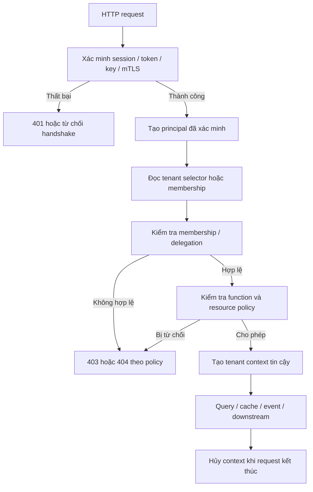

# Tenant ID lấy từ identity và policy đáng tin

## 1. Vì sao nguồn của Tenant ID quan trọng?

Trong ứng dụng multi-tenant, nhiều tổ chức dùng chung một API và có thể dùng chung cơ sở dữ liệu. Mỗi bản ghi, thao tác và tài nguyên cần được gắn với một tenant cụ thể. Nếu request của tenant A có thể khiến server đọc hoặc ghi dữ liệu của tenant B, hệ thống đã vi phạm ranh giới cách ly dữ liệu.

Một lỗi thường gặp là lấy `tenantId` trực tiếp từ request body, query string hoặc header rồi dùng giá trị đó trong truy vấn:

```http
GET /api/invoices?tenantId=tenant-b
Authorization: Bearer <token-cua-tenant-a>
```

Nếu server tin `tenantId` mà không kiểm tra danh tính và quyền truy cập, caller có thể thay giá trị để truy cập dữ liệu của tổ chức khác. UUID khó đoán, giao diện chỉ cho chọn tenant của mình hoặc việc dùng HTTPS không ngăn được lỗi này.

Nguyên tắc cốt lõi là: **tenant context phải được suy ra từ identity đã xác minh và policy đáng tin ở phía server**. Dữ liệu tenant do client gửi chỉ có thể đóng vai trò lựa chọn ngữ cảnh; nó không tự chứng minh caller có quyền đối với tenant đó.

## 2. Phân biệt identity, tenant selector và tenant context

Ba khái niệm này cần được tách rõ:

| Khái niệm | Ý nghĩa | Ví dụ | Có thể dùng làm căn cứ phân quyền trực tiếp? |
|---|---|---|---|
| Identity | Danh tính principal đã được xác thực. | `user-123`, `service:billing-worker`. | Có, sau khi xác minh credential và thuộc tính cần thiết. |
| Tenant selector | Giá trị client yêu cầu thao tác trong tenant nào. | Header `X-Tenant-ID`, path `/tenants/{id}` hoặc tenant được chọn trên giao diện. | Không. Phải kiểm tra principal có quyền chọn tenant đó. |
| Tenant context | Tenant đã được server xác định sau khi kiểm tra membership/delegation và policy. | `tenant-456` gắn với request đã được cấp quyền. | Có, trong phạm vi request và policy tương ứng. |

Ví dụ, một nhân viên tư vấn có thể làm việc cho nhiều tenant. Người đó chọn tenant hiện hành trong giao diện. Client gửi `X-Tenant-ID` để nói “tôi muốn thao tác trong tenant này”. Server xác thực user, tra membership còn hiệu lực và kiểm tra user được phép thực hiện hành động đang yêu cầu trong tenant đó. Chỉ sau khi các bước này thành công, server mới tạo tenant context đáng tin cho request.

Nếu user chỉ thuộc một tenant, server có thể lấy tenant từ membership hoặc claim đáng tin đã được xác minh mà không cần selector từ client. Với service-to-service, tenant context có thể đến từ workload identity cùng delegation/authorization context đã được xác thực. Không nên mặc định một service có quyền trên mọi tenant chỉ vì nó là service nội bộ.

## 3. Nguồn identity và claim đáng tin

Identity có thể được xác minh qua session, OAuth/OIDC access token, mTLS workload certificate hoặc API key. Dù dùng cơ chế nào, tenant ID chỉ đáng tin khi nguồn cấp identity và policy mapping được kiểm soát.

### Nếu dùng JWT/OIDC

Trước khi đọc `sub`, `tenant_id`, `roles` hoặc `scope`, resource server cần xác minh tối thiểu:

- Chữ ký bằng key phù hợp với issuer đã cấu hình; không chọn thuật toán hoặc key tùy ý từ dữ liệu không tin cậy trong token.
- `iss` đúng issuer được tin cậy và `aud` bao gồm API hiện tại.
- `exp`, `nbf` và các điều kiện thời gian phù hợp; xử lý clock skew theo chính sách.
- Loại token và claim được dùng đúng ngữ cảnh; không dùng ID token thay access token để gọi API.
- Principal, client hoặc workload được ánh xạ đúng; tenant claim được issuer có thẩm quyền cấp và có ngữ nghĩa rõ.

Chữ ký hợp lệ chỉ chứng minh token được phát hành bởi issuer và chưa bị thay đổi. Nó không tự chứng minh membership vẫn còn hiệu lực ngay thời điểm request. Nếu user vừa bị xóa khỏi tenant hoặc bị thu hồi quyền, access token cũ có thể vẫn chứa tenant claim cho đến khi hết hạn. Với thao tác nhạy cảm, cần kiểm tra membership/policy hiện tại hoặc dùng cơ chế thu hồi và token lifetime phù hợp.

Không tin claim tenant từ một JWT bất kỳ chỉ vì token có định dạng JWT. Cần xác minh token đúng issuer, audience, mục đích và nguồn phát hành claim. Nếu API nhận nhiều loại token từ nhiều issuer, policy phải xác định issuer nào có quyền khẳng định tenant nào.

### Nếu dùng session hoặc API key

Với session cookie, server lấy principal từ session đã được xác thực và tra tenant membership từ kho dữ liệu/policy đáng tin. Không lấy tenant từ một cookie phụ do client tự đặt nếu cookie đó không được bảo vệ bằng cơ chế xác thực phù hợp.

Với API key do hệ thống phát hành, record phía server cần liên kết key với chủ sở hữu, tenant, scope, thời hạn và trạng thái. Sau khi xác minh key, server lấy tenant từ record đó. Không cho caller đổi tenant bằng cách sửa header trừ khi key được thiết kế có thể truy cập nhiều tenant và policy xác minh quyền chọn tenant.

### Nếu dùng mTLS hoặc workload identity

Certificate có thể xác định workload như `billing-service` hoặc `report-worker`. Danh tính workload không đồng nghĩa nó được truy cập mọi tenant. Server cần policy xác định service được phép hoạt động trên tenant nào và thao tác nào. Khi service gọi thay mặt user, phải truyền delegation/user context đã xác thực, có audience và scope phù hợp; không chỉ chuyển tiếp một header `X-User-ID` hoặc `X-Tenant-ID` do upstream tùy ý cung cấp.

## 4. Quy trình tạo tenant context đáng tin

Một quy trình điển hình cho mỗi request:

1. Xác thực credential và tạo principal từ nguồn identity tin cậy.
2. Lấy tenant selector nếu nghiệp vụ cho phép user chọn tenant; nếu không có selector, xác định tenant theo membership hoặc identity policy.
3. Kiểm tra principal có membership/delegation còn hiệu lực trong tenant đó hay không.
4. Kiểm tra quyền chức năng và điều kiện liên quan: vai trò, scope, quan hệ với resource, trạng thái tài khoản, hạn mức hoặc yêu cầu phê duyệt.
5. Tạo tenant context bất biến cho request, chỉ chứa tenant đã được chấp thuận và principal đã xác minh.
6. Dùng context này cho mọi truy vấn, cache, event, storage và lời gọi dịch vụ downstream.
7. Kết thúc request thì hủy context; không để tenant của request trước rò sang request sau.



Không tạo tenant context chỉ từ middleware đọc header. Middleware phải chạy sau hoặc kết hợp với xác thực, và phải hoàn tất membership/policy check trước khi context được sử dụng.

## 5. Ví dụ triển khai trong Spring

Giả sử access token đã được Spring Security xác minh và `Authentication` chứa principal cùng claim được issuer tin cậy cấp. Một service resolve tenant cần xác minh membership trước khi trả tenant context.

```java
public record TenantContext(
        UUID tenantId,
        String principalId,
        String source) {
}

@Service
public class TenantContextResolver {
    private final TenantMembershipRepository memberships;

    public TenantContextResolver(TenantMembershipRepository memberships) {
        this.memberships = memberships;
    }

    public TenantContext resolve(
            Authentication authentication,
            UUID requestedTenantId) {

        if (authentication == null || !authentication.isAuthenticated()) {
            throw new AccessDeniedException("Authenticated principal required");
        }

        String principalId = authentication.getName();
        if (principalId == null || principalId.isBlank()) {
            throw new AccessDeniedException("Principal identity is missing");
        }

        boolean activeMember = memberships.existsActiveMembership(
            principalId, requestedTenantId);
        if (!activeMember) {
            throw new AccessDeniedException("Tenant access denied");
        }

        return new TenantContext(requestedTenantId, principalId, "membership");
    }
}
```

Đây là mã minh họa cho luồng user chọn tenant. `requestedTenantId` là selector chưa đáng tin; `existsActiveMembership` phải kiểm tra dữ liệu membership ở server, bao gồm trạng thái còn hiệu lực và các điều kiện cần thiết. Trong ứng dụng thực tế, cần kiểm tra cả permission chức năng và quyền trên resource sau khi có tenant context. Với principal là service account, dùng policy riêng thay vì giả định luôn có user membership.

Một controller có thể nhận tenant selector qua header hoặc path, nhưng chỉ chuyển nó cho resolver:

```java
@GetMapping("/api/invoices")
public Page<InvoiceDto> listInvoices(
        @RequestHeader("X-Tenant-ID") UUID requestedTenantId,
        Authentication authentication,
        Pageable pageable) {

    TenantContext tenant = tenantContextResolver.resolve(
        authentication, requestedTenantId);

    return invoiceService.listForTenant(tenant, pageable);
}
```

Không truyền `requestedTenantId` trực tiếp vào repository trước khi resolver xác minh. Nếu API dùng tenant từ claim, resolver vẫn cần xác định claim đã được xác minh và có đủ độ mới theo yêu cầu nghiệp vụ.

### Tránh tenant context bị rò giữa request

Nếu ứng dụng dùng `ThreadLocal` để truyền tenant context, phải đặt và xóa trong `try/finally` hoặc filter/interceptor có lifecycle rõ. Thread pool tái sử dụng thread; quên xóa context có thể khiến request tiếp theo chạy với tenant trước.

```java
try {
    TenantContextHolder.set(tenantContext);
    filterChain.doFilter(request, response);
} finally {
    TenantContextHolder.clear();
}
```

Với reactive stack, không dùng `ThreadLocal` như cơ chế context mặc định vì request có thể chuyển thread; dùng Reactor Context hoặc cơ chế context được framework hỗ trợ. Với tác vụ bất đồng bộ, truyền tenant context tường minh trong command/event đã được xác thực và kiểm tra, không dựa vào thread-local của request ban đầu.

## 6. Enforce tenant ở tầng dữ liệu

Chỉ lọc tenant trong controller là chưa đủ. Một nhánh code quên điều kiện có thể trả dữ liệu của tenant khác. Tầng truy xuất dữ liệu nên buộc mọi thao tác nằm trong tenant context.

### Ràng buộc tenant trong truy vấn

Ví dụ repository:

```java
public interface InvoiceRepository extends JpaRepository<Invoice, UUID> {
    Page<Invoice> findAllByTenantId(UUID tenantId, Pageable pageable);

    Optional<Invoice> findByIdAndTenantId(UUID id, UUID tenantId);
}
```

Service dùng tenant context đã được xác minh:

```java
public InvoiceDto getInvoice(UUID invoiceId, TenantContext tenant) {
    Invoice invoice = invoices
        .findByIdAndTenantId(invoiceId, tenant.tenantId())
        .orElseThrow(InvoiceNotFoundException::new);

    authorization.require(tenant.principalId(), "invoice:read", invoice);
    return mapper.toDto(invoice);
}
```

Đưa `tenantId` vào điều kiện truy vấn giúp dữ liệu ngoài tenant không được tải lên rồi mới kiểm tra. Vẫn cần object-level authorization vì nhiều user trong cùng tenant có thể có quyền khác nhau. Không cung cấp repository method tổng quát `findById(id)` cho các luồng request tenant nếu không có lý do và guard rõ ràng.

### Composite key và foreign key

Với schema nhiều tenant, có thể dùng khóa ghép để buộc quan hệ dữ liệu cùng tenant:

```sql
CREATE TABLE customer (
    tenant_id   UUID NOT NULL,
    customer_id UUID NOT NULL,
    name        TEXT NOT NULL,
    PRIMARY KEY (tenant_id, customer_id)
);

CREATE TABLE invoice (
    tenant_id   UUID NOT NULL,
    invoice_id  UUID NOT NULL,
    customer_id UUID NOT NULL,
    amount      NUMERIC(18, 2) NOT NULL,
    PRIMARY KEY (tenant_id, invoice_id),
    FOREIGN KEY (tenant_id, customer_id)
        REFERENCES customer (tenant_id, customer_id)
);
```

Foreign key ghép ngăn invoice của tenant A tham chiếu customer của tenant B. Các bảng con, bảng liên kết và unique constraint cũng cần xét tenant trong khóa nếu tính duy nhất chỉ có ý nghĩa bên trong một tenant. Nếu chỉ đặt `UNIQUE(email)` toàn cục trong khi email chỉ cần duy nhất theo tenant, schema có thể tạo hành vi không mong muốn; ngược lại, bỏ tenant khỏi constraint khi nghiệp vụ yêu cầu duy nhất toàn cục cũng có thể gây lỗi.

### Row-Level Security (RLS)

PostgreSQL RLS có thể thêm lớp cưỡng chế ở database. Ví dụ minh họa:

```sql
ALTER TABLE invoice ENABLE ROW LEVEL SECURITY;
ALTER TABLE invoice FORCE ROW LEVEL SECURITY;

CREATE POLICY invoice_tenant_isolation
ON invoice
USING (
    tenant_id = current_setting('app.tenant_id', true)::uuid
)
WITH CHECK (
    tenant_id = current_setting('app.tenant_id', true)::uuid
);
```

Ứng dụng đặt tenant trong phạm vi transaction:

```sql
BEGIN;
SET LOCAL app.tenant_id = '7a9d9bb0-b7c0-4c90-a51c-89c5e8c0b3c1';
SELECT invoice_id, amount FROM invoice;
COMMIT;
```

`USING` giới hạn các dòng được nhìn thấy hoặc bị tác động; `WITH CHECK` kiểm tra dòng mới/cập nhật có thuộc tenant hiện hành không. `SET LOCAL` chỉ tồn tại trong transaction hiện tại, giúp tránh rò tenant setting qua connection pool khi transaction kết thúc. Cần bảo đảm mọi truy vấn tenant đều chạy trong transaction đã thiết lập context.

RLS phải được cấu hình cùng quyền database phù hợp: application role không nên là table owner hoặc có `BYPASSRLS`; kiểm tra `FORCE ROW LEVEL SECURITY` và các policy khác. Custom setting như `app.tenant_id` do chính ứng dụng đặt không phải một ranh giới chống lại ứng dụng đã bị chiếm hoặc SQL injection chạy dưới cùng DB role, vì mã SQL cùng quyền có thể thay setting. RLS là lớp phòng vệ bổ sung, không thay thế xác minh tenant ở application và phòng chống SQL injection.

## 7. Tenant isolation ngoài database

Tenant context cần đi theo toàn bộ vòng đời dữ liệu. Một truy vấn database đúng tenant vẫn có thể rò dữ liệu qua cache, search index, object storage hoặc event queue.

### Cache

Cache key phải chứa tenant ID đã được xác minh:

```text
invoice:{tenantId}:{invoiceId}
tenant:{tenantId}:dashboard:{period}
```

Nếu chỉ dùng `invoice:{invoiceId}`, một key trùng hoặc ID có thể bị truy cập từ tenant khác sẽ tạo nguy cơ cache collision/data leak. Cache invalidation cũng phải giới hạn tenant. Không cho client tự đặt cache namespace hoặc cache key làm nguồn phân quyền.

### Search index và analytics

- Lưu tenant ID trong document và bắt buộc thêm tenant filter ở mọi truy vấn search.
- Không dựa vào filter do frontend tự gửi; server thêm filter từ tenant context.
- Kiểm tra export, aggregation, dashboard và report vì truy vấn tổng hợp có thể vô tình gộp dữ liệu nhiều tenant.
- Nếu dùng index riêng theo tenant, kiểm tra mapping quyền index/alias và tránh wildcard query mở rộng phạm vi.

### Object storage và file

- Gắn tenant với metadata/object key; chỉ cấp signed URL sau khi server xác minh quyền truy cập file và tenant.
- Signed URL nên có thời hạn ngắn, method và object cụ thể; không dùng URL có thể truy cập mọi file của bucket.
- Không ghép object path trực tiếp từ tenant ID do client gửi mà chưa xác minh.
- Khi xử lý file bất đồng bộ, event phải chứa tenant context đáng tin và worker phải kiểm tra quyền/đích lưu trước khi xử lý.

### Message queue và event

- Gắn tenant ID, actor/service principal, operation ID và schema version vào event theo hợp đồng rõ ràng.
- Xác minh producer hoặc chữ ký/message identity; không tin tenant ID chỉ vì nó xuất hiện trong payload.
- Consumer kiểm tra tenant context và quyền của workload trước khi đọc/ghi dữ liệu.
- Dead-letter queue, retry, replay và event archive cũng phải giữ ranh giới tenant.
- Không để một consumer có quyền toàn cục xử lý payload tùy ý mà không có kiểm soát theo tenant.

### Downstream service và background job

Khi gọi service khác, truyền tenant context qua token/delegation hoặc metadata được bảo vệ trong kênh tin cậy. Downstream phải xác minh nguồn và policy; không chấp nhận `X-Tenant-ID` từ bất kỳ caller nào. Với scheduled job chạy cho nhiều tenant, lấy danh sách tenant từ nguồn dữ liệu/policy được kiểm soát, xử lý từng tenant trong context riêng và cô lập lỗi giữa các tenant.

## 8. Các mô hình lưu trữ multi-tenant

Tenant isolation còn phụ thuộc kiến trúc lưu trữ:

| Mô hình | Cách tổ chức | Điểm cần bảo vệ |
|---|---|---|
| Shared database, shared schema | Các tenant dùng chung bảng; mỗi dòng có `tenant_id`. | Query filter, composite constraints, RLS, cache và index. |
| Shared database, schema per tenant | Mỗi tenant có schema riêng. | Chọn schema từ mapping đáng tin; không nối tên schema từ input chưa xác minh; migration và connection pool. |
| Database per tenant | Mỗi tenant có database riêng. | Mapping tenant-to-database, secret/connection pool, backup, migration và quyền vận hành. |

Không có mô hình nào tự động an toàn. Schema/database riêng có thể giảm nguy cơ truy vấn chéo nhưng mapping sai hoặc connection pool dùng nhầm database vẫn gây rò dữ liệu. Shared schema tiết kiệm chi phí nhưng đòi hỏi mọi truy vấn và constraint tuân thủ tenant boundary.

## 9. Những lỗi tenant isolation thường gặp

| Anti-pattern | Rủi ro | Cách phòng tránh |
|---|---|---|
| Lấy tenant ID từ body/query rồi query ngay | Caller thay tenant để đọc/ghi chéo. | Resolve tenant từ identity và membership/policy; selector chỉ là yêu cầu. |
| Tin `X-Tenant-ID` do client tự gửi | Header bị giả mạo hoặc sửa. | Xác minh membership/delegation trước khi tạo context. |
| JWT tenant claim không kiểm tra issuer/audience | Token từ nguồn khác được dùng để giả tenant. | Verify chữ ký, issuer, audience, thời hạn và ngữ nghĩa claim. |
| Membership đã bị thu hồi nhưng token cũ còn hiệu lực | User tiếp tục truy cập tenant cũ. | Kiểm tra membership hiện tại cho thao tác nhạy cảm; quản lý token lifetime/revocation. |
| Repository query thiếu tenant predicate | Một nhánh code trả dữ liệu tenant khác. | Repository API có tenant context; DB RLS/constraint làm defense-in-depth. |
| Cache key không chứa tenant | Cache trả dữ liệu của tenant khác. | Namespace theo tenant đã xác minh. |
| Search/export thiếu tenant filter | Rò dữ liệu qua báo cáo hoặc tìm kiếm. | Server áp filter bắt buộc và kiểm thử query/aggregation. |
| Signed URL quá rộng hoặc quá lâu | File bị chia sẻ ngoài tenant. | Cấp URL theo object, method, thời hạn và quyền cụ thể. |
| Worker tin tenant trong message payload | Producer giả mạo tenant hoặc event replay chéo. | Xác minh producer và policy; consumer enforce tenant. |
| ThreadLocal không được clear | Request sau nhận nhầm tenant trước. | Dùng lifecycle cleanup; context propagation phù hợp async/reactive. |
| DB role có quyền bypass RLS | Policy database không được áp dụng. | Dùng role ứng dụng không phải owner/BYPASSRLS; kiểm tra quyền thực tế. |

## 10. Kiểm thử tenant isolation

Kiểm thử phải chứng minh tenant A không thể đọc, sửa, xóa, tìm kiếm, export hoặc nhận cache/file/event của tenant B. Dùng ít nhất hai tenant với dữ liệu đánh dấu khác nhau và principal có quyền riêng.

| Ca kiểm thử | Thao tác | Kết quả mong đợi |
|---|---|---|
| Selector giả mạo | User A gửi `X-Tenant-ID` của B. | Bị từ chối nếu A không có membership/delegation ở B. |
| Body/query tampering | Thay tenant ID trong body, query hoặc path. | Không đổi tenant context đã được server chấp thuận. |
| Claim sai issuer/audience | Dùng token ký hợp lệ bởi issuer khác hoặc sai audience. | Token bị từ chối. |
| Membership bị thu hồi | Thu hồi membership rồi dùng token cũ. | Hành động nhạy cảm bị từ chối theo SLA thu hồi. |
| Object ID chéo tenant | User A truy cập invoice ID của B. | Không đọc hoặc thay đổi dữ liệu của B. |
| Write tampering | Gửi create/update với `tenant_id` của B. | Server bỏ qua hoặc từ chối field do client đặt; row chỉ thuộc tenant context A. |
| Cache collision | Hai tenant yêu cầu cùng logical resource key. | Cache trả đúng dữ liệu riêng cho từng tenant. |
| Search/export | Tìm kiếm, aggregation hoặc export từ tenant A. | Kết quả chỉ chứa dữ liệu A. |
| Signed URL | User A yêu cầu URL file của B. | Không cấp URL; URL hợp lệ chỉ truy cập object được phép. |
| Queue replay | Đưa event tenant B vào consumer xử lý tenant A hoặc giả mạo producer. | Consumer xác minh và từ chối event sai ngữ cảnh. |
| Connection pool reuse | Request tenant A rồi tenant B trên cùng pool/worker. | Không còn session setting/context của A trong request B. |
| RLS bypass | Chạy bằng application DB role và thử truy vấn không tenant predicate. | RLS giới hạn dòng; role không bypass policy. |

Nên có test tự động cho repository, API integration, cache, search, file service và consumer. Kiểm tra cả response và tác dụng phụ: số dòng thay đổi, event phát ra, file tạo, cache entry và audit event. Không chỉ test status code `403`; cần chứng minh dữ liệu tenant khác không bị đọc hoặc thay đổi.

## 11. Giám sát và xử lý sự cố xuyên tenant

Audit event nên ghi principal, tenant context đã được chấp thuận, tenant selector nếu khác, nguồn identity, endpoint/action, resource ID ở mức phù hợp, quyết định policy, request/correlation ID và thời điểm. Không ghi token, API key hoặc payload chứa dữ liệu nhạy cảm.

Theo dõi:

- Request có selector không thuộc membership của principal.
- Nhiều lần truy cập object ID không thuộc tenant hiện hành.
- Tỷ lệ `403`/`404` bất thường, truy vấn export lớn hoặc tìm kiếm có phạm vi rộng.
- Workload/service account truy cập tenant ngoài allowlist.
- Cache miss/hit, storage access hoặc queue event có tenant context thiếu/sai.
- Truy vấn database không gắn tenant context hoặc RLS/policy bị vô hiệu hóa.
- Thay đổi membership, role, tenant mapping và quyền cross-tenant.

Khi phát hiện rò dữ liệu chéo tenant, cần xác định tenant bị ảnh hưởng, principal, endpoint, khoảng thời gian, loại dữ liệu và các bản sao liên quan như cache, search index, object storage, event archive và log. Thu hồi session/token/key hoặc workload credential có liên quan; chặn đường truy cập lỗi; bảo toàn audit evidence và thực hiện quy trình thông báo theo nghĩa vụ tổ chức.

## 12. Checklist cho mỗi request multi-tenant

- [ ] Principal được xác thực từ session/token/key/certificate đã xác minh?
- [ ] Tenant selector từ client được xem là input chưa tin cậy?
- [ ] Server kiểm tra membership, delegation và trạng thái tenant hiện tại?
- [ ] Tenant context được tạo từ identity và policy, bất biến trong request?
- [ ] Permission chức năng và quyền trên object/property được kiểm tra trong tenant đó?
- [ ] Mọi query, update, delete và bulk operation đều giới hạn tenant?
- [ ] Database constraint/RLS được cấu hình đúng và application role không bypass policy?
- [ ] Cache, search, export, object storage, signed URL và queue event đều mang tenant boundary?
- [ ] Context được truyền an toàn qua async/reactive/downstream và được cleanup sau request?
- [ ] Có kiểm thử chéo tenant cho read/write/cache/search/file/queue và connection pool?
- [ ] Có audit log, cảnh báo và quy trình phản ứng sự cố xuyên tenant?

Tenant ID chỉ đáng tin khi gắn với identity đã xác minh và policy phía server đã chấp thuận. Một giá trị do client gửi có thể giúp chọn tenant, nhưng phải qua kiểm tra membership hoặc delegation trước khi trở thành tenant context. Khi cùng context được thực thi nhất quán ở API, database, cache, search, storage, queue và downstream service, hệ thống mới duy trì được ranh giới dữ liệu giữa các tổ chức.
