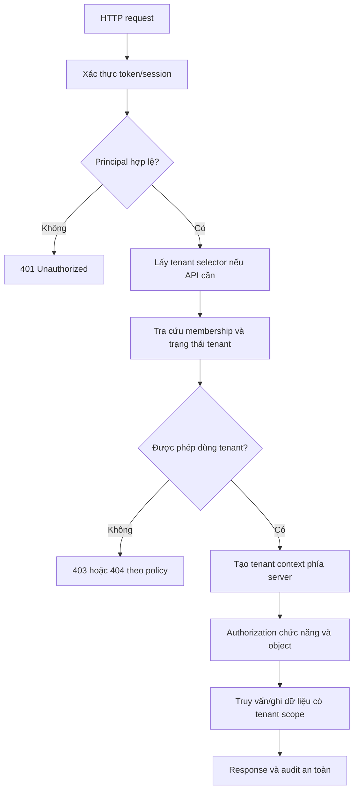

# Không tin tenant ID chỉ từ body hoặc query

Trong hệ thống multi-tenant, nhiều tổ chức hoặc khách hàng dùng chung một ứng dụng và hạ tầng nhưng dữ liệu của họ phải được cô lập. Một lỗi thường gặp là API lấy `tenantId` trực tiếp từ request body hoặc query rồi dùng giá trị đó để truy vấn dữ liệu. Người gọi chỉ cần đổi ID tenant là có thể thử truy cập dữ liệu của tổ chức khác. Đây là một dạng lỗi phân quyền mức đối tượng (Broken Object Level Authorization – BOLA), đồng thời có thể phá vỡ ranh giới tenant của toàn hệ thống.

Nguyên tắc thiết kế là: **tenant ID do client gửi chỉ là tenant được yêu cầu, không phải bằng chứng người gọi có quyền trong tenant đó**. Server phải xác thực principal, xác minh principal có membership và quyền phù hợp với tenant được yêu cầu, rồi tạo tenant context đáng tin cậy. Mọi truy vấn, cập nhật, cache, file, job và thao tác nghiệp vụ phải dùng context đã xác minh này.

## 1. Tenant isolation là gì?

Tenant là một đơn vị cô lập về mặt nghiệp vụ, ví dụ một công ty, tổ chức, khách hàng doanh nghiệp, trường học hoặc workspace. Một user có thể thuộc một tenant hoặc nhiều tenant. Trong mô hình SaaS, nhiều tenant có thể dùng chung application server, database, message broker và object storage; điều quan trọng là một tenant không thể đọc, sửa, xóa hoặc suy ra dữ liệu của tenant khác nếu không có quyền được ủy quyền rõ ràng.

Tenant isolation bao gồm nhiều lớp:

- **Identity isolation:** xác định user, service account hoặc workload đang gọi API.
- **Membership and authorization:** xác minh principal thuộc tenant nào, có vai trò và quyền gì trong tenant đó.
- **Data isolation:** mọi thao tác dữ liệu được giới hạn trong tenant context hợp lệ.
- **Resource isolation:** cache, file, search index, queue, job, quota và log không làm lộ hoặc trộn dữ liệu giữa tenant.
- **Operational isolation:** quản trị viên nền tảng, operator và service nội bộ chỉ truy cập tenant theo nhiệm vụ và quy trình được kiểm soát.

Tenant ID thường là UUID hoặc chuỗi khó đoán, nhưng tính khó đoán không phải biện pháp phân quyền. Một ID ngẫu nhiên vẫn có thể bị lộ từ URL, log, export, tài liệu, response hoặc một request hợp lệ khác. Bảo mật phải dựa trên membership và policy ở server, không dựa vào việc kẻ tấn công có đoán được ID hay không.

## 2. Vì sao không được tin tenant ID từ body hoặc query?

Giả sử user thuộc tenant `TENANT-A` gửi request:

```http
GET /api/invoices?tenantId=TENANT-A HTTP/1.1
Authorization: Bearer <access-token>
```

Nếu server thay đổi thành:

```http
GET /api/invoices?tenantId=TENANT-B HTTP/1.1
Authorization: Bearer <access-token>
```

và trả dữ liệu theo giá trị mới mà không kiểm tra membership, user có thể đọc hóa đơn của tenant B.

Lỗi tương tự xảy ra với body:

```http
POST /api/invoices/search HTTP/1.1
Authorization: Bearer <access-token>
Content-Type: application/json

{
  "tenantId": "TENANT-B",
  "status": "UNPAID"
}
```

Hoặc với tenant ID trong path và header:

```http
GET /api/tenants/TENANT-B/invoices/INV-900 HTTP/1.1
X-Tenant-ID: TENANT-B
Authorization: Bearer <access-token>
```

Body, query, path và custom header đều là dữ liệu do client kiểm soát. Đổi vị trí tenant ID từ body sang header không làm nó đáng tin hơn.

### 2.1. Những cách triển khai dễ mắc lỗi

| Cách làm | Vấn đề |
|---|---|
| `repository.findByTenantId(request.tenantId())` | Client tự chọn phạm vi truy vấn |
| Lấy `tenantId` từ query nếu có, nếu không thì dùng token | Hai nguồn tenant context có thể mâu thuẫn; dễ có nhánh xử lý bỏ qua kiểm tra |
| Tin `X-Tenant-ID` vì gateway đã thêm header | Client có thể gửi header giả nếu gateway không xóa và ghi đè header đầu vào |
| Chỉ kiểm tra tenant ID có tồn tại | Tồn tại không có nghĩa principal được phép truy cập |
| Dùng UUID khó đoán thay cho authorization | ID có thể bị lộ; khó đoán không phải quyền truy cập |
| Kiểm tra tenant ở frontend | Người dùng có thể gọi API trực tiếp và sửa request |
| Chỉ lọc tenant ở endpoint list | Endpoint detail, update, delete, export hoặc bulk có thể vẫn truy cập chéo tenant |

## 3. Nguồn tenant context đáng tin cậy

Tenant context cần được tạo sau khi xác thực và kiểm tra membership. Không có một nguồn duy nhất phù hợp cho mọi kiến trúc; điều quan trọng là client không thể tự khẳng định mình thuộc tenant nào.

### 3.1. Principal đã xác thực và membership phía server

Sau khi xác minh access token hoặc session, server có principal đại diện cho user/workload. Principal có thể chứa subject ID và một số claim đã được issuer tin cậy ký. Server tra cứu membership và quyền hiện hành để xác định tenant mà principal được phép thao tác.

Ví dụ mô hình dữ liệu:

```text
User
  id
  status

Tenant
  id
  status

TenantMembership
  user_id
  tenant_id
  status
  role
  permissions
```

Một user có thể có nhiều dòng `TenantMembership`. Khi user chọn tenant A, server kiểm tra membership của principal đối với A và trạng thái tenant/membership trước khi tạo context. Nếu membership đã bị thu hồi, user không thể tiếp tục dùng tenant A chỉ bằng cách gửi lại ID cũ.

### 3.2. Tenant claim trong access token

Một số hệ thống phát hành access token gắn với một tenant cụ thể, ví dụ claim `tenant_id`. Resource server chỉ nên tin claim này sau khi xác minh token đúng chữ ký hoặc cơ chế introspection, issuer, audience, thời hạn và các claim cần thiết. Token cũng phải được cấp cho đúng client/resource server và đúng mục đích.

Tuy nhiên, cần hiểu giới hạn của claim:

- Token chứa tenant A chỉ chứng minh authorization server đã phát hành token với tenant A tại thời điểm cấp, theo chính sách của issuer.
- Nếu user có thể đổi tenant, cần một quy trình chọn tenant và phát hành token/context mới theo membership.
- Nếu membership hoặc quyền bị thu hồi, JWT cũ có thể tiếp tục chứa claim cũ cho đến khi hết hạn, trừ khi có cơ chế thu hồi, token version hoặc kiểm tra trạng thái hiện hành.
- Không tự thêm claim từ query/body vào principal hoặc ghi đè claim đã xác minh.

Với token có thể truy cập nhiều tenant, claim danh sách tenant chỉ là đầu vào policy. Server vẫn phải xác minh tenant được chọn nằm trong phạm vi token và membership hiện hành theo yêu cầu bảo mật.

### 3.3. Tenant ID trong path/header như một selector

API có thể cần nhận tenant được yêu cầu trong path, ví dụ `/api/tenants/{tenantId}/invoices`, hoặc header `X-Tenant-ID`. Điều này có thể hữu ích khi một user thuộc nhiều tenant, nhưng giá trị đó chỉ là *selector* để server biết user muốn làm việc trong tenant nào.

Quy trình đúng:

1. Xác thực token/session và lấy principal đáng tin cậy.
2. Đọc tenant selector từ path/header/body nếu API cần.
3. Kiểm tra tenant tồn tại, đang hoạt động và principal có membership/quyền phù hợp.
4. Tạo tenant context từ kết quả đã xác minh ở server.
5. Dùng context đó cho toàn bộ xử lý request; không tiếp tục dùng selector thô.

Nếu gateway thêm `X-Tenant-ID`, gateway phải xóa header cùng tên do client gửi trước khi gắn giá trị đã xác minh. Ứng dụng vẫn nên xác minh ranh giới tin cậy giữa gateway và service; không mặc nhiên tin mọi header chỉ vì tên header có vẻ nội bộ.

### 3.4. Không có tenant context rõ ràng thì từ chối

Với endpoint yêu cầu tenant, thiếu context, tenant không hợp lệ hoặc membership không được xác nhận phải dẫn đến từ chối. Không nên tự chọn tenant mặc định, tenant đầu tiên trong danh sách hoặc tenant có ID do client gửi khi có lỗi tra cứu.

Endpoint công khai thực sự không thuộc tenant nào có thể được thiết kế riêng. Không dùng việc “không có tenant” để vô tình bỏ qua tenant filter trên endpoint vốn phải cô lập dữ liệu.

## 4. Quy trình xác minh và tạo tenant context

Một luồng xử lý điển hình:



Tenant context có thể gồm:

```java
public record TenantContext(
        UUID tenantId,
        UUID subjectId,
        Set<String> permissions,
        String requestId) {
}
```

Đây là dữ liệu nội bộ do server tạo sau khi xác minh; không deserialize trực tiếp `TenantContext` từ request body. Với workload/service account, subject có thể là client/workload ID thay vì user ID. Policy membership cần phản ánh đúng loại principal.

### Ví dụ service tạo context

```java
public TenantContext resolveTenantContext(
        AuthenticatedPrincipal principal,
        UUID requestedTenantId,
        String requestId) {

    TenantMembership membership = membershipRepository
            .findActiveBySubjectAndTenant(
                    principal.subjectId(), requestedTenantId)
            .orElseThrow(AccessDeniedException::new);

    if (!tenantRepository.isActive(requestedTenantId)) {
        throw new AccessDeniedException("Tenant is unavailable");
    }

    return new TenantContext(
            requestedTenantId,
            principal.subjectId(),
            membership.permissions(),
            requestId);
}
```

Ví dụ giả định `AuthenticatedPrincipal` đã được framework tạo sau xác thực. Trong hệ thống thực tế, cần kiểm tra thêm loại principal, trạng thái tài khoản, thời hạn membership, chính sách tenant và quyền cụ thể. Thông báo lỗi bên ngoài nên tránh tiết lộ tenant có tồn tại hay không nếu điều đó nhạy cảm.

## 5. Áp dụng tenant context cho mọi truy vấn

Sau khi tạo context, repository/service phải dùng tenant ID từ context. Không truyền tenant ID tùy ý từ controller xuống các tầng dưới rồi hy vọng mọi nơi đều kiểm tra đúng.

### 5.1. Luôn scope truy vấn theo tenant

Truy vấn list:

```java
public Page<Invoice> listInvoices(
        TenantContext context,
        InvoiceStatus status,
        Pageable pageable) {

    return invoiceRepository.findByTenantIdAndStatus(
            context.tenantId(), status, pageable);
}
```

Truy vấn detail/update/delete cũng phải bao gồm tenant:

```java
public Invoice getInvoice(TenantContext context, UUID invoiceId) {
    return invoiceRepository
            .findByIdAndTenantId(invoiceId, context.tenantId())
            .orElseThrow(NotFoundException::new);
}
```

Đối với cập nhật, có thể dùng một câu lệnh có điều kiện tenant để tránh khoảng thời gian giữa bước đọc và ghi:

```sql
UPDATE invoice
SET status = :new_status
WHERE id = :invoice_id
  AND tenant_id = :tenant_id;
```

Kiểm tra số dòng bị ảnh hưởng. Nếu không có dòng nào, trả kết quả phù hợp với policy; không chạy update lần hai chỉ theo `id`.

### 5.2. Không tin tenant ID nằm trong payload tạo mới

Khi tạo invoice, tenant ID phải lấy từ context:

```java
public Invoice createInvoice(
        TenantContext context,
        CreateInvoiceRequest request) {

    Invoice invoice = new Invoice();
    invoice.setTenantId(context.tenantId());
    invoice.setCustomerId(request.customerId());
    invoice.setAmount(request.amount());
    invoice.setCurrency(request.currency());

    return invoiceRepository.save(invoice);
}
```

`CreateInvoiceRequest` không cần trường `tenantId`. Nếu hợp đồng API bắt buộc có trường này để tương thích, server phải so sánh nó với tenant context đã xác minh và từ chối nếu không khớp; tuyệt đối không dùng giá trị request để ghi đè context.

### 5.3. Kiểm tra object trong tenant

Tenant filter là lớp đầu tiên, chưa đủ để bảo vệ mọi object trong cùng tenant. User A trong tenant X vẫn có thể không được phép xem invoice của user B trong cùng tenant. Vì vậy, cần kết hợp:

- Tenant scope: object thuộc tenant hiện tại.
- Object authorization: principal có quan hệ sở hữu, assignment hoặc ủy quyền với object.
- Function authorization: principal có permission thực hiện action.
- Business policy: trạng thái object và quy tắc nghiệp vụ cho phép thao tác.

Ví dụ `findByIdAndTenantId` chặn truy cập sang tenant khác, nhưng nếu user chỉ được xem invoice của chính mình thì truy vấn hoặc policy cần thêm điều kiện owner/customer.

## 6. Ràng buộc tenant ở database

Ứng dụng cần kiểm tra tenant ở service/repository; database có thể bổ sung lớp bảo vệ để giảm tác động khi một truy vấn bị viết thiếu filter.

### 6.1. Khóa và ràng buộc quan hệ có tenant

Với bảng chứa dữ liệu tenant, nên lưu `tenant_id` rõ ràng và tạo index phù hợp. Nếu quan hệ giữa hai bảng phải nằm trong cùng tenant, có thể dùng composite key hoặc composite foreign key để database từ chối liên kết chéo tenant.

Ví dụ:

```sql
CREATE TABLE customer (
    tenant_id UUID NOT NULL,
    id UUID NOT NULL,
    name TEXT NOT NULL,
    PRIMARY KEY (tenant_id, id)
);

CREATE TABLE invoice (
    tenant_id UUID NOT NULL,
    id UUID NOT NULL,
    customer_id UUID NOT NULL,
    amount NUMERIC(18, 2) NOT NULL,
    PRIMARY KEY (tenant_id, id),
    FOREIGN KEY (tenant_id, customer_id)
        REFERENCES customer (tenant_id, id)
);
```

Composite foreign key ngăn invoice của tenant A tham chiếu nhầm customer của tenant B, kể cả khi hai bảng có ID riêng. Cần thiết kế index và query plan phù hợp với workload thực tế.

### 6.2. Row-Level Security

Một số database, ví dụ PostgreSQL, hỗ trợ Row-Level Security (RLS). Policy có thể giới hạn row theo tenant context được thiết lập trong transaction. Ví dụ minh họa:

```sql
ALTER TABLE invoice ENABLE ROW LEVEL SECURITY;
ALTER TABLE invoice FORCE ROW LEVEL SECURITY;

CREATE POLICY invoice_tenant_policy ON invoice
USING (
    tenant_id = current_setting('app.tenant_id', true)::uuid
)
WITH CHECK (
    tenant_id = current_setting('app.tenant_id', true)::uuid
);
```

Ứng dụng cần thiết lập context trong transaction trước khi truy vấn:

```sql
SET LOCAL app.tenant_id = '...verified-tenant-uuid...';
```

`SET LOCAL` giới hạn giá trị theo transaction, giúp giảm nguy cơ context rò rỉ qua connection pool khi transaction kết thúc. Cần bảo đảm mọi truy vấn tenant đều chạy trong transaction đã thiết lập context; khi không có context, policy phải từ chối truy cập. Không dùng role database có quyền bypass RLS cho luồng ứng dụng thông thường. Chủ sở hữu bảng, superuser và cấu hình `BYPASSRLS` có thể có hành vi đặc biệt; cần kiểm tra bằng đúng database role chạy production.

RLS là defense in depth, không thay thế membership, function authorization hoặc object authorization. Nếu ứng dụng có thể tự đặt `app.tenant_id` tùy ý từ dữ liệu client, RLS cũng sẽ bị vô hiệu hóa về mặt logic. Chỉ thiết lập giá trị này từ tenant context đã xác minh ở server.

## 7. Tenant isolation ngoài database

Một hệ thống có thể truy vấn database đúng tenant nhưng vẫn rò rỉ dữ liệu qua cache, file, search, queue hoặc job. Tenant context phải theo request xuyên suốt các thành phần này.

### 7.1. Cache

Cache key cần bao gồm tenant ID đã xác minh và các yếu tố phân quyền cần thiết. Ví dụ:

```text
invoice:{tenantId}:{invoiceId}
invoice-list:{tenantId}:{filterHash}:{page}
```

Không dùng key chỉ theo `invoiceId` nếu ID không đảm bảo duy nhất toàn hệ thống hoặc nội dung còn phụ thuộc quyền user. Với response cá nhân hóa, cache key có thể cần subject/permission version hoặc không nên cache dùng chung. Khi thay đổi quyền hoặc membership, cần vô hiệu hóa cache liên quan hoặc bảo đảm cache không phục vụ nội dung theo quyền cũ.

### 7.2. Object storage và file

Đường dẫn lưu trữ phải được namespace theo tenant hoặc dùng metadata ownership phía server, ví dụ:

```text
tenants/{tenantId}/invoices/{invoiceId}/document.pdf
```

Không cho client tự chọn bucket/key tùy ý rồi trả file chỉ vì biết URL. Khi download, server phải xác minh tenant context và quyền trên tài liệu trước khi phát hành URL ký (pre-signed URL). URL ký cần thời hạn ngắn, quyền tối thiểu và giới hạn đúng object; nếu URL bị lộ, người có URL có thể dùng trong thời hạn hiệu lực nên cần xem nó như một bearer credential.

### 7.3. Search index và analytics

Mọi document trong search index cần có tenant metadata đáng tin cậy. Query phải thêm tenant filter từ context server, không lấy filter duy nhất từ body. Kiểm tra cả aggregation, facet, autocomplete và export vì chúng có thể làm lộ số lượng hoặc metadata của tenant khác. Dashboard analytics dùng chung cũng cần row-level filter và quyền riêng.

### 7.4. Message queue và background job

Message/job phải mang tenant ID cùng principal/service identity và correlation ID cần thiết, nhưng consumer không được tin message chỉ vì nó có trường `tenantId`. Producer phải tạo payload từ context đã xác minh; consumer phải xác thực nguồn message, kiểm tra schema, xác minh tenant/ownership theo policy và giới hạn dữ liệu trước khi xử lý.

Ví dụ message:

```json
{
  "eventId": "EVT-9001",
  "tenantId": "TENANT-A",
  "invoiceId": "INV-100",
  "requestedBy": "USER-42",
  "eventType": "INVOICE_EXPORT_REQUESTED"
}
```

Consumer cần tra cứu invoice theo cả `tenantId` và `invoiceId`, kiểm tra job được tạo bởi principal có quyền và không cho phép message giả đổi tenant. Với job dài hạn, cần quyết định quyền được đánh giá tại thời điểm tạo hay tại thời điểm thực thi; các thao tác nhạy cảm thường cần kiểm tra lại trạng thái membership/quyền khi chạy.

### 7.5. Log, metric và tracing

Có thể ghi tenant ID đã xác minh để phục vụ điều tra, phân tích và quota, nhưng phải giới hạn quyền xem và tránh đưa dữ liệu nhạy cảm vào log. Không ghi raw token hoặc bí mật. Không để metric label có cardinality không kiểm soát nếu tenant ID có số lượng lớn; dùng hệ thống phân tích phù hợp và giới hạn dữ liệu định danh.

## 8. Tenant admin và platform admin

Không phải mọi admin đều có quyền giống nhau:

- **Tenant administrator** quản lý user, role, cấu hình và dữ liệu trong tenant của mình.
- **Platform administrator** vận hành nền tảng nhiều tenant; quyền truy cập tenant cần được giới hạn theo nhiệm vụ, phê duyệt, thời hạn và audit.
- **Operator/support** có thể được cấp quyền hỗ trợ tạm thời trong phạm vi ticket/tenant được phân công.

Không dùng role `ADMIN` chung để bỏ qua tenant filter. Nếu có chức năng hỗ trợ truy cập nhiều tenant, phải có policy riêng, xác thực mạnh, lý do truy cập, thời hạn ngắn và audit đầy đủ. Một platform admin không nên tự động nhận mọi quyền đọc dữ liệu nghiệp vụ; có thể tách quyền vận hành hạ tầng khỏi quyền xem dữ liệu khách hàng.

Impersonation hoặc truy cập thay mặt tenant cần được thiết kế như một luồng đặc quyền riêng: ai khởi tạo, tenant nào, lý do gì, phạm vi action, thời hạn, người phê duyệt và cách kết thúc. Không thay đổi tenant context ngầm giữa request hoặc tái sử dụng context của request trước.

## 9. Rủi ro khi tenant context bị rò rỉ hoặc xử lý sai

### 9.1. Thread-local và context không được dọn

Một số ứng dụng lưu tenant context trong `ThreadLocal`. Nếu không xóa context sau request, thread được tái sử dụng có thể mang tenant của request trước sang request tiếp theo. Cần đặt context trong filter/interceptor có `try/finally`, luôn clear khi kết thúc và kiểm thử với thread pool.

Với reactive stack hoặc asynchronous execution, thread có thể thay đổi giữa các bước; `ThreadLocal` thông thường không tự truyền context an toàn. Dùng cơ chế context propagation phù hợp của framework và bảo đảm tenant context không bị mất hoặc bị trộn.

### 9.2. Connection pool và database session state

Nếu dùng session variable để RLS, phải đặt trong transaction bằng cơ chế local hoặc reset chắc chắn. Session-level setting còn sót trên connection được tái sử dụng có thể khiến request sau chạy dưới tenant cũ. Kiểm thử connection pool với nhiều tenant luân phiên và transaction rollback/exception.

### 9.3. Bulk, export và báo cáo

Endpoint export có thể dùng query riêng hoặc chạy background, bỏ qua repository thông thường. Mọi query và file export phải được tenant-scope; quyền cần được kiểm tra cả khi tạo yêu cầu và khi job thực thi. Giới hạn số bản ghi, thời gian, dung lượng và quota để ngăn một tenant tiêu hao tài nguyên của tenant khác.

### 9.4. Lỗi và side channel

Không trả thông báo khác nhau một cách không cần thiết để lộ tenant/object có tồn tại hay không. Thời gian phản hồi, số lượng kết quả, autocomplete, error detail và metric endpoint cũng có thể tiết lộ metadata. Chọn `403` hoặc `404` theo policy nhất quán và chỉ trả thông tin mà principal được phép biết.

## 10. Kiểm thử tenant isolation

Kiểm thử phải chứng minh tenant A không thể truy cập dữ liệu tenant B bằng cách sửa bất kỳ đầu vào nào, và mọi luồng phụ đều giữ tenant context.

| Nhóm kiểm thử | Tình huống | Kết quả mong đợi |
|---|---|---|
| Body tampering | User A gửi `tenantId` của B trong JSON body | Bị từ chối hoặc trường bị bỏ qua theo hợp đồng; không truy cập B |
| Query tampering | Đổi `?tenantId=A` thành `?tenantId=B` | Membership được xác minh; không truy cập B |
| Path tampering | Đổi `/tenants/A/...` thành `/tenants/B/...` | Server xác minh selector với principal |
| Header spoofing | Gửi `X-Tenant-ID: B` hoặc header trùng lặp | Header không được tin nếu chưa qua xác minh; gateway phải xóa/ghi đè đầu vào giả |
| Missing context | Bỏ tenant selector hoặc token không có tenant phù hợp | Từ chối theo hợp đồng; không chọn tenant mặc định ngoài ý muốn |
| Cross-tenant object | Dùng invoice ID của B trong tenant A | Không đọc, cập nhật hoặc xóa được |
| Create tampering | Gửi body tạo mới với `tenantId: B` | Record được gắn tenant từ context A hoặc request bị từ chối |
| Bulk/export | Export danh sách lớn khi thêm filter tenant khác | Không có dữ liệu ngoài tenant |
| Cache poisoning/leak | Request A và B cùng object key/filter | Cache không trả nội dung tenant khác |
| File access | Dùng object key hoặc pre-signed URL của tenant khác | Không cấp URL/không tải được |
| Async job | Sửa tenant ID trong message hoặc chạy job sau khi membership bị thu hồi | Consumer xác minh nguồn và quyền theo policy |
| RLS | Chạy query thiếu tenant filter bằng application DB role | RLS vẫn giới hạn row đúng tenant |
| Connection reuse | Request A rồi B trên cùng pool/thread | Không rò rỉ tenant context giữa hai request |
| Privileged admin | Platform admin truy cập tenant không có nhiệm vụ/approval | Bị từ chối và audit theo policy |

Nên tạo dữ liệu thử nghiệm với ít nhất hai tenant, mỗi tenant có object ID và user riêng. Chạy test qua security filter, service, repository, cache và storage thật trong môi trường test. Đừng chỉ kiểm tra controller; lỗi thường nằm ở query phụ, export, consumer hoặc cache.

## 11. Checklist thiết kế trước khi phát hành

- [ ] Tenant ID từ body/query/path/header được xem là selector không đáng tin cậy.
- [ ] Principal được xác thực trước khi resolve tenant context.
- [ ] Membership, trạng thái tenant và permission được xác minh ở server.
- [ ] Tenant context do server tạo và được truyền rõ ràng qua các tầng xử lý.
- [ ] Mọi truy vấn list/detail/update/delete/bulk/export đều có tenant scope.
- [ ] Tenant ID của record mới lấy từ context, không lấy trực tiếp từ payload.
- [ ] Có kiểm tra object ownership/assignment trong cùng tenant.
- [ ] Database có index/constraint phù hợp; cân nhắc RLS như lớp phòng vệ bổ sung.
- [ ] RLS không bị bypass bởi application DB role; transaction và connection pool được kiểm tra.
- [ ] Cache key, file path, search index, message và background job đều giữ tenant scope.
- [ ] Tenant admin, platform admin và operator có policy riêng; quyền đặc biệt có audit.
- [ ] Context được clear/propagate đúng trong thread pool, reactive flow và async job.
- [ ] Có test body/query/path/header tampering, cross-tenant object, cache, storage, queue và RLS.
- [ ] Log không chứa token/secret và chỉ ghi tenant metadata cần thiết.

Tenant isolation không được bảo đảm bằng cách giấu tenant ID hoặc dùng ID khó đoán. Server phải xác thực principal, kiểm tra membership và quyền trong tenant được yêu cầu, tạo context tin cậy rồi áp dụng context đó ở mọi điểm truy cập dữ liệu và tài nguyên. Khi tenant context được kiểm soát xuyên suốt từ HTTP request đến database, cache, storage và background job, việc thay đổi một giá trị trong body hoặc query sẽ không thể mở rộng phạm vi truy cập của người gọi.
