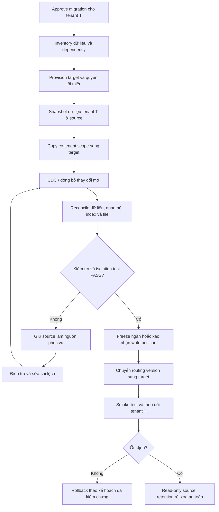

# Tenant migration không làm lộ dữ liệu

Tenant migration là quá trình chuyển dữ liệu và workload của một tenant từ vị trí lưu trữ hoặc môi trường này sang vị trí khác. Ví dụ, hệ thống có thể chuyển tenant từ database dùng chung sang shard riêng, đổi vùng lưu trữ, tách tenant lớn khỏi cụm hiện tại hoặc hợp nhất hạ tầng sau khi tái cấu trúc.

Trong suốt quá trình này, ranh giới dữ liệu giữa các tenant phải được giữ nguyên. Người dùng của tenant A không được đọc dữ liệu tenant B vì bản ghi bị copy nhầm, route trỏ sai database, cache dùng lại dữ liệu cũ, job chạy bằng quyền quá rộng hoặc ứng dụng tạm thời đọc cả nguồn lẫn đích. Migration thành công về mặt kỹ thuật khi dữ liệu đã được chuyển; migration an toàn còn phải chứng minh rằng quyền truy cập và tính cô lập vẫn đúng trước, trong và sau cutover.

Bài học thuộc phạm vi API Security: việc định tuyến request, xác định tenant, kiểm tra quyền trên object, bảo vệ dữ liệu, kiểm thử và giám sát đều phải nhất quán trong lúc hạ tầng thay đổi. `tenantId` là security context do server xác định, không phải giá trị mà client có thể tự chọn để truy cập một kho dữ liệu.

## 1. Xác định phạm vi tenant migration

Trước khi thiết kế, hãy xác định chính xác điều gì sẽ được di chuyển. Một tenant thường có dữ liệu ở nhiều nơi:

- Bản ghi nghiệp vụ trong database: khách hàng, đơn hàng, hóa đơn, giao dịch và cấu hình.
- Tệp trong object storage: ảnh, tài liệu, bản xuất và bản sao lưu.
- Search index, cache, materialized view và dữ liệu phân tích.
- Message, event, scheduled task và background job đang chờ xử lý.
- Secret, khóa mã hóa, credential tích hợp và webhook configuration.
- Metadata điều khiển như tenant-to-shard mapping, trạng thái migration và phiên bản routing.

Chuyển database mà quên search index hoặc object storage vẫn có thể làm lộ dữ liệu. Ví dụ API đọc hóa đơn từ database mới nhưng tải PDF từ bucket cũ qua object key do client cung cấp. Vì vậy, hãy lập inventory theo tenant và theo loại dữ liệu, đồng thời xác định owner của từng hệ thống.

Các kiểu migration phổ biến:

| Kiểu migration | Ví dụ | Rủi ro cần kiểm soát |
|---|---|---|
| Shared database sang shared database khác | Chuyển tenant giữa hai cụm PostgreSQL | Copy nhầm tenant, thiếu bản ghi, routing cập nhật sai |
| Shared database sang dedicated database | Tách tenant lớn sang database riêng | Quyền migration quá rộng, app đọc nhầm nguồn/đích trong giai đoạn chuyển tiếp |
| Shard sang shard | Cân bằng tải hoặc thay đổi phân vùng | Mapping shard cũ/mới không đồng bộ, request đến nhầm shard |
| Region sang region | Di chuyển tenant sang khu vực địa lý khác | Replication, residency, khóa mã hóa và bản sao lưu |
| Thay đổi tenant ownership hoặc hợp nhất tenant | Chuyển một workspace sang tổ chức khác | Thay đổi quyền sở hữu, quan hệ chia sẻ và dữ liệu người dùng |

Không giả định mọi loại migration có cùng quy tắc. Nếu thay đổi cả tenant owner hoặc tổ chức pháp lý, cần xác định rõ consent, ownership, retention và quyền truy cập mới. Chuyển vị trí lưu trữ không tự động đồng nghĩa chuyển quyền sở hữu dữ liệu.

## 2. Nguyên tắc bảo mật xuyên suốt migration

Hãy giữ các nguyên tắc sau trong mọi giai đoạn:

1. **Tenant context đáng tin cậy:** ứng dụng xác định tenant từ principal đã xác thực, domain mapping hoặc control plane được bảo vệ. Không dùng `tenantId` trong request làm nguồn quyền.
2. **Least privilege:** migration worker chỉ được đọc tenant nguồn đã chỉ định và ghi tenant đích tương ứng; credential có thời hạn và được thu hồi sau khi hoàn tất.
3. **Isolation by construction:** truy vấn, copy, queue, cache và object storage đều có phạm vi tenant tường minh.
4. **Atomic routing decision:** việc chuyển traffic sang đích phải có phiên bản hoặc trạng thái rõ ràng, tránh hai node ứng dụng định tuyến cùng tenant theo hai mapping khác nhau.
5. **No unverified cutover:** chỉ chuyển traffic khi dữ liệu, quan hệ, index và quyền truy cập đã được đối soát.
6. **Auditable operations:** mỗi lần bắt đầu, copy, cutover, rollback hoặc xóa dữ liệu nguồn đều có actor, tenant, thời điểm và kết quả được ghi nhận.
7. **Safe failure:** khi không xác định được tenant hoặc mapping, request phải bị từ chối hoặc tạm dừng có kiểm soát; không fallback sang database mặc định có thể chứa tenant khác.

## 3. Mô hình luồng migration an toàn

Một quy trình có thể chia thành các giai đoạn: chuẩn bị, copy dữ liệu ban đầu, đồng bộ thay đổi, kiểm tra, cutover, theo dõi và dọn dẹp. Trạng thái migration cần được quản lý trong control plane đáng tin cậy.



Sơ đồ là mô hình tham khảo. Với hệ thống nhỏ có thể dùng maintenance window và dừng ghi trong lúc copy. Với hệ thống lớn cần giảm downtime, snapshot kết hợp Change Data Capture (CDC) thường phù hợp hơn. Dù chọn cách nào, điểm quyết định là không được có khoảng thời gian mà ứng dụng không biết nguồn dữ liệu có thẩm quyền hoặc đọc đồng thời từ hai nơi mà không có quy tắc nhất quán.

## 4. Xác định tenant từ control plane, không từ client

Ứng dụng thường cần một bảng hoặc dịch vụ điều khiển để ánh xạ tenant tới database, shard hoặc region. Ví dụ:

| tenant_id | storage_location | routing_version | migration_state |
|---|---|---:|---|
| `tenant-A` | `shard-01` | 12 | `ACTIVE` |
| `tenant-B` | `db-tenant-B` | 4 | `ACTIVE` |
| `tenant-C` | `shard-03` | 7 | `MIGRATING` |

Mapping này là dữ liệu nhạy cảm vì nó quyết định nơi ứng dụng đọc và ghi. Chỉ control plane hoặc thành phần được ủy quyền mới được thay đổi. Không cung cấp endpoint cho client tự gửi `storage_location` hoặc `shard_id`.

Luồng xử lý request nên là:

1. Xác thực token và tạo principal.
2. Xác định tenant context từ claim đã xác minh hoặc membership được tra cứu phía server.
3. Kiểm tra caller được phép hoạt động trong tenant đó.
4. Đọc routing mapping từ control plane/cache có phiên bản và thời hạn phù hợp.
5. Chọn đúng data source và thực hiện object/function authorization trong phạm vi tenant.

Ví dụ pseudocode:

```java
TenantId tenantId = tenantContext.requireCurrentTenant();
TenantRoute route = tenantRouting.resolve(tenantId);

if (!route.isAvailableForApplicationTraffic()) {
    throw new TenantTemporarilyUnavailableException();
}

TenantDataSource dataSource = dataSourceRegistry.require(route.location());
return invoiceRepository.forTenant(dataSource)
        .findVisibleTo(tenantId, principal.subject(), invoiceId);
```

Đây là pseudocode, không phải API cụ thể của Spring. Điểm cần giữ là tenant context và route do server xác định; repository vẫn giới hạn truy vấn theo tenant và quyền trên object. Biết được database đích không đồng nghĩa caller được đọc mọi dữ liệu trong database đó.

## 5. Cô lập dữ liệu ở schema và truy vấn

Với shared database/shared schema, mỗi bảng tenant-scoped nên có `tenant_id` và các truy vấn phải giới hạn theo tenant. Có thể dùng composite key hoặc unique constraint chứa tenant để tránh liên kết chéo.

Ví dụ:

```sql
CREATE TABLE invoice (
    tenant_id UUID NOT NULL,
    invoice_id UUID NOT NULL,
    customer_id UUID NOT NULL,
    status VARCHAR(30) NOT NULL,
    amount NUMERIC(18, 2) NOT NULL,
    PRIMARY KEY (tenant_id, invoice_id)
);

CREATE TABLE invoice_line (
    tenant_id UUID NOT NULL,
    invoice_id UUID NOT NULL,
    line_id UUID NOT NULL,
    description VARCHAR(200) NOT NULL,
    PRIMARY KEY (tenant_id, invoice_id, line_id),
    FOREIGN KEY (tenant_id, invoice_id)
        REFERENCES invoice (tenant_id, invoice_id)
);
```

Composite foreign key bảo đảm một dòng hóa đơn không thể tham chiếu invoice của tenant khác thông qua quan hệ này. Các bảng liên quan khác cũng cần được rà soát: attachment, payment, audit, outbox, address và bảng join.

Mọi truy vấn tenant-scoped phải có tenant context:

```sql
SELECT invoice_id, status, amount
FROM invoice
WHERE tenant_id = :trusted_tenant_id
  AND invoice_id = :invoice_id;
```

`trusted_tenant_id` phải đến từ security context/control plane, không phải từ JSON body. Hạn chế tạo repository method chỉ nhận `invoice_id` nếu nó có thể truy xuất bản ghi ngoài phạm vi. Có thể tạo tenant-aware repository hoặc truyền tenant context bắt buộc để giảm khả năng quên điều kiện.

Với database-per-tenant, database riêng tạo thêm ranh giới hạ tầng nhưng không loại bỏ authorization. Một connection pool hoặc credential có thể truy cập nhiều database; routing sai hoặc dùng nhầm connection vẫn có thể gây rò rỉ. Quyền database và mapping connection cần được giới hạn tương ứng.

## 6. Row-Level Security và giới hạn của nó

PostgreSQL Row-Level Security (RLS) có thể bổ sung lớp bảo vệ ở database. Ví dụ policy dựa trên tenant context trong session:

```sql
ALTER TABLE invoice ENABLE ROW LEVEL SECURITY;
ALTER TABLE invoice FORCE ROW LEVEL SECURITY;

CREATE POLICY invoice_tenant_policy ON invoice
USING (
    tenant_id = current_setting('app.tenant_id', true)::uuid
)
WITH CHECK (
    tenant_id = current_setting('app.tenant_id', true)::uuid
);
```

Ứng dụng cần thiết lập tenant context an toàn cho từng transaction/connection, ví dụ dùng `SET LOCAL app.tenant_id = ...` bên trong transaction. Không dùng session state lâu dài trên connection pool nếu không bảo đảm reset; tenant A có thể vô tình để lại context cho request tenant B. Kiểm tra rõ hành vi khi setting bị thiếu hoặc rỗng: policy phải từ chối, không mở toàn bộ bảng.

RLS có các giới hạn cần hiểu:

- Database owner, role có `BYPASSRLS` hoặc superuser có thể vượt qua policy theo cấu hình/quyền của PostgreSQL. Ứng dụng runtime không nên kết nối bằng role có quyền bypass.
- Migration role có thể cần quyền rộng hơn runtime role; phải tách riêng và giới hạn theo tenant/job.
- RLS không thay thế kiểm tra function permission, quyền trên object theo nghiệp vụ hoặc validation.
- Cần test qua connection pool và transaction thực tế, không chỉ chạy một câu SQL trong console.

RLS là defense in depth. Nếu kiến trúc dùng database-per-tenant hoặc schema-per-tenant, vẫn cần xác minh routing và quyền kết nối không thể trỏ sang tenant khác.

## 7. Cấp quyền cho migration worker theo phạm vi tenant

Migration worker là một workload đặc quyền. Nó có thể đọc nhiều dữ liệu và ghi vào vị trí mới, vì vậy credential cần được thiết kế riêng.

Không nên dùng tài khoản DBA hoặc credential ứng dụng production có quyền đọc/ghi mọi tenant cho một script copy đơn giản. Thay vào đó:

- Cấp quyền đọc trên source tenant được phê duyệt và quyền ghi trên target tương ứng.
- Dùng workload identity hoặc credential ngắn hạn; không lưu password trong script, file cấu hình hoặc log.
- Tách role đọc nguồn, ghi đích và cập nhật control-plane routing khi có thể.
- Hạn chế quyền DDL/administrative; chỉ cấp khi migration schema thật sự cần.
- Ràng buộc job với `migration_id`, `tenant_id`, source, target và phiên bản schema đã phê duyệt.
- Ghi audit cho mọi lần cấp credential, bắt đầu, retry, pause, cutover và revoke.
- Thu hồi credential tạm thời sau khi hoàn tất hoặc hủy migration.

Worker phải xác minh rằng tenant trong job khớp với tenant của mọi batch được đọc và ghi. Không cho phép một tham số dòng lệnh hoặc message không tin cậy đổi `tenant_id` giữa chừng.

Ví dụ contract của job:

```json
{
  "migrationId": "mig-2026-041",
  "tenantId": "tenant-C",
  "source": "shard-03",
  "target": "db-tenant-C",
  "routingVersionExpected": 7,
  "schemaVersion": 24
}
```

Job cần tra cứu lại migration record đã được phê duyệt trong control plane. Không tin JSON message tự nó là bằng chứng cho phép di chuyển tenant.

## 8. Copy dữ liệu với tenant scope rõ ràng

Khi copy từ shared database, mọi truy vấn nguồn phải lọc theo tenant:

```sql
SELECT tenant_id, invoice_id, customer_id, status, amount
FROM invoice
WHERE tenant_id = :approved_tenant_id
ORDER BY invoice_id;
```

Khi ghi vào target shared database, giữ nguyên tenant key hoặc dùng mapping đã được phê duyệt:

```sql
INSERT INTO target_invoice (
    tenant_id, invoice_id, customer_id, status, amount
)
VALUES (
    :approved_tenant_id, :invoice_id, :customer_id, :status, :amount
);
```

Nếu target là database riêng không lưu `tenant_id`, vẫn cần lưu metadata tenant ở control plane và ràng buộc database đó với đúng tenant. Không dựa vào tên database do client truyền.

Các kiểm soát khi copy:

- Đọc theo batch có giới hạn và điều kiện tenant tường minh.
- Không dùng `SELECT *` nếu schema có trường nhạy cảm hoặc cột không thuộc phạm vi migration.
- Duy trì quan hệ cha-con bằng mapping có kiểm tra; không ghép bản ghi chỉ theo ID nếu ID không unique toàn hệ thống.
- Dùng parameterized query; tránh nối tenant ID vào SQL động.
- Mã hóa kết nối source-target và bảo vệ snapshot/temporary file.
- Không ghi raw row, payload hoặc secret vào log.
- Gắn migration ID và checkpoint để retry không nhân đôi hoặc trộn batch.

Nếu phải biến đổi dữ liệu, transformation cần có phiên bản và test riêng. Một lỗi mapping `tenant_id`, `customer_id` hoặc foreign key có thể tạo ra quan hệ xuyên tenant dù số lượng bản ghi vẫn khớp.

## 9. Đồng bộ thay đổi trong khi hệ thống vẫn hoạt động

Copy snapshot có thể mất nhiều thời gian. Trong lúc đó, ứng dụng vẫn nhận request ghi. Nếu không đồng bộ thay đổi, target sẽ thiếu các cập nhật phát sinh sau snapshot.

Hai chiến lược thường gặp:

| Chiến lược | Cách làm | Điều kiện bảo mật và nhất quán |
|---|---|---|
| Maintenance window | Tạm dừng ghi tenant, copy dữ liệu, kiểm tra rồi chuyển route | Phải từ chối hoặc xếp hàng request ghi trong thời gian freeze; thông báo và audit rõ ràng |
| Snapshot + CDC | Copy snapshot rồi phát lại thay đổi từ transaction log/outbox đến target | CDC phải lọc đúng tenant, giữ thứ tự cần thiết, chống replay và theo dõi replication lag |

Tránh dual-write tùy tiện, trong đó ứng dụng ghi độc lập vào cả source và target mà không có giao thức nhất quán. Một request có thể ghi thành công ở source nhưng thất bại ở target, hoặc ngược lại. Nếu cần dual-write trong giai đoạn chuyển tiếp, phải có outbox/idempotency, xác định nguồn có thẩm quyền và quy tắc xử lý lỗi/replay.

Với CDC, consumer cần xác minh tenant của từng event. Một topic dùng chung có thể chứa event của nhiều tenant; partition key theo tenant giúp giữ thứ tự nhưng không tự tạo quyền. Bộ lọc ở consumer và target write vẫn phải kiểm tra tenant.

Theo dõi checkpoint, lag, số event bị retry/dead-letter và trạng thái apply. Không cutover khi còn thay đổi chưa được áp dụng hoặc không thể chứng minh target đã bắt kịp source.

## 10. Quản lý trạng thái migration và routing version

Hãy biểu diễn migration như state machine có chuyển trạng thái hợp lệ. Ví dụ:

| Trạng thái | Ý nghĩa | Hành vi application traffic |
|---|---|---|
| `ACTIVE_SOURCE` | Tenant đang hoạt động ở nguồn | Chỉ route tới source |
| `COPYING` | Đang copy snapshot | Source vẫn là nguồn phục vụ có thẩm quyền |
| `CATCHING_UP` | Đang áp dụng CDC | Source vẫn là nguồn phục vụ; target chưa được đọc bởi request thông thường |
| `READY_TO_CUTOVER` | Đối soát đạt, chờ cutover | Giữ source; chỉ cho phép thao tác cutover được phê duyệt |
| `CUTOVER` | Routing version mới trỏ target | Request mới dùng target theo phiên bản mapping mới |
| `STABILIZING` | Theo dõi sau chuyển đổi | Target là nguồn phục vụ; source bị giới hạn quyền ghi |
| `COMPLETED` | Migration hoàn tất | Chỉ target còn trong routing hoạt động |
| `ROLLBACK` | Đang phục hồi theo kế hoạch | Chuyển về nguồn có thẩm quyền theo quy trình đã kiểm chứng |

Mỗi chuyển trạng thái cần điều kiện và actor được phép. Ví dụ không được chuyển `COPYING` trực tiếp sang `COMPLETED`; phải qua đối soát và cutover. Dùng compare-and-swap hoặc transaction để cập nhật state và routing version, tránh hai operator/job cùng cutover.

Ứng dụng có thể cache mapping. Mỗi mapping nên có version; request hoặc connection pool cần nhận biết phiên bản cũ và refresh/invalidate khi control plane đổi route. Nếu một node vẫn dùng mapping cũ sau cutover, nó có thể ghi vào source trong khi node khác ghi target. Khi không xác minh được version, tạm từ chối hoặc retry an toàn thay vì tự chọn một database.

## 11. Cutover không tạo cửa sổ truy cập chéo

Trước cutover, cần xác định rõ nguồn nào là authoritative. Một quy trình phổ biến:

1. Xác nhận target đã nhận đủ snapshot và CDC tới checkpoint cuối.
2. Tạm dừng hoặc fence các write mới tới source của tenant đang di chuyển.
3. Chờ transaction đang chạy hoàn tất và xác nhận replication lag bằng 0 hoặc nằm trong điều kiện đã phê duyệt.
4. Chạy đối soát cuối, gồm quan hệ, constraint và số lượng dữ liệu.
5. Cập nhật routing mapping và version trong một thao tác nguyên tử.
6. Làm mới/invalidate cache routing và connection pool theo version.
7. Chạy smoke test bằng principal thuộc tenant đó và test âm tính bằng principal tenant khác.
8. Theo dõi lỗi và audit; giữ source read-only hoặc fenced trong thời gian ổn định.

Không cho request thông thường thử source rồi target nếu không tìm thấy object ở nơi đầu tiên. Cách fallback này có thể biến một lỗi routing thành khả năng dò hoặc truy cập dữ liệu tenant khác. Nếu cần đọc fallback trong giai đoạn chuyển đổi, quy tắc phải giới hạn đúng tenant, có mục đích rõ và không bao giờ mở rộng quyền của caller.

## 12. Kiểm soát object storage, search, cache và analytics

Tenant migration không chỉ là chuyển bảng database. Hãy xử lý từng dependency theo cùng tenant mapping:

### Object storage và file

- Copy đúng prefix/bucket của tenant đã phê duyệt.
- Xác minh object metadata, checksum và quan hệ file-to-record.
- Dùng role chỉ đọc prefix nguồn và ghi prefix đích.
- Không cho client chỉ định bucket hoặc object key tùy ý để lấy file.
- Reissue pre-signed URL theo vị trí mới; giới hạn thời gian và quyền.
- Thu hồi hoặc vô hiệu hóa URL cũ theo policy khi cutover.

### Search index

- Index document phải có tenant identifier hoặc được tách index theo tenant.
- Rebuild/reindex theo tenant scope, không chạy truy vấn export toàn cụm rồi lọc sau.
- Chỉ chuyển alias/index routing sau khi kiểm tra count và tenant filter.
- Xác minh query API luôn áp dụng tenant filter phía server.

### Cache

- Xóa hoặc namespace cache theo tenant và routing version.
- Không để key chỉ dựa trên object ID nếu response phụ thuộc principal/tenant.
- Invalidate cache cũ tại cutover và khi quyền/owner thay đổi.
- Kiểm thử hai tenant gọi cùng route không nhận response của nhau.

### Analytics và reporting

- Xác minh partition, row-level filter và quyền truy cập dashboard.
- Không để bản export hoặc materialized view còn chứa bản sao ngoài phạm vi retention.
- Kiểm tra aggregate, total và báo cáo không cộng nhầm dữ liệu giữa tenant.

## 13. Message queue và background job trong thời gian di chuyển

Queue có thể chứa job được tạo trước migration nhưng thực thi sau cutover. Một job cũ có thể lưu database location hoặc object reference của source. Nếu worker không xử lý routing version, nó có thể ghi vào nơi đã bị fence hoặc đọc dữ liệu ngoài tenant.

Thiết kế message nên mang tenant ID, object reference, job ID và schema version; không mang credential hoặc quyền tự khai. Worker cần:

- Xác thực service identity.
- Kiểm tra message đến từ producer tin cậy và có tính toàn vẹn.
- Xác minh tenant/object nằm trong phạm vi job đã được cấp.
- Resolve vị trí hiện tại từ control plane thay vì tin địa chỉ source trong message cũ.
- Dùng idempotency để xử lý retry và duplicate event.
- Dừng hoặc retry có kiểm soát nếu tenant đang ở trạng thái cutover/fenced.
- Không dùng service account có thể đọc toàn bộ tenant nếu job chỉ cần một tenant.

Với job dài hạn như export, cần quyết định quyền được đánh giá tại thời điểm tạo job hay thời điểm thực thi. Ghi rõ policy này; nếu quyền bị thu hồi giữa hai thời điểm, hành vi phải phù hợp với yêu cầu sản phẩm và bảo mật.

## 14. Đối soát và chứng minh dữ liệu không bị trộn

So sánh tổng số row là chưa đủ. Hai tenant có thể bị trộn nhưng tổng số bản ghi vẫn giống nhau. Cần đối soát theo tenant và theo nhóm dữ liệu.

Các kiểm tra nên có:

- Row count theo từng bảng và `tenant_id`.
- Checksum/hash trên tập khóa và nội dung đã chuẩn hóa theo batch/partition.
- Foreign key, unique constraint và quan hệ cha-con.
- Tổng tiền, số giao dịch, trạng thái và các invariant nghiệp vụ.
- Số lượng file, metadata, checksum và quan hệ tới bản ghi.
- Search document count, tenant filter và index alias.
- Outbox/CDC checkpoint, event sequence và số event chưa xử lý.
- Kiểm tra không có record tenant khác trong target của tenant riêng, và không có record tenant này bị sót ở target.

Ví dụ đối soát đơn giản:

```sql
SELECT tenant_id, COUNT(*) AS invoice_count,
       SUM(amount) AS invoice_amount
FROM invoice
WHERE tenant_id = :approved_tenant_id
GROUP BY tenant_id;
```

Đối chiếu cùng truy vấn ở source và target. Với dữ liệu lớn, chia theo khoảng khóa hoặc partition, lưu checkpoint và checksum từng batch. Chú ý chuẩn hóa timezone, decimal precision, null và thứ tự serialization trước khi so hash.

Kết quả đối soát cần được lưu cùng migration ID, source/target, schema version, thời điểm, số liệu và người xác nhận. Nếu sai lệch chưa giải thích được, không cutover.

## 15. Rollback mà không tạo hai nguồn dữ liệu cùng có quyền ghi

Rollback cần được thiết kế trước cutover. Câu hỏi quan trọng là sau khi target đã nhận request ghi, dữ liệu mới sẽ quay về source bằng cách nào?

Một số chiến lược:

- **Rollback trước khi mở ghi trên target:** chuyển routing về source nếu target chưa nhận write production; đây là trường hợp đơn giản hơn.
- **Reverse CDC:** sau cutover, phát thay đổi từ target về source để có thể quay lại; cần lọc tenant, chống vòng lặp và giữ thứ tự.
- **Forward fix:** nếu dữ liệu đã thay đổi trên target và không thể đảo ngược an toàn, sửa lỗi ở target rồi tiếp tục vận hành; không nhất thiết phải quay về source.
- **Maintenance/freeze:** với thao tác nhạy cảm, tạm dừng ghi trong lúc quyết định và đồng bộ để tránh split-brain.

Không bật ghi độc lập trên cả hai nơi sau cutover mà không có replication protocol được thiết kế. Hai nguồn authoritative có thể nhận các cập nhật xung đột hoặc làm lộ dữ liệu khi route không nhất quán.

Khi rollback, cần cập nhật routing version, fence nơi không còn authoritative, invalidate cache, xử lý job đang chờ và xác minh quyền truy cập trước khi mở traffic. Rollback không chỉ là đổi một connection string.

## 16. Bảo vệ dữ liệu và dọn dẹp nguồn cũ

Snapshot, file tạm, log và CDC stream đều có thể chứa dữ liệu nhạy cảm. Áp dụng các biện pháp:

- Mã hóa dữ liệu khi truyền và khi lưu; dùng khóa phù hợp với chính sách tenant/region.
- Hạn chế quyền truy cập snapshot và file staging; đặt thời hạn xóa tự động.
- Không ghi raw data, token, secret hoặc payload cá nhân vào log.
- Kiểm soát backup, replica, export tạm và dead-letter queue.
- Ghi audit ai đã đọc/copy/xóa dữ liệu trong migration.
- Xác minh yêu cầu data residency, retention và legal hold trước khi xóa nguồn.

Sau thời gian ổn định, source có thể được chuyển read-only, giữ theo retention đã phê duyệt rồi xóa an toàn. Trước khi xóa, xác minh không còn traffic, job, backup policy hoặc dependency hợp lệ cần source. Xóa dữ liệu nguồn cần có phê duyệt và evidence; không xóa vội để che sai lệch migration.

Nếu dùng envelope encryption hoặc khóa riêng theo tenant, phải xác minh target có thể giải mã đúng dữ liệu và khóa được chuyển/ủy quyền theo quy trình. Không copy key material vào log hoặc file cấu hình. Với một số mô hình, có thể re-encrypt dữ liệu bằng khóa target thay vì chuyển nguyên khóa nguồn.

## 17. Kiểm thử tenant isolation trước và sau cutover

Test cần chạy ở cả source và target, cũng như qua application routing thực tế. Tạo tenant A và B với các bản ghi có giá trị dễ nhận diện bằng dữ liệu giả lập.

| Tình huống | Kết quả cần xác minh |
|---|---|
| User A đọc object của A trước migration | Thành công theo policy |
| User A đọc object của B trước migration | Bị từ chối; không có dữ liệu trong response |
| Copy tenant A sang target | Chỉ dữ liệu A được copy vào phạm vi đích đã định |
| Worker nhận job tenant A nhưng event chứa tenant B | Job bị từ chối hoặc cách ly; không copy dữ liệu B |
| Target chứa ID object của A và B | User A chỉ đọc được object A dù biết ID B |
| Routing mapping của A chưa cập nhật hoặc stale | Request bị xử lý an toàn; không fallback sang shard tùy ý |
| Tenant A đang `MIGRATING` | Request ghi được fence, xếp hàng hoặc từ chối theo policy đã định |
| Tenant A sau cutover | Request mới đi đúng target và vẫn kiểm tra owner/permission |
| User A truy cập search/file/cache sau cutover | Không nhận dữ liệu tenant B hoặc dữ liệu nguồn đã bị thu hồi |
| Job tạo trước cutover chạy sau cutover | Worker resolve route mới và giữ tenant scope |
| Rollback | Chỉ một nguồn authoritative; dữ liệu ghi sau cutover được xử lý đúng |
| Credential migration hết hạn/revoke | Worker không thể tiếp tục truy cập source/target |

Kiểm tra thêm negative case ở database: cố insert child row với `tenant_id` khác parent; cố query không có tenant context; thử dùng runtime role để truy cập tenant khác; thử connection pool tái sử dụng sau request tenant khác. Nếu dùng RLS, test cả role thực tế và transaction thực tế.

## 18. Giám sát migration và phát hiện rò rỉ

Theo dõi các chỉ số kỹ thuật:

- Số row/file/event đã copy và số còn lại.
- CDC lag, checkpoint, retry, dead-letter và lỗi apply.
- Routing version theo application instance.
- Request lỗi do tenant mapping hoặc trạng thái migration.
- Tỷ lệ `401`, `403`, `404` và lỗi truy vấn sau cutover.
- Query tới shard/database không đúng mapping.
- Cache hit/miss và invalidation theo tenant.
- Số request hoặc job tiếp tục truy cập source sau khi source bị fence.

Audit log nên ghi migration ID, tenant ID, source/target, actor hoặc workload identity, thao tác, routing version, checkpoint và kết quả. Không ghi nội dung bản ghi hoặc credential. Alert khi một job chạm tenant ngoài phạm vi, một app instance dùng route version cũ quá ngưỡng, source nhận write sau cutover hoặc một principal có pattern truy cập chéo tenant.

Đội vận hành cần có runbook xác định ai được pause, resume, cutover hoặc rollback. Những thao tác này cần xác nhận quyền, lý do, trạng thái hiện tại và correlation ID để có thể truy vết.

## 19. Checklist trước khi hoàn tất tenant migration

- [ ] Phạm vi dữ liệu và mọi dependency của tenant đã được inventory.
- [ ] Tenant identity và routing mapping chỉ được xác định/thay đổi bởi control plane tin cậy.
- [ ] Migration worker có credential ngắn hạn và quyền đúng tenant/source/target.
- [ ] Snapshot, CDC và batch copy đều lọc tenant; không có truy vấn copy toàn bộ rồi lọc ở client.
- [ ] Schema, foreign key, RLS hoặc database routing được kiểm tra theo kiến trúc thực tế.
- [ ] Write trong giai đoạn migration có quy tắc rõ: freeze, CDC hoặc protocol dual-write đã kiểm chứng.
- [ ] Routing state/version có state machine, cutover nguyên tử và xử lý stale cache.
- [ ] Đối soát row, quan hệ, file, event, search và invariant nghiệp vụ đã PASS.
- [ ] Test cross-user/cross-tenant chạy qua source, target và application route.
- [ ] Cache, object storage, search, analytics và background job đã chuyển hoặc invalidated đúng.
- [ ] Rollback có cách xử lý write sau cutover và bảo đảm chỉ một nguồn authoritative.
- [ ] Snapshot, staging file, backup và log được bảo vệ; retention/xóa nguồn có phê duyệt.
- [ ] Audit, alert và runbook cho pause/cutover/rollback đã sẵn sàng.
- [ ] Credential tạm thời đã được thu hồi sau khi migration hoàn tất.

## Kết luận

Tenant migration phải giữ nguyên ranh giới truy cập trong khi dữ liệu, routing và workload thay đổi vị trí. Hãy xác định tenant từ security context/control plane, giới hạn mọi thao tác copy theo tenant, dùng migration identity có quyền tối thiểu, đồng bộ thay đổi có kiểm soát và chỉ cutover sau khi đối soát cùng isolation test đạt yêu cầu. Database, object storage, search, cache, queue và background job đều phải tuân theo cùng tenant mapping. Khi routing có version, rollback được chuẩn bị và nguồn cũ được fence đúng lúc, migration có thể hoàn tất mà không mở ra đường truy cập chéo tenant.
