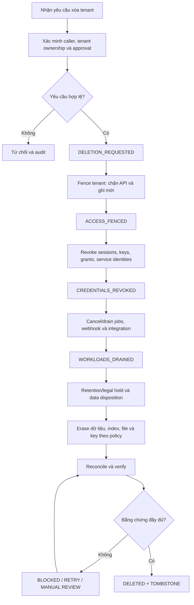

# Xóa tenant và thu hồi credential liên quan

Xóa tenant là quy trình kết thúc một tenant và thu hồi mọi khả năng truy cập vào dữ liệu, API, dịch vụ và tài nguyên được cấp cho tenant đó. Đây không chỉ là thao tác `DELETE` trên một bảng. Một tenant có thể còn phiên đăng nhập, refresh token, API key, OAuth grant, service account, webhook secret, chứng thư client, URL tải tệp đã ký, job đang chờ, kết nối tích hợp và bản sao dữ liệu trong cache hoặc hệ thống phụ.

Nếu chỉ xóa bản ghi tenant mà credential vẫn còn hiệu lực, một client cũ có thể tiếp tục gọi API hoặc một worker có thể tiếp tục xử lý dữ liệu. Nếu chỉ thu hồi credential mà không fence routing và tác vụ bất đồng bộ, request đã xác thực trước đó vẫn có thể ghi dữ liệu sau khi quá trình xóa bắt đầu. Vì vậy, quy trình an toàn cần có thứ tự rõ ràng: xác minh yêu cầu, chặn truy cập mới, thu hồi credential, xử lý workload đang chạy, áp dụng chính sách lưu giữ/xóa dữ liệu, xác minh kết quả và giữ tombstone để ngăn tenant cũ được kích hoạt ngoài ý muốn.

Trong API Security, tenant deletion là một luồng nghiệp vụ đặc quyền cao. Nó cần function authorization, kiểm tra quyền trên đúng tenant, phê duyệt phù hợp, audit và kiểm thử trước/sau khi thực hiện. Người gọi biết `tenantId` không có nghĩa họ được quyền xóa tenant đó.

## 1. Phân biệt deactivation, offboarding và data erasure

Trước khi thiết kế API, hãy xác định chính xác yêu cầu “xóa tenant” có nghĩa gì. Các thao tác dưới đây khác nhau:

| Thao tác | Mục đích | Kết quả |
|---|---|---|
| Deactivation / suspension | Tạm ngừng tenant | Chặn hoặc giới hạn truy cập; dữ liệu và credential có thể vẫn được giữ để khôi phục |
| Offboarding | Kết thúc quan hệ sử dụng dịch vụ | Thu hồi quyền, tích hợp và workload; xử lý dữ liệu theo chính sách đã thỏa thuận |
| Logical deletion | Đánh dấu tenant đã xóa trong hệ thống | Tenant không còn được phục vụ; dữ liệu có thể còn trong giai đoạn retention |
| Data erasure | Xóa dữ liệu khỏi các hệ thống nằm trong phạm vi | Xóa hoặc làm mất khả năng truy cập dữ liệu theo chính sách và yêu cầu áp dụng |
| Cryptographic erasure | Hủy khóa mã hóa riêng của tenant | Dữ liệu được mã hóa bằng khóa đó không còn giải mã được nếu không tồn tại bản sao khóa khác |

Không được coi `deleted_at` có giá trị là bằng chứng rằng dữ liệu đã bị xóa vật lý. Cũng không được hủy khóa hoặc xóa dữ liệu ngay khi nhận request nếu tenant đang có legal hold, nghĩa vụ lưu trữ hoặc yêu cầu điều tra. Chính sách retention, legal hold, data residency và hợp đồng cần được xác định bởi owner có thẩm quyền trước khi thực hiện bước không thể đảo ngược.

Một thiết kế thường dùng là chặn truy cập ngay, chuyển tenant sang trạng thái `DELETION_PENDING`, sau đó thực hiện các công việc thu hồi và xóa theo workflow bất đồng bộ có thể theo dõi.

## 2. Inventory mọi credential và điểm truy cập của tenant

Không thể thu hồi những credential mà hệ thống không biết đến. Hãy duy trì inventory có liên kết tới tenant, owner, mục đích, thời hạn và trạng thái. Các nhóm thường gặp gồm:

| Nhóm | Ví dụ | Hành động khi xóa tenant |
|---|---|---|
| User sessions | Session cookie, access/refresh token, remember-me token | Thu hồi session và refresh token family; vô hiệu hóa phiên phía server |
| API credentials | API key, personal access token, client secret | Revoke key/grant; xóa hoặc vô hiệu hóa hash/secret reference |
| OAuth grants | Consent, refresh grant, client registration riêng tenant | Thu hồi grant và token liên quan; disable client registration nếu chỉ dùng cho tenant đó |
| Service identities | Service account, workload identity, robot user | Disable principal, thu hồi role và credential |
| Webhook credentials | Signing secret, callback token | Ngừng gửi/nhận webhook và thu hồi secret |
| mTLS / certificates | Client certificate, private key reference | Revoke certificate hoặc binding và cập nhật trust store theo cơ chế hỗ trợ |
| Cloud/integration access | IAM role, storage access key, database credential | Thu hồi policy/grant và secret riêng tenant |
| File access | Pre-signed URL, download token, share link | Revoke nếu hỗ trợ; nếu không, chờ hết TTL ngắn đã thiết kế và chặn tại gateway/storage proxy |
| Encryption keys | Tenant data-encryption key hoặc key-encryption key | Disable/hủy theo retention và quy trình phê duyệt |
| Internal jobs | Export job, scheduled task, queue consumer grant | Hủy, drain hoặc cách ly job; thu hồi quyền thực thi |

Inventory phải bao gồm credential do hệ thống phát hành và credential mà tenant đã kết nối với nhà cung cấp bên ngoài. Ví dụ tenant có thể cấu hình OAuth integration với CRM, cloud storage hoặc payment provider. Hệ thống cần xóa token lưu giữ và gọi API revoke của nhà cung cấp nếu giao thức hỗ trợ. Nếu không có API revoke, cần ghi rõ giới hạn và hướng dẫn owner/tenant thực hiện bước cần thiết.

Không lưu raw secret trong inventory. Chỉ lưu ID, fingerprint, secret-manager reference, loại credential, tenant, trạng thái, ngày hết hạn và thông tin cần để thu hồi. Raw credential chỉ được truy cập qua secret manager theo quyền tối thiểu.

## 3. Luồng xóa tenant có kiểm soát

Một state machine giúp các service và worker biết tenant đang ở giai đoạn nào và hành động nào được phép. Ví dụ:



Trình tự cụ thể phụ thuộc hệ thống, nhưng nguyên tắc quan trọng là **fence trước, thu hồi credential ngay sau đó, rồi mới dọn workload và dữ liệu**. Không đợi xóa xong database mới chặn API. Nếu không thể thu hồi một loại credential ngay lập tức, phải có biện pháp bù để mọi request của tenant bị từ chối ở server.

## 4. Xác minh quyền yêu cầu xóa tenant

Endpoint xóa tenant có tác động lớn và thường không thể hoàn tác. Trước khi bắt đầu, server cần kiểm tra:

- Caller đã được xác thực bằng credential hợp lệ.
- Caller có permission riêng, ví dụ `tenants:delete` hoặc `tenants:offboard`.
- Caller có quyền trên đúng tenant, không chỉ có quyền gọi chức năng chung.
- Người yêu cầu có vai trò phù hợp theo hợp đồng hoặc quy trình quản trị tenant.
- Tenant ID được lấy từ path/request đã được đối chiếu với quyền của caller; không tin `tenantId` tự khai trong body.
- Có step-up authentication, xác nhận lại ý định hoặc approval độc lập nếu mức ảnh hưởng yêu cầu.
- Không có điều kiện chặn đã biết như legal hold, migration đang chạy hoặc giao dịch chưa hoàn tất mà policy yêu cầu xử lý trước.

Ví dụ ma trận quyết định:

| Actor | Tenant | Điều kiện | Kết quả |
|---|---|---|---|
| Tenant owner | Tenant của mình | Đã xác thực lại và đáp ứng điều kiện hợp đồng | Có thể yêu cầu offboarding |
| Tenant owner | Tenant khác | Bất kỳ | Từ chối |
| Support agent | Tenant được giao hỗ trợ | Có quyền hỗ trợ nhưng không có quyền xóa | Từ chối thao tác xóa |
| Platform administrator | Tenant bất kỳ | Có permission đặc quyền và approval theo policy | Cho phép theo quy trình kiểm soát |
| Service account | Tenant trong phạm vi job | Chỉ được cấp quyền cleanup cụ thể | Chỉ thực hiện action được cấp |
| Anonymous | Bất kỳ tenant | Chưa xác thực | Từ chối |

Nếu xóa tenant cần hai người phê duyệt, không để cùng một principal vừa yêu cầu vừa tự phê duyệt. Lưu danh tính người yêu cầu, người phê duyệt, lý do và thời điểm. Không cho support agent dùng một endpoint tiện ích có quyền rộng để bỏ qua workflow quản trị.

## 5. Fence tenant ngay khi yêu cầu được chấp nhận

Sau khi xác minh, bước đầu tiên là đánh dấu tenant không còn nhận traffic thông thường. Một trạng thái control-plane như `DELETION_PENDING` hoặc `ACCESS_FENCED` phải được mọi entry point có liên quan hiểu thống nhất.

Ví dụ metadata:

| tenant_id | lifecycle_state | authz_version | routing_version | deletion_requested_at |
|---|---|---:|---:|---|
| `tenant-A` | `ACTIVE` | 18 | 12 | `NULL` |
| `tenant-B` | `ACCESS_FENCED` | 31 | 4 | `2026-11-18T09:00:00Z` |

Khi fence:

- Từ chối request API mới của tenant theo tenant context đã xác minh.
- Chặn tạo session, refresh token, API key, OAuth grant và service identity mới.
- Chặn ghi dữ liệu mới, tạo job, upload file hoặc đăng ký webhook.
- Dừng hoặc hạn chế traffic từ các client/integration đã biết.
- Vô hiệu hóa cache membership/routing/authorization cũ hoặc tăng version để các node nhận biết.
- Ngăn tenant được kích hoạt lại bằng một request cập nhật profile hoặc một tenant ID cũ.

Việc fence cần được thực thi ở server/gateway và các service liên quan. Chỉ ẩn tenant khỏi danh sách giao diện không đủ. Nếu JWT tự chứa claim và resource server không tra trạng thái tenant, token cũ vẫn có thể được chấp nhận đến khi hết hạn. Với tenant deletion, cần có cơ chế kiểm tra trạng thái tenant/revocation version tại các thao tác quan trọng, hoặc access token TTL ngắn kết hợp denylist/introspection phù hợp.

Nếu control plane không truy cập được, endpoint nhạy cảm phải fail closed. Không fallback sang tenant mặc định hoặc coi tenant không tìm thấy là tenant active.

## 6. Thu hồi access token, refresh token và session

Các loại token có hành vi thu hồi khác nhau:

- **Refresh token opaque được lưu server-side:** đánh dấu revoked hoặc thu hồi toàn bộ token family của tenant; mọi lần refresh tiếp theo bị từ chối.
- **Access token opaque:** introspection/resource server có thể kiểm tra trạng thái active và từ chối sau khi grant/session bị revoke.
- **JWT access token tự chứa:** chữ ký hợp lệ vẫn có thể được xác minh sau khi tenant bị xóa. Muốn thu hồi sớm cần kiểm tra tenant/session status, token version, `jti` denylist hoặc cơ chế introspection; nếu không, token có thể còn hiệu lực đến `exp`.
- **Session cookie:** xóa cookie phía client không đủ; server phải thu hồi session ID hoặc session family trong kho session.
- **Remember-me/device token:** phải có inventory và trạng thái revoke riêng, không giả định logout thông thường đã xử lý hết.

Ví dụ, khi tenant B chuyển sang `ACCESS_FENCED`, resource server có thể kiểm tra trạng thái tenant trước khi thực hiện thao tác nhạy cảm:

```java
TenantLifecycle lifecycle = tenantLifecycleService.getState(
        authenticatedPrincipal.tenantId());

if (!lifecycle.allowsApiTraffic()) {
    throw new TenantAccessRevokedException();
}

authorizationService.requirePermission("invoices:read");
return invoiceService.findVisibleToCurrentPrincipal(invoiceId);
```

Đây là pseudocode; trạng thái có thể được cache ngắn hạn hoặc đẩy qua revocation event. Cache cần có invalidation/version để việc fence có hiệu lực trong khoảng thời gian đã cam kết. Với dữ liệu và hành động có rủi ro cao, không nên dựa vào cache dài hạn của trạng thái tenant.

## 7. Thu hồi API key, OAuth grant và client registration

API key thường tồn tại lâu và có thể được dùng bởi script hoặc hệ thống tích hợp mà không có người dùng tương tác. Khi xóa tenant:

1. Liệt kê tất cả key thuộc tenant, kể cả key đã hết hạn nhưng còn lưu trong hệ thống quản lý.
2. Đánh dấu key là revoked trong kho kiểm tra phía server.
3. Vô hiệu hóa key ở gateway, API management hoặc service xác minh key.
4. Xóa secret reference khỏi secret manager theo retention và khả năng điều tra.
5. Thu hồi OAuth grant, consent và refresh token family của client integration.
6. Disable client registration riêng tenant nếu không còn mục đích sử dụng.
7. Xác minh key cũ không thể gọi endpoint hoặc tạo credential mới.

Nếu API key được hash, giữ hash/revocation record đủ lâu để nhận diện key cũ và từ chối nó. Xóa ngay mọi dấu vết nhận diện có thể khiến hệ thống không phân biệt được key đã bị revoke với key không tồn tại, đồng thời làm giảm khả năng audit. Raw key không được lưu để phục hồi.

Đối với OAuth, thu hồi grant ở authorization server và kiểm tra các token đã cấp. Một access token JWT không tự biến mất chỉ vì grant đã bị revoke. Resource server cần cơ chế kiểm tra trạng thái hoặc giới hạn thời gian hiệu lực để ngăn token cũ truy cập dữ liệu tenant đã fence.

## 8. Thu hồi service account, workload identity và quyền cloud

Tenant có thể có service account để đồng bộ dữ liệu, chạy báo cáo hoặc gọi API đối tác. Các principal này thường không đi qua luồng đăng nhập người dùng và dễ bị bỏ sót.

Inventory và thu hồi:

- Disable service account hoặc robot user thuộc tenant.
- Xóa role binding, group membership và permission grant.
- Revoke client secret, private key, API key và credential được lưu trong secret manager.
- Thu hồi IAM role/policy cho object storage, queue, database, analytics hoặc cloud resource riêng tenant.
- Thu hồi workload identity federation binding, certificate hoặc trust relationship.
- Dừng scheduled task, integration worker và webhook delivery.
- Xác minh principal không còn quyền truy cập thông qua group hoặc policy kế thừa.

Nếu credential được chia sẻ giữa nhiều tenant, không thu hồi credential dùng chung theo cách làm gián đoạn tenant khác. Hãy thu hồi binding/grant riêng tenant trước. Nếu phát hiện secret dùng chung đã bị lộ hoặc không thể giới hạn quyền theo tenant, cần một kế hoạch xoay vòng có phối hợp, đánh giá phạm vi ảnh hưởng và cập nhật mọi consumer liên quan.

## 9. Webhook, integration và credential ở hệ thống bên ngoài

Webhook thường có hai chiều:

- Hệ thống gửi event tới endpoint do tenant cấu hình.
- Tenant hoặc đối tác gửi callback/webhook vào API của hệ thống.

Khi offboarding:

- Ngừng lên lịch gửi event mới cho tenant.
- Hủy hoặc đánh dấu các delivery đang retry; không gửi tiếp sau thời điểm fence trừ khi policy yêu cầu.
- Thu hồi signing secret và callback token của tenant.
- Xóa hoặc disable endpoint registration, subscription và OAuth integration.
- Gọi API revoke/disconnect của provider nếu được hỗ trợ.
- Xác minh webhook cũ không thể tạo tác vụ hoặc làm thay đổi dữ liệu tenant đã đóng.

Với webhook inbound, server phải xác minh chữ ký bằng secret/certificate đúng tenant và kiểm tra trạng thái tenant trước khi xử lý event. Không chỉ xác minh chữ ký rồi bỏ qua lifecycle state. Một webhook có chữ ký hợp lệ nhưng thuộc tenant đã bị fence vẫn phải bị từ chối hoặc cách ly theo policy.

Không gửi dữ liệu xóa tenant cho callback URL tùy ý mà không xác minh quyền và hợp đồng tích hợp. Việc thông báo offboarding tới provider nên dùng danh sách endpoint đã được phê duyệt và có audit.

## 10. Xử lý job, queue, export và kết nối đang chạy

Sau khi fence, vẫn có thể tồn tại request đã vào hệ thống, transaction đang chạy, job trong queue hoặc worker đã lấy message. Cần một giai đoạn drain có giới hạn:

- Từ chối job mới cho tenant.
- Hủy scheduled job và recurring task.
- Cancel job chưa bắt đầu; đánh dấu job không còn hợp lệ nếu worker nhận sau đó.
- Với job đang chạy, cho hoàn tất nếu an toàn hoặc yêu cầu dừng tại checkpoint.
- Kiểm tra tenant lifecycle state ngay trước khi worker đọc/ghi dữ liệu hoặc tạo side effect.
- Dừng export/download và thu hồi link truy cập theo khả năng hệ thống.
- Xử lý dead-letter queue và retry queue; không để message cũ tự chạy lại sau khi tenant đã xóa.
- Đóng connection pool hoặc credential riêng tenant khi không còn transaction hợp lệ.

Message nên chứa tenant reference và job ID, nhưng không mang quyền tự khai hoặc raw credential. Worker cần xác thực service identity và tra cứu trạng thái tenant từ control plane. Không tin message cũ chỉ vì nó được tạo trước khi tenant bị fence.

Với job đã tạo file export, cần xác định file thuộc retention nào, ai được phép tải và khi nào phải xóa. Một pre-signed URL có thể tiếp tục hoạt động đến khi hết hạn nếu object storage không hỗ trợ revoke. Có thể giảm thời gian bằng TTL ngắn, xóa/đổi quyền object hoặc đặt download proxy kiểm tra tenant state.

## 11. Xử lý dữ liệu: retention, xóa và cryptographic erasure

Sau khi access đã bị fence và workload được xử lý, thực hiện data disposition theo chính sách đã phê duyệt. Lập inventory theo hệ thống:

| Vị trí dữ liệu | Việc cần làm |
|---|---|
| Primary database | Xóa hoặc ẩn danh dữ liệu tenant theo retention; kiểm tra foreign key và shared records |
| Read replica/materialized view | Xác minh thay đổi xóa được áp dụng; không để replica tiếp tục phục vụ dữ liệu |
| Object storage | Xóa object/prefix thuộc tenant; kiểm tra versioning và multipart upload còn dang dở |
| Search index | Xóa document và cập nhật alias/index; xác minh query không còn trả kết quả |
| Cache | Invalidate key theo tenant/object và cache routing/authorization |
| Analytics/data warehouse | Xóa hoặc xử lý dữ liệu theo retention và khả năng truy vết nguồn |
| Queue/dead-letter | Xóa hoặc cách ly message chứa dữ liệu tenant theo policy |
| Export/staging | Xóa file tạm, bản tải xuống do hệ thống quản lý và artifact không còn cần |
| Logs/audit | Giữ phần bắt buộc theo retention; loại bỏ dữ liệu không cần hoặc áp dụng pseudonymization theo policy |
| Backups | Áp dụng expiry/retention; ghi nhận thời điểm bản sao cuối cùng hết hạn |

Không xóa dữ liệu shared reference đang được tenant khác sử dụng. Trước khi xóa record, cần kiểm tra quan hệ ownership, foreign key, shared object và dữ liệu đã được chia sẻ hợp lệ. Một file object dùng chung có thể cần xóa association của tenant thay vì xóa nội dung gốc.

### Cryptographic erasure

Nếu mỗi tenant có data-encryption key riêng hoặc key-encryption key riêng, hủy khóa có thể làm dữ liệu đã mã hóa không thể giải mã. Tuy nhiên, cần xác minh:

- Mọi bản sao khóa, backup, replica và escrow đã được xử lý theo policy.
- Không có dữ liệu plaintext hoặc bản export chưa mã hóa còn tồn tại.
- Key không được dùng chung với tenant khác.
- Hành động hủy khóa đã được phê duyệt và có audit.
- Việc hủy khóa không vi phạm legal hold hoặc retention bắt buộc.

Cryptographic erasure không tự động xóa object hoặc metadata. Nó chỉ có tác dụng khi mọi bản sao dữ liệu cần bảo vệ thực sự phụ thuộc vào khóa đã hủy và không còn đường giải mã khác.

## 12. Backups, replicas và thời hạn xóa cuối cùng

Backup thường là immutable hoặc được quản lý theo chu kỳ retention. Không phải hệ thống nào cũng có thể xóa chọn lọc một tenant khỏi từng backup. Vì vậy, chính sách cần xác định rõ:

- Backup nào chứa dữ liệu tenant và thời hạn giữ từng loại.
- Có thể xóa chọn lọc hay phải chờ backup hết hạn.
- Backup restore phải áp dụng tombstone/deletion ledger trước khi mở traffic.
- Dữ liệu đã xóa không được hồi sinh sau disaster recovery hoặc restore môi trường.
- Bản backup có legal hold được quản lý và giới hạn truy cập như thế nào.
- Khi hết retention, có bằng chứng về việc xóa hoặc hủy khóa theo quy trình không.

Một rủi ro quan trọng là restore backup cũ sau khi tenant đã xóa. Nếu chỉ xóa tenant khỏi database hiện tại mà không có deletion ledger/tombstone độc lập, bản ghi có thể xuất hiện trở lại. Hệ thống restore cần replay danh sách tenant đã xóa và các sự kiện thu hồi trước khi cho phép request truy cập dữ liệu.

## 13. Tombstone ngăn tenant bị tạo lại ngoài ý muốn

Sau khi xóa dữ liệu chính, nên giữ một tombstone tối thiểu để ngăn ID cũ được tái sử dụng hoặc tenant bị khôi phục bởi một job cũ. Tombstone có thể gồm:

```json
{
  "tenantId": "tenant-B",
  "lifecycleState": "DELETED",
  "deletionId": "del-2026-0091",
  "deletedAt": "2026-11-18T10:30:00Z",
  "authzVersion": 32,
  "routingVersion": 5,
  "dataDisposition": "ERASURE_COMPLETED",
  "restorePolicy": "DENY"
}
```

Đây là ví dụ metadata, không phải payload cố định. Chỉ giữ các trường tối thiểu cần cho chống tái kích hoạt, audit và phục hồi. Tombstone không nên chứa raw credential hoặc dữ liệu cá nhân không cần thiết.

Mọi luồng tạo tenant mới cần bảo đảm ID cũ không được cấp lại nếu tombstone còn hiệu lực. Nếu sản phẩm cho phép khôi phục tenant, đó phải là workflow riêng với permission, approval, kiểm tra dữ liệu và phát hành credential mới. Không tái kích hoạt refresh token, API key hoặc service account cũ.

## 14. Thiết kế workflow idempotent và có thể tiếp tục

Tenant deletion thường gồm nhiều bước phân tán và có thể bị gián đoạn. Mỗi bước cần idempotent: chạy lại không tạo credential mới, không xóa nhầm tenant khác và không làm hỏng trạng thái đã hoàn thành.

Một bản ghi workflow có thể có:

```sql
CREATE TABLE tenant_deletion_job (
    deletion_id UUID PRIMARY KEY,
    tenant_id UUID NOT NULL,
    state VARCHAR(40) NOT NULL,
    requested_by VARCHAR(200) NOT NULL,
    approved_by VARCHAR(200),
    requested_at TIMESTAMP NOT NULL,
    updated_at TIMESTAMP NOT NULL,
    last_error_code VARCHAR(80),
    completed_at TIMESTAMP
);

CREATE UNIQUE INDEX one_active_deletion_per_tenant
ON tenant_deletion_job (tenant_id)
WHERE state NOT IN ('COMPLETED', 'CANCELLED');
```

Đây là schema minh họa; cần điều chỉnh cú pháp partial index theo database và định nghĩa state terminal. Tạo deletion job và phát event khởi chạy nên dùng transaction/outbox để tránh tình trạng trạng thái đã đổi nhưng event không được gửi, hoặc event được gửi hai lần.

Ví dụ pseudocode cho bước tiếp nhận:

```java
@Transactional
DeletionAccepted requestDeletion(TenantId tenantId, Principal actor) {
    authorization.require(actor, "tenants:delete", tenantId);
    approvalPolicy.requireApprovalIfNeeded(actor, tenantId);

    Tenant tenant = tenantRepository.findForUpdate(tenantId)
            .orElseThrow(TenantNotFoundException::new);

    if (tenant.isDeleted()) {
        return DeletionAccepted.alreadyCompleted(tenantId);
    }

    tenant.fenceAccess();
    tenant.incrementAuthorizationVersion();
    deletionJobRepository.createIfAbsent(tenantId, actor.subject());
    outboxRepository.add(TenantDeletionRequested.of(tenantId));

    return DeletionAccepted.started(tenantId);
}
```

Đây là pseudocode. `findForUpdate` hoặc compare-and-swap cần ngăn hai request đồng thời tạo hai workflow. Việc fence tenant và tạo outbox event phải commit cùng transaction. Các worker sau đó xử lý từng bước với idempotency key, retry policy, dead-letter handling và checkpoint.

Không giữ một transaction database mở trong suốt quá trình xóa tất cả hệ thống. Mỗi bước phân tán cần trạng thái, timeout, retry và cách phục hồi riêng. Nếu một provider không thể thu hồi credential, workflow chuyển sang `BLOCKED` hoặc `MANUAL_REVIEW`, không đánh dấu `COMPLETED` giả tạo.

## 15. API response và thông báo trạng thái xóa

Endpoint có thể tiếp nhận yêu cầu bất đồng bộ:

```http
POST /api/tenants/{tenantId}/deletion-requests
Authorization: Bearer <access-token>
Idempotency-Key: 1d2e...
Content-Type: application/json

{
  "reason": "CUSTOMER_OFFBOARDING"
}
```

Nếu request hợp lệ và workflow đã được tạo, API có thể trả `202 Accepted` cùng `deletionId` và trạng thái ban đầu. Không trả raw credential, storage location, thông tin nội bộ hoặc chi tiết provider. Endpoint status chỉ cho caller có quyền xem workflow tương ứng.

Ví dụ:

```json
{
  "deletionId": "del-2026-0091",
  "tenantId": "tenant-B",
  "status": "ACCESS_FENCED",
  "acceptedAt": "2026-11-18T10:00:00Z"
}
```

Hãy phân biệt “đã nhận yêu cầu”, “đã chặn truy cập”, “đã thu hồi credential” và “đã hoàn tất xóa dữ liệu”. Không trả `200 Deleted` ngay khi chỉ tạo workflow. Nếu cần hỗ trợ khách hàng, cung cấp trạng thái và thời hạn dự kiến theo policy mà không tiết lộ chi tiết vận hành nhạy cảm.

## 16. Audit, cảnh báo và xử lý lỗi

Tenant deletion là hành động cần truy vết đầy đủ. Audit event nên ghi:

- Tenant reference và deletion ID.
- Principal yêu cầu, principal phê duyệt và service identity thực thi.
- Permission/policy được kiểm tra và kết quả.
- Lý do, thời điểm và correlation ID.
- Mỗi loại credential được revoke, kết quả từ provider và thời điểm xác nhận.
- Job/queue được drain hoặc cancel.
- Kết quả xóa database, file, index, cache, key và backup retention.
- Ngoại lệ, bước bị chặn, người xử lý và quyết định tiếp theo.

Không ghi access token, refresh token, API key, private key, secret hoặc dữ liệu tenant đầy đủ vào audit. Chỉ ghi credential ID/fingerprint và kết quả revoke.

Alert khi:

- Tenant đã fence nhưng vẫn có request ghi thành công.
- Credential bị revoke nhưng tiếp tục được chấp nhận ở một service.
- Job cũ chạy lại sau khi tenant đã xóa.
- Provider revoke thất bại hoặc key chưa được thu hồi.
- Tenant xuất hiện trở lại sau restore/replication.
- Một operator cố xóa tenant ngoài phạm vi được giao hoặc bỏ qua approval.
- Workflow bị kẹt quá thời hạn ở một state.

Khi một bước thất bại, giữ tenant ở trạng thái không phục vụ và retry/đưa vào manual review theo runbook. Không tự chuyển tenant về `ACTIVE` chỉ vì một provider không phản hồi. Việc mở lại tenant cần workflow khôi phục riêng và được phê duyệt.

## 17. Kiểm thử tenant deletion và credential revocation

Test cần xác minh cả quyền yêu cầu xóa, hiệu lực fence và mọi loại credential liên quan. Dùng tenant A và B để bảo đảm thao tác xóa A không tác động B.

| Tình huống | Kết quả cần xác minh |
|---|---|
| Caller thiếu `tenants:delete` | Từ chối; không tạo deletion job và không fence tenant |
| Owner yêu cầu xóa tenant của người khác | Từ chối theo object authorization |
| Request hợp lệ được chấp nhận | Tenant chuyển sang state fence và event được ghi qua outbox |
| Request lặp với cùng idempotency key | Không tạo nhiều workflow hoặc revoke side effect trùng |
| Access token cũ của tenant đã fence | API từ chối theo tenant/session status hoặc cơ chế revocation đã thiết kế |
| Refresh token cũ | Không thể cấp access/refresh token mới |
| API key hoặc OAuth grant cũ | Không gọi được API hoặc cấp credential mới |
| Service account/workload identity | Không còn quyền trên tài nguyên tenant sau revoke |
| Webhook inbound đã ký hợp lệ | Bị từ chối/cách ly nếu tenant đã fence |
| Webhook outbound đang retry | Không gửi tiếp sau khi policy yêu cầu dừng |
| Queue job cũ | Worker kiểm tra lifecycle và không thực hiện side effect trái phép |
| Signed URL đã phát hành | Hành vi revoke/TTL được xác minh; không tải được sau thời điểm policy cam kết |
| Cache/routing cũ | Không cho request đi qua hoặc truy cập dữ liệu tenant đã fence |
| Xóa dữ liệu tenant A | Tenant B và shared data hợp lệ không bị ảnh hưởng |
| Restore backup cũ | Tombstone/deletion ledger được áp dụng trước khi mở traffic |
| Credential provider revoke thất bại | Workflow không báo hoàn tất; có retry/manual review và alert |
| Legal hold/retention áp dụng | Dữ liệu được giữ đúng phạm vi, nhưng tenant vẫn bị chặn truy cập |
| Workflow chạy lại sau crash | Bước đã hoàn tất không gây side effect sai hoặc làm sống lại credential |

Test integration cần đi qua API, token validation, gateway/resource server, token store, job worker và các adapter/provider giả lập. Chỉ test hàm `revoke()` riêng không chứng minh mọi endpoint thực sự từ chối credential cũ.

## 18. Xác minh hoàn tất và giữ bằng chứng

Không đánh dấu tenant `DELETED` chỉ vì tất cả worker đã trả về thành công. Cần có tiêu chí hoàn tất rõ:

- Tenant bị fence ở mọi API entry point và service có liên quan.
- Không thể refresh hoặc sử dụng credential tenant đã thu hồi.
- Service account, webhook, integration và cloud grant riêng tenant đã bị disable/revoke hoặc có ngoại lệ được phê duyệt.
- Job đang chạy, queue, scheduled task và retry đã được xử lý.
- Database, object storage, search, cache và analytics đã được xử lý theo disposition.
- Key được hủy khi policy cho phép; backup có retention/expiry được ghi nhận.
- Tombstone/deletion ledger được lưu ở control plane và sẽ được áp dụng khi restore.
- Không còn request ghi hoặc side effect hợp lệ sau thời điểm fence.
- Audit/evidence đủ để chứng minh từng bước và các ngoại lệ còn lại.

Kết quả có thể là `COMPLETED_WITH_RETENTION` nếu dữ liệu phải được giữ trong backup hoặc legal hold theo policy. Trạng thái này cần nói rõ tenant không còn truy cập được dù một số bản sao dữ liệu vẫn còn trong thời hạn lưu giữ. Không tuyên bố xóa vật lý hoàn toàn nếu chỉ mới logical delete hoặc đang chờ backup hết hạn.

## 19. Checklist triển khai

- [ ] Phân biệt deactivation, offboarding, logical deletion và data erasure.
- [ ] Xác minh caller, permission, tenant ownership và approval trước khi tạo workflow.
- [ ] Có inventory cho session, token, API key, OAuth grant, service account, webhook, certificate, IAM và key.
- [ ] Fence tenant ở control plane và mọi API entry point trước khi cleanup.
- [ ] Thu hồi refresh token family, session và grant; xử lý rõ giới hạn revoke của JWT access token.
- [ ] Thu hồi API key, service identity, cloud permission và integration credential.
- [ ] Ngừng webhook, scheduled task, export và queue job; worker kiểm tra tenant lifecycle trước side effect.
- [ ] Áp dụng retention/legal hold trước khi xóa database, file, index, analytics hoặc encryption key.
- [ ] Xử lý backup/restore bằng tombstone hoặc deletion ledger.
- [ ] Workflow idempotent, có state machine, outbox, retry, checkpoint và manual review.
- [ ] Không để shared credential hoặc shared data của tenant khác bị thu hồi/xóa nhầm.
- [ ] Có audit, alert và evidence cho từng bước thu hồi/xóa.
- [ ] Test credential cũ, job cũ, cache cũ, cross-tenant và restore scenario.
- [ ] Chỉ đánh dấu hoàn tất khi tiêu chí verify đạt; ghi rõ retention hoặc ngoại lệ còn tồn tại.

## Kết luận

Xóa tenant an toàn là một workflow kết thúc quyền truy cập và xử lý dữ liệu trên toàn bộ hệ thống. Hãy xác minh quyền yêu cầu, fence tenant trước, thu hồi session/token/API key/OAuth grant/service identity và integration credential, sau đó drain job và áp dụng chính sách retention/xóa dữ liệu. Tombstone, deletion ledger, workflow idempotent và kiểm thử credential cũ giúp ngăn tenant hoặc quyền truy cập sống lại sau retry hay restore. Chỉ báo hoàn tất khi có bằng chứng cho từng lớp; nếu backup hoặc legal hold vẫn giữ dữ liệu, trạng thái phải phản ánh đúng giới hạn đó.
