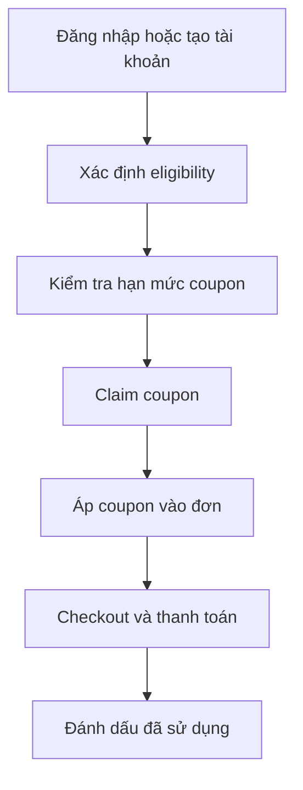
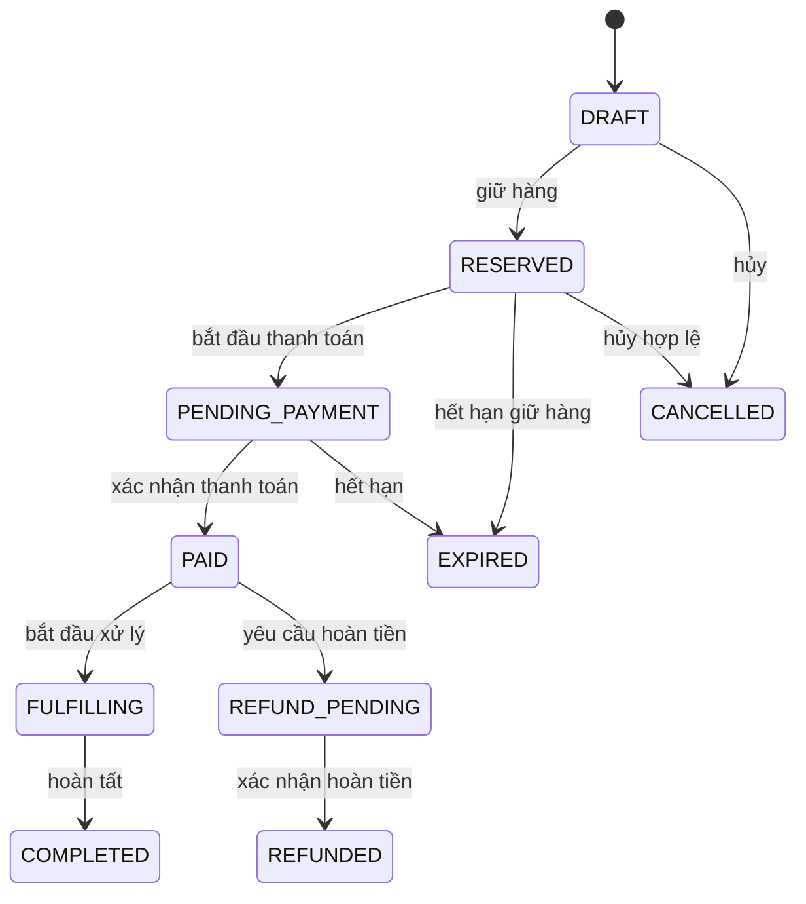
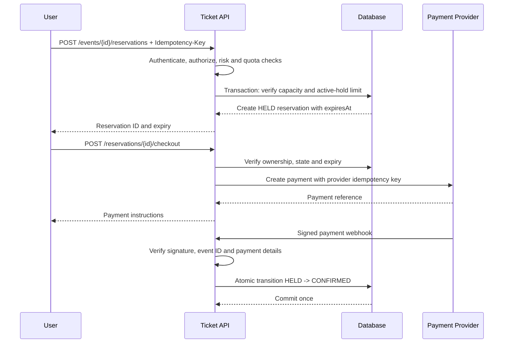

# Unrestricted Access to Sensitive Business Flows

Một API có thể xác thực đúng người dùng, kiểm tra quyền trên từng endpoint và giới hạn số request mỗi phút nhưng vẫn cho phép một người tự động hóa các thao tác hợp lệ để gây thiệt hại cho nghiệp vụ. Ví dụ: một script tạo hàng nghìn tài khoản để nhận ưu đãi chào mừng, giữ toàn bộ vé của một sự kiện, liên tục đặt rồi hủy hàng, lạm dụng mã giới thiệu hoặc gửi nhiều yêu cầu hoàn tiền.

Các request này có thể đúng cú pháp, dùng token hợp lệ và gọi đúng endpoint mà người dùng được phép sử dụng. Rủi ro nằm ở cách hệ thống cho phép một luồng nghiệp vụ nhạy cảm được thực hiện với tần suất, số lượng, thời điểm hoặc quy mô bất thường. Đây là vấn đề *Unrestricted Access to Sensitive Business Flows* (truy cập không được kiểm soát đầy đủ vào luồng nghiệp vụ nhạy cảm).

Trong module `SECURITY_API_SECURITY`, bảo mật API cần gắn với endpoint, đối tượng dữ liệu và luồng nghiệp vụ. Do đó, không thể chỉ kiểm tra từng request riêng lẻ. Hệ thống cần hiểu toàn bộ hành trình từ lúc bắt đầu đến lúc tạo ra giá trị hoặc side effect, xác định giới hạn hợp lý và phát hiện việc tự động hóa hoặc phối hợp nhiều request để lạm dụng nghiệp vụ.

## Mục tiêu học tập

Sau bài này, người học có thể:

- Nhận diện luồng nghiệp vụ nhạy cảm và các tài sản có thể bị lạm dụng.
- Phân biệt business-flow abuse với lỗi xác thực, phân quyền và unrestricted resource consumption.
- Xây dựng threat model theo actor, mục tiêu, bước nghiệp vụ, giới hạn và tác động kinh doanh.
- Thiết kế quota, velocity limit và eligibility rule theo nhiều chiều thay vì chỉ giới hạn IP.
- Bảo vệ state transition, reservation, thanh toán, coupon, referral và các thao tác có side effect.
- Kết hợp idempotency, chống replay, kiểm soát đồng thời và transaction để ngăn xử lý trùng hoặc tranh chấp.
- Sử dụng step-up verification, bot mitigation và tín hiệu rủi ro theo cách phù hợp với trải nghiệm người dùng.
- Kiểm thử, giám sát và phản ứng với hành vi lạm dụng luồng nghiệp vụ.

## 1. Sensitive business flow là gì?

Sensitive business flow là chuỗi thao tác API có thể tạo ra giá trị, quyền lợi, chi phí hoặc thay đổi quan trọng đối với hệ thống và người dùng. Một endpoint đơn lẻ có thể không nhạy cảm, nhưng chuỗi thao tác kết hợp lại có thể tạo ra tác động lớn.

Ví dụ:

| Luồng nghiệp vụ | Giá trị cần bảo vệ | Hành vi lạm dụng có thể xảy ra |
|---|---|---|
| Đăng ký và nhận ưu đãi | Ngân sách khuyến mãi, danh tính khách hàng | Tạo nhiều tài khoản để nhận ưu đãi nhiều lần |
| Đặt vé hoặc đặt chỗ | Vé giới hạn, chỗ ngồi, cơ hội tiếp cận công bằng | Bot giữ chỗ hàng loạt, đầu cơ vé hoặc làm cạn tồn |
| Checkout và thanh toán | Hàng hóa, tiền, hạn mức thanh toán | Tạo nhiều đơn, giữ tồn kho hoặc thử nhiều giao dịch |
| Coupon và referral | Chi phí marketing, ngân sách thưởng | Tự giới thiệu, tạo vòng tài khoản hoặc dùng mã nhiều lần |
| Bình chọn và đánh giá | Tính toàn vẹn của kết quả | Tự động gửi nhiều lượt bình chọn hoặc đánh giá |
| Hoàn tiền và khiếu nại | Tiền, hàng và quy trình hỗ trợ | Lặp yêu cầu hoàn tiền hoặc lợi dụng chính sách đổi trả |
| Đặt lịch và đăng ký dịch vụ | Năng lực phục vụ, lịch chuyên gia | Chiếm slot, đặt rồi hủy liên tục hoặc giữ chỗ không có ý định sử dụng |
| Khôi phục tài khoản hoặc gửi OTP | Kênh liên lạc và chi phí nhà cung cấp | Gửi hàng loạt tin nhắn, spam hoặc gây gián đoạn cho người khác |

Một luồng có thể bao gồm nhiều API: xem sản phẩm, áp coupon, giữ hàng, tạo đơn, thanh toán, xác nhận và hủy. Nếu mỗi endpoint đều hợp lệ nhưng hệ thống không giới hạn số lần giữ hàng hoặc số ưu đãi trên một khách hàng, toàn bộ luồng vẫn có thể bị lạm dụng.

### 1.1. Khi nào một luồng cần kiểm soát đặc biệt?

Hãy xem xét tăng mức bảo vệ khi luồng có một hoặc nhiều đặc điểm:

- Tạo ra lợi ích kinh tế, tín dụng, điểm thưởng, quyền truy cập hoặc tài nguyên khan hiếm.
- Có thể gửi cho bên thứ ba một thông điệp hoặc giao dịch gây chi phí.
- Có side effect khó đảo ngược như chuyển tiền, phát hành vé, xác nhận đơn hoặc thay đổi quyền.
- Có thể được tự động hóa với chi phí thấp hơn nhiều so với giá trị mà attacker nhận được.
- Dựa trên tính công bằng, tính duy nhất hoặc giới hạn số lần sử dụng.
- Có nhiều bước mà mỗi bước riêng lẻ không thể xác định mục đích cuối cùng.

Không phải mọi endpoint đều cần CAPTCHA hoặc giới hạn nghiêm ngặt. Mức kiểm soát nên dựa trên tác động, khả năng lạm dụng và chi phí của việc chặn nhầm người dùng hợp lệ.

## 2. Phân biệt business-flow abuse với các lỗi API khác

Các nhóm rủi ro có thể xuất hiện cùng nhau nhưng trả lời những câu hỏi khác nhau:

| Nhóm rủi ro | Câu hỏi chính | Ví dụ |
|---|---|---|
| Authentication failure | Caller có chứng minh được danh tính không? | Token giả hoặc credential bị đánh cắp |
| Broken Function Level Authorization (BFLA) | Caller có quyền thực hiện chức năng này không? | User thường gọi endpoint quản trị |
| Broken Object Level Authorization (BOLA) | Caller có quyền trên object cụ thể không? | User đọc đơn hàng của người khác |
| Property-level authorization | Caller có được đọc/ghi field này không? | User tự đổi `role` hoặc `creditLimit` |
| Unrestricted Resource Consumption | Request có tiêu thụ tài nguyên kỹ thuật vượt giới hạn không? | Request tạo hàng nghìn tác vụ tốn CPU hoặc bộ nhớ |
| Unrestricted Access to Sensitive Business Flows | Một actor có thể tự động hóa hoặc lặp lại luồng nghiệp vụ để chiếm lợi ích hoặc gây thiệt hại không? | Tạo nhiều tài khoản để lấy cùng ưu đãi |

Rate limit có thể giúp cả resource consumption và business-flow abuse, nhưng không giải quyết đầy đủ hai vấn đề. Một request mỗi giây có thể vẫn quá nhiều nếu nghiệp vụ chỉ cho phép một lần nhận thưởng mỗi người. Ngược lại, một người có thể gửi nhiều request đọc dữ liệu công khai mà không gây lạm dụng nghiệp vụ nhưng vẫn cần giới hạn tài nguyên.

## 3. Threat model cho luồng nghiệp vụ

Không bắt đầu bằng câu hỏi “endpoint này có rate limit chưa?”. Hãy mô tả luồng và lợi ích mà attacker muốn đạt được.

### 3.1. Lập bản đồ luồng

Với từng luồng nhạy cảm, ghi nhận:

1. **Actor:** người dùng thường, đối tác, nhân viên, workload, bot hoặc người đã chiếm tài khoản.
2. **Mục tiêu:** nhận tiền, coupon, vé, slot, dữ liệu, quyền hoặc gây chi phí cho tổ chức.
3. **Các bước:** endpoint nào được gọi, theo thứ tự nào, có thể bỏ qua hoặc lặp lại bước nào?
4. **Tài sản:** tồn kho, ngân sách thưởng, số dư, điểm, hạn mức, lịch đặt chỗ hoặc trạng thái giao dịch.
5. **Quy tắc nghiệp vụ:** mỗi người được làm bao nhiêu lần, trong khoảng thời gian nào, với điều kiện nào?
6. **Điểm quyết định:** server kiểm tra eligibility, reservation, thanh toán và xác nhận ở đâu?
7. **Tác động:** thiệt hại tối đa nếu luồng bị tự động hóa trên quy mô lớn là gì?
8. **Tín hiệu:** dữ liệu nào giúp phân biệt hành vi bình thường với hành vi bất thường mà không thu thập quá mức?

Ví dụ luồng nhận coupon:



Các câu hỏi threat model:

- Một người có thể tạo nhiều tài khoản không?
- Eligibility dựa vào email, số điện thoại, phương thức thanh toán, địa chỉ, tenant hay một định danh khác?
- Có thể claim nhiều lần bằng cách gửi request đồng thời không?
- Coupon có thể được áp vào nhiều đơn cùng lúc không?
- Nếu thanh toán thất bại, coupon hoặc quota được hoàn lại như thế nào?
- Có thể đổi user ID, tenant ID hoặc mã chiến dịch để đi vòng giới hạn không?

### 3.2. Xác định invariants nghiệp vụ

Invariant là điều kiện phải luôn đúng dù có nhiều request đồng thời, retry hoặc lỗi một service. Ví dụ:

- Một promotion chỉ cấp tối đa một benefit cho một eligibility identity trong chiến dịch.
- Tổng số vé đã bán và đang được giữ không vượt sức chứa.
- Một coupon không thể được sử dụng cho hai đơn đã thanh toán.
- Tổng tiền hoàn không vượt số tiền đã thu, sau khi tính các lần hoàn trước đó.
- Một reservation chỉ được xác nhận một lần và phải hết hạn nếu không hoàn tất.
- Một referral reward chỉ được phát sau khi điều kiện giao dịch thực sự hoàn thành.

Invariant phải được thực thi ở server và tầng lưu trữ phù hợp. Việc chỉ hiển thị thông báo “bạn đã dùng ưu đãi” trên frontend không bảo đảm điều kiện đó.

## 4. Các kiểu lạm dụng thường gặp

### 4.1. Tự động hóa một thao tác hợp lệ

Attacker dùng script, browser automation hoặc bot gọi endpoint đúng như client bình thường nhưng với tốc độ và quy mô lớn. Ví dụ gửi nhiều request claim vé hoặc tạo lịch hẹn ngay khi mở bán.

Kiểm soát phù hợp gồm quota theo nghiệp vụ, hàng đợi công bằng, giới hạn số reservation đang hoạt động, phát hiện automation và xác minh bổ sung khi có rủi ro.

### 4.2. Chia nhỏ hoạt động qua nhiều tài khoản

Nếu giới hạn chỉ theo `userId`, attacker có thể tạo nhiều tài khoản để nhận ưu đãi hoặc đặt chỗ. Nếu chỉ theo IP, attacker có thể dùng nhiều IP; ngược lại, nhiều người hợp lệ có thể dùng chung NAT hoặc mạng doanh nghiệp.

Hãy kết hợp nhiều tín hiệu và định danh phù hợp với mục tiêu nghiệp vụ. Không có một định danh duy nhất luôn đại diện chính xác cho “một người”. Email, số điện thoại, payment instrument, thiết bị, địa chỉ hoặc tài khoản có độ tin cậy và mức độ nhạy cảm khác nhau. Cần xác định rõ chính sách eligibility, cách xử lý người dùng chung thiết bị và quy trình khiếu nại.

### 4.3. Giữ tài nguyên mà không hoàn tất giao dịch

Bot có thể tạo reservation hoặc đơn hàng chờ để giữ hàng, vé hay lịch hẹn, sau đó không thanh toán. Nếu reservation không hết hạn hoặc không có giới hạn số lượng đang hoạt động, tài nguyên thật bị khóa đối với người dùng khác.

Thiết kế cần reservation có TTL, giới hạn số reservation đang hoạt động theo principal và chiến dịch, giải phóng khi hết hạn/hủy, cùng cơ chế chống tạo nhiều reservation đồng thời vượt giới hạn.

### 4.4. Lạm dụng coupon, referral và loyalty

Các chương trình khuyến mãi thường có quy tắc “mỗi người một lần”, “chỉ khách hàng mới” hoặc “chỉ khi đơn hàng hoàn tất”. Nếu server chỉ kiểm tra mã coupon hợp lệ, attacker có thể dùng nhiều tài khoản, thay đổi thứ tự request hoặc tạo giao dịch giả để nhận thưởng.

Eligibility phải được xác minh phía server tại thời điểm claim và sử dụng. Phần thưởng nên gắn với điều kiện hoàn tất đã xác minh, có idempotency và có khả năng thu hồi/điều chỉnh khi giao dịch bị hủy hoặc gian lận được xác nhận.

### 4.5. Race condition và request đồng thời

Hai request đến gần như cùng lúc có thể cùng đọc trạng thái “chưa sử dụng” rồi cả hai cùng cấp coupon hoặc hoàn tiền. Kiểm tra ở controller trước khi ghi không đủ nếu không có bảo đảm nguyên tử.

Sử dụng transaction, unique constraint, conditional update hoặc cơ chế khóa phù hợp để quyết định chỉ một request được thắng. Phải kiểm thử với request đồng thời thực tế, không chỉ gọi tuần tự trong unit test.

### 4.6. Đi vòng bằng cách gọi sai thứ tự hoặc bỏ qua bước

Client có thể gọi endpoint xác nhận trước endpoint thanh toán, gửi trực tiếp trạng thái `COMPLETED`, hoặc gọi lại endpoint cũ sau khi luồng đã kết thúc. Server cần kiểm tra state transition hợp lệ dựa trên trạng thái lưu trữ phía server, không dựa vào trình tự giao diện.

### 4.7. Lợi dụng thao tác gây chi phí

Gửi OTP, tạo báo cáo, gửi email, yêu cầu tra cứu bên thứ ba hoặc tạo phiên xác minh có thể tạo chi phí ngay cả khi không có dữ liệu nhạy cảm bị truy cập. Áp dụng quota theo user/client/tenant và ngân sách toàn hệ thống; có cooldown và giới hạn retry; chỉ thực hiện side effect sau khi request qua eligibility và risk checks.

## 5. Thiết kế giới hạn theo nghiệp vụ

### 5.1. Phân biệt rate limit, quota và eligibility

Ba loại kiểm soát này có mục tiêu khác nhau:

| Kiểm soát | Ý nghĩa | Ví dụ |
|---|---|---|
| Rate limit | Giới hạn tốc độ request trong một cửa sổ thời gian | Tối đa 10 request/giây cho một client |
| Quota/velocity limit | Giới hạn tổng số lần hoặc tổng giá trị trong một khoảng thời gian | Mỗi tài khoản chỉ claim một coupon trong chiến dịch |
| Eligibility rule | Quyết định actor có đủ điều kiện tham gia luồng không | Chỉ khách hàng đã xác minh và có đơn hoàn tất mới nhận referral reward |

Một hệ thống thường cần cả ba. Rate limit ngăn burst; quota kiểm soát tổng mức sử dụng; eligibility bảo đảm người tham gia đáp ứng quy tắc nghiệp vụ.

### 5.2. Giới hạn theo nhiều chiều

Tùy luồng, có thể áp dụng giới hạn theo:

- User/account ID đã xác thực.
- Client hoặc workload identity.
- Tenant, tổ chức hoặc project.
- Payment instrument hoặc định danh thanh toán đã token hóa.
- Device signal hoặc phiên đăng nhập.
- IP, subnet hoặc network reputation.
- Resource/campaign/event cụ thể.
- Tổng số reservation đang hoạt động.
- Tổng số lần hoặc tổng giá trị giao dịch trong ngày/tuần/tháng.
- Toàn hệ thống, nhà cung cấp hoặc ngân sách của chiến dịch.

Ví dụ một luồng đặt vé có thể giới hạn số vé mỗi tài khoản, số reservation đang hoạt động, tổng vé theo payment instrument và sức chứa toàn sự kiện. Mỗi chiều phải có lý do nghiệp vụ, thời hạn lưu dữ liệu và cách xử lý false positive.

Không dùng IP làm định danh duy nhất. IP có thể thay đổi, được chia sẻ hoặc bị che qua proxy. Cũng không nên dùng fingerprint thiết bị xâm lấn hoặc dữ liệu nhạy cảm nếu không cần thiết. Kết hợp tín hiệu để đánh giá rủi ro và có con đường hỗ trợ người dùng bị chặn nhầm.

### 5.3. Giới hạn theo tốc độ và tổng lượng

Một giới hạn “5 request mỗi phút” không ngăn được người dùng gửi 5 request mỗi phút trong nhiều ngày nếu nghiệp vụ chỉ cho phép một lần. Ngược lại, chỉ giới hạn tổng số lần trong ngày có thể cho phép burst làm cạn tài nguyên trong vài giây.

Hãy xác định:

- Burst limit: số thao tác trong vài giây/phút.
- Sustained rate: tốc độ trung bình trong thời gian dài.
- Daily/period quota: tổng số lần hoặc giá trị trong ngày/chiến dịch.
- Concurrent limit: số thao tác đang chạy hoặc reservation đang giữ.
- Global cap: tổng lượng có thể cấp trên toàn hệ thống.

Giới hạn cần được kiểm tra ở nơi thực hiện side effect. Nếu API Gateway áp dụng rate limit nhưng worker phía sau có thể nhận message trực tiếp, quota nghiệp vụ phải được bảo vệ ở service sở hữu trạng thái.

### 5.4. Quota phải được cập nhật nguyên tử

Không triển khai “đọc số lần đã dùng, nếu còn thì tăng lên” bằng hai thao tác độc lập mà không có transaction hoặc cơ chế đồng bộ. Hai request đồng thời có thể cùng thấy quota còn và cùng cấp benefit.

Có thể dùng conditional update hoặc unique constraint. Ví dụ bảng claim có unique key theo chiến dịch và eligibility identity:

```sql
CREATE UNIQUE INDEX uq_campaign_claim_identity
ON campaign_claims (campaign_id, eligibility_key);
```

Khi tạo claim, database chỉ cho phép một record cho cặp chiến dịch/định danh. `eligibility_key` phải được tạo từ định danh đã xác minh và quy tắc nghiệp vụ phù hợp; không dùng giá trị do client tùy ý gửi.

Ví dụ cập nhật quota có điều kiện:

```sql
UPDATE campaign_quota
SET claimed = claimed + 1
WHERE campaign_id = :campaign_id
  AND claimed < claim_limit;
```

Ứng dụng cần kiểm tra số row được cập nhật. Nếu bằng 0, quota đã hết hoặc campaign không còn hợp lệ. Khi thao tác tạo claim và tăng quota nằm ở nhiều bảng, thực hiện trong transaction phù hợp để tránh quota bị tăng mà claim không tồn tại hoặc ngược lại.

## 6. Bảo vệ state machine và thứ tự nghiệp vụ

### 6.1. Trạng thái phải do server quản lý

Với một đơn hàng, state machine có thể là:



Client chỉ yêu cầu hành động như “hủy đơn” hoặc “bắt đầu thanh toán”. Server kiểm tra trạng thái hiện tại và tự quyết định trạng thái kế tiếp. Không nhận `status=PAID` hoặc `status=COMPLETED` từ client như bằng chứng giao dịch đã hoàn tất.

### 6.2. Kiểm tra transition tại service sở hữu trạng thái

Một transition nên xác minh:

- Principal có quyền thực hiện action trên object.
- Trạng thái hiện tại nằm trong tập trạng thái cho phép.
- Điều kiện trước đó đã hoàn thành, ví dụ payment provider xác nhận giao dịch.
- Thông tin amount, currency, order ID và tenant nhất quán.
- Transition chưa được xử lý trước đó hoặc có idempotency key hợp lệ.
- Các side effect downstream được tạo trong transaction/outbox phù hợp.

Không để API Gateway hoặc frontend là nơi duy nhất quyết định thứ tự. Service sở hữu dữ liệu phải kiểm tra transition vì các service khác có thể gọi trực tiếp.

### 6.3. Reservation có thời hạn

Với vé, hàng hoặc lịch hẹn, dùng trạng thái `HELD`/`RESERVED` có `expiresAt`. Khi thời gian giữ chỗ kết thúc mà chưa hoàn tất, reservation được giải phóng. Cần có cả cơ chế xử lý hết hạn chủ động và logic kiểm tra khi đọc/cập nhật để một worker trễ không giữ tài nguyên vô thời hạn.

Đặt giới hạn số reservation đang hoạt động theo actor và giới hạn tổng theo resource. Khi thanh toán thất bại, hủy hoặc hết hạn, giải phóng đúng một lần. Việc giải phóng cũng cần idempotent và an toàn khi worker retry.

## 7. Idempotency, chống replay và xử lý đồng thời

### 7.1. Idempotency cho thao tác tạo side effect

Client có thể retry khi timeout mà không biết server đã xử lý request hay chưa. Với thao tác tạo đơn, claim coupon, reservation hoặc hoàn tiền, cung cấp idempotency key theo contract:

```http
POST /api/orders/ord-1001/payments
Idempotency-Key: 2f3c2d9a-7e34-4a7b-a3f8-0c2f5f9c81a2
Content-Type: application/json
```

Server lưu key gắn với principal, operation và request fingerprint. Khi nhận lại cùng key và cùng request, trả lại kết quả đã ghi nhận thay vì tạo side effect lần nữa. Nếu cùng key nhưng payload khác, từ chối theo contract. Không dùng idempotency key làm credential hoặc bằng chứng authorization.

Idempotency record cần có thời hạn lưu phù hợp với nghiệp vụ, được ghi nguyên tử với trạng thái xử lý và xử lý trường hợp request đồng thời dùng cùng key. Phạm vi uniqueness phải được xác định rõ, ví dụ theo tenant + user + operation, để tránh key của một principal va chạm hoặc đọc kết quả của principal khác.

### 7.2. Replay protection là vấn đề khác

Idempotency ngăn một operation bị thực hiện lặp do retry cùng key. Replay protection ngăn request hoặc thông điệp cũ bị gửi lại trong ngữ cảnh mà việc lặp lại có thể tạo tác động. Với webhook hoặc signed request, dùng timestamp, nonce/event ID và trạng thái đã xử lý. Một request hợp lệ về chữ ký vẫn có thể là sự kiện cũ bị phát lại.

### 7.3. Xử lý concurrency và thứ tự sự kiện

Khi nhiều request cùng thay đổi một resource, cần chọn cơ chế phù hợp:

- Unique constraint cho điều kiện duy nhất.
- Conditional update hoặc optimistic locking cho chuyển trạng thái.
- Transaction để cập nhật nhiều record có quan hệ.
- Outbox/inbox pattern để đồng bộ database và message một cách tin cậy.
- Idempotent consumer để message retry không tạo side effect trùng.
- Reservation/lease có TTL cho tài nguyên được giữ tạm thời.

Không giả định queue luôn xử lý đúng một lần hoặc đúng thứ tự nếu hệ thống không cung cấp bảo đảm đó. Thiết kế consumer để chịu được duplicate và out-of-order event theo quy tắc nghiệp vụ.

## 8. Step-up verification và bot mitigation

### 8.1. Xác minh tăng cường theo rủi ro

Với thao tác có giá trị cao hoặc bất thường, có thể yêu cầu step-up authentication như xác minh lại mật khẩu, MFA, xác nhận thiết bị hoặc xác nhận giao dịch. Việc tăng cường nên dựa trên rủi ro và tác động, ví dụ:

- Thay đổi thông tin thanh toán hoặc người nhận tiền.
- Yêu cầu hoàn tiền lớn hoặc vượt hành vi thông thường.
- Claim ưu đãi có giá trị cao từ tài khoản mới tạo.
- Đăng nhập rồi thực hiện nhiều thao tác nhạy cảm trong thời gian ngắn.
- Thay đổi thiết bị/địa điểm bất thường trước giao dịch quan trọng.

Step-up không thay thế kiểm tra quyền và eligibility. Người dùng xác minh MFA thành công vẫn không được vượt quota hoặc nhận coupon ngoài điều kiện.

### 8.2. Bot mitigation theo nhiều lớp

Không có một tín hiệu nào phân biệt bot và người thật hoàn hảo. Có thể kết hợp:

- Velocity và hành vi: tần suất, nhịp request, thời gian giữa các bước, tỷ lệ hủy và retry.
- Account signals: tuổi tài khoản, trạng thái xác minh, lịch sử giao dịch và mức độ tin cậy.
- Device/session signals: tính nhất quán của phiên, thiết bị và hành vi, trong phạm vi chính sách quyền riêng tư.
- Network signals: IP reputation, ASN, proxy/VPN hoặc nguồn traffic bất thường.
- Challenge: CAPTCHA, proof-of-work nhẹ hoặc xác minh bổ sung khi rủi ro đủ cao.
- Queue/fairness: hàng đợi có kiểm soát, giới hạn reservation và phân phối cơ hội công bằng.

CAPTCHA chỉ tăng chi phí tự động hóa; dịch vụ giải CAPTCHA, browser automation và thiết bị thật vẫn có thể vượt qua. Không dựa vào CAPTCHA làm lớp bảo vệ duy nhất. Cũng không chặn vĩnh viễn chỉ dựa trên một tín hiệu như IP hoặc fingerprint; cần hỗ trợ người dùng hợp lệ và xem xét khả năng tiếp cận.

### 8.3. Giới hạn theo risk score cần có chính sách rõ

Nếu dùng risk score, xác định tín hiệu đầu vào, ngưỡng, hành động và thời gian hiệu lực. Ví dụ request rủi ro thấp được xử lý bình thường; rủi ro trung bình bị giới hạn tốc độ hoặc yêu cầu challenge; rủi ro cao cần xác minh bổ sung hoặc review. Không dùng score như quyết định bí ẩn không thể giải thích; cần log mã lý do, theo dõi false positive và có cơ chế kháng nghị.

## 9. Ví dụ thiết kế: giữ vé và thanh toán

Giả sử một sự kiện chỉ có 1.000 vé. Người dùng được giữ tối đa 2 vé trong 5 phút và phải thanh toán để xác nhận.

### 9.1. Các quy tắc nghiệp vụ

- Một account đã xác minh được giữ tối đa 2 vé đang hoạt động.
- Một event có tổng số vé đã bán và đang giữ không vượt 1.000.
- Mỗi reservation có thời hạn 5 phút.
- Một reservation chỉ được thanh toán/xác nhận một lần.
- Payment callback phải được xác minh từ provider và khớp reservation, số tiền, currency.
- Khi reservation hết hạn hoặc thanh toán thất bại, vé được trả về inventory đúng một lần.

### 9.2. Luồng xử lý



### 9.3. Pseudocode cho reservation

```text
function reserveTickets(actor, eventId, quantity, idempotencyKey):
    require(actor.isAuthenticated)
    require(actor.accountVerified)
    require(quantity >= 1 and quantity <= 2)
    require(eventPolicy.canReserve(actor, eventId))
    enforceVelocityLimits(actor, eventId)

    return transaction:
        prior = findIdempotentResult(actor, "ticket.reserve", idempotencyKey)
        if prior exists:
            return prior

        require(activeHoldCount(actor, eventId) + quantity <= 2)
        updated = decrementAvailableIfEnough(eventId, quantity)
        require(updated == 1)

        reservation = createHold(
            actor, eventId, quantity, expiresAt = now + 5 minutes
        )
        saveIdempotencyResult(actor, idempotencyKey, reservation)
        return reservation
```

Đây là pseudocode minh họa. `decrementAvailableIfEnough` phải là thao tác nguyên tử hoặc được bảo vệ bởi transaction/locking phù hợp; `activeHoldCount` cần được bảo vệ trước request đồng thời để không vượt giới hạn. Khi triển khai thực tế, có thể dùng bảng reservation và unique/conditional constraints thay vì chỉ dựa vào một phép đếm trước khi insert.

### 9.4. Xử lý payment callback

Webhook cần xác minh chữ ký, timestamp và event ID; sau đó kiểm tra payment reference, reservation ID, amount, currency và trạng thái. Chỉ transition từ trạng thái hợp lệ sang `CONFIRMED`; event trùng phải trả kết quả idempotent. Không xác nhận vé chỉ vì client redirect về trang “thành công”.

## 10. Giám sát và phát hiện lạm dụng

Để phát hiện business-flow abuse, log từng bước quan trọng với correlation ID và business entity ID. Không chỉ đếm HTTP request; cần đo kết quả của luồng.

Các chỉ số có thể theo dõi:

- Tỷ lệ bắt đầu luồng so với hoàn tất.
- Tỷ lệ claim, checkout, thanh toán, hủy và hết hạn reservation.
- Số account, device/session hoặc payment instrument tham gia cùng campaign/resource.
- Số reservation đang hoạt động, thời gian giữ trung bình và số lần hết hạn.
- Tỷ lệ coupon/referral bị từ chối, hoàn tác hoặc phát hiện trùng.
- Tỷ lệ retry, idempotency conflict và request đồng thời.
- Số lần step-up/challenge và tỷ lệ hoàn thành sau challenge.
- Giá trị tiền, số lượng tài nguyên và chi phí third-party phát sinh theo principal/campaign.

Các dấu hiệu đáng chú ý:

- Nhiều account mới cùng claim một ưu đãi hoặc cùng sử dụng một phương thức thanh toán.
- Một account liên tục giữ rồi để hết hạn nhiều reservation.
- Tỷ lệ bắt đầu cao nhưng hoàn tất thấp bất thường.
- Một client gọi đúng một chuỗi endpoint với nhịp thời gian gần như máy móc.
- Số lượt hoàn tiền, referral hoặc coupon tăng nhanh ngoài baseline.
- Nhiều request đồng thời cùng một resource hoặc idempotency conflict tăng đột biến.
- Một tenant/client tiêu thụ phần lớn ngân sách hoặc tài nguyên của chiến dịch.

Tín hiệu chỉ là căn cứ điều tra hoặc điều chỉnh risk policy, không phải bằng chứng chắc chắn gian lận. Đặt ngưỡng dựa trên baseline, theo dõi false positive và tránh thu thập dữ liệu cá nhân không cần thiết. Log không được chứa token, secret, dữ liệu thanh toán đầy đủ hoặc nội dung nhạy cảm vượt mục đích giám sát.

## 11. Kiểm thử bảo mật cho business flow

Kiểm thử phải mô phỏng cả một người dùng hợp lệ và actor tự động hóa hoặc phối hợp nhiều request. Nên kiểm tra theo luồng end-to-end, không chỉ unit test từng controller.

| Nhóm kiểm thử | Kịch bản | Kết quả mong đợi |
|---|---|---|
| Eligibility | Account chưa xác minh claim ưu đãi dành cho khách đã xác minh | Bị từ chối trước khi tạo benefit |
| Per-account quota | Một account claim vượt số lần cho phép | Không cấp vượt quota |
| Multi-account abuse | Nhiều account cùng dùng một eligibility identity theo chính sách | Giới hạn được thực thi nhất quán |
| IP/NAT fairness | Nhiều người dùng hợp lệ dùng chung IP | Không khóa hàng loạt chỉ vì IP chung |
| Burst and sustained | Gửi burst và duy trì request trong thời gian dài | Các lớp giới hạn tương ứng hoạt động |
| Concurrent claim | Nhiều request cùng claim một coupon/vé | Chỉ số lượng hợp lệ được cấp; invariant không bị phá |
| Reservation expiry | Không thanh toán trước `expiresAt` | Tài nguyên được giải phóng đúng một lần |
| State transition | Gửi xác nhận trước thanh toán hoặc gửi status từ client | Transition không hợp lệ bị từ chối |
| Idempotency | Retry cùng key và cùng payload | Trả cùng kết quả, không tạo side effect mới |
| Idempotency conflict | Cùng key nhưng payload khác hoặc principal khác | Bị từ chối; không lộ kết quả của request khác |
| Replay | Gửi lại webhook/event đã xử lý | Không phát sinh giao dịch hoặc reward lần hai |
| Payment integrity | Callback sai amount, currency hoặc reservation | Không xác nhận đơn/vé |
| Coupon/referral | Hủy hoặc chargeback sau khi phát thưởng | Chính sách điều chỉnh/thu hồi được thực thi |
| Resource cost | Lặp gửi OTP/email hoặc tạo report | Quota và ngân sách chi phí được bảo vệ |
| Queue behavior | Message trùng, đến trễ hoặc sai thứ tự | Consumer idempotent và state transition an toàn |
| Bot mitigation | Automation thay đổi IP/device hoặc tốc độ | Nhiều tín hiệu được kết hợp; không phụ thuộc một dấu hiệu |
| Failure mode | Redis, quota store hoặc risk service lỗi | Luồng nhạy cảm có hành vi fail-safe đã định nghĩa, không tự bỏ giới hạn |

Với các giới hạn quan trọng, chạy kiểm thử concurrency và fault injection. Xác minh database, event, payment provider, inventory và notification để bảo đảm không có side effect vượt giới hạn. Test cần xác nhận cả trường hợp người dùng hợp lệ bị challenge hoặc giới hạn để đo false positive.

## 12. Xử lý khi phát hiện lạm dụng

Khi phát hiện một luồng bị lạm dụng, phản ứng nên dựa trên phạm vi và tác động:

1. Xác định campaign, endpoint, tenant, principal và tài nguyên đang bị ảnh hưởng.
2. Giảm tốc độ hoặc tạm dừng thao tác tạo benefit/reservation nếu cần; bảo đảm không làm hỏng giao dịch đang hợp lệ.
3. Siết quota hoặc yêu cầu step-up theo risk policy; tránh khóa toàn bộ người dùng chỉ dựa trên một tín hiệu yếu.
4. Kiểm tra side effect đã phát sinh: vé, đơn hàng, coupon, referral, refund, message và chi phí nhà cung cấp.
5. Hủy hoặc thu hồi benefit gian lận theo quy trình nghiệp vụ và audit; không tự động xóa dữ liệu điều tra.
6. Sửa invariant hoặc điểm kiểm soát bị thiếu, thêm test tái hiện và giám sát sau khi mở lại.
7. Ghi nhận tác động, false positive và cập nhật threat model.

Các thao tác hoàn tác cần có quyền riêng, audit và idempotency. Không dùng một endpoint quản trị rộng để sửa dữ liệu trực tiếp mà bỏ qua state machine.

## 13. Checklist trước khi phát hành

- [ ] Đã xác định luồng nghiệp vụ nhạy cảm, mục tiêu attacker, tài sản và tác động tối đa.
- [ ] Đã ghi rõ eligibility và invariant như giới hạn mỗi account, campaign, resource hoặc payment instrument.
- [ ] Rate limit, velocity limit, quota và eligibility được thiết kế riêng theo mục tiêu.
- [ ] Giới hạn được áp dụng theo nhiều chiều; IP không phải định danh duy nhất.
- [ ] State machine và transition được kiểm tra ở service sở hữu trạng thái.
- [ ] Client không thể tự đặt trạng thái thanh toán, phê duyệt hoặc hoàn tất.
- [ ] Reservation có TTL, giới hạn concurrent hold và giải phóng đúng một lần.
- [ ] Quota và claim được cập nhật nguyên tử; có unique constraint hoặc conditional update phù hợp.
- [ ] Side effect có idempotency; webhook/message có replay protection và consumer idempotent.
- [ ] Step-up và bot mitigation được kích hoạt theo rủi ro, có cơ chế xử lý false positive.
- [ ] Có timeout, concurrency limit, ngân sách và quota cho thao tác gây chi phí.
- [ ] Có telemetry cho tỷ lệ bắt đầu/hoàn tất, hủy, hết hạn, retry và giá trị nghiệp vụ.
- [ ] Có test end-to-end, concurrency, replay, multi-account và failure mode.
- [ ] Có quy trình phản ứng, hoàn tác và audit khi phát hiện lạm dụng.
- [ ] Dữ liệu giám sát được tối thiểu hóa, bảo vệ và lưu theo thời hạn phù hợp.

## Kết luận

Unrestricted access to sensitive business flows xảy ra khi một actor có thể tự động hóa hoặc lặp lại các thao tác hợp lệ để chiếm lợi ích, làm cạn tài nguyên khan hiếm hoặc gây chi phí và thiệt hại cho nghiệp vụ. Phòng vệ hiệu quả cần mô hình hóa cả luồng, xác định invariant, kiểm tra eligibility, giới hạn theo nhiều chiều, bảo vệ state transition và xử lý đồng thời một cách nguyên tử. Kết hợp idempotency, step-up theo rủi ro, bot mitigation, telemetry và kiểm thử end-to-end giúp API bảo vệ được kết quả nghiệp vụ chứ không chỉ từng request riêng lẻ.
