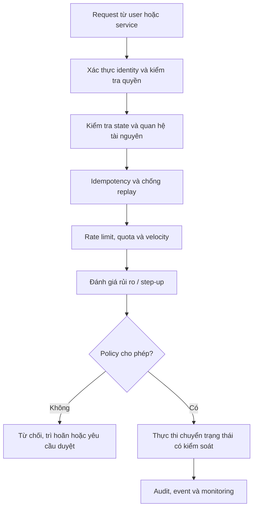
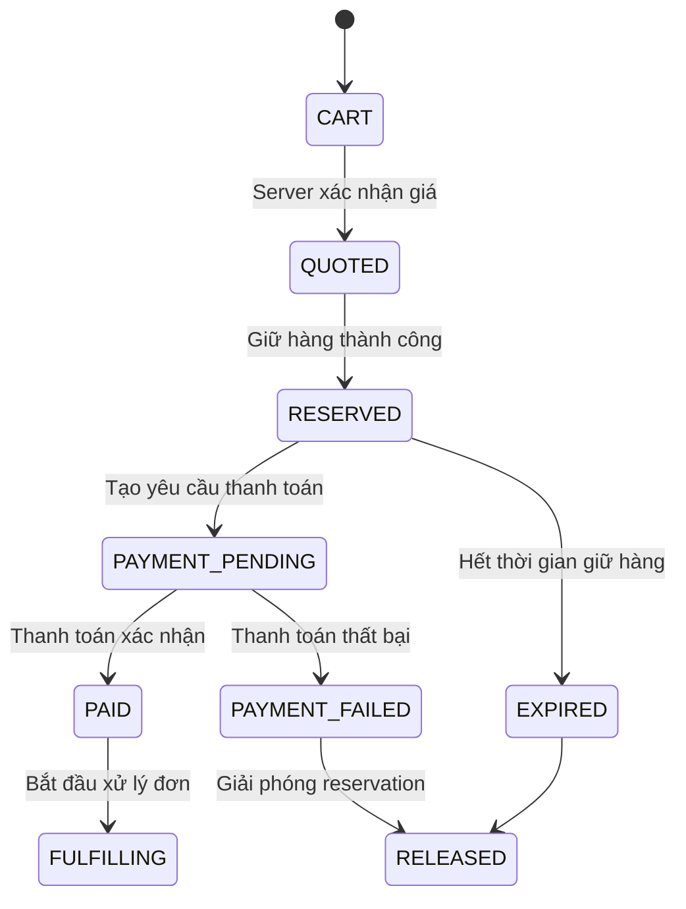
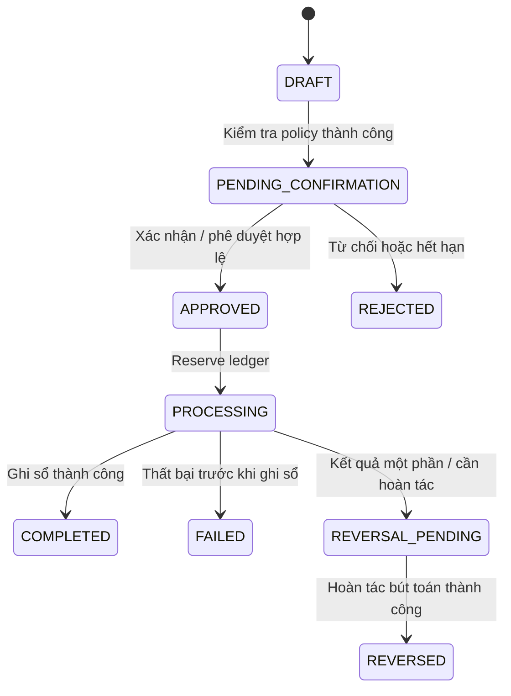

# Giới hạn automation trên purchase, transfer và publish

API có thể được gọi tự động bởi ứng dụng di động, tác vụ nền, đối tác tích hợp hoặc script hợp lệ. Automation giúp xử lý nhanh và nhất quán, nhưng cũng có thể bị lạm dụng để mua hàng hàng loạt, chiếm suất ưu tiên, thử giao dịch tài chính, chuyển tiền liên tục hoặc phát tán nội dung rác. Những hành vi này thường khai thác cách một luồng nghiệp vụ được thiết kế, chứ không nhất thiết vượt qua đăng nhập hay phá vỡ một endpoint riêng lẻ.

**Business flow security** bảo vệ toàn bộ chuỗi hành động và trạng thái của nghiệp vụ. Để giới hạn automation trên purchase, transfer và publish, hệ thống cần kết hợp xác thực, phân quyền, giới hạn tốc độ và quota, kiểm tra rủi ro, idempotency, kiểm soát đồng thời và state machine phía server. Mỗi request phải được đánh giá trong ngữ cảnh của tài khoản, tài nguyên, giá trị giao dịch và trạng thái hiện tại.

Rate limiting đơn thuần không đủ. Một bot có thể phân tán request qua nhiều IP hoặc tài khoản; một request duy nhất cũng có thể tạo ra side effect lớn; nhiều request song song có thể vượt hạn mức nếu hệ thống chỉ kiểm tra rồi mới cập nhật. Vì vậy, các giới hạn phải được thực thi tại service sở hữu nghiệp vụ và bảo vệ cả số lượng, giá trị, tần suất lẫn chuyển trạng thái.

## 1. Automation hợp lệ và automation bị lạm dụng

Automation hợp lệ thường có danh tính, mục đích và phạm vi rõ ràng. Ví dụ, một đối tác được cấp quyền đặt hàng theo hợp đồng, một service nội bộ xử lý thanh toán hoặc một công cụ quản trị lên lịch xuất bản nội dung. Automation bị lạm dụng có thể dùng credential hợp lệ nhưng thực hiện hành vi vượt quá mục đích được cấp.

| Luồng nghiệp vụ | Automation hợp lệ | Dấu hiệu lạm dụng có thể gặp |
| --- | --- | --- |
| Purchase | Ứng dụng tạo đơn theo giỏ hàng của khách; đối tác đặt hàng theo quota hợp đồng | Mua vét số lượng giới hạn, tạo nhiều đơn để giữ hàng, lặp thanh toán, săn ưu đãi bằng nhiều tài khoản. |
| Transfer | Service chuyển tiền theo lệnh đã được phê duyệt; người dùng lập lịch chuyển định kỳ | Chia nhỏ giao dịch để né hạn mức, thử nhiều tài khoản nhận, phát lại lệnh hoặc chuyển tiền hàng loạt. |
| Publish | Người dùng lên lịch bài viết; hệ thống nội bộ đăng nội dung đã duyệt | Đăng spam, tạo nhiều nội dung gần giống nhau, phát tán liên kết độc hại hoặc dùng tài khoản tự động để thao túng tương tác. |

Không thể kết luận một request là độc hại chỉ vì nó được gửi nhanh hoặc đến từ script. Quyết định cần dựa trên danh tính, quyền, lịch sử, quy mô, giá trị, quan hệ tài nguyên và chính sách của nghiệp vụ. Cũng cần bảo đảm automation hợp lệ có đường tích hợp được cấp quyền và quota phù hợp.

## 2. Mô hình kiểm soát chung cho business flow

Một quyết định cho phép thực hiện hành động nhạy cảm nên xem xét:

- **Subject:** user, service, tenant hoặc đối tác đã xác thực; trạng thái tài khoản và mức độ tin cậy.
- **Action:** purchase, reserve, transfer, approve, publish hoặc cancel.
- **Resource:** giỏ hàng, hàng tồn kho, tài khoản nguồn/đích, bài viết hoặc chiến dịch cụ thể.
- **Context:** giá trị, số lượng, thời gian, thiết bị, địa chỉ nhận, lịch sử giao dịch, trạng thái quy trình và kết quả đánh giá rủi ro.
- **Limits:** giới hạn tần suất, số lần, tổng giá trị, số lượng, số tài nguyên đang chờ và quota theo thời gian.

Các kiểm soát cần nằm ở server. Frontend có thể hiển thị hạn mức và yêu cầu xác nhận, nhưng client không được quyết định giá cuối cùng, số dư, trạng thái đã duyệt, danh tính người sở hữu hoặc kết quả kiểm tra rủi ro.



Không phải request nào cũng cần mọi lớp kiểm soát với cùng mức độ. Một thao tác đọc thông thường có thể chỉ cần quyền và rate limit cơ bản; chuyển tiền giá trị lớn hoặc xuất bản hàng loạt cần thêm xác nhận, kiểm tra rủi ro và phê duyệt.

## 3. Phân biệt rate limit, quota, velocity và concurrency limit

Các giới hạn giải quyết những dạng lạm dụng khác nhau:

| Cơ chế | Giới hạn điều gì? | Ví dụ |
| --- | --- | --- |
| Rate limit | Số request trong một khoảng thời gian | Tối đa một số request purchase mỗi phút trên một identity. |
| Quota | Tổng số lần hoặc tổng giá trị được phép trong một chu kỳ | Hạn mức tổng tiền transfer mỗi ngày hoặc số bài publish mỗi ngày. |
| Velocity check | Tốc độ thay đổi của hành vi hoặc chuỗi sự kiện | Nhiều giao dịch tăng đột ngột, đổi liên tục tài khoản nhận hoặc địa chỉ giao hàng. |
| Concurrency limit | Số thao tác đồng thời đang chạy | Chỉ cho phép một reservation đang xử lý cho cùng một cart hoặc một lệnh transfer. |
| Cooldown | Khoảng chờ giữa các hành động nhạy cảm | Chờ trước khi dùng beneficiary mới hoặc thay đổi thông tin nhận tiền. |
| Risk-based step-up | Yêu cầu bằng chứng mạnh hơn khi rủi ro tăng | Xác nhận giao dịch lại bằng MFA hoặc phê duyệt bổ sung. |

### 3.1. Chọn khóa giới hạn phù hợp

Giới hạn chỉ theo IP thường không đủ. Một IP có thể đại diện cho nhiều người dùng hợp lệ qua NAT, trong khi bot có thể thay đổi IP. Nên kết hợp nhiều chiều tùy nghiệp vụ:

- User hoặc service identity đã xác thực.
- Tenant, organization hoặc đối tác tích hợp.
- Payment instrument, tài khoản nguồn/đích hoặc beneficiary.
- Cart, order, campaign, content author hoặc tài nguyên đang được xử lý.
- Device/session và IP như tín hiệu bổ sung, có xét đến quyền riêng tư và độ tin cậy.

Không dùng một khóa dễ bị người gọi tự chọn như `X-Client-Id` hoặc `tenantId` trong body nếu server chưa xác minh quan hệ của nó với principal. Với hệ thống phân tán, bộ đếm và quota phải được cập nhật nguyên tử trong kho dữ liệu dùng chung hoặc cơ chế giới hạn có tính nhất quán phù hợp; bộ đếm trong bộ nhớ của từng instance có thể bị vượt khi request được phân tán qua nhiều instance.

### 3.2. Burst và cửa sổ thời gian

Fixed window dễ triển khai nhưng có thể cho phép burst ở ranh giới hai cửa sổ. Token bucket hoặc sliding window có thể phù hợp hơn khi cần kiểm soát tốc độ và burst. Dù chọn thuật toán nào, cần định nghĩa rõ thời gian reset, cách xử lý retry, giới hạn đồng thời và hành vi khi kho quota tạm thời không sẵn sàng.

Khi không thể kiểm tra hạn mức cho thao tác tài chính hoặc thao tác tạo side effect lớn, hệ thống nên fail closed hoặc đưa request vào trạng thái chờ kiểm tra theo chính sách. Không nên âm thầm bỏ qua quota vì Redis hoặc dịch vụ rate limit bị lỗi.

## 4. Bảo vệ purchase và inventory reservation

Purchase thường bao gồm nhiều bước: tạo giỏ hàng, xác nhận giá, giữ hàng, thanh toán và tạo đơn hoàn tất. Nếu mỗi endpoint chỉ kiểm tra độc lập, bot có thể khai thác khoảng trống giữa các bước.

### 4.1. Rủi ro phổ biến

- Tạo nhiều đơn hoặc reservation để giữ hàng dù không có ý định thanh toán.
- Gửi song song nhiều request mua cùng một mặt hàng giới hạn.
- Thay giá, chiết khấu, thuế hoặc số lượng trong request để thao túng tổng tiền.
- Phát lại request thanh toán hoặc submit order nhiều lần khi timeout.
- Tạo nhiều tài khoản để vượt quota mua trên một người dùng.
- Giữ hàng lâu bằng cách liên tục gia hạn reservation hoặc tạo cart mới.

### 4.2. Kiểm soát theo luồng

**Xác minh quyền và sở hữu:** cart phải thuộc user hoặc tenant đã xác thực. Nếu đối tác đặt hàng thay khách hàng, cần quyền đại diện rõ ràng và audit.

**Tính toán phía server:** giá, thuế, phí vận chuyển, ưu đãi, tồn kho và tổng tiền phải được tính lại ở server từ nguồn dữ liệu tin cậy. Không nhận `totalPrice`, `discountAmount` hoặc `paymentStatus` làm giá trị có thẩm quyền từ client.

**Giữ hàng có thời hạn:** tạo reservation với TTL và giới hạn số reservation đang hoạt động theo identity, SKU, campaign hoặc tenant. Khi hết hạn hoặc thanh toán thất bại, giải phóng hàng theo một luồng idempotent.

**Giới hạn số lượng và tốc độ:** áp dụng quota theo tài khoản, địa chỉ giao hàng, payment instrument hoặc chương trình khuyến mại. Với hàng khan hiếm, có thể thêm giới hạn theo campaign và yêu cầu xác minh bổ sung khi hành vi bất thường.

**Idempotency:** mỗi ý định purchase có một idempotency key duy nhất trong phạm vi principal và endpoint. Nếu client retry do timeout, server trả kết quả của thao tác đã xử lý thay vì tạo đơn hoặc charge lần nữa. Cùng key nhưng payload khác phải bị từ chối.

**Concurrency:** dùng transaction, unique constraint, conditional update hoặc cơ chế reservation nguyên tử để tránh hai request đồng thời cùng bán một đơn vị hàng. Không chỉ đọc tồn kho rồi trừ bằng hai thao tác tách rời.

### 4.3. State machine cho purchase

Một luồng đơn hàng có thể gồm:



Chỉ cho phép các chuyển trạng thái đã định nghĩa. Client không được gửi `status: PAID` hoặc gọi endpoint hoàn tất đơn để bỏ qua bước thanh toán. Callback từ payment provider cần xác minh chữ ký, merchant/account, amount, currency và reference; callback lặp phải được xử lý idempotent.

### 4.4. Ví dụ idempotency cho purchase

Request có thể mang key trong header:

```http
POST /api/purchases
Authorization: Bearer <access-token>
Idempotency-Key: 4a3f9b7e-2b2e-4a58-9a0e-0f0a4f3e9a11
Content-Type: application/json

{
  "cartId": "cart-123",
  "shippingAddressId": "address-456"
}
```

Pseudo-code ở service:

```java
@Transactional
public PurchaseResult purchase(
        PurchaseCommand command,
        ApiPrincipal actor,
        String idempotencyKey) {

    RequestFingerprint fingerprint = fingerprint(command);
    IdempotencyClaim claim = idempotencyRepository.claimAtomically(
        actor.subjectId(), "purchase", idempotencyKey, fingerprint);

    if (claim.isCompleted()) {
        return claim.storedResult();
    }
    if (claim.isInProgress()) {
        throw new RequestAlreadyInProgressException();
    }

    Cart cart = cartRepository.findOwnedById(
        command.cartId(), actor.subjectId())
        .orElseThrow(CartNotFoundException::new);

    purchasePolicy.requireAllowed(actor, cart);
    PriceQuote quote = pricingService.quote(cart, command.shippingAddressId());
    Purchase purchase = purchaseService.createWithReservation(cart, quote, actor);
    idempotencyRepository.markCompleted(claim, purchase.id());

    return PurchaseResult.from(purchase);
}
```

Đây là pseudo-code minh họa; `claimAtomically` phải tạo bản ghi `IN_PROGRESS` trước side effect bằng unique constraint cho `(subject, operation, idempotency_key)`. Khi hai request cùng key đến đồng thời, chỉ một request được claim; request còn lại nhận trạng thái đang xử lý hoặc kết quả đã lưu. Việc claim, ghi nhận kết quả và side effect nội bộ cần nằm trong transaction phù hợp. Nếu inventory, payment và order nằm ở các service/database khác nhau, không giữ một transaction database mở xuyên suốt các network call. Dùng reservation, transactional outbox và saga/compensation để quản lý tiến trình phân tán. Với payment provider, truyền idempotency key tương ứng và đối soát trạng thái trước khi retry để tránh trường hợp đã charge nhưng chưa lưu kết quả key ở hệ thống của mình.

## 5. Bảo vệ transfer và các giao dịch giá trị

Transfer có rủi ro cao vì một request có thể di chuyển tài sản. Kiểm soát cần xét danh tính, tài khoản nguồn, người nhận, giá trị, trạng thái lệnh và sự đồng ý của chủ tài khoản.

### 5.1. Kiểm tra quyền và tính hợp lệ

- Tài khoản nguồn phải thuộc người gọi hoặc nằm trong phạm vi ủy quyền hợp lệ.
- Người nhận phải hợp lệ; beneficiary mới hoặc thay đổi gần đây có thể cần cooldown hoặc xác minh bổ sung.
- Currency, amount, fee và exchange rate phải được xác định/kiểm tra phía server.
- Tài khoản phải đủ số dư khả dụng và không bị khóa, phong tỏa hoặc hạn chế giao dịch.
- Người gọi phải có quyền cho đúng loại transfer và đúng ngưỡng giá trị.
- Giao dịch vượt ngưỡng rủi ro có thể yêu cầu step-up authentication hoặc phê duyệt hai người (dual control).

### 5.2. Giới hạn theo số lần và giá trị

Có thể áp dụng nhiều hạn mức đồng thời:

| Hạn mức | Mục đích |
| --- | --- |
| Số tiền mỗi giao dịch | Giới hạn tác động của một lệnh đơn lẻ. |
| Tổng tiền theo ngày/chu kỳ | Ngăn chia nhỏ giao dịch để vượt hạn mức tổng. |
| Số giao dịch trong khoảng thời gian | Phát hiện automation tạo lệnh liên tục. |
| Tổng tiền đến một beneficiary | Hạn chế tập trung dòng tiền vào người nhận bất thường. |
| Số beneficiary mới | Hạn chế tạo hàng loạt tài khoản nhận. |
| Số lệnh đang chờ | Ngăn xếp hàng quá nhiều giao dịch chưa hoàn tất. |

Hạn mức nên tính trên các chiều liên quan và cập nhật nguyên tử. Chỉ kiểm tra tổng tiền hiện tại trước khi ghi có thể bị race condition: hai request song song cùng đọc một hạn mức còn trống rồi cả hai đều được duyệt. Cần dùng transaction với lock, conditional update, ledger reservation hoặc cơ chế quota nguyên tử.

### 5.3. Xác nhận mạnh và step-up authentication

Với giao dịch có rủi ro cao, có thể yêu cầu người dùng xác nhận lại bằng MFA, passkey hoặc cơ chế step-up phù hợp. Nội dung xác nhận nên gắn với giao dịch cụ thể: tài khoản nguồn, người nhận, số tiền, currency và thời điểm. Một lần xác thực chung không nên được tái sử dụng vô hạn cho các giao dịch khác nhau.

Nếu beneficiary vừa được thêm hoặc thông tin nhận tiền vừa thay đổi, có thể áp dụng thời gian chờ, thông báo ngoài băng hoặc yêu cầu phê duyệt. Những biện pháp này phải được thiết kế để tránh khóa nhầm người dùng hợp lệ và có quy trình hỗ trợ khi mất thiết bị.

### 5.4. Idempotency, ledger và state machine

Transfer cần một định danh lệnh duy nhất và xử lý retry an toàn. Không dùng mỗi request ID do client tự sinh làm bằng chứng giao dịch chưa từng tồn tại; server phải lưu key trong phạm vi actor/operation và phát hiện payload khác nhau cho cùng key.

Ledger nên ghi bút toán cân bằng theo một transaction nguyên tử ở hệ thống sổ cái. Không cập nhật số dư nguồn và đích bằng hai lệnh độc lập mà không có cơ chế đảm bảo nhất quán. Với luồng phân tán, dùng trạng thái pending/reserved và quy trình xác nhận/hoàn tác có kiểm soát. Chỉ cần reversal khi đã có bút toán hoặc side effect cần đảo; lỗi xảy ra trước khi ghi sổ có thể kết thúc ở `FAILED` mà không tạo bút toán đảo.

Ví dụ state machine:



Không cho client tự chuyển `PENDING_CONFIRMATION` sang `COMPLETED`. Mỗi chuyển trạng thái phải được gắn với actor hoặc service được phép, bằng chứng xác nhận, reference duy nhất và audit event.

## 6. Bảo vệ publish và luồng phân phối nội dung

Publish có thể không trực tiếp di chuyển tiền nhưng automation quy mô lớn có thể gây spam, lừa đảo, phát tán mã độc, thao túng tìm kiếm hoặc làm giảm chất lượng nền tảng.

### 6.1. Kiểm soát theo tác giả và tenant

Giới hạn số bài tạo mới, số bài chờ duyệt, số lần chỉnh sửa, số lịch xuất bản và lượng media tải lên theo user, tenant, loại tài khoản hoặc mức độ tin cậy. Với tài khoản mới hoặc có lịch sử vi phạm, có thể áp dụng quota thấp hơn và tăng dần sau khi đạt điều kiện.

Không chỉ đếm request tạo bài. Một bài có thể bị sửa liên tục, đổi URL hoặc thay media để né kiểm soát. Cần theo dõi chuỗi hành động trên cùng nội dung và quan hệ giữa các bài.

### 6.2. Moderation và state machine

Một luồng publish có thể gồm `DRAFT`, `SUBMITTED`, `REVIEW`, `APPROVED`, `SCHEDULED`, `PUBLISHED`, `REJECTED` và `REMOVED`. Chỉ service moderation hoặc actor có quyền mới được chuyển qua các trạng thái duyệt. Client không thể đặt `status=PUBLISHED` trong request cập nhật nội dung.

Kiểm tra nội dung có thể bao gồm spam similarity, số lượng liên kết, reputation của domain, malware scan cho file, loại MIME thực tế, kích thước media, metadata và chính sách nội dung. Kết quả tự động nên được xem là tín hiệu/rule trong pipeline moderation; nội dung có rủi ro cao có thể cần review thủ công.

### 6.3. Chống lặp và thao túng

Phát hiện các bài gần giống nhau được đăng bởi cùng tài khoản hoặc nhiều tài khoản liên quan; giới hạn lịch xuất bản dày đặc; kiểm tra URL rút gọn hoặc redirect theo chính sách; ngăn thay nội dung sau khi đã duyệt mà không chạy lại bước moderation. Với chỉnh sửa quan trọng, cần đưa bài về trạng thái review hoặc tạo phiên bản mới cần duyệt.

Nếu publish có side effect bên ngoài như gửi thông báo, phân phối feed hoặc webhook, hãy dùng event/outbox và idempotent consumer để tránh gửi lặp khi message được retry. Hủy hoặc gỡ bài cần phát ra event có định danh để các downstream service xử lý nhất quán.

## 7. Idempotency và chống replay trên mọi luồng

Automation thường retry khi timeout, mất kết nối hoặc nhận response không rõ ràng. Nếu endpoint không idempotent, retry có thể tạo đơn trùng, chuyển tiền hai lần hoặc publish nhiều bản sao.

Một thiết kế idempotency cần xác định:

1. **Key scope:** key thuộc principal/tenant nào và operation nào. Không dùng một key toàn cục dễ va chạm giữa các user.
2. **Request fingerprint:** cùng key phải gắn với cùng nội dung có ý nghĩa; nếu payload khác, trả lỗi conflict.
3. **Atomic claim:** chỉ một request được quyền xử lý key mới; request đồng thời phải chờ hoặc nhận trạng thái đang xử lý.
4. **Stored outcome:** lưu trạng thái và kết quả đủ để retry trả lại cùng kết quả mà không lặp side effect.
5. **Retention:** lưu key lâu hơn khoảng thời gian retry hợp lý và phù hợp với thời hạn nghiệp vụ; giao dịch tài chính có thể cần đối chiếu lâu hơn.

Idempotency không thay thế authorization. Mỗi lần replay vẫn phải xác định principal và kiểm tra quyền phù hợp trước khi trả dữ liệu kết quả đã lưu. Nếu quyền đã bị thu hồi, response có thể cần bị giới hạn theo chính sách hiện tại.

Với webhook hoặc callback từ đối tác, xác minh chữ ký trên raw body, timestamp và event ID; chống replay bằng cửa sổ thời gian và kho event ID đã xử lý. Không chỉ tin `eventId` do request gửi mà không xác minh nguồn phát.

## 8. Chống race condition và vượt hạn mức bằng request song song

Một lỗi thường gặp là kiểm tra giới hạn và ghi dữ liệu ở hai bước không nguyên tử:

```text
Đọc quota còn lại: 1
Request A kiểm tra: còn 1 -> cho phép
Request B kiểm tra: còn 1 -> cho phép
Request A ghi giao dịch
Request B ghi giao dịch
Kết quả: quota bị vượt
```

Các biện pháp phù hợp gồm:

- Transaction với row-level lock hoặc optimistic versioning.
- Conditional update kiểu “chỉ cập nhật nếu giá trị hiện tại vẫn dưới giới hạn”.
- Unique constraint để ngăn tạo hai resource có cùng business key.
- Reservation trước khi xử lý side effect và giải phóng reservation khi thất bại.
- Atomic counter hoặc script trong kho dữ liệu phân tán, với key và TTL được thiết kế cẩn thận.
- Ledger và double-entry accounting cho giao dịch tiền.

Không giữ database lock trong khi chờ một network call dài. Với quy trình nhiều service, hãy dùng saga, outbox/inbox và state transition có thể retry/compensate. Mỗi bước phải có định danh ổn định và có thể xử lý lặp mà không tạo side effect trùng.

## 9. Risk-based controls và trải nghiệm người dùng

Một chính sách tốt không nhất thiết áp dụng CAPTCHA hoặc MFA cho mọi request. Có thể dùng risk engine để chọn mức kiểm soát tương ứng:

| Mức rủi ro | Ví dụ tín hiệu | Hành động có thể áp dụng |
| --- | --- | --- |
| Thấp | Hành vi quen thuộc, trong quota, tài khoản ổn định | Cho phép theo luồng chuẩn. |
| Trung bình | Tần suất tăng, thiết bị mới, beneficiary mới, nhiều thao tác gần nhau | Giảm tốc độ, yêu cầu xác nhận bổ sung hoặc cooldown. |
| Cao | Giá trị lớn bất thường, nhiều dấu hiệu gian lận, credential có dấu hiệu bị chiếm | Step-up authentication, giữ lệnh chờ duyệt hoặc từ chối. |
| Rất cao | Credential bị xác định lộ lọt, hành vi vi phạm rõ ràng hoặc policy cấm | Chặn, thu hồi phiên/credential liên quan và mở quy trình điều tra. |

Risk score chỉ là đầu vào cho policy, không nên trở thành một con số bí ẩn duy nhất quyết định mọi thứ. Cần có lý do quyết định có thể audit, giới hạn quyền truy cập vào dữ liệu tín hiệu và cơ chế xử lý false positive. Thông báo cho người dùng nên đủ rõ để họ biết cần làm gì, nhưng không tiết lộ ngưỡng chống gian lận hoặc chi tiết giúp kẻ xấu điều chỉnh hành vi né tránh.

## 10. API contract và phản hồi khi bị giới hạn

API nên công bố các trạng thái có thể quan sát được để client xử lý retry, chờ duyệt hoặc yêu cầu xác nhận:

| HTTP status | Trường hợp thường gặp | Hành vi client |
| --- | --- | --- |
| `400 Bad Request` | Request sai cấu trúc hoặc thiếu trường | Sửa request theo schema. |
| `401 Unauthorized` | Credential thiếu hoặc không hợp lệ | Xác thực lại theo quy trình. |
| `403 Forbidden` | Không có quyền thực hiện hành động | Không retry cùng quyền; hiển thị trạng thái phù hợp. |
| `409 Conflict` | Idempotency key gắn payload khác, state conflict hoặc resource đã được xử lý | Đọc trạng thái hiện tại hoặc tạo lệnh mới đúng quy trình. |
| `422 Unprocessable Content` | Vi phạm điều kiện nghiệp vụ | Sửa dữ liệu hoặc điều kiện nghiệp vụ trước khi thử lại. |
| `429 Too Many Requests` | Vượt rate limit hoặc quota tạm thời | Tôn trọng `Retry-After` nếu có; backoff có jitter. |
| `202 Accepted` | Lệnh đã nhận và đang chờ duyệt/xử lý bất đồng bộ | Poll endpoint trạng thái hoặc nhận webhook đã xác thực. |

Không trả chi tiết quá mức như chính xác rule phát hiện bot, ngưỡng chống gian lận hoặc tài khoản nào bị gắn cờ. Tuy nhiên, response cần có error code ổn định, correlation ID và hướng xử lý phù hợp. Không dùng `429` cho mọi trường hợp bị từ chối: thiếu quyền, vi phạm trạng thái và vượt quota là các tình huống khác nhau.

Với retry, client nên dùng exponential backoff có jitter, tôn trọng `Retry-After` và giữ nguyên idempotency key cho cùng một ý định nghiệp vụ. Không tạo key mới cho mỗi lần retry vì điều đó làm mất tác dụng chống lặp.

## 11. Kiểm thử business flow security

Kiểm thử phải bao phủ chuỗi nghiệp vụ và hành vi song song, không chỉ kiểm tra từng endpoint trả `200` hay `403`.

| Nhóm kiểm thử | Tình huống | Kết quả mong đợi |
| --- | --- | --- |
| Purchase quota | Một tài khoản mua vượt số lượng hoặc tổng giá trị cho phép | Từ chối hoặc yêu cầu xác minh; không giữ hàng vượt quota. |
| Purchase concurrency | Nhiều request mua đồng thời một SKU chỉ còn một đơn vị | Chỉ một reservation thành công. |
| Purchase retry | Gửi lại cùng idempotency key sau timeout | Chỉ một order/payment side effect. |
| Price integrity | Client gửi giá hoặc discount tự sửa | Server tính lại; giá client không có thẩm quyền. |
| Transfer limits | Chia nhỏ nhiều lệnh để vượt tổng hạn mức ngày | Tổng quota vẫn được áp dụng trên chu kỳ. |
| Transfer replay | Gửi lại cùng lệnh transfer hoặc webhook | Không ghi sổ hoặc chi trả lần hai. |
| Transfer race | Hai lệnh song song cùng dùng số dư/hạn mức còn lại | Không chi vượt số dư hoặc quota. |
| Beneficiary risk | Tạo beneficiary mới rồi chuyển giá trị lớn ngay | Áp dụng cooldown/step-up/approval theo policy. |
| Publish quota | Tạo nhiều bài hoặc lịch đăng vượt quota | Giới hạn số bài và số bài chờ xử lý. |
| Publish moderation | Sửa nội dung sau khi đã duyệt | Chạy lại moderation hoặc đưa về trạng thái review. |
| Cross-tenant | Service automation thao tác tài nguyên tenant khác | Từ chối; không phát sinh side effect. |
| Risk service unavailable | Risk engine hoặc quota store không phản hồi | Thực hiện fail-closed hoặc chuyển pending theo chính sách đã định nghĩa. |

Các test concurrency cần thực sự chạy request song song và kiểm tra dữ liệu cuối cùng trong database/ledger. Với test idempotency, xác minh cả response và side effect. Với luồng bất đồng bộ, kiểm tra message được giao lặp, out-of-order và consumer retry.

## 12. Monitoring, audit và xử lý sự cố

Nên ghi nhận các sự kiện nghiệp vụ quan trọng: actor/workload, tenant, operation, resource ID, amount/quantity ở mức phù hợp, idempotency key đã băm hoặc định danh an toàn, policy decision, risk reason code, state transition, correlation ID và thời điểm. Không ghi access token, thông tin thẻ đầy đủ, mã xác thực, bí mật hoặc payload cá nhân nguyên vẹn.

Các metric hữu ích gồm:

- Tỷ lệ request bị rate limit hoặc quota reject theo user, tenant, client và endpoint.
- Số reservation hết hạn, đơn chưa thanh toán và tỷ lệ chuyển từ reservation sang purchase thành công.
- Số transfer pending/rejected, giá trị giao dịch, beneficiary mới và tỷ lệ step-up thất bại.
- Số bài publish, bài chờ moderation, bài bị gỡ và nội dung trùng lặp.
- Số idempotency conflict, duplicate callback, retry và side effect được suppress.
- Tỷ lệ request chạy song song, lock conflict và lỗi quota store.

Khi phát hiện automation bất thường, có thể giảm quota hoặc tạm dừng operation theo principal/resource, yêu cầu step-up, khóa beneficiary hoặc campaign có liên quan, đưa giao dịch vào review và thu hồi credential nếu có dấu hiệu bị chiếm. Mọi hành động cần có audit, phạm vi ảnh hưởng rõ và cách khôi phục cho người dùng hợp lệ.

## 13. Checklist thiết kế giới hạn automation

- [ ] Đã mô tả state machine và các chuyển trạng thái hợp lệ của purchase, transfer hoặc publish.
- [ ] Mỗi endpoint kiểm tra identity, function permission, object ownership và tenant scope.
- [ ] Giá, số dư, trạng thái duyệt và các dữ liệu có thẩm quyền được xác định phía server.
- [ ] Có rate limit, quota, velocity, cooldown và concurrency limit phù hợp với nghiệp vụ.
- [ ] Quota được cập nhật nguyên tử trên hệ thống phân tán; không thể vượt bằng request song song.
- [ ] Idempotency key được scope theo actor/operation, gắn request fingerprint và lưu kết quả an toàn.
- [ ] Retry, callback, webhook và message consumer có cơ chế chống replay và xử lý lặp.
- [ ] Purchase có reservation TTL, kiểm soát tồn kho và giá server-side.
- [ ] Transfer có hạn mức theo số lần/giá trị, beneficiary controls, step-up và ledger nhất quán.
- [ ] Publish có quota, moderation state, kiểm tra media/link và duyệt lại khi nội dung thay đổi.
- [ ] Risk-based control có audit reason và cơ chế xử lý false positive.
- [ ] API contract định nghĩa rõ `409`, `422`, `429`, `202` và hướng retry.
- [ ] Test bao gồm abuse case, cross-tenant, replay, race condition, retry và side effect.
- [ ] Monitoring phát hiện bất thường mà không thu thập bí mật hoặc dữ liệu cá nhân quá mức.

Giới hạn automation hiệu quả cần bảo vệ cả tốc độ, số lượng, giá trị và trạng thái của nghiệp vụ. Khi quota, idempotency, authorization, state machine và risk controls được thực thi nhất quán tại service sở hữu dữ liệu, hệ thống có thể hỗ trợ automation hợp lệ trong khi giảm khả năng bot hoặc script lạm dụng purchase, transfer và publish.
