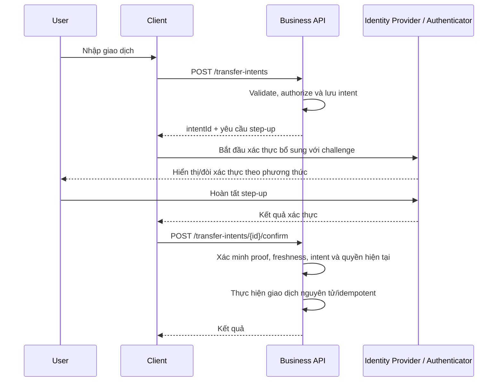
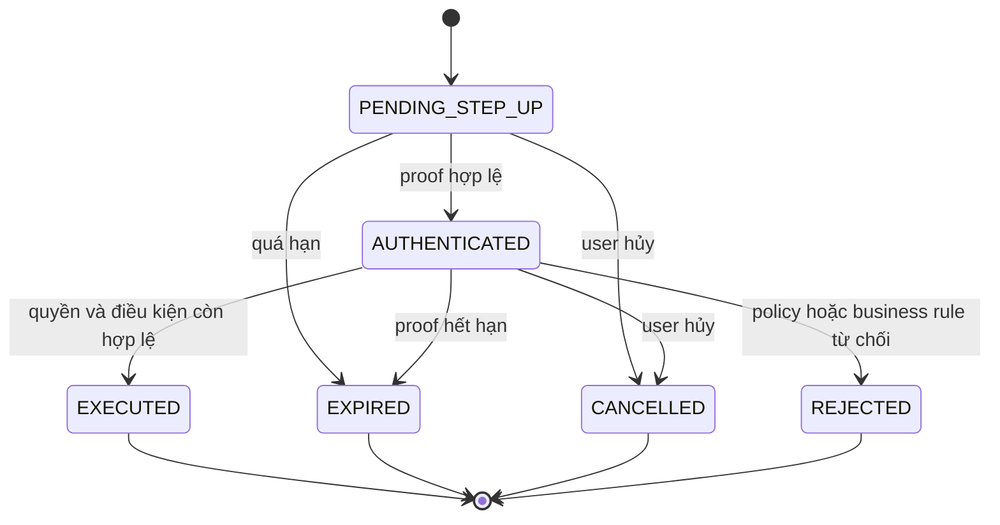

# Step-up authentication trước hành động nhạy cảm

Một người dùng có thể đã đăng nhập từ đầu ngày và đang sử dụng ứng dụng bình thường. Khi họ muốn đổi mật khẩu, thêm người thụ hưởng mới, chuyển một khoản tiền lớn, xuất dữ liệu cá nhân hoặc thay đổi quyền quản trị, hệ thống có thể cần yêu cầu xác thực lại bằng một phương thức mạnh hơn.

Đây là **step-up authentication**: yêu cầu người dùng chứng minh lại danh tính hoặc đạt mức bảo đảm xác thực cao hơn trước một hành động có rủi ro. Mục tiêu là giảm thiệt hại khi session hoặc access token bị đánh cắp, bị bỏ quên trên thiết bị dùng chung, hoặc được sử dụng trong một ngữ cảnh không còn đáng tin cậy.

Step-up không thay thế authorization. Nó chỉ xác nhận rằng principal đã đáp ứng yêu cầu xác thực bổ sung. API vẫn phải kiểm tra principal có quyền thực hiện action trên object cụ thể hay không, dữ liệu đầu vào có hợp lệ không và điều kiện nghiệp vụ có cho phép thao tác không.

Ví dụ, Alice có session hợp lệ và quyền tạo lệnh chuyển tiền. Khi cô ấy tạo lệnh 5.000.000 đồng tới người thụ hưởng đã lưu, ứng dụng có thể cho phép theo chính sách hiện tại. Nếu cô ấy đổi người thụ hưởng hoặc tăng số tiền lên 500.000.000 đồng, hệ thống có thể yêu cầu passkey hoặc một bước xác thực mạnh hơn. Bằng chứng step-up phải gắn với đúng giao dịch mà Alice nhìn thấy và xác nhận; nếu chỉ xác thực lại chung chung rồi cho phép mọi thao tác tiếp theo, kẻ tấn công có thể thay đổi nội dung giao dịch sau bước xác thực.

## 1. Khi nào cần step-up authentication?

Đăng nhập thành công chứng minh credential được chấp nhận tại một thời điểm. Nó không đảm bảo người dùng vẫn kiểm soát thiết bị, session chưa bị chiếm quyền hoặc hành động hiện tại có rủi ro thấp. Step-up bổ sung bằng chứng gần thời điểm thực hiện action hoặc yêu cầu mức assurance cao hơn.

Các trường hợp thường cân nhắc:

- Chuyển tiền, hoàn tiền, tạo người thụ hưởng mới hoặc thay đổi thông tin thanh toán.
- Đổi mật khẩu, email, số điện thoại, phương thức MFA hoặc thông tin khôi phục tài khoản.
- Tạo, xem, tải hoặc xoay API key, signing key, certificate và secret.
- Gán role quản trị, cấp permission, thay đổi policy hoặc mời thành viên có quyền cao.
- Xuất hàng loạt dữ liệu cá nhân, tài chính hoặc dữ liệu nội bộ.
- Xóa tenant, khóa tài khoản, xóa dữ liệu hoặc thực hiện thao tác khó đảo ngược.
- Đăng nhập từ thiết bị mới, vị trí hoặc hành vi bất thường theo mô hình rủi ro của hệ thống.
- Thực hiện action sau một khoảng thời gian dài kể từ lần xác thực gần nhất.

Không phải mọi request đều cần step-up. Yêu cầu xác thực bổ sung quá thường xuyên làm gián đoạn trải nghiệm và có thể khiến người dùng quen với việc bấm xác nhận mà không đọc nội dung. Hãy chọn các action có tác động đáng kể, có khả năng bị lạm dụng hoặc cần assurance cao hơn.

### 1.1. Phân loại hành động theo rủi ro

Một ma trận đơn giản có thể giúp xác định mức xác thực cần thiết:

| Mức rủi ro | Ví dụ | Kiểm soát xác thực có thể áp dụng |
|---|---|---|
| Thấp | Xem nội dung công khai, thay đổi tùy chọn giao diện | Session hiện tại theo policy |
| Trung bình | Cập nhật thông tin hồ sơ ít nhạy cảm | Session còn mới hoặc xác thực lại nếu session cũ |
| Cao | Đổi mật khẩu, thêm người thụ hưởng, xuất dữ liệu nhạy cảm | Step-up bằng MFA hoặc phương thức assurance cao hơn |
| Rất cao | Chuyển tiền lớn, thay đổi khóa bảo mật, cấp quyền super-admin | Step-up chống phishing, xác nhận transaction cụ thể, có thể cần phê duyệt bổ sung |

Đây chỉ là ví dụ phân loại. Tổ chức cần xác định mức rủi ro theo loại dữ liệu, khả năng đảo ngược, tác động tài chính, phạm vi người dùng bị ảnh hưởng và yêu cầu nghiệp vụ.

### 1.2. Step-up có thể được kích hoạt theo thời gian hoặc rủi ro

Có hai nhóm tín hiệu thường dùng:

- **Freshness:** thời gian từ lần xác thực gần nhất. Ví dụ, yêu cầu xác thực trong vòng 5 phút trước khi thay đổi email hoặc thực hiện thanh toán.
- **Risk/context:** thiết bị mới, session có dấu hiệu bất thường, thay đổi IP đột ngột, hành vi khác với baseline, thao tác có giá trị cao hoặc recipient mới.

Không nên dùng một tín hiệu như IP address làm bằng chứng duy nhất rằng session bị xâm nhập. IP có thể thay đổi do mạng di động, VPN hoặc NAT. Mô hình risk-based nên kết hợp nhiều tín hiệu và có cơ chế xử lý khi dữ liệu rủi ro không sẵn sàng.

## 2. Phân biệt step-up, re-authentication, MFA và authorization

Các khái niệm này liên quan nhưng không đồng nghĩa:

| Khái niệm | Mục đích | Ví dụ |
|---|---|---|
| Re-authentication | Yêu cầu người dùng xác thực lại, thường để làm mới freshness | Nhập lại mật khẩu hoặc dùng passkey trước khi đổi email |
| MFA | Kết hợp từ hai loại yếu tố xác thực độc lập trở lên | Password kết hợp security key |
| Step-up authentication | Nâng mức assurance hoặc freshness cho một action cụ thể | Session thường cần passkey trước khi chuyển tiền lớn |
| Authorization | Quyết định principal có quyền thực hiện action trên tài nguyên hay không | User có permission `payment:create` và được thao tác trên tài khoản của mình |
| Transaction confirmation | Xác nhận nội dung cụ thể của giao dịch | Người dùng xác nhận số tiền và người nhận trước khi gửi lệnh |

Một lần nhập lại password có thể là re-authentication nhưng không nhất thiết là MFA hoặc đạt assurance cao. Một lần MFA cũng chưa chắc ràng buộc với giao dịch cụ thể. Step-up có thể yêu cầu một hoặc nhiều yếu tố tùy policy, nhưng phải nói rõ hệ thống cần freshness, assurance hay cả hai.

## 3. Mô hình mức bảo đảm xác thực

Để áp dụng step-up nhất quán, hệ thống cần mô tả mức assurance cần thiết và cách xác minh rằng người dùng đã đạt mức đó.

Các thuộc tính thường quan tâm:

- **Authentication method:** password, OTP, push approval, passkey/WebAuthn, security key hoặc certificate.
- **Factor composition:** một yếu tố hay nhiều yếu tố độc lập.
- **Phishing resistance:** phương thức có chống được trang giả mạo hoặc chuyển tiếp OTP không.
- **User verification:** thiết bị có xác minh người dùng bằng PIN hoặc sinh trắc học tại chỗ hay không.
- **Freshness:** xác thực diễn ra cách đây bao lâu.
- **Session binding:** bằng chứng có gắn với session/client hiện tại không.
- **Transaction binding:** bằng chứng có gắn với action và dữ liệu giao dịch cụ thể không.

Không nên chỉ dùng nhãn `MFA=true` nếu các phương thức MFA có mức bảo vệ rất khác nhau. Ví dụ, OTP qua SMS và passkey có khả năng chống phishing khác nhau. Policy nên yêu cầu thuộc tính cụ thể mà action cần.

### 3.1. Mật khẩu và nhập lại mật khẩu

Yêu cầu nhập lại password có thể hữu ích để xác nhận người dùng còn biết bí mật tài khoản, đặc biệt khi session đã tồn tại lâu. Tuy nhiên, password có thể bị phishing, tái sử dụng hoặc đã bị lộ. Với hành động có tác động lớn, chỉ nhập lại password có thể chưa đủ.

Nếu dùng password re-authentication:

- Xác minh ở server bằng cùng cơ chế bảo vệ password đang dùng cho đăng nhập.
- Không gửi password qua query string, log hoặc analytics.
- Giới hạn số lần thử và áp dụng chống brute force.
- Không trả lỗi phân biệt quá chi tiết khiến có thể dò tài khoản.
- Sau khi thành công, ghi nhận thời điểm và mức xác thực mới vào security context hoặc session theo policy.

### 3.2. OTP và push approval

OTP có thể được gửi qua ứng dụng authenticator, email hoặc SMS. Các phương thức này không có cùng mức assurance. SMS có rủi ro liên quan đến chiếm đoạt số điện thoại và chuyển hướng tin nhắn; OTP nhập thủ công có thể bị phishing hoặc relay theo thời gian thực.

Push approval có thể thuận tiện nhưng cần chống fatigue attack: kẻ tấn công gửi liên tục yêu cầu đăng nhập để người dùng bấm chấp nhận theo thói quen. Có thể hiển thị thông tin thiết bị, vị trí gần đúng, action và transaction context; giới hạn số lần yêu cầu; dùng number matching hoặc cơ chế xác nhận chủ động theo khả năng của nhà cung cấp.

Không coi việc người dùng bấm “Approve” là bằng chứng đủ nếu họ không được hiển thị rõ nội dung đang phê duyệt.

### 3.3. Passkey và WebAuthn

Passkey dựa trên WebAuthn/FIDO2 sử dụng cặp khóa công khai-riêng tư gắn với relying party. Server tạo challenge ngẫu nhiên; authenticator ký challenge; server xác minh chữ ký bằng public key đã đăng ký và kiểm tra origin, RP ID, challenge, cờ user presence/user verification theo policy.

Passkey có khả năng chống phishing tốt vì credential được ràng buộc với relying party/origin. Với action nhạy cảm, server có thể yêu cầu `userVerification` và chỉ chấp nhận credential/assurance đáp ứng policy. Sinh trắc học thường được xử lý cục bộ trên thiết bị; server nhận kết quả xác minh chứ không nhận dữ liệu sinh trắc học thô.

WebAuthn challenge cần:

- Được sinh bằng bộ sinh số ngẫu nhiên an toàn và có thời hạn ngắn.
- Gắn với user, session hoặc transaction intent cần xác nhận.
- Chỉ được sử dụng một lần; lưu trạng thái để từ chối replay.
- Được kiểm tra đúng origin, RP ID, credential ID và public key đã đăng ký.
- Không được chấp nhận chỉ vì client gửi `verified=true` hoặc một cờ JavaScript tự khai báo.

### 3.4. Lựa chọn phương thức theo mức rủi ro

| Phương thức | Ưu điểm | Giới hạn cần cân nhắc |
|---|---|---|
| Nhập lại password | Dễ triển khai trong hệ thống có password | Phishing, password reuse, không phải MFA |
| TOTP authenticator | Không phụ thuộc SMS; phổ biến | Có thể bị phishing/relay; cần bảo vệ seed và quy trình khôi phục |
| SMS OTP | Dễ tiếp cận với nhiều người dùng | Rủi ro SIM swap, chuyển hướng tin nhắn và phishing |
| Push approval | Trải nghiệm thuận tiện | Push fatigue; cần hiển thị transaction context và chống approve nhầm |
| Passkey/WebAuthn | Chống phishing tốt khi cấu hình đúng | Phụ thuộc hỗ trợ thiết bị, origin/RP configuration và recovery |
| Hardware security key | Mức bảo vệ mạnh, có thể chống phishing | Cần quản lý thiết bị dự phòng và quy trình mất khóa |

Chọn phương thức dựa trên threat model và khả năng người dùng. Với thao tác tài chính hoặc thay đổi khóa bảo mật, nên ưu tiên phương thức chống phishing khi có thể.

## 4. Step-up trong OAuth 2.0 và OpenID Connect

Trong kiến trúc dùng OpenID Connect, ứng dụng có thể yêu cầu Identity Provider (IdP) xác thực lại hoặc đạt mức assurance cụ thể. Sau khi hoàn tất, IdP phát hành token hoặc kết quả xác thực có thông tin để client/resource server kiểm tra.

Các claim thường liên quan:

- `auth_time`: thời điểm user được xác thực gần nhất.
- `acr`: Authentication Context Class Reference, biểu thị lớp hoặc mức assurance theo profile của issuer.
- `amr`: Authentication Methods References, mô tả phương thức đã sử dụng theo hợp đồng của issuer.
- `max_age`: tham số yêu cầu xác thực không cũ hơn khoảng thời gian nhất định trong OIDC Authentication Request.
- `prompt=login`: có thể yêu cầu IdP tương tác xác thực lại; bản thân tham số này không chứng minh một phương thức mạnh hơn đã được dùng.
- `acr_values`: có thể yêu cầu mức authentication context cụ thể nếu IdP hỗ trợ và định nghĩa rõ các giá trị.

Ví dụ khái niệm về yêu cầu xác thực lại:

```http
GET /authorize?
  response_type=code&
  client_id=web-app&
  redirect_uri=https%3A%2F%2Fapp.example.com%2Fcallback&
  scope=openid%20profile&
  state=<random-state>&
  nonce=<random-nonce>&
  max_age=300&
  acr_values=urn:example:assurance:phishing-resistant
```

Giá trị `acr_values` ở ví dụ là minh họa, không phải tên mức assurance chuẩn dùng chung. Ứng dụng và IdP phải thống nhất profile và ý nghĩa của từng giá trị. Nếu IdP không hỗ trợ yêu cầu assurance, ứng dụng cần xử lý rõ ràng thay vì giả định yêu cầu đã được đáp ứng.

### 4.1. Kiểm tra token sau step-up

Sau khi nhận kết quả từ IdP, client và resource server cần xác minh token theo đúng vai trò:

- Client kiểm tra ID token theo OIDC, bao gồm chữ ký, issuer, audience, thời hạn, nonce và các điều kiện liên quan.
- API kiểm tra access token dành cho chính API đó; không dùng ID token thay access token.
- Nếu policy yêu cầu freshness, kiểm tra `auth_time` đã được xác minh và so sánh với ngưỡng cho phép.
- Nếu policy yêu cầu assurance hoặc phương thức cụ thể, kiểm tra `acr`/`amr` theo profile được tin cậy của issuer.
- Kiểm tra token/session gắn với đúng user và client; không nhận claims step-up do frontend tự gửi.

Không nên chỉ kiểm tra `amr` có chứa chuỗi `mfa` nếu issuer không định nghĩa rõ giá trị đó và mức assurance tương ứng. Claims là dữ liệu đáng tin chỉ sau khi token được xác minh và issuer được tin cậy.

### 4.2. Step-up có thể dùng authorization server hoặc cơ chế nội bộ

Nếu hệ thống có IdP hỗ trợ step-up, nên tận dụng luồng chuẩn và policy assurance của IdP. Nếu không, ứng dụng có thể triển khai challenge nội bộ với WebAuthn hoặc cơ chế xác thực đã đăng ký. Trong cả hai trường hợp, resource API cần có bằng chứng xác minh được và không được tin trạng thái do client tự khai báo.

Với microservices, cần xác định service nào chịu trách nhiệm đánh giá freshness/assurance. Có thể truyền access token hoặc assertion đã được issuer tin cậy cấp, có audience phù hợp. Không chuyển tiếp một ID token dành cho frontend tới mọi service và không biến một cờ `stepUpCompleted` trong request thành bằng chứng.

## 5. Gắn step-up với hành động cụ thể

Một lỗi thiết kế phổ biến là xác thực lại thành công rồi tạo một khoảng thời gian dài mà mọi thao tác nhạy cảm đều được phép. Nếu attacker đã kiểm soát session, họ có thể chờ user hoàn tất step-up cho một action hợp lệ rồi thay đổi request hoặc thực hiện action khác.

Với các giao dịch có tác động lớn, step-up nên gắn với **transaction intent**: một bản ghi server-side mô tả chính xác action mà người dùng sắp thực hiện.

Ví dụ intent chuyển tiền:

```json
{
  "intentId": "tr-intent-91ac",
  "principalId": "user-42",
  "action": "payment:create",
  "sourceAccount": "account-100",
  "beneficiaryId": "beneficiary-9",
  "amount": 5000000,
  "currency": "VND",
  "status": "PENDING_STEP_UP",
  "expiresAt": "2026-11-18T12:20:00Z"
}
```

Intent phải được tạo và lưu ở server. Client có thể hiển thị nội dung nhưng không được tự sửa trạng thái hoặc tự khai báo đã xác thực. Challenge hoặc chữ ký cần được ràng buộc với ID và nội dung intent.

### 5.1. Luồng step-up cho transaction

Một luồng khái niệm:



### 5.2. State machine cho intent

Intent nên có trạng thái rõ ràng để không thể xác nhận tùy ý:



Chỉ cho phép chuyển trạng thái theo các cạnh đã định nghĩa. Không cho client gửi trực tiếp `status=AUTHENTICATED` hoặc `status=EXECUTED`. Server quản lý state transition trong transaction và ghi audit.

### 5.3. Những trường cần ràng buộc vào transaction

Tùy loại action, intent có thể ràng buộc:

- Principal/user đã đăng nhập.
- Action cụ thể, ví dụ `payment:create` hoặc `security-key:rotate`.
- Object hoặc account nguồn.
- Người nhận/đích đến.
- Số tiền, đơn vị tiền tệ, phí hoặc giới hạn.
- Các field nghiệp vụ quan trọng khác.
- Nonce/challenge, thời điểm hết hạn và ID duy nhất.

Nếu một trường quan trọng thay đổi sau khi người dùng xác nhận, proof cũ phải mất hiệu lực và cần tạo intent/challenge mới. Ví dụ, người dùng xác nhận chuyển 5 triệu cho Bob nhưng request thực thi bị sửa thành 50 triệu cho Charlie; server phải từ chối vì nội dung không khớp intent đã được xác nhận.

## 6. Chống replay, substitution và race condition

Step-up proof là bằng chứng nhạy cảm. Nếu có thể phát lại hoặc dùng cho action khác, cơ chế này có thể trở thành đường vòng bảo mật.

### 6.1. Challenge một lần và có thời hạn

Challenge cần:

- Được sinh bằng CSPRNG với entropy phù hợp.
- Gắn với user, session/client và transaction intent.
- Có thời hạn ngắn và trạng thái sử dụng rõ ràng.
- Được tiêu thụ một lần duy nhất trong transaction nguyên tử.
- Không được chấp nhận khi đã hết hạn, đã dùng hoặc thuộc intent khác.

Không dùng timestamp đơn lẻ làm nonce. Hai request có thể cùng timestamp hoặc bị phát lại trong cửa sổ chấp nhận. Dùng nonce ngẫu nhiên hoặc ID duy nhất, lưu trạng thái đã dùng và giới hạn thời gian.

### 6.2. Chống transaction substitution

Transaction substitution xảy ra khi nội dung người dùng xác nhận khác với nội dung server thực thi. Cách phòng vệ là ràng buộc proof với transaction intent hoặc canonical representation của các trường quan trọng.

Ví dụ, server tạo một biểu diễn canonical có quy tắc mã hóa không mơ hồ (chẳng hạn canonical JSON theo schema cố định hoặc encoding có length-prefix), rồi tính digest:

```pseudo
canonical = encodeWithFixedSchema(
              action,
              sourceAccount,
              beneficiaryId,
              amount,
              currency,
              intentId,
              nonce
          )

intentDigest = SHA256(canonical)
```

Digest chỉ là dấu vân tay của nội dung canonical; tự tính SHA-256 không chứng minh người dùng đã xác nhận. Authenticator hoặc IdP cần tạo bằng chứng có thể liên kết với challenge/intent theo cơ chế đã chọn. Ví dụ, server có thể lưu ánh xạ challenge một lần tới `intentDigest`, rồi xác minh assertion ký đúng challenge đó. Khi xác nhận, server tính lại digest từ intent lưu trong database và kiểm tra ánh xạ cùng proof đã xác minh. Không lấy số tiền hoặc beneficiary mới từ request confirm rồi dùng chúng thay intent gốc.

Một passkey WebAuthn thông thường ký challenge của relying party, không tự hiển thị hay ký nội dung giao dịch theo cách người dùng có thể đọc. Nếu cần chứng minh người dùng đã xác nhận đúng người nhận/số tiền, ứng dụng phải hiển thị transaction details đáng tin cậy và thiết kế transaction confirmation/dynamic linking phù hợp; không được tuyên bố rằng mọi WebAuthn assertion tự động ký toàn bộ nội dung nghiệp vụ.

### 6.3. Chống race và double execution

Hai request confirm đồng thời có thể cùng vượt qua kiểm tra nếu hệ thống không cập nhật trạng thái nguyên tử. Dùng transaction database, optimistic locking hoặc điều kiện update để chỉ một request tiêu thụ intent thành công.

Ví dụ:

```sql
UPDATE transfer_intents
SET status = 'AUTHENTICATED', proof_used_at = CURRENT_TIMESTAMP
WHERE intent_id = :intentId
  AND principal_id = :principalId
  AND status = 'PENDING_STEP_UP'
  AND expires_at > CURRENT_TIMESTAMP
  AND proof_used_at IS NULL;
```

Chỉ khi số dòng cập nhật bằng 1 mới được tiếp tục. Khi thực thi giao dịch, cần idempotency key và cơ chế đảm bảo side effect không bị lặp khi client retry do timeout. Nếu giao dịch và việc đánh dấu intent không thể nằm trong cùng transaction, hãy thiết kế outbox/saga hoặc quy trình đối soát để tránh trạng thái nửa chừng.

## 7. Step-up không thay thế authorization và business validation

Một user hoàn tất MFA vẫn có thể không có quyền hoàn tiền hoặc thay đổi khóa hệ thống. Một giao dịch được xác nhận bằng passkey vẫn có thể không hợp lệ vì vượt hạn mức, tài khoản bị khóa hoặc người nhận không được phép.

Trước khi thực thi, server cần xác minh lại:

1. Principal vẫn là user đã xác thực và proof thuộc đúng user/session/intent.
2. Bằng chứng step-up chưa hết hạn, chưa dùng và đạt assurance/freshness yêu cầu.
3. User vẫn có permission cho action.
4. User vẫn được phép thao tác trên object/account/tenant cụ thể.
5. Transaction intent chưa bị sửa, hủy hoặc thực thi.
6. Dữ liệu và trạng thái nghiệp vụ vẫn hợp lệ tại thời điểm thực thi.
7. Hạn mức, quota, risk policy và các kiểm soát khác vẫn được đáp ứng.

Quyền có thể bị thu hồi giữa lúc bắt đầu step-up và lúc confirm. Do đó, không nên coi việc tạo intent hoặc xác thực thành công trước đó là sự cho phép vĩnh viễn. Hãy kiểm tra quyền hiện tại ở bước commit.

## 8. Step-up cho các nhóm hành động khác nhau

### 8.1. Đổi email, số điện thoại hoặc mật khẩu

Đổi thông tin liên hệ có thể làm thay đổi kênh khôi phục tài khoản. Trước khi thực hiện, có thể yêu cầu step-up bằng phương thức đã đăng ký. Sau đó gửi xác minh tới địa chỉ/số mới và chỉ cập nhật khi hoàn tất quy trình theo policy.

Không gửi mật khẩu mới hoặc OTP trong URL. Không cho phép session cũ tự động thay đổi MFA hoặc recovery factor mà không có xác thực mạnh. Khi thay đổi thành công, cân nhắc thu hồi session/token cũ hoặc thông báo tới kênh liên hệ đã đăng ký.

### 8.2. Thay đổi MFA hoặc recovery method

Thêm hoặc xóa passkey, thay đổi authenticator, tạo recovery code hoặc tắt MFA có thể giúp attacker duy trì quyền kiểm soát tài khoản. Nên yêu cầu step-up bằng một yếu tố hiện có, ghi audit, thông báo cho người dùng và áp dụng thời gian chờ hoặc kiểm soát bổ sung khi phù hợp.

Không để một session chỉ vừa được tạo bằng recovery flow có thể ngay lập tức xóa mọi yếu tố xác thực cũ mà không có kiểm soát bổ sung. Quy trình account recovery phải được xem là một phần của authentication security, không phải đường tắt bỏ qua MFA.

### 8.3. Xuất dữ liệu hoặc thao tác quản trị

Xuất dữ liệu hàng loạt có thể gây rò rỉ trên diện rộng. Step-up có thể kết hợp với permission `data:export`, giới hạn tenant, quota, phê duyệt và audit. Nếu file được tạo bất đồng bộ, cần xác định proof áp dụng cho yêu cầu tạo export và kiểm tra quyền khi job thực thi/tạo link tải.

Đối với thao tác cấp role hoặc thay đổi policy, nên yêu cầu assurance cao, xác nhận nội dung thay đổi và có thể áp dụng dual control (người tạo và người phê duyệt khác nhau). Không cho người dùng tự nâng quyền của chính mình chỉ vì đã hoàn tất MFA.

## 9. Xử lý timeout, hủy và khôi phục

Step-up có thể bị gián đoạn do người dùng đóng trình duyệt, thiết bị mất kết nối, IdP lỗi hoặc challenge hết hạn. Hệ thống cần có hành vi rõ ràng:

- Intent hết hạn phải chuyển sang trạng thái `EXPIRED`; không thực thi giao dịch.
- User hủy phải chuyển sang `CANCELLED`; không giữ proof để dùng lại.
- IdP/authenticator không sẵn sàng thì action nhạy cảm phải chờ hoặc bị từ chối theo policy, không tự động bỏ qua step-up.
- Nếu client không nhận được response sau confirm, client có thể truy vấn trạng thái intent bằng ID đã được xác thực thay vì gửi lại một action mới không có idempotency.
- Khi retry, server phải trả trạng thái nhất quán và không thực hiện side effect lần thứ hai.
- Nếu user mất thiết bị/passkey, recovery phải dùng quy trình có assurance phù hợp, rate limit, audit và thông báo.

Không nên có một fallback yếu hơn tự động kích hoạt mà không đánh giá rủi ro. Ví dụ, nếu passkey không dùng được thì tự động chuyển sang SMS OTP cho giao dịch lớn có thể làm giảm assurance ngoài ý muốn. Fallback cần được xác định trước, có điều kiện và có thể yêu cầu hỗ trợ thủ công.

## 10. API design cho step-up

Một thiết kế API có thể tách bước tạo intent, hoàn tất step-up và commit action:

```http
POST /api/transfer-intents
Authorization: Bearer <access-token>
Content-Type: application/json

{
  "sourceAccount": "account-100",
  "beneficiaryId": "beneficiary-9",
  "amount": 5000000,
  "currency": "VND"
}
```

Response có thể chứa ID intent và thông tin yêu cầu xác thực bổ sung:

```json
{
  "intentId": "tr-intent-91ac",
  "status": "PENDING_STEP_UP",
  "stepUp": {
    "method": "webauthn",
    "challengeId": "challenge-77",
    "expiresAt": "2026-11-18T12:20:00Z"
  }
}
```

Sau khi client hoàn tất WebAuthn/IdP flow, nó gửi proof hoặc authorization code theo hợp đồng đã thiết kế. Server xác minh proof, gắn nó với challenge và intent rồi mới cho phép confirm:

```http
POST /api/transfer-intents/tr-intent-91ac/confirm
Authorization: Bearer <access-token>
Idempotency-Key: 3c5d...
Content-Type: application/json

{
  "challengeId": "challenge-77",
  "assertion": "<proof-from-authenticator>"
}
```

Đây là ví dụ API minh họa; không phải schema chuẩn của WebAuthn hoặc OIDC. Trong triển khai thực tế, assertion WebAuthn có cấu trúc và cần được xác minh theo WebAuthn; authorization code phải được đổi tại token endpoint theo OAuth/OIDC. Không nhận một chuỗi `mfa=true` hoặc `verified=true` do client tự tạo.

### 10.1. Bảo vệ endpoint challenge và confirm

- `create-intent` cần authentication và authorization ban đầu; kiểm tra dữ liệu, hạn mức và object/account.
- `start-step-up` chỉ được tạo challenge cho principal/intent hợp lệ; giới hạn số challenge và thời gian sống.
- `complete-step-up` xác minh proof, challenge, user, session, origin/RP ID hoặc issuer tùy cơ chế.
- `confirm` kiểm tra proof đã gắn với đúng intent, quyền hiện tại, transaction digest và trạng thái; tiêu thụ proof một lần.
- `status` chỉ cho principal được phép biết trạng thái intent; tránh làm lộ thông tin giao dịch qua ID đoán được.

Không cho client chỉ định `assuranceLevel` hoặc `auth_time` trong request. Các giá trị này phải đến từ token/assertion đã xác minh hoặc trạng thái server-side đáng tin cậy.

## 11. Logging, audit và giám sát

Với hành động nhạy cảm, audit trail cần cho biết ai đã yêu cầu action, step-up được yêu cầu ở mức nào, phương thức nào được sử dụng, intent nào được xác nhận và kết quả cuối cùng.

Các trường log có thể gồm:

- Principal ID và loại principal đã xác minh.
- Action, object/account và transaction intent ID.
- Lý do kích hoạt step-up: freshness, risk signal hoặc action classification.
- Assurance policy yêu cầu và assurance/method đã được xác minh theo profile.
- Thời điểm xác thực gần nhất, challenge ID hoặc correlation ID; không ghi secret/assertion đầy đủ.
- Kết quả step-up: success, failure, timeout, expired, cancelled hoặc replay detected.
- Kết quả authorization/business validation và trạng thái commit.
- Request ID, trace ID, client, thời gian và reason code.

Không ghi password, OTP, recovery code, private key, session cookie, access/refresh token hoặc WebAuthn assertion đầy đủ. Giới hạn quyền đọc audit log, bảo vệ log khỏi sửa đổi và đặt retention theo yêu cầu dữ liệu.

Các tín hiệu nên theo dõi:

- Nhiều lần step-up thất bại hoặc challenge được tạo liên tục cho cùng một user.
- Push approval bất thường hoặc số lần từ chối tăng cao.
- Proof bị replay, dùng sai intent hoặc gửi từ session/client khác.
- Một user thực hiện nhiều action nhạy cảm trong thời gian ngắn.
- Step-up thành công nhưng action bị từ chối do permission, tenant hoặc business state.
- Tỷ lệ timeout của IdP/authenticator tăng, gây gián đoạn action nhạy cảm.
- Recovery flow được dùng ngay trước khi thay đổi thông tin thanh toán hoặc MFA.

Alert cần gắn với ngữ cảnh và mức rủi ro. Một lần step-up thất bại có thể do người dùng nhập sai hoặc thiết bị không tương thích; nhiều lần thất bại kết hợp với thay đổi thiết bị và giao dịch bất thường cần được điều tra kỹ hơn.

## 12. Kiểm thử step-up authentication

Kiểm thử cần bao phủ cả luồng thành công, từ chối, replay, thay đổi transaction và lỗi phụ thuộc. Một ma trận cơ bản:

| Tình huống | Kết quả mong đợi |
|---|---|
| User có session nhưng action yêu cầu step-up | Không thực thi trước khi có proof hợp lệ |
| Step-up thành công nhưng user không có permission | Authorization vẫn từ chối |
| Proof hợp lệ nhưng `auth_time` quá cũ | Yêu cầu step-up mới hoặc từ chối |
| `acr`/`amr` không đạt mức yêu cầu | Từ chối action hoặc yêu cầu phương thức phù hợp |
| Challenge hết hạn | Proof bị từ chối |
| Challenge đã dùng | Replay bị từ chối |
| Proof thuộc user/session khác | Bị từ chối |
| Người nhận hoặc số tiền đổi sau khi xác nhận | Intent digest không khớp; không thực thi |
| Hai request confirm đồng thời | Chỉ một request tiêu thụ intent và thực thi |
| User hủy hoặc intent hết hạn | Không có side effect |
| IdP không khả dụng | Action nhạy cảm fail closed theo policy |
| MFA recovery vừa xảy ra | Áp dụng delay/step-up bổ sung nếu policy yêu cầu |
| Step-up thành công nhưng object thuộc tenant khác | Object authorization từ chối |
| Client gửi `mfa=true` tự khai báo | Không được xem là proof |

### 12.1. Kiểm thử transaction substitution

1. Tạo intent chuyển 5.000.000 đồng tới Bob.
2. Bắt đầu step-up và xác nhận nội dung intent.
3. Thay beneficiary thành Charlie hoặc amount thành 50.000.000 trong request confirm.
4. Xác minh server chỉ dùng intent đã lưu và từ chối khi digest/proof không khớp.
5. Kiểm tra không có giao dịch hoặc side effect nào được tạo.

### 12.2. Kiểm thử freshness và session binding

1. Tạo session với `auth_time` cũ hơn ngưỡng policy.
2. Gọi action nhạy cảm và xác minh step-up được yêu cầu.
3. Hoàn tất step-up, lấy token/assertion mới theo cơ chế triển khai.
4. Dùng proof từ session khác hoặc user khác để confirm; kỳ vọng bị từ chối.
5. Dùng proof đúng nhưng sau khi hết hạn; kỳ vọng bị từ chối.
6. Thu hồi session hoặc permission giữa lúc step-up và commit; xác minh server kiểm tra lại trước khi thực thi.

Với WebAuthn, cần kiểm thử challenge, origin, RP ID, credential ownership, user verification và chống replay. Với OIDC, kiểm thử issuer, audience, nonce, `auth_time`, `acr`, `amr`, `max_age` và xử lý khi IdP không đáp ứng mức assurance yêu cầu.

## 13. Checklist thiết kế step-up cho một business flow

- [ ] Xác định action nào nhạy cảm và lý do cần step-up.
- [ ] Định nghĩa freshness, assurance level và phương thức được chấp nhận.
- [ ] Phân biệt re-authentication, MFA, transaction confirmation và authorization.
- [ ] Bằng chứng step-up được xác minh ở server; không tin cờ do client gửi.
- [ ] Challenge ngẫu nhiên, ngắn hạn, dùng một lần và gắn với principal/session.
- [ ] Transaction intent được lưu ở server và ràng buộc action, object, người nhận, số tiền hoặc dữ liệu quan trọng.
- [ ] Nội dung hiển thị cho người dùng khớp với nội dung server sẽ thực thi.
- [ ] Thay đổi dữ liệu quan trọng sau xác nhận làm proof mất hiệu lực.
- [ ] Commit kiểm tra lại permission, object authorization, business state và hạn mức.
- [ ] Intent state transition nguyên tử; chống replay, double submit và race condition.
- [ ] Có idempotency và cách truy vấn trạng thái khi client timeout.
- [ ] Fallback/recovery không tự động hạ assurance ngoài policy.
- [ ] Có audit cho yêu cầu, xác thực, quyết định và kết quả cuối cùng; không log secret.
- [ ] Có negative tests cho proof sai, cũ, replay, sai session, sai transaction và không có quyền.

## 14. Nguyên tắc cần ghi nhớ

Step-up authentication yêu cầu người dùng chứng minh lại danh tính hoặc đạt mức assurance cao hơn trước action có rủi ro. Nó có thể được kích hoạt theo freshness, loại hành động hoặc tín hiệu rủi ro. Phương thức xác thực phải phù hợp với mức tác động; passkey/WebAuthn hoặc security key thường có khả năng chống phishing tốt hơn OTP nhập thủ công khi triển khai đúng.

Step-up không tự cấp quyền. API vẫn phải kiểm tra permission, object, tenant, trạng thái và business rule tại thời điểm commit. Với giao dịch quan trọng, hãy gắn proof với transaction intent và nội dung người dùng đã xác nhận, dùng challenge một lần, hết hạn ngắn và state transition nguyên tử. Nếu nội dung thay đổi, proof cũ không được dùng cho giao dịch mới.

Một phép thử thực tế là hoàn tất step-up cho một giao dịch hợp lệ rồi thay số tiền hoặc người nhận trước khi confirm. Nếu API vẫn thực hiện giao dịch đã bị thay đổi, step-up chưa bảo vệ được business flow. Bằng chứng xác thực phải gắn với đúng principal, đúng thời điểm và đúng hành động mà server thực thi.

## Tài liệu tham khảo

- OpenID Connect Core 1.0 — `auth_time`, `acr`, `amr`, `max_age`, `prompt` và authentication request.
- W3C Web Authentication (WebAuthn) — challenge, relying party, origin và user verification.
- FIDO Alliance — Passkeys và xác thực chống phishing.
- NIST SP 800-63B — Digital Identity Guidelines: Authentication and Authenticator Management.
- OWASP Authentication Cheat Sheet — reauthentication và quản lý session.
- OWASP Transaction Authorization Cheat Sheet — xác nhận giao dịch và ràng buộc nội dung hành động.
- RFC 6749 / RFC 7636 — OAuth 2.0 Authorization Framework và PKCE.
