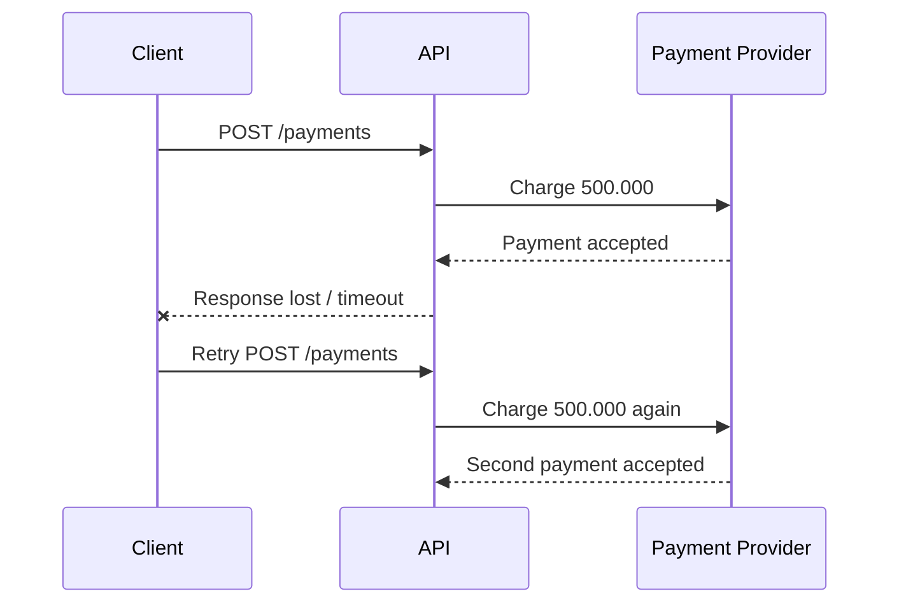
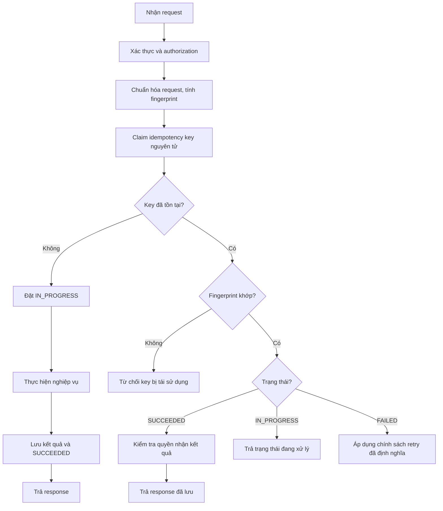
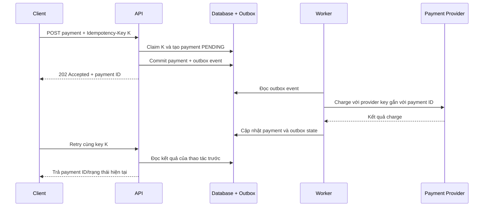
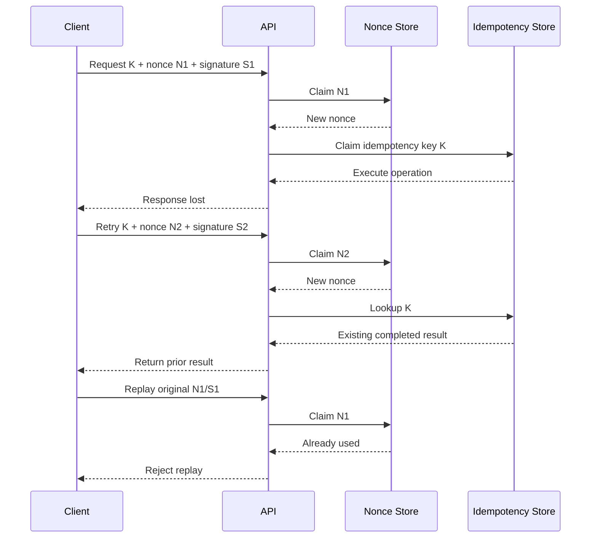

# Idempotency và chống replay cho side effect

API thường nhận cùng một request nhiều lần dù client chỉ muốn thực hiện một hành động. Client có thể timeout sau khi server đã xử lý xong, proxy có thể retry, ứng dụng mobile có thể gửi lại khi mất kết nối hoặc một kẻ tấn công có thể phát lại request đã thu thập được. Với thao tác chỉ đọc, request lặp thường ít gây hậu quả. Với thanh toán, hoàn tiền, tạo đơn, cấp quyền hoặc gửi thông báo, mỗi lần xử lý lặp có thể tạo thêm side effect.

Idempotency giúp một thao tác có thể được gửi lại mà không tạo thêm hiệu ứng nghiệp vụ. Chống replay giúp phát hiện và từ chối một thông điệp hoặc request đã được sử dụng trước đó. Hai kỹ thuật liên quan nhưng phục vụ mục đích khác nhau: retry hợp lệ cần nhận lại kết quả của thao tác trước, trong khi replay không được phép thường phải bị từ chối. Thiết kế API cần phân biệt hai trường hợp này và lưu trạng thái đủ tin cậy để xử lý request đồng thời, lỗi giữa chừng và nhiều instance.

## 1. Side effect và rủi ro khi request bị lặp

Side effect là thay đổi có thể quan sát được bên ngoài kết quả trả về của một hàm. Trong API, side effect có thể là:

- Ghi một bản ghi mới hoặc thay đổi trạng thái đơn hàng.
- Trừ tiền, hoàn tiền, ghi nhận thanh toán hoặc thay đổi số dư.
- Gửi email, SMS, webhook hoặc thông báo push.
- Cấp API key, tạo phiên, cấp quyền hoặc thu hồi credential.
- Đặt chỗ, giữ hàng, tạo vận đơn hoặc khởi chạy một tác vụ nền.
- Phát event sang message broker hoặc gọi một dịch vụ bên ngoài.

Một tình huống phổ biến là client gửi yêu cầu thanh toán, server đã gọi nhà cung cấp thanh toán và giao dịch được chấp nhận, nhưng response bị mất trên đường về. Client chỉ thấy timeout nên gửi lại request. Nếu API coi request thứ hai là một giao dịch mới, khách hàng có thể bị tính tiền hai lần.



Vấn đề không nằm ở việc client retry. Mạng phân tán không thể bảo đảm client luôn biết server đã hoàn tất hay chưa. API cần thiết kế để lần gửi lại được nhận diện là cùng một ý định nghiệp vụ.

## 2. Phân biệt idempotency, retry và replay attack

### 2.1. Idempotency

Một thao tác có tính idempotent khi thực hiện một hay nhiều lần với cùng ý định và cùng đầu vào sẽ tạo ra cùng hiệu ứng nghiệp vụ như thực hiện một lần.

Trong REST/HTTP, `GET`, `HEAD`, `PUT` và `DELETE` được định nghĩa là idempotent theo semantics của giao thức. Điều này không tự động bảo đảm code của API tuân thủ semantics đó. Ví dụ, `DELETE` có thể trả `204` lần đầu và `404` lần sau nhưng trạng thái cuối vẫn giống nhau; ngược lại, nếu mỗi lần gọi `PUT` lại gửi thêm một email hoặc trừ thêm tiền thì implementation đã tạo side effect ngoài ý muốn.

`POST` thường được dùng cho thao tác tạo hoặc thực thi command và thường không idempotent. API có thể bổ sung cơ chế idempotency key để client retry an toàn.

### 2.2. Retry hợp lệ

Retry là việc client gửi lại một yêu cầu vì chưa nhận được kết quả đáng tin cậy. Retry có thể xuất phát từ timeout, lỗi kết nối, HTTP 502/503/504 hoặc chính sách retry của SDK. Client có thể không biết lần trước đã được xử lý hay chưa.

Với retry hợp lệ, API nên nhận ra cùng một thao tác và trả lại kết quả đã ghi nhận, hoặc thông báo thao tác vẫn đang được xử lý. API không tạo side effect lần nữa.

### 2.3. Replay attack

Replay attack là việc một bên gửi lại một request hoặc thông điệp đã quan sát được nhằm lặp lại hành động, sử dụng lại bằng chứng xác thực hoặc gây ra hiệu ứng không được phép. Ví dụ, kẻ tấn công lấy được một request ký bằng HMAC rồi gửi lại nhiều lần trong khoảng thời gian chữ ký còn hợp lệ.

Với replay attack, mục tiêu thường là từ chối lần sử dụng lại. Nonce dùng một lần, timestamp, request signature và kho ghi nhận nonce đã dùng là những cơ chế thường gặp.

| Cơ chế | Mục đích | Khi nhận lại cùng giá trị |
|---|---|---|
| Idempotency key | Nhận diện cùng một ý định nghiệp vụ để retry an toàn | Trả kết quả cũ hoặc trạng thái đang xử lý |
| Nonce dùng một lần | Chứng minh request chưa từng được sử dụng | Từ chối request nếu nonce đã xuất hiện |
| Timestamp | Giới hạn tuổi của request đã ký | Từ chối request nằm ngoài cửa sổ thời gian |
| Request signature | Chứng minh request được tạo bởi chủ thể giữ khóa và nội dung chưa bị sửa | Xác minh chữ ký; bản thân chữ ký không ngăn phát lại |

Không dùng nonce và idempotency key như hai tên gọi cho cùng một thứ. Nếu client retry bằng nonce mới cho mỗi lần gửi, server có thể hiểu mỗi lần là một request mới. Nếu client retry bằng cùng idempotency key, server có thể nhận diện cùng một thao tác và trả lại kết quả trước đó.

## 3. Thiết kế idempotency key

Idempotency key là một mã duy nhất do client tạo cho một ý định nghiệp vụ. Client gửi cùng key cho mọi lần retry của thao tác đó. Khi bắt đầu một thao tác mới, client tạo key mới.

Ví dụ:

```http
POST /api/payments HTTP/1.1
Authorization: Bearer <access-token>
Idempotency-Key: 8d5b2f30-8b72-4f41-aac2-61e9f7b3c2a1
Content-Type: application/json

{
  "orderId": "ORD-42",
  "amount": 500000,
  "currency": "VND"
}
```

Nếu client không nhận được response, nó gửi lại request với cùng key và cùng nội dung. Server tra cứu trạng thái key, xác định thao tác đã hoàn tất hay chưa rồi trả kết quả phù hợp.

### 3.1. Yêu cầu đối với key

- Được tạo bằng bộ sinh ngẫu nhiên an toàn hoặc UUID có nguồn ngẫu nhiên phù hợp.
- Có độ dài và định dạng giới hạn để tránh đầu vào bất thường.
- Được dùng lại nguyên vẹn cho các lần retry của cùng thao tác.
- Không chứa thông tin cá nhân, số tài khoản hoặc dữ liệu bí mật.
- Không được xem như credential hoặc bằng chứng authorization.

Idempotency key không cần được giữ bí mật. Kẻ tấn công biết key không nên có khả năng thực hiện thao tác nếu không vượt qua authentication, authorization và các kiểm tra nghiệp vụ khác.

### 3.2. Phạm vi duy nhất của key

Không nên chỉ dùng key làm khóa duy nhất toàn hệ thống mà không xét chủ thể và hành động. Hai client độc lập có thể vô tình tạo cùng một chuỗi; hoặc cùng một client có thể dùng key giống nhau cho hai loại thao tác khác nhau.

Một phạm vi khóa thường bao gồm:

```text
tenant_id + client_or_subject_id + operation + idempotency_key
```

Ví dụ, key được dùng cho `payments:create` của client `partner-17` trong tenant `tenant-4` không xung đột với key cùng chuỗi của client khác. Cách chọn phạm vi phải phù hợp với mô hình nghiệp vụ; nếu một giao dịch cần duy nhất ở cấp đơn hàng thì vẫn cần ràng buộc nghiệp vụ riêng trên `order_id`.

### 3.3. Gắn key với fingerprint của request

Server cần xác minh các lần gửi cùng key thực sự đại diện cho cùng một request. Có thể tạo fingerprint từ:

- HTTP method và route đã chuẩn hóa.
- Operation hoặc API version.
- Tenant và chủ thể/client đã xác thực.
- Body sau khi parse và chuẩn hóa theo hợp đồng API.
- Các header có ảnh hưởng đến nghiệp vụ như currency hoặc account context.

Không nên đưa mọi header tùy ý vào fingerprint vì các header như `Date`, `User-Agent`, tracing ID hoặc thứ tự header có thể thay đổi giữa các lần retry mà không làm thay đổi ý định nghiệp vụ. Hãy chọn rõ các trường có ý nghĩa và chuẩn hóa nhất quán.

Ví dụ:

```text
request_fingerprint = SHA256(
    canonical_method || canonical_path || canonical_payload || business_context
)
```

Nếu cùng key nhưng fingerprint khác, API phải từ chối request. Nếu không, một key ban đầu dùng để thanh toán đơn hàng A có thể bị tái sử dụng để thanh toán đơn hàng B hoặc với số tiền khác.

Không nhất thiết lưu raw request body. Có thể lưu hash/fingerprint, các metadata tối thiểu và kết quả đã được lọc. Với payload chứa dữ liệu nhạy cảm, tránh lưu bản sao plaintext chỉ để hỗ trợ idempotency.

## 4. Lưu trạng thái idempotency ở server

Với API chạy nhiều instance, trạng thái idempotency phải nằm trong kho dùng chung hoặc một hệ thống có tính nhất quán phù hợp. Bộ nhớ cục bộ của từng instance không đủ: lần đầu có thể đến instance A, lần retry đến instance B và B không biết thao tác đã được xử lý.

Một bảng lưu trữ có thể gồm:

| Trường | Mục đích |
|---|---|
| `tenant_id` | Phạm vi tenant |
| `principal_id` | User hoặc client đã xác thực |
| `operation` | Tên hành động nghiệp vụ |
| `idempotency_key` | Key do client gửi |
| `request_fingerprint` | Phát hiện key bị tái sử dụng với payload khác |
| `state` | `IN_PROGRESS`, `SUCCEEDED`, `FAILED` hoặc trạng thái được định nghĩa |
| `resource_id` | ID giao dịch hoặc resource được tạo |
| `response_status` | HTTP status của kết quả đã hoàn tất |
| `response_snapshot` | Phần response được phép phát lại nếu cần |
| `created_at`, `expires_at` | Vòng đời record |
| `updated_at` | Theo dõi tiến trình xử lý |

Ví dụ schema SQL giản lược:

```sql
CREATE TABLE idempotency_records (
    tenant_id            VARCHAR(64) NOT NULL,
    principal_id         VARCHAR(128) NOT NULL,
    operation            VARCHAR(100) NOT NULL,
    idempotency_key      VARCHAR(128) NOT NULL,
    request_fingerprint  BYTEA NOT NULL,
    state                VARCHAR(20) NOT NULL,
    resource_id          VARCHAR(128),
    response_status      INTEGER,
    response_snapshot    JSONB,
    created_at           TIMESTAMP NOT NULL,
    updated_at           TIMESTAMP NOT NULL,
    expires_at           TIMESTAMP NOT NULL,
    PRIMARY KEY (
        tenant_id, principal_id, operation, idempotency_key
    )
);
```

Kiểu `BYTEA` và `JSONB` là ví dụ cho PostgreSQL. Hệ quản trị khác có thể dùng kiểu binary và JSON tương ứng. Không lưu access token, API key hoặc secret trong record idempotency.

Unique constraint là lớp bảo vệ quan trọng để hai request đồng thời không cùng tạo hai record cho một key. Không chỉ dựa vào đoạn code kiểu “SELECT trước, nếu chưa có thì INSERT” vì hai instance có thể cùng đọc thấy chưa tồn tại rồi cùng thực hiện side effect.

## 5. Quy trình xử lý request idempotent

Một luồng cơ bản:

1. Xác thực caller và xác định principal, tenant.
2. Kiểm tra quyền chức năng, quyền trên resource và validation đầu vào.
3. Đọc idempotency key, kiểm tra định dạng và tạo request fingerprint.
4. Thử tạo record `IN_PROGRESS` bằng thao tác nguyên tử hoặc transaction có unique constraint.
5. Nếu tạo thành công, request này trở thành owner của lần xử lý.
6. Nếu key đã tồn tại, so sánh fingerprint và đọc trạng thái hiện tại.
7. Nếu fingerprint khác, từ chối việc tái sử dụng key.
8. Nếu đã `SUCCEEDED`, xác minh caller hiện tại vẫn được phép nhận kết quả rồi trả response đã lưu.
9. Nếu đang `IN_PROGRESS`, trả trạng thái đang xử lý theo hợp đồng API; không chạy side effect lần nữa.
10. Khi xử lý hoàn tất, lưu kết quả và chuyển trạng thái một cách nhất quán.



Thứ tự authorization trước khi trả lại response cũ rất quan trọng. Quyền của caller có thể đã bị thu hồi kể từ lần đầu. Record idempotency không phải là vé cho phép đọc kết quả mãi mãi; API cần xác minh caller hiện tại có còn được nhận dữ liệu đó hay không.

## 6. Xử lý request đồng thời

Hai request có cùng key có thể đến gần như đồng thời. Nếu cả hai cùng đọc trạng thái “chưa có record” rồi chạy nghiệp vụ, idempotency đã thất bại.

Có thể dùng:

- Unique constraint và transaction để chỉ một request claim được key.
- Atomic insert-if-absent hoặc compare-and-set trong kho dữ liệu.
- Distributed lock có lease và fencing token khi thao tác cần khóa lâu hơn transaction.
- State transition có điều kiện để chỉ owner hiện tại được hoàn tất record.

Ví dụ claim key bằng SQL:

```sql
INSERT INTO idempotency_records (
    tenant_id, principal_id, operation, idempotency_key,
    request_fingerprint, state, created_at, updated_at, expires_at
)
VALUES (
    :tenant_id, :principal_id, :operation, :key,
    :fingerprint, 'IN_PROGRESS', CURRENT_TIMESTAMP,
    CURRENT_TIMESTAMP, :expires_at
)
ON CONFLICT DO NOTHING;
```

Ứng dụng phải kiểm tra số dòng được chèn. Nếu không có dòng nào, request cần đọc record hiện có và xử lý theo trạng thái; không được tiếp tục gọi dịch vụ thanh toán.

Nếu dùng lock phân tán, cần tính đến process bị dừng, lease hết hạn và request cũ tiếp tục chạy sau khi lock được cấp cho owner mới. Fencing token hoặc cơ chế version giúp ngăn owner cũ ghi đè kết quả của owner mới. Với thao tác ngắn trong cùng database, transaction và unique constraint thường đơn giản hơn.

## 7. Quản lý trạng thái và lỗi giữa chừng

Không phải mọi lỗi đều có cùng ý nghĩa. API cần phân biệt lỗi xảy ra trước side effect, lỗi chắc chắn chưa thực hiện side effect và kết quả không xác định vì timeout sau khi hệ thống ngoài có thể đã xử lý.

| Tình huống | Cách xử lý idempotency cần cân nhắc |
|---|---|
| Validation thất bại trước khi claim key | Có thể từ chối mà không lưu record, theo hợp đồng API |
| Authorization thất bại | Không thực hiện side effect; không trả kết quả cũ nếu caller không còn quyền |
| Claim key thành công, nghiệp vụ chưa bắt đầu | Có thể giải phóng hoặc giữ trạng thái để retry có kiểm soát |
| Nghiệp vụ hoàn tất và kết quả được lưu | Đánh dấu `SUCCEEDED`, phát lại kết quả |
| Nghiệp vụ thất bại chắc chắn trước side effect | Ghi `FAILED` hoặc cho phép retry theo chính sách |
| Timeout khi gọi nhà cung cấp, chưa biết họ đã xử lý chưa | Giữ trạng thái cần đối soát; không tạo giao dịch mới ngay |
| Process chết khi đang `IN_PROGRESS` | Có cơ chế phát hiện record bị treo và khôi phục an toàn |

### 7.1. Không giải phóng key khi kết quả chưa rõ

Giả sử API gửi yêu cầu charge đến provider rồi kết nối bị timeout. Nếu API xóa record idempotency và cho phép retry như một request mới, provider có thể nhận hai lần charge. Khi kết quả không rõ, cần giữ trạng thái chờ đối soát và dùng cùng provider idempotency key khi truy vấn hoặc retry.

Không chuyển `IN_PROGRESS` thành `FAILED` chỉ vì client timeout. Timeout phía client không chứng minh nghiệp vụ thất bại. Hãy dùng trạng thái như `UNKNOWN` hoặc `RECONCILING` nếu cần biểu diễn kết quả chưa xác định.

### 7.2. Phát lại response đã hoàn tất

Response snapshot nên chứa đúng phần kết quả cần trả lại, chẳng hạn status code, resource ID và response body đã lọc. Không lưu toàn bộ header hoặc cookie một cách mặc định. Không lưu token, `Set-Cookie`, thông tin xác thực hoặc dữ liệu không cần thiết.

Nếu resource đã thay đổi sau lần đầu, API cần quyết định hợp đồng phát lại là kết quả ban đầu hay representation hiện tại. Với lệnh tạo thanh toán, trả lại receipt hoặc payment ID ban đầu thường phù hợp. Với endpoint cập nhật hồ sơ, có thể trả kết quả operation ban đầu hoặc tài nguyên hiện tại theo hợp đồng được công bố.

## 8. Giữ idempotency xuyên qua hệ thống ngoài

Một transaction database không thể tự động bao trọn việc ghi dữ liệu và gọi một hệ thống thanh toán, email hoặc message broker. Có thể xảy ra tình huống database đã commit nhưng process chết trước khi gửi request ngoài, hoặc provider đã xử lý nhưng API chưa lưu được kết quả.

Với side effect bên ngoài, nên kết hợp:

- Idempotency key ở API inbound.
- Transactional outbox để lưu ý định phát event cùng transaction với thay đổi database.
- Idempotency key hoặc mã tham chiếu duy nhất khi gọi provider nếu provider hỗ trợ.
- Consumer deduplication để message được giao nhiều lần không tạo nhiều hiệu ứng.
- Reconciliation job để đối chiếu trạng thái khi kết quả chưa rõ.
- Saga hoặc quy trình bù trừ cho workflow nhiều dịch vụ không thể dùng transaction phân tán.

Ví dụ luồng thanh toán:



Outbox giúp ý định gửi event không bị mất giữa database commit và publish. Worker vẫn có thể gửi message nhiều lần, nên consumer cần deduplicate hoặc gọi provider bằng idempotency key ổn định. Không tạo provider key mới cho mỗi lần retry.

Không phải provider nào cũng hỗ trợ idempotency. Nếu không có, cần tìm cơ chế tra cứu giao dịch bằng merchant reference duy nhất, kiểm tra trạng thái trước khi gửi lại hoặc thiết kế quy trình đối soát thủ công. Không thể bảo đảm exactly-once end-to-end chỉ bằng cách lưu một key ở API.

## 9. Chống replay cho request đã ký

Idempotency giải quyết việc thực hiện side effect lặp do retry. Với request cần chống replay ở tầng thông điệp, có thể yêu cầu client ký nội dung request và gửi timestamp cùng nonce.

Một request có thể có:

```http
POST /api/transfers HTTP/1.1
X-Client-Id: partner-17
X-Request-Timestamp: 1795000000
X-Request-Nonce: 1e9a6a34-2c2a-4b6a-9c2d-3c8f1a5d9e01
X-Content-SHA256: <body-digest>
X-Signature: <request-signature>
Content-Type: application/json

{"source":"A-100","destination":"B-200","amount":500000}
```

Chữ ký nên bao phủ các thành phần quan trọng như:

- HTTP method đã chuẩn hóa.
- Path và query đã chuẩn hóa theo một quy tắc duy nhất.
- Timestamp và nonce.
- Digest của body.
- Client ID hoặc key ID.
- Các header nghiệp vụ cần được bảo vệ.

Server tính lại signature từ nội dung nhận được và xác minh bằng HMAC hoặc chữ ký bất đối xứng theo giao thức đã thống nhất. Không tự nghĩ ra cách ghép chuỗi mơ hồ; client và server phải dùng cùng canonicalization, encoding và thuật toán. Với HMAC, khóa bí mật cần được quản lý riêng cho từng client hoặc workload; với chữ ký bất đối xứng, server xác minh bằng public key đã đăng ký.

Chữ ký hợp lệ chứng minh request được tạo bởi bên giữ khóa và nội dung chưa bị sửa theo thuật toán. Nó không tự ngăn request bị phát lại. Kẻ tấn công có thể sao chép cả body, timestamp, nonce và chữ ký rồi gửi lại nguyên vẹn trong cửa sổ thời gian hợp lệ.

## 10. Timestamp và nonce dùng một lần

### 10.1. Giới hạn tuổi request

Timestamp giúp server từ chối request quá cũ hoặc có thời gian nằm quá xa so với đồng hồ server. Ví dụ, hệ thống có thể chấp nhận độ lệch tối đa vài phút tùy yêu cầu và độ đồng bộ đồng hồ.

Timestamp không đủ để chống replay trong cửa sổ được chấp nhận. Cùng một request đã ký có thể được gửi nhiều lần trong khoảng thời gian đó nếu server không ghi nhận nonce.

Đồng hồ giữa client và server cần được đồng bộ. Cửa sổ quá rộng làm tăng cơ hội replay; cửa sổ quá hẹp có thể từ chối client hợp lệ khi clock skew hoặc mạng chậm. Hãy đặt ngưỡng theo rủi ro, quan sát thực tế và có quy trình xử lý clock drift.

### 10.2. Lưu nonce đã sử dụng

Nonce là giá trị duy nhất cho một request đã ký. Sau khi xác minh chữ ký và timestamp, server cần claim nonce theo cách nguyên tử trong phạm vi client/key và cửa sổ thời gian. Nếu nonce đã tồn tại, từ chối request như một lần phát lại.

Ví dụ khóa lưu trữ:

```text
replay:{client_id}:{key_id}:{nonce}
```

Có thể dùng thao tác tương đương `SET key value NX EX ttl` trong Redis để chỉ một request claim được nonce và tự hết hạn sau cửa sổ chấp nhận. TTL cần đủ dài để bao phủ khoảng thời gian request có thể được chấp nhận, cộng biên độ clock skew phù hợp.

Thứ tự xử lý cần nhất quán:

1. Kiểm tra định dạng, kích thước và timestamp.
2. Xác minh client/key còn hiệu lực.
3. Tính và xác minh request signature.
4. Kiểm tra quyền chức năng, phạm vi resource và điều kiện nghiệp vụ cần thiết.
5. Claim nonce nguyên tử trước khi thực hiện side effect.
6. Nếu nonce đã tồn tại, từ chối replay.
7. Tiếp tục xử lý nghiệp vụ.

Không claim nonce trước khi xác minh chữ ký nếu điều đó cho phép người ngoài gửi nonce giả để làm cạn kho hoặc chiếm nonce hợp lệ. Tuy nhiên, việc claim nonce phải diễn ra trước side effect. Nếu request hợp lệ bị lỗi sau khi nonce đã claim, client có thể cần tạo request mới với nonce mới và dùng cùng idempotency key để bảo đảm thao tác không bị lặp.

### 10.3. Nonce store phải dùng chung và nguyên tử

Nếu mỗi API instance lưu nonce trong bộ nhớ riêng, request đầu đến instance A và bản replay đến instance B có thể cùng được chấp nhận. Nonce store cần dùng chung hoặc có cơ chế định tuyến bảo đảm mọi request của cùng phạm vi đi qua một nơi có tính nhất quán phù hợp.

Nếu nonce store không truy cập được, endpoint yêu cầu chống replay không nên âm thầm bỏ qua kiểm tra. Hành vi có thể là từ chối tạm thời hoặc chuyển sang cơ chế dự phòng đã được đánh giá. Cần có giới hạn dung lượng, TTL, giám sát số nonce và bảo vệ trước việc gửi hàng loạt nonce rác.

## 11. Kết hợp idempotency key với nonce

Một request có thể dùng cả hai:

- Idempotency key nhận diện ý định nghiệp vụ qua nhiều lần retry.
- Nonce chứng minh từng thông điệp ký là mới và chưa được sử dụng.

Ví dụ client gửi request lần đầu với idempotency key `K` và nonce `N1`. Nếu timeout, client ký lại cùng nội dung và key `K` nhưng tạo nonce mới `N2`. Server chấp nhận thông điệp mới vì `N2` chưa dùng, tra cứu idempotency key `K` và trả lại kết quả trước đó hoặc trạng thái đang xử lý. Nếu kẻ tấn công phát lại nguyên request cũ với `N1`, server từ chối vì nonce đã được claim.



Đây là cách kết hợp hữu ích khi API yêu cầu request signing và đồng thời phải hỗ trợ retry. Nếu API chỉ cần chống side effect lặp do retry trong một môi trường client-server tin cậy, idempotency key có thể đã đủ. Chỉ thêm nonce/signature khi threat model yêu cầu chống phát lại thông điệp hoặc xác minh tính toàn vẹn request.

## 12. Bảo vệ kết quả idempotency và quyền truy cập

Idempotency record có thể chứa resource ID, trạng thái thanh toán hoặc response snapshot. Người biết key không được tự động đọc được dữ liệu đó.

Mỗi lần retry cần:

- Xác thực caller như request thông thường.
- Kiểm tra caller thuộc đúng tenant và principal scope đã tạo record.
- Kiểm tra quyền hiện tại trước khi trả response snapshot.
- So sánh fingerprint để bảo đảm cùng một ý định nghiệp vụ.
- Không trả lại header hoặc trường dữ liệu nhạy cảm không còn được phép xem.

Nếu user bị thu hồi quyền sau lần đầu, API có thể không cho họ đọc response cũ dù thao tác trước đã hoàn tất. Có thể trả một trạng thái tối thiểu hoặc yêu cầu caller có quyền phù hợp. Việc giữ kết quả idempotency và quyền đọc kết quả là hai quyết định riêng.

Không dùng idempotency key như mật khẩu. Không đưa nó vào URL, log công khai hoặc metric label nếu không cần. Khi lưu trữ, giới hạn quyền đọc bảng, mã hóa dữ liệu nhạy cảm và đặt thời gian lưu phù hợp.

## 13. Thời hạn lưu và dọn dẹp

Nếu xóa record quá sớm, client retry muộn có thể bị xem như thao tác mới và tạo side effect lần nữa. Nếu giữ mãi, kho lưu trữ tăng không giới hạn và có thể lưu response nhạy cảm lâu hơn cần thiết.

TTL cần dựa trên:

- Thời gian retry tối đa mà SDK/client được phép thực hiện.
- Thời gian xử lý và đối soát của hệ thống ngoài.
- Thời hạn nghiệp vụ mà một thao tác trùng lặp vẫn nguy hiểm.
- Yêu cầu audit, tài chính và lưu trữ dữ liệu.
- Khả năng client gửi lại request sau khi offline lâu.

Với thanh toán hoặc tạo đơn, có thể cần một ràng buộc nghiệp vụ lâu dài hơn idempotency TTL, ví dụ một order chỉ có một payment attempt đang hoạt động hoặc một merchant reference duy nhất. Không dựa vào TTL ngắn để ngăn giao dịch trùng lặp suốt vòng đời nghiệp vụ.

Quy trình dọn dẹp nên xóa response snapshot và metadata hết hạn theo chính sách, nhưng giữ audit aggregate hoặc mã tham chiếu cần thiết nếu quy định yêu cầu. Không xóa record `IN_PROGRESS` chỉ vì quá TTL nếu side effect bên ngoài chưa được đối soát.

## 14. Những lỗi triển khai thường gặp

**Tạo idempotency key mới cho mỗi lần retry.** Server sẽ coi mỗi request là thao tác mới. Client phải giữ key ban đầu cho đến khi có kết quả cuối cùng hoặc quy trình nghiệp vụ kết thúc.

**Cùng key nhưng không so sánh request fingerprint.** Client hoặc attacker có thể tái sử dụng key với amount, resource hoặc payload khác. Hãy từ chối khi fingerprint không khớp.

**Chỉ lưu key trong memory của một instance.** Request retry đến instance khác sẽ không thấy trạng thái cũ. Dùng store dùng chung và thao tác claim nguyên tử.

**Dùng SELECT rồi INSERT mà không có unique constraint.** Hai request đồng thời có thể cùng chạy side effect. Bảo vệ uniqueness ở database hoặc primitive atomic tương đương.

**Đánh dấu FAILED khi client timeout.** Timeout không chứng minh provider chưa thực hiện giao dịch. Giữ trạng thái chưa xác định và đối soát trước khi gửi lại.

**Chỉ dùng timestamp để chống replay.** Request vẫn có thể bị phát lại trong cửa sổ timestamp. Cần nonce dùng một lần hoặc cơ chế tương đương.

**Cho rằng chữ ký HMAC ngăn replay.** Chữ ký bảo vệ tính toàn vẹn và nguồn gốc request; bản sao nguyên vẹn vẫn có chữ ký hợp lệ. Cần timestamp và nonce nếu cần chống replay.

**Trả response snapshot mà không xác minh quyền hiện tại.** Người đã bị thu hồi quyền có thể đọc dữ liệu cũ. Xác thực và authorization lại trước khi phát lại response.

**Chỉ chống trùng ở API nhưng không ở provider/consumer.** Worker hoặc message có thể được xử lý nhiều lần. Truyền idempotency reference ổn định xuống các hệ thống phía sau và có deduplication.

## 15. Kiểm thử idempotency và replay

Kiểm thử phải xác minh cả response lẫn hiệu ứng nghiệp vụ. Một request trả `200` hoặc `202` không chứng minh side effect chỉ xảy ra một lần.

| Tình huống | Kết quả cần xác minh |
|---|---|
| Gửi request đầu với key mới | Chỉ một thao tác được claim và xử lý |
| Gửi lại cùng key, cùng payload sau khi hoàn tất | Trả kết quả trước đó; không tạo side effect mới |
| Gửi cùng key nhưng payload khác | Bị từ chối; không thay đổi thao tác ban đầu |
| Hai request cùng key đến đồng thời | Chỉ một request thực hiện side effect |
| Retry khi trạng thái `IN_PROGRESS` | Không chạy song song side effect; trả trạng thái đang xử lý theo hợp đồng |
| Client timeout sau khi provider xử lý | Retry không tạo giao dịch provider thứ hai |
| Process chết sau database commit nhưng trước publish event | Outbox cho phép worker tiếp tục gửi mà không mất ý định |
| Consumer nhận cùng event nhiều lần | Deduplication ngăn xử lý nghiệp vụ lặp |
| Gửi lại nonce đã dùng với chữ ký hợp lệ | Bị từ chối replay |
| Nonce mới nhưng idempotency key cũ | Trả kết quả cũ hoặc trạng thái xử lý, không chạy side effect mới |
| Timestamp nằm ngoài cửa sổ | Bị từ chối trước khi thực hiện nghiệp vụ |
| Chữ ký sai hoặc body bị sửa | Bị từ chối; nonce/key không bị chiếm trái phép |
| Nonce store không truy cập được | Không tự động bỏ qua chống replay |
| Caller mất quyền sau lần đầu | Không đọc được response snapshot ngoài quyền hiện tại |
| Record idempotency hết TTL | Hành vi phù hợp với ràng buộc nghiệp vụ chống trùng dài hạn |

Nên có test tích hợp với nhiều API instance hoặc mô phỏng concurrency để xác minh atomic claim. Kiểm tra database, provider mock, outbox, message broker và audit log để xác nhận số side effect thực tế. Kiểm thử lỗi giữa chừng cần mô phỏng timeout sau khi provider đã chấp nhận nhưng trước khi API lưu response.

## 16. Checklist thiết kế endpoint có side effect

Trước khi phát hành endpoint tạo hoặc thay đổi dữ liệu, hãy xác nhận:

- [ ] Đã xác định side effect và hậu quả nếu request được thực hiện hai lần.
- [ ] Đã quyết định endpoint có cần idempotency key, nonce/signature hay cả hai.
- [ ] Idempotency key được giới hạn theo tenant, principal và operation phù hợp.
- [ ] Request fingerprint bao phủ method, route, payload và ngữ cảnh nghiệp vụ quan trọng.
- [ ] Cùng key nhưng payload khác bị từ chối.
- [ ] Claim key được thực hiện nguyên tử bằng unique constraint hoặc primitive tương đương.
- [ ] Trạng thái `IN_PROGRESS`, hoàn tất, thất bại và chưa xác định được xử lý rõ ràng.
- [ ] Retry không tạo side effect mới và không phát lại dữ liệu ngoài quyền hiện tại.
- [ ] Provider và message consumer có idempotency/deduplication tương ứng.
- [ ] Timestamp và nonce được xác minh nếu threat model yêu cầu chống replay.
- [ ] Nonce được lưu dùng chung, claim nguyên tử và có TTL phù hợp.
- [ ] Hành vi khi database, nonce store hoặc provider lỗi đã được xác định.
- [ ] Có reconciliation cho kết quả không xác định và quy trình dọn record hết hạn.
- [ ] Test concurrency, retry, replay, permission revocation và side effect thực tế.

## 17. Nguyên tắc thiết kế

Với API có side effect, hãy giả định request có thể đến nhiều lần và response có thể bị mất sau khi nghiệp vụ đã hoàn tất. Idempotency key giúp nhận diện cùng một ý định để retry an toàn; request fingerprint ngăn key bị tái sử dụng cho payload khác; kho trạng thái dùng chung và thao tác claim nguyên tử ngăn nhiều instance cùng thực hiện một thao tác.

Khi cần chống replay ở mức thông điệp, dùng chữ ký request cùng timestamp và nonce được lưu theo cách nguyên tử. Chữ ký không tự ngăn replay; timestamp không ngăn bản sao trong cửa sổ chấp nhận; nonce không thay thế idempotency cho retry hợp lệ. Với side effect qua hệ thống ngoài, kết hợp outbox, provider idempotency, consumer deduplication và reconciliation để xử lý lỗi giữa chừng.

**Mục tiêu không phải giả định mạng chỉ gửi một lần. Mục tiêu là bảo đảm một ý định nghiệp vụ chỉ tạo ra hiệu ứng được phép, dù request bị retry, gửi đồng thời hoặc bị phát lại.**
