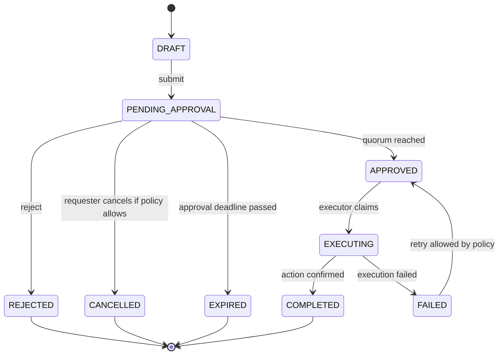

# Approval, separation of duties và four-eyes

Một request đã qua xác thực và có đủ quyền gọi endpoint vẫn có thể tạo ra rủi ro nếu nó thực hiện một hành động quan trọng mà không có kiểm tra độc lập. Ví dụ, một nhân viên tạo lệnh chuyển tiền rồi tự phê duyệt; người tạo tài khoản nhà cung cấp đồng thời tự xác nhận tài khoản đó; hoặc một quản trị viên thay đổi hạn mức và áp dụng thay đổi ngay trong cùng một phiên.

Với các hành động có ảnh hưởng lớn, API cần bảo vệ cả **luồng nghiệp vụ** chứ không chỉ từng request riêng lẻ. Approval (phê duyệt), separation of duties (SoD – phân tách nhiệm vụ) và four-eyes (nguyên tắc hai người kiểm tra) giúp bảo đảm một người không thể tự khởi tạo và hoàn tất toàn bộ hành động nhạy cảm. Các kiểm soát này phải được thực thi ở server, gắn với đúng nội dung được duyệt, trạng thái hiện tại và danh tính người thực hiện.

## 1. Vì sao một endpoint hợp lệ vẫn có thể tạo ra giao dịch sai?

Giả sử API cung cấp:

```http
POST /api/v1/transfers
Authorization: Bearer <access-token>
Content-Type: application/json

{
  "sourceAccountId": "ACC-100",
  "destinationAccountId": "ACC-900",
  "amount": 500000000,
  "currency": "VND"
}
```

Người gọi có thể có quyền tạo lệnh chuyển tiền và request có thể hợp lệ về kiểu dữ liệu, số dư và tài khoản. Nhưng nếu hệ thống lập tức chuyển tiền sau request này, một tài khoản bị chiếm quyền hoặc một nhân viên có quyền tạo lệnh có thể gây thiệt hại lớn mà không có người thứ hai kiểm tra.

Vấn đề nằm ở quy trình: ai được tạo yêu cầu, ai được xem và phê duyệt, ai được thực thi, nội dung nào đã được phê duyệt và liệu nội dung có bị thay đổi sau phê duyệt hay không. Kiểm tra `hasAuthority('transfer:create')` tại controller không trả lời đầy đủ các câu hỏi đó.

Những hành động thường cần kiểm soát theo luồng gồm:

- Chuyển tiền, hoàn tiền, điều chỉnh số dư hoặc thay đổi hạn mức tín dụng.
- Thay đổi thông tin tài khoản nhận tiền, nhà cung cấp hoặc thông tin thanh toán.
- Cấp hoặc thu hồi quyền quản trị, thay đổi vai trò và chính sách truy cập.
- Phê duyệt đơn hàng lớn, chiết khấu đặc biệt, hợp đồng hoặc khoản chi.
- Xuất dữ liệu nhạy cảm, xóa dữ liệu hàng loạt hoặc thay đổi cấu hình production.
- Mở khóa tài khoản, bỏ cờ rủi ro hoặc thay đổi trạng thái kiểm soát.

Không phải mọi thao tác đều cần bốn mắt. Mức kiểm soát phải dựa trên giá trị, khả năng đảo ngược, mức độ nhạy cảm, quy định nội bộ và hậu quả nếu một người hoặc một credential bị xâm phạm.

## 2. Approval, SoD và four-eyes là gì?

Ba khái niệm liên quan nhưng không đồng nghĩa:

| Khái niệm | Ý nghĩa | Ví dụ |
|---|---|---|
| Approval | Một chủ thể có thẩm quyền xem xét và quyết định cho phép hoặc từ chối yêu cầu | Quản lý duyệt khoản chi |
| Separation of duties (SoD) | Phân chia các bước hoặc quyền quan trọng cho những vai trò/chủ thể khác nhau để giảm khả năng một người tự kiểm soát toàn bộ quy trình | Người tạo nhà cung cấp không được tự duyệt nhà cung cấp đó |
| Four-eyes principle | Một hành động cần ít nhất hai người độc lập tham gia kiểm tra/phê duyệt theo chính sách | Người lập lệnh và một người khác xác nhận lệnh chuyển tiền |

Four-eyes là một dạng kiểm soát SoD. Một quy trình SoD có thể có nhiều hơn hai vai trò, chẳng hạn người yêu cầu, người phê duyệt, người thực thi và người kiểm toán. Một quy trình four-eyes có thể chỉ cần hai người phê duyệt độc lập, nhưng với một số nghiệp vụ, người tạo và người thực thi cũng phải là các chủ thể riêng.

**Hai lần bấm nút không phải là four-eyes.** Hai request từ cùng một tài khoản, hai session của cùng một người hoặc hai API call với cùng danh tính đều chỉ là một principal. Hệ thống phải xác minh hai danh tính độc lập theo chính sách tổ chức.

## 3. Xác định vai trò và ranh giới nhiệm vụ

Trước khi thiết kế endpoint, hãy mô tả các vai trò trong quy trình. Một luồng thanh toán có thể có:

| Vai trò | Trách nhiệm | Quyền cần giới hạn |
|---|---|---|
| Maker / Requester | Tạo và gửi yêu cầu | Không tự phê duyệt yêu cầu của chính mình |
| Checker / Approver | Kiểm tra nội dung và quyết định | Chỉ duyệt trong hạn mức, phạm vi và loại giao dịch được cấp |
| Executor | Thực hiện hành động sau khi đủ phê duyệt | Chỉ thực thi yêu cầu đang ở trạng thái hợp lệ |
| Auditor | Kiểm tra lịch sử và bằng chứng | Thường chỉ đọc audit, không sửa quyết định đã ghi |

Một tổ chức nhỏ có thể cho phép một người vừa là approver vừa là executor trong một số trường hợp. Tuy nhiên, chính sách phải nêu rõ những vai trò nào bắt buộc tách biệt. Với giao dịch rủi ro cao, có thể yêu cầu maker, checker và executor là ba người khác nhau.

SoD có thể áp dụng ở nhiều cấp:

- **Theo người:** cùng một người không được tạo và duyệt cùng yêu cầu.
- **Theo vai trò:** một vai trò không được nắm đồng thời hai quyền xung đột trong cùng quy trình.
- **Theo tài nguyên:** người duyệt chỉ xử lý yêu cầu thuộc đơn vị, tenant hoặc tài khoản mình quản lý.
- **Theo hạn mức:** approver chỉ được duyệt đến một giá trị nhất định hoặc một nhóm giao dịch nhất định.
- **Theo giai đoạn:** người thực hiện một bước không được tự xác nhận bước kế tiếp.

Không chỉ kiểm tra tên role. Một user có thể có nhiều role, được ủy quyền tạm thời hoặc thuộc nhiều nhóm. Policy phải đánh giá toàn bộ quyền hiệu lực và các xung đột nhiệm vụ tại thời điểm ra quyết định.

## 4. Thiết kế workflow với trạng thái tường minh

Một workflow phê duyệt nên được mô hình hóa bằng state machine. Ví dụ:



Trạng thái là ví dụ; hệ thống thực tế có thể cần `ON_HOLD`, `NEEDS_REVISION`, `PARTIALLY_APPROVED` hoặc trạng thái khác. Điều quan trọng là mỗi chuyển trạng thái có:

- Actor được phép thực hiện.
- Trạng thái nguồn hợp lệ.
- Điều kiện nghiệp vụ và điều kiện SoD.
- Dữ liệu cần kiểm tra trước khi chuyển.
- Audit event phải ghi lại.
- Quy tắc retry, timeout, hủy và xử lý lỗi.

Không cho client cập nhật tùy ý `status` bằng một endpoint chung như:

```http
PATCH /api/v1/transfers/123

{ "status": "APPROVED" }
```

Thay vào đó, cung cấp command endpoint có ý nghĩa nghiệp vụ như `POST /transfers/{id}/submit`, `POST /transfers/{id}/approvals` hoặc `POST /transfers/{id}/cancel`. Server tự xác định trạng thái tiếp theo sau khi kiểm tra policy và điều kiện.

## 5. Phê duyệt phải gắn với đúng nội dung được duyệt

Một lỗi nghiêm trọng là approver duyệt một bản xem trước, sau đó request được sửa trước khi thực thi. Khi đó, audit cho thấy đã có approval nhưng nội dung được thực hiện khác nội dung đã xem.

Ví dụ:

1. Maker gửi lệnh chuyển 5 triệu đồng tới tài khoản A.
2. Approver xem và phê duyệt lệnh đó.
3. Một API cập nhật thay tài khoản nhận thành B và số tiền thành 500 triệu đồng.
4. Executor thực hiện nội dung mới bằng approval cũ.

Để ngăn lỗi này, approval phải gắn với một phiên bản bất biến của yêu cầu. Có thể lưu:

- `request_id` và `request_version`.
- Bản snapshot hoặc canonical representation của các trường có ý nghĩa nghiệp vụ.
- Hash của nội dung đã chuẩn hóa, ví dụ `payload_hash`.
- Người duyệt, quyết định, thời điểm và lý do.
- Chính sách/hạn mức được áp dụng tại thời điểm phê duyệt.

Hash phải do server tính từ dữ liệu chuẩn hóa; không tin hash do client gửi. Approver phải nhìn thấy cùng nội dung mà server sẽ thực thi. Nếu bất kỳ trường quan trọng nào thay đổi sau khi gửi duyệt, hệ thống cần tăng version, vô hiệu hóa các approval cũ và yêu cầu submit/approval lại.

Các trường thường cần ràng buộc gồm người thụ hưởng, tài khoản nguồn/đích, số tiền, loại tiền, mục đích, thời hạn, điều khoản, quyền được cấp và phạm vi tài nguyên. Không chỉ hash một phần payload nếu phần bị bỏ qua có thể làm thay đổi ý nghĩa giao dịch.

### Canonicalization và hash

Hash chỉ ổn định nếu dữ liệu được chuẩn hóa nhất quán. Cần quy định cách xử lý thứ tự field, số thập phân, timezone, Unicode, giá trị null, mảng và field mặc định. Có thể lưu snapshot đã chuẩn hóa cùng hash để phục vụ đối chiếu và audit.

Không dùng JSON serialization tùy ý từ nhiều phiên bản ứng dụng làm nguồn canonical duy nhất nếu thứ tự hoặc cách biểu diễn có thể thay đổi. Định nghĩa một schema/version cho snapshot, chuẩn hóa theo quy tắc rõ ràng và kiểm tra hash lại trước khi thực thi.

## 6. Quy tắc độc lập của người phê duyệt

Một quyết định four-eyes cần xác định thế nào là hai người độc lập. Tối thiểu, requester và approver phải là hai principal khác nhau theo danh tính đã xác thực. Với chính sách nghiêm ngặt hơn, có thể cần kiểm tra:

- Không cùng `user_id` hoặc cùng identity gốc trong hệ thống SSO.
- Không phải cùng service account hoặc tài khoản dùng chung.
- Không nằm trong danh sách xung đột lợi ích hoặc cùng người sở hữu quyền kiểm soát.
- Approver không phải người tạo/thay đổi dữ liệu cuối cùng đang được duyệt.
- Không dùng một tài khoản quản trị khẩn cấp để vừa tạo vừa tự phê duyệt.

Không thể chứng minh hai con người độc lập chỉ bằng hai username nếu một người có thể kiểm soát cả hai tài khoản. Với quy trình rủi ro cao, cần chính sách danh tính, MFA, quản lý tài khoản đặc quyền và audit đủ mạnh. Việc phát hiện cùng thiết bị hoặc cùng IP có thể là tín hiệu bổ sung, nhưng không nên tự động coi đó là bằng chứng duy nhất vì nhiều người có thể dùng chung mạng hoặc thiết bị quản lý.

### Approver phải có quyền trên đúng yêu cầu

Không phải mọi người có role `APPROVER` đều có quyền duyệt mọi yêu cầu. Cần kiểm tra:

- Tenant, đơn vị, project hoặc tài khoản nằm trong phạm vi quản lý.
- Loại nghiệp vụ và loại hành động được cấp.
- Hạn mức tiền hoặc mức độ rủi ro.
- Trạng thái yêu cầu và thời hạn phê duyệt.
- Xung đột nhiệm vụ với requester, editor, beneficiary hoặc executor.
- Trạng thái tài khoản, quyền hiệu lực và xác thực tăng cường nếu cần.

Quyền approver nên được đánh giá ở thời điểm ra quyết định. Nếu quyền đã bị thu hồi, tài khoản bị khóa hoặc approver không còn thuộc đơn vị quản lý, quyết định mới phải bị từ chối theo policy. Với approval đã ghi nhận trước đó, tổ chức cần quy định rõ trường hợp nào phải đánh giá lại khi quyền hoặc vai trò thay đổi.

## 7. Quorum và hạn mức phê duyệt

Một số giao dịch chỉ cần một approver độc lập; giao dịch lớn hoặc nhạy cảm có thể cần hai hay nhiều người. Quorum là số lượng hoặc tổ hợp quyết định cần đạt để workflow chuyển sang trạng thái được phê duyệt.

Ví dụ:

| Giá trị giao dịch | Điều kiện minh họa |
|---|---|
| Đến 10 triệu VND | Một approver khác requester |
| Trên 10 đến 100 triệu VND | Một manager trong đúng đơn vị |
| Trên 100 đến 500 triệu VND | Hai approver độc lập, trong đó có một finance manager |
| Trên 500 triệu VND | Hai approver độc lập và một approver thuộc cấp kiểm soát cao hơn |

Các con số chỉ minh họa. Hạn mức thực tế phải do tổ chức và quy định nghiệp vụ xác định. Policy cần xác định cách tính giá trị: theo từng giao dịch, tổng giá trị liên quan trong một khoảng thời gian, tổng lệnh cùng người thụ hưởng hay tổng giao dịch được chia nhỏ.

Nếu chỉ xét từng request, attacker có thể chia một khoản lớn thành nhiều khoản nhỏ để né ngưỡng. Có thể phát hiện và gộp các giao dịch liên quan theo account, beneficiary, requester, thời gian hoặc mục đích; việc gộp phải dựa trên quy tắc nghiệp vụ minh bạch.

Quorum cũng cần xử lý quyết định trái chiều. Ví dụ, một người duyệt và một người từ chối thì yêu cầu có bị từ chối ngay, cần thêm người phân xử hay chuyển sang trạng thái cần xem xét? Không để logic đếm số lượng đơn giản vô tình cho phép một approval vượt qua một rejection theo chính sách.

## 8. Tách quyền tạo, duyệt, sửa, hủy và thực thi

Một ma trận quyền giúp phát hiện xung đột nhiệm vụ trước khi triển khai:

| Hành động | Maker | Approver | Executor | Auditor |
|---|---:|---:|---:|---:|
| Tạo bản nháp | Có | Theo policy | Không | Không |
| Gửi yêu cầu | Có | Không | Không | Không |
| Xem nội dung chờ duyệt | Có | Có trong phạm vi | Có khi cần thực thi | Có theo quyền đọc |
| Duyệt/từ chối | Không với yêu cầu của mình | Có | Không nếu policy yêu cầu tách | Không |
| Sửa nội dung sau khi gửi | Theo luồng trả lại/hủy | Không sửa thay maker | Không | Không |
| Thực thi | Không | Không | Có sau khi đủ điều kiện | Không |
| Xem audit | Theo phạm vi | Theo phạm vi | Theo phạm vi | Có |

Đây là ma trận mẫu, không phải mặc định bắt buộc cho mọi tổ chức. Có thể có nghiệp vụ mà approver đồng thời thực thi, nhưng không được để requester tự phê duyệt khi policy yêu cầu độc lập.

Đặc biệt, cần tách quyền **sửa** sau khi submit. Nếu approver có thể sửa trực tiếp số tiền hoặc người thụ hưởng, quyết định phê duyệt không còn phản ánh nội dung ban đầu. Nếu cần chỉnh sửa, hãy trả yêu cầu về maker hoặc tạo version mới và yêu cầu phê duyệt lại.

## 9. Thiết kế API cho approval workflow

Một API dễ kiểm soát có thể tách command theo từng bước:

```http
POST /api/v1/transfers
POST /api/v1/transfers/{id}/submit
GET  /api/v1/approvals/pending
GET  /api/v1/transfers/{id}/approval-view
POST /api/v1/transfers/{id}/approvals
POST /api/v1/transfers/{id}/reject
POST /api/v1/transfers/{id}/cancel
POST /api/v1/transfers/{id}/execute
GET  /api/v1/transfers/{id}/audit
```

Các endpoint cần được bảo vệ riêng:

- `POST /transfers`: yêu cầu scope tạo và quyền trên tài khoản nguồn, beneficiary cùng tenant.
- `POST /submit`: chỉ maker hoặc người được ủy quyền hợp lệ mới gửi bản nháp; server đóng băng version được gửi duyệt.
- `GET /approval-view`: chỉ approver phù hợp được xem đầy đủ thông tin cần thiết; dữ liệu nhạy cảm phải được che theo vai trò.
- `POST /approvals`: actor lấy từ security context; body chỉ chứa quyết định, lý do và version/ETag mà approver đã xem.
- `POST /reject`: yêu cầu lý do theo policy và ghi audit.
- `POST /cancel`: chỉ actor được phép hủy trong trạng thái và thời điểm phù hợp.
- `POST /execute`: chỉ executor hoặc worker được cấp quyền; kiểm tra lại quorum, version, expiry và trạng thái trước side effect.
- `GET /audit`: chỉ role được phép xem lịch sử; không cho sửa/xóa audit event.

Ví dụ body phê duyệt:

```http
POST /api/v1/transfers/7f12/approvals HTTP/1.1
Authorization: Bearer <approver-token>
If-Match: "transfer-version-4"
Idempotency-Key: 3a7d...
Content-Type: application/json

{
  "decision": "APPROVE",
  "comment": "Đã đối chiếu chứng từ và thông tin thụ hưởng"
}
```

Không nhận `approverId` từ body. Server lấy actor từ danh tính đã xác thực. `If-Match` hoặc trường version trong command giúp bảo đảm approver đang quyết định trên phiên bản đã xem. `Idempotency-Key` giúp tránh ghi nhận hai lần do client retry; server vẫn phải xác định cùng key được dùng với payload nào và phạm vi lưu khóa.

## 10. Ví dụ mô hình dữ liệu

Một mô hình đơn giản có thể tách yêu cầu, snapshot, approval và audit:

```sql
CREATE TABLE approval_requests (
    id UUID PRIMARY KEY,
    tenant_id UUID NOT NULL,
    requester_id UUID NOT NULL,
    request_type VARCHAR(60) NOT NULL,
    status VARCHAR(30) NOT NULL,
    version BIGINT NOT NULL,
    payload_snapshot JSONB NOT NULL,
    payload_hash VARCHAR(128) NOT NULL,
    submitted_at TIMESTAMPTZ,
    approval_deadline TIMESTAMPTZ,
    created_at TIMESTAMPTZ NOT NULL,
    updated_at TIMESTAMPTZ NOT NULL
);

CREATE TABLE approval_decisions (
    id UUID PRIMARY KEY,
    request_id UUID NOT NULL REFERENCES approval_requests(id),
    request_version BIGINT NOT NULL,
    payload_hash VARCHAR(128) NOT NULL,
    approver_id UUID NOT NULL,
    decision VARCHAR(20) NOT NULL,
    comment TEXT,
    decided_at TIMESTAMPTZ NOT NULL,
    UNIQUE (request_id, request_version, approver_id)
);

CREATE TABLE approval_audit_events (
    id UUID PRIMARY KEY,
    request_id UUID NOT NULL,
    actor_id UUID NOT NULL,
    actor_type VARCHAR(30) NOT NULL,
    event_type VARCHAR(60) NOT NULL,
    request_version BIGINT,
    payload_hash VARCHAR(128),
    occurred_at TIMESTAMPTZ NOT NULL,
    metadata JSONB NOT NULL
);
```

Schema trên mang tính minh họa. Hệ thống thực tế cần foreign key, index, retention, tenant isolation, enum/check constraint, versioning và quyền truy cập database phù hợp. Nếu cho phép nhiều stage hoặc nhiều loại quorum, có thể tách bảng policy, approval stage, approver eligibility và approval requirement. Audit nên được lưu theo cơ chế append-only hoặc có kiểm soát toàn vẹn phù hợp.

Unique constraint giúp một approver không tạo nhiều quyết định cho cùng một request version. Nó không tự bảo đảm hai approver khác nhau; service vẫn phải kiểm tra distinct principal và policy. Cũng cần xử lý trường hợp một người có nhiều account hoặc được đại diện qua nhiều danh tính.

## 11. Ví dụ xử lý approval trong Spring Boot

Đoạn code dưới đây minh họa các kiểm tra cốt lõi. Repository có thể dùng pessimistic lock hoặc optimistic locking tùy tải và mô hình dữ liệu:

```java
@Transactional
public ApprovalResult approve(
        UUID requestId,
        long expectedVersion,
        ApproveCommand command,
        Actor actor) {

    ApprovalRequest request = requestRepository.findByIdForUpdate(requestId)
        .orElseThrow(() -> new EntityNotFoundException("Request not found"));

    if (request.status() != ApprovalStatus.PENDING_APPROVAL) {
        throw new IllegalStateException("Request is not awaiting approval");
    }

    if (request.version() != expectedVersion) {
        throw new OptimisticLockingFailureException("Request version changed");
    }

    if (request.requesterId().equals(actor.userId())) {
        throw new AccessDeniedException("Requester cannot approve own request");
    }

    approvalPolicy.requireEligibleApprover(actor, request);

    if (decisionRepository.existsByRequestAndVersionAndApprover(
            requestId, request.version(), actor.userId())) {
        throw new IllegalStateException("Decision already recorded");
    }

    decisionRepository.save(ApprovalDecision.approve(
        request.id(), request.version(), request.payloadHash(),
        actor.userId(), command.comment(), clock.instant()));

    ApprovalProgress progress = approvalPolicy.evaluateQuorum(request);
    if (progress.isSatisfied()) {
        request.markApproved(clock.instant());
    }

    auditRepository.append(ApprovalAuditEvent.approved(
        request.id(), actor.userId(), request.version(),
        request.payloadHash(), clock.instant()));

    return ApprovalResult.from(request, progress);
}
```

Đây là ví dụ khung, không phải lớp service hoàn chỉnh có thể biên dịch ngay. Cần bảo đảm `findByIdForUpdate` thật sự khóa đúng bản ghi trong transaction; `approvalPolicy` kiểm tra tenant, loại nghiệp vụ, hạn mức, quyền hiệu lực và xung đột SoD; việc lưu decision và cập nhật trạng thái diễn ra nguyên tử. Nếu dùng optimistic locking, cần xử lý conflict và yêu cầu client tải lại phiên bản mới.

Không dùng `requesterId` hoặc `approverId` do client gửi để quyết định SoD. `Actor` phải được tạo từ security context sau khi xác minh token hoặc session. Với tổ chức cần chống một người dùng nhiều tài khoản, policy cần ánh xạ về identity gốc được quản lý tập trung.

## 12. Chống sửa đổi sau phê duyệt và TOCTOU

TOCTOU (Time-of-check to time-of-use) xảy ra khi hệ thống kiểm tra một điều kiện tại một thời điểm nhưng sử dụng dữ liệu ở thời điểm sau, trong khi dữ liệu có thể đã thay đổi. Approval workflow có nguy cơ này nếu:

- Approver kiểm tra payload version 4 nhưng executor tải version 5.
- Hạn mức hoặc quyền của approver thay đổi sau khi duyệt.
- Tài khoản nguồn bị khóa hoặc không còn đủ số dư trước lúc thực thi.
- Beneficiary bị đưa vào danh sách chặn sau khi phê duyệt.
- Hai executor đồng thời nhận cùng một yêu cầu.

Trước khi thực thi, server cần kiểm tra lại các điều kiện có thể thay đổi và ràng buộc hành động với đúng version/hash đã được duyệt. Nếu nội dung thay đổi, approval không còn hợp lệ. Nếu điều kiện nghiệp vụ thay đổi, policy phải quyết định yêu cầu cần phê duyệt lại, bị từ chối hay chuyển sang trạng thái xem xét.

Không phải mọi điều kiện đều cần giữ nguyên từ lúc duyệt đến lúc thực thi. Ví dụ, số dư có thể được kiểm tra lại tại thời điểm thực thi thay vì yêu cầu approver duyệt lại chỉ vì một giao dịch khác đã làm thay đổi số dư. Hãy phân biệt dữ liệu **đã được phê duyệt** (beneficiary, amount, purpose) với điều kiện **phải còn đúng khi thực thi** (account active, balance, sanctions status). Cả hai phải được định nghĩa rõ.

## 13. Thực thi đúng một lần theo hiệu quả nghiệp vụ

Một executor có thể gửi request thực thi rồi bị timeout trước khi nhận response. Nếu retry tạo ra side effect lần hai, hệ thống có thể chuyển tiền hoặc phát hành lệnh nhiều lần. Cần thiết kế idempotency và trạng thái thực thi.

Một quy trình có thể:

1. Khóa hoặc claim request ở trạng thái `APPROVED` bằng cập nhật có điều kiện.
2. Kiểm tra lại approval quorum, version/hash, deadline, trạng thái account và policy cần thiết.
3. Ghi nhận `execution_id` hoặc idempotency key duy nhất cho nghiệp vụ.
4. Gửi command tới hệ thống đích bằng cùng một idempotency key.
5. Lưu kết quả và chuyển trạng thái sang `COMPLETED` hoặc `FAILED` theo kết quả xác thực.
6. Khi retry, tra cứu kết quả theo execution ID và không tạo side effect mới cho cùng thao tác.

Nếu gọi hệ thống ngoài trong cùng luồng, không thể dựa vào transaction database cục bộ để bảo đảm atomicity với hệ thống bên ngoài. Có thể dùng transactional outbox, saga hoặc cơ chế idempotency của nhà cung cấp. Cần xử lý rõ trường hợp timeout không biết kết quả, callback đến trễ, callback lặp và trạng thái đối soát.

## 14. Expiry, timeout, từ chối và hủy yêu cầu

Approval cần có thời hạn để tránh yêu cầu nằm chờ vô hạn hoặc được duyệt sau khi ngữ cảnh đã cũ. Một yêu cầu có thể hết hạn khi:

- Quá `approval_deadline`.
- Dữ liệu hoặc báo giá tham chiếu đã hết hiệu lực.
- Người yêu cầu bị khóa hoặc không còn quyền thực hiện.
- Beneficiary, tài khoản hoặc resource không còn hợp lệ.
- Chính sách yêu cầu phải gửi lại sau một khoảng thời gian.

Hết hạn không nên chỉ là một nhãn hiển thị. Server phải từ chối approval và execution sau deadline, kể cả khi một job nền chưa kịp cập nhật trạng thái thành `EXPIRED`. Thời gian được kiểm tra theo clock server đáng tin cậy và lưu UTC.

Từ chối cần ghi actor, thời điểm và lý do theo chính sách. Hủy yêu cầu cần xác định ai được hủy và ở trạng thái nào. Sau khi đã thực thi, không thể coi `CANCELLED` là cách xóa dấu vết; nếu cần đảo ngược giao dịch, phải tạo một nghiệp vụ bù trừ hoặc reversal có approval riêng.

## 15. Delegation, vắng mặt và người phê duyệt thay thế

Trong vận hành thực tế, approver có thể nghỉ phép hoặc chuyển đơn vị. Hệ thống có thể hỗ trợ delegation, nhưng quyền ủy quyền cần được quản lý như một policy có thời hạn:

- Người ủy quyền phải có quyền được phép ủy quyền.
- Người nhận ủy quyền phải đủ điều kiện cho loại giao dịch và hạn mức.
- Phạm vi, thời hạn bắt đầu/kết thúc và lý do phải được lưu lại.
- Không được ủy quyền theo cách phá vỡ SoD, ví dụ requester ủy quyền cho chính mình qua một tài khoản khác.
- Audit phải ghi người quyết định thực tế và người đã ủy quyền.
- Khi delegation hết hạn hoặc bị thu hồi, các quyết định mới phải bị từ chối.

Không nên tự động chuyển mọi approval đang chờ cho một tài khoản quản trị chung. Với giao dịch nhạy cảm, có thể yêu cầu phân công approver cụ thể và xác thực tăng cường.

## 16. Break-glass và phê duyệt khẩn cấp

Một số sự cố cần hành động nhanh hơn quy trình bình thường, ví dụ khóa credential bị xâm nhập hoặc ngăn giao dịch gian lận. Break-glass là cơ chế truy cập/điều khiển khẩn cấp được giới hạn chặt, không phải một role quản trị thường trực để bỏ qua mọi kiểm soát.

Một policy break-glass nên quy định:

- Trường hợp nào được kích hoạt và ai có thẩm quyền.
- Danh tính đặc quyền riêng, MFA hoặc step-up authentication.
- Phạm vi hành động và thời hạn quyền tạm thời.
- Lý do bắt buộc và ticket/incident tham chiếu.
- Ghi audit bất biến và cảnh báo tức thời.
- Review hậu kiểm độc lập trong thời hạn xác định.
- Thu hồi quyền khẩn cấp sau khi sự cố được xử lý.

Nếu không thể có phê duyệt thứ hai trước hành động vì tính khẩn cấp, cần quy trình hậu kiểm bắt buộc và giới hạn phạm vi tác động. Không nên dùng break-glass để thực hiện giao dịch thường ngày hoặc để hợp thức hóa việc một người tự duyệt yêu cầu của mình.

## 17. Audit trail và bằng chứng phê duyệt

Audit phải trả lời được ai tạo yêu cầu, ai sửa, ai gửi duyệt, ai đã xem, ai duyệt hoặc từ chối, nội dung version nào được duyệt, ai thực thi và kết quả cuối cùng. Một bản ghi audit hữu ích thường có:

- Request ID, tenant, loại nghiệp vụ và version.
- Actor ID, loại actor, service/client identity và vai trò tại thời điểm hành động.
- Hành động, quyết định, thời điểm và lý do.
- Payload hash/snapshot reference đã được duyệt.
- Approval policy/version, quorum yêu cầu và các approval đã tích lũy.
- Request ID, correlation ID, execution ID và kết quả từ hệ thống đích.
- Thông tin xác thực tăng cường đã dùng ở mức metadata, không lưu OTP, password hay token.

Audit event nên append-only, được giới hạn quyền sửa/xóa và có retention phù hợp. Với yêu cầu toàn vẹn cao, có thể dùng hash chaining, chữ ký hoặc lưu trữ chống sửa đổi. Không ghi toàn bộ payload nhạy cảm nếu snapshot an toàn hoặc tham chiếu bất biến đã đủ; cần kiểm soát truy cập audit như dữ liệu nhạy cảm.

## 18. Kiểm thử approval và SoD

Kiểm thử phải bao gồm các đường hợp lệ và các cách cố tình phá vỡ thứ tự hoặc vai trò:

| Nhóm test | Tình huống |
|---|---|
| Self-approval | Requester gửi approval cho chính request của mình |
| Identity independence | Hai request dùng cùng user, cùng identity gốc hoặc cùng service account |
| Role conflict | User có nhiều role xung đột hoặc approver không thuộc đơn vị quản lý |
| Scope/limit | Approver duyệt sai tenant, sai loại nghiệp vụ hoặc vượt hạn mức |
| Quorum | Một approval chưa đủ; hai approver trùng identity; approval và rejection xung đột |
| Payload binding | Sửa amount, beneficiary, tenant hoặc field quan trọng sau khi một người đã duyệt |
| Version race | Hai approver gửi quyết định đồng thời trên cùng version |
| State transition | Duyệt trước submit, thực thi trước quorum, hủy sau khi hoàn tất |
| Expiry | Duyệt hoặc thực thi ngay sau deadline; job hết hạn chạy trễ |
| Replay/idempotency | Gửi lặp approval, execute hoặc callback từ hệ thống ngoài |
| Delegation | Ủy quyền hết hạn, vượt phạm vi hoặc phá vỡ SoD |
| Break-glass | Kích hoạt không đủ điều kiện, thiếu hậu kiểm hoặc quyền không bị thu hồi |
| Audit | Thiếu actor, sai version/hash, sửa/xóa audit hoặc thiếu execution result |

Test nên xác nhận cả response, trạng thái workflow, bản ghi decision, audit và side effect. Ví dụ, request self-approval trả `403` nhưng vẫn tạo approval record là lỗi. Một request bị từ chối do payload hash không khớp nhưng vẫn phát lệnh thanh toán cũng là lỗi nghiêm trọng.

Nên có test tích hợp với nhiều actor và tenant, test đồng thời cho quorum và execution claim, cùng kiểm thử retry khi hệ thống ngoài timeout. Policy thay đổi cần có test hồi quy để tránh vô tình mở rộng quyền approver.

## 19. Giám sát hoạt động phê duyệt

Metric và cảnh báo có thể theo dõi:

- Tỷ lệ yêu cầu chờ quá lâu, bị từ chối hoặc hết hạn.
- Số lần requester thử tự duyệt hoặc approver bị từ chối do xung đột SoD.
- Giao dịch vượt ngưỡng, giao dịch chia nhỏ hoặc nhiều request cùng beneficiary.
- Approver đột ngột duyệt khối lượng lớn hoặc duyệt ngoài giờ/mẫu thông thường.
- Thay đổi payload/version sau khi submit hoặc approval bị vô hiệu hóa.
- Nhiều lần retry execution, callback lặp hoặc trạng thái `EXECUTING` kéo dài.
- Sử dụng break-glass, delegation và thay đổi policy/quorum.

Một tín hiệu bất thường không tự động chứng minh gian lận. Hãy kết hợp bối cảnh công việc, lịch trực, thay đổi nhân sự và audit để điều tra. Cảnh báo cần chỉ ra request ID, actor, approver, version và hành động bị ảnh hưởng, đồng thời không đưa bí mật vào nội dung thông báo.

## 20. Checklist thiết kế approval workflow

- [ ] Xác định hành động nào cần approval, SoD hoặc four-eyes dựa trên rủi ro.
- [ ] Phân vai maker, checker, executor và auditor; mô tả rõ xung đột nhiệm vụ.
- [ ] Mô hình hóa workflow bằng trạng thái và chuyển trạng thái hợp lệ.
- [ ] Không cho client tự set `APPROVED`, `EXECUTED` hoặc trạng thái nội bộ khác.
- [ ] Approval gắn với request ID, version và payload hash/snapshot do server tạo.
- [ ] Mọi thay đổi quan trọng sau submit làm mất hiệu lực approval cũ và yêu cầu duyệt lại.
- [ ] Actor lấy từ security context; không nhận approver ID hoặc role từ body.
- [ ] Kiểm tra requester khác approver và kiểm tra identity gốc khi policy yêu cầu.
- [ ] Approver có quyền trên đúng tenant, loại nghiệp vụ, object và hạn mức.
- [ ] Quorum, quyết định trái chiều, deadline, delegation và hủy được định nghĩa rõ.
- [ ] Thực thi kiểm tra lại trạng thái, version/hash, điều kiện nghiệp vụ và quyền cần thiết.
- [ ] Execution và callback có idempotency, chống replay và xử lý timeout rõ ràng.
- [ ] Break-glass có phạm vi hẹp, thời hạn, audit và hậu kiểm độc lập.
- [ ] Audit trail lưu actor, approver, version, payload hash, policy và kết quả thực thi.
- [ ] Test self-approval, identity trùng, payload mutation, race condition, quorum và side effect.
- [ ] Có metric/cảnh báo cho approval bất thường, quá hạn, delegation và break-glass.

## Kết luận

Approval, separation of duties và four-eyes bảo vệ các hành động mà một người hoặc một credential không nên tự khởi tạo, xác nhận và hoàn tất. Để kiểm soát có hiệu lực, API phải mô hình hóa workflow bằng trạng thái rõ ràng, phân biệt maker/checker/executor, xác minh danh tính độc lập, giới hạn quyền phê duyệt theo object và hạn mức, đồng thời gắn quyết định với đúng version nội dung được duyệt. Trước khi thực thi, hệ thống cần kiểm tra lại các điều kiện quan trọng, chống retry/replay và ghi audit đầy đủ. Nhờ vậy, kiểm soát không dừng ở một nút “Approve” trên giao diện mà trở thành quy tắc nghiệp vụ được server thực thi xuyên suốt.
