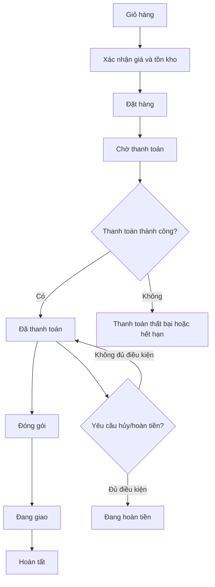

# Không chỉ rate limit request mà phải bảo vệ logic flow

Rate limit giúp hạn chế số request trong một khoảng thời gian, nhưng không chứng minh một người dùng đang thực hiện nghiệp vụ hợp lệ. Một attacker có thể gọi API chậm hơn ngưỡng giới hạn mà vẫn lạm dụng quy trình: áp mã giảm giá nhiều lần, đặt rồi hủy hàng loạt đơn, yêu cầu hoàn tiền lặp lại, nhận OTP liên tục trên nhiều tài khoản hoặc gọi bước cuối của quy trình mà chưa hoàn thành các bước bắt buộc.

Vì vậy, bảo mật API cần bảo vệ **logic flow**: thứ tự các bước, trạng thái hợp lệ, điều kiện chuyển trạng thái, giới hạn nghiệp vụ, quan hệ giữa các đối tượng và tác động tích lũy của nhiều request. Một request riêng lẻ có thể hợp lệ về cú pháp, đã xác thực và chưa vượt rate limit, nhưng chuỗi request vẫn có thể tạo ra kết quả mà nghiệp vụ không cho phép.

Trong bài học này, bảo vệ flow được xem là sự kết hợp giữa xác thực, phân quyền, state machine, business invariants, quota/velocity theo ngữ cảnh, chống replay, kiểm soát đồng thời, phát hiện tự động hóa và giám sát hành vi. Mục tiêu là bảo đảm mọi bước của quy trình đều hợp lệ khi xét trong toàn bộ vòng đời nghiệp vụ.

Sau bài học, người đọc có thể:

- Phân biệt rate limiting ở tầng request với giới hạn và điều kiện ở tầng nghiệp vụ.
- Mô hình hóa quy trình bằng trạng thái và các chuyển trạng thái được phép.
- Bảo vệ business invariants như tồn kho, hạn mức, số lần sử dụng coupon và điều kiện hoàn tiền.
- Thiết kế quota/velocity theo user, tenant, thiết bị, tài nguyên và hành động.
- Ngăn replay, request trùng, race condition và bỏ qua bước trong workflow.
- Kiểm thử các chuỗi hành vi lạm dụng dù từng request đều trả về thành công.

## 1. Vì sao rate limit chưa đủ?

Rate limit thường trả lời câu hỏi: “Một định danh hoặc nguồn gọi được phép gửi bao nhiêu request trong một khoảng thời gian?”. Nó hữu ích để giảm brute force, spam, scraping và cạn tài nguyên. Nhưng nó không trả lời đầy đủ các câu hỏi nghiệp vụ:

- Người dùng có quyền thực hiện hành động này trên object này không?
- Object đang ở trạng thái nào? Chuyển sang trạng thái mới có hợp lệ không?
- Người dùng đã dùng hết hạn mức hoặc quyền lợi chưa?
- Một thao tác đã được thực hiện trước đó chưa?
- Chuỗi bước bắt buộc có được hoàn thành đúng thứ tự không?
- Tổng tác động của nhiều request có vượt giới hạn nghiệp vụ không?
- Request này có đang cạnh tranh với request khác để cùng tiêu thụ một tài nguyên không?

Ví dụ, API cho phép tối đa 10 request/phút trên mỗi IP. Một bot có thể dùng nhiều IP hoặc gọi 1 request mỗi phút để tạo hàng trăm tài khoản nhận khuyến mãi. Tất cả request đều dưới ngưỡng rate limit, nhưng nghiệp vụ “mỗi khách hàng mới chỉ nhận một ưu đãi” đã bị phá vỡ.

| Kiểm soát | Câu hỏi chính | Ví dụ |
|---|---|---|
| Rate limit | Tần suất request có quá cao không? | Tối đa 30 lần gọi endpoint/phút |
| Quota nghiệp vụ | Tổng quyền lợi/tài nguyên được sử dụng còn không? | Mỗi khách hàng chỉ dùng một coupon |
| Velocity rule | Một hành vi có lặp bất thường theo thời gian không? | Một tài khoản tạo 20 đơn trong 5 phút |
| State machine | Hành động có hợp lệ ở trạng thái hiện tại không? | Không thể giao đơn trước khi đóng gói |
| Business invariant | Điều kiện toàn cục có còn đúng sau thao tác không? | Không bán vượt tồn kho |
| Idempotency | Request gửi lại có tạo tác động trùng không? | Một payment key chỉ tạo một giao dịch |
| Authorization | Chủ thể có quyền trên object và hành động không? | Chỉ chủ đơn hoặc nhân viên được giao mới được hủy |

Các lớp này bổ sung cho nhau. Một API an toàn cần chọn đúng lớp kiểm soát cho từng rủi ro và thực thi ở phía server.

## 2. Phân tích workflow và tài sản cần bảo vệ

Trước khi viết middleware hoặc chọn công cụ chống bot, hãy mô tả quy trình nghiệp vụ từ đầu đến cuối. Với mỗi bước, xác định:

1. Ai khởi tạo bước đó: end user, nhân viên, service hay tác vụ nền?
2. Object nào được đọc hoặc thay đổi?
3. Trạng thái hiện tại và trạng thái tiếp theo là gì?
4. Điều kiện tiên quyết nào phải đúng?
5. Tài nguyên hoặc quyền lợi nào bị tiêu thụ: tiền, tồn kho, coupon, lượt thử, quota, điểm thưởng hay thời gian của nhân viên?
6. Nếu request bị gửi lại, timeout hoặc chạy đồng thời thì kết quả cần như thế nào?
7. Có bước phê duyệt, xác minh bổ sung hoặc phân tách nhiệm vụ nào không?

Ví dụ flow đặt hàng:



Không phải mọi chuyển trạng thái đều được phép từ mọi điểm. Ví dụ, đơn đã hoàn tất không thể quay về `PENDING_PAYMENT`; đơn đang giao không thể bị hủy như một đơn chưa thanh toán nếu quy trình yêu cầu thu hồi hàng trước. Các chuyển trạng thái này phải được kiểm tra ở service nghiệp vụ, không chỉ ở frontend.

## 3. Dùng state machine để khóa thứ tự bước

State machine định nghĩa các trạng thái hợp lệ và các chuyển trạng thái được phép. Mỗi request cần xác minh trạng thái hiện tại, hành động yêu cầu và điều kiện chuyển tiếp.

Ví dụ đơn hàng:

| Trạng thái hiện tại | Hành động | Trạng thái tiếp theo | Điều kiện |
|---|---|---|---|
| `DRAFT` | `submit` | `PENDING_PAYMENT` | Giỏ hàng hợp lệ, giá được tính phía server |
| `PENDING_PAYMENT` | `payment_succeeded` | `PAID` | Provider xác minh giao dịch và số tiền |
| `PENDING_PAYMENT` | `expire` | `EXPIRED` | Hết thời hạn thanh toán |
| `PAID` | `pack` | `PACKING` | Tồn kho đã giữ và nhân viên có quyền |
| `PACKING` | `ship` | `SHIPPED` | Có thông tin vận chuyển hợp lệ |
| `SHIPPED` | `deliver` | `COMPLETED` | Có bằng chứng giao hàng theo policy |
| `PAID` | `request_refund` | `REFUND_PENDING` | Đơn đủ điều kiện hoàn tiền |

Một request như `POST /orders/42/ship` không được chấp nhận chỉ vì caller có quyền gọi endpoint. Server phải kiểm tra order đang ở `PACKING`, có quyền trên order, hàng đã được đóng gói và điều kiện vận chuyển đã thỏa mãn.

Ví dụ service method:

```java
@Transactional
public OrderResponse ship(UUID orderId, ApiPrincipal actor) {
    Order order = orderRepository
            .findByIdAndTenantId(orderId, actor.tenantId())
            .orElseThrow(OrderNotFoundException::new);

    authorizationService.requireCanShip(actor, order);
    order.requireStatus(OrderStatus.PACKING);
    order.requirePackageReady();

    order.ship(clock.instant());
    return mapper.toResponse(order);
}
```

`requireCanShip` kiểm tra quyền chức năng và object; `requireStatus` và `requirePackageReady` kiểm tra quy tắc flow. Cả kiểm tra và cập nhật phải được bảo vệ trước request đồng thời. Một controller chỉ kiểm tra role `warehouse:write` mà không kiểm tra trạng thái đơn vẫn có thể cho phép gọi sai thứ tự.

### 3.1. Không tin trạng thái do client khai báo

Client không được tự gửi trạng thái đích để server lưu trực tiếp:

```json
{
  "status": "COMPLETED",
  "paid": true,
  "approved": true
}
```

Client nên gửi command có ý nghĩa như `submit`, `cancel` hoặc `requestRefund`. Server tự xác định trạng thái tiếp theo từ trạng thái hiện tại, kết quả xác minh và policy. Các trường `paid`, `approvedBy`, `shippedAt` hoặc `balance` phải được tạo từ nguồn có thẩm quyền.

### 3.2. Bảo vệ cả các đường chuyển trạng thái gián tiếp

Không chỉ endpoint chính mới thay đổi trạng thái. Webhook thanh toán, tác vụ timeout, admin tool, message consumer và batch import cũng có thể cập nhật object. Tất cả phải dùng chung state transition rules hoặc một domain service có thẩm quyền. Nếu webhook có thể đổi `PENDING_PAYMENT` thành `PAID`, phải xác minh chữ ký, merchant/account, order reference, amount, currency và trạng thái giao dịch trước khi chuyển trạng thái.

## 4. Bảo vệ business invariants

Business invariant là điều kiện phải luôn đúng trước và sau mọi thao tác, kể cả khi có nhiều request đồng thời. Đây là lớp bảo vệ quan trọng vì một request riêng lẻ có thể hợp lệ nhưng tổng tác động có thể vi phạm nghiệp vụ.

Ví dụ:

- Số lượng bán không được vượt tồn kho có thể phân bổ.
- Số dư không được âm nếu sản phẩm không cho phép thấu chi.
- Một coupon không được sử dụng vượt số lượt hoặc ngoài thời gian hiệu lực.
- Một khoản thanh toán không được ghi nhận nhiều lần.
- Tổng tiền hoàn không được vượt số tiền đã thu trừ các khoản đã hoàn.
- Một user không được có nhiều hơn số tài khoản/ưu đãi theo policy.
- Một yêu cầu phê duyệt không được tự duyệt bởi người tạo nếu quy trình yêu cầu separation of duties.

Đừng chỉ đọc giá trị, kiểm tra trong Java rồi ghi sau bằng một câu lệnh độc lập. Hai request có thể cùng đọc giá trị cũ và cùng vượt qua điều kiện. Hãy dùng transaction, khóa, optimistic locking, ràng buộc database hoặc câu lệnh cập nhật có điều kiện để bảo đảm invariant nguyên tử.

Ví dụ giữ tồn kho bằng câu lệnh có điều kiện:

```sql
UPDATE inventory
SET available_quantity = available_quantity - :quantity,
    reserved_quantity = reserved_quantity + :quantity
WHERE product_id = :productId
  AND available_quantity >= :quantity;
```

Sau câu lệnh, kiểm tra số dòng bị cập nhật. Nếu bằng 0, tồn kho không đủ hoặc sản phẩm không còn khả dụng; không tạo đơn ở trạng thái đã giữ hàng. Nếu có nhiều sản phẩm, xử lý tất cả trong một transaction hoặc có cơ chế bù trừ rõ ràng để tránh giữ được một phần tồn kho mà đơn hàng thất bại.

Ví dụ coupon cần có unique constraint hoặc cập nhật có điều kiện theo người dùng/campaign, không chỉ kiểm tra `usedCount < maxUses` ở tầng ứng dụng rồi tăng bộ đếm sau. Ràng buộc dữ liệu phải bảo vệ được cả các request chạy đồng thời.

## 5. Quota và velocity theo ngữ cảnh nghiệp vụ

Rate limit thường dựa trên IP hoặc endpoint. Quota nghiệp vụ cần dựa trên đối tượng và quyền lợi đang bị tiêu thụ. Tùy flow, có thể kết hợp:

- **Theo user:** số đơn tạo mới, số lần gửi OTP, số yêu cầu đổi mật khẩu.
- **Theo tenant/tổ chức:** số tài khoản thành viên, tổng dung lượng, số lần export hoặc tổng giá trị giao dịch.
- **Theo tài nguyên:** số lần sử dụng coupon, số lần thử thanh toán cho một order, số lần yêu cầu hoàn tiền.
- **Theo thiết bị/session:** tốc độ tạo tài khoản, đổi danh tính hoặc dùng quyền lợi từ cùng một thiết bị.
- **Theo IP/network:** phát hiện nguồn tự động hóa, dò quét hoặc brute force.
- **Theo payment instrument/địa chỉ nhận/định danh chống gian lận:** phát hiện việc chia nhỏ request qua nhiều tài khoản.

Không nên dựa vào một khóa duy nhất. Rate limit theo IP có thể chặn nhầm nhiều người dùng chung NAT; giới hạn theo user có thể bị vượt qua bằng cách tạo nhiều tài khoản. Kết hợp nhiều tín hiệu, đặt giới hạn phù hợp rủi ro và theo dõi false positive.

### 5.1. Phân biệt quota với rate limit

| Ví dụ | Rate limit | Quota nghiệp vụ |
|---|---|---|
| Gửi OTP | Tối đa 5 request/phút | Tối đa 10 OTP/ngày cho một số điện thoại theo policy |
| Tạo đơn | Tối đa 20 request/phút | Giới hạn số đơn chưa thanh toán hoặc tổng giá trị theo ngày |
| Coupon | Giới hạn request kiểm tra coupon | Mỗi user chỉ được dùng một lần và campaign có tổng lượt tối đa |
| Export | Giới hạn request/phút | Giới hạn số dòng/dung lượng export theo tenant |
| Hoàn tiền | Giới hạn endpoint/phút | Tổng tiền hoàn không vượt số tiền đã thu và policy cho phép |

Quota nên được ghi nhận trong dữ liệu có tính nhất quán, có định danh phạm vi và chu kỳ rõ ràng. Khi quota hết, API trả lỗi nghiệp vụ ổn định; không chỉ trả `429` nếu nguyên nhân là quyền lợi đã dùng hết. Có thể dùng `409 Conflict` hoặc `422` theo hợp đồng, còn `429` phù hợp khi giới hạn tần suất request bị vượt.

### 5.2. Velocity rule và phát hiện hành vi bất thường

Velocity rule xem xét tần suất và chuỗi hành động theo một hoặc nhiều chiều. Ví dụ:

- Một user tạo nhiều tài khoản trong thời gian ngắn.
- Nhiều user dùng cùng payment instrument hoặc địa chỉ nhận để lấy ưu đãi.
- Một tài khoản thử nhiều phương thức thanh toán trên cùng order.
- Một coupon bị kiểm tra từ nhiều tài khoản rồi dùng liên tiếp.
- Một tài khoản liên tục tạo đơn, hủy đơn và đặt lại để giữ tồn kho.

Không phải mọi bất thường đều nên bị khóa ngay. Tùy mức rủi ro, hệ thống có thể yêu cầu xác minh bổ sung, giới hạn tạm thời, đưa vào review hoặc từ chối. Quy tắc cần có lý do, thời hạn và khả năng điều chỉnh để tránh khóa nhầm người dùng hợp lệ.

## 6. Chống replay và request trùng

Client có thể retry khi timeout, mạng bị ngắt hoặc không nhận được response. Attacker cũng có thể phát lại một request đã quan sát được. Với thao tác tạo giao dịch, hoàn tiền, đổi trạng thái hoặc tiêu thụ quyền lợi, cần xác định request nào được phép thực hiện một lần.

### 6.1. Idempotency key

Với thao tác như tạo payment hoặc submit order, client gửi một key duy nhất cho ý định nghiệp vụ:

```http
POST /api/payments HTTP/1.1
Authorization: Bearer <access-token>
Idempotency-Key: 7d5e3c80-7f5a-4d77-9a90-3b0ef6fdbf91
Content-Type: application/json

{
  "orderId": "ORD-200",
  "paymentMethodId": "PM-18"
}
```

Server lưu key cùng phạm vi caller/tenant, action, fingerprint của request và kết quả. Khi nhận lại cùng key:

- Nếu request fingerprint giống và đã hoàn tất, trả lại kết quả đã lưu.
- Nếu request đang xử lý, trả trạng thái đang xử lý hoặc cho client retry theo hợp đồng.
- Nếu cùng key nhưng payload khác, từ chối vì xung đột.
- Nếu key hết thời hạn lưu, xử lý theo chính sách rõ ràng; không tái sử dụng key cũ một cách mơ hồ.

Key phải được scope theo chủ thể hoặc tenant và endpoint/action. Không dùng key do client chọn làm bằng chứng xác thực hoặc quyền truy cập. Server vẫn phải kiểm tra authorization, business invariants và quota.

### 6.2. Nonce, timestamp và webhook

Với webhook hoặc request ký số, xác minh chữ ký trên đúng raw payload, timestamp trong cửa sổ chấp nhận và nonce/event ID chưa được xử lý. Lưu event ID có unique constraint để ngăn cùng một sự kiện được áp dụng nhiều lần. Chữ ký hợp lệ không ngăn replay nếu hệ thống không ghi nhận sự kiện đã xử lý.

Không dùng timestamp đơn lẻ làm cơ chế chống replay: hai request giống nhau vẫn có thể đến trong cùng cửa sổ thời gian. Cần một định danh duy nhất và lưu trạng thái xử lý.

## 7. Kiểm soát cập nhật đồng thời và race condition

Một flow có thể bị lạm dụng khi nhiều request đồng thời cùng vượt qua một điều kiện. Ví dụ coupon còn một lượt nhưng hai request cùng đọc `remainingUses = 1`; cả hai đều thấy còn lượt và cùng áp dụng coupon.

Các cách kiểm soát:

- **Optimistic locking:** dùng version column; request cập nhật chỉ thành công nếu version chưa thay đổi.
- **Pessimistic locking:** khóa hàng hoặc tài nguyên trong transaction khi cạnh tranh cao và thời gian giữ khóa ngắn.
- **Conditional update:** gộp điều kiện và thay đổi vào cùng câu lệnh SQL, kiểm tra số hàng bị tác động.
- **Unique constraint:** ngăn một chủ thể sử dụng một quyền lợi nhiều lần, ví dụ unique `(campaign_id, user_id)`.
- **Idempotency record:** bảo đảm một ý định nghiệp vụ chỉ tạo một kết quả.

Ví dụ constraint cho coupon:

```sql
CREATE UNIQUE INDEX uq_coupon_redemption_per_user
ON coupon_redemptions (campaign_id, user_id);
```

Ràng buộc này bảo vệ quy tắc mỗi user chỉ đổi coupon một lần ngay cả khi hai request chạy đồng thời. Nếu policy cho phép nhiều lần theo từng order, khóa cần phản ánh đúng phạm vi như `(campaign_id, user_id, order_id)`.

Với flow nhiều service, transaction database cục bộ không thể tự bảo đảm toàn bộ quy trình. Dùng saga hoặc workflow orchestration để theo dõi bước đã hoàn tất và thực hiện compensation khi bước sau thất bại. Ví dụ, nếu đã giữ tồn kho nhưng thanh toán thất bại, cần giải phóng reservation theo một thao tác có idempotency riêng. Không giả định rollback ở service thanh toán sẽ tự rollback database tồn kho.

## 8. Xác minh bổ sung và phân tách nhiệm vụ

Một số thao tác có tác động lớn cần thêm bước xác minh hoặc người phê duyệt. Ví dụ:

- Đổi email/số điện thoại cần xác minh kênh mới.
- Đổi mật khẩu hoặc tắt MFA cần xác thực lại (step-up authentication).
- Chuyển tiền vượt ngưỡng cần xác nhận bổ sung hoặc phê duyệt hai người.
- Nhân viên tạo yêu cầu hoàn tiền không được tự phê duyệt yêu cầu đó nếu policy yêu cầu separation of duties.
- Thay đổi role quản trị cần actor có quyền riêng và audit đầy đủ.

Không chỉ kiểm tra một claim `role=ADMIN`. Cần kiểm tra quyền action, object, giới hạn giá trị, trạng thái, phương thức xác minh gần đây và quy tắc phân tách nhiệm vụ. Với phê duyệt hai người, requester và approver phải là hai chủ thể khác nhau theo policy; kiểm tra này cần được thực thi ở server và transaction.

Challenge bổ sung phải gắn với đúng user, đúng action, đúng object và có thời hạn. Không chấp nhận một OTP đã dùng cho hành động khác hoặc một bước xác minh cũ cho một giao dịch mới.

## 9. Chống tự động hóa và lạm dụng workflow

Bot có thể thực hiện các bước hợp lệ với tốc độ gần người dùng thật hoặc phân tán qua nhiều IP. Vì vậy, chống automation cần kết hợp tín hiệu và quy tắc flow:

- Theo dõi chuỗi hành động: tạo tài khoản → xác minh → nhận ưu đãi → đặt hàng → hủy đơn.
- Đánh giá tốc độ và số lượng trên nhiều khóa: account, device, IP, phone, payment instrument, tenant và resource.
- Dùng challenge/risk-based verification ở bước có giá trị cao hoặc bất thường; không yêu cầu challenge ở mọi request như biện pháp duy nhất.
- Giới hạn số lần thử và thời gian chờ cho OTP, password reset, mã xác minh, coupon và payment method.
- Phát hiện việc tạo nhiều tài khoản có cùng tín hiệu hoặc chia nhỏ hành vi để né quota.
- Có cơ chế review/hold cho giao dịch rủi ro cao thay vì tự động từ chối mọi trường hợp lạ.
- Bảo vệ endpoint tra cứu trước hành động chính, ví dụ coupon validation hoặc kiểm tra tài khoản có tồn tại, vì chúng có thể bị dùng để dò dữ liệu.

CAPTCHA có thể tăng chi phí tự động hóa nhưng không thay thế xác thực, authorization, quota, state machine hay business invariants. Kẻ tấn công có thể thuê giải CAPTCHA hoặc chuyển sang API trực tiếp.

## 10. Webhook, callback và nguồn sự kiện bên ngoài

Webhook thanh toán, vận chuyển hoặc đối tác có thể làm thay đổi trạng thái quan trọng. Không tin payload chỉ vì nó đến từ endpoint callback.

Trước khi áp dụng sự kiện:

1. Xác minh chữ ký theo cách của provider, gồm đúng raw body và secret/public key tương ứng.
2. Kiểm tra timestamp hoặc cửa sổ hợp lệ nếu provider hỗ trợ.
3. Xác minh event ID chưa được xử lý và lưu idempotently.
4. Đối chiếu merchant/account, order reference, amount, currency và trạng thái giao dịch với dữ liệu của hệ thống.
5. Kiểm tra chuyển trạng thái hiện tại có hợp lệ không; sự kiện đến muộn hoặc sai thứ tự phải được xử lý theo policy.
6. Chỉ sau khi xác minh mới phát sinh side effect như giao hàng, cộng điểm hoặc mở khóa tài nguyên.

Ví dụ, webhook `payment.succeeded` không nên tự động đặt bất kỳ order nào thành `PAID` chỉ dựa trên `orderId` trong body. Hãy xác minh giao dịch thuộc đúng merchant, đúng order, đúng số tiền/đơn vị tiền tệ và chưa được áp dụng trước đó.

## 11. Kiểm thử logic flow bằng chuỗi hành vi

Unit test cho từng endpoint là cần thiết nhưng chưa đủ. Lỗi flow thường chỉ xuất hiện khi nhiều request được gọi theo một thứ tự cụ thể hoặc chạy đồng thời. Hãy thiết kế test theo kịch bản đầu-cuối.

| Kịch bản | Chuỗi request | Kết quả mong đợi |
|---|---|---|
| Bỏ qua bước thanh toán | Tạo order → gọi ship khi chưa thanh toán | Từ chối, order không đổi trạng thái |
| Lặp coupon | Redeem cùng coupon hai lần | Chỉ áp dụng theo quota; lần sau bị từ chối hoặc trả kết quả idempotent |
| Race coupon cuối | Hai request đồng thời dùng lượt cuối | Chỉ một request tiêu thụ thành công |
| Replay payment | Gửi lại cùng payment request/event | Không tạo giao dịch hoặc cộng tiền hai lần |
| Hủy sau giao | Ship → deliver → cancel | Từ chối hoặc chuyển sang quy trình trả hàng phù hợp |
| Vượt hạn mức | Gửi request chậm dưới rate limit nhưng tổng vượt quota ngày | Quota nghiệp vụ chặn |
| Chia nhỏ tài khoản | Nhiều tài khoản dùng chung payment instrument để nhận ưu đãi | Risk/eligibility rule xử lý theo policy |
| Giả mạo trạng thái | PATCH `status=COMPLETED` | Không được thay đổi trạng thái trực tiếp |
| Webhook sai thứ tự | `succeeded` sau khi giao dịch đã refund | Không hồi sinh trạng thái đã đóng |
| Approver trùng requester | User tạo và tự duyệt yêu cầu | Từ chối theo separation of duties |
| Retry khi timeout | Gửi lại cùng idempotency key | Một kết quả nghiệp vụ duy nhất |
| Saga lỗi giữa chừng | Giữ hàng thành công, payment thất bại | Reservation được giải phóng đúng một lần |

### 11.1. Kiểm thử đồng thời

Với invariant quan trọng, chạy nhiều request đồng thời bằng cùng fixture. Không chỉ assert một response thành công; hãy kiểm tra tổng trạng thái cuối. Ví dụ khi chỉ còn một coupon, sau hai request đồng thời phải có đúng một redemption, không có bộ đếm âm và không có hai order cùng nhận ưu đãi.

### 11.2. Kiểm thử property và state transition

Có thể dùng property-based testing hoặc model-based testing để sinh nhiều chuỗi hành động. Với state machine, kiểm tra rằng mọi chuỗi được chấp nhận đều tuân theo tập chuyển trạng thái đã định nghĩa và không có trạng thái cuối vi phạm invariant. Lưu regression test cho mỗi chuỗi abuse đã phát hiện.

### 11.3. Kiểm thử failure và retry

Giả lập timeout sau khi database commit nhưng trước khi response về client; gửi lại request và xác minh không tạo tác động thứ hai. Giả lập message được giao nhiều lần, webhook lặp, worker restart và service downstream lỗi giữa chừng. Đây là các tình huống thực tế có thể tạo trùng nghiệp vụ dù không có attacker.

## 12. Giám sát và phản ứng theo nghiệp vụ

Log và metric cần giúp nhóm vận hành hiểu hành vi ở cấp flow, không chỉ đếm request. Với một workflow quan trọng, có thể ghi nhận:

- Actor, tenant, object và action (định danh đã giảm thiểu phù hợp).
- Trạng thái trước/sau và kết quả transition.
- Quota/limit được áp dụng và quyết định allow/deny.
- Idempotency key ở dạng định danh an toàn hoặc hash; không log token.
- Correlation ID liên kết các bước qua service và message queue.
- Lý do từ chối nội bộ, risk signal và kết quả challenge/phê duyệt.

Theo dõi các chỉ số như tỷ lệ chuyển trạng thái thất bại, coupon redemption theo user/tenant/device, đơn tạo-hủy lặp, payment retry, refund/chargeback, số lần OTP thất bại, số workflow treo và compensation thất bại. Cảnh báo nên dựa trên xu hướng và tổ hợp tín hiệu, tránh chỉ dựa vào một request đơn lẻ.

Khi phát hiện lạm dụng:

1. Giới hạn hoặc tạm dừng đúng action/resource/actor bị ảnh hưởng.
2. Giữ lại audit trail và correlation ID phục vụ điều tra.
3. Kiểm tra các side effect đã phát sinh: tiền, tồn kho, coupon, điểm, thông báo và trạng thái object.
4. Thu hồi hoặc vô hiệu hóa token/key liên quan nếu có dấu hiệu bị lộ.
5. Thực hiện bù trừ theo nghiệp vụ và xác minh không tạo thêm tác động trùng.
6. Bổ sung regression test và điều chỉnh rule/threshold sau khi hiểu nguyên nhân.

## 13. Checklist bảo vệ business flow

- [ ] Đã vẽ workflow, xác định actor, object, tài nguyên bị tiêu thụ và điều kiện từng bước.
- [ ] Có state machine hoặc quy tắc chuyển trạng thái rõ ràng ở phía server.
- [ ] Không tin status, price, balance, approval hoặc quyền lợi do client khai báo.
- [ ] Mỗi bước kiểm tra xác thực, quyền chức năng, quyền object và property phù hợp.
- [ ] Business invariants được bảo vệ bằng transaction, conditional update, locking hoặc constraint.
- [ ] Quota được áp dụng theo user/tenant/resource/quyền lợi; rate limit có nhiều chiều phù hợp.
- [ ] Có velocity/risk rule cho chuỗi hành vi lặp hoặc phân tán.
- [ ] Thao tác có thể retry có idempotency key hoặc cơ chế chống xử lý trùng.
- [ ] Webhook/callback được xác minh chữ ký, event ID, amount và trạng thái trước khi áp dụng.
- [ ] Workflow nhiều service có saga/compensation và xử lý retry rõ ràng.
- [ ] Thao tác nhạy cảm có step-up authentication hoặc separation of duties khi cần.
- [ ] Cache, log và audit không làm lộ dữ liệu hoặc bỏ qua policy.
- [ ] Có test bỏ bước, đảo thứ tự, replay, race condition, quota và failure/retry.
- [ ] Có metric/cảnh báo ở cấp workflow và quy trình xử lý side effect khi có sự cố.

## Kết luận

Rate limit kiểm soát tần suất request; bảo vệ logic flow kiểm soát điều gì được phép xảy ra qua toàn bộ chuỗi nghiệp vụ. Hãy mô hình hóa trạng thái, kiểm tra điều kiện chuyển tiếp, bảo vệ invariant bằng thao tác nguyên tử, áp quota theo quyền lợi và chống replay/race condition. Khi kiểm thử bằng các chuỗi hành vi, request đồng thời và tình huống retry/failure, hệ thống có thể phát hiện những cách lạm dụng mà kiểm tra từng endpoint riêng lẻ hoặc giới hạn request đơn thuần không nhìn thấy.
