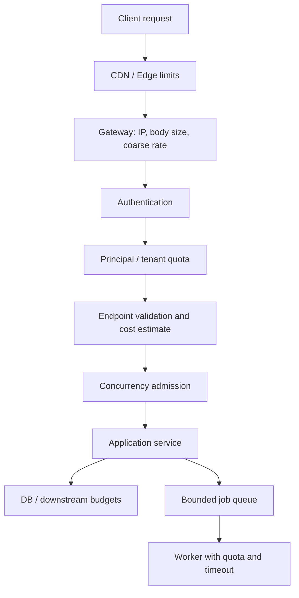

# Unrestricted Resource Consumption

API có thể xác thực người gọi đúng và kiểm tra quyền trên từng object nhưng vẫn bị khai thác nếu cho phép request tiêu thụ tài nguyên không giới hạn. Một endpoint tìm kiếm có thể khiến database chạy truy vấn nặng; endpoint export có thể tạo file rất lớn; API upload có thể làm đầy object storage; endpoint gửi OTP có thể tạo chi phí SMS; một request gọi nhiều dịch vụ bên ngoài có thể giữ thread và connection trong thời gian dài. Khi attacker tự động hóa các request này, hệ thống có thể chậm, cạn connection, đầy bộ nhớ, tăng hóa đơn hạ tầng hoặc ngừng phục vụ người dùng hợp lệ.

Đây là vấn đề **Unrestricted Resource Consumption**: API không đặt hoặc không thực thi giới hạn phù hợp cho số lượng, kích thước, thời gian, độ phức tạp và mức đồng thời của công việc mà một caller có thể yêu cầu. Rủi ro không chỉ là gửi quá nhiều request mỗi giây. Một request đơn lẻ cũng có thể rất đắt nếu nó yêu cầu hàng triệu bản ghi, một truy vấn join phức tạp, một file khổng lồ hoặc một chuỗi lời gọi đến dịch vụ bên ngoài.

Trong phạm vi `SECURITY_API_SECURITY`, bảo vệ tài nguyên cần được thiết kế theo endpoint, actor, tenant và luồng nghiệp vụ. Authentication cho biết ai gọi; authorization cho biết họ được phép làm gì; validation xác định dữ liệu có hợp lệ; các quota, giới hạn kích thước, concurrency và timeout bảo đảm công việc hợp lệ vẫn nằm trong ngân sách tài nguyên mà hệ thống có thể phục vụ.

## 1. Tài nguyên nào có thể bị tiêu thụ?

Khi review một endpoint, không chỉ đếm request. Hãy xác định toàn bộ tài nguyên mà request có thể sử dụng trực tiếp hoặc gián tiếp.

| Loại tài nguyên | Ví dụ bị tiêu thụ | Hậu quả khi không giới hạn |
|---|---|---|
| CPU | Mã hóa, giải nén, tính toán, xử lý ảnh, truy vấn phức tạp | CPU saturation, tăng latency |
| Memory | JSON lớn, file upload, kết quả query, buffer | Out of memory, garbage collection kéo dài |
| Network | Upload/download, gọi API ngoài, response lớn | Băng thông cạn, chi phí truyền dữ liệu |
| Database | Query nặng, full scan, connection giữ lâu, transaction dài | Cạn connection pool, lock contention, database quá tải |
| Thread/worker | Request chờ I/O, tác vụ đồng bộ, job không giới hạn | Thread starvation, queue backlog |
| Storage | File, export, log, bản sao tạm | Hết dung lượng, tăng chi phí lưu trữ |
| Dịch vụ tính phí | SMS, email, OCR, AI inference, geocoding | Tăng chi phí trực tiếp, bị lợi dụng ngân sách |
| Tài nguyên nghiệp vụ | OTP, lượt reset password, coupon, reservation | Spam, gian lận, khóa tài khoản hoặc giữ chỗ trái phép |

Một endpoint thường tiêu thụ nhiều loại tài nguyên cùng lúc. Ví dụ `POST /reports/export` có thể đọc database, giữ worker, tạo file, ghi object storage và gửi thông báo. Giới hạn request/giây đơn lẻ không kiểm soát đầy đủ chuỗi này.

## 2. Mô hình đe dọa và ví dụ thực tế

Các tình huống phổ biến gồm:

- **Pagination không giới hạn:** caller đặt `pageSize=1000000`, khiến server tải nhiều bản ghi và tạo response lớn.
- **Batch quá lớn:** một request cập nhật hàng trăm nghìn object, giữ transaction và khóa database.
- **Search quá đắt:** wildcard đầu chuỗi, regex phức tạp, sort trên cột không có index hoặc filter có cardinality lớn.
- **Upload không giới hạn:** gửi file rất lớn, nhiều file nhỏ hoặc archive giải nén thành dữ liệu khổng lồ.
- **Export lặp lại:** tạo nhiều báo cáo tốn CPU/DB và chiếm worker dù caller không tải kết quả.
- **OTP/SMS abuse:** gọi endpoint gửi mã xác thực liên tục đến một số điện thoại hoặc nhiều số.
- **Password reset abuse:** gửi nhiều email, tạo nhiều token hoặc kích hoạt công việc đắt tiền.
- **Fan-out:** một request gọi hàng chục dịch vụ downstream; mỗi request có chi phí nhân lên.
- **Slow request:** gửi body chậm hoặc giữ kết nối lâu, chiếm socket, thread và connection.
- **Retry storm:** client và service tự retry đồng loạt khi downstream chậm, khiến quá tải tăng thêm.
- **SSRF có chi phí:** endpoint fetch URL cho phép gọi đích nội bộ hoặc dịch vụ ngoài liên tục, vừa tạo rủi ro SSRF vừa tiêu thụ network/connection.

Attacker không nhất thiết phải vượt qua authorization. Họ có thể dùng tài khoản hợp lệ, API key bị lộ hoặc nhiều tài khoản để khai thác một chức năng đúng quyền nhưng thiếu quota. Vì vậy, chống lạm dụng tài nguyên là một lớp kiểm soát độc lập với đăng nhập và phân quyền.

## 3. Lập ngân sách tài nguyên theo endpoint

Mỗi endpoint nên có một ngân sách dựa trên tác động thực tế. Trước tiên, xác định:

1. Request có thể đọc hoặc thay đổi tối đa bao nhiêu object?
2. Kích thước body, file, response và số phần tử tối đa là bao nhiêu?
3. Request có gọi database, dịch vụ ngoài hoặc tạo background job không?
4. Thời gian xử lý và số tác vụ đồng thời được phép là bao nhiêu?
5. Một user, API key, tenant hoặc IP được phép sử dụng bao nhiêu trong một khoảng thời gian?
6. Khi hệ thống gần hết công suất, endpoint giảm tải hoặc từ chối theo cách nào?

Ví dụ bảng ngân sách ban đầu:

| Nhóm endpoint | Giới hạn cần xác định |
|---|---|
| Read/list/search | Page size tối đa, filter/sort allowlist, query timeout, response size |
| Create/update | Body size, số object mỗi batch, quota theo actor/tenant |
| Upload | File size, tổng request size, số file, loại file, thời gian upload, quota storage |
| Export/report | Số job đồng thời, quota theo ngày, thời gian chạy, kích thước kết quả, thời hạn lưu file |
| OTP/email/SMS | Cooldown theo destination, user, IP và tổng quota theo tenant |
| Search nâng cao | Độ phức tạp filter, số điều kiện, timeout và concurrency |
| URL fetch/webhook test | Số lần fetch, timeout, giới hạn response, allowlist destination và concurrency |
| Admin/bulk action | Số object tối đa, step-up/approval khi cần, quota và audit |

Không có một con số giới hạn phù hợp cho mọi hệ thống. Giá trị phải dựa trên load test, SLO, năng lực database/worker, chi phí downstream, loại khách hàng và mức rủi ro. Hãy đặt giới hạn có thể cấu hình, theo dõi rồi điều chỉnh bằng dữ liệu.

## 4. Rate limiting theo nhiều chiều

Rate limit kiểm soát tốc độ request hoặc action trong một khoảng thời gian. Không nên chỉ giới hạn theo IP vì một IP có thể đại diện cho nhiều người dùng hợp lệ sau NAT, trong khi attacker có thể phân tán request qua nhiều IP.

Các chiều thường dùng:

- **IP/network:** bảo vệ lớp trước authentication và hạn chế nguồn gửi bất thường.
- **User/principal:** giới hạn hoạt động của một người dùng đã xác thực.
- **API key/client ID:** giới hạn một integration hoặc workload.
- **Tenant/account:** bảo vệ công bằng giữa khách hàng và kiểm soát quota hợp đồng.
- **Endpoint/action:** áp dụng ngưỡng riêng cho search, export, login, OTP, upload hoặc refund.
- **Destination/resource:** giới hạn gửi OTP đến một số điện thoại/email, hoặc tác động lên cùng một object.
- **Global/system:** bảo vệ năng lực tổng thể khi toàn hệ thống gần quá tải.

Thường cần kết hợp nhiều lớp. Ví dụ endpoint gửi OTP có thể có giới hạn theo IP, user/session, số điện thoại nhận và quota tổng của tenant. Mỗi chiều giải quyết một kiểu lạm dụng khác nhau.

### 4.1. Không tin IP header tùy ý

Nếu ứng dụng chạy sau reverse proxy hoặc load balancer, chỉ tin `Forwarded`/`X-Forwarded-For` từ proxy nằm trong trust configuration. Không lấy IP đầu tiên trong header do client tự gửi làm nguồn sự thật. Nếu không, attacker có thể thay header để tạo nhiều bucket rate limit giả.

Proxy cần xóa hoặc ghi đè các header forwarding đến từ client rồi chèn giá trị đã xác định. Ứng dụng chỉ phân tích chuỗi proxy theo danh sách hop tin cậy, không chọn một IP bất kỳ trong header.

### 4.2. Rate limit trước và sau authentication

Nên có giới hạn thô trước authentication để bảo vệ gateway, TLS termination và endpoint login. Sau khi xác thực, áp dụng quota chính xác theo user, API key, tenant và action. Nếu chỉ giới hạn sau authentication, endpoint cấp token/login có thể bị dùng để làm cạn tài nguyên trước khi có principal.

Không dùng một bucket chung cho toàn bộ API. Một endpoint đọc cache có chi phí thấp và một endpoint export database có chi phí cao không nên có cùng quota chỉ vì cùng một caller.

## 5. Chọn thuật toán rate limit

### 5.1. Fixed window counter

Đếm số request trong từng cửa sổ cố định, ví dụ một phút. Cách này dễ triển khai nhưng có thể tạo burst ở ranh giới cửa sổ: caller gửi gần hết quota cuối phút rồi tiếp tục gửi hết quota ngay đầu phút sau.

### 5.2. Sliding window

Sliding window log lưu timestamp của request trong khoảng thời gian trượt; sliding window counter ước lượng lưu lượng giữa hai cửa sổ. Cách này giảm burst ở ranh giới nhưng có thể cần nhiều state hơn hoặc có sai số tùy cách triển khai.

### 5.3. Token bucket

Token bucket cho phép burst có giới hạn. Bucket có dung lượng (B), được bổ sung token với tốc độ (r) token/giây. Mỗi request tiêu thụ một số token theo cost; nếu không đủ token, request bị từ chối hoặc trì hoãn.

```text
tokens = min(B, tokens + elapsed_seconds * r)

if tokens >= request_cost:
    tokens = tokens - request_cost
    allow
else:
    reject_or_delay
```

Bucket dung lượng nhỏ giới hạn burst; tốc độ refill quyết định mức trung bình lâu dài. Với endpoint có request cost khác nhau, ví dụ search nhẹ và export nặng, có thể trừ token theo cost thay vì mỗi request đều tính một đơn vị.

### 5.4. Leaky bucket và queueing

Leaky bucket xử lý công việc theo tốc độ ổn định, giúp làm phẳng burst. Nếu dùng queue, queue phải có giới hạn kích thước và thời gian chờ; queue vô hạn chỉ chuyển tình trạng quá tải thành backlog lớn và tăng latency. Khi queue đầy, từ chối có kiểm soát thay vì tiếp tục nhận việc.

### 5.5. Rate limit phân tán

Nếu API chạy nhiều instance, counter cục bộ trên từng instance có thể khiến tổng quota bị nhân lên theo số instance. Dùng kho state dùng chung hoặc gateway có cơ chế phân phối quota phù hợp. Cập nhật token/counter phải atomic để request đồng thời không cùng tiêu thụ một quota.

Thiết kế cần xác định hành vi khi kho rate limit mất kết nối. Với endpoint nhạy cảm về chi phí như SMS, export hoặc AI inference, fail-open có thể tạo chi phí không kiểm soát; fail-closed có thể làm gián đoạn chức năng. Chọn theo rủi ro, có fallback giới hạn và giám sát lỗi của limiter.

## 6. Quota, concurrency limit và cost-based limit

Rate limit giới hạn tốc độ nhưng không nhất thiết giới hạn số việc đang chạy. Nếu mỗi request kéo dài 30 giây, chỉ vài request/giây vẫn có thể tạo hàng trăm tác vụ đồng thời.

### 6.1. Concurrency limit

Giới hạn số request/job đồng thời theo endpoint, tenant hoặc dependency. Ví dụ chỉ cho phép một số lượng export job đang chạy; request tiếp theo có thể được xếp vào queue giới hạn hoặc bị từ chối với hướng dẫn thử lại.

Semaphore hoặc admission controller có thể dùng để giữ slot trong suốt thời gian xử lý. Slot phải được giải phóng cả khi timeout, exception hoặc client disconnect; nếu không, limiter có thể rò slot và tự làm hệ thống ngừng nhận request.

### 6.2. Quota theo kỳ

Quota kiểm soát tổng mức sử dụng trong giờ/ngày/tháng, ví dụ số báo cáo, dung lượng lưu trữ, số SMS hoặc số lượt inference. Quota cần gắn với chủ thể rõ ràng và có semantics nhất quán:

- Quota được tính khi yêu cầu được nhận, khi bắt đầu xử lý hay khi hoàn tất?
- Request thất bại có được hoàn lại quota không?
- Retry cùng idempotency key có bị tính nhiều lần không?
- Quota có được chia sẻ giữa nhiều API key của cùng tenant không?
- Khi nâng cấp gói dịch vụ, thời điểm quota mới có hiệu lực là khi nào?

Với chi phí phát sinh ở hệ thống ngoài, nên ghi nhận usage theo operation ID để đối soát và tránh tính trùng khi retry.

### 6.3. Cost-based limiting

Một số endpoint có chi phí thay đổi theo tham số. Có thể ước lượng cost trước khi thực thi dựa trên:

- Số bản ghi tối đa cần đọc hoặc cập nhật.
- Số điều kiện/filter/sort và loại truy vấn.
- Số downstream call dự kiến.
- Kích thước file hoặc response dự kiến.
- Số trang, độ sâu GraphQL hoặc số resolver được gọi.
- Loại mô hình hoặc mức tài nguyên tính phí được yêu cầu.

Cost estimate không cần chính xác tuyệt đối nhưng phải có giới hạn và được kiểm tra trước khi bắt đầu công việc đắt tiền. Nếu vượt ngân sách, yêu cầu giảm phạm vi, chia batch hoặc dùng job bất đồng bộ theo quota.

## 7. Giới hạn kích thước và cấu trúc request

### 7.1. Body size và số phần tử

Đặt giới hạn cho:

- Tổng kích thước HTTP request body.
- Kích thước từng field và chuỗi.
- Số phần tử trong array/list/batch.
- Độ sâu JSON và số node lồng nhau.
- Số file và tổng dung lượng multipart.
- Kích thước header và query string.

Giới hạn nên được áp dụng càng sớm càng tốt ở CDN, gateway, reverse proxy, web server và application. Nếu application chỉ kiểm tra sau khi framework đã đọc toàn bộ body vào memory, kiểm soát có thể đến quá muộn.

### 7.2. Pagination bắt buộc và có trần

Endpoint list/search cần giới hạn page size và tránh mặc định trả toàn bộ dữ liệu.

Ví dụ với Spring:

```java
public record OrderSearchRequest(
    @Min(0) int page,
    @Min(1) @Max(100) int size,
    @Size(max = 80) String keyword
) {}
```

Đây là ví dụ validation; giá trị tối đa phải dựa trên khả năng hệ thống. Không để client truyền `size` tùy ý rồi đưa thẳng vào query. Server cần clamp hoặc từ chối giá trị vượt trần theo hợp đồng API.

Ngoài page size, hãy giới hạn số trang export, thời gian truy vấn, sort field và filter. Ưu tiên cursor/keyset pagination cho tập dữ liệu lớn hoặc thay đổi liên tục; offset pagination rất lớn có thể khiến database phải bỏ qua nhiều hàng trước khi trả kết quả.

### 7.3. Allowlist filter và sort

Không chuyển trực tiếp field name, sort expression hoặc operator do client gửi vào SQL/ORM. Ánh xạ các lựa chọn được phép sang cột/index đã thiết kế. Giới hạn số điều kiện, wildcard, khoảng thời gian và kích thước danh sách `IN`.

Tránh regex tùy ý trên input không tin cậy nếu pattern có thể gây catastrophic backtracking. Dùng parser/regex engine an toàn, giới hạn độ dài input, giới hạn thời gian hoặc thay bằng search syntax có cấu trúc.

### 7.4. GraphQL và API truy vấn linh hoạt

Với GraphQL hoặc endpoint cho phép client định nghĩa nested query, giới hạn:

- Query depth và số field/resolver.
- Complexity/cost theo schema.
- Alias và số operation trong một request.
- Batch size và số object được trả về.
- Resolver fan-out và concurrency downstream.

Depth limit đơn lẻ không đủ vì một query nông nhưng có nhiều field quan hệ vẫn có thể tạo hàng nghìn resolver. Nên kết hợp complexity score, pagination bắt buộc và giới hạn concurrency.

## 8. Giới hạn upload, download và giải nén

### 8.1. Upload

Upload cần giới hạn kích thước file, tổng request, số file, thời gian truyền, quota theo tenant và dung lượng lưu trữ. Server nên stream dữ liệu thay vì giữ toàn bộ file trong memory, kiểm tra loại file bằng nội dung thực tế khi cần và lưu vào vùng quarantine trước khi xử lý.

Không tin tên file hoặc `Content-Type` do client gửi. Kiểm tra extension, magic bytes, loại nội dung được phép, tên file đã chuẩn hóa và quyền truy cập object. Quét malware hoặc xử lý ảnh/PDF phải có giới hạn CPU, memory và thời gian riêng.

### 8.2. Archive và decompression bomb

Một file nén nhỏ có thể giải nén thành dữ liệu rất lớn hoặc chứa hàng triệu entry. Giới hạn cả:

- Kích thước archive đầu vào.
- Tổng kích thước sau giải nén.
- Số lượng entry.
- Độ sâu thư mục và độ dài tên entry.
- Tỷ lệ nén tối đa hoặc ngân sách CPU/thời gian.

Không giải nén vào filesystem tùy ý; ngăn path traversal như `../` và symlink escape. Thực hiện trong sandbox hoặc worker có resource limit.

### 8.3. Download và export

Giới hạn response size, số dòng, thời gian tạo file, số export job đồng thời và thời hạn lưu file. Với export lớn, tạo job bất đồng bộ, trả operation ID và cho client poll trạng thái. File kết quả cần authorization riêng, URL tải có thời hạn và không được coi operation ID là secret cấp quyền.

## 9. Timeout và bảo vệ dependency

Mỗi hop cần timeout rõ ràng: nhận request, đọc body, lấy connection, chạy query, gọi HTTP downstream và chờ queue. Timeout tổng của request phải lớn hơn hoặc bằng ngân sách các bước nhưng vẫn nằm trong giới hạn SLO.

Các kiểm soát quan trọng:

- **Connection pool limit:** giới hạn số connection database/HTTP đồng thời.
- **Query timeout:** chặn truy vấn chạy quá lâu; tránh giữ transaction/lock vô hạn.
- **Circuit breaker:** tạm ngừng gọi dependency đang lỗi để tránh giữ tài nguyên và khuếch đại sự cố.
- **Bulkhead:** tách pool/worker theo dependency hoặc loại tác vụ để một nhóm lỗi không chiếm hết tài nguyên chung.
- **Backpressure:** giảm tốc hoặc từ chối khi downstream/queue không thể nhận thêm việc.
- **Cancellation:** khi client hủy hoặc deadline hết, dừng công việc có thể dừng và giải phóng tài nguyên.

Timeout không đảm bảo downstream đã dừng xử lý. Với thao tác có side effect, request có thể đã được thực hiện dù caller nhận timeout. Cần idempotency key, operation status hoặc cơ chế truy vấn kết quả để client không gửi lại và tạo tác động trùng.

## 10. Retry, backoff và idempotency

Retry có thể giúp vượt qua lỗi tạm thời, nhưng retry không giới hạn tạo ra retry storm. Nếu mỗi tầng retry nhiều lần, một request ban đầu có thể nhân thành hàng chục hoặc hàng trăm request downstream.

Quy tắc:

- Giới hạn số lần retry và tổng thời gian retry theo deadline của operation.
- Dùng exponential backoff kèm jitter để tránh tất cả client retry cùng lúc.
- Chỉ retry lỗi được xác định là tạm thời; không retry lỗi validation hoặc authorization.
- Tôn trọng `Retry-After` nếu server cung cấp.
- Không retry thao tác có side effect nếu chưa có idempotency hoặc cơ chế xác định kết quả.
- Tránh retry ở nhiều tầng cùng lúc; xác định một tầng sở hữu retry cho mỗi dependency.
- Hủy retry khi circuit breaker mở hoặc deadline đã hết.

Với API tạo payment, gửi SMS hoặc tạo export job, hỗ trợ idempotency key có phạm vi theo principal/tenant và action. Cùng key với cùng payload trả về kết quả operation đã có; cùng key nhưng payload khác phải bị từ chối theo hợp đồng. Lưu trạng thái idempotency đủ lâu để bao phủ thời gian retry hợp lý.

## 11. Bảo vệ endpoint tốn chi phí nghiệp vụ

### 11.1. OTP, SMS và email

Endpoint gửi mã xác thực cần quota theo IP, user/session, destination và tenant. Có cooldown giữa các lần gửi, giới hạn số lần trong một khoảng thời gian và giới hạn tổng chi phí. Response không nên tiết lộ tài khoản/số điện thoại có tồn tại hay không.

Không cho caller thay đổi destination liên tục để vượt quota. Có thể dùng risk signal, device/session reputation và step-up challenge cho hành vi bất thường, nhưng cần tránh khóa nhầm người dùng hợp lệ chỉ vì dùng chung NAT.

### 11.2. Search và report

Giới hạn date range, số dimension, filter complexity, số bản ghi và số job đồng thời. Query report nên chạy trên read replica/warehouse hoặc worker chuyên dụng nếu phù hợp, thay vì giữ connection của database giao dịch trong thời gian dài.

### 11.3. AI, OCR và dịch vụ tính phí

Giới hạn số token/ảnh/trang, kích thước input, số job đồng thời, quota theo user/tenant và tổng ngân sách. Kiểm tra cost trước khi gọi provider; ghi usage theo operation ID để đối soát. Không cho một client dùng credential hợp lệ tạo chi phí không giới hạn cho tài khoản của tổ chức.

### 11.4. URL fetch và SSRF

Endpoint tải URL hoặc kiểm tra webhook cần cả kiểm soát SSRF và resource consumption: giới hạn số lần fetch, concurrency, timeout, redirect, response bytes và tổng thời gian. Chặn địa chỉ loopback, link-local, private/internal network theo policy; kiểm tra DNS và địa chỉ đích sau redirect, không chỉ kiểm tra chuỗi URL. Không cho một URL fetch request giữ connection vô hạn hoặc tải response không giới hạn.

## 12. Response khi vượt giới hạn

Chọn HTTP status code theo nguyên nhân:

| Status | Khi dùng |
|---|---|
| `400 Bad Request` | Tham số sai cú pháp hoặc không thể phân tích |
| `413 Content Too Large` | Request body hoặc file vượt giới hạn kích thước |
| `422 Unprocessable Content` | Nội dung hợp lệ về cú pháp nhưng vi phạm quy tắc nghiệp vụ/validation |
| `429 Too Many Requests` | Caller vượt rate limit hoặc quota theo policy |
| `503 Service Unavailable` | Hệ thống hoặc dependency tạm thời không đủ khả năng nhận thêm việc |
| `504 Gateway Timeout` | Gateway không nhận được phản hồi kịp thời từ upstream |

Ví dụ rate limit response:

```http
HTTP/1.1 429 Too Many Requests
Retry-After: 30
Content-Type: application/problem+json
Cache-Control: no-store
```

```json
{
  "type": "https://api.example.com/problems/rate-limit",
  "title": "Too many requests",
  "status": 429,
  "detail": "Please retry after the indicated delay.",
  "code": "RATE_LIMITED",
  "traceId": "01J..."
}
```

Chỉ cung cấp thông tin client cần để xử lý. Không tiết lộ ngưỡng nội bộ chi tiết, cấu trúc limiter hoặc dữ liệu về caller khác. `429` dành cho giới hạn theo caller/quota; `503` phù hợp hơn khi toàn hệ thống hoặc dependency không thể phục vụ tạm thời. Không trả `200` với body báo lỗi giới hạn.

## 13. Kiến trúc kiểm soát nhiều lớp

Không có một middleware rate limit nào đủ bảo vệ mọi tài nguyên. Các lớp nên phối hợp:



Vai trò từng lớp:

- Edge/CDN hấp thụ hoặc chặn traffic thô trước khi đến application.
- Gateway áp dụng giới hạn body, header, IP và route.
- Authentication tạo principal tin cậy để tính quota theo user/client.
- Application xác thực quyền, tenant scope, cost và giới hạn nghiệp vụ.
- Admission control chỉ nhận công việc khi còn capacity.
- Database/downstream có pool, timeout và quota riêng.
- Queue/worker có độ dài tối đa, concurrency và retry policy.

Mọi lớp phải có metric và cách phản hồi nhất quán. Nếu gateway cho phép request nhưng application từ chối do quota, client vẫn cần nhận mã lỗi rõ ràng. Nếu nhiều limiter cùng áp dụng, tài liệu API nên mô tả giới hạn mà client cần biết mà không tiết lộ cấu hình chống abuse nội bộ.

## 14. Thiết kế công bằng và chống quota bypass

Rate limit có thể gây tác động không công bằng nếu chỉ dựa vào IP hoặc một bucket chung. Hãy cân nhắc:

- Tách quota theo tenant để một khách hàng không chiếm hết capacity của khách hàng khác.
- Có global safety limit để bảo vệ hệ thống khi nhiều tenant cùng tăng tải.
- Dành capacity cho thao tác thiết yếu như đăng nhập, đọc trạng thái hoặc revoke credential.
- Ưu tiên hoặc phân tầng tác vụ theo SLA/plan đã công bố.
- Tránh một API key dùng chung cho nhiều workload không liên quan; cấp credential riêng để quy trách nhiệm và giới hạn độc lập.
- Không tin `tenantId`, `userId`, `X-Forwarded-For` hoặc quota class do client tự gửi.
- Chống bypass bằng cách tạo nhiều API key/user trong cùng tenant nếu quota thực tế phải áp dụng ở cấp tenant.
- Kiểm tra endpoint alias, phiên bản API và method khác nhau để tránh một đường đi không qua limiter.

Với các action nhạy cảm, kết hợp rate limit với object authorization và business invariant. Ví dụ, giới hạn số lần refund theo actor/tenant không thay thế việc kiểm tra một payment có thể refund hay không.

## 15. Kiểm thử Unrestricted Resource Consumption

Kiểm thử nên mô phỏng cả request volume cao lẫn request ít nhưng đắt. Đặt ngưỡng an toàn cho môi trường test để không làm ảnh hưởng hệ thống dùng chung.

| Tình huống | Kết quả mong đợi |
|---|---|
| Page size vượt mức tối đa | Bị từ chối hoặc giới hạn theo hợp đồng; không query toàn bộ dữ liệu |
| Batch có quá nhiều object | Bị từ chối trước khi tạo side effect |
| Body/file quá lớn | `413`; không đọc toàn bộ body vào memory trước khi từ chối |
| JSON quá sâu hoặc quá nhiều node | Bị từ chối trong giới hạn parser |
| Filter/sort không allowlist | Bị từ chối; không tạo query tùy ý |
| Regex/search gây tính toán nặng | Bị giới hạn input/time/cost |
| GraphQL query quá sâu hoặc complexity cao | Bị từ chối trước resolver đắt tiền |
| Nhiều request đồng thời vào export | Concurrency/queue limit được thực thi |
| Vượt quota user/API key/tenant | `429` và quota state chính xác |
| Nhiều IP giả qua header forwarding | Không bypass được IP trust policy |
| OTP gửi liên tục đến cùng destination | Cooldown và destination quota hoạt động |
| Downstream chậm | Timeout, circuit breaker và bulkhead bảo vệ tài nguyên |
| Queue đầy | Backpressure hoặc từ chối có kiểm soát; queue không tăng vô hạn |
| Client retry đồng loạt | Backoff/jitter và retry budget hạn chế khuếch đại |
| Request timeout sau side effect | Idempotency/operation status ngăn thực hiện trùng |
| URL fetch response quá lớn hoặc redirect nhiều | Giới hạn bytes, redirect, timeout và SSRF policy được áp dụng |
| Limiter store bị lỗi | Hành vi fail-open/fail-closed đúng policy và có alert |
| Một tenant tạo tải lớn | Quota tenant ngăn ảnh hưởng quá mức đến tenant khác |

### 15.1. Load test và capacity test

Đo latency p50/p95/p99, throughput, CPU, memory, database connections, worker utilization, queue depth, downstream latency và error rate. Tăng tải theo từng nhóm endpoint và theo nhiều tenant; kiểm tra điểm mà admission control bắt đầu từ chối.

Load test cần xác minh hệ thống suy giảm có kiểm soát: request đắt bị từ chối trước khi làm cạn tài nguyên; endpoint thiết yếu vẫn có capacity; queue không tăng vô hạn; limiter không trở thành bottleneck; và hệ thống phục hồi sau burst mà không cần restart thủ công.

## 16. Giám sát và cảnh báo

Theo dõi tối thiểu:

- Request rate theo route, method, principal type và tenant.
- Tỷ lệ `429`, `413`, `503` và timeout.
- Request body/response size và số phần tử batch.
- Latency p50/p95/p99 theo endpoint.
- CPU, memory, GC pause, thread pool và connection pool utilization.
- Concurrency đang dùng, số request chờ và số request bị admission reject.
- Queue depth, tuổi message cũ nhất, retry và dead-letter count.
- Database query duration, lock wait, connection saturation.
- Downstream call count, latency, timeout và circuit breaker state.
- Usage/quota theo API key, user, tenant và dịch vụ tính phí.
- Storage growth, export file size và số job tồn đọng.

Đặt cảnh báo khi một tenant tăng usage bất thường, tỷ lệ `429` tăng đột biến, queue backlog kéo dài, pool gần cạn, chi phí dịch vụ ngoài vượt ngân sách hoặc limiter store không hoạt động. Log cần có operation/correlation ID để điều tra nhưng không ghi secret hay toàn bộ payload nhạy cảm.

## 17. Những lỗi triển khai thường gặp

| Lỗi | Hệ quả | Cách xử lý |
|---|---|---|
| Chỉ rate limit theo IP | NAT gây false positive; attacker phân tán IP để bypass | Kết hợp principal, API key, tenant, route và IP |
| Một quota cho mọi endpoint | Endpoint đắt bị khai thác trong quota chung | Ngân sách theo endpoint/action/cost |
| Chỉ giới hạn request/giây | Một request rất đắt vẫn làm cạn tài nguyên | Giới hạn cost, concurrency, size và timeout |
| Pagination mặc định không có trần | Response/query quá lớn | Page size tối đa và cursor pagination |
| Queue không giới hạn | Backlog và memory tăng vô hạn | Bounded queue, admission control và backpressure |
| Retry không giới hạn | Retry storm khuếch đại sự cố | Retry budget, backoff, jitter và idempotency |
| Kiểm tra file sau khi đọc hết vào memory | Memory exhaustion trước khi reject | Giới hạn ở edge và streaming parser |
| Chỉ có timeout ở gateway | Downstream vẫn chạy và giữ tài nguyên | Timeout từng hop, cancellation và giới hạn pool |
| Tin `X-Forwarded-For` do client gửi | Bypass rate limit theo IP | Trust proxy list và overwrite header |
| Quota chỉ theo API key | Tạo nhiều key để vượt quota tenant | Quota hợp nhất ở cấp account/tenant khi cần |
| Chỉ đo request count | Không biết endpoint nào tiêu thụ chi phí lớn | Cost/usage metrics và capacity test |

## 18. Checklist review resource consumption

- [ ] Mỗi endpoint có ngân sách CPU, memory, network, DB, storage và downstream phù hợp.
- [ ] Rate limit được áp dụng trước authentication ở mức thô và sau authentication theo principal/tenant.
- [ ] Có quota riêng cho endpoint/action có chi phí cao.
- [ ] Có concurrency limit, bounded queue và admission control.
- [ ] Request body, header, query, JSON depth, array và batch size có giới hạn.
- [ ] Pagination, filter, sort, search và GraphQL complexity có trần.
- [ ] Upload/archive/download/export có giới hạn size, thời gian, số lượng và quota storage.
- [ ] Database, HTTP client và worker có pool, timeout, bulkhead và cancellation phù hợp.
- [ ] Retry có budget, backoff, jitter và idempotency cho side effect.
- [ ] OTP, SMS, email, AI/OCR và dịch vụ tính phí có destination/user/tenant quota.
- [ ] URL fetch có giới hạn fetch/redirect/bytes/timeout và kiểm soát SSRF.
- [ ] IP forwarding chỉ tin proxy đã cấu hình; tenant/principal không lấy từ header tự khai báo.
- [ ] Có chính sách rõ khi limiter store hoặc dependency bị lỗi.
- [ ] Response dùng `413`, `429`, `503` hoặc mã phù hợp; có `Retry-After` khi cần.
- [ ] Có load test, test tenant fairness, retry storm, queue saturation và recovery.
- [ ] Dashboard/alert theo dõi usage, latency, pool, queue, quota và chi phí.

API an toàn phải giới hạn cả quyền và lượng công việc mà mỗi quyền có thể kích hoạt. Khi ngân sách được đặt theo endpoint, principal, tenant và cost; request được giới hạn về kích thước, độ phức tạp, concurrency và thời gian; còn queue, retry và dependency được kiểm soát, một caller hợp lệ sẽ khó làm cạn tài nguyên của toàn hệ thống. Các giới hạn cần được kiểm thử và quan sát liên tục để bảo vệ tính sẵn sàng mà vẫn giữ trải nghiệm ổn định cho người dùng hợp lệ.
