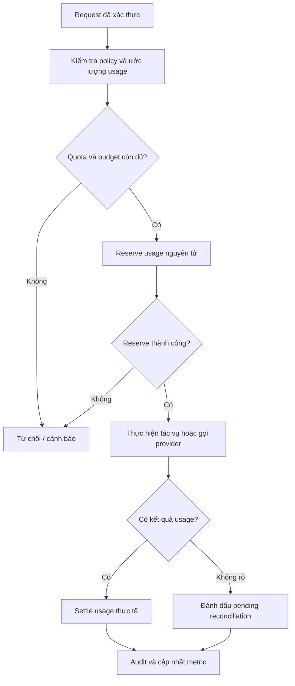
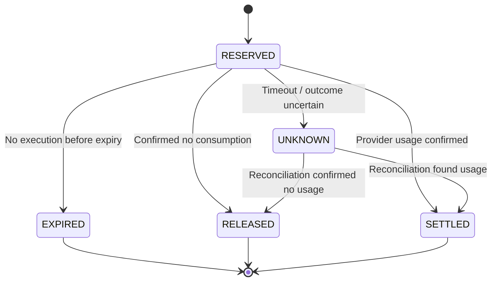

# Chi phí email, SMS, storage và third-party API

Trong chương **Resource consumption** của module `SECURITY_API_SECURITY`, kiểm soát chi phí email, SMS, storage và third-party API là một phần của bảo mật API. Một request hợp lệ về cú pháp và có token hợp lệ vẫn có thể gây thiệt hại nếu nó kích hoạt hàng nghìn email, gửi OTP liên tục, tải lên tệp lớn, tạo nhiều bản sao hoặc gọi dịch vụ tính phí theo từng lần sử dụng. Kẻ tấn công có thể khai thác các luồng này để làm tăng hóa đơn, cạn quota của tổ chức hoặc khiến dịch vụ quan trọng không còn ngân sách phục vụ người dùng thật.

Mục tiêu thiết kế là giới hạn mức tiêu thụ theo **actor, tenant, endpoint, loại tài nguyên và nhà cung cấp**, đồng thời giữ được khả năng quan sát và điều tra. Không thể dựa riêng vào rate limit theo IP: một tenant có thể có nhiều người dùng, nhiều người dùng có thể chia sẻ một IP, và một request duy nhất có thể tạo ra nhiều tác vụ tính phí. Cần kết hợp quota, budget, giới hạn kích thước, chống xử lý trùng, kiểm soát fan-out, chính sách retry và giới hạn ở phía nhà cung cấp.

## 1. Hiểu chi phí và đường khuếch đại

Trước khi thêm giới hạn, hãy lập bản đồ một request có thể tiêu thụ những tài nguyên nào. Một API tạo chiến dịch thông báo có thể chỉ nhận một request nhưng tạo ra hàng chục nghìn lần gửi. Một API tạo thumbnail có thể lưu một file nhưng sinh thêm nhiều phiên bản. Một endpoint tổng hợp có thể gọi ba dịch vụ đối tác cho mỗi bản ghi.

### 1.1. Các thành phần chi phí

| Tài nguyên | Đơn vị thường tính phí | Đường tiêu thụ điển hình | Rủi ro |
|---|---|---|---|
| Email | Số message, số recipient, dung lượng hoặc gói gửi | Gửi lời mời, reset mật khẩu, hóa đơn, thông báo hàng loạt | Spam, cạn quota gửi, tăng chi phí và ảnh hưởng uy tín domain |
| SMS | Số segment, quốc gia/nhà mạng, loại tin nhắn | OTP, xác nhận giao dịch, cảnh báo | SMS pumping, resend abuse, chi phí khác nhau theo quốc gia |
| Object storage | GB-tháng, số request, dung lượng retrieval, replication/version | Upload, backup, log, attachment, thumbnail | Upload lặp, file lớn, version tích tụ, lưu giữ vô hạn |
| Storage egress | Byte truyền ra, số lần tải hoặc CDN request | Download, export, media delivery | Hotlink, tải lặp, export lớn, phân phối file ngoài ý muốn |
| Third-party API | Request, token, record, thời gian chạy hoặc gói dịch vụ | Geocoding, AI, payment, fraud check, shipping, search | Fan-out, retry storm, query đắt, gọi đối tác theo dữ liệu không giới hạn |
| Queue/worker | Thời gian CPU, memory, concurrency, message hoặc compute | Gửi thông báo, xử lý file, đồng bộ đối tác | Queue backlog, retry vô hạn, worker chạy lặp |

Đơn vị tính phí có thể thay đổi theo hợp đồng và nhà cung cấp. Không hardcode một giá chung vào policy nếu giá khác nhau theo vùng, loại dịch vụ hoặc thời điểm. Hệ thống cần lưu usage metric và đối chiếu hóa đơn/usage report của provider.

### 1.2. Nhận diện cost amplification

Cost amplification xảy ra khi một hành động nhỏ ở API tạo ra mức tiêu thụ lớn hơn nhiều ở backend hoặc hệ thống ngoài. Ví dụ:

- Một request gửi email đến danh sách 5.000 địa chỉ.
- Một lần nhấn “gửi lại mã” tạo nhiều SMS vì client retry khi timeout.
- Một file upload được xử lý thành nhiều thumbnail và bản preview có kích thước lớn.
- Một endpoint tìm kiếm gọi API đối tác cho từng kết quả thay vì gọi theo batch.
- Một webhook lỗi được retry không giới hạn và tạo nhiều tác vụ downstream.
- Một export không giới hạn số bản ghi khiến worker đọc dữ liệu, tạo file và truyền nhiều GB.

Đối với mỗi luồng, tính hệ số khuếch đại:

\[
\text{Amplification} = \frac{\text{Số đơn vị tiêu thụ tối đa ở downstream}}{\text{Số request đầu vào}}
\]

Ví dụ một request chiến dịch tạo 2.000 email có amplification 2.000 message/request. Con số này không nhất thiết là lỗi nếu chức năng được thiết kế cho gửi hàng loạt, nhưng nó cần quota và phê duyệt phù hợp với quy mô đó.

### 1.3. Lập mô hình chi phí cho mỗi use case

Với mỗi endpoint có thể kích hoạt dịch vụ tính phí, ghi lại:

- Số đơn vị tối đa một request có thể tạo.
- Chi phí ước tính cho một đơn vị và nguồn giá.
- Số lần gọi downstream và số retry tối đa.
- Số tenant/user có thể gọi đồng thời.
- Thời gian hoàn thành và tài nguyên giữ chỗ.
- Cách hủy, hoàn quota hoặc xử lý kết quả không xác định.
- Mức tiêu thụ tối đa theo giờ/ngày/tháng và người chịu trách nhiệm ngân sách.

Không chỉ đo chi phí trung bình. Thiết kế cần chịu được trường hợp xấu hợp lý: payload lớn nhất, nhiều request đồng thời, provider chậm, retry và người dùng cố tình gọi lặp.

## 2. Xây dựng quota và budget nhiều chiều

Rate limit và quota giải quyết các vấn đề khác nhau. Rate limit giới hạn tốc độ request trong một khoảng thời gian; quota giới hạn tổng lượng sử dụng; budget giới hạn chi phí ước tính hoặc số tiền được phép tiêu thụ. Một request có thể nằm dưới rate limit nhưng vẫn vượt quota nếu nó tạo nhiều message hoặc file lớn.

### 2.1. Chọn đúng phạm vi áp dụng

Một chính sách thường cần kết hợp nhiều chiều:

| Chiều giới hạn | Ví dụ | Mục đích |
|---|---|---|
| IP / network | 20 request/phút/IP | Giảm bot đơn giản và traffic bất thường |
| Principal / user | 5 lần gửi OTP/giờ/user | Hạn chế một tài khoản lạm dụng |
| Tenant | 10.000 email/ngày/tenant | Bảo vệ ngân sách và quota của tổ chức |
| Endpoint/action | 3 lần resend/10 phút | Giới hạn hành động nhạy cảm |
| Recipient / destination | 3 OTP/giờ/số điện thoại | Ngăn dồn chi phí vào một đích nhận |
| API key / client | 100 request/phút/client | Giới hạn integration hoặc workload |
| Provider | 500 request/phút tới provider | Bảo vệ quota và quan hệ với đối tác |
| Global budget | Mức trần chi phí dịch vụ/ngày | Giới hạn thiệt hại toàn hệ thống |

Không dùng một chiều thay cho tất cả. IP limit quá thấp có thể chặn người dùng hợp lệ sau NAT; tenant limit đơn thuần có thể để một user tiêu hết ngân sách tenant. Kết hợp limit theo user, tenant và đích nhận giúp giới hạn tác động ở nhiều cấp.

### 2.2. Phân biệt rate limit, quota và budget

| Cơ chế | Đo lường | Ví dụ | Khi vượt |
|---|---|---|---|
| Rate limit | Số request hoặc action trong cửa sổ thời gian | 10 lần gửi OTP/giờ | Từ chối tạm thời, có thể trả `429` và `Retry-After` |
| Quota | Tổng đơn vị sử dụng trong chu kỳ | 500 MB upload/ngày | Từ chối hoặc yêu cầu nâng quota theo quy trình |
| Budget | Chi phí ước tính trong chu kỳ | 50 USD/ngày cho SMS | Dừng, giảm cấp dịch vụ hoặc yêu cầu phê duyệt |
| Concurrency limit | Số tác vụ đang chạy | Tối đa 3 export đồng thời/tenant | Xếp hàng hoặc từ chối có kiểm soát |
| Size/complexity limit | Kích thước hoặc độ phức tạp | 20 MB/file, 100 recipient/request | `413` hoặc lỗi validation |

Các giới hạn cần được áp dụng trước điểm tiêu thụ chi phí càng sớm càng tốt. Ví dụ kiểm tra số recipient trước khi enqueue gửi email; kiểm tra dung lượng file trước khi xử lý; reserve budget trước khi gọi provider.

### 2.3. Dùng hard limit và soft limit

**Hard limit** chặn hành động khi đạt ngưỡng. Dùng cho giới hạn bảo mật, quota nhà cung cấp, số OTP, kích thước file hoặc mức ngân sách tối đa đã cam kết.

**Soft limit** phát cảnh báo hoặc yêu cầu xác nhận khi tiến gần ngưỡng. Dùng cho cảnh báo ngân sách, xu hướng tăng bất thường hoặc mức tiêu thụ gần quota.

Ví dụ, gửi cảnh báo ở 70% và 90% budget, rồi dừng ở 100%. Các tỷ lệ này chỉ là ví dụ; ngưỡng thực tế phải dựa trên tốc độ tiêu thụ, độ trễ của báo cáo usage và mức thiệt hại có thể chấp nhận.

Không chỉ cảnh báo khi hóa đơn đã tăng. Theo dõi tốc độ tiêu thụ và dự báo thời điểm chạm ngưỡng giúp phản ứng trước khi vượt budget.

### 2.4. Reserve và settle usage

Với hành động có chi phí downstream, có thể giữ trước một lượng quota hoặc budget trước khi thực hiện. Khi hoàn tất, hệ thống settle theo usage thực tế; khi thất bại chắc chắn trước khi tiêu thụ, giải phóng reservation.

Luồng tổng quát:



Reservation phải có ID duy nhất, thời hạn và trạng thái để tránh giữ quota vĩnh viễn nếu worker chết. Nếu provider timeout nhưng có thể đã xử lý request, không tự động hoàn reservation như thể chắc chắn chưa phát sinh chi phí. Đưa giao dịch sang trạng thái `UNKNOWN` hoặc `PENDING_RECONCILIATION`, sau đó đối soát bằng idempotency key, provider status API hoặc usage report.

### 2.5. Cập nhật quota nguyên tử

Hai request đồng thời có thể cùng đọc “còn một lượt” rồi cả hai đều thực hiện. Việc kiểm tra và reserve phải là một thao tác nguyên tử ở nơi lưu quota, ví dụ transaction database với row lock, conditional update hoặc atomic operation trong Redis/Lua.

Ví dụ SQL minh họa:

```sql
UPDATE tenant_usage
SET reserved_units = reserved_units + :units
WHERE tenant_id = :tenant_id
  AND period_start = :period_start
  AND consumed_units + reserved_units + :units <= quota_units;
```

Ứng dụng chỉ tiếp tục khi số dòng cập nhật bằng 1. Câu lệnh phải chạy trong transaction phù hợp; cần xử lý tạo bucket theo chu kỳ, reset quota và retry transaction. Với budget tiền tệ, lưu đơn vị nhỏ nhất (ví dụ cents) hoặc decimal chính xác; không dùng floating-point để cộng trừ tiền.

## 3. Kiểm soát email

Email có thể bị lạm dụng để spam người nhận, làm cạn gói gửi hoặc phá uy tín domain. Các endpoint gửi lời mời, reset mật khẩu, xác minh email, hóa đơn và chiến dịch cần chính sách khác nhau vì mức độ nhạy cảm và quy mô khác nhau.

### 3.1. Giới hạn recipient và fan-out

- Đặt số recipient tối đa cho mỗi request và cho mỗi tenant trong từng chu kỳ.
- Giới hạn số email gửi đến cùng một địa chỉ trong khoảng thời gian ngắn.
- Giới hạn số chiến dịch đang chạy và số message đang chờ trong queue.
- Với bulk email, yêu cầu quyền chức năng riêng, xác nhận số lượng và quy trình phê duyệt phù hợp.
- Không cho endpoint thông báo tùy ý biến thành relay gửi email đến địa chỉ bất kỳ nếu nghiệp vụ không cần.
- Giới hạn attachment, tổng kích thước message và số file đính kèm.

Một request bulk nên được kiểm tra số recipient sau khi chuẩn hóa và loại trùng. Không tin `recipientCount` do client gửi; server tự đếm danh sách đã validate. Nếu danh sách lớn, tạo campaign/job có quota riêng thay vì giữ HTTP request mở và gửi đồng bộ.

### 3.2. Kiểm soát danh tính và địa chỉ nhận

Với email giao dịch như reset mật khẩu hoặc xác minh địa chỉ, recipient phải được lấy từ tài khoản hoặc quy trình xác minh đã được server xác nhận. Không để caller truyền email tùy ý vào endpoint reset password để biến dịch vụ thành công cụ gửi spam.

Với chiến dịch marketing hoặc thông báo hàng loạt, cần kiểm tra quyền quản lý audience, trạng thái consent, suppression list, unsubscribe và chính sách gửi theo tenant. Không bỏ qua unsubscribe hoặc trạng thái bounce/complaint chỉ vì tenant có budget.

### 3.3. Chống gửi trùng và resend abuse

Một thao tác gửi email có thể bị lặp do người dùng nhấn nhiều lần, client retry hoặc webhook gửi lại. Dùng idempotency key gắn với principal, tenant và hành động; lưu trạng thái gửi và provider message ID để nhận diện lần xử lý trước.

Idempotency không nên chỉ dựa vào request body giống nhau trong một thời gian ngắn. Cần xác định phạm vi key, thời hạn lưu và cách xử lý khi cùng key được dùng với payload khác. Nếu payload khác, trả lỗi xung đột thay vì thực hiện thêm lần gửi.

### 3.4. Bảo vệ queue và domain reputation

Theo dõi queue depth, tỷ lệ bounce, complaint, reject, suppression và tốc độ gửi theo tenant/domain. Nếu bounce hoặc complaint vượt ngưỡng, tạm dừng campaign hoặc domain theo chính sách để tránh làm hỏng uy tín gửi. Có giới hạn tốc độ ở worker và provider adapter, không chỉ ở API gateway.

Không retry vô hạn email bị từ chối vĩnh viễn (ví dụ địa chỉ không hợp lệ). Phân loại lỗi transient và permanent; lỗi permanent chuyển sang dead-letter hoặc trạng thái failed cần xử lý, lỗi transient retry có giới hạn.

## 4. Kiểm soát SMS và OTP

SMS thường có giá theo quốc gia, nhà mạng và số segment. Nội dung dài hoặc ký tự Unicode có thể làm một tin nhắn thành nhiều segment và tăng chi phí. Luồng OTP là mục tiêu phổ biến của SMS pumping: kẻ tấn công kích hoạt gửi mã liên tục đến số điện thoại hoặc dải số có chi phí cao.

### 4.1. Giới hạn theo nhiều chiều

Với endpoint gửi OTP, cân nhắc đồng thời:

- Số lần gửi theo user/account trong cửa sổ ngắn và theo ngày.
- Số lần gửi theo số điện thoại đã chuẩn hóa E.164.
- Số lần gửi theo IP, device/session và tenant.
- Số lần gửi theo quốc gia, prefix hoặc nhóm rủi ro.
- Thời gian chờ giữa hai lần gửi và giới hạn resend cho một challenge.
- Tổng SMS segment và budget theo tenant/provider.

Không dùng IP làm khóa duy nhất vì attacker có thể phân tán request qua nhiều IP, còn người dùng hợp lệ có thể chia sẻ IP. Không dùng số điện thoại thô làm key log; có thể dùng HMAC với secret quản lý an toàn để tạo định danh ổn định cho rate-limit bucket mà không ghi số thật.

### 4.2. Kiểm tra quốc gia và phạm vi gửi

Chỉ bật các quốc gia/loại route cần cho sản phẩm. Nếu nghiệp vụ không hỗ trợ một quốc gia, từ chối trước khi gọi provider. Có thể yêu cầu xác minh bổ sung hoặc CAPTCHA/risk check khi traffic đến từ vùng có mức lạm dụng cao; chính sách cần tránh chặn nhầm người dùng hợp lệ.

Không cho client chọn tùy ý provider, sender ID hoặc route giá cao. Server chọn route theo policy và cấu hình được quản lý. Giới hạn chiều dài message và tính số segment dự kiến trước khi reserve budget.

### 4.3. Gắn OTP với mục đích và chống replay

OTP cần được gắn với challenge, tài khoản, số điện thoại đã xác minh hoặc đích nhận đã được policy cho phép, tenant và mục đích cụ thể như login hoặc xác nhận giao dịch. Một mã không nên dùng được cho nhiều mục đích. Đặt thời hạn ngắn, giới hạn số lần nhập sai và chỉ cho phép challenge hợp lệ được sử dụng một lần. Endpoint gửi OTP không nên cho caller tự do chọn một số điện thoại bất kỳ nếu mục đích nghiệp vụ yêu cầu gửi đến số đã gắn với tài khoản.

Khi gửi lại mã, quyết định rõ challenge cũ bị vô hiệu hóa hay vẫn hợp lệ trong thời gian chồng lấn. Không tạo challenge mới cho mọi lần retry của cùng request. Dùng idempotency và trạng thái challenge để bảo đảm resend có quy tắc.

Response không tiết lộ tài khoản hoặc số điện thoại có tồn tại hay không. Ví dụ, endpoint có thể trả thông báo trung tính giống nhau cho địa chỉ đã đăng ký và chưa đăng ký, trong khi server áp dụng policy gửi phù hợp.

### 4.4. Theo dõi chi phí SMS

Lưu số segment thực tế, quốc gia, provider route, đơn giá áp dụng tại thời điểm gửi và provider message ID nếu được phép. Đối chiếu usage report của provider để phát hiện chênh lệch giữa ước lượng và tính phí thật. Nếu provider báo segment cao hơn dự kiến, cập nhật cost model và giới hạn message.

## 5. Kiểm soát storage và chi phí truyền dữ liệu

Storage có chi phí lưu trữ, request, versioning, replication, xử lý và egress. Một upload có thể tạo ra nhiều chi phí sau khi API trả `200`: virus scan, OCR, thumbnail, indexing, replication và download. Cần kiểm soát toàn bộ vòng đời file.

### 5.1. Giới hạn upload trước khi xử lý

- Giới hạn kích thước request và từng file ở gateway, application và storage policy.
- Giới hạn số file, tổng dung lượng một request và số upload đồng thời theo tenant.
- Chỉ cho phép loại nội dung cần thiết; kiểm tra magic bytes thay vì tin `Content-Type` hoặc phần mở rộng.
- Giới hạn kích thước giải nén, số entry và độ sâu archive để chống zip bomb.
- Dùng streaming và giới hạn bộ nhớ; không đọc toàn bộ file lớn vào RAM.
- Giới hạn thời gian upload và thời gian xử lý.
- Không cấp object key tùy ý từ client; server tạo key trong namespace tenant.

Với upload trực tiếp lên object storage bằng signed URL, server cần reserve quota trước khi cấp URL, giới hạn object key, method, kích thước và thời hạn. Sau upload, xác minh object thực tế có tồn tại, kích thước và checksum phù hợp rồi settle usage. Nếu URL hết hạn mà không có object, giải phóng reservation sau thời gian chờ an toàn.

### 5.2. Giới hạn xử lý downstream

Một file nén 10 MB có thể giải nén thành nhiều GB; một ảnh có thể có kích thước pixel rất lớn dù file nhỏ. Đặt giới hạn cho:

- Kích thước sau giải nén và số lượng entry trong archive.
- Pixel/dimension ảnh và thời gian decode.
- Số trang PDF, số trang OCR và số lần chuyển đổi định dạng.
- Số thumbnail/preview và tổng kích thước output.
- Thời gian quét malware, OCR, indexing và các worker xử lý.
- Số lần xử lý lại khi lỗi và kích thước dead-letter queue.

Quét malware và xác thực nội dung trước khi file được chia sẻ hoặc đưa vào pipeline có quyền truy cập rộng. File không hợp lệ cần bị cách ly hoặc xóa theo policy; không lặp xử lý tốn phí vô hạn.

### 5.3. Quản lý retention, version và lifecycle

Thiết lập retention theo loại dữ liệu và nghĩa vụ nghiệp vụ. Xóa file tạm, bản preview, multipart upload chưa hoàn tất và object hết hạn. Kiểm tra versioning, soft delete và replication vì chúng có thể khiến dung lượng thực tế cao hơn dung lượng người dùng nhìn thấy.

Không xóa dữ liệu bắt buộc lưu giữ chỉ để giảm hóa đơn. Retention policy phải phù hợp yêu cầu pháp lý, hợp đồng và nhu cầu khôi phục; có audit cho thao tác xóa và quyền phù hợp.

### 5.4. Kiểm soát download và egress

- Giới hạn số download và băng thông theo user/tenant khi phù hợp.
- Cấp signed URL ngắn hạn, chỉ cho đúng object và method.
- Không để object storage public mặc định.
- Hạn chế hotlink hoặc chia sẻ URL ra ngoài nếu nghiệp vụ yêu cầu.
- Giới hạn kích thước export và số lần tải lại.
- Cache nội dung công khai ở CDN; không cache nhầm dữ liệu tenant riêng.
- Theo dõi byte egress theo tenant và loại nội dung.

Download có thể tiêu tốn chi phí lớn dù số request thấp. Bổ sung quota theo byte hoặc theo tổng dung lượng tải, không chỉ đếm request.

## 6. Kiểm soát third-party API

Third-party API có thể tính phí theo request, token, record, thời gian xử lý hoặc gói sử dụng. Chi phí tăng mạnh khi một request nội bộ gọi provider nhiều lần, retry liên tục hoặc cho phép người dùng điều khiển độ phức tạp đầu vào.

### 6.1. Kiểm soát fan-out và batch

Đếm số lần gọi provider trên mỗi request nghiệp vụ. Nếu một API trả 100 kết quả và gọi provider riêng cho từng kết quả, một request có thể tạo 100 call. Hãy dùng batch API, bulkhead hoặc giới hạn số phần tử được xử lý; nếu không thể batch, đặt giới hạn fan-out rõ ràng.

Không cho client tự chọn endpoint provider, URL, model, tier hoặc tham số tính phí cao nếu không có allowlist và policy. Server phải xác định provider operation từ use case, validate tham số và tính cost estimate trước khi gọi.

### 6.2. Timeout, retry và backoff

Retry có thể tăng chi phí và gây retry storm khi provider đang lỗi. Chỉ retry lỗi có khả năng tạm thời, với số lần tối đa, exponential backoff và jitter. Tôn trọng `Retry-After` nếu provider công bố. Không retry lỗi xác thực, validation hoặc lỗi nghiệp vụ vĩnh viễn.

Đặt timeout kết nối và timeout tổng cho request. Timeout không có nghĩa provider chắc chắn chưa xử lý; nếu request có side effect hoặc tính phí, cần idempotency key và truy vấn trạng thái trước khi gửi lại.

### 6.3. Idempotency và deduplication

Với thao tác có thể tính phí như tạo shipment, thanh toán, gửi message hoặc gọi API AI, truyền idempotency key nếu provider hỗ trợ. Lưu mapping giữa key nội bộ, provider request ID và kết quả. Ràng buộc key theo tenant, principal, operation và payload hash.

Nếu provider không hỗ trợ idempotency, tạo lớp deduplication phía server và xác định cách xử lý trạng thái không chắc chắn. Không tự động retry một thao tác có khả năng đã thành công chỉ vì client không nhận được response.

### 6.4. Circuit breaker và bulkhead

Circuit breaker ngăn tiếp tục gọi provider khi tỷ lệ lỗi hoặc độ trễ vượt ngưỡng; bulkhead giới hạn số request đồng thời để một provider chậm không chiếm hết thread/connection của service. Khi circuit mở, trả lỗi có kiểm soát, dùng dữ liệu cache nếu phù hợp hoặc xếp hàng theo policy.

Không dùng fallback làm phát sinh một chuỗi provider khác không giới hạn. Fallback cần cost budget riêng và phải giữ nguyên kiểm tra authorization.

### 6.5. Cache và tái sử dụng kết quả

Cache có thể giảm chi phí cho dữ liệu tham chiếu hoặc kết quả có thể tái sử dụng. Cache key phải chứa các tham số ảnh hưởng đến kết quả và tenant/security scope nếu dữ liệu được phân vùng. Không chia sẻ kết quả chứa dữ liệu riêng của tenant A cho B.

Đặt TTL phù hợp với độ mới dữ liệu, có cơ chế invalidation và tránh cache stampede khi nhiều request cùng hết hạn. Có thể dùng single-flight hoặc lock ngắn để hợp nhất các request đồng thời cho cùng một key. Không cache kết quả nhạy cảm nếu policy không cho phép.

## 7. Thiết kế quota service và cost ledger

Với hệ thống có nhiều loại tài nguyên, nên có một cơ chế chung để kiểm tra quota và ghi nhận usage. Không nhất thiết mọi nghiệp vụ phải dùng một bảng hoặc một service duy nhất, nhưng semantics reserve, settle, release và audit cần nhất quán.

### 7.1. Mô hình dữ liệu gợi ý

Một mô hình đơn giản có thể gồm:

| Bản ghi | Trường chính | Mục đích |
|---|---|---|
| Quota policy | `tenant_id`, `resource_type`, `period`, `limit_units`, `hard_limit` | Mức sử dụng được phép |
| Usage reservation | `reservation_id`, `tenant_id`, `actor_id`, `resource_type`, `reserved_units`, `status`, `expires_at` | Giữ quota trước khi thực hiện |
| Usage ledger | `event_id`, `reservation_id`, `provider`, `actual_units`, `unit_cost`, `currency`, `occurred_at` | Ghi nhận usage thực tế và đối soát |
| Idempotency record | `tenant_id`, `operation`, `key_hash`, `payload_hash`, `result_ref`, `expires_at` | Chống xử lý trùng |
| Budget alert | `tenant_id`, `resource_type`, `threshold`, `sent_at` | Theo dõi và chống gửi cảnh báo lặp |

Không lưu API key hoặc secret provider trong ledger. `unit_cost` nên lưu giá áp dụng và nguồn giá tại thời điểm ghi nhận; nếu provider tính tiền bằng đơn vị tiền tệ nhỏ, dùng kiểu số chính xác và lưu currency.

### 7.2. Trạng thái reservation

Một state machine gợi ý:



Không cho phép settle hoặc release cùng một reservation nhiều lần. Chuyển trạng thái phải idempotent và ghi audit. Với `UNKNOWN`, không cấp lại toàn bộ budget cho đến khi đối soát hoặc hết thời hạn xử lý theo policy; nếu không, attacker có thể khai thác timeout để tiêu thụ lặp mà ledger không ghi nhận.

### 7.3. Tách usage theo tenant và actor

Tenant ledger phục vụ quota và chargeback của tổ chức; actor ledger giúp phát hiện một user hoặc API key đang tiêu thụ bất thường. Có thể ghi thêm dimension endpoint, provider, country, model hoặc operation. Chỉ thu thập dimension cần thiết và tránh đưa dữ liệu cá nhân nhạy cảm vào metric label có cardinality cao.

Nếu tenant được phép vượt quota theo hợp đồng, ghi rõ mức overage, người phê duyệt và cảnh báo. Không để giới hạn được nâng tự động bởi request từ chính tenant đó.

## 8. Xử lý khi gần hoặc vượt ngưỡng

Khi usage gần budget, hệ thống cần hành vi rõ ràng để người dùng và vận hành hiểu điều gì sẽ xảy ra.

Các lựa chọn:

- Từ chối request mới có thể tạo chi phí, giữ các tác vụ thiết yếu theo thứ tự ưu tiên.
- Hạ tốc độ xử lý hoặc xếp hàng với giới hạn độ dài và thời gian chờ.
- Giảm chất lượng hoặc kích thước output nếu nghiệp vụ cho phép và contract mô tả rõ.
- Dùng cache hoặc kết quả cũ trong giới hạn freshness đã công bố.
- Yêu cầu admin tenant nâng quota hoặc phê duyệt ngân sách bổ sung.
- Tạm khóa loại hành động có rủi ro cao trong khi vẫn giữ các luồng bảo mật thiết yếu như reset/khôi phục tài khoản theo policy riêng.

Không để một budget tổng duy nhất làm dừng mọi hoạt động của tenant. Có thể tách budget theo resource type và mức ưu tiên; ví dụ campaign marketing có thể dừng trong khi email bảo mật vẫn có quota dự phòng. Quota dự phòng cũng cần giới hạn để tránh trở thành đường vòng cho lạm dụng.

### 8.1. Mã lỗi và thông tin trả về

Contract nên phân biệt các tình huống:

| Mã | Ý nghĩa có thể dùng | Thông tin bổ sung |
|---|---|---|
| `413` | Payload hoặc file quá lớn | Giới hạn kích thước nếu an toàn để công bố |
| `429` | Rate limit hoặc quota theo tốc độ | `Retry-After` khi có thể thử lại |
| `409` | Xung đột idempotency hoặc trạng thái tác vụ | Mã lỗi ổn định để client xử lý |
| `422` | Tham số hoặc số lượng vượt quy tắc nghiệp vụ | Không gọi provider trước khi validation hoàn tất |
| `503` | Provider hoặc resource subsystem tạm thời không sẵn sàng | Có thể retry theo hướng dẫn, tránh retry storm |

Budget hết không nhất thiết giống rate limit. Có thể dùng `429` cho quota theo chu kỳ hoặc một mã lỗi nghiệp vụ riêng trong error body; điều quan trọng là contract ổn định và không tiết lộ thông tin nội bộ. Không trả số dư ngân sách hoặc thông tin billing tenant cho principal không có quyền xem.

## 9. Ví dụ Java/Spring: reserve trước khi gửi SMS

Ví dụ dưới đây minh họa các ranh giới chính. Các interface và repository là kiểu giả định để giải thích thiết kế; cần điều chỉnh transaction, persistence và provider client theo ứng dụng.

```java
public record SmsRequest(
        UUID challengeId,
        String idempotencyKey
) {}

public record OtpDispatch(
        String verifiedPhoneE164,
        String purpose,
        String otpCode
) {}

public record UsageReservation(
        UUID id,
        UUID tenantId,
        UUID actorId,
        long reservedSegments
) {}
```

Service kiểm tra quyền và giới hạn trước khi gọi provider:

```java
@Service
public class SmsService {
    private final SmsPolicy policy;
    private final OtpChallengeService challenges;
    private final UsageQuotaService quota;
    private final SmsProvider provider;
    private final SmsRequestRepository requests;

    public SmsService(
            SmsPolicy policy,
            OtpChallengeService challenges,
            UsageQuotaService quota,
            SmsProvider provider,
            SmsRequestRepository requests) {
        this.policy = policy;
        this.challenges = challenges;
        this.quota = quota;
        this.provider = provider;
        this.requests = requests;
    }

    public SmsResult sendOtp(SmsRequest request, CurrentPrincipal principal) {
        OtpDispatch dispatch = challenges.prepareDispatch(request.challengeId(), principal);
        String normalizedPhone = PhoneNumbers.toE164(dispatch.verifiedPhoneE164());
        policy.requireOtpAllowed(principal, dispatch.purpose());
        policy.requireDestinationAllowed(principal, normalizedPhone);

        String payloadHash = SmsHashes.hash(request.challengeId(), dispatch.purpose());
        return requests.executeIdempotently(
                principal.tenantId(),
                principal.id(),
                request.idempotencyKey(),
                payloadHash,
                () -> sendReserved(normalizedPhone, dispatch, principal)
        );
    }

    private SmsResult sendReserved(
            String phone,
            OtpDispatch dispatch,
            CurrentPrincipal principal) {
        String message = SmsTemplates.otp(dispatch.otpCode());
        long estimatedSegments = SmsCostEstimator.estimateSegments(message);

        UsageReservation reservation = quota.reserve(
                principal.tenantId(),
                principal.id(),
                "SMS_SEGMENT",
                estimatedSegments);

        try {
            SmsProviderResult result = provider.send(phone, message);
            quota.settle(reservation.id(), result.actualSegments(), result.providerMessageId());
            return SmsResult.accepted(result.providerMessageId());
        } catch (ProviderOutcomeUnknownException ex) {
            quota.markUnknown(reservation.id(), ex.correlationId());
            throw new SmsPendingException("SMS outcome is being reconciled");
        } catch (ProviderRejectedException ex) {
            // Chỉ release khi provider xác nhận request bị từ chối và không tính phí.
            quota.release(reservation.id(), ex.code());
            throw ex;
        }
    }
}
```

Điểm cần lưu ý:

- `CurrentPrincipal` chứa tenant và actor đã xác minh; request body không được tự quyết định tenant.
- `OtpChallengeService` xác minh challenge thuộc principal/tenant, còn hiệu lực và lấy số nhận đã được xác minh từ dữ liệu server.
- `requireOtpAllowed` kiểm tra quyền chức năng và policy của luồng OTP.
- Chuẩn hóa số điện thoại server-side trước khi tính rate limit và kiểm tra quốc gia.
- Idempotency record được ràng buộc với tenant, actor, operation và payload hash.
- Quota được reserve trước khi provider được gọi.
- Provider timeout không rõ kết quả được đánh dấu `UNKNOWN`, không giải phóng quota ngay.
- Chỉ release reservation khi provider xác nhận request bị từ chối theo cách không phát sinh phí; lỗi không rõ kết quả phải đi qua reconciliation.
- `actualSegments` lấy từ kết quả provider hoặc reconciliation, không lấy từ giá trị client khai báo.

Trong code thực tế, không giữ transaction database mở trong lúc chờ mạng provider. Tách bước tạo reservation/idempotency record, gọi provider và settle thành các giao dịch ngắn; dùng trạng thái trung gian và worker reconciliation. Provider call phải có timeout, giới hạn concurrency và idempotency nếu provider hỗ trợ.

## 10. Kiểm thử bảo mật và kiểm soát chi phí

Test cần xác minh cả request hợp lệ, request bị lạm dụng, trường hợp đồng thời và trạng thái không chắc chắn. Mock provider giúp đếm call và mô phỏng timeout, nhưng vẫn cần một số integration test với quota store thật để kiểm tra tính nguyên tử.

### 10.1. Ma trận test theo tài nguyên

| Tình huống | Kiểm tra | Kết quả mong đợi |
|---|---|---|
| User vượt rate limit | Gửi nhiều request trong cửa sổ | Request vượt ngưỡng bị chặn, không gọi provider |
| Tenant hết quota | Quota còn 0 hoặc không đủ | Không reserve, không phát sinh usage mới |
| Nhiều request đồng thời | Nhiều request cùng reserve đơn vị cuối | Chỉ số lượng trong quota được reserve thành công |
| Idempotency lặp | Cùng key, cùng payload | Trả lại kết quả đã lưu, không gửi lần hai |
| Idempotency xung đột | Cùng key, payload khác | Từ chối xung đột, không gọi provider |
| Provider timeout không rõ | Provider có thể đã nhận request | Reservation chuyển `UNKNOWN`, reconciliation xử lý |
| Provider từ chối chắc chắn | Validation/reject trước khi tính phí | Release reservation theo semantics đã xác minh |
| Retry storm | Provider lỗi liên tục | Retry hữu hạn, backoff, circuit breaker mở |
| Cross-tenant quota | User A gửi request với tenant B | Không tiêu quota hoặc budget của B |
| Bulk fan-out | Danh sách lớn hơn giới hạn | Từ chối trước khi enqueue hoặc gọi provider |
| Storage upload quá lớn | Content-Length hoặc stream vượt giới hạn | Dừng upload/xử lý, không tạo nhiều output |
| Archive bomb | File nén nhỏ, giải nén rất lớn | Chặn theo expanded size/entry/depth |
| Download lặp | Cùng file được tải nhiều lần | Áp dụng egress quota và audit |
| Budget threshold | Usage chạm ngưỡng cảnh báo/hard stop | Cảnh báo một lần theo policy; hard stop có hiệu lực |

### 10.2. Kiểm tra side effect và provider call

Với mọi request bị từ chối do quota, xác minh:

- Không có provider call.
- Không có message/job được enqueue ngoài ý muốn.
- Không có reservation mồ côi hoặc usage ledger sai.
- Không có email/SMS/file được tạo.
- Không trừ quota của tenant khác.
- Không để client biết thông tin billing hoặc usage riêng của tenant khác.

Đối với lỗi sau khi provider đã nhận request, test trạng thái `UNKNOWN` và reconciliation. Xác minh worker không gửi lại một giao dịch đã thành công chỉ vì lần gọi đầu timeout.

### 10.3. Kiểm thử đồng thời

Tạo nhiều thread gửi request đồng thời khi quota chỉ còn vài đơn vị. Kết quả phải bảo đảm:

\[
\text{Consumed} + \text{Reserved} \leq \text{Quota}
\]

Kiểm tra cả khi worker crash sau reserve, sau provider call và trước settle. Chạy lại job phải idempotent và không tạo usage trùng. Test nên dùng database/Redis thực tế của môi trường kiểm thử thay vì mock atomic operation.

### 10.4. Kiểm thử storage và third-party

- Upload content vượt `Content-Length` hoặc chunked stream vượt giới hạn.
- Upload MIME giả, file hỏng, archive lồng sâu và file giải nén vượt quota.
- Gửi signed URL hết hạn, sai method, sai object hoặc dùng URL của tenant khác.
- Gọi endpoint tạo fan-out vượt mức tối đa.
- Provider trả `429`, `5xx`, timeout, response sai schema hoặc usage lớn hơn estimate.
- Retry theo `Retry-After`, backoff và jitter; circuit breaker không để request tiếp tục dồn vào provider.
- Cache key không dùng chung kết quả riêng tenant; invalidation và TTL đúng.

## 11. Giám sát usage và phát hiện bất thường

Rate limit chặn một phần hành vi tức thời; monitoring phát hiện thay đổi xu hướng và sai lệch giữa usage nội bộ với hóa đơn provider.

Theo dõi tối thiểu:

- Số email/SMS và segment theo tenant, actor, endpoint, quốc gia và provider.
- Chi phí ước tính, usage thực tế, reservation đang mở và reservation `UNKNOWN`.
- GB lưu trữ, số object, số version, upload/download byte và egress.
- Số provider call, fan-out trung bình/tối đa, latency, timeout, retry và circuit state.
- Queue depth, tuổi message cũ nhất, dead-letter count và worker concurrency.
- Tỷ lệ bounce/complaint SMS/email, OTP resend và destination mới bất thường.
- Tỷ lệ usage so với budget, tốc độ tiêu thụ và chênh lệch provider reconciliation.

Alert nên dựa trên cả ngưỡng tuyệt đối và baseline. Một tenant nhỏ tăng từ 2 lên 200 SMS có thể đáng chú ý dù tổng số vẫn thấp; một tenant lớn có mức tăng 5% có thể là bình thường. Tránh dùng email, số điện thoại hoặc user ID làm metric label không giới hạn cardinality. Có thể dùng aggregate metric và truy vấn log có kiểm soát để điều tra.

### 11.1. Audit trail

Với hành động có chi phí, audit event nên ghi:

- Actor/service, tenant và operation.
- Loại tài nguyên, đơn vị dự kiến và đơn vị thực tế.
- Reservation ID, idempotency key hash và provider request ID.
- Quyết định policy: allowed, denied, throttled hoặc pending.
- Cost estimate, currency, nguồn giá và timestamp.
- Correlation ID để nối request, worker và provider callback.

Không ghi API key, access token, OTP, nội dung email/SMS nhạy cảm hoặc URL signed đầy đủ. Bảo vệ quyền đọc audit và đặt retention phù hợp. Audit trail cần đủ để đối soát mà không trở thành nơi lưu bí mật.

### 11.2. Reconciliation với provider

Định kỳ đối chiếu usage ledger nội bộ với usage report hoặc invoice provider. Điều tra chênh lệch do segment, retry, rounding, currency conversion, timezone, request đã thành công nhưng timeout hoặc provider tính phí theo đơn vị khác.

Nếu provider có callback usage, xác minh chữ ký, chống replay và xử lý idempotent. Không cập nhật tenant budget chỉ dựa trên webhook chưa xác thực. Khi không có usage event chi tiết, đối chiếu tổng theo kỳ và giữ lại nguồn dữ liệu cùng thời điểm chụp.

## 12. Những lỗi thiết kế thường gặp

| Lỗi | Hệ quả | Cách khắc phục |
|---|---|---|
| Chỉ rate limit theo IP | Một user phân tán IP hoặc nhiều user chung IP | Kết hợp actor, tenant, destination và provider limits |
| Đếm request thay vì đơn vị tính phí | Một request tạo hàng nghìn message hoặc GB | Đếm recipient, segment, byte, record, token và fan-out |
| Kiểm tra quota rồi mới reserve riêng | Request đồng thời vượt quota | Reserve nguyên tử |
| Retry mọi lỗi | Retry storm và tính phí trùng | Phân loại lỗi, retry hữu hạn, backoff và idempotency |
| Hoàn quota ngay khi timeout | Provider có thể đã xử lý và tính phí | Trạng thái UNKNOWN và reconciliation |
| Cho client chọn provider/route tùy ý | Chuyển sang tuyến đắt hoặc ngoài policy | Server-side allowlist và routing policy |
| Không giới hạn recipient/đích SMS | Spam và SMS pumping | Giới hạn theo user, tenant, destination, quốc gia |
| Chỉ giới hạn file upload | Chi phí phát sinh ở preview/OCR/egress | Giới hạn cả downstream processing và download |
| Retention vô hạn | Storage và version tăng liên tục | Lifecycle, cleanup và retention có kiểm soát |
| Không tách budget theo loại dịch vụ | Một luồng làm cạn ngân sách của luồng thiết yếu | Budget theo resource type và priority |
| Không đối soát provider | Hóa đơn khác xa usage nội bộ | Reconciliation định kỳ và cảnh báo sai lệch |
| Log toàn bộ request/provider payload | Rò OTP, email, số điện thoại hoặc secret | Redaction, audit tối thiểu và kiểm soát truy cập |

## 13. Checklist review trước khi phát hành

- [ ] Mỗi endpoint có cost model và hệ số fan-out tối đa được xác định.
- [ ] Rate limit, quota, budget, concurrency và size limit được phân biệt rõ.
- [ ] Giới hạn áp dụng theo actor, tenant, endpoint, destination và provider khi phù hợp.
- [ ] Kiểm tra và reserve quota được thực hiện nguyên tử.
- [ ] Reservation có expiry, trạng thái, settle/release idempotent và reconciliation.
- [ ] Email có giới hạn recipient, bulk size, attachment, resend và suppression policy.
- [ ] SMS có giới hạn theo số điện thoại, user, tenant, quốc gia, segment và resend.
- [ ] OTP gắn với challenge, account, purpose và thời hạn; chống replay.
- [ ] Upload giới hạn byte, file count, expanded size, processing time và output.
- [ ] Storage có tenant namespace, signed URL giới hạn, retention và lifecycle.
- [ ] Download/egress được đo theo byte và bảo vệ khỏi chia sẻ ngoài ý muốn.
- [ ] Third-party API có timeout, concurrency limit, retry/backoff, idempotency và circuit breaker.
- [ ] Cache key phản ánh tenant/security scope và dữ liệu có TTL/invalidation phù hợp.
- [ ] Provider secret không xuất hiện trong code, response, metric hoặc log.
- [ ] Có test quota exhaustion, concurrency, idempotency, timeout, side effect và cross-tenant.
- [ ] Có dashboard/alert cho usage, budget, queue, provider errors và bất thường.
- [ ] Usage ledger được đối chiếu với provider report/invoice.

## Kết luận

Chi phí email, SMS, storage và third-party API cần được xem như một phần của bề mặt tấn công API. Thiết kế tốt đo đơn vị tiêu thụ thật, giới hạn ở nhiều chiều, reserve quota nguyên tử trước khi tạo chi phí, chống xử lý trùng và kiểm soát retry/fan-out. Kết hợp budget theo tenant, giới hạn provider, lifecycle storage, audit và reconciliation giúp hệ thống ngăn lạm dụng mà vẫn giữ được các luồng nghiệp vụ thiết yếu.
