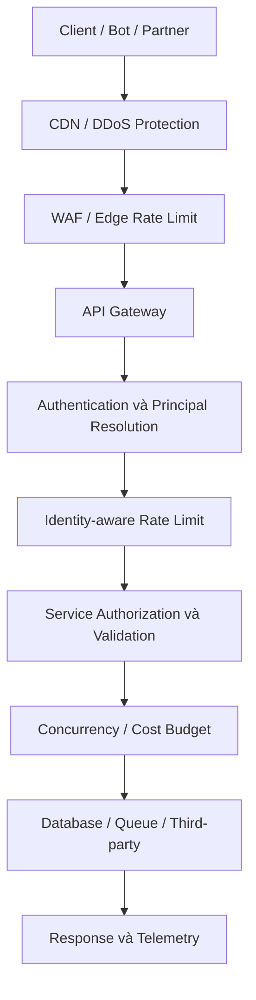
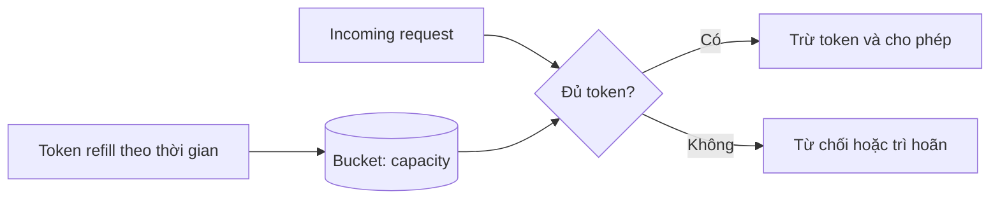

# Burst, distributed traffic và bot automation

Một API có thể chịu được lưu lượng trung bình nhưng vẫn bị quá tải khi hàng nghìn request đến trong vài giây. Kẻ tấn công cũng có thể phân tán request qua nhiều IP, tài khoản hoặc thiết bị để né giới hạn chỉ dựa trên địa chỉ nguồn. Bot còn có thể mô phỏng chuỗi thao tác của người dùng, giữ session hợp lệ và gọi đúng endpoint theo hợp đồng.

Vì vậy, bảo vệ API khỏi burst, distributed traffic và bot automation cần nhiều lớp kiểm soát: giới hạn tốc độ, tổng quota, số request đồng thời, giới hạn chi phí xử lý, nhận diện principal, bảo vệ hạ tầng và phân tích hành vi. Mỗi lớp giải quyết một loại rủi ro khác nhau. Rate limit theo IP có thể chặn một nguồn gửi quá nhanh nhưng không ngăn được botnet; giới hạn theo user có thể bị vượt qua bằng nhiều tài khoản; CAPTCHA có thể tăng chi phí automation nhưng không bảo đảm request là hợp lệ.

Trong module `SECURITY_API_SECURITY`, các giới hạn cần được gắn với endpoint, đối tượng dữ liệu và luồng nghiệp vụ. Hệ thống phải xác định ai đang gọi, operation nào được thực hiện, tài nguyên nào bị tiêu thụ và tác động của một request. Sau đó, áp dụng giới hạn phù hợp ở gateway, service và nơi thực hiện side effect, đồng thời theo dõi để cân bằng giữa khả năng chống lạm dụng và trải nghiệm của người dùng hợp lệ.

## Mục tiêu học tập

Sau bài này, người học có thể:

- Phân biệt burst traffic, distributed traffic, bot automation và volumetric DDoS.
- Chọn thuật toán rate limiting phù hợp với yêu cầu burst, fairness và độ chính xác.
- Thiết kế giới hạn theo IP, client, user, tenant, endpoint, resource và toàn hệ thống.
- Triển khai rate limit phân tán với state dùng chung và thao tác cập nhật nguyên tử.
- Kết hợp rate limit với concurrency limit, quota, timeout, backpressure và load shedding.
- Nhận diện bot bằng nhiều tín hiệu và áp dụng challenge theo rủi ro.
- Xử lý đúng proxy headers, IPv4/IPv6, key cardinality và các đường bypass.
- Kiểm thử burst, distributed sources, race condition, false positive và lỗi của kho rate-limit.

## 1. Hiểu các dạng lưu lượng cần bảo vệ

### 1.1. Burst traffic

Burst là một lượng lớn request đến trong một khoảng thời gian rất ngắn. Burst có thể xuất phát từ bot, client retry đồng loạt sau một sự cố, chiến dịch mở bán, thông báo push hoặc một tác vụ nội bộ bị cấu hình sai.

Ví dụ, một ứng dụng mobile khôi phục kết nối sau khi mạng trở lại và hàng chục nghìn client cùng gọi `GET /feed` trong vài giây. Dù mỗi người dùng hợp lệ, hệ thống vẫn có thể cạn connection pool, CPU hoặc cache capacity.

Burst cần được kiểm soát bằng giới hạn ngắn hạn, capacity planning, cache, queue, jitter trong retry và concurrency limit. Không phải burst nào cũng là tấn công; policy cần phân biệt sự kiện hợp lệ với hành vi lạm dụng khi có đủ tín hiệu.

### 1.2. Distributed traffic

Distributed traffic là lưu lượng được phân tán qua nhiều nguồn. Attacker có thể dùng proxy, botnet, cloud instances, nhiều tài khoản hoặc nhiều session. Mỗi nguồn có thể nằm dưới ngưỡng rate limit riêng nhưng tổng lưu lượng vẫn gây quá tải hoặc lạm dụng endpoint.

Nếu chỉ giới hạn 100 request/phút/IP, 10.000 IP có thể tạo ra tổng cộng một triệu request/phút. Vì vậy, cần nhiều chiều giới hạn: source network, client identity, user, tenant, endpoint, resource và global capacity.

### 1.3. Bot automation

Bot automation là việc dùng phần mềm tự động thực hiện các thao tác API hoặc mô phỏng hành vi client. Bot có thể gửi request rất nhanh, nhưng cũng có thể hoạt động chậm và đều để né ngưỡng đơn giản. Một số bot sử dụng browser thật, cookie, JavaScript và tài khoản đã đăng ký.

Mục tiêu có thể là dò credential, thu thập dữ liệu, chiếm chỗ/vé, gửi spam, thử mã khuyến mãi, tạo chi phí hoặc làm cạn quota. Không thể xác định bot chỉ bằng một header `User-Agent` hoặc một IP reputation score.

### 1.4. Volumetric DDoS và application-layer abuse

Volumetric DDoS tìm cách làm cạn băng thông hoặc năng lực mạng bằng lượng traffic rất lớn. Application-layer abuse tập trung vào endpoint và chi phí xử lý của ứng dụng, ví dụ gọi một API tìm kiếm tốn CPU hoặc tạo nhiều report.

| Dạng lưu lượng | Điểm nghẽn thường gặp | Lớp kiểm soát phù hợp |
|---|---|---|
| Burst hợp lệ | Connection pool, cache, worker queue | Jitter, cache, queue, concurrency limit, autoscaling |
| Distributed flood | Băng thông, gateway, CPU, database | CDN/WAF, upstream DDoS protection, global rate limit, network controls |
| Bot automation | Endpoint nhạy cảm, quota nghiệp vụ, tài nguyên downstream | Identity-aware limits, behavior detection, challenge, eligibility rules |
| Expensive API abuse | CPU, DB query, search engine, third-party quota | Per-operation cost budget, timeout, query limits, concurrency limit |
| Credential stuffing | Authentication service, account lockout | Login-specific throttling, breached credential detection, MFA/risk controls |

Rate limiting ở ứng dụng không thể thay thế bảo vệ DDoS ở mạng hoặc nhà cung cấp hạ tầng. Nếu traffic đã làm đầy đường truyền trước khi đến gateway, ứng dụng không còn cơ hội xử lý request để trả `429`.

## 2. Threat model và vị trí áp dụng giới hạn

Trước khi chọn thuật toán, hãy xác định request nào cần giới hạn và chi phí thực tế của nó.

Với mỗi endpoint, ghi nhận:

1. Principal có thể là anonymous, API client, user, tenant, workload hoặc nhân viên.
2. Chi phí trung bình và chi phí cực đại của request: CPU, memory, DB, network, queue, storage và third-party calls.
3. Tài nguyên hoặc nghiệp vụ bị ảnh hưởng: đăng nhập, tìm kiếm, export, OTP, checkout, upload hoặc thanh toán.
4. Mức burst hợp lệ, tốc độ ổn định và số request đồng thời mà hệ thống có thể chịu.
5. Giới hạn theo từng principal và global capacity.
6. Hành vi khi vượt giới hạn, kho rate-limit lỗi hoặc downstream không sẵn sàng.
7. Các đường gọi thay thế: API version cũ, endpoint nội bộ, batch, GraphQL, WebSocket hoặc direct origin.



Các lớp có thể được triển khai trong cùng một nền tảng hoặc nhiều sản phẩm khác nhau. Điều quan trọng là biết lớp nào bảo vệ loại tài nguyên nào. Edge layer chặn sớm traffic rác; gateway biết route và client; service hiểu user, tenant, object và chi phí nghiệp vụ; database bảo vệ invariant và tính nguyên tử.

## 3. Phân biệt rate limit, quota và concurrency limit

Ba cơ chế thường bị gọi chung là rate limit nhưng có mục tiêu khác nhau:

| Cơ chế | Giới hạn | Ví dụ |
|---|---|---|
| Rate limit | Số request hoặc cost units trong cửa sổ thời gian | Tối đa 60 request/phút |
| Quota | Tổng lượng sử dụng trong kỳ dài hơn | Tối đa 10.000 lần export/tháng cho tenant |
| Concurrency limit | Số operation đang chạy cùng lúc | Tối đa 5 report đang xử lý cho một tenant |

Một endpoint export có thể chỉ nhận 2 request/phút nhưng mỗi request chạy 10 phút và tiêu thụ nhiều CPU. Rate limit vẫn cho phép 2 tác vụ chạy cùng lúc; concurrency limit mới kiểm soát số tác vụ đang hoạt động. Ngược lại, endpoint đọc cache rẻ có thể chịu concurrency cao nhưng cần rate limit để ngăn burst.

Với endpoint có chi phí khác nhau, giới hạn theo cost units thường chính xác hơn đếm request. Ví dụ tìm kiếm một trang nhỏ tốn 1 unit, còn export một triệu bản ghi tốn nhiều unit hơn. Cost model cần có giới hạn trên để client không thể gửi tham số khiến một request tiêu thụ tài nguyên không kiểm soát.

## 4. Các thuật toán rate limiting phổ biến

### 4.1. Fixed window counter

Fixed window chia thời gian thành các cửa sổ cố định, ví dụ mỗi phút. Bộ đếm được tăng cho từng request; khi sang cửa sổ mới, bộ đếm được đặt lại.

```text
window = floor(currentTime / windowDuration)
key = principal + route + window
count = atomicIncrement(key)

if count <= limit:
    allow
else:
    reject
```

**Ví dụ giới hạn 100 request/phút**

- 12:00:59: client gửi 100 request và được chấp nhận.
- 12:01:00: bộ đếm chuyển sang cửa sổ mới.
- 12:01:01: client gửi thêm 100 request.

Client có thể gửi gần 200 request trong khoảng hai giây quanh ranh giới cửa sổ. Đây là boundary burst.

**Ưu điểm:** dễ triển khai, ít state và chi phí thấp. **Nhược điểm:** giới hạn không mượt ở ranh giới cửa sổ. Phù hợp với quota đơn giản hoặc giới hạn thô, nhưng cần cân nhắc cho endpoint nhạy cảm với burst.

### 4.2. Sliding log

Sliding log lưu timestamp của từng request và đếm số request trong khoảng thời gian trượt, ví dụ 60 giây gần nhất.

```text
remove timestamps older than now - window
if count(timestamps in window) < limit:
    append now
    allow
else:
    reject
```

**Ưu điểm:** chính xác theo cửa sổ trượt, tránh boundary burst của fixed window. **Nhược điểm:** lưu một timestamp cho mỗi request, tốn bộ nhớ và cần thao tác nguyên tử khi nhiều request đến đồng thời. Phù hợp với một số quota quan trọng khi lưu lượng và cardinality có thể kiểm soát.

### 4.3. Sliding window counter

Sliding window counter kết hợp bộ đếm cửa sổ hiện tại và cửa sổ trước, ước lượng lượng request trong cửa sổ trượt bằng trọng số thời gian.

```text
estimated = currentWindowCount
          + previousWindowCount * previousWindowOverlap

allow if estimated < limit
```

**Ưu điểm:** giảm boundary burst với ít state hơn sliding log. **Nhược điểm:** là phép xấp xỉ; độ chính xác phụ thuộc cách chia cửa sổ và phân bố request. Thường phù hợp với rate limit phân tán có chi phí state thấp.

### 4.4. Token bucket

Token bucket có một dung lượng token tối đa. Token được nạp lại theo tốc độ cố định; mỗi request tiêu thụ một số token theo cost. Nếu còn đủ token thì request được chấp nhận.



Ví dụ bucket có capacity 20 và refill 2 token/giây. Client có thể gửi burst tối đa 20 request khi bucket đầy, sau đó trung bình được bổ sung 2 token mỗi giây. Một request đắt có thể tiêu thụ nhiều token hơn request thường.

**Ưu điểm:** cho phép burst có giới hạn nhưng giữ tốc độ trung bình; phù hợp API có lưu lượng không đều. **Nhược điểm:** cần cập nhật token và timestamp nguyên tử; phải xử lý clock, TTL và state phân tán.

### 4.5. Leaky bucket

Leaky bucket đưa request vào hàng đợi và xử lý theo tốc độ ổn định. Nếu hàng đợi đầy, request mới bị từ chối hoặc trì hoãn theo hợp đồng.

**Ưu điểm:** làm mượt lưu lượng tới downstream, hữu ích cho worker hoặc tích hợp có giới hạn tốc độ. **Nhược điểm:** tăng latency và cần giới hạn queue size, thời gian chờ, hủy tác vụ và backpressure. Nếu queue không giới hạn, hệ thống chỉ chuyển quá tải từ CPU sang bộ nhớ và thời gian chờ.

### 4.6. So sánh và lựa chọn

| Thuật toán | Burst | Độ chính xác cửa sổ | State/chi phí | Trường hợp phù hợp |
|---|---|---|---|---|
| Fixed window | Có thể có burst lớn ở ranh giới | Thấp ở boundary | Thấp | Quota đơn giản, giới hạn thô |
| Sliding log | Kiểm soát chặt theo cửa sổ | Cao | Cao | Operation nhạy cảm, lưu lượng vừa phải |
| Sliding window counter | Giảm boundary burst | Xấp xỉ | Trung bình/thấp | API có lưu lượng lớn, cần cân bằng chi phí |
| Token bucket | Burst trong capacity | Giới hạn tốc độ trung bình | Thấp/trung bình | API tương tác, traffic không đều |
| Leaky bucket/queue | Làm mượt đầu ra | Theo tốc độ xử lý | Queue state | Downstream cần tốc độ ổn định |

Không có thuật toán tốt nhất cho mọi endpoint. Có thể kết hợp token bucket ở gateway, concurrency limit trong service và quota nghiệp vụ ở database.

## 5. Thiết kế key giới hạn theo nhiều chiều

### 5.1. Chọn principal phù hợp

Không nên chỉ dùng IP. Một policy có thể kết hợp nhiều bucket:

| Chiều | Ví dụ key | Mục đích |
|---|---|---|
| Source network | `ip:203.0.113.10` hoặc prefix mạng đã chuẩn hóa | Chặn một nguồn gửi quá nhanh |
| Client identity | `client:partner-a` | Giới hạn tích hợp hoặc API key |
| User identity | `user:1842` | Giới hạn hoạt động theo tài khoản đã xác thực |
| Tenant | `tenant:42` | Bảo vệ quota và fairness giữa tổ chức |
| Route/action | `route:POST:/payments` | Giới hạn operation nhạy cảm |
| Resource | `event:summer-2026` | Bảo vệ một sự kiện hoặc tài nguyên khan hiếm |
| Global | `global:payment-provider` | Giữ tổng traffic dưới capacity downstream |

Request chỉ được xử lý khi đáp ứng tất cả bucket bắt buộc. Một user có thể được phép 30 request/phút nhưng tenant của họ chỉ còn quota 100 request; request tiếp theo phải tuân theo cả hai chính sách.

### 5.2. IP address và trusted proxy

Nếu ứng dụng nằm sau CDN hoặc reverse proxy, `RemoteAddr` có thể là IP của proxy. Header như `X-Forwarded-For` hoặc `Forwarded` chỉ đáng tin khi request đến từ proxy đã được cấu hình tin cậy và proxy xóa/ghi lại header do client gửi.

Không lấy phần tử đầu tiên của `X-Forwarded-For` một cách mù quáng. Attacker có thể tự gửi header này nếu edge không ghi đè; nhiều proxy nối thêm địa chỉ theo thứ tự khác nhau. Hãy cấu hình danh sách proxy tin cậy, xác định thuật toán chọn client IP từ chuỗi hop và bỏ qua forwarded header từ nguồn không tin cậy.

Với IPv6, một client có thể thay đổi địa chỉ trong một prefix. Có thể giới hạn theo prefix mạng trong một số tình huống, nhưng prefix quá rộng có thể ảnh hưởng nhiều người dùng hợp lệ; cần chọn theo dữ liệu thực tế và chính sách mạng. Chuẩn hóa IPv4-mapped IPv6 và định dạng địa chỉ để tránh một nguồn được biểu diễn thành nhiều key khác nhau.

### 5.3. Tránh key cardinality không giới hạn

Không tạo bucket dựa trực tiếp trên mọi giá trị do client tự do gửi như `X-Request-ID`, query string tùy ý hoặc một `deviceId` không xác thực. Attacker có thể tạo hàng triệu key để làm đầy Redis hoặc bộ nhớ.

Chỉ dùng dimensions đã được chuẩn hóa và có giới hạn cardinality; đặt TTL cho state hết hoạt động; giới hạn số key mới theo nguồn; không đưa raw URL/query vào key nếu có thể chuẩn hóa thành route template. Với anonymous traffic, dùng network key và edge controls trước khi tạo state per-session.

### 5.4. Thứ tự áp dụng nhiều bucket

Nếu một request cần kiểm tra IP, client, user, tenant và global bucket, việc trừ token cần nhất quán. Nếu trừ IP bucket thành công nhưng tenant bucket bị từ chối, cần quy định token đã tiêu thụ hay được hoàn lại. Với giới hạn quan trọng, kiểm tra và cập nhật nhiều bucket trong một thao tác nguyên tử hoặc thiết kế reservation/commit rõ ràng. Không để retry làm trừ quota nhiều lần ngoài ý muốn.

## 6. Rate limiting phân tán

### 6.1. Vì sao bộ đếm local không đủ?

Giả sử API có 4 instance và mỗi instance cho phép 100 request/phút theo cùng một user. Nếu user phân phối request đều qua 4 instance, tổng giới hạn thực tế có thể thành 400 request/phút. Autoscaling còn làm giới hạn thay đổi theo số instance.

Với quota cần nhất quán, các instance cần dùng state dùng chung hoặc một dịch vụ rate-limit tập trung. Có thể dùng Redis, database, API gateway shared policy hoặc một rate-limit service chuyên dụng.

### 6.2. Cập nhật counter phải nguyên tử

Hai request đồng thời có thể cùng đọc count là 99, rồi cả hai cùng tăng lên 100 và đều được chấp nhận dù giới hạn là 100. Dùng thao tác atomic increment, transaction, script hoặc primitive đồng bộ phù hợp. Việc kiểm tra rồi cập nhật bằng hai lệnh độc lập là lỗi race condition.

Ví dụ pseudocode cho token bucket dùng state chia sẻ:

```text
atomic operation for bucket key:
    now = trustedCurrentTime()
    state = read(tokens, lastUpdated)
    elapsed = max(0, now - lastUpdated)
    tokens = min(capacity, tokens + elapsed * refillRate)

    if tokens >= requestCost:
        tokens = tokens - requestCost
        allowed = true
    else:
        allowed = false

    save(tokens, now, withTTL)
    return allowed, tokens
```

Thao tác đọc, tính token, quyết định và ghi state phải được thực hiện nguyên tử đối với một bucket. Đồng hồ cần nhất quán; ưu tiên thời gian từ cùng hệ thống lưu state hoặc có chiến lược clock skew rõ ràng. TTL phải đủ dài để giữ trạng thái cần thiết nhưng không làm state tồn tại vô hạn.

### 6.3. Redis và distributed limiter

Redis thường được dùng cho counter và token bucket nhờ atomic commands, Lua scripts và TTL. Khi triển khai:

- Dùng script/transaction để kết hợp read-modify-write.
- Đặt key có namespace, route template và principal ID đã chuẩn hóa.
- Dùng TTL để dọn bucket hết hoạt động.
- Xác định behavior khi Redis timeout, failover hoặc mất dữ liệu.
- Tránh một hot key global gây nghẽn; có thể phân vùng hoặc dùng local pre-limit kết hợp global cap.
- Nếu dùng Redis Cluster, các key cần cập nhật cùng script/transaction phải tuân theo yêu cầu hash slot của cluster.
- Theo dõi latency, evictions, memory, key cardinality và replication lag.

Không mặc định Redis là bộ đếm hoàn hảo trong mọi failure mode. Failover có thể làm mất một số cập nhật gần nhất tùy cấu hình durability/replication; policy phải chấp nhận mức sai số hoặc dùng cơ chế mạnh hơn cho quota tài chính/nghiệp vụ.

### 6.4. Local limit kết hợp global limit

Một mô hình thường dùng là local token bucket ở mỗi instance để chặn burst nhanh, kết hợp global limiter để kiểm soát tổng quota. Local limit giảm round trip và bảo vệ instance; global limit giữ giới hạn toàn hệ thống.

Nếu phân bổ quota tĩnh cho từng instance, cần xử lý autoscaling và phân bổ không đều. Nếu dùng local cache của token, phải tính đến oversubscription khi nhiều instance cùng cấp token. Không dùng local limit làm nguồn chân lý cho giới hạn tài chính hoặc điều kiện “chỉ được một lần”.

### 6.5. Khi kho rate-limit không sẵn sàng

Không có một chính sách fail-open/fail-closed phù hợp cho mọi endpoint:

- Endpoint công khai rủi ro thấp có thể dùng local fallback với giới hạn chặt và thời gian ngắn.
- Endpoint gửi OTP, tạo chi phí, thanh toán hoặc thao tác quản trị thường cần fail closed hoặc giảm chức năng an toàn khi không xác minh được quota.
- Với global capacity, có thể load shed để bảo vệ hệ thống thay vì cho phép vô hạn.
- Phải đo và cảnh báo khi fallback được kích hoạt; không để fallback trở thành chế độ hoạt động lâu dài.

Quyết định cần dựa trên tác động của việc chặn nhầm và tác động của việc cho phép vượt giới hạn. Không âm thầm bỏ toàn bộ rate limit khi Redis lỗi.

## 7. Concurrency limit, backpressure và load shedding

Rate limit giới hạn tốc độ request mới, nhưng không trực tiếp giới hạn số request đang chạy. Nếu một request mất 30 giây, 20 request/giây có thể tạo ra hàng trăm request đồng thời.

### 7.1. Concurrency limit

Giới hạn số operation đang chạy theo service, tenant, principal hoặc downstream. Khi đạt ngưỡng, hệ thống có thể từ chối sớm hoặc đưa request vào queue có giới hạn.

Ví dụ:

- Tối đa 20 report export đồng thời trên toàn hệ thống.
- Tối đa 2 export đồng thời cho mỗi tenant.
- Tối đa 50 request đồng thời tới payment provider.

Semaphore/worker pool cần giải phóng permit trong mọi đường kết thúc, kể cả exception và timeout. Permit có lease/TTL nếu process có thể chết khi đang giữ permit; cần tránh lease hết hạn trong khi tác vụ cũ vẫn chạy dẫn tới vượt giới hạn.

### 7.2. Backpressure và queue

Backpressure báo cho upstream giảm tốc độ khi downstream không xử lý kịp. Queue chỉ giúp hấp thụ burst tạm thời; queue phải có max size, TTL, giới hạn theo tenant và chính sách từ chối khi đầy.

Không đưa mọi request vào queue không giới hạn. Điều đó làm latency tăng, memory/storage cạn và người dùng nhận kết quả muộn mà không biết request đã được nhận hay chưa. Với API async, trả `202 Accepted` chỉ khi tác vụ đã được ghi nhận bền vững và có trạng thái tra cứu rõ.

### 7.3. Load shedding

Khi service gần quá tải, có thể từ chối sớm request ưu tiên thấp hoặc operation tốn kém để bảo vệ chức năng cốt lõi. Quy tắc cần công bằng và minh bạch: ví dụ bảo vệ health/authentication hoặc giao dịch đã bắt đầu, giảm report/export, giới hạn tenant chiếm quá nhiều tài nguyên.

Load shedding nên dùng các tín hiệu như queue depth, CPU, memory, latency, connection pool và downstream saturation. Không chờ tới khi process hết bộ nhớ mới bắt đầu từ chối.

### 7.4. Timeout, retry và circuit breaker

Đặt timeout cho toàn request và từng dependency. Retry chỉ với lỗi có thể phục hồi và operation an toàn/idempotent; dùng exponential backoff, jitter và giới hạn tổng số lần. Retry storm có thể nhân lưu lượng lên nhiều lần khi downstream đang lỗi.

Circuit breaker giúp tạm ngừng gọi dependency đang lỗi; bulkhead tách pool để một dependency không chiếm toàn bộ thread/connection. Những cơ chế này bổ sung cho rate limit, không thay thế quota và authorization.

## 8. Nhận diện và giảm thiểu bot automation

### 8.1. Dùng nhiều tín hiệu thay vì một dấu hiệu

Bot detection nên kết hợp tín hiệu theo ngữ cảnh:

| Nhóm tín hiệu | Ví dụ | Giới hạn cần hiểu |
|---|---|---|
| Request behavior | Tốc độ, burst, nhịp request, chuỗi endpoint, tỷ lệ lỗi | Người dùng hợp lệ cũng có thể hoạt động nhanh hoặc lặp lại |
| Session/account | Tuổi tài khoản, lịch sử đăng nhập, trạng thái xác minh, session consistency | Tài khoản thật có thể bị chiếm hoặc được dùng tự động |
| Network | IP reputation, ASN, proxy/VPN, nguồn datacenter | NAT, VPN doanh nghiệp và mạng di động có thể dùng chung IP |
| Client signals | Header consistency, JavaScript capability, cookie/session | Có thể bị giả lập; không phải bằng chứng mật mã |
| Device signals | Tính nhất quán thiết bị hoặc browser characteristics | Có rủi ro quyền riêng tư và false positive |
| Business outcome | Tỷ lệ checkout, hủy, claim, failed payment, scrape volume | Cần gắn với mục tiêu nghiệp vụ và baseline |

Không coi `User-Agent`, `Referer`, `Origin` hoặc một header do client gửi là bằng chứng đáng tin cậy về người dùng hay thiết bị. Các tín hiệu này có thể hữu ích cho risk scoring nhưng phải được kết hợp với danh tính và hành vi.

### 8.2. Progressive friction

Thay vì chặn mọi request đáng ngờ ngay lập tức, có thể tăng mức ma sát theo rủi ro:

1. Rủi ro thấp: xử lý bình thường với quota cơ bản.
2. Rủi ro tăng: giảm tốc độ, giới hạn số trang hoặc yêu cầu đăng nhập.
3. Rủi ro trung bình: yêu cầu CAPTCHA/challenge hoặc xác minh bổ sung.
4. Rủi ro cao: tạm dừng operation nhạy cảm, step-up authentication hoặc review.
5. Có bằng chứng lạm dụng: khóa credential/session hoặc chặn nguồn theo quy trình phản ứng.

Challenge phải gắn với session/request context, có thời hạn và được xác minh ở server. Không để client gửi `captchaPassed=true` mà server không kiểm tra token challenge. CAPTCHA không thay thế rate limit, authorization hoặc business eligibility.

### 8.3. Bảo vệ endpoint authentication

Login, password reset, OTP và account recovery cần policy riêng vì attacker có thể thử nhiều username, password hoặc đích gửi OTP. Kiểm soát có thể gồm:

- Rate limit theo account identifier đã chuẩn hóa, source network và client/session.
- Không tiết lộ account có tồn tại hay không trong response.
- Cooldown và giới hạn số lần xác minh, gửi lại OTP hoặc reset.
- MFA/step-up và phát hiện credential stuffing.
- Bảo vệ chống account lockout abuse: không cho attacker dễ dàng khóa tài khoản nạn nhân chỉ bằng request lặp.
- Giám sát tỷ lệ thành công/thất bại và các cụm nguồn có hành vi giống nhau.

Không chỉ giới hạn theo IP vì botnet phân tán; cũng không chỉ giới hạn theo username vì attacker có thể gửi nhiều username và gây từ chối dịch vụ cho nạn nhân.

### 8.4. Fairness và quyền riêng tư

Bot mitigation có thể ảnh hưởng người dùng hợp lệ, đặc biệt người dùng chung NAT, thiết bị dùng chung, mạng di động hoặc công nghệ hỗ trợ. Cần:

- Đo false positive và tỷ lệ challenge thất bại.
- Có đường hỗ trợ hoặc xác minh thay thế cho người dùng hợp lệ.
- Hạn chế thu thập fingerprint và dữ liệu thiết bị ở mức cần thiết.
- Xác định mục đích, quyền truy cập và thời hạn lưu dữ liệu risk signals.
- Tránh dùng một tín hiệu yếu làm lý do khóa tài khoản vĩnh viễn.

## 9. Bảo vệ các đường gọi và tránh bypass

Rate limit chỉ hiệu quả nếu mọi đường truy cập liên quan đều được kiểm soát. Cần rà soát:

- API version cũ, route alias và HTTP method khác nhau.
- Direct origin access bỏ qua CDN hoặc gateway.
- Internal endpoint có thể bị gọi từ workload không được phép.
- Batch endpoint có thể gói hàng trăm operation trong một request.
- GraphQL query có thể yêu cầu độ sâu, số node hoặc resolver cost lớn.
- WebSocket hoặc streaming connection có thể duy trì tài nguyên lâu dài.
- File upload, download, export và background job có quota riêng.
- API key/client ID có thể được chia sẻ giữa nhiều ứng dụng.

Với GraphQL, giới hạn cả request rate, query depth, complexity/cost, alias count, batch size và resolver concurrency. Với WebSocket, giới hạn số connection, message rate, frame size và thời gian idle. Với batch, giới hạn số item và cost tổng, không chỉ số HTTP request.

Origin server nên chỉ nhận traffic từ edge/gateway được phép hoặc có lớp authentication riêng; nếu attacker gọi thẳng origin, edge rate limit có thể bị bỏ qua. Network ACL cần được duy trì cùng xác thực tại service.

## 10. HTTP response và contract khi vượt giới hạn

Khi client vượt rate limit, response thường dùng `429 Too Many Requests`. Có thể trả `Retry-After` nếu server biết thời điểm hợp lý để thử lại. Với quá tải toàn hệ thống hoặc dependency không sẵn sàng, `503 Service Unavailable` có thể phù hợp hơn.

| Tình huống | Status thường dùng | Hành vi client nên thực hiện |
|---|---|---|
| Vượt giới hạn theo client/user/tenant | `429` | Tôn trọng `Retry-After`, giảm tốc độ và tránh retry ngay lập tức |
| Service quá tải hoặc đang bảo trì | `503` | Retry có backoff và jitter nếu operation an toàn |
| Payload vượt kích thước cho phép | `413` | Giảm kích thước request; không retry nguyên payload |
| Không xác thực được | `401` | Thực hiện lại authentication theo flow |
| Đã xác thực nhưng không có quyền | `403` | Không retry để tìm cách vượt quyền |

Ví dụ:

```http
HTTP/1.1 429 Too Many Requests
Retry-After: 12
Content-Type: application/problem+json

{
  "type": "https://api.example.com/problems/rate-limit-exceeded",
  "title": "Too many requests",
  "status": 429,
  "detail": "Request limit exceeded. Retry later."
}
```

Response không nên tiết lộ ngưỡng nội bộ, thuật toán phát hiện bot hoặc thông tin về các principal khác. Header quota/reset có thể hữu ích cho client tin cậy nếu contract cho phép; hãy tránh làm lộ thông tin vận hành nhạy cảm.

Client cần retry có kiểm soát. Nếu nhiều client cùng nhận `429` rồi retry ngay khi `Retry-After` hết hạn, chúng có thể tạo burst mới. Dùng jitter và giới hạn retry để phân tán thời điểm thử lại.

## 11. Ví dụ thiết kế policy cho API

Giả sử hệ thống có ba endpoint:

| Endpoint | Chi phí/rủi ro | Giới hạn minh họa |
|---|---|---|
| `GET /catalog` | Rẻ, cache được | Token bucket theo IP/client và global edge limit |
| `POST /reports/export` | Tốn CPU, DB và storage | Quota theo tenant, tối đa 2 tác vụ đồng thời, cost budget và queue có giới hạn |
| `POST /auth/otp` | Tạo chi phí SMS và ảnh hưởng người khác | Limit theo account/đích nhận, IP/client, cooldown và global provider budget |

Một policy có thể kết hợp:

```text
request = normalizeRouteAndPrincipal(httpRequest)

applyEdgeLimit(request.sourceNetwork)
applyClientLimit(request.clientId, request.route)

if endpointRequiresUser:
    user = authenticate(request)
    applyUserLimit(user.id, request.route)
    applyTenantLimit(user.tenantId, request.route)

applyGlobalCapacity(endpoint, estimatedCost(request))
acquireConcurrencyPermit(endpoint, principal)

authorize(userOrWorkload, action, resource)
validateRequestAndBusinessRules(request)
executeWithTimeoutAndAudit()
releaseConcurrencyPermit()
```

Đây là pseudocode minh họa thứ tự. Trong hệ thống thực tế, không nhất thiết phải tạo mọi bucket cho mọi endpoint. Chọn dimensions dựa trên rủi ro và đảm bảo principal được xác thực trước khi dùng ID của nó làm key. Với request anonymous, chỉ dùng các nguồn có thể xác định an toàn ở edge.

Nếu nhiều bucket phải được cập nhật đồng thời, thiết kế một thao tác nguyên tử hoặc chính sách debit/rollback rõ ràng. Concurrency permit phải được giải phóng kể cả khi validation, downstream hoặc response gặp exception.

## 12. Kiểm thử rate limit và bot mitigation

Kiểm thử không chỉ xác nhận một client gửi request quá nhanh bị `429`. Cần mô phỏng nhiều instance, nhiều nguồn, proxy, người dùng hợp lệ và lỗi hạ tầng.

| Nhóm kiểm thử | Kịch bản | Kết quả mong đợi |
|---|---|---|
| Burst | Gửi nhiều request sát nhau và quanh ranh giới fixed window | Burst được giới hạn theo thuật toán đã chọn |
| Sustained traffic | Duy trì traffic trong thời gian dài | Trung bình không vượt refill/quota |
| Distributed sources | Cùng principal gửi qua nhiều IP/instance | Giới hạn theo principal vẫn có hiệu lực |
| Shared NAT | Nhiều user hợp lệ dùng chung IP | Không bị khóa toàn bộ chỉ vì IP chung |
| Proxy spoofing | Client tự gửi `X-Forwarded-For` giả | IP được xác định theo trusted proxy chain |
| IPv6 | Một nguồn thay đổi địa chỉ trong prefix | Chuẩn hóa và policy prefix hoạt động theo thiết kế |
| Multi-bucket | IP bucket cho phép nhưng tenant/global bucket từ chối | Không vượt bucket bắt buộc; state được cập nhật nhất quán |
| Concurrency | Request chậm vượt số tác vụ đồng thời | Permit giới hạn và được giải phóng đúng cách |
| Distributed race | Nhiều instance cùng tăng counter | Atomic update không cho vượt ngưỡng ngoài sai số đã định nghĩa |
| Key cardinality | Gửi hàng triệu ID/header ngẫu nhiên | Không tạo state vô hạn hoặc làm đầy kho limiter |
| Limiter outage | Redis timeout/failover | Fallback đúng policy; endpoint nhạy cảm không tự bỏ giới hạn |
| Bot behavior | Automation đổi IP, user-agent hoặc nhịp request | Risk signals kết hợp; không phụ thuộc một header |
| Challenge | Token challenge giả, hết hạn hoặc dùng lại | Server từ chối challenge không hợp lệ/replay |
| Retry storm | Nhiều client retry sau `429`/`503` | Backoff/jitter phân tán request |
| Bypass | Gọi API version cũ hoặc direct origin | Cùng lớp giới hạn và authorization được áp dụng |
| Cost abuse | Một request tạo nhiều DB/third-party calls | Cost budget, timeout và concurrency bảo vệ downstream |

Load test cần có nhiều profile: steady state, burst ngắn, burst lặp lại, traffic phân tán và traffic hỗn hợp có request đắt. Đo latency p50/p95/p99, tỷ lệ `429`, queue depth, CPU, memory, DB pool, Redis latency và chi phí downstream. Xác định ngưỡng trước khi chạy để không nhầm thử tải với traffic production.

## 13. Logging, metrics và phản ứng sự cố

### 13.1. Metrics cần theo dõi

- Request rate theo route, client, tenant và kết quả status.
- Số request bị giới hạn theo từng policy và bucket.
- Token balance/refill hoặc counter utilization ở mức aggregate.
- Số request đồng thời, queue depth, thời gian chờ và số tác vụ bị hủy.
- Redis/rate-limit latency, timeout, error, memory, eviction và cardinality.
- Challenge rate, challenge completion, false positive và account/session bị đánh dấu rủi ro.
- Downstream latency, retry count, circuit breaker state và cost units.
- Traffic tới origin không đi qua edge/gateway.

### 13.2. Log có ngữ cảnh nhưng không lộ dữ liệu

Log nên ghi policy ID, route template, client/user/tenant ID đã chuẩn hóa, source network ở mức cần thiết, quyết định allow/deny, cost estimate và correlation ID. Không log token, API key, cookie, challenge secret hoặc payload nhạy cảm. Dùng sampling cho traffic lớn và giữ đủ log chi tiết cho sự kiện bảo mật quan trọng.

### 13.3. Khi traffic bất thường xảy ra

1. Xác định endpoint, nguồn, principal và tài nguyên đang bị ảnh hưởng.
2. Phân biệt volumetric traffic, burst hợp lệ, bot automation và lỗi retry của client.
3. Tăng bảo vệ ở edge/gateway; siết policy theo route hoặc principal bị ảnh hưởng.
4. Bảo vệ downstream bằng concurrency limit, timeout, circuit breaker và load shedding.
5. Nếu có business abuse, kiểm tra quota, reservation, transaction và side effect đã tạo.
6. Giữ khả năng truy cập cho người dùng hợp lệ; tránh chặn toàn bộ NAT hoặc tenant chỉ dựa trên một tín hiệu.
7. Sau sự cố, điều chỉnh ngưỡng dựa trên số liệu, thêm test tái hiện và cập nhật capacity plan.

Không thay đổi giới hạn toàn hệ thống một cách tùy tiện khi đang sự cố nếu chưa hiểu tác động tới các endpoint khác. Mỗi policy nên có owner, phạm vi, giá trị mặc định và cách rollback.

## 14. Checklist trước khi phát hành

- [ ] Đã phân loại burst, distributed traffic, bot automation và volumetric DDoS.
- [ ] Mỗi endpoint có cost model, burst allowance và capacity limit phù hợp.
- [ ] Rate limit, quota và concurrency limit được định nghĩa riêng.
- [ ] Thuật toán được chọn dựa trên burst, độ chính xác, state và chi phí.
- [ ] Có giới hạn theo source network, client, user, tenant, route, resource và global capacity khi cần.
- [ ] Forwarded IP chỉ được tin từ proxy/CDN đã cấu hình; header giả mạo bị loại bỏ.
- [ ] Key dimensions được chuẩn hóa, có TTL và không tạo cardinality không giới hạn.
- [ ] Distributed counter được cập nhật nguyên tử; failure mode của kho limiter được xác định.
- [ ] Local và global limit không gây oversubscription ngoài mức chấp nhận.
- [ ] Có concurrency limit, queue bound, timeout, backpressure và load shedding cho endpoint đắt.
- [ ] Bot detection kết hợp nhiều tín hiệu, có progressive challenge và đo false positive.
- [ ] Login, OTP, recovery và các operation gây chi phí có policy riêng.
- [ ] API version, batch, GraphQL, WebSocket, direct origin và internal route không bypass policy.
- [ ] Response `429`/`503` và `Retry-After` có contract rõ; client dùng backoff/jitter.
- [ ] Có test burst, distributed sources, NAT, IPv6, race, Redis outage, key cardinality và bypass.
- [ ] Metrics/log đủ điều tra nhưng không làm lộ credential hoặc dữ liệu nhạy cảm.

## Kết luận

Burst, distributed traffic và bot automation cần được kiểm soát ở nhiều lớp vì mỗi nguồn hoặc mỗi request riêng lẻ có thể trông hợp lệ trong khi tổng lưu lượng gây quá tải hoặc lạm dụng API. Hãy chọn thuật toán rate limit theo đặc tính endpoint, kết hợp giới hạn theo principal và global capacity, cập nhật state phân tán nguyên tử, bảo vệ concurrency và downstream, đồng thời dùng nhiều tín hiệu để nhận diện bot. Trusted proxy handling, key cardinality, failure policy, fairness và kiểm thử phân tán là các phần thiết yếu để giới hạn hoạt động hiệu quả trong production.
