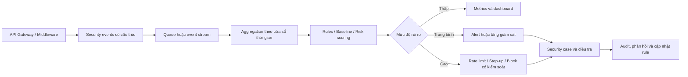

# Theo dõi abuse pattern theo thời gian

Lạm dụng API thường không thể nhận ra chỉ từ một request riêng lẻ. Một request đọc dữ liệu có thể hoàn toàn hợp lệ, nhưng hàng nghìn request tương tự trong vài phút có thể là hành vi scraping. Một lần đăng nhập sai có thể do người dùng nhập nhầm mật khẩu, nhưng nhiều lần thử trên nhiều tài khoản từ cùng một thiết bị có thể là credential stuffing. Một lần truy cập `404` có thể là lỗi gõ URL, nhưng chuỗi dò nhiều object ID liên tiếp có thể cho thấy hành vi enumeration.

Vì vậy, API Security cần theo dõi hành vi theo thời gian và liên kết các sự kiện giữa user, service, tenant, thiết bị, địa chỉ mạng, endpoint và tài nguyên. Mục tiêu là phát hiện mẫu bất thường đủ sớm, đánh giá mức độ rủi ro, áp dụng biện pháp phù hợp và giữ lại bằng chứng để điều tra. Việc theo dõi phải dựa trên dữ liệu có cấu trúc, chính sách rõ ràng và cơ chế bảo vệ quyền riêng tư.

## 1. Vì sao cần theo dõi theo thời gian?

Kiểm tra bảo mật tại một request trả lời câu hỏi: request hiện tại có hợp lệ không? Theo dõi theo thời gian trả lời thêm: chuỗi request của một chủ thể có đang tạo ra hành vi bất thường hoặc gây rủi ro cho hệ thống không?

Một request có thể vượt qua authentication, authorization và validation nhưng vẫn là một phần của hành vi lạm dụng. Ví dụ, một tài khoản có quyền đọc danh sách sản phẩm có thể gửi request hợp lệ liên tục để thu thập toàn bộ catalog. Một API tìm kiếm có thể trả đúng dữ liệu được phép, nhưng bị truy vấn với nhiều từ khóa và phân trang để tạo tải lớn hoặc sao chép dữ liệu.

Theo dõi theo thời gian giúp nhận ra:

- **Volume bất thường:** số request, số lần đăng nhập, số lần tạo đơn hoặc lượng dữ liệu tải xuống tăng đột biến.
- **Velocity bất thường:** nhiều hành động diễn ra quá nhanh so với hành vi bình thường hoặc giới hạn nghiệp vụ.
- **Enumeration:** thử nhiều user ID, order ID, invoice ID, mã OTP hoặc tài nguyên khác nhau để dò dữ liệu.
- **Scraping:** đọc số lượng lớn bản ghi, phân trang liên tục hoặc truy vấn diện rộng trong thời gian ngắn.
- **Credential attacks:** password spraying, credential stuffing, brute force hoặc lạm dụng refresh token.
- **Business-flow abuse:** tạo nhiều reservation, retry thanh toán, transfer, publish hoặc thao tác tuần tự để né quota.
- **Distributed abuse:** một actor phân tán request qua nhiều IP, hoặc nhiều tài khoản cùng hoạt động từ một hạ tầng/thiết bị đáng ngờ.
- **Resource exhaustion:** gửi truy vấn nặng, payload lớn, batch lớn hoặc lặp thao tác tốn CPU, database và dịch vụ bên ngoài.

Không phải mọi lưu lượng cao đều độc hại. Một chiến dịch hợp lệ, một đợt đồng bộ hoặc một đợt phát hành tính năng cũng có thể tạo spike. Hệ thống phát hiện cần kết hợp danh tính, quyền, loại endpoint, lịch sử và ngữ cảnh nghiệp vụ.

## 2. Kiến trúc theo dõi abuse pattern

Một pipeline phổ biến gồm các lớp:



**API gateway hoặc middleware** thu thập thông tin chung như route, method, status, latency và principal đã xác thực. **Application/service** bổ sung sự kiện nghiệp vụ như tạo reservation, chuyển trạng thái đơn hàng, từ chối authorization hoặc hoàn tất transfer. **Event stream** chuyển sự kiện đến hệ thống phân tích để tổng hợp theo cửa sổ thời gian. **Detection engine** áp dụng rule, baseline hoặc risk model. **Response layer** phát cảnh báo, yêu cầu xác minh hoặc kích hoạt giới hạn phù hợp.

Không nên đặt toàn bộ logic phát hiện ở gateway. Gateway không biết đầy đủ quan hệ sở hữu, trạng thái đơn hàng, giá trị giao dịch hoặc ý nghĩa của từng nghiệp vụ. Service sở hữu dữ liệu cần phát sự kiện nghiệp vụ và thực thi quyết định bảo mật tại nơi có đủ ngữ cảnh.

## 3. Thiết kế security event có cấu trúc

Log văn bản tự do khó tổng hợp và dễ bỏ sót trường quan trọng. Nên định nghĩa event schema ổn định để các service ghi nhận sự kiện nhất quán.

Một security event có thể gồm:

| Trường | Ý nghĩa | Lưu ý |
| --- | --- | --- |
| `event_id` | Định danh duy nhất của sự kiện | Hỗ trợ chống xử lý lặp và đối chiếu. |
| `occurred_at` | Thời điểm sự kiện xảy ra | Chuẩn hóa UTC; phân biệt event time với thời điểm ingest. |
| `service` | Service phát sinh sự kiện | Dùng tên service đã đăng ký, không lấy tùy ý từ request. |
| `route_template` | Route template, ví dụ `/api/orders/{id}` | Tránh dùng raw URL chứa ID hoặc dữ liệu nhạy cảm làm dimension chính. |
| `method` / `action` | HTTP method và hành động nghiệp vụ | Ví dụ `GET`, `order.read`, `transfer.create`. |
| `actor_ref` | User hoặc workload đã xác thực | Dùng định danh nội bộ hoặc pseudonymous reference phù hợp. |
| `tenant_ref` | Tenant/organization đã được xác minh | Không lấy trực tiếp từ body chưa xác minh. |
| `client_ref` | OAuth client hoặc integration identity | Hữu ích cho traffic máy-với-máy. |
| `source_signal` | IP, ASN, device/session reference hoặc vùng mạng | Giới hạn quyền truy cập và thời gian lưu; không mặc định IP là identity. |
| `resource_type` / `resource_ref` | Loại và định danh tài nguyên | Có thể hash/pseudonymize nếu không cần ID thô. |
| `decision` | Allow, deny, challenge, throttle | Ghi lý do dạng code ổn định. |
| `status_code` | HTTP status | Phân tích tỷ lệ lỗi và hành vi dò tìm. |
| `latency_ms` | Thời gian xử lý | Giúp phát hiện request nặng hoặc suy giảm dịch vụ. |
| `request_size` / `response_size` | Kích thước dữ liệu | Hỗ trợ phát hiện payload hoặc response bất thường. |
| `business_value` | Số lượng/giá trị nghiệp vụ ở mức cần thiết | Không ghi dữ liệu thanh toán hoặc cá nhân nguyên vẹn. |
| `correlation_id` | Liên kết các bước trong một luồng | Sinh hoặc xác minh ở hạ tầng tin cậy; không dùng làm danh tính. |

Ví dụ event JSON rút gọn:

```json
{
  "event_id": "evt-01JXYZ8K3M",
  "occurred_at": "2026-11-18T09:30:15.120Z",
  "service": "orders-api",
  "route_template": "/api/orders/{orderId}",
  "method": "GET",
  "action": "order.read",
  "actor_ref": "usr-hash-7a91",
  "tenant_ref": "tenant-a",
  "source_signal": {
    "ip_prefix": "203.0.113.0/24",
    "device_ref": "device-hash-31b"
  },
  "resource_type": "order",
  "resource_ref": "order-hash-91c",
  "decision": "DENY",
  "reason_code": "OBJECT_OUT_OF_SCOPE",
  "status_code": 404,
  "latency_ms": 18,
  "correlation_id": "corr-01JXYZ8K"
}
```

Event trên minh họa một lần đọc đơn hàng bị từ chối theo chính sách che giấu tài nguyên. Nhiều event tương tự trong một cửa sổ thời gian có thể là tín hiệu enumeration. Không cần ghi bearer token, cookie, mật khẩu, OTP, request body đầy đủ hoặc response chứa dữ liệu cá nhân vào security event.

### 3.1. Phân biệt access log, audit log và security event

- **Access log** ghi nhận request/response ở mức vận hành: route, status, latency và nguồn gọi.
- **Audit log** ghi nhận hành động quan trọng và thay đổi trạng thái: ai làm gì, trên tài nguyên nào, kết quả ra sao.
- **Security event** ghi nhận tín hiệu phục vụ phát hiện và điều tra: deny, validation failure, quota exceeded, token bất thường, enumeration pattern hoặc risk decision.

Ba loại dữ liệu có thể dùng chung một pipeline, nhưng có mục đích, quyền truy cập và thời hạn lưu khác nhau. Audit trail cần tính toàn vẹn và khả năng truy xuất; metric vận hành cần tổng hợp hiệu quả; security event cần đủ chi tiết để phát hiện mà không thu thập quá mức.

## 4. Chọn chiều phân tích và cửa sổ thời gian

Không có một khóa nhóm duy nhất phù hợp cho mọi kiểu abuse. Hãy phân tích theo nhiều chiều và kết hợp chúng:

- Theo actor: user, service principal, OAuth client hoặc API key đã được xác minh.
- Theo tenant: một tổ chức có đang tạo lưu lượng bất thường hay bị ảnh hưởng bởi một actor không?
- Theo nguồn: IP prefix, ASN, network reputation, device/session reference.
- Theo endpoint/action: route template, method, chức năng và mức độ nhạy cảm.
- Theo tài nguyên: số object khác nhau, số lần thử trên cùng object, quan hệ parent-child.
- Theo kết quả: tỷ lệ `2xx`, `401`, `403`, `404`, `409`, `429` và lỗi validation.
- Theo thời gian: phút, vài phút, giờ, ngày hoặc chu kỳ nghiệp vụ.

Ví dụ, nhóm theo IP có thể phát hiện nhiều tài khoản đăng nhập từ một nguồn. Nhóm theo actor có thể phát hiện một tài khoản dò nhiều object dù đổi IP. Nhóm theo tenant giúp nhận ra một integration key đang tiêu thụ quota của toàn tổ chức. Nhóm theo route cho thấy một endpoint search hoặc export bị gọi bất thường.

### 4.1. Chọn cửa sổ phù hợp

| Cửa sổ | Phù hợp để phát hiện | Hạn chế |
| --- | --- | --- |
| 10–60 giây | Burst, brute force nhanh, spike request | Dễ báo động nhầm khi traffic hợp lệ tăng ngắn hạn. |
| 5–15 phút | Enumeration, scraping, retry storm, velocity bất thường | Có thể bỏ sót hành vi chậm và phân tán. |
| 1–24 giờ | Password spraying, quota abuse, hoạt động lặp theo chu kỳ | Phản ứng chậm hơn nếu chỉ dùng cửa sổ dài. |
| 7–30 ngày | Baseline, hành vi theo mùa, thay đổi dài hạn | Cần xử lý seasonality và thay đổi sản phẩm. |

Nên kết hợp cửa sổ ngắn để phản ứng nhanh và cửa sổ dài để hiểu baseline. Một rule có thể dùng rolling window hoặc sliding window để tránh hiện tượng burst ở ranh giới fixed window.

### 4.2. Event time và late events

Trong hệ thống phân tán, event có thể đến queue trễ hoặc sai thứ tự. `occurred_at` là thời điểm sự kiện xảy ra; `ingested_at` là thời điểm pipeline nhận được sự kiện. Detection engine cần quy định watermark hoặc khoảng chờ cho late events, đồng thời có cách cập nhật lại kết quả khi sự kiện đến muộn. Nếu chỉ dùng thời điểm ingest, một batch log gửi trễ có thể tạo spike giả.

Đồng hồ của các node cần được đồng bộ phù hợp. Không dựa vào timestamp do client gửi làm thời gian tin cậy; server hoặc hạ tầng ghi nhận thời điểm sự kiện.

## 5. Các abuse pattern thường gặp

### 5.1. Enumeration và dò object ID

Enumeration xảy ra khi caller thử nhiều định danh để tìm object tồn tại hoặc có thể truy cập. Tín hiệu có thể gồm:

- Một actor gọi cùng route template với nhiều `resource_ref` khác nhau trong thời gian ngắn.
- Tỷ lệ `403`/`404` cao so với request thành công.
- ID tăng tuần tự hoặc có entropy thấp, kết hợp với nhiều lần thử liên tiếp.
- Một actor truy cập nhiều object thuộc các owner hoặc tenant khác nhau.
- Nhiều request có cùng cấu trúc nhưng thay đổi duy nhất object ID.

Không phải mọi chuỗi `404` đều là tấn công. Một ứng dụng có thể kiểm tra tài nguyên đã xóa hoặc người dùng có thể mở link cũ. Hãy kết hợp số object khác nhau, tốc độ, tỷ lệ deny, quan hệ tenant và hành vi lịch sử.

### 5.2. Scraping và data harvesting

Scraping có thể dùng các endpoint hợp lệ để thu thập dữ liệu quy mô lớn. Tín hiệu gồm số trang liên tiếp, số bản ghi khác nhau, độ rộng truy vấn, response bytes, tần suất export và số endpoint dữ liệu được gọi. Một client có thể giữ tốc độ thấp nhưng liên tục trong nhiều giờ; vì vậy chỉ dùng cửa sổ một phút sẽ bỏ sót.

Phân biệt client tích hợp hợp lệ bằng danh tính, scope, quota hợp đồng và mẫu sử dụng được đăng ký. Với dữ liệu nhạy cảm, cần theo dõi số bản ghi thực sự trả về và loại dữ liệu, không chỉ số request.

### 5.3. Credential stuffing và password spraying

- **Credential stuffing:** thử các cặp username/password bị lộ trên nhiều tài khoản.
- **Password spraying:** thử một hoặc vài mật khẩu phổ biến trên nhiều tài khoản để tránh khóa một user quá sớm.
- **Brute force:** thử nhiều mật khẩu trên một hoặc một số ít tài khoản.

Theo dõi thất bại theo account, IP/ASN, device reference, client, user-agent đã chuẩn hóa và khoảng thời gian. Phát hiện cả phân tán: mỗi IP thử một vài tài khoản nhưng một cụm nguồn cùng nhắm vào nhiều account. Không ghi mật khẩu hoặc credential đã thử vào log.

### 5.4. Token và session abuse

Tín hiệu gồm refresh token bị dùng từ nhiều thiết bị/nguồn không phù hợp, token cũ tiếp tục được sử dụng sau rotation, nhiều lần refresh thất bại, scope/audience bất thường hoặc một client phát sinh lưu lượng vượt baseline. Với refresh token rotation, reuse detection có thể giúp phát hiện token đã bị sao chép; phản ứng cần theo đúng chính sách thu hồi token family và xử lý false positive.

### 5.5. Resource consumption và retry storm

Theo dõi request có latency cao, response lớn, truy vấn tốn kém, batch nhiều phần tử, upload lớn, số lần retry, timeout downstream và concurrency. Một số actor có thể gửi request hợp lệ về cú pháp nhưng liên tục yêu cầu tác vụ tốn tài nguyên. Một dịch vụ downstream chậm cũng có thể tạo retry storm từ nhiều client bình thường.

Khi thấy spike, cần xác định nguyên nhân là abuse, lỗi ứng dụng, sự cố dependency hay traffic hợp lệ. Rate limit và circuit breaker có thể giảm tác động, nhưng không thay thế phân tích nguyên nhân.

### 5.6. Business-flow abuse

Theo dõi chuỗi sự kiện như tạo cart → reserve → bỏ thanh toán, tạo beneficiary → transfer giá trị lớn, hoặc submit → reject → submit lại nội dung tương tự. Tín hiệu có thể là tỷ lệ reservation hết hạn tăng, nhiều idempotency conflict, số transfer pending bất thường, nhiều publish bị moderation từ chối hoặc một actor liên tục thử state transition không hợp lệ.

Service nghiệp vụ nên phát event ở các bước quan trọng để detection engine nhìn thấy cả kết quả và trạng thái, thay vì suy luận toàn bộ từ HTTP status.

## 6. Phát hiện dựa trên rule, baseline và chuỗi hành vi

### 6.1. Rule theo ngưỡng

Rule đơn giản dễ giải thích và phù hợp với giới hạn cứng. Ví dụ:

```text
Nếu một actor có hơn N lần object lookup bị deny
trên ít nhất M object khác nhau trong cửa sổ T
thì tạo security signal ENUMERATION_SUSPECTED.
```

Ngưỡng `N`, `M`, `T` phải được hiệu chỉnh theo endpoint và traffic thực tế. Không dùng một ngưỡng chung cho login, search, file download và purchase. Rule có thể yêu cầu nhiều điều kiện đồng thời để giảm false positive.

### 6.2. Baseline theo hành vi bình thường

Một endpoint có traffic cao tự nhiên có thể cần ngưỡng khác endpoint quản trị ít dùng. Baseline có thể được xây dựng theo:

- Giờ trong ngày và ngày trong tuần.
- Tenant, client type, route template hoặc nhóm tài khoản.
- Số request, distinct resources, bytes, latency và tỷ lệ lỗi.
- Mùa vụ, chiến dịch, ngày thanh toán hoặc thời điểm phát hành.

Có thể dùng median và percentile để giảm ảnh hưởng của outlier; EWMA để theo dõi thay đổi dần; z-score khi phân phối dữ liệu và độ ổn định phù hợp. Với dữ liệu lệch, có seasonality hoặc ít mẫu, không nên dựa máy móc vào trung bình và độ lệch chuẩn. Baseline cần được giám sát để tránh học nhầm một giai đoạn đang bị tấn công thành hành vi bình thường.

### 6.3. Phân tích chuỗi sự kiện

Một số abuse chỉ xuất hiện khi xem thứ tự hành động. Ví dụ:

```text
LOGIN_SUCCESS
  -> MANY_OBJECT_LOOKUPS
  -> HIGH_DOWNLOAD_VOLUME
  -> TOKEN_REFRESH_FROM_NEW_SOURCE
```

Hoặc:

```text
BENEFICIARY_CREATED
  -> TRANSFER_CREATED
  -> STEP_UP_FAILED
  -> TRANSFER_RETRIED_WITH_NEW_KEYS
```

Sequence detection có thể dùng stateful stream processing, event correlation hoặc rule engine. Cần giới hạn thời gian giữ state, xử lý event đến trễ và tránh kết luận chỉ từ một chuỗi chưa đầy đủ.

### 6.4. Correlation giữa nhiều thực thể

Kẻ tấn công có thể đổi IP hoặc tạo nhiều tài khoản. Có thể liên kết tín hiệu qua các thực thể như device reference, client credential, ASN, payment instrument tokenized, beneficiary, tenant hoặc correlation giữa các request. Mối liên hệ phải dựa trên tín hiệu được phép thu thập và có độ tin cậy phù hợp.

Không nên tự động coi hai người dùng là cùng một actor chỉ vì dùng chung IP công cộng. NAT, mạng doanh nghiệp, trường học hoặc nhà mạng có thể khiến nhiều người hợp lệ chia sẻ nguồn mạng. Hãy kết hợp nhiều tín hiệu và giữ mức tin cậy của mối liên hệ.

## 7. Ví dụ tổng hợp theo cửa sổ thời gian

Giả sử API có security event `object_access` với các trường `actor_ref`, `resource_ref`, `decision` và `occurred_at`. Một truy vấn phân tích có thể nhóm theo actor trong 5 phút:

```sql
SELECT
    actor_ref,
    COUNT(*) AS request_count,
    COUNT(DISTINCT resource_ref) AS distinct_resources,
    SUM(CASE WHEN decision = 'DENY' THEN 1 ELSE 0 END) AS denied_count
FROM security_events
WHERE event_type = 'object_access'
  AND occurred_at >= CURRENT_TIMESTAMP - INTERVAL '5 minutes'
GROUP BY actor_ref
HAVING COUNT(DISTINCT resource_ref) >= 30
   AND SUM(CASE WHEN decision = 'DENY' THEN 1 ELSE 0 END) >= 20;
```

Truy vấn chỉ minh họa cách tổng hợp; cú pháp interval và khả năng xử lý sliding window phụ thuộc database. Trong production, cần lọc theo route/resource type, loại trừ traffic kiểm thử đã xác thực, xử lý event trùng và đặt ngưỡng theo baseline. Một actor có nhiều object hợp lệ vẫn có thể vượt số lượng này; vì vậy kết quả là signal để đánh giá, không phải kết luận tự động rằng actor chắc chắn độc hại.

### 7.1. Ví dụ bộ đếm trong ứng dụng

Ở mức ứng dụng, có thể phát event sau khi quyết định authorization:

```java
public void recordObjectAccess(
        ApiPrincipal actor,
        String routeTemplate,
        String resourceType,
        String resourceRef,
        AccessDecision decision) {

    securityEventPublisher.publish(new ObjectAccessEvent(
        clock.instant(),
        actor.pseudonymousId(),
        actor.tenantId(),
        routeTemplate,
        resourceType,
        resourceRef,
        decision.name()
    ));
}
```

Publisher nên ghi vào queue/outbox theo cách không làm request chính bị phụ thuộc vào một hệ thống analytics chậm. Với sự kiện bắt buộc cho audit hoặc quyết định giao dịch, cần cơ chế durable phù hợp; không được âm thầm bỏ mất event quan trọng. Event publisher phải tránh đưa raw token hoặc payload nhạy cảm vào message.

## 8. Risk score và quyết định phản ứng

Nhiều tín hiệu có thể được kết hợp thành risk score hoặc risk tier. Ví dụ, một actor có nhiều object ID khác nhau, tỷ lệ deny cao, tốc độ tăng nhanh và nguồn mới có thể được đánh giá rủi ro cao hơn actor chỉ có một tín hiệu đơn lẻ.

Một mô hình minh họa:

| Tín hiệu | Điểm minh họa |
| --- | ---: |
| Tốc độ request cao hơn baseline | +1 |
| Nhiều object khác nhau trong cửa sổ ngắn | +2 |
| Tỷ lệ deny/404 cao | +2 |
| Nhiều tenant hoặc owner khác nhau | +3 |
| Client/workload đã đăng ký và hành vi ổn định | -1 |
| Traffic thuộc maintenance window đã xác minh | -2 |

Các điểm trên chỉ minh họa cách kết hợp tín hiệu, không phải ngưỡng dùng chung. Tránh để một tín hiệu yếu như IP reputation tự nó quyết định khóa tài khoản.

Phản ứng nên tăng dần theo độ tin cậy và tác động:

1. **Observe:** ghi nhận và đưa vào dashboard, chưa ảnh hưởng người dùng.
2. **Alert:** tạo cảnh báo cho đội vận hành/an ninh.
3. **Throttle:** giảm tốc độ hoặc giới hạn endpoint/resource cụ thể.
4. **Step-up:** yêu cầu MFA, xác minh lại hoặc proof-of-work phù hợp với use case.
5. **Temporary hold:** tạm giữ một giao dịch hoặc hành động có rủi ro để review.
6. **Block/revoke:** chặn actor, client hoặc credential khi có bằng chứng đủ mạnh và theo quy trình.

Không nên tự động khóa vĩnh viễn tài khoản chỉ vì một rule heuristic. Với giao dịch tài chính hoặc hành động không thể đảo ngược, có thể tạm dừng side effect để xác minh. Với request đọc thông thường, throttling có thể ít gây gián đoạn hơn.

## 9. Alerting và quản lý false positive

Một cảnh báo hữu ích phải trả lời được: điều gì xảy ra, đối tượng nào bị ảnh hưởng, trong khoảng thời gian nào, rule nào kích hoạt, bằng chứng nào hỗ trợ và người xử lý nên làm gì tiếp theo.

Alert nên có:

- Tên pattern và severity.
- Actor/client/tenant hoặc nhóm thực thể liên quan ở dạng bảo vệ phù hợp.
- Route template và loại resource.
- Cửa sổ thời gian, số lượng event và baseline so sánh.
- Tỷ lệ allow/deny, distinct resources và giá trị nghiệp vụ liên quan.
- Correlation ID hoặc link đến tập event đã được phân quyền truy cập.
- Hành động tự động đã thực hiện và trạng thái hiện tại.

Để giảm false positive:

- Hiệu chỉnh ngưỡng theo endpoint, tenant và loại client.
- Phân biệt traffic production, synthetic monitoring, batch job và maintenance đã xác minh.
- Dùng nhiều tín hiệu độc lập trước khi block.
- Đặt thời gian cooldown để tránh gửi hàng trăm alert giống nhau.
- Theo dõi precision, false-positive rate và thời gian phát hiện.
- Cho phép analyst đánh dấu kết quả để cải thiện rule, nhưng không tự động whitelist rộng dựa trên một lần đánh dấu.

Allowlist phải có owner, phạm vi, lý do và ngày hết hạn. Một integration hợp lệ vẫn có thể bị chiếm credential hoặc thay đổi hành vi; do đó không nên miễn trừ toàn bộ kiểm soát chỉ vì client từng được tin cậy.

## 10. Bảo vệ dữ liệu quan sát và quyền riêng tư

Security monitoring cần đủ dữ liệu để phát hiện, nhưng bản thân telemetry cũng có thể trở thành nguồn rò rỉ. Cần áp dụng data minimization và access control:

- Không ghi mật khẩu, OTP, access token, refresh token, session cookie, API secret hoặc private key.
- Không lưu toàn bộ request/response body mặc định. Chỉ ghi field đã chọn và đã được đánh giá về độ nhạy cảm.
- Pseudonymize user/device/payment reference khi không cần định danh trực tiếp.
- Che hoặc rút gọn IP theo yêu cầu pháp lý và chính sách lưu trữ; giới hạn ai được truy cập dữ liệu nguồn.
- Dùng route template thay raw URL có thể chứa email, object ID hoặc query nhạy cảm.
- Phân quyền dashboard, alert và event store; audit việc truy cập dữ liệu điều tra.
- Đặt retention theo mục đích, mức rủi ro và nghĩa vụ của tổ chức; xóa hoặc tổng hợp dữ liệu khi hết hạn.
- Bảo vệ integrity của audit/security events và hạn chế khả năng service thường sửa hoặc xóa dấu vết của chính nó.

Metrics labels cần cardinality thấp. Không đưa user ID, request ID, email hoặc resource ID làm label trong time-series metrics vì số lượng nhãn có thể tăng không giới hạn, gây tốn bộ nhớ và làm hệ thống monitoring suy giảm. Các định danh chi tiết nên nằm trong event store có kiểm soát; metrics dùng route template, service, status class và nhóm tenant/client phù hợp.

## 11. Kiểm thử detection và response

Rule phát hiện phải được kiểm thử như một phần của hệ thống bảo mật. Kiểm thử cả event đầu vào, kết quả aggregation, alert và hành động phản ứng.

| Kịch bản | Dữ liệu kiểm thử | Kết quả mong đợi |
| --- | --- | --- |
| Enumeration | Một actor thử nhiều object ID, nhiều lần bị deny trong 5 phút | Tạo signal enumeration theo ngưỡng của route. |
| Scraping chậm | Một client đọc nhiều trang với tốc độ thấp trong nhiều giờ | Cửa sổ dài hoặc baseline phát hiện volume bất thường. |
| Credential stuffing | Nhiều account có login failure từ một cụm nguồn | Tạo signal theo nguồn và cụm account, không chỉ theo một user. |
| Password spraying phân tán | Nhiều nguồn thử một vài mật khẩu trên nhiều account | Correlation phát hiện mẫu phân tán khi đủ tín hiệu. |
| Retry storm | Downstream timeout khiến nhiều client retry | Phát hiện spike retry và phân biệt với actor độc hại. |
| Business abuse | Reservation hết hạn hoặc transfer pending tăng bất thường | Tạo signal nghiệp vụ và cảnh báo phù hợp. |
| Late/out-of-order events | Event đến trễ hoặc sai thứ tự | Kết quả được cập nhật theo event-time policy; không tạo spike giả. |
| Duplicate events | Một event được giao nhiều lần | Deduplicate theo `event_id` hoặc xử lý idempotent. |
| False positive | Batch job hợp lệ trong maintenance window | Không block; ghi nhận exemption có phạm vi và thời hạn. |
| Monitoring outage | Queue hoặc detection engine không sẵn sàng | Có health alert, buffer/durable path và không làm lộ dữ liệu. |

Nên dùng dữ liệu tổng hợp hoặc fixture đã ẩn danh. Không tạo thử nghiệm bằng credential thật hoặc dữ liệu cá nhân production. Kiểm tra detection latency, alert deduplication, hành vi khi queue đầy và khả năng replay event sau khi pipeline phục hồi.

## 12. Vận hành và xử lý sự cố

Khi cảnh báo được xác nhận, quy trình xử lý có thể gồm:

1. Xác định actor, client, tenant, endpoint, tài nguyên và khoảng thời gian bị ảnh hưởng.
2. Xem lại event liên quan, quyết định authorization, state transition và side effect đã xảy ra.
3. Phân biệt abuse với lỗi ứng dụng, traffic hợp lệ, batch job hoặc sự cố dependency.
4. Giảm tác động bằng rate limit, quota, step-up, tạm giữ operation hoặc thu hồi credential theo mức độ chắc chắn.
5. Xác định dữ liệu bị đọc, giao dịch bị tạo, tài nguyên bị thay đổi và downstream service bị ảnh hưởng.
6. Khắc phục nguyên nhân, thêm regression test và điều chỉnh rule/baseline.
7. Ghi lại quyết định, người xử lý, thời gian, bằng chứng và kết quả để phục vụ audit.

Monitoring pipeline cũng cần được giám sát. Theo dõi event ingestion lag, queue depth, dropped events, detection latency, rule evaluation errors, alert delivery failures và tình trạng đồng bộ thời gian. Nếu hệ thống phát hiện bị gián đoạn, đội vận hành phải biết khoảng thời gian nào không có đủ telemetry để đánh giá.

## 13. Checklist theo dõi abuse pattern

- [ ] Gateway và service phát security event có schema ổn định.
- [ ] Event chứa actor/workload, tenant, route template, action, decision và thời điểm tin cậy.
- [ ] Không ghi credential, token hoặc payload nhạy cảm nguyên vẹn.
- [ ] Có thể nhóm theo actor, tenant, client, nguồn, endpoint và resource.
- [ ] Có cửa sổ ngắn và dài để phát hiện burst lẫn hành vi chậm.
- [ ] Phân biệt event time, ingest time, late events và duplicate events.
- [ ] Rule bao phủ enumeration, scraping, credential attacks, token abuse, resource consumption và business-flow abuse.
- [ ] Baseline có xét giờ/ngày, tenant, client type, mùa vụ và thay đổi sản phẩm.
- [ ] Detection kết hợp nhiều tín hiệu; không block chỉ dựa trên một tín hiệu yếu.
- [ ] Alert có severity, bằng chứng, phạm vi ảnh hưởng và hướng xử lý.
- [ ] Response có các mức observe, alert, throttle, step-up, hold và block/revoke.
- [ ] False positive, allowlist và exemption có owner, lý do và thời hạn.
- [ ] Event store, dashboard và audit được phân quyền, bảo vệ integrity và retention.
- [ ] Metrics tránh cardinality cao do user ID hoặc resource ID.
- [ ] Có test cho abuse pattern, late/duplicate event, pipeline outage và response.
- [ ] Có quy trình điều tra và đánh giá khoảng trống telemetry khi monitoring gián đoạn.

Theo dõi abuse pattern theo thời gian giúp phát hiện hành vi mà kiểm tra từng request không thể nhận ra. Khi API phát security event có cấu trúc, pipeline tổng hợp theo nhiều chiều, detection kết hợp rule và baseline, đồng thời response được triển khai theo mức rủi ro, tổ chức có thể phát hiện sớm scraping, enumeration, credential attack và lạm dụng luồng nghiệp vụ mà vẫn kiểm soát false positive và bảo vệ dữ liệu quan sát.
