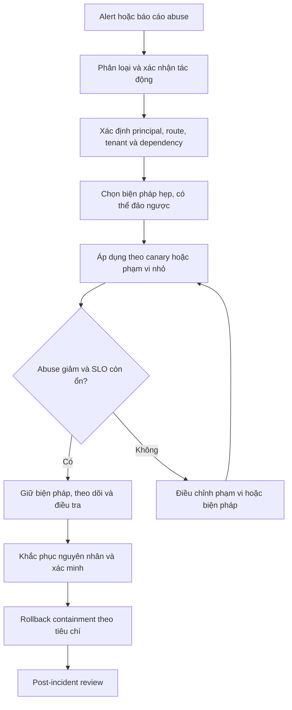

# Runbook containment mà không làm sập toàn dịch vụ

Khi một API bị lạm dụng, phản ứng đầu tiên thường là muốn chặn ngay mọi request đáng ngờ. Nhưng một lệnh chặn quá rộng có thể làm gián đoạn khách hàng hợp lệ, ảnh hưởng nhiều tenant hoặc khiến toàn bộ hệ thống ngừng phục vụ. Ngược lại, chờ xác minh quá lâu có thể để hành vi lạm dụng tiếp tục tiêu tốn tài nguyên, làm lộ dữ liệu hoặc gây thiệt hại nghiệp vụ.

Runbook containment cần giúp đội vận hành **giảm tác động của hành vi lạm dụng theo phạm vi nhỏ nhất có thể, theo dõi hiệu quả và mở rộng biện pháp chỉ khi cần**. Mục tiêu là bảo vệ tính bí mật, toàn vẹn và khả dụng của API trong khi duy trì các luồng hợp lệ quan trọng.

Ví dụ, một endpoint tìm kiếm bị gọi với tốc độ cao từ một API key. Nếu tắt toàn bộ `search-api`, người dùng của mọi tenant đều mất chức năng tìm kiếm. Nếu chỉ giới hạn key có hành vi bất thường, giảm page size, đặt quota riêng cho endpoint tốn tài nguyên và chuyển các truy vấn nặng sang hàng đợi, hệ thống có thể giảm tải mà vẫn phục vụ phần lớn người dùng.

Runbook này tập trung vào containment khi có dấu hiệu abuse như brute force, credential stuffing, enumeration, scraping, resource exhaustion, spam, lạm dụng luồng nghiệp vụ hoặc traffic bất thường. Nó cần phối hợp với quy trình incident response chung của tổ chức.

## 1. Mục tiêu và nguyên tắc containment

Containment là tập hợp biện pháp tạm thời nhằm ngăn sự cố lan rộng hoặc giảm thiệt hại trong lúc nhóm điều tra nguyên nhân và chuẩn bị khắc phục lâu dài. Containment không nhất thiết là chặn toàn bộ dịch vụ. Một biện pháp tốt phải xác định rõ đối tượng, phạm vi, thời hạn, người chịu trách nhiệm và cách gỡ bỏ.

Các nguyên tắc vận hành:

1. **Giới hạn theo phạm vi nhỏ nhất:** ưu tiên một credential, client, principal, tenant, route, action hoặc loại request có dấu hiệu abuse thay vì chặn cả service.
2. **Bảo vệ luồng quan trọng:** duy trì các endpoint cần thiết cho đăng nhập, thanh toán, hoàn tất giao dịch, health check và các chức năng khôi phục theo thứ tự ưu tiên đã thống nhất.
3. **Thay đổi có thể quan sát:** mỗi biện pháp phải có metric/log để biết nó đã giảm abuse hay chỉ chuyển traffic sang đường khác.
4. **Ưu tiên biện pháp có thể đảo ngược:** bắt đầu bằng throttle, quota, challenge hoặc giới hạn tính năng; chỉ dùng block hoặc disable rộng khi mức độ đe dọa đòi hỏi.
5. **Fail safe theo từng chức năng:** khi hệ thống chống abuse gặp lỗi, endpoint nhạy cảm không được tự động bỏ qua xác thực hoặc authorization; endpoint đọc công khai có thể có chính sách fallback khác.
6. **Giữ bằng chứng cần thiết:** lưu request ID, principal/client, thời gian, route và reason code; không lưu secret hoặc payload nhạy cảm không cần thiết.
7. **Đặt thời hạn và điều kiện kết thúc:** containment tạm thời phải có owner, expiry/review time và tiêu chí rollback.

Không có một hành động containment an toàn cho mọi tình huống. Chặn IP có thể hữu ích khi nguồn tấn công rõ ràng, nhưng có thể ảnh hưởng người dùng sau NAT, mạng di động hoặc proxy dùng chung. Rate limit theo IP có thể bổ sung cho limit theo user/client/tenant, không nên là chiều duy nhất.

## 2. Phân biệt sự cố abuse với lưu lượng hợp lệ tăng cao

Traffic tăng không tự động có nghĩa là tấn công. Một chiến dịch marketing, đợt mở bán, lịch đồng bộ, client retry sau outage hoặc một bản phát hành mới có thể làm request tăng đột biến.

Trước khi containment, hãy đối chiếu nhiều tín hiệu:

- **Nguồn gọi:** principal, API key, client ID, tenant, IP/ASN, user-agent và vùng địa lý nếu được phép thu thập.
- **Mẫu request:** route, method, query pattern, kích thước body, page size, tần suất lặp, số object ID khác nhau và tỷ lệ request thành công.
- **Tác động:** CPU, memory, database connections, queue depth, latency p95/p99, tỷ lệ timeout, chi phí dịch vụ ngoài và lỗi 4xx/5xx.
- **Ngữ cảnh thay đổi:** release gần nhất, thay đổi quota, chiến dịch sản phẩm, lịch batch, outage dependency hoặc thay đổi client.
- **Kết quả bảo mật:** xác thực thất bại, authorization denied, credential bị thu hồi vẫn được dùng, truy cập chéo tenant hoặc hành vi bất thường trong luồng nghiệp vụ.

Một số dấu hiệu thường gặp:

| Dấu hiệu | Có thể chỉ ra | Cần xác minh |
|---|---|---|
| Nhiều lần đăng nhập sai trên nhiều tài khoản | Credential stuffing hoặc brute force | Phân bố theo account, client, IP và user-agent; có phải lỗi cấu hình client không |
| Một principal thử nhiều ID liên tiếp | Enumeration hoặc BOLA probing | ID có tuần tự không, tỷ lệ 403/404, object có thuộc nhiều tenant không |
| Một API key tạo traffic tăng mạnh trên một route | Key bị lộ hoặc client lỗi | Owner của key, release/client version, nguồn gọi và scope của key |
| Request hợp lệ nhưng page size/batch rất lớn | Resource exhaustion | CPU/DB time, kích thước response và giới hạn hợp đồng |
| Nhiều thao tác OTP, đăng ký hoặc hoàn tiền | Lạm dụng business flow | Số tài khoản, recipient, transaction, chi phí và kết quả cuối cùng |
| Tăng retry đồng loạt sau timeout | Retry storm | Dependency nào lỗi trước, retry policy và backoff của client |

Nếu bằng chứng còn yếu, có thể bật giám sát tăng cường, giảm giới hạn ở một endpoint nặng hoặc áp dụng challenge có chọn lọc. Tránh chặn diện rộng chỉ dựa trên một IP hoặc một biểu đồ traffic.

## 3. Mức độ sự cố và mức phản ứng

Tổ chức nên định nghĩa severity dựa trên tác động thực tế và xu hướng, không chỉ số request. Ví dụ một lượng nhỏ request có thể gây rò rỉ dữ liệu nhạy cảm; ngược lại, một đợt traffic lớn có thể chỉ là client retry và chưa gây ảnh hưởng.

| Mức | Tác động điển hình | Phản ứng ban đầu |
|---|---|---|
| SEV-3 / thấp | Tăng traffic hoặc lỗi giới hạn ở một client; chưa có ảnh hưởng đáng kể | Theo dõi, xác minh nguồn, điều chỉnh quota có phạm vi hẹp |
| SEV-2 / trung bình | Một endpoint hoặc tenant bị suy giảm; có dấu hiệu abuse lặp lại | Chỉ định incident lead, áp dụng containment theo client/route/tenant, cập nhật thường xuyên |
| SEV-1 / cao | Nhiều tenant bị ảnh hưởng, nguy cơ lộ dữ liệu, giao dịch trái phép hoặc cạn tài nguyên diện rộng | Incident command, containment khẩn cấp, bảo vệ luồng quan trọng, phối hợp security/ops/product |

Đây là ví dụ phân loại; dùng định nghĩa severity hiện có của tổ chức nếu đã có. Nếu có nguy cơ mất dữ liệu, truy cập trái phép hoặc thiệt hại tài chính, hãy xử lý như incident bảo mật ngay cả khi availability vẫn bình thường.

## 4. Vai trò và quyền quyết định

Một runbook cần nêu rõ ai có quyền thay đổi traffic policy, ai xác minh security impact và ai quyết định rollback. Trong incident lớn, tránh để nhiều người cùng sửa gateway, WAF, application config hoặc quota mà không có một đầu mối điều phối.

| Vai trò | Trách nhiệm |
|---|---|
| Incident lead | Xác định ưu tiên, phân công, duyệt thay đổi phạm vi rộng và điều phối cập nhật |
| Service owner | Hiểu endpoint, dependency, SLO và tác động tới người dùng |
| Security responder | Đánh giá dấu hiệu tấn công, credential, authorization và dữ liệu bị ảnh hưởng |
| SRE/Platform | Thực hiện rate limit, traffic shaping, scaling, circuit breaker và rollback hạ tầng |
| Product/Customer operations | Xác định luồng quan trọng, khách hàng/tenant bị ảnh hưởng và thông điệp phù hợp |
| Scribe | Ghi timeline, quyết định, người thực hiện, thay đổi và kết quả |

Với sự cố nhỏ, một người có thể kiêm nhiều vai trò. Tuy nhiên, quyết định block tenant, tắt chức năng thanh toán hoặc thay đổi policy toàn cục cần có người chịu trách nhiệm rõ ràng và ghi lại lý do.

## 5. Trình tự containment

Trình tự dưới đây giúp nhóm phản ứng có hệ thống. Trong sự cố nghiêm trọng, một số bước có thể diễn ra song song, nhưng cần giữ một đầu mối điều phối và ghi nhận mọi thay đổi.



### Bước 1: Ghi nhận và xác định phạm vi

Ghi thời điểm phát hiện, alert/source, service, environment, route, API version và các chỉ số đang bị ảnh hưởng. Xác định request đến từ user, client app, API key, workload hay partner integration.

Tạo incident record và gắn request/trace ID có liên quan. Chụp lại baseline trước containment nếu có thể: traffic, latency, error rate, resource utilization và số lượng request bị chặn. Việc này giúp đánh giá biện pháp sau đó có hiệu quả hay không.

### Bước 2: Xác định blast radius

Trả lời các câu hỏi:

- Chỉ một route hay nhiều endpoint bị ảnh hưởng?
- Chỉ một client/API key, một user, một tenant hay nhiều tenant?
- Traffic tập trung ở một vùng, một gateway hay toàn hệ thống?
- Có dependency dùng chung như database, cache, queue hoặc dịch vụ bên ngoài đang quá tải không?
- Có dấu hiệu truy cập dữ liệu trái phép, thay đổi dữ liệu hoặc chỉ gây suy giảm availability?
- Các luồng nào cần được bảo vệ để người dùng vẫn đăng nhập, hoàn tất giao dịch hoặc khôi phục tài khoản?

Phân biệt nơi phát sinh traffic với nơi chịu tác động. Một endpoint search có thể làm quá tải database dùng chung và ảnh hưởng cả API hồ sơ. Khi đó, containment nên giới hạn truy vấn gây tải ở nguồn hoặc route cụ thể, đồng thời bảo vệ connection pool và dependency dùng chung.

### Bước 3: Chọn hành động nhỏ nhất có tác dụng

Ưu tiên các biện pháp theo thứ tự gợi ý:

1. Giảm chi phí mỗi request: page size, batch size, payload size, query depth, timeout hoặc độ đồng thời.
2. Giới hạn theo principal/client/API key/tenant và action cụ thể.
3. Làm chậm hoặc xếp hàng request tốn tài nguyên; trả `429` hoặc `503` có `Retry-After` phù hợp.
4. Challenge hoặc yêu cầu xác thực bổ sung cho nhóm request có rủi ro.
5. Tạm khóa credential/client cụ thể khi có bằng chứng bị lộ hoặc bị chiếm quyền.
6. Tắt tạm chức năng hoặc route riêng khi các biện pháp hẹp không đủ.
7. Chặn vùng traffic rộng hoặc tắt toàn service chỉ khi có nguy cơ nghiêm trọng và không còn biện pháp hẹp đủ hiệu quả.

Đây không phải thứ tự cứng. Nếu đang có rò rỉ dữ liệu hoặc giao dịch trái phép, thu hồi credential hay vô hiệu hóa action có thể cần thực hiện ngay. Điều quan trọng là lựa chọn phải gắn với bằng chứng và tác động đã đánh giá.

### Bước 4: Thực hiện có kiểm soát

Khi hệ thống hỗ trợ, áp dụng policy cho một client/tenant nhỏ trước, sau đó mở rộng theo tín hiệu. Kiểm tra cấu hình trước khi publish; xác minh route/method/identity match chính xác; ghi lại thời gian bắt đầu và thời hạn review.

Với thay đổi gateway hoặc WAF, cần kiểm tra thứ tự rule và tránh rule rộng hơn dự kiến. Một deny rule trên `/api/*` có thể vô tình chặn login, webhook, health check hoặc API phục vụ các luồng thiết yếu.

### Bước 5: Đo hiệu quả và tác dụng phụ

Theo dõi đồng thời:

- Traffic và tỷ lệ request bị throttle/block theo principal, tenant, route.
- Latency p95/p99, error rate, timeout và queue depth.
- Database connections, CPU, memory và saturation của dependency.
- Tỷ lệ request hợp lệ bị từ chối hoặc bị chậm.
- Các luồng kinh doanh quan trọng như login, checkout, payment status và account recovery.
- Dấu hiệu attacker chuyển sang IP, credential, route hoặc API version khác.

Một biện pháp chỉ được coi là hiệu quả khi giảm tác động abuse mà không tạo ra mức suy giảm dịch vụ lớn hơn. Nếu số request bị chặn tăng nhưng database vẫn quá tải, cần xem lại liệu nguồn tải có chuyển sang route khác hoặc công việc đã nằm trong queue hay chưa.

### Bước 6: Khắc phục và gỡ containment

Khi đã sửa nguyên nhân, kiểm thử bằng traffic mô phỏng hoặc canary, xác minh policy mới và mở lại theo từng phần. Gỡ các rule tạm thời có owner/expiry rõ ràng; giữ lại những kiểm soát đã được chuyển thành policy vận hành lâu dài.

Không xóa log, audit hoặc incident record khi gỡ rule. Ghi lại ai gỡ, lúc nào, lý do và kết quả sau rollback.

## 6. Các biện pháp containment theo lớp

### 6.1. Rate limit theo nhiều chiều

Rate limit giới hạn số request trong một khoảng thời gian. Thay vì chỉ giới hạn theo IP, có thể kết hợp nhiều dimension:

- Principal/user đã xác thực.
- Client ID hoặc API key.
- Tenant hoặc organization.
- Endpoint/action và HTTP method.
- IP/subnet/ASN như tín hiệu bổ sung.
- Loại tài nguyên hoặc chi phí ước tính của request.

Ví dụ, một user có thể gọi API đọc profile 60 lần/phút nhưng chỉ được tạo 3 yêu cầu gửi OTP trong một khoảng thời gian. Một tenant có thể có quota riêng cho export; một API key đối tác có quota theo hợp đồng. Giới hạn cần phản ánh chi phí và rủi ro của từng action.

Rate limit theo IP đơn thuần có thể chặn nhiều người dùng hợp lệ sau NAT hoặc bỏ lọt botnet phân tán. Rate limit theo account đơn thuần cũng có thể bị dùng để khóa tài khoản nạn nhân bằng cách cố tình gửi nhiều request. Hãy kết hợp limit, detection và response phù hợp.

### 6.2. Quota và ngân sách tài nguyên

Rate limit thường đo số request; quota có thể đo lượng tài nguyên hoặc quyền sử dụng trong một kỳ. Ví dụ:

- Số bản ghi được export mỗi ngày.
- Số SMS/OTP được gửi theo user, tenant hoặc client.
- Tổng số trang hoặc kích thước dữ liệu trả về.
- Số tác vụ báo cáo đang chạy đồng thời.
- Số lần gọi dịch vụ bên ngoài hoặc chi phí ước tính.

Với endpoint tốn tài nguyên, hãy giới hạn cả kích thước đầu vào lẫn chi phí thực thi. Một request/giây vẫn có thể gây cạn tài nguyên nếu mỗi request chạy truy vấn nặng hoặc tải file rất lớn.

### 6.3. Traffic shaping và queue

Traffic shaping điều tiết tốc độ request; queue hấp thụ burst và cho phép xử lý theo năng lực thực tế. Có thể chuyển tác vụ export, báo cáo hoặc xử lý media sang hàng đợi thay vì thực hiện đồng bộ trên request thread.

Các điểm cần kiểm soát:

- Giới hạn độ dài queue và số worker đồng thời.
- Đặt deadline/TTL cho job; loại bỏ job đã lỗi thời.
- Có quota theo principal/tenant để một khách hàng không chiếm hết worker.
- Thiết kế idempotency để retry không tạo side effect trùng.
- Ưu tiên job theo business priority đã định nghĩa.
- Trả trạng thái job và cho phép client polling với giới hạn phù hợp.

Queue không làm biến mất tải; nó chỉ điều tiết thời điểm xử lý. Nếu queue không có giới hạn, attacker có thể chuyển resource exhaustion từ API sang queue storage hoặc worker.

### 6.4. Challenge và xác thực tăng cường

Với login, đăng ký, gửi OTP hoặc các hành động dễ bị automation, có thể yêu cầu CAPTCHA, proof-of-work, device/risk check hoặc step-up authentication cho nhóm có dấu hiệu bất thường. Challenge cần được áp dụng có chọn lọc để không làm khó toàn bộ người dùng hợp lệ.

Challenge không thay thế authentication hoặc authorization. Nếu một request đã xác thực nhưng không có quyền truy cập object, CAPTCHA không làm request đó trở nên hợp lệ. Với giao dịch nhạy cảm, step-up cần gắn với action/transaction intent theo policy.

### 6.5. Credential containment

Nếu một API key, token hoặc service credential có dấu hiệu bị lộ:

1. Xác định credential ID/client owner và scope hiện tại.
2. Đánh giá request đã được chấp nhận và tài nguyên có thể bị truy cập.
3. Thu hồi hoặc tạm vô hiệu hóa credential cụ thể; không xóa secret khỏi log/repository rồi coi như đã xử lý.
4. Cấp credential mới qua kênh an toàn nếu client hợp lệ cần tiếp tục hoạt động.
5. Giảm scope/quota và đặt thời hạn phù hợp cho credential thay thế.
6. Xác minh request dùng credential cũ bị từ chối ở gateway và service.

Nếu credential dùng chung cho nhiều client, cần xác định tác động trước khi thu hồi. Sau incident, tách credential để lần sau có thể cô lập một client mà không làm gián đoạn toàn bộ tích hợp.

### 6.6. Tenant/client isolation

Nếu abuse tập trung ở một tenant, có thể giảm quota, tạm khóa action cụ thể hoặc cách ly job của tenant đó. Tuy nhiên, cần xác minh tenant không bị chiếm tài khoản quản trị và có luồng hỗ trợ để khôi phục.

Không nên chặn toàn bộ tenant chỉ vì một user có hành vi bất thường nếu có thể vô hiệu hóa principal hoặc API key cụ thể. Ngược lại, nếu credential quản trị tenant bị chiếm quyền và nhiều user bị ảnh hưởng, việc giới hạn một phần tenant có thể cần thiết.

### 6.7. Circuit breaker và bảo vệ dependency

Circuit breaker ngăn service tiếp tục gọi dependency đang lỗi hoặc quá tải. Khi tỷ lệ lỗi/timeout vượt ngưỡng, circuit có thể mở để fail fast, sau đó thử lại có giới hạn ở trạng thái half-open.

Circuit breaker bảo vệ dependency và thread/connection pool, nhưng có thể khiến chức năng phụ thuộc tạm thời không khả dụng. Nên áp dụng theo dependency/operation cụ thể, định nghĩa fallback phù hợp và không trả dữ liệu giả như thể giao dịch đã thành công.

Với request retry, dùng exponential backoff có jitter và giới hạn số lần retry. Retry storm có thể khiến một outage nhỏ biến thành sự cố toàn hệ thống.

### 6.8. Tạm vô hiệu hóa chức năng riêng

Nếu một tính năng gây tải lớn hoặc bị khai thác, có thể tắt riêng action đó qua feature flag hoặc gateway policy. Ví dụ, tạm dừng export CSV nhưng vẫn cho xem báo cáo theo trang; tạm dừng gửi OTP qua SMS nhưng giữ kênh xác minh khác nếu policy cho phép.

Feature flag khẩn cấp cần:

- Phạm vi rõ ràng: route/action/tenant/client/environment.
- Owner và thời điểm hết hạn/review.
- Kiểm tra ảnh hưởng đến dependency và business flow.
- Audit khi bật/tắt và metric cho số request bị ảnh hưởng.
- Cách khôi phục đã thử trước đó.

Không dùng một cờ tắt chung cho cả service nếu có thể cô lập chức năng đang bị lạm dụng.

## 7. Bảo vệ availability khi containment

Containment có thể gây tác dụng phụ nếu policy quá rộng hoặc không hiểu dependency. Cần xác định rõ luồng ưu tiên và mức degraded mode có thể chấp nhận.

### 7.1. Phân loại endpoint theo mức quan trọng

Một bảng ví dụ:

| Nhóm endpoint | Ưu tiên vận hành | Biện pháp khi quá tải |
|---|---|---|
| Authentication/session refresh | Cao | Giới hạn theo account/client, chống brute force có chọn lọc, giữ đường đăng nhập hợp lệ |
| Payment/transaction status | Cao | Giữ truy vấn trạng thái; hạn chế tạo giao dịch mới nếu cần và bảo đảm idempotency |
| Account recovery | Cao nhưng nhạy cảm | Rate limit chặt, chống enumeration, giữ luồng khôi phục an toàn |
| Search/list | Trung bình | Giảm page size, cache hợp lệ, giới hạn query cost và concurrency |
| Bulk export/report | Có thể trì hoãn | Queue, quota theo tenant, tạm dừng job mới hoặc giảm worker |
| Analytics/telemetry phụ trợ | Thấp hơn | Sampling, batch hoặc tạm giảm độ chi tiết |

Ưu tiên phải phù hợp với sản phẩm. Ví dụ, trong hệ thống thanh toán, trạng thái giao dịch có thể cần tiếp tục phục vụ để người dùng không gửi lại giao dịch đã thành công. Trong hệ thống khác, luồng ưu tiên có thể là khôi phục tài khoản hoặc truy cập dữ liệu y tế.

### 7.2. Degraded mode có chủ đích

Degraded mode cho phép hệ thống tiếp tục cung cấp phần chức năng cốt lõi khi một số thành phần bị giới hạn. Ví dụ:

- Tắt export lớn nhưng vẫn cho xem dữ liệu theo trang.
- Giảm page size và concurrency thay vì chặn mọi request đọc.
- Trả dữ liệu cache chỉ khi freshness và quyền truy cập cho phép; không phục vụ dữ liệu riêng tư từ cache sai tenant.
- Tạm dừng tác vụ không khẩn cấp nhưng giữ job đã cam kết hoặc có thể gây mất trạng thái nếu hủy.
- Giảm tần suất cập nhật dashboard nhưng vẫn giữ luồng giao dịch chính.

Degraded mode cần được thiết kế và kiểm thử trước incident. Không nên lần đầu thử chế độ này khi production đang quá tải.

### 7.3. Không để biện pháp chống abuse trở thành DoS nội bộ

Các kiểm soát cũng tiêu tốn tài nguyên. Ví dụ, gọi một dịch vụ risk scoring đồng bộ cho mọi request có thể làm risk service thành bottleneck; tạo CAPTCHA challenge cho mọi user có thể làm tăng tải hoặc làm giảm conversion; ghi toàn bộ request body vào log có thể làm đầy storage.

Hãy giới hạn chi phí của chính cơ chế chống abuse:

- Cache kết quả policy/risk trong thời gian ngắn khi phù hợp và có invalidation.
- Giới hạn kích thước log, dùng sampling cho traffic bình thường và giữ audit đầy đủ cho sự kiện quan trọng.
- Có timeout và circuit breaker cho dependency chống abuse.
- Tránh gọi nhiều dịch vụ ngoài trong đường xử lý đồng bộ.
- Đặt quota cho queue, challenge generation và các tác vụ điều tra tự động.

## 8. Runbook theo tình huống

Các kịch bản sau là mẫu để điều chỉnh theo kiến trúc và chính sách của tổ chức.

### 8.1. Credential stuffing hoặc brute force đăng nhập

**Dấu hiệu:** nhiều lần đăng nhập thất bại trên nhiều account, request tập trung vào endpoint login, nguồn gọi phân tán hoặc user-agent tự động.

**Containment:**

1. Xác định account/client/IP pattern và phân biệt lỗi đăng nhập hàng loạt do client lỗi.
2. Áp rate limit theo account và nguồn gọi với ngưỡng được hiệu chỉnh; tránh khóa tài khoản vĩnh viễn chỉ vì có nhiều lần thử sai.
3. Áp challenge/risk check cho traffic nghi ngờ; yêu cầu MFA hoặc step-up khi policy chỉ ra rủi ro.
4. Bảo vệ endpoint recovery để attacker không chuyển sang dò hoặc spam kênh khôi phục.
5. Theo dõi tỷ lệ đăng nhập hợp lệ bị từ chối, số account bị ảnh hưởng và request chuyển sang endpoint khác.
6. Nếu credential cụ thể bị xác nhận lộ, thực hiện reset/revoke theo quy trình và thông báo phù hợp.

**Tránh:** chặn toàn bộ dải IP lớn khi nhiều khách hàng hợp lệ dùng chung mạng; khóa hàng loạt account chỉ dựa trên request thất bại.

### 8.2. Enumeration hoặc scraping dữ liệu

**Dấu hiệu:** một principal duyệt nhiều ID, page liên tục, truy vấn với pattern lặp hoặc export lượng lớn dữ liệu.

**Containment:**

1. Kiểm tra authorization log, object/tenant scope và response size.
2. Giới hạn page size, số trang, tốc độ truy vấn và export theo principal/tenant.
3. Chặn hoặc thu hẹp credential/client có dấu hiệu bị lạm dụng; giữ endpoint đọc cần thiết cho client hợp lệ.
4. Kiểm tra dữ liệu có bị truy cập trái phép hay chỉ được đọc trong scope hợp lệ.
5. Bổ sung detection cho ID enumeration và response pattern; rà soát cache/CDN để không làm lộ dữ liệu riêng tư.

**Tránh:** chỉ đổi ID sang UUID hoặc chặn URL công khai mà không sửa object authorization.

### 8.3. Resource exhaustion từ request hợp lệ

**Dấu hiệu:** endpoint trả 200 nhưng latency và DB time tăng, page size lớn, truy vấn sâu, payload nặng hoặc tác vụ CPU-intensive.

**Containment:**

1. Xác định chi phí theo route và tham số; dùng trace để tìm truy vấn hoặc dependency tốn thời gian.
2. Giới hạn payload, page size, query depth, batch size, timeout và concurrency.
3. Chuyển công việc nặng sang queue có giới hạn; giảm worker hoặc tạm dừng job không ưu tiên.
4. Bật cache chỉ khi dữ liệu và authorization scope cho phép.
5. Theo dõi database pool, queue depth, latency và tỷ lệ request hợp lệ bị từ chối.

**Tránh:** chỉ scale ngang vô hạn khi mỗi request vẫn tạo tải không giới hạn lên database hoặc dịch vụ tính phí.

### 8.4. API key hoặc token bị lộ

**Dấu hiệu:** credential dùng từ client/nguồn lạ, traffic tăng, endpoint nhạy cảm được gọi hoặc key xuất hiện trong repository/log.

**Containment:**

1. Xác định key ID, owner, scope, tenant và các request đã được chấp nhận.
2. Thu hồi credential bị lộ; xác minh gateway và service từ chối request mới.
3. Cấp key mới qua secret manager hoặc kênh provisioning an toàn nếu client hợp lệ cần tiếp tục hoạt động.
4. Giảm scope/quota, tách credential nếu trước đây dùng chung.
5. Rà soát dữ liệu hoặc action đã bị truy cập, lưu bằng chứng và thông báo theo quy trình.

**Tránh:** chỉ xóa key khỏi source code hoặc chặn IP hiện tại trong khi credential vẫn còn hiệu lực.

### 8.5. Abuse trên một tenant hoặc partner

**Dấu hiệu:** traffic, export, OTP hoặc transaction bất thường tập trung vào một tenant/client.

**Containment:**

1. Xác minh tenant/client owner và xem credential quản trị có bị chiếm quyền không.
2. Giới hạn action hoặc quota cụ thể trước khi khóa toàn tenant.
3. Nếu cần cách ly, giữ các endpoint hỗ trợ, trạng thái giao dịch và recovery theo policy.
4. Thông báo đầu mối vận hành/partner qua kênh được phê duyệt; không gửi thông tin nhạy cảm qua kênh không an toàn.
5. Chỉ mở lại khi owner xác nhận nguyên nhân đã được xử lý và policy mới được kiểm chứng.

### 8.6. Retry storm hoặc dependency outage

**Dấu hiệu:** nhiều service retry cùng lúc, queue tăng, timeout lan truyền và circuit breaker mở.

**Containment:**

1. Xác định dependency lỗi đầu tiên và tạm giảm retry/concurrency ở caller.
2. Bật exponential backoff có jitter, giới hạn retry và deadline toàn request.
3. Mở circuit breaker cho operation bị lỗi; trả lỗi có thể retry với `Retry-After` khi phù hợp.
4. Giữ endpoint không phụ thuộc vào dependency đó nếu có thể.
5. Không replay các giao dịch không idempotent; kiểm tra idempotency key và trạng thái trước khi retry.

**Tránh:** tăng retry hoặc restart hàng loạt service mà không giảm áp lực lên dependency đang lỗi.

## 9. Ví dụ quyết định containment theo từng lớp

Giả sử `POST /api/reports/export` tăng từ 20 lên 1.500 request/phút. Database CPU tăng, queue export đầy và người dùng vẫn cần xem báo cáo cơ bản.

Một kế hoạch containment có thể là:

| Phạm vi | Hành động | Lý do |
|---|---|---|
| Endpoint export | Giảm concurrency và giới hạn số bản ghi mỗi job | Giảm chi phí mỗi request |
| Client/API key bất thường | Hạ quota tạm thời hoặc revoke nếu key bị lộ | Cô lập nguồn traffic đã xác định |
| Tenant | Áp quota export riêng theo hợp đồng và baseline | Tránh một tenant chiếm worker của tenant khác |
| Queue | Giới hạn depth, ưu tiên job đã được chấp nhận và loại job hết hạn | Ngăn queue tăng vô hạn |
| Reports read API | Giữ read-only với page size thấp hơn | Duy trì chức năng cơ bản |
| Database | Giới hạn connection/concurrency cho export worker | Bảo vệ dependency dùng chung |

Sau khi áp dụng, nhóm theo dõi queue depth, database CPU, latency của read API, tỷ lệ export thành công và số request bị throttle. Nếu export traffic vẫn cao từ nhiều client nhưng không có dấu hiệu chiếm quyền, có thể đó là nhu cầu hợp lệ tăng cao; khi đó cần mở rộng năng lực hoặc điều chỉnh quota theo kế hoạch thay vì tiếp tục block.

## 10. Cách thiết kế rule containment an toàn

Một rule vận hành nên mô tả rõ điều kiện match và phạm vi ảnh hưởng. Ví dụ cấu hình minh họa:

```yaml
ruleId: temporary-export-throttle-2026-11
scope:
  service: reports-api
  route: POST /api/reports/export
  clientId: partner-client-17
action:
  type: rate-limit
  limit: 10
  window: 1m
  response: 429
  retryAfter: 30s
owner: incident-commander
reason: abnormal-export-burst
expiresAt: 2026-11-18T14:00:00Z
reviewAt: 2026-11-18T13:30:00Z
```

Đây là ví dụ minh họa, không phải schema của gateway cụ thể. Trong thực tế cần xác định rõ:

- Rule match theo route đã chuẩn hóa, method và identity nào.
- Giới hạn có dùng token bucket, fixed window, sliding window hay thuật toán khác.
- Limit được chia sẻ giữa instance hay mỗi instance có bucket riêng.
- Hành vi khi rate-limit store hoặc policy service không khả dụng.
- Response có `Retry-After` và mã lỗi ổn định để client xử lý hay không.
- Thời hạn, người sở hữu, lý do và cách rollback.

Nếu mỗi gateway instance giữ counter riêng, tổng quota thực tế có thể cao hơn dự kiến khi scale ngang. Nếu dùng distributed counter, store có thể trở thành dependency mới; cần timeout, fallback và bảo vệ nó khỏi quá tải.

## 11. Gỡ bỏ containment và phục hồi dịch vụ

Không nên giữ rule khẩn cấp vô thời hạn. Khi nguyên nhân đã được sửa hoặc rủi ro giảm, thực hiện rollback theo từng bước:

1. Xác nhận bản sửa đã được triển khai và kiểm thử trên canary hoặc phạm vi nhỏ.
2. Xác minh credential, permission, validation, quota hoặc dependency liên quan đã hoạt động đúng.
3. Nới một giới hạn tại một thời điểm; quan sát traffic và SLO trước khi nới tiếp.
4. Gỡ block/throttle tạm thời đã hết mục đích; giữ lại policy lâu dài đã được review.
5. Kiểm tra job tồn đọng, request retry, giao dịch pending và dữ liệu có thể cần đối soát.
6. Thông báo cho service owner/tenant/partner nếu có thay đổi ảnh hưởng họ.
7. Đóng incident khi đã đáp ứng tiêu chí phục hồi và các action item có owner.

Nếu mở lại gây tái phát abuse, quay lại trạng thái containment trước đó và cập nhật giả thuyết. Không nên xóa rule hoặc thay đổi hàng loạt chỉ để đưa dashboard về màu xanh.

## 12. Ghi nhận bằng chứng và bảo vệ dữ liệu

Trong quá trình containment, cần giữ đủ thông tin để xác định nguyên nhân và phạm vi ảnh hưởng:

- Timestamp đồng bộ, request ID/trace ID và service/version.
- Principal/client/API key ID đã được định danh; không ghi secret.
- Route template, method, status, latency, kích thước và reason code.
- Kết quả authentication/authorization và quota decision.
- Rule đã bật/tắt, người thực hiện, thời điểm, lý do và kết quả.
- Dữ liệu về resource utilization và dependency saturation.

Không ghi password, access/refresh token, API key, session cookie, private key hoặc toàn bộ payload nhạy cảm. Nếu cần lưu mẫu request để điều tra, hãy mask dữ liệu cá nhân và secret, giới hạn quyền truy cập, mã hóa và đặt thời hạn lưu. Bằng chứng cần được bảo vệ khỏi sửa đổi và chỉ chia sẻ qua kênh được phép.

## 13. Mẫu nhật ký quyết định containment

Mỗi hành động nên có bản ghi ngắn, đủ để người trực sau hiểu tại sao rule được bật và cách khôi phục:

```text
Incident: INC-2026-041
Service/Environment: reports-api / production
Observed: export request burst from partner-client-17
Impact: export queue saturated; report read latency elevated
Evidence: request IDs, trace IDs, route metrics, client ID
Containment: temporary rate limit on export route for one client
Scope: POST /api/reports/export, partner-client-17
Owner: incident commander / service owner
Applied at: 13:10 UTC
Review at: 13:30 UTC
Expiry: 14:00 UTC
Success criteria: queue depth falling; read API p95 back within SLO
Rollback: remove temporary rule after client fix and canary validation
```

Không đưa token, key hoặc dữ liệu cá nhân vào incident note. Mẫu trên chỉ minh họa cách ghi; dùng hệ thống incident management và múi giờ chuẩn của tổ chức.

## 14. Chỉ số đánh giá containment

Containment cần được đánh giá bằng cả hiệu quả giảm abuse và mức độ giữ dịch vụ:

| Chỉ số | Ý nghĩa |
|---|---|
| Abuse request rate | Tốc độ request được xác định là abuse trước và sau containment |
| Block/throttle rate theo scope | Số request bị giới hạn theo principal, client, tenant hoặc route |
| False-positive rate | Tỷ lệ request hợp lệ bị chặn hoặc throttle |
| p95/p99 latency | Trải nghiệm của request còn được phục vụ |
| Error rate theo endpoint | Tác động tới chức năng và client hợp lệ |
| Dependency saturation | CPU, DB connections, queue depth, memory và external API usage |
| Critical-flow success rate | Tỷ lệ thành công của login, payment status, recovery hoặc flow ưu tiên |
| Time to contain | Thời gian từ xác nhận incident đến khi tác động được giới hạn |
| Time to recover | Thời gian khôi phục dịch vụ về mức chấp nhận được |

Không tối ưu một chỉ số riêng lẻ. Ví dụ, block rate cao có thể cho thấy rule đang chặn được abuse, nhưng cũng có thể là false positive. Latency giảm trong khi payment success rate giảm mạnh không phải một kết quả containment tốt.

## 15. Checklist vận hành khi có API abuse

- [ ] Ghi nhận incident, thời điểm, service, route, version và người điều phối.
- [ ] Xác định abuse pattern bằng nhiều tín hiệu; phân biệt với traffic hợp lệ hoặc retry storm.
- [ ] Xác định principal/client/API key, tenant, IP và dependency chịu ảnh hưởng.
- [ ] Đánh giá nguy cơ dữ liệu, toàn vẹn giao dịch và availability.
- [ ] Liệt kê critical flows cần duy trì và các endpoint có thể degraded.
- [ ] Chọn containment có phạm vi nhỏ nhất và có thể đảo ngược.
- [ ] Rate limit/quota theo nhiều chiều; không chỉ dựa vào IP.
- [ ] Giới hạn request cost, payload, page size, batch, concurrency và queue.
- [ ] Thu hồi credential cụ thể nếu bị lộ; xác minh credential cũ thực sự bị từ chối.
- [ ] Áp dụng rule qua canary hoặc scope nhỏ khi mức độ incident cho phép.
- [ ] Theo dõi abuse rate, false positives, SLO, critical-flow success và dependency saturation.
- [ ] Ghi owner, reason, thời điểm review, expiry và rollback cho mỗi rule tạm thời.
- [ ] Giữ bằng chứng nhưng mask secret và dữ liệu nhạy cảm.
- [ ] Sửa nguyên nhân gốc, kiểm thử và mở lại từng bước.
- [ ] Rà soát job/giao dịch pending và thực hiện post-incident review.

## 16. Diễn tập runbook trước khi cần dùng

Runbook chỉ hữu ích nếu đội vận hành biết cách thực hiện và hệ thống hỗ trợ các hành động được mô tả. Nên diễn tập định kỳ trong staging hoặc môi trường thử nghiệm có kiểm soát:

- Mô phỏng một API key bị lộ và xác minh chỉ key đó bị thu hồi.
- Tạo burst traffic trên một route nặng và thử giảm page size/concurrency mà vẫn giữ endpoint đọc.
- Mô phỏng credential stuffing và đo false-positive với người dùng sau NAT.
- Làm queue đầy để kiểm tra giới hạn queue, backpressure và ưu tiên job.
- Làm dependency timeout để xác minh circuit breaker, retry backoff và idempotency.
- Bật rồi gỡ feature flag khẩn cấp; xác minh không còn rule tạm thời bị quên.
- Diễn tập khôi phục credential/client/tenant sau khi xác minh nguyên nhân đã được xử lý.

Sau diễn tập, cập nhật runbook với command/config thực tế, owner, quyền cần thiết, thời gian lan truyền policy và các phụ thuộc. Không đưa secret hoặc token production vào tài liệu diễn tập.

## 17. Nguyên tắc cần ghi nhớ

Containment tốt làm giảm tác động abuse mà vẫn duy trì những luồng hợp lệ quan trọng. Trước khi chặn, hãy hiểu nguồn traffic, route, tenant, dependency và mức độ thiệt hại. Ưu tiên giới hạn theo principal/client/tenant/action, giảm chi phí mỗi request, điều tiết queue và thu hồi credential cụ thể. Chỉ mở rộng tới route hoặc service lớn hơn khi bằng chứng và tác động yêu cầu.

Mỗi rule tạm thời cần phạm vi, owner, reason, metric theo dõi, thời điểm review và cách rollback. Theo dõi cả abuse bị chặn lẫn false positive, latency và tỷ lệ thành công của critical flow. Một biện pháp làm traffic giảm nhưng khiến toàn bộ khách hàng hợp lệ không thể sử dụng dịch vụ có thể tạo ra sự cố mới.

Sau khi khắc phục nguyên nhân, hãy gỡ containment theo từng bước, đối soát request/job/giao dịch đang chờ và chuyển những kiểm soát cần thiết thành policy lâu dài. Runbook cần được diễn tập để đội ngũ có thể hành động nhanh mà không phải thử nghiệm cấu hình rộng trên production trong lúc hệ thống đang bị áp lực.

## Tài liệu tham khảo

- OWASP API Security Top 10 (2023) — API4:2023 Unrestricted Resource Consumption.
- OWASP Automated Threats to Web Applications — các dạng automation và abuse pattern.
- OWASP REST Security Cheat Sheet — giới hạn request, validation và kiểm soát truy cập.
- Google SRE Workbook — Incident Response, mitigating overload và graceful degradation.
- RFC 6585 — Additional HTTP Status Codes, bao gồm `429 Too Many Requests`.
- RFC 9110 — HTTP Semantics, gồm `Retry-After` và các status code liên quan.
