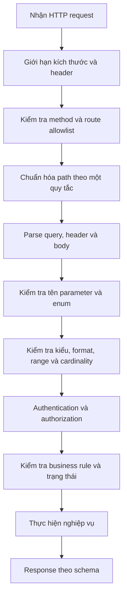

# Allowlist method, path, parameter và enum

API nhận dữ liệu từ client qua HTTP method, path, query string, header và request body. Mỗi thành phần đều có thể bị thay đổi thủ công, gửi giá trị ngoài dự kiến hoặc dùng cách biểu diễn khác để đi qua lớp kiểm tra. Vì vậy, API cần định nghĩa rõ những method, route, parameter và enum được hỗ trợ, sau đó từ chối các giá trị không thuộc hợp đồng.

Allowlist là cách tiếp cận phù hợp cho input validation: chỉ chấp nhận tập giá trị đã biết và có ý nghĩa với endpoint. Cách này giúp giảm bề mặt xử lý, tránh các nhánh bất ngờ và làm cho hợp đồng API dễ kiểm thử. Tuy nhiên, một giá trị hợp lệ về cú pháp vẫn có thể không được phép theo quyền của caller. Allowlist validation phải đi cùng authentication, authorization, kiểm tra trạng thái nghiệp vụ và giới hạn tài nguyên.

## 1. Allowlist là gì và vì sao cần dùng?

Allowlist xác định trước tập method, path, tên parameter, định dạng hoặc giá trị mà API chấp nhận. Request chỉ được tiếp tục khi các thành phần liên quan khớp hợp đồng đã định nghĩa.

Ví dụ, endpoint tìm kiếm đơn hàng chỉ hỗ trợ:

```http
GET /api/orders?status=PAID&sort=createdAt&direction=DESC&page=0&size=50
```

Hợp đồng có thể quy định:

- Chỉ nhận `GET` trên route `/api/orders`.
- Chỉ nhận query parameter `status`, `sort`, `direction`, `page` và `size`.
- `status` chỉ nhận `PENDING`, `PAID`, `CANCELLED` hoặc `SHIPPED`.
- `sort` chỉ nhận `createdAt`, `totalAmount` hoặc `orderNumber`.
- `direction` chỉ nhận `ASC` hoặc `DESC`.
- `page` là số nguyên không âm; `size` từ 1 đến 100.

Request có `sort=customerEmail`, `size=100000` hoặc `debug=true` phải bị từ chối nếu những giá trị đó không nằm trong hợp đồng.

Allowlist thường an toàn và dễ bảo trì hơn việc cố gắng liệt kê mọi chuỗi nguy hiểm cần chặn. Blacklist như chặn riêng ký tự `'`, `..` hoặc từ khóa `DROP` thường bỏ sót cách mã hóa, cú pháp mới và những giá trị nguy hiểm không nằm trong danh sách đã nghĩ tới.

| Cách tiếp cận | Đặc điểm | Hạn chế |
|---|---|---|
| Allowlist | Chấp nhận những giá trị được định nghĩa rõ | Cần cập nhật hợp đồng khi thêm chức năng hoặc giá trị mới |
| Denylist/blacklist | Chặn một số giá trị đã biết là nguy hiểm | Khó bao phủ mọi biến thể và dễ tạo cảm giác an toàn giả |
| Validation theo kiểu dữ liệu | Kiểm tra UUID, số nguyên, ngày giờ, độ dài | Kiểu hợp lệ chưa chắc thuộc tập giá trị nghiệp vụ được phép |
| Authorization | Kiểm tra caller có quyền thực hiện hành động hay không | Không thay thế kiểm tra cú pháp, phạm vi và giới hạn đầu vào |

Một API an toàn thường kết hợp allowlist với kiểu dữ liệu, giới hạn kích thước, validation nghiệp vụ và authorization.

## 2. Allowlist HTTP method

Mỗi resource chỉ nên hỗ trợ những HTTP method thực sự cần thiết. Cùng một URI có thể đại diện cho nhiều hành động và mỗi method cần chính sách riêng.

Ví dụ:

| Route | Method được hỗ trợ | Hành động |
|---|---|---|
| `/api/orders/{id}` | `GET`, `HEAD` | Đọc đơn hàng và metadata được phép |
| `/api/orders/{id}` | `PATCH` | Cập nhật các trường được phép |
| `/api/orders/{id}` | `DELETE` | Hủy đơn theo điều kiện nghiệp vụ |
| `/api/orders` | `GET`, `POST` | Tìm kiếm hoặc tạo đơn hàng |
| `/api/orders/{id}/approve` | `POST` | Thực hiện command phê duyệt |

Không bật `PUT`, `DELETE` hoặc các method khác chỉ vì framework hỗ trợ chúng. Nếu endpoint không có nhu cầu dùng một method, không khai báo route tương ứng và bảo đảm proxy, gateway cùng backend không tự ánh xạ method đó sang một thao tác khác.

### 2.1. Xử lý method không được hỗ trợ

Với route tồn tại nhưng method không được hỗ trợ, API thường trả `405 Method Not Allowed` và có thể cung cấp header `Allow` chứa những method được hỗ trợ. Với route không tồn tại, phản hồi thường là `404 Not Found`. Cần thống nhất hành vi giữa API gateway, reverse proxy và application server.

Không tự động chuyển mọi method lạ thành `GET` hoặc `POST`. Không dùng một rule bảo vệ path chung để cho phép mọi method trên route đó. Cấu hình authorization cần xét cả method và path.

Ví dụ kiểm tra âm:

```http
TRACE /api/orders/ORD-42 HTTP/1.1
Host: api.example.test
```

Các method như `TRACE` hoặc `CONNECT` thường không cần cho API nghiệp vụ. Nếu không sử dụng, hãy tắt ở web server, proxy và framework. Cũng cần kiểm tra `X-HTTP-Method-Override` hoặc tham số `_method` nếu framework có hỗ trợ. Nếu gateway kiểm tra `POST` nhưng backend đổi method thành `DELETE`, policy có thể bị bypass.

### 2.2. Xử lý OPTIONS và CORS

`OPTIONS` có thể được dùng để công bố khả năng của route hoặc xử lý CORS preflight. Việc cho phép một preflight request không có nghĩa caller đã được cấp quyền thực hiện method được nêu trong `Access-Control-Request-Method`.

Ví dụ trình duyệt hỏi trước khi gửi `DELETE`:

```http
OPTIONS /api/orders/ORD-42 HTTP/1.1
Origin: https://app.example.test
Access-Control-Request-Method: DELETE
Access-Control-Request-Headers: authorization,content-type
```

Sau preflight, request `DELETE` thực tế vẫn phải qua authentication, function authorization, object authorization và business rule. CORS kiểm soát việc trình duyệt cho phép JavaScript đọc response; nó không phải cơ chế phân quyền API.

## 3. Allowlist path và route

Path quyết định handler hoặc resource mà request sẽ chạm tới. Không nên kiểm tra path bằng so khớp chuỗi lỏng lẻo rồi giả định mọi route con đều an toàn.

### 3.1. Khai báo route cụ thể

Ưu tiên route template rõ ràng:

```text
GET    /api/orders
POST   /api/orders
GET    /api/orders/{orderId}
PATCH  /api/orders/{orderId}
POST   /api/orders/{orderId}/cancel
```

Mỗi route cần có method, handler và policy cụ thể. Tránh các rule kiểu `path.startsWith("/api/order")` vì có thể vô tình khớp `/api/orders-admin`, `/api/order-export` hoặc một route mới có mức nhạy cảm khác.

Nếu phải dùng prefix, hãy bảo đảm ranh giới segment được kiểm tra. `/api/orders/` và `/api/orders-admin/` là hai nhánh khác nhau. Cần kiểm thử route matcher thực tế thay vì chỉ đọc cấu hình.

### 3.2. Chuẩn hóa path nhất quán

Các tầng proxy, gateway và ứng dụng có thể diễn giải path khác nhau. Những biến thể cần được kiểm thử gồm:

- Dấu gạch chéo lặp: `/api//orders/42`.
- Dấu chấm và segment cha: `/api/orders/../admin`.
- Ký tự mã hóa phần trăm: `%2e`, `%2f`, `%5c`.
- Dấu gạch chéo ngược: `\`.
- Mã hóa hai lần: `%252e%252e`.
- Path parameter hoặc matrix parameter nếu framework hỗ trợ: `/orders;mode=admin/42`.
- Unicode normalization và các ký tự nhìn giống nhau.
- Trailing slash và alias route.

Ví dụ, gateway có thể kiểm tra chuỗi `/api/orders/%2e%2e/admin` trước khi decode, còn backend decode rồi chuẩn hóa thành `/api/admin`. Nếu hai tầng không thống nhất, request có thể đi qua allowlist của gateway nhưng tới handler khác ở backend.

Hãy xác định một quy tắc canonicalization duy nhất, áp dụng nhất quán trước khi định tuyến và authorization. Không decode lặp nhiều lần. Với encoding hoặc cấu trúc path không hợp lệ/nhập nhằng, nên từ chối thay vì cố đoán ý định. Kiểm tra cả request trực tiếp tới backend nếu backend có thể truy cập ngoài gateway.

### 3.3. Validate path variable theo kiểu dữ liệu

Path variable như `orderId`, `userId` hoặc `tenantId` cần có định dạng cụ thể. Nếu ID là UUID, parse thành UUID và từ chối chuỗi không hợp lệ. Nếu là mã nghiệp vụ, giới hạn charset, độ dài và quy tắc chuẩn hóa.

Ví dụ:

```java
@GetMapping("/api/orders/{orderId}")
public OrderView getOrder(@PathVariable UUID orderId) {
    // UUID không hợp lệ sẽ không được chấp nhận như một ID tùy ý.
    return orderService.get(orderId);
}
```

Không dùng path variable do client gửi làm đường dẫn file, tên class, tên bảng hoặc tên service tùy ý. Nếu nghiệp vụ cần chọn một loại tài nguyên hoặc thao tác, ánh xạ giá trị đầu vào qua một bảng allowlist cố định.

Path hợp lệ cũng không chứng minh caller có quyền truy cập resource. Sau khi parse ID, API vẫn phải kiểm tra tenant, owner hoặc quan hệ truy cập.

## 4. Allowlist query parameter

Query parameter ảnh hưởng đến tìm kiếm, lọc, phân trang, sắp xếp và đôi khi cả hành vi nghiệp vụ. Mỗi endpoint nên công bố danh sách tên parameter, kiểu, số lần xuất hiện, giá trị mặc định và giới hạn.

Ví dụ hợp đồng tìm kiếm:

| Parameter | Bắt buộc | Kiểu / allowlist | Giới hạn |
|---|---|---|---|
| `status` | Không | `PENDING`, `PAID`, `CANCELLED`, `SHIPPED` | Một giá trị |
| `sort` | Không | `createdAt`, `totalAmount`, `orderNumber` | Một giá trị |
| `direction` | Không | `ASC`, `DESC` | Một giá trị |
| `page` | Không | Số nguyên | Từ 0 trở lên |
| `size` | Không | Số nguyên | 1 đến 100 |
| `from` | Không | Ngày ISO-8601 | Không vượt quá khoảng thời gian nghiệp vụ |
| `to` | Không | Ngày ISO-8601 | Phải sau hoặc bằng `from` |

### 4.1. Từ chối parameter không được khai báo

Request như sau phải bị từ chối nếu `debug`, `includeDeleted` hoặc `internalTenant` không thuộc hợp đồng:

```http
GET /api/orders?status=PAID&debug=true&internalTenant=tenant-999
```

Không âm thầm chuyển parameter lạ thành tùy chọn nội bộ. Đặc biệt, không để client điều khiển các trường như `tenantId`, `ownerId`, `isAdmin`, `includeDeleted` hoặc `bypassCache` nếu endpoint không định nghĩa và kiểm soát chúng rõ ràng.

Nếu API cần mở rộng trong tương lai, hãy thêm parameter vào hợp đồng theo version hoặc quy trình tương thích đã công bố. Việc bỏ qua mọi parameter lạ có thể hữu ích cho một số API cần forward compatibility, nhưng không được để parameter bị bỏ qua tác động tới logic ở middleware hoặc tầng khác.

### 4.2. Xử lý parameter trùng lặp

Query string có thể chứa cùng tên nhiều lần:

```text
?role=user&role=admin
?page=1&page=999999
?status=PAID&status=CANCELLED
```

Một framework có thể lấy giá trị đầu tiên, giá trị cuối cùng hoặc trả về danh sách. Nếu gateway và backend chọn cách khác nhau, có thể xảy ra HTTP parameter pollution.

Với parameter đơn trị, hãy từ chối khi xuất hiện nhiều hơn một lần. Với parameter đa trị được hỗ trợ, định nghĩa rõ số phần tử tối đa, cách xử lý trùng lặp và thứ tự có ý nghĩa hay không. Không để các lớp khác nhau tự chọn giá trị.

### 4.3. Giới hạn giá trị số và phân trang

Kiểm tra kiểu số chưa đủ. `size=999999999` có thể là số nguyên hợp lệ nhưng gây truy vấn quá lớn hoặc tiêu thụ bộ nhớ. Cần giới hạn min/max, kiểm tra overflow và tính toán offset an toàn.

Ví dụ:

```java
public record OrderSearchQuery(
        OrderStatus status,
        OrderSort sort,
        SortDirection direction,
        @Min(0) int page,
        @Min(1) @Max(100) int size) {}
```

Ngoài validation ở DTO, endpoint cần áp dụng giới hạn tổng số trang hoặc khoảng thời gian truy vấn nếu nghiệp vụ có yêu cầu. Không cho phép `size=0`, số âm hoặc giá trị mặc định không rõ ràng làm phát sinh hành vi khác nhau giữa các tầng.

### 4.4. Không dùng tên cột hoặc biểu thức tùy ý để sort

Không nối trực tiếp giá trị `sort` vào câu SQL:

```java
// Không an toàn: client kiểm soát tên cột/biểu thức.
String sql = "SELECT * FROM orders ORDER BY " + sort;
```

Prepared statement bảo vệ giá trị parameter nhưng không biến tên cột hoặc keyword SQL thành bind parameter thông thường. Hãy ánh xạ enum hoặc token đã allowlist sang cột cố định:

```java
String orderBy = switch (sort) {
    case CREATED_AT -> "created_at";
    case TOTAL_AMOUNT -> "total_amount";
    case ORDER_NUMBER -> "order_number";
};
```

Sau đó dùng prepared statement cho các giá trị dữ liệu. Không cho client gửi trực tiếp `ORDER BY`, tên bảng, tên cột, toán tử hoặc đoạn SQL.

## 5. Allowlist body parameter và header

### 5.1. Dùng request DTO thay vì bind thẳng entity

Request body phải có schema rõ ràng. Chỉ đưa vào DTO những trường client được phép gửi. Không bind JSON trực tiếp vào entity persistence có các trường như `id`, `tenantId`, `ownerId`, `role`, `status`, `createdAt` hoặc `approvedBy`.

Ví dụ:

```java
public record CreateOrderRequest(
        @NotBlank @Size(max = 80) String reference,
        @NotNull List<@Valid OrderLineRequest> items,
        @NotNull DeliveryMethod deliveryMethod) {}

public record OrderLineRequest(
        @NotNull UUID productId,
        @Min(1) @Max(100) int quantity) {}
```

Server tự xác định tenant, owner, trạng thái ban đầu và các trường hệ thống từ principal cùng dữ liệu nghiệp vụ đáng tin cậy. DTO chỉ giới hạn trường được gửi; service vẫn phải kiểm tra caller có quyền tạo đơn và có được mua các sản phẩm được nêu hay không.

### 5.2. Xử lý field không biết

Với JSON API có schema cố định, cân nhắc từ chối field không được khai báo thay vì bỏ qua im lặng. Điều này giúp phát hiện client gửi nhầm field và ngăn mass assignment qua những thay đổi DTO trong tương lai.

Ví dụ JSON hợp lệ:

```json
{
  "reference": "WEB-2026-0042",
  "deliveryMethod": "STANDARD",
  "items": [
    {"productId": "a2d8e8e1-2c4a-4c2d-9e3a-6b1f8a7d3c90", "quantity": 2}
  ]
}
```

Nếu client gửi thêm `status`, `tenantId` hoặc `approvedBy`, API nên từ chối theo hợp đồng. Cấu hình JSON deserializer cần được kiểm tra để bảo đảm unknown property không bị bỏ qua ngoài ý muốn. Với các endpoint có schema mở rộng, phải định nghĩa namespace hoặc object extension riêng, giới hạn kích thước và không cho extension ghi đè trường hệ thống.

### 5.3. Allowlist header cần thiết

Header HTTP không phải lúc nào cũng đơn trị và có thể được thêm bởi proxy. API nên xác định header nào được ứng dụng sử dụng, header nào do hạ tầng quản lý và header nào không được tin cậy.

Ví dụ header ứng dụng có thể cần:

| Header | Mục đích | Kiểm soát |
|---|---|---|
| `Authorization` | Credential | Dùng cơ chế xác thực; không log giá trị |
| `Content-Type` | Kiểu body | Chỉ chấp nhận media type được hỗ trợ |
| `Accept` | Kiểu response mong muốn | Chỉ hỗ trợ representation đã công bố |
| `Idempotency-Key` | Nhận diện thao tác retry | Giới hạn độ dài và định dạng |
| `If-Match` | Điều kiện version/ETag | Parse theo cú pháp HTTP và kiểm tra version |
| `X-Request-Id` | Correlation ID nếu client được phép cung cấp | Giới hạn độ dài, không dùng làm danh tính |

Không tin các header tự khai báo danh tính hoặc quyền như `X-User-Id`, `X-Role`, `X-Tenant-Id` nếu chúng không được tạo và bảo vệ bởi một proxy tin cậy. Nếu proxy chèn header nội bộ, cần xóa giá trị client gửi trước khi chèn giá trị đáng tin cậy và giới hạn khả năng gọi trực tiếp backend.

Header name không phân biệt chữ hoa/chữ thường theo HTTP, còn một số header có thể xuất hiện nhiều lần. Với header nhạy cảm hoặc đơn trị như `Authorization`, hãy từ chối giá trị trùng lặp hoặc nhập nhằng thay vì để proxy và ứng dụng chọn khác nhau.

## 6. Allowlist enum và giá trị hữu hạn

Enum phù hợp khi parameter chỉ có một tập giá trị hữu hạn, chẳng hạn trạng thái đơn hàng, hướng sắp xếp, phương thức giao hàng hoặc loại báo cáo.

Ví dụ:

```java
public enum DeliveryMethod {
    STANDARD,
    EXPRESS,
    PICKUP
}
```

API chỉ chấp nhận những giá trị được định nghĩa. Các giá trị như `OVERNIGHT_ADMIN`, `FREE` hoặc chuỗi bất kỳ phải bị từ chối nếu không nằm trong enum.

### 6.1. Không dùng giá trị mặc định để che enum sai

Một lỗi thường gặp là khi parse enum thất bại, hệ thống tự gán giá trị mặc định:

```java
// Không nên: giá trị không hợp lệ bị biến thành một lựa chọn khác.
DeliveryMethod method = parse(value).orElse(DeliveryMethod.STANDARD);
```

Điều này có thể làm client gửi sai nhưng server vẫn thực hiện một hành động khác. Với trường có ảnh hưởng nghiệp vụ hoặc bảo mật, giá trị không hợp lệ phải bị từ chối rõ ràng.

```java
public enum DeliveryMethod {
    STANDARD("standard"),
    EXPRESS("express"),
    PICKUP("pickup");

    private final String wireValue;

    DeliveryMethod(String wireValue) {
        this.wireValue = wireValue;
    }

    public static DeliveryMethod fromWireValue(String value) {
        return Arrays.stream(values())
                .filter(item -> item.wireValue.equals(value))
                .findFirst()
                .orElseThrow(() -> new IllegalArgumentException(
                        "Unsupported delivery method"));
    }
}
```

Thông báo lỗi trả cho client nên nêu field không hợp lệ mà không tiết lộ stack trace hoặc chi tiết nội bộ. Log nội bộ có thể ghi mã lỗi và endpoint, không ghi toàn bộ payload nhạy cảm.

### 6.2. Quy định rõ chữ hoa, chữ thường và alias

Nếu API chỉ chấp nhận `STANDARD`, thì `standard`, `Standard` hoặc `STANDARD ` cần được xử lý theo một quy tắc nhất quán. Có thể chuẩn hóa khoảng trắng hoặc chữ hoa nếu hợp đồng công bố rõ, nhưng không nên tự động chấp nhận nhiều biến thể ở một số endpoint rồi xử lý khác ở endpoint khác.

Nếu cần hỗ trợ alias để tương thích phiên bản cũ, ánh xạ từng alias rõ ràng sang giá trị chuẩn, ghi nhận thời hạn hỗ trợ và có kế hoạch loại bỏ. Không dùng fuzzy matching hoặc tự đoán enum gần giống.

### 6.3. Enum không thay thế authorization

Giá trị `role=ADMIN` có thể là một giá trị enum hợp lệ trong hệ thống, nhưng điều đó không có nghĩa mọi caller được phép gán role này. Validation chỉ xác nhận giá trị thuộc tập được định nghĩa; authorization mới xác định actor có quyền yêu cầu thay đổi đó hay không.

Tương tự, `status=APPROVED` có thể là một trạng thái hợp lệ của đơn hàng nhưng client không được tự gửi trạng thái đó trong endpoint cập nhật thông thường. Chuyển trạng thái cần đi qua command riêng, kiểm tra quyền và state transition.

## 7. Chuẩn hóa và validate một lần theo hợp đồng

Input validation nên có một ranh giới rõ ràng. Tránh để gateway decode một lần, controller decode lần nữa, service tự trim theo cách khác và repository lại chuyển đổi kiểu riêng.

Một pipeline có thể gồm:



Thứ tự thực tế có thể đặt authentication sớm hơn để tránh tiết lộ chi tiết route hoặc validation cho caller chưa xác thực. Điều quan trọng là không thực hiện side effect trước khi hoàn tất các kiểm tra bắt buộc. Kiểm tra kích thước và cú pháp cơ bản cần diễn ra đủ sớm để bảo vệ tài nguyên; kiểm tra quyền cần diễn ra trước khi truy cập hoặc thay đổi dữ liệu được bảo vệ.

### 7.1. Kiểm tra Content-Type và kích thước

Nếu endpoint chỉ nhận JSON, từ chối media type không hỗ trợ bằng `415 Unsupported Media Type`. Giới hạn kích thước body, số phần tử mảng, độ sâu object và độ dài string để tránh tiêu thụ CPU hoặc bộ nhớ quá mức.

Đừng chỉ tin `Content-Length`: request có thể được truyền theo streaming hoặc chunked encoding. Giới hạn cần được thực thi trong server/container và ở tầng đọc body. Với file upload, kiểm tra kích thước thực tế, loại nội dung theo bytes và quy tắc lưu trữ riêng.

### 7.2. Kiểm tra kiểu và giới hạn

Mỗi field nên có:

- Kiểu dữ liệu chính xác: UUID, integer, decimal, boolean, date/time hoặc enum.
- Độ dài tối thiểu/tối đa.
- Khoảng giá trị hợp lệ.
- Cardinality: đơn trị hay đa trị, số phần tử tối đa.
- Quy tắc chuẩn hóa rõ ràng.
- Quan hệ giữa các field, ví dụ `from <= to` hoặc `quantity * unitPrice` không vượt hạn mức.

Không dùng regex phức tạp trên input không giới hạn vì có thể gây Regular Expression Denial of Service (ReDoS). Giới hạn độ dài trước khi áp dụng regex và ưu tiên parser chuyên dụng cho ngày giờ, URI, email hoặc số.

## 8. Phản hồi validation lỗi

Request chứa method, path, parameter hoặc enum không hợp lệ cần nhận response nhất quán, thường là `400 Bad Request`; `405` dành cho method không được hỗ trợ trên route; `404` dành cho route/resource không tồn tại theo chính sách; `413 Content Too Large` cho body vượt giới hạn; `415 Unsupported Media Type` cho content type không hỗ trợ.

Ví dụ response lỗi theo Problem Details:

```http
HTTP/1.1 400 Bad Request
Content-Type: application/problem+json

{
  "type": "https://api.example.test/problems/invalid-parameter",
  "title": "Invalid request parameter",
  "status": 400,
  "detail": "The value of 'direction' is not supported.",
  "errors": [
    {
      "name": "direction",
      "code": "UNSUPPORTED_ENUM_VALUE"
    }
  ]
}
```

Không trả stack trace, câu SQL, đường dẫn file nội bộ, tên class, cấu hình hệ thống hoặc danh sách giá trị bí mật. Có thể công bố các enum không nhạy cảm trong tài liệu API để client biết cách sử dụng.

Nếu caller không có quyền truy cập resource, tránh trả lỗi validation chi tiết có thể tiết lộ field hoặc sự tồn tại của dữ liệu riêng tư. Response cần phù hợp với chính sách authorization và che giấu resource của hệ thống.

## 9. Các lỗi allowlist thường gặp

**Chỉ allowlist path mà không xét method.** Route có thể an toàn cho `GET` nhưng nguy hiểm với `DELETE` hoặc `PATCH`. Hãy kiểm soát cặp method và path.

**Dùng prefix string quá rộng.** `/api/admin` có thể vô tình khớp `/api/administrator`. Dùng route matcher theo segment và test các path gần giống.

**Gateway và backend chuẩn hóa path khác nhau.** Encoded slash, dot segment hoặc double decoding có thể làm request tới handler khác với handler đã được kiểm tra. Chuẩn hóa nhất quán và từ chối encoding nhập nhằng.

**Bỏ qua query parameter lạ.** Parameter không được hỗ trợ có thể bị middleware hoặc tầng khác sử dụng. Từ chối hoặc cô lập extension theo hợp đồng rõ ràng.

**Chấp nhận parameter trùng lặp nhưng các tầng chọn giá trị khác nhau.** Đây là nguồn của HTTP parameter pollution. Quy định cardinality và từ chối duplicate với parameter đơn trị.

**Dùng giá trị `sort` trực tiếp trong SQL.** Tên cột và biểu thức phải được ánh xạ qua allowlist cố định; dùng prepared statement cho dữ liệu.

**Bind JSON trực tiếp vào entity.** Client có thể gửi thêm `role`, `tenantId`, `ownerId` hoặc `status`. Dùng DTO theo allowlist field và từ chối field không biết khi phù hợp.

**Enum sai tự rơi về giá trị mặc định.** Client có thể vô tình kích hoạt một hành động khác. Từ chối giá trị ngoài tập được hỗ trợ.

**Tin header do client tự khai báo.** `X-User-Id` hoặc `X-Role` không phải danh tính đáng tin cậy. Chỉ dùng header nội bộ do proxy tin cậy tạo sau khi xóa giá trị client gửi.

**Dùng validation thay cho authorization.** `tenantId` đúng định dạng UUID vẫn có thể là tenant mà caller không có quyền truy cập. Sau validation phải kiểm tra quyền theo principal và resource.

## 10. Kiểm thử allowlist

Kiểm thử nên bao phủ cả giá trị hợp lệ, giá trị ngoài allowlist và biến thể biểu diễn. Với mỗi endpoint, giữ nguyên phần còn lại của request rồi thay một thành phần để xác định đúng lớp kiểm soát.

| Nhóm | Test case | Kết quả cần xác minh |
|---|---|---|
| Method | Gửi method được hỗ trợ | Được route tới đúng handler và tiếp tục qua authorization |
| Method | Gửi `TRACE`, `CONNECT` hoặc method không hỗ trợ | Bị từ chối; không chạy handler nghiệp vụ |
| Method | Gửi `POST` cùng method override thành `DELETE` | Bị từ chối hoặc xử lý theo policy đã công bố; không bypass |
| Path | Gửi route đúng | Khớp đúng handler |
| Path | Gửi prefix gần giống hoặc route alias | Không khớp nhầm route nhạy cảm |
| Path | Gửi `%2f`, `%2e`, double encoding hoặc backslash | Bị chuẩn hóa nhất quán hoặc từ chối |
| Query | Gửi parameter được khai báo | Parse đúng kiểu và giá trị |
| Query | Gửi parameter lạ | Bị từ chối theo hợp đồng |
| Query | Gửi cùng parameter đơn trị nhiều lần | Bị từ chối, không phụ thuộc thứ tự |
| Query | Gửi `page=-1`, `size=1000000` | Bị từ chối do range |
| Query | Gửi `sort` chứa SQL hoặc biểu thức lạ | Không được nối vào câu SQL |
| Body | Gửi field hợp lệ | Được parse và validate |
| Body | Gửi thêm `role`, `tenantId` hoặc `status` | Bị từ chối hoặc không thể thay đổi trường hệ thống theo hợp đồng |
| Enum | Gửi giá trị trong tập | Được parse đúng |
| Enum | Gửi giá trị lạ, sai case hoặc khoảng trắng | Xử lý đúng quy tắc đã công bố; không tự rơi về default |
| Header | Gửi `Authorization` trùng lặp | Bị từ chối hoặc xử lý theo quy tắc thống nhất |
| Header | Gửi `X-Role: ADMIN` hoặc `X-User-Id` giả | Không ảnh hưởng danh tính hoặc quyền hiệu lực |
| Content | Gửi media type không hỗ trợ | Trả `415` |
| Content | Gửi body vượt giới hạn | Trả `413`, không đọc hết body vào bộ nhớ |
| Resource | Gửi UUID hợp lệ nhưng thuộc tenant khác | Validation qua nhưng authorization từ chối |

Nên kiểm thử tại nhiều lớp: router/framework, gateway, controller, service và tích hợp database. Một unit test cho enum parser không phát hiện được gateway đang cho phép method sai; một test route không chứng minh backend không thể bị gọi trực tiếp.

## 11. Duy trì allowlist theo version API

Allowlist là một phần của hợp đồng API. Khi thêm method, route, query parameter hoặc enum value, cần cập nhật đồng bộ:

- Tài liệu API và schema OpenAPI.
- Router và cấu hình gateway.
- Validation DTO/parser.
- Authorization policy.
- Client SDK và ví dụ tích hợp.
- Unit test, integration test và security regression test.
- Monitoring để phát hiện client còn gửi giá trị cũ hoặc không được hỗ trợ.

Không thêm một enum value mới chỉ để tránh lỗi tương thích nếu nghiệp vụ chưa định nghĩa cách xử lý nó. Với client cũ, có thể duy trì alias trong thời gian chuyển đổi nhưng phải ghi rõ thời hạn, cảnh báo sử dụng và cách loại bỏ.

Unknown enum value trong response từ một dịch vụ downstream cũng cần được xử lý có chủ đích. Nếu API proxy forward enum từ hệ thống khác, hãy quyết định có giữ nguyên chuỗi chưa biết, ánh xạ sang `UNKNOWN` hay từ chối; không để parser mặc định tạo ra quyền hoặc hành động mới. Quyết định này cần được ghi trong hợp đồng version và không được làm mất thông tin quan trọng một cách âm thầm.

## 12. Checklist thiết kế allowlist

Trước khi phát hành endpoint, hãy xác nhận:

- [ ] Đã liệt kê HTTP method được hỗ trợ và permission riêng cho từng hành động.
- [ ] Method không hỗ trợ không được ánh xạ sang handler khác; method override được tắt hoặc kiểm soát rõ.
- [ ] Route được khai báo cụ thể, không dựa vào prefix mơ hồ.
- [ ] Gateway và backend chuẩn hóa path theo cùng quy tắc, không decode lặp.
- [ ] Path variable có kiểu, charset và độ dài được giới hạn.
- [ ] Query parameter có allowlist tên, kiểu, range, cardinality và quy tắc duplicate.
- [ ] Tên cột sort/filter được ánh xạ từ allowlist cố định.
- [ ] Request body dùng DTO theo field được phép; unknown property được xử lý rõ.
- [ ] Header được sử dụng có mục đích; không tin header danh tính do client tự khai báo.
- [ ] Enum có tập giá trị và quy tắc chữ hoa/chữ thường rõ ràng; giá trị lạ không rơi về default.
- [ ] Content-Type, body size, array size, string length và độ sâu JSON có giới hạn.
- [ ] Validation không thay thế authorization hoặc business rule.
- [ ] Response lỗi không tiết lộ stack trace, dữ liệu nhạy cảm hoặc chi tiết nội bộ.
- [ ] Có test cho giá trị hợp lệ, giá trị ngoài allowlist, duplicate, encoding và bypass.
- [ ] Thay đổi allowlist được cập nhật cùng API version, tài liệu và security tests.

## 13. Nguyên tắc thiết kế

Hãy định nghĩa hợp đồng đầu vào theo từng endpoint: method nào được hỗ trợ, path nào được route, parameter nào được nhận, kiểu và giới hạn của từng parameter, header nào được tin cậy và enum nào hợp lệ. Dùng allowlist cụ thể, chuẩn hóa nhất quán và từ chối đầu vào nhập nhằng. Với dữ liệu có cấu trúc, dùng parser và DTO thay vì nối chuỗi hoặc bind trực tiếp vào entity.

Sau validation, tiếp tục kiểm tra quyền trên chức năng, đối tượng và trạng thái nghiệp vụ. Một method hợp lệ, UUID đúng định dạng hay enum nằm trong danh sách không tự cấp quyền truy cập. **Allowlist thu hẹp những gì API có thể hiểu và xử lý; authorization quyết định caller được phép làm gì với dữ liệu đó.**
