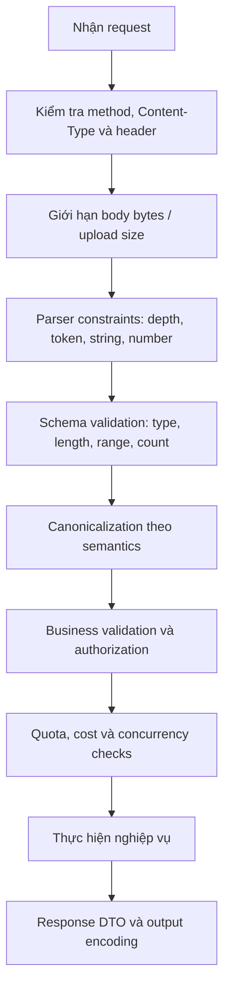

# Giới hạn string, number, array và nested object

Trong chương **Input validation API** của module `SECURITY_API_SECURITY`, giới hạn kích thước và miền giá trị của dữ liệu đầu vào là một kiểm soát bảo mật quan trọng. Một request có JSON hợp lệ và token hợp lệ vẫn có thể làm cạn CPU, memory, database connection hoặc quota của dịch vụ ngoài nếu API chấp nhận chuỗi quá dài, số không có giới hạn, mảng hàng triệu phần tử hoặc object lồng nhau quá sâu.

Validation cần được thiết kế ngay trong API contract và thực thi ở server trước khi dữ liệu đi vào nghiệp vụ. Với mỗi endpoint, hãy xác định field nào được nhận, kiểu dữ liệu nào hợp lệ, độ dài/số lượng tối đa, miền giá trị, độ sâu cấu trúc và kích thước toàn request. Mục tiêu là nhận đúng dữ liệu nghiệp vụ cần thiết với chi phí xử lý có thể dự đoán được.

## 1. Vì sao phải giới hạn đầu vào?

Không có giới hạn, attacker có thể khai thác các hành vi tưởng như bình thường:

- Gửi chuỗi dài hàng trăm MB khiến parser, validator, log hoặc database tốn bộ nhớ.
- Gửi số có hàng triệu chữ số hoặc exponent rất lớn khiến phép chuyển đổi và tính toán tốn CPU.
- Gửi mảng có hàng trăm nghìn phần tử khiến server tạo quá nhiều object, truy vấn hoặc message.
- Gửi object lồng nhau hàng nghìn cấp khiến JSON parser, validator hoặc serializer tràn stack.
- Gửi nhiều key tùy ý trong object metadata khiến map, index và storage phình to.
- Gửi chuỗi được thiết kế để regex backtracking kéo dài, làm một request chiếm CPU lâu.
- Gửi request hợp lệ theo từng field nhưng tổng payload quá lớn, vượt khả năng xử lý của service.

Các trường hợp này có thể dẫn đến denial of service, tăng chi phí, làm chậm tenant khác hoặc tạo dữ liệu không nhất quán. Giới hạn đầu vào cũng bảo vệ các hệ thống downstream: database, search engine, message broker, email provider và third-party API.

### 1.1. Validation không chỉ là kiểm tra kiểu

Kiểu dữ liệu trả lời câu hỏi “giá trị này là string hay number?”. Validation cần trả lời thêm:

- Chuỗi dài tối thiểu/tối đa bao nhiêu? Có chấp nhận khoảng trắng, ký tự điều khiển hoặc Unicode nào?
- Số nằm trong miền nào? Có bao nhiêu chữ số nguyên và chữ số thập phân?
- Mảng có tối thiểu/tối đa bao nhiêu phần tử? Phần tử có được trùng nhau không?
- Object có những property nào? Có cho phép property không khai báo không?
- Object lồng nhau sâu tối đa bao nhiêu cấp? Có giới hạn tổng số node không?
- Tổng request, số file và kích thước sau giải nén tối đa là bao nhiêu?

Một giá trị có thể đúng kiểu nhưng vẫn không hợp lệ hoặc quá tốn tài nguyên. Ví dụ `pageSize` là integer nhưng giá trị `2000000` không phù hợp; `comment` là string nhưng chứa 10 MB; `items` là array hợp lệ nhưng có 50.000 phần tử.

### 1.2. Phân biệt giới hạn theo field và giới hạn toàn request

Giới hạn từng field không thay thế giới hạn toàn request. Một object có 100 field, mỗi field dài 10 KB, có thể tạo payload lớn dù từng field nằm dưới giới hạn riêng.

| Phạm vi | Ví dụ giới hạn | Mục tiêu |
|---|---|---|
| Một string | `displayName` tối đa 120 ký tự | Giới hạn chi phí xử lý và lưu trữ của field |
| Một number | `quantity` từ 1 đến 1.000 | Ngăn giá trị tràn hoặc gây tính toán bất thường |
| Một array | Tối đa 50 dòng hàng | Giới hạn vòng lặp, truy vấn và fan-out |
| Một object | Tối đa 30 property được khai báo | Giữ schema ổn định và tránh metadata tùy ý |
| Độ sâu cấu trúc | Tối đa 20 hoặc 32 cấp theo use case | Ngăn parser/validator đệ quy quá sâu |
| Toàn request | Tối đa 1 MB cho JSON endpoint | Giới hạn body trước khi parse |
| Upload | Tối đa 20 MB/file và 50 MB/request | Kiểm soát streaming, storage và xử lý file |

Các con số trong ví dụ chỉ minh họa. Mỗi endpoint cần chọn ngưỡng dựa trên yêu cầu nghiệp vụ, giới hạn database, hạ tầng và chi phí downstream; không sao chép một mức chung cho mọi API.

## 2. Xác định giới hạn trong API contract

Contract phải là nguồn thống nhất cho frontend, backend, tester và đối tác tích hợp. Với mỗi operation, mô tả rõ schema request, field bắt buộc, field tùy chọn, miền giá trị, giới hạn kích thước và cách xử lý field không được khai báo.

### 2.1. Những thuộc tính schema thường dùng

| Loại dữ liệu | Ràng buộc | Ý nghĩa |
|---|---|---|
| String | `minLength`, `maxLength` | Độ dài tối thiểu/tối đa |
| String | `pattern`, `enum`, `format` | Cấu trúc hoặc tập giá trị được chấp nhận |
| Number | `minimum`, `maximum`, `exclusiveMinimum`, `exclusiveMaximum` | Biên số |
| Number | `multipleOf` | Bước giá trị hợp lệ |
| Integer | `minimum`, `maximum` | Miền số nguyên |
| Array | `minItems`, `maxItems` | Số phần tử |
| Array | `uniqueItems` | Không cho phần tử trùng theo semantics của schema |
| Object | `required`, `properties` | Field bắt buộc và field được khai báo |
| Object | `minProperties`, `maxProperties` | Số property tối thiểu/tối đa |
| Object | `additionalProperties` | Chính sách với property ngoài schema |
| Nested schema | `$ref`, `items`, `properties` | Ràng buộc đệ quy cho cấu trúc con |

`format` như `email`, `date-time` hoặc `uri` có thể chỉ mang ý nghĩa annotation nếu validator không bật format assertion. Không giả định mọi công cụ OpenAPI đều thực thi `format` giống nhau. Với quy tắc bảo mật quan trọng, cần validation server-side rõ ràng và test tương ứng.

### 2.2. Contract phải quy định hành vi khi vượt giới hạn

Khi dữ liệu không hợp lệ, API nên từ chối toàn bộ request theo một cấu trúc lỗi ổn định. Không tự động cắt chuỗi, bỏ phần tử dư hoặc ép số về giới hạn mà không được contract công bố. Silent truncation có thể làm thay đổi ý nghĩa dữ liệu, tạo sai lệch giữa client và server hoặc làm thay đổi nội dung được ký.

Với bulk operation, cần quy định rõ all-or-nothing hay partial success. Nếu một phần tử vượt validation, API có thể từ chối toàn bộ batch hoặc trả kết quả theo từng phần tử theo contract. Không để implementation quyết định ngẫu nhiên theo thứ tự xử lý.

## 3. Giới hạn string

String là kiểu dữ liệu xuất hiện nhiều nhất trong API: tên, mô tả, mã định danh, email, địa chỉ, filter, token và nội dung ghi chú. Một giới hạn string tốt phải tính đến độ dài, encoding, normalization, ký tự được phép và cách sử dụng downstream.

### 3.1. Đặt minLength và maxLength theo nghiệp vụ

Không đặt một giới hạn lớn tùy tiện như 1 MB cho mọi string. Hãy đặt theo ý nghĩa field:

| Field | Ví dụ giới hạn | Ghi chú |
|---|---:|---|
| Username | 3–40 | Quy tắc ký tự và tính duy nhất cần được định nghĩa |
| Display name | 1–120 | Có thể cho phép Unicode và khoảng trắng |
| SKU | 1–32 | Thường dùng allowlist ký tự ASCII |
| Email | Tối đa theo contract/hệ thống mail | Cần thống nhất giới hạn với database và provider |
| Search query | 1–200 | Giới hạn thêm số token và độ phức tạp truy vấn |
| Comment | 0–2.000 | Kiểm tra cả tổng payload và quy tắc lưu trữ |
| Country code | Đúng 2 ký tự | Có thể dùng enum hoặc pattern theo chuẩn được chọn |
| URL callback | Giới hạn độ dài riêng | Sau validation cú pháp còn cần policy outbound/SSRF |

`minLength` và `maxLength` cần phản ánh semantics. Với field bắt buộc, kết hợp kiểm tra không rỗng/không chỉ có whitespace. Với field tùy chọn, phân biệt rõ không có field, `null`, chuỗi rỗng và chuỗi chỉ có khoảng trắng.

### 3.2. Ký tự, code point, grapheme và byte không giống nhau

“Độ dài chuỗi” có thể được đo theo nhiều cách:

- Byte sau khi encode UTF-8.
- Unicode code point.
- UTF-16 code unit mà một số runtime dùng trong `String.length()`.
- Grapheme cluster mà người dùng nhìn thấy như một ký tự.

Ví dụ một emoji có thể gồm nhiều code point hoặc code unit; một chữ có dấu có thể được biểu diễn bằng ký tự dựng sẵn hoặc ký tự nền cộng combining mark. Vì vậy, giới hạn 120 “ký tự” có thể cho kết quả khác nhau giữa Java, JavaScript, database và validator JSON Schema nếu không thống nhất cách đo.

Trong API contract, định nghĩa rõ cách đo và kiểm tra nhất quán giữa các thành phần. JSON Schema đo `minLength`/`maxLength` theo Unicode code point; Java `String.length()` đếm UTF-16 code unit. Với giới hạn lưu trữ hoặc truyền tải, nên có giới hạn byte riêng. Với giới hạn hiển thị, cân nhắc grapheme cluster. Không dùng giới hạn ký tự thay cho giới hạn body byte.

### 3.3. Chuẩn hóa Unicode và khoảng trắng

Hai chuỗi có thể hiển thị giống nhau nhưng có cách mã hóa Unicode khác nhau. Với username, mã tìm kiếm hoặc định danh cần so sánh, hãy xác định normalization form phù hợp (thường xem xét NFC) trước khi kiểm tra tính duy nhất và lưu trữ. Cần kiểm tra sau normalization vì quá trình chuẩn hóa có thể thay đổi độ dài.

Không áp dụng normalization tùy tiện cho password, token, chữ ký hoặc dữ liệu opaque vì điều đó có thể làm thay đổi giá trị mà client đã gửi. Với mật khẩu, không trim hoặc đổi hoa/thường trừ khi chính sách xác thực quy định rõ.

Đối với tên và địa chỉ, tránh loại bỏ mọi dấu hoặc chỉ cho phép ASCII nếu nghiệp vụ cần hỗ trợ tiếng Việt và các ngôn ngữ khác. Với mã kỹ thuật như SKU, mã quốc gia hoặc enum, allowlist hẹp thường phù hợp hơn.

### 3.4. Allowlist ký tự theo mục đích

Không có một regex “chống injection” dùng được cho mọi string. Hãy xác định tập ký tự theo semantics:

- SKU hoặc mã nội bộ: chữ hoa, chữ số, `_` và `-` nếu cần.
- Country code: enum hoặc tập mã được hỗ trợ.
- Username: quy tắc Unicode/ASCII, khoảng trắng và dấu phân cách được công bố.
- Free-text: chấp nhận ngôn ngữ tự nhiên nhưng giới hạn độ dài, ký tự điều khiển và cách render.
- URL: parse bằng thư viện URI, sau đó áp dụng allowlist scheme/host và policy SSRF nếu server sẽ truy cập URL.

Không từ chối toàn bộ dấu nháy, dấu gạch hoặc ký tự `<` như một biện pháp chống SQL injection/XSS chung. Dữ liệu cần được truy vấn bằng parameterized query và encode theo ngữ cảnh khi hiển thị. Validation cú pháp không thay thế output encoding hoặc query parameterization.

### 3.5. Cẩn thận với regex và ReDoS

Regex phức tạp có thể có thời gian chạy tăng theo cấp số nhân khi gặp chuỗi được chế tạo đặc biệt (Regular Expression Denial of Service). Tránh nested quantifier và các nhánh mơ hồ như `(a+)+`, `(.*a){n}`. Đặt giới hạn độ dài trước khi chạy regex, ưu tiên pattern đơn giản và kiểm tra bằng input xấu.

Ví dụ pattern mã SKU đơn giản:

```regex
^[A-Z0-9][A-Z0-9_-]{0,31}$
```

Pattern này giới hạn tối đa 32 ký tự theo tập cho phép. Không dùng cùng pattern cho tên người hoặc địa chỉ vì sẽ loại bỏ dữ liệu hợp lệ.

### 3.6. Kiểm tra format không đồng nghĩa xác minh thực tế

`@Email` hoặc `format: email` chỉ kiểm tra một phần cú pháp. Nó không chứng minh mailbox tồn tại, thuộc người dùng hay có thể nhận thư. Tương tự, `format: uri` không chứng minh URL an toàn để server truy cập. Với số điện thoại, parser có thể chuẩn hóa định dạng nhưng không chứng minh số đó thuộc caller.

Tách các bước: validation cú pháp, xác minh quyền sở hữu hoặc quan hệ nghiệp vụ, rồi mới thực hiện side effect như gửi email/SMS hoặc truy cập mạng.

## 4. Giới hạn number và integer

Number cần giới hạn miền giá trị, độ chính xác, scale và cách biểu diễn. Chỉ kiểm tra “là số” có thể để lọt giá trị âm, số quá lớn, số có hàng nghìn chữ số hoặc phép tính gây overflow.

### 4.1. Đặt minimum và maximum

Với mỗi số, xác định:

- Giá trị nhỏ nhất/lớn nhất theo nghiệp vụ.
- Có chấp nhận số âm, zero hoặc số thập phân không.
- Đơn vị đo: đồng, cent, byte, giây, phần trăm, mét hay số lượng.
- Có cho phép số mũ/scientific notation không.
- Cách xử lý giá trị vượt biên: từ chối, không tự clamp.

Ví dụ:

| Field | Kiểu | Miền giá trị ví dụ |
|---|---|---|
| `quantity` | Integer | 1–1.000 |
| `pageSize` | Integer | 1–100 |
| `discountPercent` | Decimal | 0–100, tối đa 2 chữ số thập phân |
| `timeoutSeconds` | Integer | 1–60 |
| `latitude` | Decimal | -90 đến 90 |
| `longitude` | Decimal | -180 đến 180 |
| `fileSizeBytes` | Integer | 0 đến giới hạn upload được công bố |

Các miền trên là ví dụ. Đơn vị phải được ghi rõ trong tên field hoặc schema; không để client gửi `timeout=1000` mà không biết là millisecond hay second.

### 4.2. Giới hạn precision và scale

Với decimal, xác định số chữ số nguyên và chữ số thập phân. Ví dụ số tiền có thể giới hạn tối đa 10 chữ số nguyên và 2 chữ số thập phân. Nếu database dùng `DECIMAL(12,2)`, API cần từ chối giá trị vượt precision/scale trước khi insert để tránh bị làm tròn hoặc lỗi muộn.

Không dùng binary floating-point cho phép tính tiền. Trong Java, ưu tiên `BigDecimal` với precision/scale và rounding mode được định nghĩa. Có thể dùng số nguyên theo đơn vị nhỏ nhất (ví dụ cents) nếu miền giá trị và currency cho phép. Không để client gửi giá trị có scale tùy ý rồi âm thầm làm tròn.

### 4.3. Tránh overflow và số quá lớn

Giá trị `Integer.MAX_VALUE + 1` có thể tràn khi ép kiểu; phép nhân `quantity * unitPrice` cũng có thể overflow nếu dùng kiểu số không đủ rộng. Kiểm tra biên trước khi tính toán và dùng kiểu phù hợp. Với số nguyên lớn, giới hạn cả số chữ số đầu vào để tránh parse một chuỗi số khổng lồ.

JSON chuẩn không biểu diễn `NaN` và `Infinity`, nhưng một số parser hoặc định dạng mở rộng có thể chấp nhận giá trị không hữu hạn. Nếu stack cho phép các giá trị này, từ chối rõ ràng. Không để `NaN` đi vào so sánh vì nhiều phép so sánh với `NaN` không hoạt động như mong đợi.

### 4.4. Dùng integer cho số đếm và tiền theo đơn vị nhỏ

Số lượng, page size, số byte và số lần retry thường nên là integer. Tiền có thể biểu diễn bằng integer theo đơn vị nhỏ nhất:

```json
{
  "currency": "VND",
  "unitPriceMinor": 125000,
  "quantity": 2
}
```

Tên `unitPriceMinor` cần đi cùng định nghĩa currency và quy tắc đơn vị. Với VND, đơn vị nhỏ nhất theo mô hình ứng dụng có thể là đồng; với currency khác có thể là cent hoặc đơn vị khác. Không giả định mọi currency đều có hai chữ số thập phân.

### 4.5. Tránh ép kiểu hoặc clamp âm thầm

Không chuyển `-1` thành `0`, số quá lớn thành `maximum` hoặc decimal nhiều chữ số thành scale mặc định mà không có contract. Những thay đổi âm thầm có thể làm client hiểu sai kết quả hoặc tạo sai lệch tính tiền. Hãy trả lỗi validation có field path và mã lỗi ổn định.

## 5. Giới hạn array

Array có thể tạo fan-out lớn trong service: mỗi phần tử có thể sinh truy vấn database, kiểm tra quyền, message hoặc lời gọi provider. Giới hạn array cần tính cả số phần tử, kích thước từng phần tử, tổng kích thước và chi phí xử lý.

### 5.1. Dùng minItems và maxItems

Với mỗi array, định nghĩa số phần tử tối thiểu/tối đa. Ví dụ:

| Array | Giới hạn ví dụ | Lý do |
|---|---:|---|
| `order.items` | 1–50 | Kiểm soát số dòng hàng và phép tính |
| `recipientIds` | 1–100 | Giới hạn fan-out thông báo |
| `tags` | 0–20 | Tránh metadata không giới hạn |
| `sort` | Tối đa 3 điều kiện | Giới hạn query planner và API complexity |
| `filters` | Tối đa 10 điều kiện | Kiểm soát truy vấn tìm kiếm |
| `attachmentIds` | 0–10 | Giới hạn file và truy vấn quyền |

Không cho phép `maxItems` quá lớn chỉ vì database có thể chứa nhiều bản ghi. Với danh sách lớn, dùng pagination, bulk job hoặc streaming protocol có quota thay vì nhận toàn bộ trong một request.

### 5.2. Validate từng phần tử

`items` có thể có giới hạn số phần tử nhưng từng item vẫn cần schema riêng: field bắt buộc, string length, number range và nested validation. Một array 10 phần tử vẫn có thể nguy hiểm nếu mỗi phần tử chứa object lồng sâu hoặc chuỗi cực lớn.

Với array ID, kiểm tra định dạng và số lượng trước khi truy vấn. Sau đó kiểm tra quyền trên từng đối tượng trong tenant scope. ID hợp lệ về cú pháp không đồng nghĩa caller được thao tác trên đối tượng đó.

### 5.3. Xử lý phần tử trùng nhau

Quyết định array có cho phép duplicate không. Nếu không, kiểm tra uniqueness sau khi chuẩn hóa giá trị. `uniqueItems: true` trong JSON Schema so sánh theo semantics JSON; nó không thay thế kiểm tra uniqueness theo business key sau normalization.

Ví dụ `ABC-1` và `abc-1` có thể là cùng một mã nếu hệ thống không phân biệt hoa thường. Tương tự, số điện thoại có thể có nhiều cách viết nhưng cùng một số sau khi chuẩn hóa. Deduplicate theo canonical value trước khi tính quota hoặc fan-out.

### 5.4. Bulk operation cần giới hạn và semantics rõ

Với bulk create/update/delete, cần xác định:

- Số ID tối đa trong một batch.
- Có cho phép partial success hay all-or-nothing.
- Một phần tử lỗi có làm rollback toàn bộ không.
- Response có trả kết quả từng phần tử không.
- Quota tính theo request hay theo từng phần tử.
- Retry batch có thể lặp side effect hay không.

Không cho một request chứa hàng chục nghìn ID rồi xử lý đồng bộ. Dùng job bất đồng bộ có trạng thái, giới hạn số job và quota riêng. Worker phải kiểm tra tenant và authorization theo policy tại thời điểm được chọn trong contract.

### 5.5. Pagination là một phần của giới hạn array

Endpoint list cần giới hạn `pageSize` ở server, ngay cả khi client gửi giá trị lớn. Không tin `limit` hoặc `size` từ client. Cursor phải được ràng buộc với query, tenant và phạm vi quyền; không để cursor cũ bỏ qua filter. Với offset pagination, giới hạn offset hoặc chuyển sang cursor nếu offset lớn gây truy vấn đắt.

## 6. Giới hạn object và nested object

Object có thể chứa nhiều property, nested object, array hoặc map. Kiểm soát chỉ ở cấp ngoài cùng không đủ nếu cấu trúc con không có giới hạn.

### 6.1. Khai báo field được phép

Với object request, khai báo `properties` và `required` rõ ràng. Nếu không có nhu cầu mở rộng metadata tùy ý, đặt `additionalProperties: false` hoặc cơ chế tương đương để từ chối field ngoài schema.

Điều này giúp ngăn mass assignment. Ví dụ endpoint cập nhật hồ sơ chỉ cho phép `displayName` và `phone`; client thêm `role`, `tenantId`, `ownerId` hoặc `isAdmin` phải bị từ chối hoặc bỏ qua đúng theo contract. Với field server-managed, tốt nhất không bind trực tiếp request vào entity persistence.

Nếu cần extension field động, hãy đặt nó trong một object riêng có `maxProperties`, giới hạn key length, kiểu giá trị, tổng byte và allowlist namespace. Không cho phép map metadata chứa object tùy ý không giới hạn.

### 6.2. Giới hạn số property và kích thước map

`maxProperties` giới hạn số key trong một object. Tuy nhiên, nó không giới hạn độ dài từng key hoặc giá trị; cần có ràng buộc riêng cho property name và value. Map động nên giới hạn:

- Số key tối đa.
- Độ dài key tối đa và tập ký tự hợp lệ.
- Kiểu value được chấp nhận.
- Độ sâu object/value.
- Tổng kích thước byte sau encoding.
- Số lượng phần tử trong array value.

Không dùng map tổng quát cho mọi dữ liệu chỉ vì thuận tiện. Schema có cấu trúc rõ giúp kiểm soát quyền, validation, migration và lưu trữ tốt hơn.

### 6.3. Giới hạn độ sâu nested object

JSON cho phép object và array lồng nhau. Parser và validator đệ quy có thể tốn stack hoặc CPU khi độ sâu quá lớn. Xác định độ sâu tối đa theo use case, ví dụ 10 cấp cho filter hoặc 20 cấp cho cấu trúc cây. Độ sâu thực tế phải được kiểm tra tại parser hoặc một bước giới hạn trước khi gọi validator đệ quy.

Một schema có `$ref` đệ quy cần có giới hạn rõ. Đừng giả định `maxItems` tự giới hạn độ sâu hoặc `maxLength` tự giới hạn số node.

### 6.4. Giới hạn tổng số node và tổng kích thước cấu trúc

Một JSON có thể có độ sâu thấp nhưng chứa hàng triệu node ở cùng một cấp. Ngược lại, một object có ít node nhưng mỗi string rất lớn. Vì vậy cần cân nhắc nhiều giới hạn cùng lúc:

- Max body bytes.
- Max nesting depth.
- Max object properties.
- Max array items.
- Max string length.
- Max numeric token length.
- Max tổng số node/token nếu parser hỗ trợ.

Các giới hạn này tạo thành một ngân sách cấu trúc. Không chỉ giới hạn từng chiều riêng lẻ mà quên tổng mức tiêu thụ.

### 6.5. Kiểm tra quan hệ nested và quyền

Nested object không chỉ là cấu trúc dữ liệu. Ví dụ request tạo order có `customerId`, `warehouseId` và `items[].productId`. Server cần kiểm tra từng ID thuộc tenant và caller có quyền sử dụng trong nghiệp vụ. Không tin rằng object cha hợp lệ đồng nghĩa mọi object con đều hợp lệ.

Đối với nested patch, xác định rõ semantics thay thế hay merge. Không cho client gửi object con để cập nhật field không được phép. Dùng request DTO theo use case và kiểm tra property-level authorization cho từng field.

## 7. Giới hạn toàn request và parser

Validation annotation chạy sau khi framework đã đọc và parse body. Nếu body quá lớn hoặc JSON quá sâu, tài nguyên có thể đã bị tiêu thụ trước khi Bean Validation bắt đầu. Vì vậy, giới hạn cần được áp dụng ở nhiều lớp.

### 7.1. Giới hạn body ở gateway và application

- Đặt maximum request body size tại API gateway/reverse proxy.
- Đặt giới hạn tương ứng trong application server và framework.
- Áp dụng giới hạn riêng cho endpoint JSON, upload và bulk.
- Từ chối request vượt giới hạn trước khi buffer toàn bộ body nếu hạ tầng hỗ trợ streaming.
- Giới hạn thời gian nhận body và tốc độ upload để tránh slow request.
- Không tin `Content-Length` duy nhất; request streaming/chunked vẫn cần đếm byte thực tế.

Giới hạn gateway không thay thế giới hạn trong service vì internal call có thể đi vòng gateway. Ngược lại, giới hạn ở service không ngăn gateway buffer một body quá lớn trước khi chuyển tiếp. Cần cấu hình nhất quán ở các lớp.

### 7.2. Giới hạn JSON parser

Parser cần giới hạn độ sâu nesting, độ dài string token, độ dài numeric token, số token hoặc số node nếu thư viện hỗ trợ. Các giới hạn parser phải được cấu hình cho đúng phiên bản thư viện và áp dụng trên mọi đường parse, kể cả message queue và internal API.

Không chỉ kiểm tra JSON sau khi parse thành `Map` hoặc `JsonNode`, vì lúc đó bộ nhớ đã được cấp cho toàn bộ cấu trúc. Dùng parser streaming hoặc parser constraints để từ chối sớm khi phù hợp.

### 7.3. Content-Type và content encoding

Chỉ chấp nhận content type mà endpoint hỗ trợ, ví dụ `application/json` cho JSON API. Từ chối content type không phù hợp và không tự đoán kiểu dữ liệu. Nếu hỗ trợ gzip hoặc content encoding khác, giới hạn cả compressed bytes lẫn decompressed bytes để chống decompression bomb.

Với multipart, giới hạn tổng request, số part, từng file, từng field và kích thước header/filename. File upload cần streaming, kiểm tra magic bytes, loại file cho phép và giới hạn giải nén/preview ở downstream.

### 7.4. Giới hạn thời gian và độ phức tạp xử lý

Một payload nhỏ vẫn có thể tạo truy vấn rất đắt. Giới hạn số filter, độ sâu biểu thức, số sort condition, số phép join hoặc độ phức tạp GraphQL. Đặt timeout cho validation, database query và downstream call. Không cho client gửi regex hoặc biểu thức tùy ý nếu service sẽ thực thi trực tiếp.

## 8. Ví dụ OpenAPI schema có giới hạn rõ ràng

Ví dụ sau mô tả request tạo order với string, integer, array và nested object được giới hạn. `unitPriceMinor` là số nguyên theo đơn vị tiền nhỏ nhất do contract định nghĩa, tránh dùng floating-point cho phép tính tiền.

```yaml
openapi: 3.1.0
paths:
  /v1/orders:
    post:
      operationId: createOrder
      requestBody:
        required: true
        content:
          application/json:
            schema:
              $ref: '#/components/schemas/CreateOrderRequest'
      responses:
        '201':
          description: Order created
        '400':
          description: Request validation failed
        '413':
          description: Request body too large
components:
  schemas:
    CreateOrderRequest:
      type: object
      additionalProperties: false
      required: [reference, items, shippingAddress]
      properties:
        reference:
          type: string
          minLength: 1
          maxLength: 40
          pattern: '^[A-Z0-9][A-Z0-9_-]{0,39}$'
        items:
          type: array
          minItems: 1
          maxItems: 50
          items:
            $ref: '#/components/schemas/OrderLineRequest'
        shippingAddress:
          $ref: '#/components/schemas/ShippingAddressRequest'
    OrderLineRequest:
      type: object
      additionalProperties: false
      required: [productId, quantity, unitPriceMinor]
      properties:
        productId:
          type: string
          minLength: 1
          maxLength: 64
        quantity:
          type: integer
          minimum: 1
          maximum: 1000
        unitPriceMinor:
          type: integer
          minimum: 0
          maximum: 100000000
    ShippingAddressRequest:
      type: object
      additionalProperties: false
      required: [recipient, line1, countryCode]
      properties:
        recipient:
          type: string
          minLength: 1
          maxLength: 120
        line1:
          type: string
          minLength: 1
          maxLength: 200
        line2:
          type: string
          maxLength: 200
        countryCode:
          type: string
          pattern: '^[A-Z]{2}$'
```

Schema này giới hạn số item và từng field, nhưng vẫn cần giới hạn body bytes, parser depth, tổng số node và quyền trên `productId`. Pattern country code chỉ kiểm tra cấu trúc hai chữ cái; nếu chỉ hỗ trợ một tập quốc gia, dùng enum/allowlist tương ứng. `unitPriceMinor` trong ví dụ phải được xác định theo currency và không nên tin giá do client gửi nếu giá phải lấy từ catalog server.

`additionalProperties: false` áp dụng cho các object được khai báo. Nếu schema dùng composition như `allOf`, `oneOf` hoặc `$ref`, cần kiểm tra semantics đóng object đúng theo JSON Schema 2020-12/OpenAPI 3.1 và validator đang sử dụng; test thực tế để bảo đảm field ngoài schema không lọt qua.

## 9. Ví dụ Java/Spring Bean Validation

Bean Validation giúp đặt ràng buộc ngay trên request DTO. Dùng DTO riêng cho request và không bind JSON trực tiếp vào JPA entity.

```java
public record CreateOrderRequest(
        @NotBlank
        @Size(max = 40)
        @Pattern(regexp = "^[A-Z0-9][A-Z0-9_-]{0,39}$")
        String reference,

        @NotEmpty
        @Size(max = 50)
        List<@NotNull @Valid OrderLineRequest> items,

        @NotNull
        @Valid
        ShippingAddressRequest shippingAddress
) {}

public record OrderLineRequest(
        @NotBlank
        @Size(max = 64)
        String productId,

        @NotNull
        @Min(1)
        @Max(1000)
        Integer quantity,

        @NotNull
        @Min(0)
        @Max(100000000)
        Long unitPriceMinor
) {}

public record ShippingAddressRequest(
        @NotBlank
        @Size(max = 120)
        String recipient,

        @NotBlank
        @Size(max = 200)
        String line1,

        @Size(max = 200)
        String line2,

        @NotBlank
        @Pattern(regexp = "^[A-Z]{2}$")
        String countryCode
) {}
```

Controller kích hoạt validation:

```java
@RestController
@RequestMapping("/v1/orders")
public class OrderController {
    private final OrderService orders;

    public OrderController(OrderService orders) {
        this.orders = orders;
    }

    @PostMapping
    public ResponseEntity<OrderResponse> create(
            @Valid @RequestBody CreateOrderRequest request,
            @AuthenticationPrincipal CurrentPrincipal principal) {
        OrderResponse response = orders.create(request, principal);
        return ResponseEntity.status(HttpStatus.CREATED).body(response);
    }
}
```

`@AuthenticationPrincipal` lấy principal từ security context đã được xác thực; `CurrentPrincipal` là kiểu principal tùy ứng dụng. Ví dụ đã lược bớt import và cấu hình Spring Security. Nếu ứng dụng dùng argument resolver riêng, hãy lấy principal từ resolver đó và không nhận tenant/user identity từ request body.

Các annotation có ý nghĩa khác nhau:

- `@NotNull` từ chối null; với wrapper type như `Integer`, cần dùng nó nếu field bắt buộc.
- `@NotBlank` từ chối null, chuỗi rỗng và chuỗi chỉ có whitespace.
- `@Size` giới hạn độ dài `CharSequence`, số phần tử collection, số phần tử array hoặc số entry map; giá trị null vẫn hợp lệ nên cần kết hợp `@NotNull` nếu bắt buộc.
- `@Pattern` kiểm tra chuỗi theo regex; giá trị null vẫn hợp lệ nên cần kết hợp `@NotBlank` hoặc `@NotNull` nếu bắt buộc. Nó không thay thế giới hạn độ dài hoặc xác minh nghiệp vụ.
- `@Min`/`@Max` kiểm tra biên số nguyên; với decimal dùng `@DecimalMin`/`@DecimalMax` và có thể thêm `@Digits`.
- `@Valid` kích hoạt validation cho object lồng nhau và phần tử collection được annotate; nó không tự làm field bắt buộc, vì vậy cần `@NotNull` hoặc `@NotEmpty` phù hợp.

`@Size(max = 50)` trên `items` giới hạn số phần tử, không giới hạn tổng byte của JSON hay kích thước nested object. `@Size` trên Java `String` thường dựa vào `CharSequence.length()` (UTF-16 code unit); cần kiểm tra và thống nhất với semantics độ dài của OpenAPI/database nếu hệ thống nhận Unicode.

### 9.1. Validation tùy chỉnh cho giới hạn không có annotation sẵn

Một số yêu cầu cần validator tùy chỉnh, ví dụ giới hạn UTF-8 bytes, tổng số node, tổng kích thước map hoặc quan hệ giữa hai field. Hãy giữ validator đơn giản, có giới hạn đầu vào và tránh regex hoặc đệ quy không giới hạn.

Ví dụ kiểm tra số byte UTF-8:

```java
public final class Utf8Length {
    private Utf8Length() {}

    public static boolean isWithin(String value, int maxBytes) {
        if (value == null) {
            return true;
        }
        return value.getBytes(StandardCharsets.UTF_8).length <= maxBytes;
    }
}
```

Đoạn helper này minh họa semantics; với chuỗi rất lớn, việc tạo mảng byte mới có thể tốn thêm memory. Trong đường xử lý quan trọng, có thể đếm byte theo streaming hoặc kiểm tra giới hạn trước khi copy/encode. Custom constraint cần có test cho null, Unicode, boundary và input lớn.

### 9.2. Validation chéo field

Một request có thể có ràng buộc giữa các field: `startDate` phải trước `endDate`, `minPrice` không lớn hơn `maxPrice`, hoặc `currency` phải phù hợp với đơn vị tiền. Dùng class-level constraint hoặc service validation có chủ đích; trả lỗi gắn với field liên quan. Không lặp lại logic nghiệp vụ khác nhau ở nhiều controller.

## 10. Thứ tự validation trong request pipeline

Thứ tự kiểm tra ảnh hưởng đến tài nguyên và khả năng rò dữ liệu. Một pipeline tổng quát:



Thứ tự cụ thể có thể thay đổi theo hệ thống. Một số canonicalization cần thực hiện trước khi so sánh uniqueness; một số bước authorization cần diễn ra trước khi truy vấn chi tiết để tránh lộ dữ liệu. Nguyên tắc là giới hạn rẻ và sớm trước bước tốn tài nguyên, đồng thời không để validation tiết lộ thông tin của đối tượng caller không được phép xem.

### 10.1. Validation ở nhiều lớp

- **Gateway/reverse proxy:** giới hạn body, header, timeout, upload và một phần rate limit.
- **Parser/framework:** giới hạn độ sâu, token và kích thước chuỗi/số trước khi tạo object graph.
- **DTO/schema:** kiểm tra kiểu, field, độ dài, range, số phần tử và unknown properties.
- **Service/domain:** kiểm tra quy tắc nghiệp vụ, quan hệ dữ liệu, tenant và authorization.
- **Database:** giữ constraint như NOT NULL, CHECK, UNIQUE và foreign key để bảo vệ tính toàn vẹn.

Không xem validation ở frontend là kiểm soát bảo mật. Client có thể bị sửa hoặc bỏ qua; server phải thực thi lại tất cả điều kiện quan trọng.

### 10.2. Không biến validation thành sanitizer tổng quát

Validation xác định dữ liệu có thuộc contract hay không. Sanitization/encoding xử lý dữ liệu theo ngữ cảnh sử dụng, ví dụ HTML output, SQL parameter hoặc shell argument. Không có hàm “sanitize mọi input” an toàn cho mọi ngữ cảnh.

Với truy vấn database, dùng prepared statement/ORM parameter binding. Với HTML, encode theo ngữ cảnh output hoặc dùng framework template an toàn. Với URL server truy cập, áp dụng allowlist và SSRF controls. Với log, redaction và giới hạn độ dài. Một string đã qua `@Size` vẫn có thể chứa payload XSS hoặc SQL injection nếu được sử dụng sai cách.

## 11. Chuẩn hóa lỗi validation

Lỗi nên giúp client sửa request mà không tiết lộ implementation, dữ liệu nhạy cảm hoặc toàn bộ payload. Một cấu trúc có thể dùng:

```json
{
  "type": "https://api.example.test/problems/validation-error",
  "title": "Request validation failed",
  "status": 400,
  "code": "VALIDATION_ERROR",
  "errors": [
    {
      "field": "items[0].quantity",
      "code": "OUT_OF_RANGE",
      "message": "Giá trị phải nằm trong khoảng cho phép"
    },
    {
      "field": "items",
      "code": "TOO_MANY_ITEMS",
      "message": "Danh sách vượt số phần tử tối đa"
    }
  ]
}
```

Quy tắc:

- Dùng mã lỗi ổn định để client không phải parse message tự do.
- Trả field path và giới hạn có thể công bố.
- Không phản chiếu toàn bộ giá trị đầu vào, token, password hoặc dữ liệu cá nhân.
- Không trả stack trace, tên class, SQL, file path hoặc nội dung exception nội bộ.
- Giới hạn số lỗi trong response; một request có hàng nghìn field lỗi không nên tạo response lỗi khổng lồ.
- Không phân biệt lỗi theo cách tiết lộ sự tồn tại của user, tenant hoặc object nếu chính sách yêu cầu che giấu.

`400` thường phù hợp cho request schema không hợp lệ; `413` phù hợp khi body vượt giới hạn truyền tải. Lựa chọn mã cần thống nhất trong API contract.

## 12. Kiểm thử giới hạn và trường hợp biên

Không chỉ test một giá trị hợp lệ và một giá trị quá lớn. Với mỗi giới hạn, test ngay dưới biên, đúng biên và vượt biên. Với string và Unicode, test thêm cách đo độ dài; với array/object, test cả tổng cấu trúc.

### 12.1. Ma trận kiểm thử theo kiểu dữ liệu

| Loại | Trường hợp cần test | Kết quả mong đợi |
|---|---|---|
| String | null, rỗng, whitespace-only, min-1, min, max, max+1 | Đúng semantics required/optional và boundary |
| String | Unicode dựng sẵn/combining mark, emoji, ký tự điều khiển | Độ dài/normalization nhất quán, không lỗi encoding |
| String | Pattern hợp lệ, pattern sai, regex stress input | Từ chối nhanh, không gây CPU spike |
| Number | min-1, min, max, max+1 | Từ chối/cho phép đúng biên |
| Number | số âm, exponent lớn, token quá dài, decimal scale dư | Không overflow, không làm tròn âm thầm |
| Array | rỗng, min-1, min, max, max+1 | Đúng giới hạn số phần tử |
| Array | phần tử null, sai schema, duplicate sau normalization | Từ chối hoặc xử lý theo contract |
| Object | thiếu required, field lạ, quá nhiều property | Từ chối theo schema |
| Nested | độ sâu tối đa, tối đa+1, nhiều node ở cùng cấp | Parser/validator từ chối trong giới hạn tài nguyên |
| Request | body đúng max bytes và vượt max bytes | Chấp nhận đúng biên; trả `413` khi vượt |
| Encoding | gzip nhỏ nhưng giải nén rất lớn | Giới hạn decompressed size |

### 12.2. Kiểm thử property-based và fuzzing

Property-based testing có thể sinh nhiều giá trị trong miền và quanh biên để tìm lỗi mà ví dụ thủ công bỏ sót. Fuzzing parser/schema giúp tìm crash, stack overflow hoặc hành vi khác nhau giữa validator. Giới hạn thời gian và kích thước của test input để bản thân bộ test không gây cạn tài nguyên.

Với mỗi validator, xác định invariant: nếu request vượt max string length, max array items hoặc max nesting depth thì nó phải bị từ chối trước khi service tạo side effect. Có thể dùng spy/mock ở service/provider để xác minh không có lời gọi downstream khi validation thất bại.

### 12.3. Kiểm tra tính nhất quán giữa contract và runtime

Tạo contract test so sánh OpenAPI schema với response lỗi/thành công thực tế. Kiểm tra các khác biệt phổ biến:

- OpenAPI cho phép `null` nhưng DTO không xử lý, hoặc ngược lại.
- Schema cho `maxLength` khác với `@Size` do semantics Unicode.
- `format` được khai báo nhưng validator runtime không thực thi.
- `additionalProperties: false` trong schema nhưng Jackson vẫn bỏ qua field lạ.
- API gateway và application có body limit khác nhau.
- Database column ngắn hơn giới hạn API khiến lỗi chỉ xảy ra lúc insert.

Giữ giới hạn ở gateway, parser, DTO và database tương thích. Nếu một lớp cần ngưỡng thấp hơn vì lý do hạ tầng, công bố và test hành vi nhất quán.

## 13. Lỗi thiết kế thường gặp

| Lỗi | Hệ quả | Cách khắc phục |
|---|---|---|
| Chỉ kiểm tra kiểu dữ liệu | Chuỗi/mảng/số vẫn có thể rất lớn | Thêm length, range, count, depth và body limits |
| Dùng một maxLength cho mọi field | Quá lỏng hoặc chặn dữ liệu hợp lệ | Đặt ngưỡng theo use case và storage |
| Chỉ validate sau khi parse | Parser đã tiêu thụ memory/CPU | Giới hạn body và parser trước DTO validation |
| Chỉ giới hạn array ngoài cùng | Nested arrays vẫn khổng lồ | Validate đệ quy và giới hạn tổng cấu trúc |
| Không giới hạn số chữ số | Parse/compute tốn CPU hoặc overflow | Max numeric token, range, precision và scale |
| Regex phức tạp | ReDoS | Pattern đơn giản, giới hạn length và stress test |
| Tin `format` tự động được thực thi | Runtime có thể chỉ coi là annotation | Validator rõ ràng và test thực tế |
| Bind request vào entity | Mass assignment và field nội bộ bị cập nhật | DTO allowlist và mapping tường minh |
| Tự cắt hoặc clamp giá trị | Sai lệch dữ liệu và chữ ký | Từ chối theo contract, không sửa âm thầm |
| Tin frontend validation | Client có thể bỏ qua | Server-side validation ở mọi đường truy cập |
| Bỏ qua unknown properties | Client gửi field không dự kiến | Từ chối hoặc xử lý theo policy được công bố |
| Trả toàn bộ lỗi và input | Rò dữ liệu, response lớn | Giới hạn lỗi và không echo giá trị nhạy cảm |

## 14. Checklist review trước khi phát hành

- [ ] Mỗi field có kiểu, required/optional và miền giá trị được định nghĩa.
- [ ] String có min/max length, byte limit khi cần, normalization và character policy.
- [ ] Regex đơn giản, có giới hạn input trước khi chạy và được stress test.
- [ ] Number có min/max, precision/scale, đơn vị và kiểu lưu trữ phù hợp.
- [ ] Số đếm dùng integer; tiền không dùng binary floating-point cho tính toán chính xác.
- [ ] Array có min/max items, validation từng phần tử và uniqueness semantics.
- [ ] Bulk operation có giới hạn, quota và semantics all-or-nothing/partial rõ ràng.
- [ ] Object khai báo field allowlist và chính sách unknown property.
- [ ] Nested object có giới hạn depth, property, node và tổng byte.
- [ ] Request body, multipart, compressed/decompressed size và parser có giới hạn sớm.
- [ ] Gateway và application áp dụng giới hạn tương thích.
- [ ] DTO request tách khỏi persistence entity; có `@Valid` và constraint phù hợp.
- [ ] Business validation và authorization được thực hiện ở server trước side effect.
- [ ] Database constraints bảo vệ tính toàn vẹn dữ liệu.
- [ ] Error response ổn định, không echo secret hoặc payload nhạy cảm.
- [ ] Test dưới biên, đúng biên, vượt biên, Unicode, nested, concurrency và fuzz input.
- [ ] Validation failure không gọi provider, không enqueue job và không ghi dữ liệu nghiệp vụ.

## Kết luận

Giới hạn string, number, array và nested object biến API contract thành hàng rào kiểm soát dữ liệu và tài nguyên. Hãy xác định ngưỡng theo nghiệp vụ, công bố rõ trong schema, thực thi ở parser và server-side DTO, rồi kiểm tra lại ở service và database. Kết hợp giới hạn từng field với giới hạn body, độ sâu và tổng cấu trúc giúp ngăn payload gây cạn tài nguyên; kiểm thử boundary và contract bảo đảm các lớp xử lý cùng hiểu một quy tắc.
