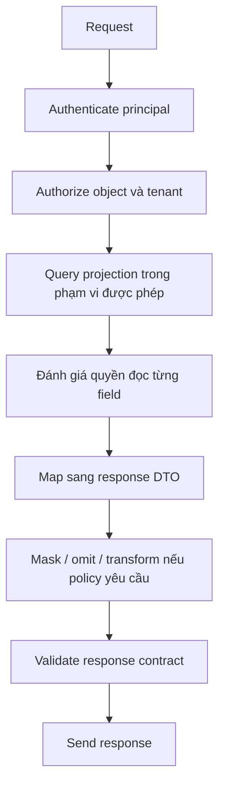

# Khác biệt response theo role và field authorization

Một API trả về hồ sơ nhân viên có thể chứa tên, email công việc, số điện thoại cá nhân, mức lương, ghi chú nhân sự và đánh giá nội bộ. Nhân viên đó có thể xem tên và email của chính mình; quản lý trực tiếp có thể xem thêm một số thông tin phục vụ quản lý; bộ phận nhân sự có thể được phép xem mức lương; đồng nghiệp thông thường không được nhận các trường nội bộ.

Nếu API chỉ kiểm tra người gọi đã đăng nhập rồi serialize toàn bộ database entity thành JSON, response có thể làm lộ dữ liệu dù giao diện không hiển thị các trường đó. Ẩn cột trong UI, dùng CSS để che giá trị hoặc bỏ field khỏi JavaScript không bảo vệ được dữ liệu đã gửi qua mạng.

**Output filtering là việc quyết định dữ liệu nào được phép xuất hiện trong response trước khi gửi về client. Field-level authorization đánh giá quyền đọc từng thuộc tính theo principal, object và ngữ cảnh.** Role có thể là một đầu vào của policy, nhưng không nên là căn cứ duy nhất nếu quyền còn phụ thuộc tenant, quan hệ với object, mục đích sử dụng hoặc trạng thái nghiệp vụ.

## 1. Response filtering bảo vệ điều gì?

Output filtering (lọc dữ liệu đầu ra) kiểm soát nội dung API trả về. Nó giúp giảm excessive data exposure, bảo vệ dữ liệu cá nhân và thông tin nội bộ, đồng thời làm rõ hợp đồng dữ liệu giữa server và client.

Ví dụ, endpoint:

```http
GET /api/employees/emp-104
Authorization: Bearer <access-token>
```

Database có thể lưu:

```json
{
  "id": "emp-104",
  "displayName": "Nguyen An",
  "workEmail": "an@example.com",
  "personalPhone": "+84...",
  "salary": 42000000,
  "bankAccount": "...",
  "performanceNote": "...",
  "disciplinaryRecord": "...",
  "tenantId": "tenant-7"
}
```

Không phải principal nào cũng được nhận mọi field. API cần tạo response phù hợp với quyền đọc đã được xác minh, chẳng hạn chỉ trả `id`, `displayName` và `workEmail` cho đồng nghiệp; trả thêm `salary` cho nhân sự có permission phù hợp; chỉ trả `personalPhone` cho chính nhân viên hoặc người có nhiệm vụ hợp lệ.

### 1.1. Output filtering không phải là UI filtering

UI filtering quyết định phần nào được hiển thị trên màn hình. Output filtering quyết định phần nào được gửi khỏi server.

| Cách làm | Tác động | Có bảo vệ dữ liệu ở API không? |
|---|---|---|
| Ẩn field bằng CSS hoặc component condition | Field vẫn có thể nằm trong response hoặc DOM | Không |
| Không hiển thị nút cho role thấp | Giảm thao tác trong UI | Không thay thế authorization phía server |
| Xóa field trong JavaScript sau khi nhận JSON | Dữ liệu đã đi tới client | Không |
| Server tạo DTO chỉ chứa field được phép | Field không được cấp không xuất hiện trong response | Có, nếu policy được đánh giá đúng |
| Server query projection chỉ lấy field cần thiết | Giảm cả dữ liệu tải vào ứng dụng và nguy cơ vô tình serialize | Có, là lớp giảm thiểu hữu ích |

Client luôn có thể xem response bằng Developer Tools, proxy hoặc HTTP client. Vì vậy, dữ liệu không được phép đọc phải bị loại bỏ ở server trước khi response rời khỏi ranh giới tin cậy.

### 1.2. Phân biệt object authorization và field authorization

Object-level authorization trả lời principal có được truy cập object này không. Field-level authorization trả lời principal được đọc những thuộc tính nào của object đó.

Ví dụ, quản lý có quyền xem hồ sơ nhân viên thuộc nhóm mình, nhưng chỉ được đọc tên, email công việc và trạng thái công việc. Họ không được xem số tài khoản ngân hàng hoặc ghi chú kỷ luật. Quyền đọc object không tự động cấp quyền đọc tất cả field.

Một response an toàn cần qua ít nhất hai lớp:

1. Kiểm tra principal có được đọc object trong tenant/quan hệ hiện tại không.
2. Với object được phép đọc, kiểm tra từng field hoặc nhóm field nào được đưa vào response.

### 1.3. Output filtering khác output encoding

Hai kiểm soát này giải quyết hai rủi ro khác nhau:

- **Output filtering** quyết định field hoặc dữ liệu nào được phép gửi cho caller. Ví dụ, loại `internalNote` khỏi response của nhân viên không có quyền.
- **Output encoding** biểu diễn dữ liệu an toàn theo ngữ cảnh sử dụng để tránh nội dung bị hiểu thành cú pháp thực thi. Ví dụ, khi đưa tên do người dùng nhập vào HTML, frontend cần escape theo ngữ cảnh HTML thay vì chèn trực tiếp bằng `innerHTML`.

Một response chỉ chứa field được phép vẫn có thể chứa chuỗi độc hại nếu client đưa chuỗi đó vào HTML không an toàn. Ngược lại, escape HTML không làm cho field nhạy cảm trở nên được phép đọc. API cần lọc dữ liệu theo quyền; client cần render dữ liệu an toàn theo ngữ cảnh.

## 2. Field authorization theo role và ngữ cảnh

Role-Based Access Control (RBAC) có thể gán các permission cho role. Field authorization thường cần kết hợp RBAC với thuộc tính và quan hệ (ABAC/ReBAC) để quyết định field nào được đọc.

Một policy có thể phụ thuộc vào:

- **Principal:** user, service account hoặc client đã xác thực.
- **Role/permission:** `EMPLOYEE`, `MANAGER`, `HR_SPECIALIST`, `employee:salary:read`.
- **Object:** hồ sơ nhân viên, hóa đơn, giao dịch hoặc tài liệu cụ thể.
- **Field:** `salary`, `bankAccount`, `internalNote`, `paymentToken`.
- **Context:** tenant, quan hệ quản lý, mục đích xử lý, trạng thái hồ sơ, mức xác thực và thời điểm.

Có thể biểu diễn quyết định:

```text
canReadField(principal, object, field, context)
```

Không nên dùng một hàm quá tổng quát như `isAdmin()` rồi cho phép serialize mọi field. Một quản trị viên hỗ trợ khách hàng có thể cần quyền khóa tài khoản nhưng không cần xem số tài khoản ngân hàng hoặc ghi chú nhân sự. Role khác nhau có thể cùng được phép một số field; một role cũng có thể bị giới hạn theo tenant hoặc object.

### 2.1. Ví dụ ma trận role và field

Giả sử API trả hồ sơ nhân viên với các field sau:

| Field | Nhân viên chính chủ | Quản lý trực tiếp | Nhân sự (HR) | Đồng nghiệp |
|---|---|---|---|---|
| `id`, `displayName` | Được đọc | Được đọc trong phạm vi quản lý | Được đọc theo nhiệm vụ | Được đọc nếu directory cho phép |
| `workEmail` | Được đọc | Được đọc trong phạm vi quản lý | Được đọc theo nhiệm vụ | Được đọc nếu directory cho phép |
| `personalPhone` | Được đọc | Chỉ khi có mục đích/quyền cụ thể | Được đọc theo nhiệm vụ | Không |
| `salary` | Theo chính sách self-service | Chỉ khi có quyền lương riêng | Được đọc theo nhiệm vụ | Không |
| `bankAccount` | Có thể xem dạng che một phần | Không | Chỉ nhóm được cấp quyền | Không |
| `performanceNote` | Theo quy trình công bố | Được đọc trong phạm vi quản lý | Được đọc theo nhiệm vụ | Không |
| `disciplinaryRecord` | Theo chính sách và quy định áp dụng | Không mặc định | Chỉ nhóm có thẩm quyền | Không |

Bảng này chỉ là ví dụ. Quyền thực tế phải dựa trên chính sách tổ chức, pháp luật áp dụng và mục đích xử lý dữ liệu. Không nên suy ra mọi người có role `HR` đều cần truy cập mọi trường nhạy cảm.

### 2.2. Permission theo field thường rõ hơn role tổng quát

Thay vì hard-code:

```pseudo
if principal.role == "HR":
    include all employee fields
```

có thể dùng permission rõ ràng:

```text
employee:profile:read
employee:personal-phone:read
employee:salary:read
employee:bank-account:read
employee:performance-note:read
```

Role là cách gom permission để quản lý dễ hơn. Policy vẫn cần kiểm tra object scope và context. Ví dụ, `employee:salary:read` chỉ áp dụng cho hồ sơ thuộc tenant hoặc phạm vi công việc mà principal được giao.

### 2.3. Quyền đọc field và quyền cập nhật field là hai quyền riêng

Bài này tập trung vào dữ liệu đầu ra, nhưng cùng một field có thể có chính sách đọc và ghi khác nhau. Được phép xem `paymentStatus` không có nghĩa được phép sửa trạng thái đó; được phép sửa `displayName` không có nghĩa được sửa `role` hoặc `tenantId`.

Ví dụ:

```text
employee:salary:read
employee:salary:update
employee:bank-account:read
employee:bank-account:update
```

Khi xử lý `PATCH`, server cần dùng request DTO/allowlist riêng và kiểm tra quyền cập nhật từng thuộc tính. Không dùng output DTO làm request model, không bind toàn bộ entity và không suy ra quyền ghi từ quyền đọc. Field filtering ở response không tự ngăn mass assignment ở request.

### 2.4. Deny by default

Nếu field không có rule cho phép, mặc định không đưa field đó vào response. Cách này an toàn hơn việc serialize tất cả rồi cố liệt kê một số field bị cấm.

Đặc biệt với field mới được thêm vào entity hoặc schema, mặc định deny giúp field không tự động xuất hiện trong response của mọi role chỉ vì serializer tự phát hiện thuộc tính mới.

## 3. Phân loại dữ liệu trước khi thiết kế response

Không thể xây dựng field policy tốt nếu không biết field nào nhạy cảm và vì sao cần bảo vệ. Nên phân loại dữ liệu theo tác động khi bị lộ, người được phép sử dụng và thời hạn cần giữ.

Một cách phân loại minh họa:

| Nhóm | Ví dụ | Cách xử lý đầu ra thường gặp |
|---|---|---|
| Công khai | Tên sản phẩm, mô tả công khai | Có thể trả cho mọi caller theo policy |
| Nội bộ | Trạng thái xử lý, mã vận hành | Chỉ trả cho user/service có nhiệm vụ |
| Dữ liệu cá nhân | Email, số điện thoại, địa chỉ | Giới hạn theo mục đích, object và role |
| Nhạy cảm cao | Số tài khoản, thông tin tài chính, hồ sơ kỷ luật | Permission riêng, tối thiểu hóa, có thể mask hoặc audit |
| Bí mật xác thực | Password hash, API secret, private key, reset token | Không trả qua API thông thường |

Một số field tuyệt đối không nên xuất hiện trong response nghiệp vụ, kể cả với administrator thông thường: password hash, private signing key, secret dùng chung, token reset còn hiệu lực hoặc dữ liệu kỹ thuật có thể dùng để chiếm quyền. Nếu có chức năng quản trị credential, hãy cung cấp thao tác riêng như tạo mới, rotate hoặc revoke; không trả secret đã lưu.

### 3.1. Gắn metadata phân loại với field

Có thể duy trì data catalog hoặc metadata trong code/schema để biết field thuộc nhóm nào, owner là ai và permission nào cần thiết. Ví dụ:

```text
Employee.salary
  classification: CONFIDENTIAL_FINANCIAL
  readPermission: employee:salary:read
  writePermission: employee:salary:update
  auditRequired: true

Employee.workEmail
  classification: INTERNAL_PERSONAL
  readPermission: employee:profile:read
  writePermission: employee:profile:update
  auditRequired: false
```

Đây là cách biểu diễn minh họa, không phải chuẩn metadata bắt buộc. Điều quan trọng là field mới phải được review về phân loại, quyền đọc/ghi và cách serialize trước khi phát hành.

## 4. Quy trình tạo response an toàn

Một luồng xử lý có thể được tổ chức như sau:



Các bước cần được thực hiện ở phía server:

1. Xác thực principal và tạo security context từ credential đã được xác minh.
2. Kiểm tra quyền đọc object, tenant và quan hệ liên quan.
3. Chỉ truy vấn những cột hoặc dữ liệu cần thiết khi có thể xác định trước.
4. Đánh giá field policy dựa trên principal, object, field và context.
5. Tạo response DTO/representation riêng, chỉ chứa field được phép.
6. Áp dụng masking hoặc transform khi policy cho phép trả dữ liệu một phần.
7. Kiểm tra response theo schema/hợp đồng rồi mới gửi.

Không nên để serializer tự động duyệt toàn bộ entity database. Entity thường chứa field nội bộ, relationship lazy-loaded, metadata và thuộc tính được thêm trong tương lai mà client không cần biết.

## 5. Dùng DTO và allowlist thay vì serialize raw entity

DTO (Data Transfer Object) là cấu trúc dành riêng cho dữ liệu trao đổi qua API. DTO giúp xác định rõ hợp đồng response và tránh để thay đổi model database tự động thay đổi dữ liệu công khai.

### 5.1. Cách làm rủi ro

```java
@GetMapping("/employees/{id}")
public Employee getEmployee(@PathVariable String id) {
    return employeeRepository.findById(id).orElseThrow();
}
```

Nếu `Employee` có `salary`, `bankAccount`, `disciplinaryRecord` hoặc field nội bộ khác, serializer có thể đưa chúng vào JSON. Một thay đổi schema trong tương lai cũng có thể vô tình mở rộng response.

### 5.2. Cách làm rõ hợp đồng hơn

```java
public record EmployeeBasicResponse(
    String id,
    String displayName,
    String workEmail
) {}

public record EmployeeHrResponse(
    String id,
    String displayName,
    String workEmail,
    BigDecimal salary
) {}
```

Service xác minh object scope và permission trước khi chọn response representation:

```pseudo
principal = authenticate(request)
employee = loadEmployeeWithinAuthorizedTenant(employeeId, principal)
require authorization.can(principal, "employee:read", employee)

if authorization.canReadField(principal, employee, "salary"):
    return EmployeeHrResponse(
        employee.id,
        employee.displayName,
        employee.workEmail,
        employee.salary
    )

return EmployeeBasicResponse(
    employee.id,
    employee.displayName,
    employee.workEmail
)
```

Trong ví dụ, việc chọn DTO dựa trên permission đã được kiểm tra. Với hệ thống có nhiều field và nhiều policy, có thể dùng một response mapper/policy-aware projection tập trung thay vì tạo một DTO cho mọi tổ hợp role. Tuy nhiên, cần giữ allowlist rõ ràng để field mới không tự động được xuất ra.

Không nên dựa vào annotation serializer tĩnh như `@JsonIgnore` để biểu diễn policy thay đổi theo role. Annotation kiểu này thường ẩn field cho mọi caller hoặc phụ thuộc cấu hình toàn cục; nó không tự đánh giá principal, object và context của request. Annotation có thể phù hợp để loại field tuyệt đối không được public, còn quyền động nên được xử lý bằng DTO/mapper/policy rõ ràng.

### 5.3. Vì sao denylist dễ bị bỏ sót?

Một denylist kiểu “serialize mọi field trừ `password` và `secret`” có rủi ro khi entity được thêm `bankAccount`, `internalNote` hoặc `riskScore`. Field mới có thể tự động xuất hiện vì chưa được thêm vào danh sách cấm.

Allowlist xác định field nào được trả cho một representation. Khi có field mới, nó không xuất hiện cho đến khi được review và thêm vào response contract một cách chủ đích.

## 6. Query projection và giảm dữ liệu nhạy cảm trong bộ nhớ

DTO filtering sau khi tải toàn bộ entity có thể ngăn field xuất hiện trong JSON, nhưng ứng dụng vẫn đã đọc dữ liệu nhạy cảm vào process. Điều đó có thể làm tăng nguy cơ lộ qua debug log, exception, trace hoặc code mapping khác.

Nếu biết trước principal/role cần những field nào, hãy chọn cột phù hợp ngay trong query:

```sql
SELECT employee_id, display_name, work_email
FROM employees
WHERE employee_id = :employeeId
  AND tenant_id = :principalTenantId;
```

Khi principal có permission xem lương, một query/projection khác có thể bổ sung `salary` sau khi policy được kiểm tra. Với policy phụ thuộc object, có thể cần lấy metadata tối thiểu trước, kiểm tra quyền rồi mới query field nhạy cảm.

Query projection không thay thế authorization. Điều kiện tenant và object vẫn phải lấy từ principal đã xác minh; không được để client tự chọn `tenantId` rồi truy vấn tùy ý. Đồng thời, hãy kiểm tra các query phụ, ORM relationship và lazy loading để không tải dữ liệu ngoài phạm vi.

### 6.1. Tránh serialize trực tiếp ORM entity

ORM entity thường chứa quan hệ như `employee.manager`, `employee.payrollRecords` hoặc `employee.auditEvents`. Serializer có thể duyệt sâu, kích hoạt lazy loading, tạo vòng lặp hoặc vô tình đưa dữ liệu nhạy cảm của object liên quan vào response.

Hãy map sang DTO tường minh và giới hạn graph cần trả. Không bật serialization toàn bộ quan hệ chỉ vì framework hỗ trợ tự động.

## 7. Chọn giữa omit, mask, redact và null

Không phải lúc nào cũng cần loại bỏ hoàn toàn field. Có thể dùng nhiều cách biểu diễn tùy mục đích và hợp đồng API.

| Cách xử lý | Ý nghĩa | Ví dụ |
|---|---|---|
| Omit | Không đưa field vào response | Không trả `salary` cho đồng nghiệp |
| Mask | Chỉ hiển thị một phần giá trị | `**** 4821` cho số tài khoản |
| Redact | Thay giá trị bằng nhãn đã loại bỏ | `[REDACTED]` trong một báo cáo nội bộ |
| Transform | Chỉ trả dạng tổng hợp/ít nhạy cảm hơn | Trả `salaryBand` thay vì mức lương chính xác |
| Null | Field có trong schema nhưng giá trị null | Chỉ dùng khi null có nghĩa nghiệp vụ rõ ràng |

### 7.1. Omit khi caller không có quyền đọc

Omit thường phù hợp khi field không thuộc representation của principal. Ví dụ response của đồng nghiệp không chứa `salary`:

```json
{
  "id": "emp-104",
  "displayName": "Nguyen An",
  "workEmail": "an@example.com"
}
```

Không nên trả một placeholder có thể làm lộ field tồn tại hoặc phân biệt chính sách nếu điều đó không cần thiết. Hợp đồng API cần mô tả rằng một số field có thể không xuất hiện tùy quyền.

### 7.2. Mask khi một phần dữ liệu vẫn cần thiết

Masking có thể hữu ích khi người dùng cần xác nhận một thông tin mà không cần biết toàn bộ giá trị. Ví dụ, màn hình thanh toán có thể hiển thị bốn chữ số cuối của thẻ hoặc tài khoản.

Masking phải được thực hiện phía server. Không gửi giá trị đầy đủ rồi yêu cầu UI che đi. Cũng cần bảo đảm không có endpoint phụ, log hoặc export trả lại giá trị đầy đủ cho cùng principal nếu họ không có permission.

### 7.3. Null không đồng nghĩa với bị từ chối quyền

Nếu `salary: null` có thể có nghĩa “chưa được nhập”, “không áp dụng” hoặc “caller không có quyền”, client sẽ khó phân biệt và có thể suy luận sai. Dùng null để che quyền còn có thể làm lộ rằng field có tồn tại.

Nên định nghĩa rõ semantics:

- `null` biểu diễn dữ liệu thực sự không có hoặc không áp dụng theo schema.
- Omit biểu diễn field không thuộc response representation hoặc không được cấp theo policy, nếu hợp đồng cho phép.
- Error response được dùng khi client yêu cầu rõ một field mà policy không cho phép và API chọn từ chối toàn request.

Không có một cách duy nhất cho mọi API; điều quan trọng là nhất quán và không vô tình tiết lộ dữ liệu hoặc cấu trúc nhạy cảm.

## 8. Field selection và query parameter `fields`

Một số API cho client yêu cầu tập field cần thiết:

```http
GET /api/employees/emp-104?fields=id,displayName,workEmail
```

Field selection có thể giảm payload và giúp client lấy đúng dữ liệu. Tuy nhiên, danh sách field do client yêu cầu không phải là quyền. Server vẫn phải áp dụng allowlist và field authorization.

Ví dụ:

```pseudo
requestedFields = parseAndValidateFieldSelection(request.query.fields)
allowedFields = fieldPolicy.allowedReadFields(principal, employee, context)

if requestedFields contains field not in publicSchema:
    return 400

if requestedFields contains field not in allowedFields:
    return forbiddenOrConcealedResponseAccordingToPolicy

return project(employee, requestedFields intersect allowedFields)
```

Hai cách xử lý field không được phép thường gặp:

- **Từ chối request:** phù hợp khi client yêu cầu tường minh field nhạy cảm; có thể trả lỗi chung theo chính sách để không tiết lộ field có tồn tại hay không.
- **Bỏ qua field bị cấm:** phù hợp với một số API linh hoạt, nhưng cần tài liệu hóa và tránh khiến client hiểu nhầm rằng dữ liệu không tồn tại.

Không nên âm thầm trả giá trị đầy đủ chỉ vì client đã nêu tên field. Cũng cần giới hạn số field, độ sâu path và kích thước response để field selection không trở thành cách truy vấn quá rộng.

### 8.1. Hợp đồng API khi response thay đổi theo quyền

Nếu cùng một endpoint trả các tập field khác nhau theo principal, tài liệu API cần mô tả field nào luôn có, field nào optional hoặc chỉ xuất hiện theo permission. Với các representation khác biệt lớn, có thể định nghĩa response DTO/schema riêng hoặc `oneOf` trong OpenAPI để client hiểu các dạng response hợp lệ.

Không nên để client phụ thuộc vào việc một field nhạy cảm luôn có mặt rồi trả `null` khi bị cấm nếu `null` vốn mang nghĩa dữ liệu không tồn tại. Client cần xử lý field optional và không được coi việc một field vắng mặt là bằng chứng về quyền của người dùng. Khi thêm field mới, cập nhật schema, policy, test và tài liệu cùng một thay đổi.

## 9. Field authorization cho nested response và collection

Response có thể chứa object lồng nhau:

```json
{
  "id": "order-1001",
  "customer": {
    "displayName": "Nguyen An",
    "email": "an@example.com",
    "personalPhone": "+84..."
  },
  "payment": {
    "status": "PAID",
    "cardLast4": "4821",
    "providerReference": "..."
  }
}
```

Quyền đọc order không tự động cấp quyền đọc mọi field của customer hoặc payment. Cần áp dụng policy cho từng nested object và field nhạy cảm. Nếu user được xem `customer.displayName` nhưng không được xem `customer.personalPhone`, serializer phải xử lý đúng ở cấp nested.

### 9.1. Collection có thể chứa object với quyền khác nhau

Một danh sách nhân viên có thể chứa người thuộc nhiều team hoặc tenant. Không nên tính một bộ field allowlist theo role rồi áp dụng cho mọi object nếu quyền phụ thuộc quan hệ với từng object.

Ví dụ, một quản lý có thể xem `performanceNote` của nhân viên trong nhóm mình nhưng không được xem ghi chú của nhân viên thuộc nhóm khác. API phải lọc object trước, rồi tính field representation theo policy trên từng object hoặc theo nhóm object có cùng policy.

### 9.2. Pagination, count và aggregation

Field filtering cần nhất quán với list/search/count/export. Không để endpoint detail che field nhưng endpoint search trả `salary`, hoặc response list không trả object nhưng `totalCount` tiết lộ số object ngoài phạm vi.

Các phép aggregate cũng có thể làm lộ dữ liệu khi nhóm quá nhỏ. Ví dụ, một quản lý không xem được lương từng người nhưng có thể suy ra lương của một nhân viên nếu API trả average salary của team chỉ có một thành viên. Hãy đánh giá quyền trên cả dữ liệu tổng hợp và khả năng suy luận từ kết quả.

## 10. Field authorization trong GraphQL và API linh hoạt

GraphQL cho client chọn field trong query, nhưng schema visibility hoặc việc field có trong schema không đồng nghĩa caller được phép đọc field đó.

Ví dụ:

```graphql
query Employee($id: ID!) {
  employee(id: $id) {
    displayName
    workEmail
    salary
    disciplinaryRecord
  }
}
```

Resolver hoặc service layer phải kiểm tra quyền với `salary` và `disciplinaryRecord`. Chỉ bảo vệ resolver cấp `employee` là chưa đủ nếu nested resolver có thể được gọi độc lập hoặc DataLoader tải dữ liệu không giới hạn.

Các nguyên tắc:

- Áp dụng authorization ở resolver/service layer cho field nhạy cảm.
- Dùng DataLoader có cache key phù hợp với principal/tenant hoặc chỉ cache dữ liệu đã được phân quyền ở lớp dùng chung an toàn.
- Giới hạn query depth, complexity và số object để tránh resource abuse.
- Kiểm tra nested object và field độc lập; không giả định quyền của parent truyền xuống mọi child.
- Quyết định rõ cách xử lý field bị cấm: lỗi field-level, null theo schema hay response khác; không để lỗi vô tình làm lộ giá trị.
- Bảo vệ introspection/schema metadata theo threat model, nhưng không coi việc ẩn schema là authorization.

Với REST, JSON:API, OData hoặc endpoint có sparse fieldset, nguyên tắc tương tự: client có thể chọn representation nhưng server quyết định field nào được phép trả.

## 11. Field authorization cho event, export và background job

Không chỉ response HTTP đồng bộ mới cần lọc field. Dữ liệu có thể rời hệ thống qua:

- WebSocket hoặc server-sent events.
- Webhook gửi tới đối tác.
- File CSV/PDF export.
- Email notification và báo cáo định kỳ.
- Message queue hoặc event stream.
- Background job tạo file tải xuống sau vài phút.

Mỗi kênh cần representation và policy riêng. Không nên serialize raw entity thành event rồi gửi cho mọi subscriber. Khi quyền thay đổi, subscription hoặc job đang chờ có thể cần đánh giá lại quyền trước khi phát dữ liệu.

Với export, cần kiểm tra quyền ở thời điểm tạo yêu cầu và khi job thực thi nếu dữ liệu hoặc permission có thể thay đổi. File tạo ra phải có phạm vi truy cập phù hợp, thời hạn tải và audit. Signed URL chỉ được phát hành sau khi kiểm tra quyền download; URL là bearer capability trong thời hạn hiệu lực.

## 12. Cache và response khác nhau theo role

Khi response thay đổi theo principal hoặc role, cache trở thành một ranh giới bảo mật quan trọng. Nếu cache key chỉ dựa trên URL, response đã tạo cho HR có thể bị trả cho một đồng nghiệp khác.

Ví dụ:

1. HR gọi `/api/employees/emp-104` và nhận response có `salary`.
2. CDN hoặc reverse proxy cache response theo URL.
3. Đồng nghiệp gọi cùng URL và nhận response từ cache mà không chạy field authorization.

Đây là rò rỉ dữ liệu dù API origin có policy đúng.

Biện pháp:

- Với response chứa dữ liệu riêng tư, dùng `Cache-Control: private` hoặc `no-store` theo yêu cầu và kiểm tra cấu hình proxy/CDN.
- Nếu cache ở application layer, key phải cô lập theo principal/tenant/permission context cần thiết; không dùng role name đơn giản nếu quyền còn phụ thuộc object.
- Invalidate cache khi role, permission, tenant membership hoặc object classification thay đổi.
- Đặt TTL phù hợp với thời gian policy có thể thay đổi.
- Kiểm thử cache warm bằng role cao rồi request bằng role thấp, và ngược lại.
- Xem xét ETag/304, shared cache, browser cache và cache của DataLoader.

`Vary: Authorization` có thể hỗ trợ một số mô hình HTTP cache nhưng không thay thế cấu hình cache an toàn. Cần xác minh CDN/proxy thực sự tôn trọng header, không log hoặc chia sẻ response riêng tư ngoài ý muốn.

## 13. HTTP status và lỗi khi field không được phép

API cần định nghĩa nhất quán cách xử lý khi object được phép truy cập nhưng một field cụ thể không được phép đọc.

Một số lựa chọn:

- Trả response DTO đã loại field theo representation của principal, thường vẫn là `200`.
- Nếu client yêu cầu tường minh một field bị cấm, từ chối toàn request bằng `403` hoặc response che giấu phù hợp theo chính sách.
- Nếu object bản thân không được phép truy cập, dùng `403` hoặc `404` theo chính sách object authorization và chống enumeration.
- Nếu tên field không thuộc schema công khai hoặc query không hợp lệ, trả lỗi validation như `400`.

Không trả giá trị nhạy cảm trong error detail, stack trace hoặc validation message. Cũng không nên để thông báo “field salary exists but is restricted” làm lộ schema nội bộ nếu client không cần biết. Log nội bộ có thể ghi reason code rõ hơn nhưng phải bảo vệ quyền truy cập.

## 14. Những lỗi output filtering thường gặp

| Lỗi | Rủi ro | Cách khắc phục |
|---|---|---|
| Trả thẳng ORM/entity | Field nội bộ tự xuất hiện | Dùng DTO/allowlist |
| Chỉ ẩn field ở frontend | Client vẫn nhận toàn bộ dữ liệu | Lọc ở server trước response |
| Denylist một vài field bí mật | Field mới tự lọt ra | Default deny và allowlist |
| Dùng role admin chung cho mọi field | Quyền quá rộng | Permission riêng theo field/action và context |
| Kiểm tra object nhưng không kiểm tra field | Lộ thuộc tính nhạy cảm | Field-level authorization |
| Chỉ lọc endpoint detail | List/export/search vẫn lộ | Dùng policy nhất quán cho mọi representation |
| Serialize nested entity tự động | Lộ field trong object con | DTO và policy cho từng nested resource |
| Cache chỉ theo URL | Response role cao bị dùng lại cho role thấp | Cache isolation và private/no-store |
| Dùng null để che mọi field | Mơ hồ giữa absent và unauthorized | Định nghĩa rõ omit/mask/null |
| Ghi response đầy đủ vào log | Dữ liệu bị lộ ngoài API | Mask/minimize log và giới hạn truy cập |
| Policy lỗi thì trả toàn bộ dữ liệu | Fail-open | Deny by default; fail closed cho field nhạy cảm |
| Thêm field vào schema nhưng không review | Mở rộng response ngoài dự kiến | Review data classification và contract khi thêm field |

## 15. Kiểm thử field authorization

Kiểm thử cần bao phủ principal, role, object, tenant, field và cách response được tạo. Một test “admin thấy field salary” chưa đủ; cần chứng minh role thấp không thể lấy field bằng cách gọi API trực tiếp, chọn field hoặc đi qua endpoint khác.

### 15.1. Ma trận kiểm thử cơ bản

| Principal | Object | Field yêu cầu | Kết quả mong đợi |
|---|---|---|---|
| Nhân viên chính chủ | Hồ sơ của mình | `displayName`, `workEmail` | Có field theo policy |
| Nhân viên chính chủ | Hồ sơ của mình | `bankAccount` | Mask hoặc cho phép theo policy self-service |
| Đồng nghiệp | Hồ sơ người khác | `salary` | Không có giá trị trong response |
| Quản lý | Hồ sơ thuộc team mình | `performanceNote` | Có nếu policy cho phép |
| Quản lý | Hồ sơ team khác | `performanceNote` | Không được đọc |
| HR có permission | Hồ sơ thuộc phạm vi được giao | `salary` | Được đọc và audit nếu yêu cầu |
| HR không có permission riêng | Hồ sơ bất kỳ | `bankAccount` | Bị từ chối hoặc omit theo policy |
| User tenant A | Hồ sơ tenant B | Bất kỳ field riêng tư | Object authorization từ chối |
| Service account export | Dữ liệu được giao | Field được phép export | Chỉ các field trong export policy |

### 15.2. Các nhóm test cần có

1. **Role matrix:** so sánh response của các role khác nhau trên cùng object.
2. **Object/tenant matrix:** cùng role nhưng khác owner, team hoặc tenant.
3. **Field selection:** thử yêu cầu field nhạy cảm qua query parameter, GraphQL hoặc sparse fieldset.
4. **Nested resource:** kiểm tra field của object con và quan hệ liên quan.
5. **Collection/export:** kiểm tra list, search, count, aggregate, CSV/PDF và background job.
6. **Cache isolation:** làm nóng cache bằng principal quyền cao rồi truy cập bằng principal quyền thấp.
7. **Error behavior:** kiểm tra status/body/header không làm lộ field hoặc schema ngoài policy.
8. **Schema evolution:** thêm field mới trong test và xác minh field không tự xuất hiện trong DTO của role cũ.
9. **Logging:** kiểm tra field nhạy cảm không xuất hiện trong application log, trace hoặc error report.
10. **Policy failure:** mô phỏng PDP/permission store lỗi và xác minh field nhạy cảm không được trả theo fail-open.

### 15.3. Kiểm tra response thực tế

Không chỉ kiểm tra object DTO trong unit test. Hãy gọi endpoint qua HTTP integration test và xác minh JSON cuối cùng:

```pseudo
response = GET /api/employees/emp-104 with tokenFor("COLLEAGUE")
assert response.status == 200
assert response.json contains "displayName"
assert response.json does not contain "salary"
assert response.json does not contain "bankAccount"
assert response.body does not contain knownSalaryValue
```

Kiểm tra cả field name, alias, nested property, response header, error detail và dữ liệu bị cache. Nếu API dùng compression hoặc encoding, test nên parse response theo giao thức thay vì chỉ tìm chuỗi trong raw bytes.

## 16. Logging, audit và giám sát output filtering

Với field nhạy cảm, hệ thống có thể cần audit ai đã đọc field nào, trên object nào và theo mục đích nào. Không nhất thiết ghi toàn bộ response; có thể ghi sự kiện access với field group và reason code.

Ví dụ audit event:

```json
{
  "event": "sensitive_field_read",
  "principalId": "user-42",
  "action": "employee:salary:read",
  "objectType": "employee",
  "objectId": "emp-104",
  "fieldGroup": "compensation",
  "decision": "ALLOW",
  "requestId": "req-7f31",
  "timestamp": "2026-11-18T10:15:30Z"
}
```

Không ghi giá trị field nhạy cảm vào audit event nếu không cần thiết. Log cần có quyền truy cập giới hạn, mã hóa, retention và khả năng phát hiện sửa đổi.

Các tín hiệu có thể theo dõi:

- Số lần đọc field nhạy cảm theo principal, role, tenant và endpoint.
- Tăng đột biến request yêu cầu field `salary`, `bankAccount`, `internalNote` hoặc field nhóm bí mật.
- Tỷ lệ field authorization deny và số lần thử field không thuộc schema.
- Export chứa field nhạy cảm và số lượng object được trả.
- Cache response có khác biệt theo permission nhưng dùng chung cache key.
- Policy decision timeout hoặc lỗi mapping khiến field bị omit/allow bất thường.

Không tạo metric label cardinality không giới hạn bằng mọi object ID hoặc user ID. Dùng metric tổng hợp theo nhóm; chi tiết điều tra nằm trong log/audit có kiểm soát.

## 17. Checklist trước khi phát hành response có dữ liệu theo role

- [ ] Phân loại field theo mức nhạy cảm, mục đích và owner dữ liệu.
- [ ] Xác định rõ principal, object, field và context dùng trong policy.
- [ ] Kiểm tra object authorization trước khi đánh giá field permission.
- [ ] Dùng DTO/allowlist; không serialize raw ORM entity hoặc object graph tự động.
- [ ] Field mới mặc định không xuất hiện cho đến khi được review và cho phép.
- [ ] Query projection chỉ lấy dữ liệu cần thiết khi có thể.
- [ ] Nested object, list, search, count, aggregate, export và event đều có filtering phù hợp.
- [ ] Omit/mask/redact/null có semantics rõ ràng và nhất quán.
- [ ] Field selection do client yêu cầu vẫn được server authorize.
- [ ] Cache được cô lập theo principal/tenant/policy hoặc response được đánh dấu private/no-store phù hợp.
- [ ] Error, log, trace, analytics và export không làm lộ field ngoài policy.
- [ ] Policy engine lỗi không làm field nhạy cảm được trả mặc định.
- [ ] Có integration tests cho role, object, tenant, field, nested response và cache.
- [ ] Có audit/monitoring cho truy cập field nhạy cảm theo yêu cầu.

## 18. Nguyên tắc cần ghi nhớ

Response là một phần của ranh giới bảo mật API. Một user có thể được phép đọc object nhưng không được phép đọc mọi field bên trong. Role giúp gom permission, nhưng field policy vẫn cần xét object, tenant, quan hệ và context. Hãy phân loại dữ liệu, dùng allowlist/DTO và chỉ serialize những field đã được phép.

Ẩn field ở UI, xóa field trong JavaScript hoặc serialize entity rồi hy vọng không ai để ý đều không bảo vệ dữ liệu. Query projection giúp giảm dữ liệu nhạy cảm đi vào process; DTO và policy-aware mapper giúp kiểm soát hợp đồng response. Omit, mask, redact và null phải có semantics rõ ràng.

Hãy kiểm thử response HTTP thực tế qua detail, list, search, GraphQL, export, event và cache. Một field bị ẩn trong endpoint chính nhưng xuất hiện trong nested response hoặc CDN cache vẫn là lỗ hổng. Nếu không có rule cho phép, mặc định không trả field; khi policy service lỗi, không để dữ liệu nhạy cảm được gửi đi.

## Tài liệu tham khảo

- OWASP API Security Top 10 (2023) — API3:2023 Broken Object Property Level Authorization.
- OWASP Authorization Cheat Sheet — deny by default và kiểm tra quyền trên mọi request.
- OWASP REST Security Cheat Sheet — response data minimization và kiểm soát truy cập.
- OWASP GraphQL Cheat Sheet — authorization ở resolver, giới hạn query và bảo vệ field.
- OWASP Mass Assignment Cheat Sheet — allowlist thuộc tính có thể bind và cập nhật.
- RFC 9110 — HTTP Semantics: cache directives, status code và representation.
