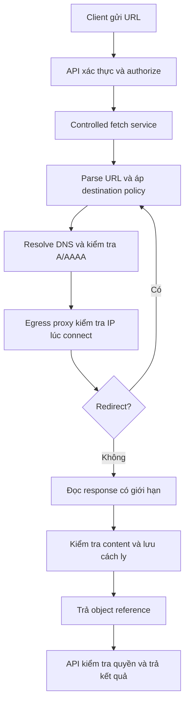

# API nhận URL hoặc địa chỉ đích từ người dùng

## 1. SSRF là gì và vì sao API dễ trở thành điểm trung gian?

Server-Side Request Forgery (SSRF) xảy ra khi attacker khiến server gửi request đến một đích mà attacker không thể hoặc không nên truy cập trực tiếp. API thường có quyền truy cập mạng rộng hơn người dùng bên ngoài: nó có thể kết nối database admin, service nội bộ, control plane, cloud metadata endpoint hoặc hệ thống chỉ mở trong private network. Nếu API nhận URL/hostname/IP từ client rồi tự truy cập mà không kiểm tra đích, server có thể trở thành một “confused deputy” dùng quyền mạng của chính nó thay cho attacker.

Các chức năng dễ gặp rủi ro:

- Tải ảnh đại diện, tài liệu hoặc tệp từ URL.
- Xem trước liên kết, tạo thumbnail hoặc trích xuất metadata trang web.
- Gọi webhook, callback hoặc endpoint tích hợp do khách hàng cấu hình.
- Import dữ liệu từ URL, đồng bộ feed, đọc OpenAPI/schema từ xa.
- Kiểm tra tình trạng website, proxy request hoặc fetch nội dung để hiển thị trong ứng dụng.
- Chuyển đổi tài liệu, xử lý media hoặc tạo PDF từ một URL nguồn.

Ví dụ, API có endpoint `POST /api/previews` nhận `{ "url": "https://example.com/article" }`. Nếu server tải URL theo yêu cầu mà không áp dụng policy, attacker có thể thử thay URL bằng địa chỉ loopback, IP private, dịch vụ quản trị hoặc địa chỉ metadata của cloud. Ngay cả khi response không được trả về client, request vẫn có thể gây tác động; đây là blind SSRF.

SSRF không chỉ là vấn đề URL. Đầu vào có thể là hostname, IP, port, tên service, proxy address, webhook destination hoặc một URL được lưu trong cấu hình rồi sử dụng sau đó. Mọi luồng khiến server mở kết nối đến đích do người dùng kiểm soát đều cần threat model.

## 2. Xác định trust boundary và tài sản cần bảo vệ

Trước khi triển khai tính năng fetch, hãy xác định server sẽ gọi đi đâu, bằng giao thức nào, dùng credential nào và response được xử lý ra sao.

| Thành phần | Câu hỏi cần trả lời | Rủi ro nếu bỏ qua |
|---|---|---|
| Input | Client điều khiển toàn bộ URL, hostname, IP, port, path hay chỉ một ID? | Attacker có thể chọn đích ngoài dự kiến. |
| DNS | Ai phân giải hostname và kết quả được kiểm tra ở thời điểm nào? | DNS rebinding hoặc thay đổi A/AAAA sau kiểm tra. |
| Kết nối | HTTP client, proxy, service mesh hay network layer mở socket? | Kiểm tra ở một tầng nhưng tầng khác kết nối tới IP khác. |
| Redirect | Client có tự động theo redirect không? | URL công khai chuyển hướng sang mạng nội bộ. |
| Credential | Request outbound có mang cookie, bearer token, API key hoặc client certificate không? | Credential của server bị gửi đến host do attacker chọn. |
| Response | Server đọc bao nhiêu byte, loại nội dung nào, thời gian bao lâu? | DoS, decompression bomb, parser exploit hoặc lưu nội dung độc hại. |
| Quyền mạng | Workload được phép truy cập subnet/service nào? | SSRF biến thành đường vào hạ tầng nội bộ. |

Tài sản cần bảo vệ gồm dữ liệu nội bộ, thông tin xác thực, metadata cloud, control plane, dịch vụ quản trị, hệ thống thanh toán và tính sẵn sàng của outbound network. Một URL có vẻ hợp lệ vẫn có thể dẫn tới tài sản nhạy cảm nếu hạ tầng route nó vào mạng nội bộ.

## 3. Những dạng đích SSRF thường gặp

### Loopback và địa chỉ private

Các địa chỉ sau thường không được phép làm đích cho một tính năng fetch URL công khai:

| Nhóm | Ví dụ | Lý do cần chặn theo policy |
|---|---|---|
| IPv4 loopback | `127.0.0.1`, toàn bộ `127.0.0.0/8` | Có thể truy cập service chỉ bind trên máy local. |
| IPv4 private | `10.0.0.0/8`, `172.16.0.0/12`, `192.168.0.0/16` | Có thể truy cập service nội bộ hoặc mạng tenant. |
| IPv4 link-local | `169.254.0.0/16` | Có thể chứa cloud metadata hoặc dịch vụ link-local. |
| IPv4 unspecified/current network | `0.0.0.0/8` và địa chỉ không xác định khác | Cách hệ điều hành diễn giải có thể khác với kỳ vọng của ứng dụng. |
| Carrier-grade NAT | `100.64.0.0/10` | Có thể được dùng trong mạng hạ tầng/nhà cung cấp. |
| IPv4 multicast/reserved | `224.0.0.0/4`, `240.0.0.0/4` | Không phải đích unicast công khai thông thường. |
| IPv6 loopback/unspecified | `::1`, `::` | Tương đương loopback/unspecified trong IPv6. |
| IPv6 unique-local | `fc00::/7` | Phạm vi private của IPv6. |
| IPv6 link-local | `fe80::/10` | Chỉ có ý nghĩa trên link; có thể tiếp cận hạ tầng cục bộ. |
| IPv6 multicast | `ff00::/8` | Không phải đích unicast thông thường. |

Danh sách trên chỉ là ví dụ quan trọng, không phải policy đầy đủ cho mọi mạng. Cần xét thêm các dải reserved, documentation, benchmark, địa chỉ nội bộ riêng của tổ chức, subnet peering, service mesh và route đặc thù của cloud. Địa chỉ public cũng không tự động an toàn: một IP public có thể được route qua VPN, NAT hoặc gateway tới dịch vụ nhạy cảm.

### Cloud metadata và control plane

Các môi trường cloud thường có endpoint metadata hoặc identity service gắn với instance/workload. Nếu SSRF chạm được endpoint đó, attacker có thể tìm cách lấy thông tin về máy, role hoặc credential tạm thời. Một số nền tảng yêu cầu cơ chế bảo vệ riêng cho metadata; hãy bật cấu hình bảo vệ được nhà cung cấp hỗ trợ, giới hạn quyền IAM/workload identity và chặn đường truy cập từ workload không cần thiết.

Không dựa vào một hostname metadata duy nhất để bảo vệ. Metadata có thể có địa chỉ IP, DNS alias hoặc cơ chế truy cập riêng theo nền tảng. Kiểm soát ở network egress và identity policy phải bổ sung cho validation của ứng dụng.

### Giao thức không mong muốn

Nếu tính năng chỉ cần tải nội dung web, thường chỉ cho phép `https` và chỉ cho phép `http` khi nghiệp vụ thực sự cần. Từ chối scheme không cần thiết như `file:`, `ftp:`, `gopher:`, `jar:`, `data:`, `ldap:` hoặc các scheme mà HTTP client/plugin có thể diễn giải ngoài dự kiến. Không để URL parser của một thư viện chuyển đầu vào thành file path hoặc protocol handler khác.

## 4. Vì sao kiểm tra URL bằng regex là không đủ?

URL có cấu trúc phức tạp: scheme, authority, userinfo, hostname, port, path, query và fragment. Parser khác nhau có thể xử lý khác nhau đối với backslash, percent-encoding, Unicode/IDN, dấu chấm cuối hostname, IPv6 literal, dấu `@`, dấu `#` hoặc dạng biểu diễn IP bất thường.

Ví dụ, kiểm tra chuỗi có chứa `example.com` không chứng minh hostname thực sự là `example.com`. URL có thể chứa userinfo hoặc hostname khác sau dấu phân cách. Tương tự, kiểm tra bằng regex rằng URL bắt đầu bằng `https://` không xác minh được IP mà socket cuối cùng kết nối.

Các quy tắc nên áp dụng:

- Parse bằng URI/URL parser chuẩn; không tự tách authority bằng substring hoặc regex.
- Kiểm tra scheme, host, port, userinfo và các thành phần theo hợp đồng.
- Chuẩn hóa hostname theo một quy tắc nhất quán, bao gồm IDN nếu hỗ trợ; so sánh allowlist theo hostname đã canonicalize.
- Từ chối URL mơ hồ hoặc parser không trích xuất được hostname rõ ràng.
- Không decode/encode lặp qua nhiều tầng; xác định rõ thành phần nào được decode và ở thời điểm nào.
- Kiểm tra cả IP literal và kết quả DNS; không chỉ kiểm tra chuỗi hostname.

Nếu nghiệp vụ cho phép một danh sách đối tác cố định, allowlist hostname chính xác thường an toàn và dễ kiểm soát hơn việc cố chặn mọi hostname nguy hiểm. Không dùng kiểm tra kiểu `host.endsWith("example.com")` nếu chưa xử lý ranh giới label; `evil-example.com` hoặc `example.com.attacker.test` không phải subdomain hợp lệ của `example.com`. Nếu cần subdomain, kiểm tra bằng quy tắc label như `host.equals(base) || host.endsWith("." + base)` sau canonicalization.

## 5. DNS rebinding và TOCTOU

Một lỗi tinh vi xảy ra khi ứng dụng phân giải DNS để kiểm tra địa chỉ, thấy IP public hợp lệ rồi sau đó HTTP client tự phân giải hostname lần nữa và nhận IP private. Đây là DNS rebinding hoặc một dạng Time-of-check to Time-of-use (TOCTOU): địa chỉ được kiểm tra không phải địa chỉ thực tế được kết nối.

Ví dụ luồng không an toàn:

1. API nhận `https://attacker-controlled.example/`.
2. Ứng dụng gọi DNS và nhận IP public, rồi cho qua kiểm tra.
3. TTL hết hạn hoặc DNS trả kết quả khác.
4. HTTP client phân giải lại hostname và kết nối tới IP private/loopback.

Việc gọi `InetAddress.getAllByName()` rồi sau đó dùng `WebClient`/`RestTemplate` với hostname ban đầu không tự giải quyết vấn đề này. Client có thể phân giải lại DNS ở thời điểm kết nối, dùng proxy hoặc đi qua một resolver khác.

Các biện pháp vững chắc hơn:

- Ưu tiên allowlist host đích cố định, kết hợp egress policy chỉ cho phép IP/subnet cần thiết.
- Với host động, thực hiện DNS resolution và kiểm tra toàn bộ A/AAAA/CNAME chain theo policy; từ chối nếu có địa chỉ không được phép.
- Bảo đảm địa chỉ được kiểm tra chính là địa chỉ được dùng khi mở socket. Có thể dùng egress proxy/controlled fetch service thực hiện resolve, validate và connect trong cùng một điểm kiểm soát.
- Nếu pin IP, vẫn phải giữ hostname gốc cho TLS SNI và hostname verification; không tắt kiểm tra chứng chỉ để “khớp IP”.
- Kiểm tra lại khi retry hoặc reconnect; không tái sử dụng kết quả kiểm tra cũ ngoài thời hạn policy.
- Áp dụng network egress firewall để chặn private, link-local, metadata và subnet nội bộ ngay cả khi validation ở ứng dụng bị lỗi.

Không nên tự viết một HTTP client thấp tầng chỉ để pin DNS nếu chưa xử lý đầy đủ proxy, IPv4/IPv6, TLS, connection pooling, redirect và hostname verification. Một egress proxy chuyên dụng có policy ở thời điểm connect thường là ranh giới dễ quản lý hơn.

## 6. Redirect có thể biến URL an toàn thành đích nguy hiểm

Một URL public có thể trả `301`, `302`, `303`, `307` hoặc `308` chuyển hướng đến địa chỉ khác. Nếu HTTP client tự theo redirect, validation ban đầu chỉ bảo vệ URL đầu tiên. Redirect có thể đổi hostname, port, scheme hoặc chuyển từ public sang private.

Chính sách an toàn:

- Tắt automatic redirect nếu tính năng không cần redirect.
- Nếu cần redirect, đặt giới hạn số lần và kiểm tra lại URL đích sau mỗi bước.
- Áp dụng lại scheme, hostname, port, DNS/IP và egress policy cho từng redirect.
- Không chuyển tiếp `Authorization`, cookie, API key hoặc header nội bộ sang host mới.
- Không cho downgrade từ HTTPS sang HTTP nếu không có yêu cầu và policy rõ ràng.
- Chống vòng lặp redirect và giới hạn tổng thời gian của toàn chuỗi.

Redirect có thể được tạo từ response của một server hợp lệ hoặc từ dịch vụ do attacker kiểm soát. Vì vậy, trust của URL ban đầu không được kế thừa tự động cho URL tiếp theo.

## 7. Chiến lược cho phép đích đến

Chọn policy dựa trên mục đích nghiệp vụ. Không có một chiến lược phù hợp cho mọi tính năng.

| Chiến lược | Khi phù hợp | Cách thực hiện |
|---|---|---|
| Exact hostname allowlist | Chỉ fetch một số đối tác/dịch vụ đã biết. | So sánh hostname canonical với danh sách cố định; giới hạn scheme và port. |
| Subdomain allowlist | Đối tác dùng nhiều subdomain có quy ước. | So sánh label boundary; giới hạn suffix và xác minh DNS/IP tại thời điểm kết nối. |
| IP/CIDR allowlist | Hệ thống đích có IP/subnet được quản lý ổn định. | Chỉ cho phép dải cần thiết; kiểm tra địa chỉ kết nối và thay đổi hạ tầng. |
| Controlled egress proxy | Cần truy cập nhiều host public theo nhu cầu. | Proxy resolve DNS, kiểm tra IP/port, kiểm soát redirect và log destination. |
| Private integration connector | Gọi webhook/đối tác theo cấu hình đã được quản trị. | Quản trị viên xác minh endpoint, lưu cấu hình tin cậy, cấp credential riêng và kiểm tra khi thay đổi. |

Tránh dựa hoàn toàn vào denylist. Danh sách IP private/metadata hữu ích nhưng có thể thiếu dải đặc thù của tổ chức hoặc môi trường cloud. Với tính năng có thể giới hạn đích, allowlist là lựa chọn ưu tiên. Nếu phải hỗ trợ internet rộng, hãy kết hợp kiểm tra IP ở thời điểm connect và egress proxy/firewall.

### Nếu API nhận hostname hoặc IP thay vì URL

Không ghép hostname, port và path bằng nối chuỗi tùy ý. Định nghĩa riêng hợp đồng cho từng field:

- Hostname: parse và canonicalize DNS name; từ chối userinfo, scheme, slash và port lẫn trong field hostname.
- IP: parse thành kiểu địa chỉ IP; không chấp nhận biểu diễn mơ hồ; áp dụng policy IPv4/IPv6.
- Port: parse thành số nguyên và chỉ cho phép tập port cần thiết.
- Path: xử lý như path segment; ngăn path traversal và không cho phép nó thay đổi authority.
- Scheme: enum do server định nghĩa, không nhận handler tùy ý.

Nếu API nhận `host` và `port` để kiểm tra kết nối, server vẫn phải xác minh principal có quyền sử dụng chức năng và giới hạn số lần/đích đến. Một endpoint “TCP ping” hoặc “check host” không xác định phạm vi có thể trở thành port scanner nội bộ.

## 8. Bảo vệ credential và header trong request outbound

Một SSRF có thể nguy hiểm hơn khi HTTP client tự động gắn credential. Không dùng chung một HTTP client có default header chứa token nội bộ cho request tới URL do người dùng cung cấp.

- Không chuyển tiếp access token của user, service token, cookie session, `Authorization`, `Proxy-Authorization` hoặc header quản trị sang host do client chọn.
- Không tự động gửi client certificate/mTLS identity có quyền rộng cho mọi đích.
- Không chuyển tiếp toàn bộ header inbound; tạo outbound request mới với allowlist header tối thiểu.
- Nếu phải gọi đối tác có xác thực, lấy credential riêng theo integration đã được quản trị và chỉ gắn sau khi hostname/tenant/endpoint được xác minh.
- Không đưa secret vào URL query string; URL thường xuất hiện trong log và trace.
- Kiểm tra redirect không làm rò credential sang origin khác.

Credential nên có scope hẹp, audience phù hợp, thời hạn ngắn và quyền tối thiểu. SSRF prevention và secret management phải được thiết kế cùng nhau.

## 9. Giới hạn response và tác động tài nguyên

Ngay cả khi đích đến hợp lệ, server vẫn cần coi response là dữ liệu không tin cậy. Một server public có thể trả response cực lớn, stream vô hạn, MIME type giả, nội dung nén có tỷ lệ giải nén rất cao hoặc file gây tốn CPU khi parse.

Hãy giới hạn:

- Connect timeout, response timeout và tổng deadline của thao tác.
- Số redirect và tổng số lần retry.
- Kích thước response sau giải nén, không chỉ `Content-Length` khai báo.
- Số byte đọc, số kết nối đồng thời, queue depth và số tác vụ fetch mỗi user/tenant.
- Content type và loại file được chấp nhận; kiểm tra magic bytes nếu xử lý file.
- Kích thước ảnh, pixel count, độ dài media, độ sâu tài liệu và thời gian parse.
- Số URL được xử lý trong một request/batch và tần suất gọi theo principal/tenant.

Không tải toàn bộ response vào RAM nếu có thể stream qua bộ đếm byte và dừng ngay khi vượt giới hạn. Không tin `Content-Length`, `Content-Type` hoặc tên file do remote server khai báo. Nếu lưu nội dung, đặt tên object do server sinh, lưu ở vùng cách ly và quét/kiểm tra trước khi cho người dùng khác tải.

## 10. Mẫu triển khai an toàn trong Java/Spring

### Trường hợp tốt nhất: host đích được biết trước

Ví dụ sau minh họa một tính năng chỉ lấy metadata từ một số host đối tác đã cấu hình. Nó kiểm tra cấu trúc URL, giới hạn scheme/port, từ chối userinfo và redirect. Đây là một phần của thiết kế; egress firewall/proxy vẫn cần bảo đảm địa chỉ kết nối nằm trong policy.

```java
@Component
public class PartnerUrlPolicy {
    private static final Set<String> ALLOWED_HOSTS = Set.of(
        "status.partner.example",
        "catalog.partner.example"
    );

    public URI validate(String rawUrl) {
        if (rawUrl == null || rawUrl.length() > 2048) {
            throw new IllegalArgumentException("Invalid URL");
        }

        final URI uri;
        try {
            uri = URI.create(rawUrl).parseServerAuthority();
        } catch (URISyntaxException | IllegalArgumentException ex) {
            throw new IllegalArgumentException("Malformed URL", ex);
        }

        if (!"https".equalsIgnoreCase(uri.getScheme())
                || uri.getRawUserInfo() != null
                || uri.getHost() == null
                || (uri.getPort() != -1 && uri.getPort() != 443)) {
            throw new IllegalArgumentException("URL is not allowed");
        }

        String host = IDN.toASCII(uri.getHost()).toLowerCase(Locale.ROOT);
        if (!ALLOWED_HOSTS.contains(host)) {
            throw new IllegalArgumentException("Destination is not allowed");
        }

        return uri;
    }
}
```

Trong ví dụ này, allowlist chỉ gồm hostname chính xác; không dùng wildcard. Với URI có IDN, cần xác định chính sách Unicode/IDNA và canonicalization nhất quán giữa parser, allowlist, DNS resolver và egress proxy. Không chấp nhận host dạng IP nếu use case chỉ cho phép DNS name.

HTTP client nên tắt redirect tự động, đặt deadline và chỉ gửi header tối thiểu:

```java
HttpClient httpClient = HttpClient.newBuilder()
    .connectTimeout(Duration.ofSeconds(3))
    .followRedirects(HttpClient.Redirect.NEVER)
    .build();

URI target = partnerUrlPolicy.validate(request.url());
HttpRequest outbound = HttpRequest.newBuilder(target)
    .timeout(Duration.ofSeconds(5))
    .header("Accept", "application/json")
    .GET()
    .build();

HttpResponse<InputStream> response = httpClient.send(
    outbound, HttpResponse.BodyHandlers.ofInputStream());
```

Đoạn mã chỉ minh họa host allowlist và redirect policy. Production cần đọc stream với byte limit, kiểm tra status/content type, đóng stream đúng cách, giới hạn concurrency và gửi request qua egress path được kiểm soát. Với host động, kiểm tra allowlist hostname không đủ để chống DNS rebinding; proxy/connector phải kiểm tra IP thực tế tại thời điểm kết nối. Không tắt TLS certificate hoặc hostname verification.

### Thiết kế một controlled fetch service

Nếu sản phẩm phải tải từ nhiều host internet, tách chức năng này thành một service chuyên trách:

1. API nghiệp vụ xác thực user và kiểm tra quyền sử dụng tính năng fetch.
2. API gửi URL cùng tenant/principal context đã xác thực tới controlled fetch service qua kênh nội bộ.
3. Fetch service parse URL, áp policy scheme/port/hostname, phân giải DNS và kiểm tra mọi địa chỉ.
4. Egress proxy/network policy chỉ cho kết nối tới địa chỉ public được phép và chặn mạng nội bộ/metadata.
5. Mỗi redirect được kiểm tra lại; outbound header/credential được tạo mới theo allowlist.
6. Fetch service giới hạn byte/time/concurrency và trả về nội dung đã kiểm tra hoặc một object reference.
7. API nghiệp vụ kiểm tra quyền trên object/result trước khi trả cho caller.



Kiến trúc này tạo một điểm thực thi policy outbound và giảm số service cần quyền truy cập internet tùy ý. Fetch service vẫn cần quyền tối thiểu, cách ly workload và giám sát riêng.

## 11. Bảo vệ webhook và callback URL

Webhook URL thường do tenant hoặc quản trị viên cấu hình và được server gọi về sau. Đây là SSRF dạng lưu trữ (stored/second-order SSRF): URL có thể được lưu hôm nay và chỉ được sử dụng khi có event vài ngày sau.

- Chỉ role có quyền quản lý integration mới được tạo hoặc sửa destination.
- Xác minh destination khi lưu và kiểm tra lại khi gửi; DNS và route có thể thay đổi theo thời gian.
- Dùng allowlist host/port hoặc controlled egress service; không coi URL đã xác minh một lần là an toàn vĩnh viễn.
- Không cho callback đến loopback, private, link-local, metadata hoặc subnet nội bộ.
- Gửi payload tối thiểu, ký webhook bằng secret riêng cho từng integration và không gửi bearer token nội bộ.
- Giới hạn timeout, retry, response size và số lần gửi; hỗ trợ tạm dừng integration có hành vi bất thường.
- Xác minh quyền sở hữu endpoint khi onboarding nếu nghiệp vụ yêu cầu, nhưng không coi challenge một lần là biện pháp thay thế kiểm tra đích khi kết nối.

Khi tenant thay đổi webhook URL, cần audit ai thay đổi, thời điểm và giá trị destination đã được chuẩn hóa/che phù hợp. Không ghi secret ký webhook vào log.

## 12. Những anti-pattern thường gặp

| Anti-pattern | Rủi ro | Cách sửa |
|---|---|---|
| Chỉ kiểm tra URL bắt đầu bằng `https://` | Không kiểm tra hostname/IP thực tế. | Parse URL, destination policy và egress enforcement. |
| Chặn vài chuỗi như `localhost` | Bỏ sót IP literal, alias, IPv6 và DNS. | Kiểm tra IP sau resolution và allowlist. |
| Resolve DNS để kiểm tra rồi client resolve lại | DNS rebinding/TOCTOU. | Kiểm tra tại điểm kết nối hoặc dùng controlled egress proxy. |
| Cho phép redirect tự động | Redirect có thể đi tới private/metadata. | Tắt redirect hoặc validate từng hop. |
| Tin `X-Forwarded-For`/header do client gửi làm policy đích | Header có thể bị giả mạo và không chứng minh network destination. | Dùng địa chỉ socket/egress policy do proxy tin cậy cung cấp. |
| Dùng HTTP client có sẵn bearer token | SSRF có thể gửi credential nội bộ đến host attacker. | Client riêng, header allowlist, credential theo integration. |
| Cho phép mọi port/giao thức | Có thể dò cổng hoặc gọi protocol handler ngoài dự kiến. | Giới hạn scheme và port; chỉ HTTP(S) khi cần. |
| Chỉ kiểm tra URL lúc lưu webhook | DNS/route có thể đổi trước lúc gửi. | Kiểm tra lại tại mỗi lần kết nối. |
| Đọc response không giới hạn | DoS hoặc lưu nội dung quá lớn/độc hại. | Byte/time/concurrency limits và content validation. |
| Dựa vào denylist hostname đơn lẻ | Alias/CNAME và dải nội bộ mới có thể bị bỏ sót. | Allowlist hoặc egress proxy/firewall theo IP/CIDR. |

## 13. Kiểm thử SSRF

Kiểm thử cần bao gồm URL đầu vào, DNS, kết nối, redirect và response. Thực hiện trong môi trường test có kiểm soát; dùng endpoint giả lập để xác nhận request bị chặn thay vì dò thử hạ tầng production.

| Nhóm test | Trường hợp | Kết quả mong đợi |
|---|---|---|
| Scheme | `file:`, `ftp:`, `gopher:`, `data:` hoặc scheme không được cấu hình. | Bị từ chối trước khi tạo kết nối. |
| URL parsing | Userinfo, hostname rỗng, port lạ, dấu phân cách/encoding mơ hồ. | Parse thất bại hoặc policy từ chối. |
| Loopback/private | IPv4/IPv6 loopback, RFC1918, ULA, link-local và dải nội bộ của tổ chức. | Không có kết nối outbound tới đích. |
| Metadata | Địa chỉ/hostname metadata theo môi trường cloud. | Network egress chặn; ứng dụng từ chối theo policy. |
| DNS multi-answer | Hostname trả nhiều A/AAAA, trong đó có địa chỉ bị cấm. | Từ chối theo policy; không chọn ngẫu nhiên một IP an toàn rồi bỏ qua IP còn lại. |
| DNS rebinding | Kết quả DNS đổi giữa lúc validate và connect. | IP thực tế ở thời điểm connect vẫn bị kiểm tra/chặn. |
| Redirect | URL public trả redirect sang host khác hoặc IP private. | Tắt redirect hoặc kiểm tra lại hop và từ chối đích không hợp lệ. |
| Credential leakage | Redirect/host ngoài allowlist trong khi request có header nhạy cảm. | Không gửi token/cookie/API key tới origin khác. |
| Response limits | Stream dài, không có Content-Length, content nén lớn hoặc timeout. | Dừng theo byte/deadline; giải phóng tài nguyên. |
| Stored webhook | URL được lưu hợp lệ rồi DNS/đích thay đổi trước lần gửi sau. | Kiểm tra lại lúc kết nối; audit và chặn destination mới không hợp lệ. |
| Authorization | User không có quyền tạo integration/fetch URL. | Bị từ chối trước khi fetch service được gọi. |
| Egress policy | Thử kết nối tới subnet nội bộ từ fetch workload. | Firewall/proxy từ chối dù application validation có lỗi. |

Đo cả số request thực sự rời workload, IP/port được kết nối, redirect chain, byte nhận, thời gian xử lý và quyết định policy. Một response `403` từ API không đủ chứng minh SSRF đã được chặn nếu outbound request vẫn xảy ra trước khi response bị từ chối.

## 14. Giám sát và ứng phó

Log outbound request ở mức đủ điều tra nhưng không lưu secret hoặc toàn bộ query có thể chứa dữ liệu nhạy cảm. Các trường hữu ích gồm principal/tenant, feature gọi fetch, hostname đã canonicalize, IP/port đích thực tế, scheme, redirect count, policy decision, response status, byte count, duration và request/correlation ID.

Theo dõi các dấu hiệu:

- Nhiều request tới IP private, loopback, link-local, metadata hoặc hostname nội bộ.
- Một user/tenant tạo nhiều destination mới hoặc thử nhiều port/hostname.
- DNS answer thay đổi bất thường, redirect chain dài hoặc nhiều redirect bị chặn.
- Tăng outbound traffic, response size, timeout, concurrency hoặc retry.
- Webhook URL bị thay đổi ngay trước khi có event nhạy cảm.
- Fetch service cố kết nối tới subnet ngoài allowlist hoặc dùng giao thức không được phép.

Khi phát hiện SSRF, vô hiệu hóa integration/fetch job bị ảnh hưởng, chặn destination ở egress layer, thu hồi credential có thể đã bị gửi đi, kiểm tra audit log của dịch vụ đích và xác định dữ liệu/metadata có thể bị truy cập. Nếu credential cloud hoặc service token có nguy cơ lộ, xoay vòng/thu hồi và rà soát quyền IAM. Giữ lại evidence về URL, DNS answer, IP kết nối và redirect chain theo chính sách bảo vệ dữ liệu.

## 15. Checklist cho API nhận URL hoặc địa chỉ đích

- [ ] Có lý do nghiệp vụ rõ ràng để server phải mở kết nối tới destination do client cung cấp?
- [ ] Principal được xác thực và có quyền dùng chức năng fetch/webhook/import?
- [ ] Input được parse bằng URI/IP parser chuẩn, không dựa vào regex hoặc substring?
- [ ] Scheme, hostname, port, userinfo và path được giới hạn theo hợp đồng?
- [ ] Có allowlist chính xác khi có thể; nếu host động thì có destination policy ở thời điểm connect?
- [ ] DNS A/AAAA/CNAME và IPv4/IPv6 được kiểm tra; có chống DNS rebinding/TOCTOU?
- [ ] Redirect bị tắt hoặc từng hop được kiểm tra lại?
- [ ] Egress proxy/firewall chặn private, loopback, link-local, metadata và subnet nội bộ?
- [ ] Outbound request không tự gửi cookie, bearer token, API key hoặc header nội bộ?
- [ ] Timeout, byte limit, response type, redirect count, retry và concurrency được giới hạn?
- [ ] Webhook URL được kiểm tra cả lúc lưu và lúc gửi; có audit thay đổi integration?
- [ ] Có test cho parser ambiguity, DNS change, redirect, credential leakage và egress denial?
- [ ] Có log/alert về destination và IP thực tế mà không làm lộ secret?

Khi API nhận URL hoặc địa chỉ đích từ người dùng, server đang sử dụng quyền mạng của chính mình để thực hiện một hành động thay mặt caller. Vì vậy, bảo vệ SSRF phải kiểm soát destination ở thời điểm kết nối, giới hạn giao thức và redirect, bảo vệ credential outbound, giới hạn response và cưỡng chế egress ở tầng mạng. Regex hoặc một lần kiểm tra URL ở đầu request không thể thay thế các lớp kiểm soát này.
