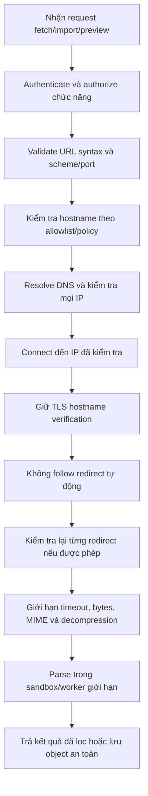

# Server-Side Request Forgery qua fetch, import hoặc preview

Nhiều API cần truy cập URL do caller cung cấp để tải ảnh đại diện, nhập dữ liệu từ nguồn bên ngoài, xem trước nội dung trang web, kiểm tra webhook hoặc lấy tài liệu từ một dịch vụ khác. Chức năng này biến server thành một HTTP client có thể truy cập mạng thay cho người dùng. Nếu API không kiểm soát đích đến, attacker có thể khiến server gửi request đến địa chỉ nội bộ, dịch vụ quản trị, cổng metadata của cloud hoặc hệ thống chỉ có thể truy cập từ mạng backend.

Đây là **Server-Side Request Forgery (SSRF)**. Điểm nguy hiểm nằm ở chỗ request được phát ra từ hạ tầng của server, nơi có thể có quyền mạng và credential khác với thiết bị của caller. Một endpoint chỉ cần nhận trường `url` rồi gọi `HTTP client.get(url)` đã có thể trở thành điểm SSRF nếu thiếu kiểm tra URL, DNS, địa chỉ IP, redirect, proxy, giao thức và giới hạn tài nguyên.

Trong phạm vi `SECURITY_API_SECURITY`, mọi chức năng fetch/import/preview phải được thiết kế theo endpoint, dữ liệu và luồng nghiệp vụ. Xác thực người gọi và phân quyền sử dụng chức năng vẫn cần thiết, nhưng không làm URL do caller gửi trở nên đáng tin. Server phải tự quyết định đích nào được phép truy cập, thực hiện kết nối trong vùng mạng giới hạn và kiểm soát dữ liệu nhận về.

## 1. SSRF hoạt động như thế nào?

Một luồng đơn giản có thể là:

```text
Client -> POST /api/preview { "url": "https://example.com/article" }
       -> API server -> HTTP request đến URL
       -> Server đọc response -> trả preview cho client
```

Nếu server chấp nhận URL bất kỳ, caller có thể thay bằng địa chỉ nội bộ hoặc địa chỉ nhạy cảm:

```text
http://127.0.0.1:8080/admin
http://169.254.169.254/
http://10.0.0.12:9000/metrics
http://internal-service.namespace.svc.cluster.local/
```

Các địa chỉ trên chỉ là ví dụ minh họa. Tùy môi trường, server có thể truy cập loopback, private network, link-local, service discovery trong cluster hoặc endpoint metadata. Attacker không cần trực tiếp kết nối được các đích đó; họ chỉ cần thuyết phục server kết nối thay mình.

### 1.1. Tác động có thể xảy ra

- **Đọc dịch vụ nội bộ:** truy cập dashboard, admin API, metrics, health endpoint hoặc service không được public.
- **Đánh cắp credential hạ tầng:** truy cập metadata endpoint để lấy token/credential của workload nếu cloud/runtime cho phép.
- **Quét mạng nội bộ:** dùng response, timing hoặc lỗi kết nối để suy đoán host và port tồn tại.
- **Gọi hành động trái phép:** gửi request đến endpoint nội bộ có side effect, nhất là khi service tin request từ mạng nội bộ.
- **Vượt ranh giới tenant hoặc môi trường:** truy cập tài nguyên chỉ dành cho backend, staging hoặc control plane.
- **Tấn công gián tiếp:** tải URL gây redirect, DNS rebinding, response khổng lồ, decompression bomb hoặc giữ kết nối lâu để tiêu thụ tài nguyên.

SSRF có thể là *blind SSRF*: server gửi request nhưng không trả body cho caller. Attacker vẫn có thể suy ra việc request đã xảy ra qua thời gian phản hồi, mã lỗi, callback/DNS do họ kiểm soát hoặc side effect ở hệ thống đích. Vì vậy, việc API chỉ trả `URL accepted` không loại bỏ rủi ro.

## 2. Những tính năng API dễ tạo SSRF

Hãy tìm mọi nơi backend thực hiện kết nối ra ngoài dựa trên dữ liệu request hoặc dữ liệu đã lưu trước đó.

| Chức năng | Đầu vào có thể bị kiểm soát | Rủi ro |
|---|---|---|
| Link preview | URL trang web | Đọc mạng nội bộ, metadata hoặc redirect sang đích cấm |
| Import CSV/JSON/XML từ URL | URL nguồn dữ liệu | Đọc file hoặc endpoint nội bộ; tải file lớn |
| Import tài liệu/ảnh | URL file | SSRF, file độc hại, decompression bomb |
| Remote avatar/image proxy | URL ảnh | SSRF qua fetch ảnh và xử lý metadata |
| Webhook test/delivery | Callback URL | Gọi địa chỉ nội bộ hoặc dịch vụ quản trị |
| PDF/document converter | URL nguồn hoặc resource reference | SSRF từ thư viện render khi tải ảnh/font/link phụ |
| URL checker/health checker | Host/URL cần kiểm tra | Quét port hoặc host nội bộ |
| OAuth/OIDC metadata hoặc JWKS helper | Issuer/JWKS URL | SSRF nếu URL chưa được ràng buộc với issuer tin cậy |
| Image/PDF processing | URL nằm trong file hoặc HTML | SSRF gián tiếp trong worker/parser |
| AI crawler/summarizer | URL hoặc link trong nội dung | Server-side browsing đến đích ngoài dự kiến |

Không chỉ kiểm tra controller nhận URL. Một thư viện preview có thể tự tải ảnh, stylesheet, font hoặc redirect; một parser XML có thể resolve external entity; một worker có thể fetch URL ở thời điểm xử lý job. Threat model phải bao phủ toàn bộ chuỗi thực thi.

## 3. Ranh giới tin cậy và luồng xử lý an toàn

URL do client gửi là dữ liệu không tin cậy. DNS record, redirect location, proxy configuration và nội dung response cũng có thể thay đổi hoặc bị đối phương kiểm soát. Mỗi bước trước khi mở kết nối phải áp dụng chính sách riêng.



Một chính sách an toàn nên ưu tiên allowlist hostname/destination cố định. Nếu sản phẩm bắt buộc hỗ trợ URL công khai tùy ý, cần kiểm tra đồng thời hostname, toàn bộ địa chỉ IP phân giải được, địa chỉ thực sự dùng để kết nối và mọi redirect. Chỉ kiểm tra chuỗi URL hoặc regex hostname là không đủ.

## 4. Xác thực và phân quyền trước khi fetch

Trước khi thực hiện request ra ngoài, xác định:

- Caller là user, service account hay integration nào?
- Họ có quyền dùng chức năng fetch/import/preview không?
- Họ có được phép fetch cho tenant, project hoặc object cụ thể không?
- Có được phép dùng hostname/destination này theo chính sách sản phẩm không?
- Request có vượt quota, concurrency hoặc giới hạn chi phí không?

Ví dụ, quyền `document:import` không đồng nghĩa caller được yêu cầu server truy cập mọi URL. Có thể cần quyền hoặc policy riêng như `document:import-from-approved-source`, gắn với tenant và danh sách nguồn dữ liệu được quản trị.

Không dùng URL làm căn cứ cấp quyền. Nếu caller gửi `tenantId`, `ownerId` hoặc `projectId`, server phải xác minh các tham chiếu này thuộc phạm vi actor. Khi job được đưa vào queue, lưu actor/tenant đã xác minh cùng policy context; worker phải kiểm tra lại quyền hoặc grant theo chính sách tại thời điểm thực thi.

## 5. Chỉ cho phép giao thức và port cần thiết

Nếu chức năng chỉ cần tải nội dung web, thường chỉ cho phép `https`. Nếu cần hỗ trợ `http`, phải có lý do nghiệp vụ và giới hạn rõ. Từ chối các scheme không cần thiết như:

- `file:` để đọc file local.
- `ftp:` hoặc protocol khác mà HTTP client không cần.
- `gopher:`, `dict:` hoặc scheme có thể kích hoạt hành vi ngoài dự kiến của thư viện.
- `jar:`, `data:` hoặc scheme đặc thù của runtime/parser nếu không có use case.
- Scheme tùy chỉnh do plugin hoặc thư viện hỗ trợ nhưng chưa được review.

Giới hạn port theo policy. Với dịch vụ web công khai, thường chỉ cần port 443 và có thể 80 nếu cho phép HTTP. Không cho caller chọn port tùy ý vì điều đó hỗ trợ quét dịch vụ nội bộ. Không dựa vào port mặc định của thư viện; hãy kiểm tra port sau khi parse URL và sau khi áp dụng normalization.

URL parser phải được dùng đúng chuẩn. Tránh tự tách URL bằng regex hoặc thao tác chuỗi thủ công. Cần xử lý userinfo, hostname Unicode/IDN, dấu chấm cuối hostname, IPv6 literal, encoded character và dạng địa chỉ IP bất thường. URL như `https://trusted.example@127.0.0.1/` có hostname thực là `127.0.0.1`, không phải `trusted.example`.

## 6. Allowlist hostname là lớp kiểm soát ưu tiên

Nếu nghiệp vụ chỉ cần một số nguồn xác định, dùng allowlist hostname chính xác:

```text
Allowed hosts:
  files.partner.example
  catalog.vendor.example
  images.cdn.example
```

Nguyên tắc:

- So khớp hostname đã parse và canonicalize, không dùng `contains()` hoặc kiểm tra suffix tùy tiện.
- `partner.example.attacker.invalid` không được xem là subdomain của `partner.example`.
- Nếu cho phép subdomain, kiểm tra boundary dấu chấm: hostname phải bằng domain gốc hoặc kết thúc bằng `.` + domain gốc.
- Xác định rõ có cho phép CNAME, subdomain do tenant quản lý hoặc domain thay đổi theo khách hàng không.
- Quản lý allowlist như cấu hình bảo mật: có owner, review, audit và quy trình cập nhật.
- Không để client tự gửi `allowedHost`, `trustedDomain` hoặc policy flag để bỏ qua kiểm tra.

Ví dụ kiểm tra suffix đúng về nguyên tắc:

```java
boolean isAllowedSubdomain(String host, String baseDomain) {
    String normalizedHost = IDN.toASCII(host).toLowerCase(Locale.ROOT);
    String normalizedBase = IDN.toASCII(baseDomain).toLowerCase(Locale.ROOT);
    return normalizedHost.equals(normalizedBase)
        || normalizedHost.endsWith("." + normalizedBase);
}
```

Đây chỉ là một bước trong kiểm tra hostname, không phải một SSRF defense hoàn chỉnh. Cần xử lý trailing dot, hostname dạng IP, userinfo, port, Unicode/IDN, DNS resolution và kết nối thực tế. Với allowlist, ưu tiên danh sách hostname đầy đủ thay vì suffix rộng.

### 6.1. URL công khai tùy ý là trường hợp khó hơn

Một số sản phẩm cần preview mọi website công khai. Khi đó allowlist cố định không khả thi, nhưng không được bỏ qua kiểm soát. Server phải:

1. Chỉ chấp nhận scheme/port đã quy định.
2. Parse và canonicalize hostname bằng thư viện chuẩn.
3. Từ chối hostname/IP literal thuộc vùng cấm.
4. Resolve tất cả A/AAAA record và kiểm tra mọi địa chỉ.
5. Chỉ kết nối đến địa chỉ đã xác minh, tránh DNS re-resolution ngoài kiểm soát.
6. Xác minh lại mỗi redirect và mọi request phụ.
7. Áp dụng egress firewall để chặn mạng nội bộ ở tầng mạng.

Nếu không thể bảo đảm client HTTP dùng đúng IP đã kiểm tra, nên dùng một fetch proxy chuyên biệt có khả năng kiểm soát DNS và kết nối thay vì gọi HTTP client chung của ứng dụng.

## 7. Kiểm tra địa chỉ IP sau DNS resolution

Hostname có thể resolve thành nhiều địa chỉ. Không được chỉ kiểm tra hostname rồi tin mọi IP mà DNS trả về.

### 7.1. Các nhóm địa chỉ cần chặn theo policy

Với chức năng fetch Internet công khai, thường phải từ chối:

- IPv4 loopback, ví dụ `127.0.0.0/8`.
- IPv4 private, ví dụ `10.0.0.0/8`, `172.16.0.0/12`, `192.168.0.0/16`.
- IPv4 link-local, ví dụ `169.254.0.0/16`, gồm các endpoint metadata phổ biến.
- IPv4 unspecified, broadcast, multicast và các dải reserved/special-purpose không dùng làm đích public.
- IPv6 loopback `::1`, unspecified `::`, link-local `fe80::/10` và unique-local `fc00::/7`.
- IPv6 multicast và các dải special-purpose không được phép.
- IPv4-mapped IPv6 và các biểu diễn IPv6 có thể ánh xạ đến IPv4 bị cấm.
- Các dải mạng nội bộ riêng của tổ chức, VPC, VNet, cluster hoặc service mesh.

Danh sách trên là nhóm cần xem xét, không thay thế bảng special-purpose IP cập nhật và chính sách mạng của môi trường. Một số dải có semantics đặc biệt theo hệ điều hành hoặc cloud; dùng thư viện IP/CIDR đáng tin cậy thay vì tự viết regex.

### 7.2. Kiểm tra tất cả A và AAAA record

Nếu DNS trả nhiều IP, tất cả địa chỉ có thể được client chọn. Chỉ cần một record trỏ vào private network cũng tạo rủi ro nếu HTTP client tự chọn record đó. Chính sách an toàn là từ chối hostname nếu bất kỳ địa chỉ nào trong tập kết quả thuộc vùng cấm, trừ khi kiến trúc có một cơ chế chọn và pin địa chỉ được kiểm chứng.

Không chỉ kiểm tra IPv4 rồi bỏ qua IPv6. Một hostname có thể có A record public và AAAA record nội bộ hoặc ngược lại. Kiểm tra cả hai họ địa chỉ theo cùng policy.

### 7.3. Kiểm tra IP literal và dạng biểu diễn đặc biệt

Attacker có thể dùng địa chỉ IP thay cho hostname, hoặc biểu diễn IPv4 theo dạng số nguyên, octal, hexadecimal hay IPv4-mapped IPv6 tùy parser. Các parser khác nhau có thể diễn giải khác nhau. Hãy parse bằng thư viện chuẩn, chuẩn hóa thành binary address và kiểm tra CIDR. Nếu parser không nhận dạng rõ ràng, từ chối thay vì đoán.

Không dùng biểu thức như `startsWith("10.")` hoặc regex đơn giản để nhận diện private IP. Chúng có thể bỏ sót IPv6, dạng encoded hoặc địa chỉ đặc biệt.

## 8. DNS rebinding và TOCTOU

Một lỗi phổ biến là kiểm tra DNS ở bước đầu rồi để HTTP client tự resolve lại khi kết nối. Attacker kiểm soát DNS có thể trả địa chỉ public khi kiểm tra, sau đó đổi sang `127.0.0.1` hoặc private IP ở lần resolve tiếp theo. Đây là DNS rebinding; nó khai thác khoảng cách giữa thời điểm kiểm tra và thời điểm sử dụng (time-of-check to time-of-use, TOCTOU).

Luồng không an toàn:

```text
1. Application resolve attacker.example -> public IP
2. Application thấy IP public và cho phép
3. HTTP client resolve attacker.example lần nữa
4. DNS trả 127.0.0.1 hoặc private IP
5. Server kết nối vào đích nội bộ
```

Biện pháp:

- Resolve bằng resolver được kiểm soát và kiểm tra toàn bộ kết quả.
- Kết nối đến chính IP đã kiểm tra (pinning) trong request đó, nhưng vẫn giữ TLS hostname verification và SNI đúng hostname gốc.
- Không để HTTP client âm thầm resolve hostname lại sau bước kiểm tra.
- Không tái sử dụng connection pool theo cách làm mất ràng buộc host/IP đã xác minh.
- Nếu dùng proxy, proxy phải thực hiện kiểm tra DNS/IP tại nơi nó thực sự mở kết nối.
- Kết hợp egress firewall để chặn private, loopback, link-local và mạng quản trị.

Pin IP không có nghĩa là tắt TLS certificate verification. TLS vẫn phải xác minh certificate với hostname ban đầu; không xác minh theo IP đã pin nếu certificate không được cấp cho IP đó. Nếu không thể vừa pin địa chỉ vừa giữ hostname verification đúng, hãy dùng một fetch component chuyên dụng đã được thiết kế cho việc này.

## 9. Redirect và URL phụ

Một URL public có thể trả `301`, `302`, `303`, `307` hoặc `308` đến một đích khác. Nếu HTTP client tự follow redirect, kiểm tra URL ban đầu không còn đủ.

Chính sách an toàn:

- Tắt auto-follow redirect mặc định.
- Nếu sản phẩm cần redirect, giới hạn số hop nhỏ và có trần.
- Parse, kiểm tra scheme, port, hostname, DNS/IP và policy cho từng `Location` mới.
- Không cho redirect từ HTTPS xuống HTTP nếu policy yêu cầu TLS.
- Không forward `Authorization`, Cookie, API key hoặc header nội bộ sang origin khác.
- Chặn vòng lặp redirect và giới hạn tổng thời gian của toàn chuỗi.
- Không tin redirect đến hostname allowlist chỉ vì hostname ban đầu được phép.

Các thư viện preview/render có thể tải tài nguyên phụ như ảnh, CSS, font, iframe hoặc link nhúng. Mỗi request phụ cũng phải đi qua cùng SSRF policy. Một trang public có thể chứa ``; nếu renderer tự tải ảnh, nó tạo SSRF ngay cả khi URL trang chính an toàn.

## 10. Proxy, service mesh và egress network

HTTP client có thể tự sử dụng proxy từ environment variables hoặc cấu hình runtime. Nếu application kiểm tra IP đích nhưng request thực tế được gửi qua proxy khác, proxy có thể resolve hostname và kết nối đến IP chưa được kiểm tra.

Hãy xác định rõ:

- Có sử dụng `HTTP_PROXY`, `HTTPS_PROXY`, `NO_PROXY` hoặc proxy cấu hình ở runtime không?
- Proxy có kiểm tra destination và redirect không?
- Proxy có cho phép truy cập private/link-local/metadata không?
- DNS được resolve ở application hay ở proxy?
- Có đường kết nối trực tiếp bypass proxy không?
- Service mesh sidecar có áp dụng egress policy hay route đặc biệt không?

### 10.1. Egress firewall là lớp phòng thủ quan trọng

Tách fetch worker khỏi mạng ứng dụng và chỉ cho phép outbound đến các đích cần thiết. Network policy/firewall nên chặn:

- Loopback và private address space không cần thiết.
- Link-local và cloud metadata endpoints.
- Kubernetes control plane, node management, database và service admin ports.
- Các subnet/VPC/VNet nội bộ không thuộc allowlist.
- Port outbound không cần thiết.

Nếu một chức năng chỉ cần truy cập một số nhà cung cấp, cho phép egress đến các hostname/IP range đã quản lý. Lưu ý IP của CDN/provider có thể thay đổi; cập nhật allowlist cần quy trình và telemetry. Không mở egress toàn mạng chỉ vì một thư viện cần tải URL.

### 10.2. Metadata endpoint của cloud

Các cloud provider có endpoint metadata cung cấp thông tin về instance/workload và trong một số cấu hình có thể cấp credential. Chặn link-local metadata address ở tầng ứng dụng và network. Nếu nền tảng hỗ trợ cơ chế bảo vệ metadata như yêu cầu header/token hoặc hop limit, bật cơ chế đó; nhưng không xem đây là thay thế SSRF defense.

Không dựa vào một hostname metadata duy nhất. Attacker có thể thử IP literal, IPv6, redirect, proxy hoặc hostname nội bộ khác. Hãy áp dụng policy cho toàn bộ link-local/private destinations và egress.

## 11. Kiểm soát HTTP request và response

Sau khi xác định destination hợp lệ, vẫn cần giới hạn cách request được tạo và nội dung nhận về.

### 11.1. Request tối thiểu

- Chỉ dùng method cần thiết, thường là `GET` hoặc `HEAD` cho preview/fetch.
- Không cho caller tùy ý đặt request headers.
- Không forward Cookie, Authorization, cloud credential, internal tracing header hoặc client certificate.
- Không tự động gửi credential của server đến destination.
- Giới hạn port, timeout connect/read/total và số connection đồng thời.
- Không cho caller chọn proxy hoặc DNS resolver.
- Giới hạn redirect và tổng số request phụ.

Nếu cần gọi partner API có authentication, dùng credential riêng cho đúng partner và audience; không lấy credential từ session của người dùng hoặc dùng credential quản trị chung. Destination phải được xác minh theo cấu hình tin cậy trước khi gửi credential.

### 11.2. Giới hạn response

- Giới hạn số byte nhận về, cả compressed và decompressed.
- Giới hạn thời gian tổng, tốc độ truyền tối thiểu nếu cần và số lần retry.
- Chỉ chấp nhận content type được chức năng hỗ trợ.
- Giới hạn độ sâu parser, số trang, số object và kích thước tài liệu.
- Không lưu response vào memory toàn bộ nếu có thể stream vào vùng tạm giới hạn.
- Xóa file tạm khi lỗi hoặc khi hết hạn; tránh để dữ liệu tồn tại vô thời hạn.

`Content-Length` do server đích gửi không đáng tin tuyệt đối. Response có thể không có header này hoặc stream vượt kích thước đã khai báo. Phải đếm byte thực tế khi đọc và dừng khi vượt limit.

### 11.3. Nén và decompression bomb

Giới hạn kích thước sau giải nén. Một response nhỏ có thể nở thành dữ liệu rất lớn. Nếu HTTP client tự giải nén gzip/br, cần biết giới hạn ở tầng nào và đo cả bytes trước/sau giải nén. Tắt content encoding không cần thiết nếu không hỗ trợ; không để parser nhận stream vô hạn.

### 11.4. MIME và parser

Không tin `Content-Type` hoặc filename do server đích gửi. Kiểm tra định dạng thực tế khi cần, chỉ hỗ trợ loại file cần thiết và chạy parser trong worker/sandbox có CPU, memory, filesystem và network hạn chế. Nếu preview HTML, không thực thi script, không tải resource phụ ngoài policy và sanitize nội dung trước khi trả về browser.

## 12. Thiết kế API fetch/import an toàn

### 12.1. Tách fetch khỏi request thread chính

Với import hoặc xử lý tài liệu tốn thời gian, tạo job bất đồng bộ trong một fetch worker riêng. Worker có:

- Egress network policy chặt hơn application thông thường.
- HTTP client riêng, không có credential nội bộ không cần thiết.
- Timeout, response size, concurrency và queue limit.
- Filesystem tạm hoặc object storage cách ly.
- Parser chạy trong sandbox hoặc process riêng.
- Audit event chứa actor, tenant, source hostname đã chuẩn hóa, policy decision và operation ID; không ghi secret/query token.

Job bất đồng bộ không làm SSRF an toàn hơn. URL có thể bị thay đổi DNS sau khi enqueue; worker phải thực hiện đầy đủ kiểm tra tại thời điểm fetch. Nếu quyền của actor bị thu hồi trong lúc chờ, cần policy quyết định có kiểm tra lại quyền trước khi thực thi hay không.

### 12.2. Lưu URL và fetch sau

Nếu API lưu URL để fetch về sau, đừng chỉ validate lúc tạo record. DNS, redirect, domain ownership và allowlist có thể thay đổi giữa lúc lưu và lúc worker thực thi. Hãy lưu URL đã chuẩn hóa cùng metadata cần thiết, nhưng worker vẫn phải kiểm tra destination mới tại thời điểm kết nối.

Không cho người dùng chỉnh URL sau khi đã được duyệt mà không chạy lại policy. Nếu URL là một phần cấu hình integration, thay đổi URL phải là thao tác được authorize và audit.

### 12.3. Import từ nguồn đối tác

Với import từ partner, ưu tiên cấu hình nguồn theo partner ID thay vì nhận URL tùy ý ở mỗi request. Mapping `partnerId -> approved host/path/credential` được quản trị ở server. Caller chỉ chọn partner mà họ được phép sử dụng; server dựng URL từ cấu hình đã kiểm soát.

Nếu partner cung cấp redirect hoặc link đến file ở CDN khác, bổ sung host đó vào allowlist sau review. Không tự động cho phép mọi redirect domain do partner trả về.

### 12.4. Preview URL công khai

Preview thường chỉ cần title, description và ảnh thumbnail. Không cần tải toàn bộ website hoặc thực thi JavaScript. Hãy:

- Giới hạn HTML bytes và thời gian tải.
- Parse HTML trong sandbox, không bật script execution.
- Chỉ đọc các metadata field cần thiết.
- Không tải iframe, script, CSS hoặc tài nguyên phụ trừ khi có policy riêng.
- Nếu cần ảnh, fetch qua cùng SSRF-safe image proxy.
- Sanitize output và không trả raw HTML có thể chạy script.

## 13. Ví dụ kiến trúc triển khai an toàn

Một thiết kế nên tách policy và network fetch thành component chuyên trách:

```java
public PreviewResult preview(PreviewRequest request, CurrentActor actor) {
    authorization.requireCanPreview(actor);
    quota.requireAvailable(actor.tenantId(), "url-preview");

    NormalizedUrl url = urlPolicy.parseAndValidate(request.url());
    FetchJob job = fetchJobService.submit(
        actor.id(), actor.tenantId(), url, request.operationId());

    return PreviewResult.accepted(job.id());
}
```

Worker:

```java
public FetchResult execute(FetchJob job) {
    authorization.revalidateJobGrant(job);

    ValidatedDestination destination =
        destinationPolicy.resolveAndValidate(job.url());

    return restrictedHttpFetcher.fetch(
        destination,
        FetchLimits.previewDefaults()
    );
}
```

Đây là ví dụ kiến trúc, không phải một thư viện SSRF hoàn chỉnh. `destinationPolicy` phải kiểm tra scheme, port, hostname, DNS A/AAAA, IP ranges, redirect policy và pin kết nối; `restrictedHttpFetcher` phải dùng đúng địa chỉ đã xác minh, giữ TLS hostname verification, tắt auto redirect hoặc validate từng hop, không dùng credential/proxy tùy ý và áp dụng mọi giới hạn response. Các lớp này cần được review và test độc lập.

Không nên viết một hàm `isSafeUrl()` chỉ trả boolean rồi cho mọi HTTP client dùng URL gốc. Điều quan trọng là kết nối thực tế phải tuân theo đúng destination đã kiểm tra.

## 14. SSRF qua các giao thức và parser khác

SSRF không chỉ xảy ra với `HttpClient.get()`.

- **XML External Entity (XXE):** XML parser có thể resolve external entity hoặc DTD đến file/network. Tắt external entities, external DTD và truy cập ngoài không cần thiết.
- **PDF/office renderer:** tài liệu có thể chứa external image/font/link khiến renderer fetch URL.
- **Image library:** metadata hoặc URL embedded có thể kích hoạt request phụ tùy thư viện.
- **Webhook delivery:** endpoint gửi callback là server-side request đến URL do khách hàng cấu hình; cần xác minh destination và egress policy.
- **URL parser/browser automation:** headless browser có thể tải script, iframe, websocket, WebRTC hoặc tài nguyên phụ; cần sandbox và network isolation mạnh.
- **Cloud SDK/custom scheme:** SDK có thể hỗ trợ endpoint override hoặc proxy config; không để caller điều khiển endpoint/region/service URL.

Với XML, tắt DTD/external entity resolution theo cấu hình parser được duy trì. Với browser automation, dùng container/VM riêng, không gắn credential production và chặn mạng nội bộ ở tầng network; chỉ kiểm tra URL trang đầu là không đủ.

## 15. Logging, audit và giám sát SSRF

Ghi nhận đủ để điều tra mà không làm lộ secret:

- Actor/service identity, tenant và permission đã được kiểm tra.
- Operation/correlation ID và endpoint chức năng.
- Hostname đã chuẩn hóa, scheme, port và quyết định policy.
- IP đã resolve ở dạng phù hợp với quyền truy cập log; tránh ghi dữ liệu không cần thiết.
- Redirect count và host đích từng hop.
- Response status, content type, byte count và thời gian xử lý.
- Lý do từ chối như `SCHEME_DENIED`, `PRIVATE_ADDRESS`, `HOST_NOT_ALLOWED`, `REDIRECT_DENIED`, `RESPONSE_TOO_LARGE`.

Không ghi URL đầy đủ nếu query string có signed token, credential hoặc dữ liệu cá nhân. Có thể log scheme/host/path đã lọc và hash/reference cho phần query. Không ghi Authorization header, Cookie, API key hoặc response body nhạy cảm.

Theo dõi các tín hiệu:

- Nhiều request đến loopback, private, link-local hoặc metadata range.
- DNS trả nhiều IP hoặc IP thay đổi bất thường giữa các lần kiểm tra/kết nối.
- Redirect từ public host sang private/internal host.
- Request đến port lạ, scheme lạ hoặc hostname nội bộ.
- Fetch worker tạo traffic outbound tăng đột biến.
- Nhiều response timeout, response lớn hoặc parser job vượt CPU/memory budget.
- Request bị chặn bởi egress firewall hoặc proxy policy.

Alert cần gắn với actor, tenant, endpoint và operation ID để phân biệt lỗi tích hợp hợp lệ với hành vi dò mạng. Không đưa raw URL hoặc IP cardinality cao vào metric label nếu hệ thống metrics không được thiết kế cho dữ liệu đó.

## 16. Kiểm thử SSRF

Kiểm thử phải xác minh request thực tế không đến đích cấm, không chỉ xác minh hàm URL validator trả `false`. Dùng môi trường test cô lập với các endpoint giả lập loopback/private/metadata; không thử nghiệm trên metadata production hoặc hệ thống nội bộ thật.

| Nhóm test | Ví dụ | Kết quả mong đợi |
|---|---|---|
| Scheme | `file:`, `ftp:`, scheme không hỗ trợ | Từ chối trước kết nối |
| Userinfo/host confusion | `https://trusted.example@127.0.0.1/` | Parse đúng host thực và từ chối |
| IP literal | IPv4 loopback/private/link-local | Từ chối |
| IPv6 | `::1`, `fe80::`, `fc00::` và IPv4-mapped IPv6 | Từ chối theo policy |
| IP encoding | Dạng integer/hex/octal mà parser hỗ trợ | Chuẩn hóa rồi kiểm tra; trường hợp mơ hồ bị từ chối |
| DNS A/AAAA | Một hostname có cả public và private record | Từ chối nếu có record cấm theo policy |
| DNS rebinding | Public ở lần kiểm tra, private ở lần kết nối | Kết nối vẫn bị chặn; không resolve lại ngoài kiểm soát |
| Redirect | Public URL redirect đến private/link-local | Từ chối redirect trước khi kết nối đích |
| Redirect loop | Chuỗi redirect dài/vòng lặp | Dừng theo hop/time limit |
| Proxy | Proxy resolve sang IP cấm hoặc bypass direct | Proxy/egress policy chặn; không bypass |
| Header forwarding | Client tự gửi `X-Forwarded-For`/proxy header | Không ảnh hưởng destination hoặc trust decision |
| Response size | Body lớn hoặc stream vô hạn | Dừng khi vượt byte/time limit |
| Compression | Gzip/decompression bomb | Giới hạn bytes sau giải nén và CPU |
| MIME/parser | HTML có image/script/iframe nội bộ | Không fetch tài nguyên phụ ngoài policy |
| Async worker | URL đổi DNS sau khi enqueue | Worker kiểm tra lại tại thời điểm fetch |
| Authorization | User không có quyền import/preview | Từ chối trước khi tạo fetch job |
| Resource abuse | Nhiều job đồng thời hoặc retry | Quota, concurrency và idempotency được áp dụng |
| Logging | URL có signed query hoặc token | Log không chứa secret/query nhạy cảm |

### 16.1. Test bằng network canary

Trong môi trường test, dựng các canary server ở các network zone khác nhau và ghi nhận mọi kết nối. Khi gửi URL bị cấm, xác minh canary nội bộ không nhận request. Test cả redirect, DNS rebinding, IPv4/IPv6 và đường đi qua proxy. Đây là bằng chứng mạnh hơn việc chỉ kiểm tra exception ở application.

### 16.2. Test TLS và IP pinning

Nếu fetcher pin IP đã kiểm tra, xác minh:

- Socket kết nối đúng IP đã được policy duyệt.
- TLS vẫn kiểm tra certificate với hostname gốc.
- SNI và Host header đúng hostname dự kiến.
- Connection pool không tái sử dụng socket cho host/IP khác.
- Proxy không thay đổi đích mà application đã xác minh.

Không tắt certificate validation để làm cho pinning hoạt động. Nếu thư viện không hỗ trợ ràng buộc này an toàn, chuyển việc fetch sang egress proxy chuyên dụng.

## 17. Những lỗi triển khai thường gặp

| Lỗi | Hệ quả | Cách xử lý |
|---|---|---|
| Chỉ kiểm tra URL bắt đầu bằng `https://` | Vẫn có thể gọi private IP qua HTTPS | Parse URL, kiểm tra host, DNS/IP và egress |
| Dùng regex để tìm `127.0.0.1` hoặc `10.` | Bỏ sót IPv6, encoding và parser ambiguity | Parse IP/CIDR bằng thư viện chuẩn |
| Chỉ kiểm tra DNS một lần | DNS rebinding/TOCTOU | Pin IP đã kiểm tra hoặc dùng fetch proxy an toàn |
| Cho HTTP client auto-follow redirect | Redirect đến internal network | Tắt redirect hoặc validate từng hop |
| Allow mọi subdomain bằng `contains()` | Hostname giả vượt allowlist | So khớp canonical hostname và domain boundary |
| Cho caller chọn proxy/header/credential | SSRF và credential leakage | Cấu hình outbound client ở server |
| Chỉ chặn metadata hostname | Attacker dùng IP literal/redirect/alias | Chặn link-local/private ranges và egress |
| Validate lúc enqueue, không validate lúc worker chạy | DNS/URL thay đổi trước khi fetch | Revalidate tại thời điểm kết nối |
| Preview HTML thực thi script/tải resource phụ | SSRF qua tài nguyên embedded | Parse/sandbox, tắt script và kiểm soát subresource |
| Không giới hạn response | Memory/CPU/storage exhaustion | Byte, decompression, timeout và parser limits |
| Dùng HTTP client chung có credential nội bộ | Request đến attacker host mang credential | Fetch worker/client cô lập, không forward secret |

## 18. Checklist review SSRF cho API

- [ ] Đã inventory mọi chức năng fetch/import/preview/webhook test và parser có thể mở network.
- [ ] Caller được authenticate/authorize trước khi tạo fetch operation.
- [ ] URL được parse bằng thư viện chuẩn; scheme và port có allowlist.
- [ ] Hostname được canonicalize và kiểm tra bằng allowlist/policy rõ ràng.
- [ ] Tất cả DNS A/AAAA record được kiểm tra; IP literal và IPv4-mapped IPv6 được xử lý.
- [ ] Loopback, private, link-local, metadata, multicast và network nội bộ bị chặn.
- [ ] DNS rebinding/TOCTOU được xử lý bằng IP pinning hoặc fetch proxy kiểm soát kết nối.
- [ ] TLS certificate/hostname verification vẫn bật.
- [ ] Redirect tắt mặc định; nếu cho phép thì từng hop được kiểm tra lại.
- [ ] Proxy, service mesh và egress firewall có policy rõ; không có đường bypass.
- [ ] Không forward cookie, authorization, API key hoặc credential nội bộ đến URL do caller kiểm soát.
- [ ] Request method/header và số request phụ bị giới hạn.
- [ ] Response có giới hạn bytes, decompression, MIME, parser CPU/memory và timeout.
- [ ] Fetch worker/job có quota, concurrency, audit và authorization revalidation phù hợp.
- [ ] XML, PDF, browser automation và parser không tự mở network ngoài policy.
- [ ] Log không chứa signed URL, token, secret hoặc response body nhạy cảm.
- [ ] Test thực tế xác nhận không có kết nối đến đích cấm qua DNS, redirect, proxy và IPv6.

SSRF không được giải quyết bằng một phép kiểm tra chuỗi URL. API cần kiểm soát toàn bộ đường đi từ URL đầu vào đến DNS resolution, IP được kết nối, redirect, proxy, TLS, request phụ và dữ liệu response. Khi allowlist được ưu tiên, egress bị giới hạn, fetch worker được cô lập và mọi hop đều được kiểm tra lại, các chức năng fetch/import/preview có thể phục vụ nhu cầu nghiệp vụ mà không biến backend thành proxy truy cập mạng nội bộ cho caller.
