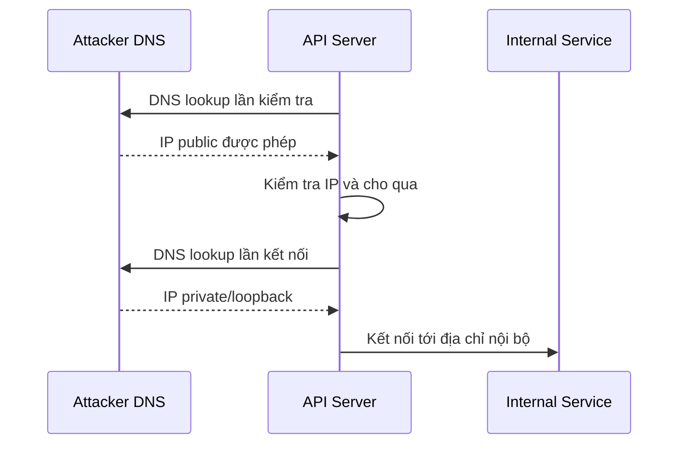

# DNS rebinding và redirect chain

Một API có thể kiểm tra URL do người dùng gửi, phân giải DNS và từ chối địa chỉ private nhưng vẫn mắc SSRF nếu HTTP client tự phân giải hostname lần nữa khi kết nối. Attacker có thể trả lời DNS bằng địa chỉ public trong lần kiểm tra đầu, rồi đổi sang loopback, private network hoặc địa chỉ metadata ở lần kết nối tiếp theo. Đây là một dạng DNS rebinding và là lỗi time-of-check/time-of-use (TOCTOU).

Một đường vòng khác xuất hiện khi API cho phép HTTP client tự động đi theo redirect. URL ban đầu có thể trỏ tới host public hợp lệ, nhưng response `302` lại chuyển request tới `http://127.0.0.1`, một hostname nội bộ hoặc cloud metadata endpoint. Nếu chỉ kiểm tra URL đầu tiên, chính server sẽ tiếp tục request tới đích không được phép.

Trong module `SECURITY_API_SECURITY`, chống SSRF cần bảo vệ toàn bộ vòng đời outbound request: parse và chuẩn hóa URL, kiểm tra hostname/port, phân giải và kiểm tra tất cả địa chỉ IP, ràng buộc kết nối với IP đã kiểm tra, sau đó xác minh lại từng redirect. Việc kiểm tra chuỗi URL một lần hoặc chỉ dùng allowlist hostname là chưa đủ.

## Mục tiêu học tập

Sau bài này, người học có thể:

- Giải thích DNS rebinding và TOCTOU trong luồng server-side HTTP request.
- Nhận diện rủi ro từ nhiều bản ghi A/AAAA, CNAME chain, IPv4/IPv6 và mixed public/private answers.
- Thiết kế DNS validation gắn với địa chỉ IP thực sự được dùng để mở socket.
- Hiểu vì sao DNS cache, DNSSEC hoặc allowlist hostname riêng lẻ không tự giải quyết DNS rebinding.
- Kiểm soát redirect chain bằng cách tắt auto-follow, giới hạn số hop và xác minh từng đích đến.
- Ngăn redirect làm rò rỉ Authorization header, cookie hoặc credential sang origin khác.
- Xây dựng HTTP fetcher an toàn với timeout, response-size limit, egress policy và TLS hostname verification.
- Kiểm thử DNS rebinding, redirect-to-private, redirect loop, IPv6 và các tình huống parser differential.

## 1. DNS rebinding và TOCTOU là gì?

### 1.1. DNS rebinding

DNS rebinding là kỹ thuật khiến cùng một hostname phân giải thành các địa chỉ IP khác nhau theo thời gian hoặc theo lần truy vấn. Attacker kiểm soát DNS authoritative của một domain và thay đổi câu trả lời để vượt qua kiểm tra ban đầu.

Ví dụ, API nhận URL:

```text
https://fetch.attacker.example/image
```

Luồng có thể diễn ra như sau:

1. API phân giải `fetch.attacker.example`; DNS trả về IP public do attacker kiểm soát.
2. Bộ kiểm tra thấy IP public và cho phép URL.
3. HTTP client thực hiện kết nối nhưng tự phân giải hostname lại.
4. DNS lúc này trả về `127.0.0.1`, `10.0.0.8` hoặc một địa chỉ private khác.
5. Server mở kết nối tới tài nguyên nội bộ bằng quyền mạng của chính nó.



TTL rất thấp, câu trả lời thay đổi theo truy vấn hoặc nhiều bản ghi A/AAAA có thể được dùng để tăng khả năng xảy ra tình huống này. Không nhất thiết phải có DNS cache poisoning: domain do attacker kiểm soát có thể tự trả lời DNS theo cách có chủ đích.

### 1.2. TOCTOU: kiểm tra một địa chỉ nhưng kết nối tới địa chỉ khác

TOCTOU là khoảng cách giữa thời điểm kiểm tra điều kiện (time of check) và thời điểm sử dụng tài nguyên (time of use). Trong SSRF:

- **Check:** ứng dụng xác minh hostname phân giải tới IP được phép.
- **Use:** HTTP library thực hiện DNS lookup hoặc chọn một địa chỉ khác rồi mở socket.

Nếu hai bước không dùng cùng một kết quả DNS đã được xác minh, kiểm tra bảo mật không còn ràng buộc với kết nối thực tế.

Nguyên tắc quan trọng là: **địa chỉ IP được kiểm tra phải chính là địa chỉ IP mà socket kết nối tới**. Nếu transport không thể bảo đảm điều đó, không thể coi bước DNS validation là đủ.

### 1.3. DNSSEC không thay thế kiểm tra địa chỉ

DNSSEC có thể xác thực tính toàn vẹn và nguồn gốc của dữ liệu DNS trong một chuỗi tin cậy. Tuy nhiên, nó không chứng minh địa chỉ IP được trả về là an toàn. Attacker kiểm soát một domain có thể ký hợp lệ bản ghi trỏ tới IP private. Vì vậy, ngay cả khi DNSSEC được sử dụng, ứng dụng vẫn phải áp dụng policy địa chỉ và ràng buộc kết nối.

## 2. Các dạng DNS answer cần xử lý

### 2.1. Kiểm tra cả A và AAAA

Hostname có thể trả về:

- Bản ghi A: địa chỉ IPv4.
- Bản ghi AAAA: địa chỉ IPv6.
- Nhiều địa chỉ trong cùng một loại bản ghi.
- Một tập kết quả thay đổi theo resolver, thời điểm hoặc vị trí mạng.

Không chỉ kiểm tra địa chỉ IPv4 đầu tiên. Nếu ứng dụng kiểm tra A record nhưng HTTP client ưu tiên AAAA record, request có thể đi qua IPv6 mà không qua policy IPv4.

Với hostname chỉ được phép truy cập Internet công khai, một policy thận trọng là từ chối hostname nếu bất kỳ địa chỉ A/AAAA nào trong tập kết quả có thể được chọn lại thuộc vùng bị cấm. Sau khi kiểm tra, chỉ kết nối tới một địa chỉ đã được phê duyệt và pin vào connection attempt đó.

Không để thư viện tự chọn lại giữa danh sách đã trộn public/private. Nếu dùng Happy Eyeballs hoặc cơ chế fallback IPv4/IPv6, mọi candidate có thể được thử đều phải được kiểm tra và chỉ candidate được phép mới được đưa vào quá trình kết nối.

### 2.2. Theo dõi CNAME chain

Một hostname có thể là CNAME trỏ tới hostname khác. Chính sách DNS cần tính đến kết quả cuối cùng sau khi resolver xử lý chuỗi alias. Hãy giới hạn độ sâu chain, phát hiện loop và kiểm tra toàn bộ địa chỉ cuối cùng.

Không chỉ kiểm tra tên CNAME có vẻ hợp lệ rồi bỏ qua A/AAAA của target. Một CNAME trỏ tới domain do attacker kiểm soát vẫn có thể thay đổi địa chỉ đích. Nếu dùng allowlist domain, xác minh cả hostname ban đầu và quy tắc alias theo policy; quan trọng nhất vẫn là địa chỉ socket cuối cùng.

### 2.3. Mixed public/private answers

Một hostname có thể trả đồng thời một IP public và một IP private. Nếu ứng dụng chỉ kiểm tra địa chỉ đầu tiên, còn HTTP client chọn địa chỉ thứ hai, SSRF vẫn xảy ra.

Ví dụ:

```text
fetch.example.test A     1.1.1.1
fetch.example.test A     10.10.4.12
fetch.example.test AAAA  2606:4700:4700::1111
```

Các địa chỉ trong ví dụ chỉ dùng cho minh họa. Với policy chỉ cho phép public Internet, không được chọn ngẫu nhiên một địa chỉ public rồi để transport tự fallback. Cần kiểm tra toàn bộ candidate, từ chối mixed set hoặc chỉ tạo transport có thể kết nối đúng một IP đã được duyệt.

### 2.4. Địa chỉ đặc biệt và địa chỉ không công khai

Policy cần nhận diện ít nhất các nhóm sau, cho cả IPv4 và IPv6:

| Nhóm | Ví dụ | Rủi ro |
|---|---|---|
| Unspecified | `0.0.0.0`, `::` | Địa chỉ không đại diện cho một đích public thông thường |
| Loopback | `127.0.0.1`, `::1` | Truy cập process trên chính máy chạy API |
| Private IPv4 | `10.0.0.0/8`, `172.16.0.0/12`, `192.168.0.0/16` | Truy cập mạng nội bộ |
| IPv6 Unique Local | `fc00::/7` | Truy cập mạng IPv6 riêng |
| Link-local | `169.254.0.0/16`, `fe80::/10` | Có thể truy cập metadata hoặc dịch vụ trên link nội bộ |
| Multicast | `224.0.0.0/4`, `ff00::/8` | Không phải đích unicast public hợp lệ cho fetch thông thường |
| Shared address space | `100.64.0.0/10` | Không gian địa chỉ dùng chung của carrier-grade NAT |
| Reserved/special-purpose | Các dải IANA dành riêng, benchmark hoặc documentation | Có thể tạo hành vi không dự kiến hoặc bị định tuyến đặc biệt |
| IPv4-mapped IPv6 | `::ffff:127.0.0.1` | Có thể che địa chỉ IPv4 loopback trong biểu diễn IPv6 |
| Cloud metadata | Thường gặp `169.254.169.254` | Có thể làm lộ credential và metadata của workload |

Danh sách trên không nên được hardcode như danh sách đầy đủ duy nhất. Hãy dùng thư viện IP/CIDR đáng tin cậy và policy được cập nhật theo các dải special-purpose của IANA và nền tảng triển khai. Chuẩn hóa IPv4-mapped IPv6 về địa chỉ IPv4 tương ứng trước khi kiểm tra. Từ chối IPv6 zone identifier nếu use case không yêu cầu rõ ràng.

Với một số môi trường, địa chỉ public có thể được NAT hoặc proxy tới hệ thống nội bộ. Vì vậy, IP classification cần kết hợp egress firewall và policy mạng thực tế; không xem nhãn “global unicast” là bảo đảm tuyệt đối rằng đích không có tác động nội bộ.

## 3. Thiết kế DNS validation chống rebinding

### 3.1. Ưu tiên allowlist destination cố định

Giải pháp mạnh nhất là không nhận URL tùy ý nếu nghiệp vụ chỉ cần gọi một số nhà cung cấp đã biết. Thay vì nhận:

```json
{
  "url": "https://any-host.example/resource"
}
```

hãy nhận một định danh như:

```json
{
  "provider": "catalog-partner",
  "resourceId": "item-1001"
}
```

Server ánh xạ `catalog-partner` sang base URL được cấu hình sẵn, giới hạn path và method, rồi tự tạo request. Cách này loại bỏ phần lớn khả năng attacker điều khiển hostname.

Nếu nghiệp vụ bắt buộc nhận URL, áp dụng cả allowlist hostname và kiểm tra IP. Allowlist hostname không thay thế IP validation vì một hostname được phép vẫn có thể bị cấu hình DNS sai hoặc bị chiếm quyền.

### 3.2. Chuẩn hóa hostname trước khi kiểm tra

URL parser và hostname cần được chuẩn hóa nhất quán trước khi áp dụng policy:

- Chỉ cho phép scheme `https` nếu nghiệp vụ không cần HTTP; nếu hỗ trợ cả hai, chỉ cho phép `http`/`https` và giới hạn port.
- Từ chối userinfo như `https://trusted.example@evil.example/`.
- Chuẩn hóa hostname quốc tế bằng IDNA/ASCII theo một quy tắc thống nhất.
- Chuẩn hóa chữ hoa/chữ thường và xử lý trailing dot theo policy DNS.
- Xử lý IPv4/IPv6 literal bằng parser địa chỉ chuẩn, không dùng regex đơn giản.
- Từ chối hostname rỗng, malformed, zone ID hoặc dạng biểu diễn IP không được hỗ trợ.
- Loại bỏ fragment trước khi gửi request; fragment không được truyền trong HTTP request target.
- Giới hạn port được phép, thường chỉ 443 và 80 nếu thật sự cần.

Không dùng phép kiểm tra chuỗi như `host.contains("trusted.example")` hoặc `host.endsWith("trusted.example")` vì có thể chấp nhận `eviltrusted.example` hoặc `trusted.example.attacker.test`. Nếu cho phép subdomain, so sánh hostname chính xác hoặc suffix có ranh giới dấu chấm: `host == domain` hoặc `host.endsWith("." + domain)` sau chuẩn hóa.

Tránh tự viết parser URL bằng cách tách chuỗi theo `://`, `/` hoặc `@`. Dùng URI parser đã được kiểm chứng, nhưng vẫn phải xử lý các khác biệt giữa parser và HTTP client thực tế. Cùng một canonical host, scheme và port phải được dùng trong validation, routing, TLS và logging.

### 3.3. Resolve, validate và pin địa chỉ

Luồng an toàn có thể mô tả như sau:

1. Parse URL và chuẩn hóa scheme, hostname, port.
2. Kiểm tra hostname thuộc allowlist và không chứa userinfo hoặc cú pháp mơ hồ.
3. Resolve toàn bộ CNAME/A/AAAA theo resolver đã cấu hình.
4. Từ chối nếu không có kết quả, có CNAME loop, vượt giới hạn chain hoặc có candidate thuộc vùng cấm.
5. Chọn một địa chỉ đã được kiểm tra.
6. Mở socket trực tiếp tới địa chỉ IP đã chọn; không để HTTP client resolve hostname lần nữa.
7. Giữ hostname ban đầu cho HTTP `Host`, TLS SNI và certificate hostname verification.
8. Xác minh remote peer address thực tế đúng với IP đã pin.
9. Không fallback sang IP chưa được kiểm tra nếu kết nối thất bại.

Đây là điểm cốt lõi chống TOCTOU. Pinning chỉ có ý nghĩa nếu transport thật sự kết nối tới IP được cung cấp. Một bước `InetAddress.getAllByName()` rồi gọi `httpClient.send(uri)` thông thường chưa đủ nếu HTTP client lại tự resolve `uri.getHost()`.

### 3.4. Giữ TLS hostname verification khi pin IP

Khi kết nối socket tới IP đã pin, không được tắt TLS certificate verification hoặc đổi hostname cần xác minh thành IP nếu certificate được cấp cho hostname gốc.

Transport cần:

- Kết nối TCP tới IP đã được duyệt.
- Gửi TLS SNI theo hostname gốc.
- Xác minh certificate chain và hostname với hostname gốc.
- Gửi HTTP Host/:authority phù hợp với hostname và port.
- Kiểm tra remote socket address thực tế.

Không dùng chế độ “trust all certificates” để xử lý lỗi khi kết nối trực tiếp tới IP. Không bỏ SNI hoặc hostname verification vì điều đó làm suy yếu bảo vệ TLS và có thể khiến request tới nhầm virtual host.

### 3.5. DNS cache không phải giải pháp pinning

Cache DNS có thể giảm số lần resolve nhưng không bảo đảm địa chỉ được dùng là địa chỉ đã được kiểm tra. Cache có thể hết hạn giữa check và connect; nhiều layer có thể dùng resolver/cache khác nhau; HTTP client có thể cache riêng hoặc resolve lại khi retry.

Pinning cần gắn với từng connection attempt hoặc connection pool entry. Nếu dùng connection pooling, key của pool phải gắn với hostname, port, policy và IP đã pin phù hợp; không tái sử dụng connection được mở theo một policy cũ sau khi policy thay đổi hoặc credential bị thu hồi.

## 4. Redirect chain là một ranh giới tin cậy mới

### 4.1. Redirect có thể đổi đích đến

Một server public có thể trả:

```http
HTTP/1.1 302 Found
Location: http://127.0.0.1:8080/admin
```

Nếu HTTP client tự động theo redirect, request tiếp theo có thể truy cập loopback. Redirect cũng có thể trỏ tới private IP, hostname nội bộ, cloud metadata, port quản trị hoặc một scheme không được phép.

Vì vậy, kiểm tra URL ban đầu không đủ. Mỗi `Location` là một URL mới cần được parse, chuẩn hóa, xác minh hostname, resolve DNS, kiểm tra IP và pin connection lại từ đầu.

### 4.2. Tắt automatic redirect

Với HTTP client dùng cho URL không tin cậy, mặc định tắt auto-follow redirect. Ứng dụng tự xử lý redirect để có thể kiểm tra từng hop.

Không giả định mọi thư viện có cùng hành vi. Một số client mặc định follow redirect; một số chỉ follow một số status; một số chuyển `POST` thành `GET` với 301/302/303 nhưng giữ method/body với 307/308. Cần kiểm tra cấu hình thực tế và viết test ở đúng transport đang dùng.

Nếu nghiệp vụ không cần redirect, từ chối mọi 3xx. Đây là lựa chọn đơn giản và an toàn hơn cho nhiều URL fetcher.

### 4.3. Xác minh từng Location

Khi cần hỗ trợ redirect:

1. Chỉ chấp nhận status redirect được định nghĩa trong contract.
2. Yêu cầu có đúng một `Location` hợp lệ; từ chối giá trị malformed hoặc mơ hồ.
3. Resolve relative Location dựa trên URL hiện tại theo URI semantics.
4. Parse và canonicalize URL đích.
5. Chỉ cho phép scheme và port nằm trong policy; thường từ chối HTTPS downgrade sang HTTP.
6. Áp dụng lại hostname allowlist, DNS resolution, IP classification và pinning.
7. Kiểm tra redirect không tạo loop và không vượt số hop tối đa.
8. Chỉ gửi request tiếp theo sau khi toàn bộ kiểm tra thành công.

Giới hạn số redirect, ví dụ 3 đến 5 hop tùy nghiệp vụ. Giới hạn này giảm vòng lặp và làm chi phí dễ dự đoán; nó không thay thế validation từng hop.

### 4.4. Relative redirect và URL parsing

`Location` có thể là URL tuyệt đối, path tương đối hoặc path bắt đầu bằng `//`. Ví dụ:

```text
/next
../image.png
//other.example/resource
https://other.example/resource
```

Hãy dùng URI resolution theo chuẩn để tạo URL đích, sau đó chạy lại toàn bộ policy. Không nối chuỗi `baseUrl + location` vì có thể tạo sai host/path hoặc bỏ qua authority mới.

Từ chối userinfo, scheme lạ (`file:`, `gopher:`, `ftp:`...) và port không được phép. Nếu URL đích thay đổi origin, không chuyển tiếp credential gắn với origin cũ.

### 4.5. Redirect chain và rò rỉ credential

Redirect có thể dẫn sang origin khác. Không chuyển tiếp tự động các header nhạy cảm như:

- `Authorization` hoặc API key.
- `Cookie` và session credential.
- `Proxy-Authorization`.
- Header nội bộ chứa user, tenant hoặc service identity.
- Header chứa signed request metadata.

Nếu nghiệp vụ yêu cầu xác thực với nhiều đích, cấp credential riêng theo từng destination và scope; không forward bearer token của hệ thống tới host do người dùng kiểm soát. Với URL fetcher công khai, tốt nhất không gửi cookie hoặc Authorization header từ request inbound sang outbound.

## 5. Kết hợp hostname allowlist, IP policy và egress control

Ba lớp này bổ trợ cho nhau:

| Lớp | Kiểm soát | Không giải quyết được một mình |
|---|---|---|
| Hostname allowlist | Giới hạn domain và port mà nghiệp vụ cho phép | DNS rebinding, domain bị chiếm, redirect sang host khác |
| IP validation + pinning | Bảo đảm socket chỉ kết nối tới IP được phép đã kiểm tra | Host public có thể proxy tới dịch vụ nội bộ; policy IP có thể thiếu cập nhật |
| Egress firewall/proxy | Giới hạn mạng mà workload thực sự có thể kết nối | Không hiểu đầy đủ quyền nghiệp vụ, redirect hoặc credential forwarding |

Với tích hợp tới một số provider cố định, allowlist nên dựa trên hostname chính xác, port và path cần thiết. Nếu dùng wildcard, định nghĩa rõ subdomain nào được phép và ai có quyền tạo subdomain. Không cho phép toàn bộ `*.example.com` nếu các nhóm khác có thể tạo host trỏ tới tài nguyên không tin cậy.

Egress firewall nên chặn loopback, private, link-local, metadata và các mạng không cần thiết ở tầng mạng. Nếu sử dụng outbound proxy, proxy phải thực hiện DNS validation và destination policy ở phía nó. Ứng dụng kiểm tra IP local nhưng sau đó gửi URL tới proxy để proxy tự resolve lại vẫn còn TOCTOU ở proxy.

## 6. Giới hạn tài nguyên của URL fetcher

SSRF thường kết hợp với việc lạm dụng tài nguyên. Một URL hợp lệ về destination vẫn có thể trả response rất lớn, chậm vô hạn hoặc tạo redirect chain dài.

URL fetcher cần giới hạn:

- Timeout kết nối, TLS handshake, đọc response và tổng thời gian của toàn redirect chain.
- Số redirect tối đa và phát hiện URL loop.
- Kích thước header, body và số byte sau giải nén.
- Content type được chấp nhận và định dạng thực tế của nội dung.
- Số kết nối đồng thời, số request theo principal và quota theo tenant.
- Số lần retry; không retry sang IP chưa được kiểm tra hoặc destination mới.
- Kích thước file lưu, thời gian giữ và chi phí xử lý sau download.

Không chỉ tin `Content-Length`; response có thể không khai báo hoặc khai báo sai. Hãy đếm byte thực tế khi stream và dừng ngay khi vượt giới hạn. Nếu hỗ trợ gzip/br, giới hạn cả compressed bytes lẫn decompressed bytes để tránh decompression bomb.

Không tải toàn bộ response vào RAM trước khi kiểm tra kích thước. Dùng streaming với hard cap và hủy socket khi vượt giới hạn.

## 7. Ví dụ thiết kế HTTP fetcher an toàn

### 7.1. Tách URL policy khỏi HTTP transport

Một thiết kế dễ review tách các trách nhiệm:

| Thành phần | Trách nhiệm |
|---|---|
| `UrlCanonicalizer` | Parse URL, chuẩn hóa scheme/host/port và từ chối cú pháp mơ hồ |
| `DestinationPolicy` | Kiểm tra hostname allowlist, port và loại đích được phép |
| `SafeDnsResolver` | Resolve CNAME/A/AAAA, phát hiện loop và trả toàn bộ candidate |
| `IpAddressPolicy` | Phân loại IPv4/IPv6 và từ chối địa chỉ đặc biệt/private |
| `PinnedHttpTransport` | Kết nối đúng IP đã duyệt, giữ TLS SNI/hostname verification và không tự resolve lại |
| `RedirectController` | Tắt auto-follow, kiểm tra từng Location và giới hạn số hop |
| `ResponseLimiter` | Giới hạn timeout, header, body, decompression và content type |
| `Audit/Telemetry` | Ghi destination logical name, quyết định policy và request ID mà không log secret |

### 7.2. Pseudocode cho một fetch có redirect an toàn

```text
function safeFetch(inputUrl):
    current = canonicalizeAndValidateUrl(inputUrl)
    visited = emptySet()

    for hop from 0 to MAX_REDIRECTS:
        key = canonicalUrlKey(current)
        require(key not in visited)
        visited.add(key)

        require(destinationPolicy.allowsHostAndPort(current))

        dnsResult = resolver.resolveAll(current.hostname)
        require(dnsResult.hasAddresses)
        require(not dnsResult.hasCnameLoop)
        require(dnsResult.chainLength <= MAX_CNAME_DEPTH)

        candidates = normalizeAll(dnsResult.ipv4 + dnsResult.ipv6)
        require(candidates are not empty)
        require(all candidates pass ipAddressPolicy)

        pinnedIp = chooseOneApprovedAddress(candidates)
        response = pinnedTransport.get(
            url = current,
            connectTo = pinnedIp,
            tlsServerName = current.hostname,
            verifyCertificateFor = current.hostname,
            autoRedirect = false,
            timeout = TOTAL_DEADLINE,
            maxHeaderBytes = HEADER_LIMIT,
            maxBodyBytes = BODY_LIMIT
        )

        require(response.remotePeerIp == pinnedIp)

        if response.status is not redirectStatus:
            return validateAndReturnResponse(response)

        require(hop < MAX_REDIRECTS)
        location = requireSingleValidLocation(response)
        nextUrl = resolveRelativeUri(current, location)
        nextUrl = canonicalizeAndValidateUrl(nextUrl)
        require(not isHttpsDowngrade(current, nextUrl))
        current = nextUrl

    reject("redirect limit exceeded")
```

Đây là pseudocode mô tả các bảo đảm cần có, không phải một HTTP client hoàn chỉnh. `pinnedTransport` phải bảo đảm kết nối tới đúng IP được truyền, không resolve hostname lần nữa, vẫn xác minh TLS theo hostname gốc và không tự theo redirect. Chỉ kiểm tra `remotePeerIp` sau khi kết nối là quá muộn nếu request đã gửi tới địa chỉ không được phép; việc pin phải diễn ra trước khi gửi dữ liệu.

### 7.3. Java/Spring: định hình API an toàn

Với Java, có thể định nghĩa các kiểu riêng để tránh truyền một URL chưa kiểm tra trực tiếp vào HTTP client:

```java
record ApprovedTarget(
    URI uri,
    String hostname,
    int port,
    InetAddress pinnedAddress
) {}

interface DestinationPolicy {
    ApprovedTarget validateAndPin(URI uri);
}

interface PinnedHttpTransport {
    SafeResponse get(
        ApprovedTarget target,
        Duration timeout,
        long maxResponseBytes
    );
}
```

`DestinationPolicy.validateAndPin` phải thực hiện canonicalization, allowlist, resolve tất cả A/AAAA, IP classification và chọn một IP hợp lệ. `PinnedHttpTransport.get` phải mở socket tới `pinnedAddress`, nhưng dùng `hostname` cho SNI, Host header và certificate verification. Đây là hợp đồng thiết kế; cần triển khai bằng HTTP stack hỗ trợ custom DNS resolver/connection route phù hợp và kiểm thử remote peer address.

Đối với Apache HttpClient hoặc client tương tự, cấu hình redirect strategy ở chế độ không tự động theo redirect và dùng resolver/route planner có thể pin địa chỉ. Với `java.net.http.HttpClient`, đặt `followRedirects(NEVER)` là bước cần thiết khi tự quản lý redirect; tuy nhiên, API chuẩn không cung cấp một cơ chế đơn giản để truyền IP đã pin cho từng request trong khi vẫn giữ hostname TLS. Không được kết luận chỉ đặt `NEVER` là đã chống DNS rebinding. Nếu transport không hỗ trợ pinning, hãy dùng egress proxy chuyên trách có destination validation hoặc chọn thư viện/connector cho phép kiểm soát DNS và socket.

Ví dụ tạo client không tự follow redirect:

```java
HttpClient client = HttpClient.newBuilder()
    .followRedirects(HttpClient.Redirect.NEVER)
    .connectTimeout(Duration.ofSeconds(3))
    .build();
```

Client trên chỉ minh họa việc tắt auto-redirect và đặt connect timeout. Nó chưa tự thực hiện DNS pinning, IP policy, response body cap hoặc per-hop validation. Các kiểm soát đó phải được triển khai trong lớp fetcher/transport trước khi dùng với URL không tin cậy.

### 7.4. Ví dụ allowlist hostname chính xác

```java
boolean isAllowedHost(String host) {
    String normalized = normalizeHostname(host);
    return normalized.equals("images.partner.example")
        || normalized.equals("cdn.partner.example");
}
```

Ví dụ này chỉ minh họa allowlist host chính xác. Nó không thay thế DNS/IP validation và redirect validation. Nếu cho phép subdomain, phải kiểm tra ranh giới suffix sau khi chuẩn hóa, không dùng `contains` hoặc regex rộng.

## 8. Các lỗi triển khai thường gặp

| Lỗi | Vì sao chưa an toàn | Cách sửa |
|---|---|---|
| Resolve DNS để kiểm tra rồi gọi `httpClient.get(url)` | Client có thể resolve lại và nhận IP khác | Pin IP đã kiểm tra vào socket/transport |
| Chỉ kiểm tra A record | Client có thể dùng AAAA | Kiểm tra toàn bộ A và AAAA |
| Chỉ kiểm tra IP đầu tiên | Candidate khác có thể là private | Kiểm tra tất cả candidate có thể được chọn |
| Cho phép mixed public/private answer | Happy Eyeballs hoặc retry có thể chọn IP private | Từ chối mixed set hoặc chỉ đưa IP đã duyệt vào transport |
| Chỉ allowlist hostname | Host hợp lệ có thể rebinding hoặc redirect | Kết hợp allowlist, IP validation và pinning |
| Tin DNS cache hoặc TTL | Cache có thể khác giữa check và connect | Ràng buộc socket với IP đã duyệt |
| Bật auto-follow redirect | Hop sau có thể trỏ tới internal target | Tắt auto-follow và kiểm tra từng hop |
| Chỉ kiểm tra redirect đầu tiên | Hop thứ hai hoặc thứ ba có thể đổi đích | Validate toàn bộ chain với giới hạn hop |
| Forward Authorization/Cookie qua redirect | Credential có thể bị gửi tới origin attacker | Strip credential khi đổi origin; tốt nhất không gửi credential inbound |
| Chỉ chặn RFC1918 IPv4 | Bỏ sót loopback, link-local, IPv6 ULA và mapped IPv4 | Dùng IP classification đầy đủ cho IPv4/IPv6 |
| Dùng `endsWith("trusted.example")` | Có thể chấp nhận hostname giả mạo suffix | So sánh chính xác hoặc suffix có ranh giới dấu chấm |
| Tắt TLS hostname verification khi pin IP | Cho phép MITM hoặc nhầm virtual host | Giữ SNI và verify certificate theo hostname gốc |
| Kiểm tra IP local nhưng dùng proxy tự resolve | Proxy vẫn có thể kết nối tới IP private | Enforce policy tại proxy hoặc dùng transport trực tiếp đã pin |
| Không giới hạn response/redirect/time | Có thể bị dùng để cạn tài nguyên | Đặt deadline, hop limit, byte limit và concurrency limit |

## 9. Kiểm thử DNS rebinding và redirect chain

Kiểm thử cần xác minh địa chỉ thực sự được kết nối, không chỉ kết quả của hàm kiểm tra URL. Dùng DNS server và HTTP server giả lập trong môi trường test cô lập; không thử truy cập metadata hoặc hệ thống nội bộ production.

| Nhóm kiểm thử | Tình huống | Kết quả mong đợi |
|---|---|---|
| DNS rebinding | Lần resolve đầu trả public IP, lần sau trả loopback/private | Transport không resolve lần hai; chỉ kết nối IP đã pin |
| DNS TTL | TTL bằng 0 hoặc rất ngắn, answer thay đổi liên tục | Không tạo TOCTOU giữa validation và connect |
| Multiple A | Một public, một private | Từ chối mixed answer hoặc chỉ dùng candidate được duyệt mà transport không fallback |
| AAAA | A public nhưng AAAA loopback/ULA/link-local | IPv6 không bypass policy |
| IPv4-mapped IPv6 | `::ffff:127.0.0.1` | Chuẩn hóa và từ chối như IPv4 loopback |
| CNAME chain | CNAME trỏ qua nhiều domain tới IP private | Kiểm tra chain và địa chỉ cuối; giới hạn độ sâu |
| CNAME loop | Alias tạo vòng lặp | Từ chối an toàn, không resolve vô hạn |
| Special address | Loopback, private, link-local, multicast, reserved | Bị từ chối theo IP policy |
| Host canonicalization | Chữ hoa, trailing dot, IDN, IP literal và authority mơ hồ | Cùng một canonical form được dùng trong policy và transport |
| Host allowlist | `trusted.example.attacker.test`, `eviltrusted.example` | Không được chấp nhận như subdomain hợp lệ |
| Redirect to loopback | Public URL trả `Location: http://127.0.0.1/` | Hop tiếp theo bị từ chối trước khi kết nối |
| Redirect to metadata/private | Location trỏ tới link-local hoặc private range | Bị từ chối |
| Redirect chain | Hop 1 public, hop 2 public, hop 3 private | Hop 3 bị từ chối; không có request tới private IP |
| Relative redirect | `../next`, `/path`, `//other-host` | Resolve theo URI chuẩn rồi chạy lại policy |
| Redirect loop | A → B → A | Dừng do URL lặp hoặc hop limit |
| Scheme/port change | `https` sang `http`, `file:`, port quản trị | Bị từ chối theo policy |
| Credential forwarding | Redirect sang origin khác | Authorization, cookie và secret headers không được forward |
| TLS verification | Certificate không khớp hostname gốc | Handshake thất bại; không tắt verification để fallback |
| Proxy behavior | Proxy tự resolve hostname sau khi app kiểm tra | Policy được thực thi tại proxy hoặc request bị chặn |
| Peer verification | Socket remote IP khác IP đã pin | Request bị hủy và có security event |
| Resource limits | Response quá lớn, chậm hoặc redirect quá nhiều | Dừng theo byte, deadline và hop limits |

### 9.1. Kiểm thử TOCTOU có kiểm soát

Một test quan trọng nên mô phỏng resolver trả hai câu trả lời khác nhau:

1. Resolver lần đầu trả một địa chỉ test được cho phép.
2. HTTP transport được gọi với target đã pin.
3. Resolver giả lập được cấu hình để trả địa chỉ khác nếu bị gọi lần hai.
4. Test xác nhận transport không gọi resolver lần hai và socket target đúng IP đã duyệt.

Test này chứng minh ràng buộc giữa check và use. Chỉ unit test `isPublicIp()` hoặc `isAllowedHost()` không chứng minh transport an toàn.

### 9.2. Kiểm thử redirect chain

Tạo HTTP server giả lập với các route:

- `/start` trả redirect tới một hostname public test được cho phép.
- `/second` trả redirect tới một hostname bị cấm.
- `/loop-a` và `/loop-b` chuyển hướng qua lại.
- `/large` trả body vượt giới hạn.
- `/slow` không trả dữ liệu trước deadline.

Xác nhận request không bao giờ tới server đích bị cấm, không forward credential khi đổi origin và không vượt giới hạn thời gian/response.

## 10. Logging, monitoring và phản ứng sự cố

### 10.1. Log đủ để điều tra, không lưu secret

Log outbound request nên ghi:

- Request ID/trace ID và service gọi.
- Destination logical name hoặc hostname đã chuẩn hóa theo mức cần thiết.
- Scheme, port, số redirect hop và policy decision.
- DNS answer đã phân loại ở dạng metadata phù hợp, tránh lưu dữ liệu không cần thiết.
- IP đã pin hoặc fingerprint của target nếu chính sách cho phép.
- Kết quả TLS, peer IP, timeout, response status và byte count.
- Mã lý do từ chối như `HOST_NOT_ALLOWED`, `PRIVATE_ADDRESS`, `REDIRECT_BLOCKED` hoặc `DNS_REBIND_SUSPECTED`.

Không log Authorization header, cookie, API key, URL có query secret hoặc toàn bộ response body. Nếu hostname do người dùng cung cấp có thể chứa thông tin cá nhân, cần giới hạn quyền đọc và thời hạn lưu.

### 10.2. Metrics và cảnh báo

Theo dõi:

- Số URL bị từ chối theo policy reason.
- Tỷ lệ DNS answer có mixed public/private address.
- Số CNAME chain quá dài, loop hoặc lỗi resolution.
- Số redirect hop trung bình/tối đa và redirect bị chặn.
- Số lần peer IP không khớp pinned IP.
- Tỷ lệ timeout, TLS failure, response-size rejection và connection error.
- Egress tới private, link-local hoặc host không nằm trong allowlist.

Một đợt tăng đột biến `PRIVATE_ADDRESS` hoặc redirect bị chặn có thể là dấu hiệu scanner hoặc attacker đang dò SSRF. Không cảnh báo chỉ dựa trên một hostname; kết hợp caller identity, endpoint, tenant và tần suất.

### 10.3. Khi phát hiện SSRF thành công hoặc nghi ngờ

1. Xác định endpoint, principal, URL, DNS answer, pinned/peer IP và redirect chain đã xảy ra.
2. Thu hồi credential hoặc token có thể đã bị truy cập qua metadata/internal service.
3. Cô lập workload hoặc egress path bị ảnh hưởng nếu cần.
4. Rà soát access log của service nội bộ, metadata access và hành vi dùng credential sau thời điểm nghi bị lộ.
5. Chặn destination/redirect policy bị khai thác và kiểm tra các URL fetcher khác dùng chung transport.
6. Thêm regression test cho DNS rebinding và redirect chain cụ thể.
7. Xác minh egress firewall, proxy và peer-IP enforcement sau khi triển khai.

Không chỉ đổi DNS hoặc block một domain rồi kết thúc điều tra. Cần xác định liệu request đã truy cập được dữ liệu nội bộ hoặc credential hay chưa.

## 11. Checklist trước khi phát hành

- [ ] Ưu tiên destination allowlist cố định thay vì nhận URL tùy ý.
- [ ] URL được parse và canonicalize bằng parser chuẩn; từ chối userinfo và scheme/port không cần thiết.
- [ ] Hostname được chuẩn hóa IDNA, case và trailing dot trước khi so sánh allowlist.
- [ ] Allowlist dùng so sánh hostname chính xác hoặc suffix có ranh giới dấu chấm.
- [ ] Resolve CNAME chain và toàn bộ A/AAAA; giới hạn độ sâu và phát hiện loop.
- [ ] Kiểm tra tất cả candidate IPv4/IPv6, gồm loopback, private, link-local, ULA, multicast, reserved và mapped IPv4.
- [ ] Mixed public/private answers bị từ chối hoặc transport chỉ được dùng IP đã duyệt mà không fallback.
- [ ] Socket kết nối đúng IP đã kiểm tra; không resolve hostname lần hai.
- [ ] TLS SNI, Host header và certificate hostname verification vẫn dùng hostname gốc.
- [ ] Xác minh remote peer address; không tắt TLS verification để xử lý pinning.
- [ ] Auto-follow redirect bị tắt; mỗi Location được parse, normalize, resolve và kiểm tra lại.
- [ ] Redirect chain có hop limit, loop detection và không downgrade HTTPS nếu policy cấm.
- [ ] Credential headers không được forward sang origin khác.
- [ ] Proxy thực hiện destination validation nếu proxy là nơi resolve DNS/kết nối.
- [ ] Egress firewall chặn mạng nội bộ và metadata không cần thiết.
- [ ] Có timeout, body/header cap, decompression limit, concurrency và quota.
- [ ] Có test DNS rebinding, multiple A/AAAA, CNAME, IPv6, redirect chain, proxy và peer-IP mismatch.
- [ ] Log/metrics ghi policy decision nhưng không làm lộ token, cookie hoặc query secret.

## Kết luận

DNS rebinding khai thác khoảng cách giữa địa chỉ được kiểm tra và địa chỉ được kết nối; redirect chain thay đổi đích đến sau khi URL ban đầu đã qua kiểm tra. Chống hai kỹ thuật này cần gắn DNS validation với socket bằng IP pinning, kiểm tra toàn bộ A/AAAA và CNAME chain, giữ TLS hostname verification, tắt auto-redirect và xác minh lại từng hop. Kết hợp hostname allowlist, egress control, giới hạn tài nguyên, logging và kiểm thử TOCTOU giúp URL fetcher không trở thành cầu nối từ API public vào mạng nội bộ.
