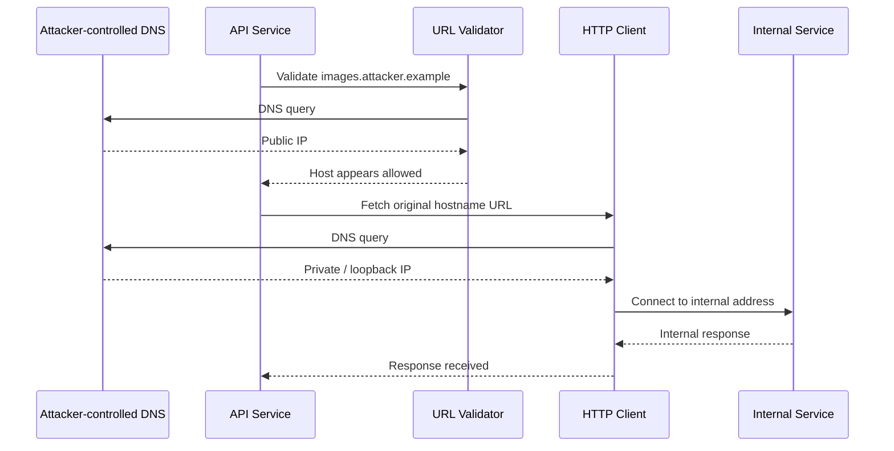
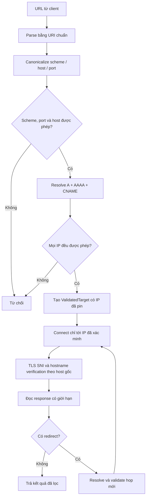

# Không tin kết quả resolve một lần duy nhất

Trong chương **SSRF qua API** của module `SECURITY_API_SECURITY`, việc phân giải DNS phải được xem là một bước trong quá trình xác định đích mạng, không phải bằng chứng đủ để kết luận một URL an toàn. Một endpoint có thể kiểm tra hostname và nhận được địa chỉ IP công khai, sau đó HTTP client tự phân giải hostname lần nữa và kết nối tới địa chỉ nội bộ. Khoảng cách giữa lần kiểm tra và lần kết nối tạo ra lỗi time-of-check to time-of-use (TOCTOU), thường được khai thác bằng DNS rebinding.

Nguyên tắc thiết kế là: **địa chỉ IP được kiểm tra phải là địa chỉ thực sự được dùng để mở kết nối**. Nếu HTTP client, proxy, redirect handler hoặc connection pool tự chọn một đích khác, kiểm tra trước đó không còn bảo đảm điều gì. Với API nhận URL do client cung cấp, cần kiểm soát cả quá trình parse URL, resolve hostname, đánh giá mọi địa chỉ trả về, chọn địa chỉ, mở socket, xác minh TLS và xử lý các lần chuyển hướng.

## 1. Vì sao một lần DNS resolve không đủ?

DNS là hệ thống phân giải tên thành địa chỉ. Một hostname có thể trả về nhiều địa chỉ A (IPv4), AAAA (IPv6), CNAME hoặc kết quả khác nhau theo thời điểm, resolver, vị trí mạng và chính sách DNS. Kết quả có thể thay đổi sau TTL hoặc được trả khác nhau giữa hai lần truy vấn.

Ví dụ một API có tính năng tải ảnh từ URL:

```text
POST /v1/preview
{
  "url": "https://images.attacker.example/photo.jpg"
}
```

Server kiểm tra hostname bằng cách resolve DNS và thấy địa chỉ công khai `8.8.8.8` (địa chỉ minh họa). Sau đó server truyền URL gốc cho HTTP client. HTTP client tự resolve lại hostname; lần này DNS trả về `127.0.0.1` hoặc một địa chỉ private như `10.0.0.8`. Server đã kiểm tra một địa chỉ nhưng kết nối tới địa chỉ khác.



Đây là DNS rebinding: chủ thể kiểm soát DNS thay đổi câu trả lời để hostname ban đầu trỏ tới đích công khai khi bị kiểm tra, rồi trỏ tới đích nhạy cảm khi service thực hiện kết nối. Một biến thể khác không cần đổi câu trả lời theo thời gian: DNS trả đồng thời nhiều địa chỉ, trong đó có cả IP công khai và IP private; validator chỉ kiểm tra địa chỉ đầu tiên nhưng HTTP client có thể chọn địa chỉ khác.

### 1.1. TOCTOU trong kiểm tra URL

TOCTOU xảy ra khi trạng thái được kiểm tra khác với trạng thái tại thời điểm sử dụng. Trong SSRF, các bước dễ bị tách rời gồm:

1. Parse URL và lấy hostname.
2. Resolve hostname để kiểm tra IP.
3. Trả kết quả “an toàn” về cho tầng nghiệp vụ.
4. HTTP client resolve hostname lại.
5. Client kết nối tới một IP có thể khác kết quả ở bước 2.

Nếu bước 2 và bước 5 không dùng cùng một kết quả đã xác minh, việc kiểm tra IP không gắn với kết nối. Kiểm tra hostname bằng allowlist cũng chưa đủ nếu hostname được phép có thể bị cấu hình DNS sai, bị chiếm quyền hoặc trả về địa chỉ nội bộ.

### 1.2. DNS cache và TTL không phải biện pháp chống SSRF

TTL cho biết thời gian một câu trả lời DNS có thể được cache theo semantics của DNS. TTL ngắn không làm cho câu trả lời đáng tin; TTL dài cũng không chứng minh IP sẽ an toàn. DNS cache của JVM, operating system, resolver, proxy và HTTP client có thể có hành vi khác nhau.

Không dựa vào việc “đã resolve rồi nên client chắc sẽ dùng cache đó”. Cache có thể không dùng chung giữa validator và transport, có thể hết hạn giữa hai bước, hoặc HTTP client có resolver riêng. Tắt cache DNS cũng không giải quyết TOCTOU; nó có thể làm client resolve thường xuyên hơn và tạo thêm cơ hội nhận câu trả lời khác.

DNSSEC có thể xác thực tính toàn vẹn và nguồn gốc của dữ liệu DNS trong một chuỗi tin cậy, nhưng không ngăn chủ sở hữu hợp lệ của một domain thay đổi record sang địa chỉ private. Vì vậy, DNSSEC không thay thế việc phân loại IP, pin địa chỉ và kiểm soát egress.

## 2. Các tình huống DNS cần xem xét

### 2.1. DNS rebinding theo thời gian

Attacker thay đổi record sau lần kiểm tra hoặc sử dụng DNS response có TTL rất thấp để tạo ra câu trả lời khác nhau giữa validator và HTTP client. Một lần resolve an toàn không chứng minh lần kết nối tiếp theo an toàn.

### 2.2. Nhiều bản ghi A và AAAA

Hostname có thể trả nhiều IPv4 hoặc IPv6. Nếu validator chỉ kiểm tra địa chỉ đầu tiên, client có thể chọn địa chỉ thứ hai. Nếu chỉ kiểm tra A mà bỏ qua AAAA, client có thể kết nối qua IPv6 tới một địa chỉ loopback, link-local hoặc unique-local.

Phải thu thập tất cả địa chỉ mà resolver sử dụng cho hostname và đánh giá từng địa chỉ. Chính sách an toàn mặc định là từ chối hostname nếu bất kỳ địa chỉ ứng viên nào không được phép, trừ khi hệ thống có một cơ chế transport bảo đảm chỉ chọn một địa chỉ cụ thể đã được xác minh và không thể fallback sang địa chỉ chưa kiểm tra.

### 2.3. CNAME và chuỗi phân giải

Một hostname có thể trỏ tới CNAME, rồi tiếp tục tới hostname khác. Không chỉ kiểm tra chuỗi hostname ban đầu; cần đánh giá địa chỉ cuối cùng mà resolver trả về. Nếu resolver trả cả alias và địa chỉ, quyết định kết nối vẫn phải dựa trên IP thực tế được chọn.

Không tự triển khai DNS resolver bằng cách truy vấn từng record thủ công rồi ghép kết quả thiếu nhất quán. Dùng resolver được quản lý, có hỗ trợ A/AAAA và tuân thủ chính sách mạng. Nếu cần kiểm soát CNAME chain, hãy dùng API resolver cung cấp kết quả phân giải cuối cùng và ghi lại chain phục vụ audit.

### 2.4. Split-horizon DNS và resolver khác nhau

Một hostname có thể phân giải khác nhau trong mạng nội bộ và Internet. Validator chạy ở một resolver, còn HTTP client hoặc egress proxy chạy ở resolver khác. Kết quả của validator không phản ánh nhất thiết đích mà thành phần thực sự mở socket.

Đặc biệt chú ý môi trường container, service mesh, VPN, corporate DNS, proxy HTTP và DNS resolver được cấu hình qua biến môi trường. Phải xác định rõ thành phần nào thực hiện DNS lookup cuối cùng.

### 2.5. DNS rebinding qua redirect

Một URL ban đầu có thể trỏ tới IP công khai và trả về `302 Location: http://internal.example/`. Nếu client tự theo redirect, request thứ hai có thể đi tới hostname hoặc IP khác mà chưa được kiểm tra. Redirect có thể thay đổi scheme, hostname, port và đường dẫn; mỗi hop là một đích mạng mới cần đánh giá.

### 2.6. Connection pool và HTTP/2 connection reuse

Ngay cả khi DNS đã được kiểm tra, connection pool có thể tái sử dụng socket được tạo dưới một quyết định cũ. Ngược lại, client có thể mở kết nối mới sau khi DNS thay đổi. Một số transport còn hỗ trợ HTTP/2 connection coalescing, cho phép nhiều authority dùng chung kết nối trong điều kiện nhất định.

Chính sách SSRF phải được gắn với kết nối và authority thực tế, không chỉ với URL ở tầng ứng dụng. Cần xác định pool key, thời hạn kết nối, quy tắc tái sử dụng và hành vi khi redirect hoặc thay đổi hostname.

## 3. Chuẩn hóa URL và hostname trước khi resolve

Trước khi gọi DNS, parse URL bằng thư viện URI chuẩn. Không dùng regex để tách hostname hoặc tự cắt chuỗi theo `://`, `/` hay `:` vì URL có thể chứa userinfo, IPv6 literal, port, percent encoding và các dạng authority khác nhau.

### 3.1. Chỉ chấp nhận scheme và port cần thiết

Nếu nghiệp vụ chỉ cần tải nội dung web, thường chỉ cho phép `https`. Chỉ bật `http` khi có yêu cầu rõ và có kiểm soát bổ sung. Từ chối các scheme không cần thiết như `file`, `ftp`, `gopher`, `jar`, `data` hoặc scheme đặc thù mà HTTP client/handler có thể diễn giải.

Port nên nằm trong allowlist của nghiệp vụ. Không mặc định cho phép mọi port vì service có thể bị dùng để dò dịch vụ nội bộ qua các cổng quản trị, database hoặc metadata. Nếu nghiệp vụ chỉ truy cập HTTPS công khai, giới hạn port 443 là lựa chọn dễ kiểm soát.

### 3.2. Chuẩn hóa hostname

Hostname cần được chuyển về dạng canonical trước khi so sánh allowlist hoặc tra cứu DNS:

- Chuẩn hóa IDN theo quy tắc IDNA phù hợp và so sánh trên dạng ASCII canonical (A-label).
- Chuẩn hóa chữ hoa/chữ thường vì DNS hostname không phân biệt hoa thường.
- Xử lý dấu chấm cuối hostname một cách nhất quán.
- Từ chối hostname rỗng, label rỗng bất thường hoặc tên có ký tự không hợp lệ.
- Phân biệt hostname với IP literal và parse IP bằng thư viện địa chỉ IP chuẩn.
- Không bỏ qua userinfo; tốt nhất từ chối URL có username/password nếu use case không cần.

Ví dụ `trusted.example@127.0.0.1` có authority chứa userinfo `trusted.example` và host thực là `127.0.0.1`. Chỉ tìm chuỗi `trusted.example` trong URL sẽ đưa ra kết luận sai. Các dạng IPv4 không chuẩn, IPv4 dạng số nguyên, octal/hex hoặc IPv4-mapped IPv6 cũng cần được xử lý bởi parser IP chuẩn; không tự chuyển đổi bằng regex.

### 3.3. Kiểm tra IP literal

Nếu URL chứa IP literal, không cần DNS lookup nhưng vẫn phải kiểm tra chính địa chỉ đó theo policy. Không chấp nhận loopback, private, link-local, multicast, unspecified, reserved hoặc dải đặc biệt không phù hợp với ứng dụng.

Nếu nghiệp vụ không cần IP literal, có thể từ chối tất cả URL dùng IP trực tiếp và chỉ cho phép hostname đã được kiểm soát. Điều này giúp giảm sự khác nhau giữa các cách biểu diễn IPv4/IPv6 và đơn giản hóa allowlist.

### 3.4. Không dùng substring hoặc suffix check ngây thơ

Kiểm tra `host.endsWith("example.com")` có thể chấp nhận `evil-example.com`. Nếu cần allowlist subdomain, so sánh hostname canonical bằng điều kiện chính xác:

```text
host == "example.com"
OR host ends with ".example.com"
```

Không cho phép hostname có dấu chấm hoặc ký tự phân cách bất thường làm sai semantics. Nếu có thể, dùng allowlist hostname đầy đủ thay vì allowlist suffix rộng.

## 4. Resolve và đánh giá tất cả địa chỉ

Sau khi parse và chuẩn hóa hostname, resolver phải trả về tập địa chỉ ứng viên mà transport có thể sử dụng. Mọi địa chỉ cần được phân loại trước khi mở kết nối.

### 4.1. Lấy cả IPv4 và IPv6

Resolve cả A và AAAA theo đúng resolver mà transport sẽ dùng. Không chỉ gọi một API chỉ trả IPv4. Đánh giá toàn bộ địa chỉ sau khi xử lý CNAME. Nếu một hostname có một IP công khai và một IP private, từ chối toàn bộ hostname là mặc định an toàn, vì transport có thể thử địa chỉ private khi địa chỉ công khai lỗi.

Nếu thiết kế cần chọn một địa chỉ trong tập, hãy chọn sau khi kiểm tra tất cả ứng viên và truyền đúng địa chỉ đã chọn tới transport. Khi thử fallback sang địa chỉ thứ hai, địa chỉ đó cũng phải nằm trong tập đã xác minh. Không cho transport tự resolve lại hoặc tự thêm địa chỉ mới.

### 4.2. Phân loại địa chỉ theo policy mạng

Không chỉ chặn `127.0.0.1` và `10.0.0.0/8`. Cần xem xét ít nhất:

| Nhóm địa chỉ | Ví dụ | Lý do cần chặn trong luồng SSRF công khai |
|---|---|---|
| IPv4 loopback | `127.0.0.0/8` | Truy cập chính host/container |
| IPv4 private | `10/8`, `172.16/12`, `192.168/16` | Mạng nội bộ |
| IPv4 link-local | `169.254.0.0/16` | Có thể chứa metadata hoặc dịch vụ link-local |
| Shared address space | `100.64.0.0/10` | Dải CGNAT, không phải đích Internet công khai thông thường |
| Unspecified/current network | `0.0.0.0/8` và địa chỉ unspecified | Không phải đích public hợp lệ cho use case thông thường |
| Multicast/reserved | `224.0.0.0/4`, `240.0.0.0/4` và dải đặc biệt | Không phải đích unicast public thông thường |
| IPv6 loopback | `::1/128` | Truy cập loopback |
| IPv6 unique-local | `fc00::/7` | Mạng riêng IPv6 |
| IPv6 link-local | `fe80::/10` | Mạng link-local |
| IPv6 multicast | `ff00::/8` | Không phải đích unicast phù hợp |
| IPv4-mapped IPv6 | `::ffff:0:0/96` | Có thể che địa chỉ IPv4 bên trong dạng IPv6 |
| IPv4-embedded transition | NAT64 như `64:ff9b::/96`, 6to4 `2002::/16`, Teredo `2001::/32` | Có thể mang địa chỉ IPv4 đích bên trong IPv6; cần giải mã và áp dụng policy IPv4 hoặc từ chối |

Đây là các ví dụ quan trọng, không phải danh sách đầy đủ mọi dải special-purpose. Dải dành riêng, documentation, benchmarking, transition, NAT64 và các dải có thể được route đặc biệt phụ thuộc môi trường. Dùng thư viện phân loại IP/CIDR được duy trì và policy dựa trên IANA special-purpose address registries cùng các dải nội bộ thực tế của tổ chức. Kiểm tra IPv4-mapped IPv6 sau khi chuyển về địa chỉ IPv4 tương ứng; với NAT64/transition prefix, từ chối mặc định hoặc giải mã địa chỉ IPv4 nhúng và áp dụng cùng policy trước khi cho phép kết nối.

Một policy đơn giản cho luồng tải nội dung Internet là chỉ cho phép địa chỉ unicast global có thể route theo policy của môi trường, sau khi loại trừ các dải đặc biệt. Tuy nhiên, “global” trong registry không phải lúc nào cũng đồng nghĩa dịch vụ mong muốn có thể hoặc nên truy cập; allowlist hostname/đích nghiệp vụ và egress firewall vẫn cần thiết.

### 4.3. Không chỉ kiểm tra địa chỉ đầu tiên

Đoạn logic sau là không an toàn:

```java
InetAddress address = InetAddress.getAllByName(host)[0];
if (isPublic(address)) {
    return true;
}
```

Nó chỉ kiểm tra phần tử đầu tiên. Transport có thể chọn phần tử khác, và thứ tự địa chỉ có thể thay đổi. Cần kiểm tra toàn bộ tập:

```java
List<InetAddress> addresses = resolver.resolveAll(canonicalHost);

if (addresses.isEmpty()) {
    throw new DestinationRejectedException("No DNS address");
}

for (InetAddress address : addresses) {
    if (!addressPolicy.isAllowedPublicDestination(address)) {
        throw new DestinationRejectedException("DNS answer contains a disallowed address");
    }
}
```

Đây mới là bước đánh giá tập địa chỉ. Nó chưa giải quyết TOCTOU nếu HTTP client tự resolve hostname lại sau đó. Kết quả phải được giữ thành một đối tượng validated target và dùng trực tiếp khi kết nối.

`InetAddress.getAllByName()` trong Java có thể hữu ích để lấy địa chỉ, nhưng API này không cung cấp đầy đủ metadata TTL/CNAME chain theo cách một policy nghiêm ngặt có thể cần. Ví dụ resolver ở trên là abstraction có chủ đích; trong triển khai, dùng resolver được quản lý có thể trả cả record chain, TTL và A/AAAA result, rồi gắn kết quả đã duyệt với transport.

### 4.4. Xử lý DNS error và kết quả không đầy đủ

Nếu resolver timeout, trả NXDOMAIN, SERVFAIL hoặc kết quả không đầy đủ, không chuyển sang chế độ “bỏ qua kiểm tra” hay dùng một resolver khác không có cùng policy. Từ chối request hoặc trả lỗi tạm thời theo contract.

Không fallback sang DNS public tùy ý khi resolver nội bộ lỗi; điều đó có thể làm thay đổi split-horizon semantics và bypass policy. Ghi nhận lỗi resolver, nhưng không log URL chứa token hoặc userinfo.

## 5. Gắn IP đã xác minh với kết nối thực tế

Đây là điểm quan trọng nhất: validator và HTTP transport phải dùng cùng một địa chỉ đã được xác minh. Một đối tượng validated target nên chứa URL đã chuẩn hóa, hostname canonical, port, tập IP được phép, scheme và thông tin policy cần thiết.

```text
ValidatedTarget
  normalizedUri
  canonicalHost
  approvedPort
  validatedAddresses[]
  policyVersion
  expiresAt
```

Khi mở socket, transport nhận tập `validatedAddresses` và chỉ được kết nối tới một địa chỉ trong tập đó. Nó không được gọi resolver độc lập để tìm IP mới. Nếu địa chỉ đầu tiên không kết nối được, fallback chỉ được phép tới địa chỉ khác đã được kiểm tra trong cùng tập và còn hiệu lực theo policy.

### 5.1. Pin địa chỉ cho mỗi lần kết nối

Pinning ở đây có nghĩa là gắn quyết định địa chỉ đã kiểm tra với thao tác kết nối. Không phải certificate pinning. Có thể triển khai bằng:

- HTTP client cho phép inject DNS resolver hoặc route planner theo request, trả về đúng tập IP đã xác minh.
- Transport tùy chỉnh mở socket tới IP đã xác minh nhưng vẫn giữ hostname gốc cho TLS và HTTP.
- Egress proxy tin cậy nhận yêu cầu theo hostname, tự resolve, kiểm tra policy và kết nối tới IP đã kiểm tra trong cùng thành phần.

Không lưu IP đã xác minh trong một biến global theo hostname rồi để nhiều request dùng chung nếu chưa ràng buộc tenant, thời hạn, port, policy version và vòng đời kết nối. Một target được validate cho request này không mặc nhiên được dùng cho request khác sau khi DNS hoặc policy thay đổi.

### 5.2. Giữ hostname cho TLS SNI và certificate verification

Khi socket kết nối trực tiếp tới IP đã pin, HTTPS vẫn phải xác minh certificate cho hostname ban đầu. TLS SNI và hostname verification cần dùng canonical hostname của URL, không phải IP được pin, trừ trường hợp URL thực sự dùng IP literal và certificate được cấp cho IP đó.

Không tắt certificate validation, không dùng trust-all manager và không bỏ qua hostname verification để “khắc phục” việc kết nối bằng IP. Nếu transport không hỗ trợ vừa connect tới IP cố định vừa giữ TLS identity theo hostname, không nên tự thay URL hostname bằng IP rồi gửi request; cần dùng transport hoặc egress proxy hỗ trợ đúng semantics.

HTTP `Host` header (hoặc `:authority` với HTTP/2) cũng phải phản ánh authority hợp lệ của URL. Không để client tùy ý ghi đè header này, vì sai lệch giữa địa chỉ kết nối, TLS SNI và HTTP authority có thể dẫn tới request smuggling ở tầng routing hoặc truy cập sai virtual host.

### 5.3. Retry chỉ trong tập IP đã xác minh

Nếu một IP đã xác minh không phản hồi, có thể thử IP khác trong cùng tập đã xác minh theo giới hạn retry. Không resolve lại hostname rồi kết nối tới kết quả mới mà không chạy lại toàn bộ validation và pinning. Retry cũng cần timeout, số lần tối đa và giới hạn tổng thời gian để tránh tạo tải hoặc biến thành DoS.

Nếu cần resolve lại vì TTL hết hạn hoặc connection mới, bắt đầu một chu kỳ validate mới: resolve, kiểm tra tất cả địa chỉ, tạo target mới và chỉ sau đó mở kết nối. Không dùng địa chỉ cũ vô thời hạn.

### 5.4. Ràng buộc vòng đời và cache

Validated target nên có thời hạn không dài hơn TTL nhỏ nhất của các record CNAME và địa chỉ cuối cùng liên quan tới kết quả được dùng, cũng như thời hạn tối đa do ứng dụng đặt; policy có thể yêu cầu thời hạn ngắn hơn hoặc resolve lại mỗi lần tạo kết nối. TTL DNS không phải bằng chứng địa chỉ an toàn, nó chỉ là một yếu tố trong vòng đời của kết quả đã kiểm tra.

Nếu địa chỉ bị thu hồi khỏi allowlist hoặc chuyển sang dải không được phép, connection pool cũ có thể vẫn giữ socket đang mở. Với đích có rủi ro cao, cần giới hạn connection lifetime, đóng kết nối khi policy version thay đổi và không cho connection cũ phục vụ request mới sau khi hết hạn phê duyệt.

## 6. Redirect là một đích mới cần xác minh

Tắt automatic redirect là lựa chọn an toàn và dễ kiểm soát nhất cho URL fetcher. Nếu nghiệp vụ cần redirect, xử lý thủ công từng hop:

1. Nhận status redirect và đọc `Location` với giới hạn độ dài.
2. Resolve relative URL theo URL hiện tại bằng thư viện URI chuẩn.
3. Parse, chuẩn hóa scheme/host/port và kiểm tra allowlist.
4. Resolve DNS mới và đánh giá toàn bộ A/AAAA/CNAME result.
5. Tạo validated target mới và pin IP đã xác minh.
6. Giới hạn số hop, phát hiện vòng lặp và tổng thời gian.
7. Không chuyển tiếp Authorization, Cookie hoặc header nhạy cảm sang authority khác.

Không giả định redirect cùng hostname là an toàn: hostname có thể resolve khác ở lần kết nối mới. Redirect cùng hostname nhưng thay port hoặc scheme cũng cần kiểm tra lại. Redirect tới hostname khác phải được xử lý như một request hoàn toàn mới.

Nếu redirect chuyển từ HTTPS sang HTTP, mặc định từ chối trừ khi use case cho phép rõ ràng. Nếu redirect trỏ về IP literal, áp dụng IP policy tương tự. Mỗi hop phải dùng transport được kiểm soát; không để thư viện tự theo redirect sau khi validator đã chạy.

## 7. Proxy, service mesh và egress gateway

Một proxy có thể làm thay đổi nơi DNS được thực hiện. Với HTTP forward proxy, client có thể gửi `CONNECT hostname:port`; proxy sẽ resolve hostname và mở kết nối. Khi đó việc API service resolve hostname cục bộ rồi kiểm tra IP không đảm bảo proxy sẽ kết nối tới cùng IP.

### 7.1. Xác định resolver cuối cùng

Trước khi chọn biện pháp, xác định:

- DNS lookup diễn ra trong ứng dụng, HTTP client, sidecar hay proxy?
- Proxy nhận hostname hay IP đã pin?
- Proxy có resolve lại hostname không?
- Proxy có kiểm tra địa chỉ private/link-local và port không?
- Service mesh có thể route hostname tới service nội bộ theo cấu hình riêng không?
- Biến môi trường `HTTP_PROXY`, `HTTPS_PROXY`, `NO_PROXY` hoặc cấu hình runtime có thể thay đổi đường đi không?

Không dựa vào cấu hình proxy do request hoặc người dùng kiểm soát. Proxy outbound phải là cấu hình tin cậy, được quản lý và có policy riêng.

### 7.2. Egress proxy có kiểm tra đích

Với hệ thống có nhiều service, egress proxy tập trung thường dễ kiểm soát hơn việc mỗi ứng dụng tự triển khai socket pinning. Proxy cần:

- Parse URL và xác định authority thực tế.
- Resolve hostname bằng resolver được quản lý.
- Kiểm tra toàn bộ địa chỉ A/AAAA và CNAME result.
- Kết nối tới IP đã kiểm tra mà không resolve lại.
- Chặn private, loopback, link-local, metadata và các dải nội bộ của tổ chức.
- Kiểm tra lại redirect nếu proxy hỗ trợ fetch thay cho tunnel.
- Ghi log đích và policy decision, không ghi secret hoặc query nhạy cảm.

Nếu proxy chỉ tạo tunnel TCP tới hostname và để DNS được xử lý ở nơi khác, cần xác minh policy tại điểm mở socket. Tường lửa egress nên là lớp phòng thủ cuối cùng, chỉ cho phép các mạng/port thực sự cần.

### 7.3. Network policy không thay thế kiểm tra ứng dụng

Egress firewall hoặc network policy có thể chặn kết nối tới subnet nội bộ, metadata service và port quản trị ngay cả khi validator có lỗi. Đây là defense in depth. Ứng dụng vẫn cần kiểm tra URL và IP để trả lỗi đúng, giới hạn destination và không cho phép truy cập các dịch vụ public không thuộc nghiệp vụ.

Không cho rằng container network tự động cô lập khỏi metadata hoặc các service trong cluster. Xác minh routing thực tế, IPv4/IPv6, NAT, service mesh, DNS search domain và các đường egress.

## 8. Connection pool và HTTP protocol

Connection pooling cải thiện hiệu năng nhưng làm vòng đời kết nối phức tạp hơn. Cần đảm bảo một socket được mở tới địa chỉ đã xác minh và không bị sử dụng cho một authority hoặc policy khác.

### 8.1. Pool key và authority

Pool key cần phân biệt ít nhất scheme, hostname, port, TLS identity và route/proxy. Không chia sẻ socket tùy tiện giữa các hostname chỉ vì chúng cùng trỏ tới một IP. Nếu dùng HTTP/2 connection coalescing, xác minh transport có thể áp dụng SSRF policy cho authority mới trước khi tái sử dụng connection; nếu không thể chứng minh, tắt coalescing cho URL fetcher.

### 8.2. Không để DNS rebinding đổi đích của request mới

Kết nối đã mở không tự đổi IP chỉ vì DNS thay đổi, nhưng request mới có thể mở socket khác khi pool tạo connection mới. Vì vậy, mỗi lần mở socket mới phải đi qua resolver và IP policy. Nếu request được gửi trên socket đã tồn tại, cần bảo đảm socket đó vẫn gắn với cùng validated authority và còn hiệu lực theo policy.

### 8.3. Giới hạn thời gian và số kết nối

Đặt connect timeout, response timeout, tổng deadline, giới hạn số connection mỗi host và tổng concurrency. Một hostname attacker kiểm soát có thể trả nhiều địa chỉ hoặc không phản hồi để giữ connection slot. Quota và bulkhead giúp một request fetch không chiếm tài nguyên của toàn service.

### 8.4. Giới hạn response

SSRF không chỉ là nơi kết nối mà còn là dữ liệu nhận về. Giới hạn response body bytes, decompressed bytes, redirect count và thời gian đọc. Không tự động tải file vô hạn hoặc giải nén response không giới hạn. Validate content type và magic bytes nếu downstream xử lý file; không tin `Content-Type` do server ngoài trả về.

## 9. Thiết kế một URL fetcher an toàn

Một luồng an toàn có thể chia thành các bước rõ ràng:



Các bước nên nằm trong một module hoặc adapter duy nhất để mọi tính năng tải URL dùng cùng policy. Không để controller tự kiểm tra URL, service khác tự gọi `RestTemplate`, còn worker lại dùng HTTP client mặc định.

### 9.1. Pseudocode cho quy trình validate và connect

Đoạn Java dưới đây mô tả ranh giới thiết kế, không phải API cụ thể của một HTTP client. `PinnedTransport` phải được triển khai bằng HTTP client có khả năng dùng đúng địa chỉ IP đã cung cấp cho socket và giữ hostname gốc cho TLS SNI/hostname verification. Nếu thư viện không hỗ trợ điều này, hãy dùng egress proxy được kiểm soát thay vì truyền URL gốc cho client mặc định.

```java
public record ValidatedTarget(
        URI uri,
        String canonicalHost,
        int port,
        List<InetAddress> approvedAddresses,
        Instant expiresAt,
        long policyVersion
) {}

public final class SafeUrlFetcher {
    private final DestinationResolver resolver;
    private final AddressPolicy addressPolicy;
    private final UrlPolicy urlPolicy;
    private final PinnedTransport transport;

    public FetchResult fetch(URI input) {
        ValidatedTarget target = validateAndPin(input);

        // Transport chỉ được kết nối tới approvedAddresses của target.
        // TLS SNI và hostname verification vẫn dùng canonicalHost.
        return transport.execute(target, RedirectPolicy.DISABLED,
                ResponseLimits.DEFAULT);
    }

    private ValidatedTarget validateAndPin(URI input) {
        URI normalized = urlPolicy.parseAndNormalize(input);
        String host = urlPolicy.canonicalHost(normalized);
        int port = urlPolicy.requireAllowedPort(normalized);

        List<InetAddress> answers = resolver.resolveAllAAndAAAA(host);
        if (answers.isEmpty()) {
            throw new DestinationRejectedException("No DNS result");
        }

        for (InetAddress address : answers) {
            if (!addressPolicy.isAllowed(address)) {
                throw new DestinationRejectedException(
                        "DNS answer contains a disallowed address");
            }
        }

        return new ValidatedTarget(
                normalized,
                host,
                port,
                List.copyOf(answers),
                Instant.now().plusSeconds(30),
                urlPolicy.currentVersion());
    }
}
```

`30` giây chỉ là giá trị minh họa cho thời hạn target; hệ thống phải chọn theo TTL nhỏ nhất nhận được và policy của ứng dụng. Ngay tại thời điểm mở socket, `PinnedTransport` phải từ chối target đã hết hạn hoặc có `policyVersion` cũ, chỉ kết nối tới `approvedAddresses`, không resolve lại, và giữ TLS SNI/hostname verification theo `canonicalHost`. `DestinationResolver` cần trả kết quả A/AAAA cuối cùng sau CNAME; `AddressPolicy` dùng danh sách CIDR được duy trì. Đoạn code chưa thể hiện redirect thủ công, retry trong tập IP đã xác minh, proxy policy, connection pool hoặc cancellation; các thành phần đó phải tuân theo cùng nguyên tắc.

### 9.2. Vì sao không thể chỉ thay hostname bằng IP trong URL?

Nếu đổi `https://example.com/path` thành `https://8.8.8.8/path`, TLS client có thể kiểm tra certificate theo IP thay vì hostname và gửi SNI sai. Nếu tự thêm `Host: example.com` nhưng không giữ TLS identity, request vẫn có thể thất bại hoặc bị xử lý sai ở virtual host. Cách đúng là transport kết nối socket tới IP đã pin trong khi TLS và HTTP authority vẫn dùng hostname hợp lệ ban đầu.

Không dùng `Host` header do client gửi để thay thế hostname đã parse từ URL. Authority của URL là nguồn xác định host; header cần được transport tạo nhất quán.

## 10. Kiểm thử DNS rebinding và TOCTOU

Unit test cho hàm `isPublicIp()` là cần thiết nhưng chưa đủ. Lỗi DNS rebinding nằm giữa resolver và transport, nên cần integration test có DNS có thể điều khiển và server đích giả lập.

### 10.1. Test resolver trả public rồi private

Tạo authoritative DNS test server cho hostname kiểm thử. Lần resolve đầu trả IP public test được phép; lần tiếp theo trả loopback/private. Gọi URL fetcher và xác minh transport chỉ dùng địa chỉ trong tập đã pin hoặc từ chối trước khi mở socket. Không được có request tới internal test server.

Test cần phân biệt:

- Validator và transport dùng chung một kết quả đã xác minh.
- Transport tự resolve lại hostname: test phải phát hiện và fail.
- Resolver cache hết TTL giữa kiểm tra và connect.
- Nhiều request đồng thời nhận kết quả DNS khác nhau.

### 10.2. Test nhiều bản ghi và dual stack

Tạo DNS response có:

- Một IPv4 public và một IPv4 private.
- Một IPv4 public và một IPv6 loopback/link-local.
- Nhiều địa chỉ public nhưng một địa chỉ bị chặn.
- CNAME chain kết thúc ở private IP.
- Chỉ có AAAA record hoặc chỉ có A record.
- IPv4-mapped IPv6 chứa IPv4 private.

Theo policy default-deny, hostname có một địa chỉ không được phép phải bị từ chối. Nếu implementation chỉ chọn một địa chỉ, test cần chứng minh transport không thể tự fallback sang địa chỉ chưa được duyệt.

### 10.3. Test redirect

Tạo server public giả lập trả `302` tới loopback, private IP, hostname khác hoặc port không được phép. Xác minh redirect tự động bị tắt; nếu hỗ trợ redirect thủ công, mỗi hop phải chạy lại parse, resolve, IP policy và pinning. Test redirect loop, relative URL, redirect vượt số hop và chuyển HTTPS sang HTTP.

### 10.4. Test proxy và connection pool

Nếu production dùng proxy/sidecar, test trong môi trường có cùng đường egress hoặc proxy tương đương. Kiểm tra proxy không tự resolve lại hostname sang private IP sau khi ứng dụng đã validate. Với pool, kiểm tra:

- Connection mới luôn dùng địa chỉ đã xác minh.
- Không tái sử dụng connection của authority khác.
- Policy version hoặc target hết hạn làm connection không còn được sử dụng cho request mới.
- HTTP/2 coalescing không bypass policy.
- Proxy configuration không thể bị request ghi đè.

### 10.5. Kiểm tra cả IPv4 và IPv6 trong môi trường thật

Một test chỉ chạy trên máy developer không chứng minh được egress policy ở production. Pipeline và staging cần kiểm tra routing IPv4/IPv6, NAT64 nếu có, service mesh, DNS search domain và metadata endpoint. Kiểm thử network policy nên xác minh kết nối bị chặn ở lớp mạng ngay cả khi ứng dụng có lỗi.

### 10.6. Ma trận kiểm thử đề xuất

| Trường hợp | Đầu vào/kịch bản | Kết quả mong đợi |
|---|---|---|
| Rebinding | Resolve lần 1 public, lần 2 private | Transport không resolve lại hoặc từ chối |
| Mixed A records | Public + private trong cùng answer | Từ chối hostname theo default-deny |
| Mixed A/AAAA | A public, AAAA loopback | Từ chối hostname |
| CNAME | Alias kết thúc ở private IP | Từ chối sau phân giải cuối |
| DNS error | Timeout, NXDOMAIN, SERVFAIL | Fail closed, không fallback không kiểm soát |
| IP literal | Loopback/private/link-local | Từ chối |
| Redirect | Public URL redirect tới internal | Từ chối hop mới |
| Redirect chain | Nhiều hop hoặc vòng lặp | Giới hạn số hop và tổng deadline |
| Proxy | Proxy resolve lại hostname | Proxy phải áp dụng destination policy; không bypass |
| Pool | DNS/policy thay đổi, cần connection mới | Kết nối mới phải qua validate và pinning mới |
| IPv4-mapped IPv6 | Mapped address chứa private IPv4 | Từ chối sau canonicalization |
| Response size | Server trả body hoặc gzip quá lớn | Dừng đọc và giải phóng tài nguyên |

## 11. Giám sát và xử lý sự cố

URL fetcher nên ghi nhận quyết định an ninh ở mức đủ để điều tra:

- Hostname canonical và port đã được đánh giá.
- Resolver hoặc egress proxy được sử dụng.
- Số lượng A/AAAA address trả về và policy decision cho từng địa chỉ.
- Lý do từ chối như private range, link-local, unsupported scheme, redirect target hoặc DNS error.
- Redirect count, connect outcome, timeout và response size.
- Policy version và correlation ID.

Không ghi nguyên URL nếu query string có thể chứa token, signed URL, email hoặc dữ liệu cá nhân. Không log Authorization, Cookie, proxy credential hoặc response body nhạy cảm. Có thể log hostname đã canonicalize và hash/định danh request theo chính sách dữ liệu.

Theo dõi các tín hiệu bất thường: một hostname trả nhiều IP khác nhau trong thời gian ngắn, tỷ lệ DNS answer bị chặn tăng, nhiều redirect, nhiều lần kết nối timeout, request tới port bất thường hoặc lượng response lớn. Đây có thể là dấu hiệu dò SSRF hoặc cấu hình DNS sai.

Khi phát hiện kết nối tới mạng nội bộ ngoài ý muốn:

1. Chặn egress tới dải/port liên quan ở network layer.
2. Tạm dừng hoặc giới hạn chức năng URL fetch nếu chưa thể xác định phạm vi.
3. Giữ log DNS, policy decision, connection metadata và correlation ID cần thiết.
4. Xác định service, principal, tenant và tài nguyên có thể bị truy cập.
5. Kiểm tra credential hoặc metadata endpoint có khả năng bị lộ và xoay vòng nếu cần.
6. Vá resolver/transport/redirect/pool policy, sau đó chạy lại bộ test rebinding và staging egress.

## 12. Lỗi thiết kế thường gặp

| Lỗi | Hệ quả | Cách khắc phục |
|---|---|---|
| Resolve một lần rồi truyền URL gốc cho HTTP client | Client có thể resolve lại sang IP khác | Pin địa chỉ đã kiểm tra vào kết nối |
| Chỉ kiểm tra IP đầu tiên | Client có thể chọn IP còn lại | Kiểm tra toàn bộ A/AAAA answer |
| Chỉ kiểm tra IPv4 | Bỏ sót IPv6 private/loopback | Resolve và đánh giá cả A lẫn AAAA |
| Bỏ qua CNAME | Đích cuối có thể là private IP | Đánh giá địa chỉ cuối cùng sau CNAME |
| Tin TTL hoặc DNS cache | Cache không nhất thiết dùng chung với transport | Gắn kết quả đã xác minh với socket thực tế |
| Tự theo redirect | Hop mới chưa được kiểm tra | Tắt redirect hoặc validate từng hop |
| Connect bằng IP và tắt TLS verification | Mở đường MITM | Giữ SNI/hostname verification theo hostname gốc |
| Chỉ kiểm tra ở ứng dụng khi dùng proxy | Proxy có thể resolve sang địa chỉ khác | Policy tại egress proxy/điểm mở socket |
| Dùng connection pool không xét authority | Reuse/coalescing có thể vượt policy | Ràng buộc pool và kiểm tra mỗi connection mới |
| Dùng regex để phân tích URL/IP | Bỏ sót dạng biểu diễn đặc biệt | URI/IP parser chuẩn và canonicalization |
| Chỉ chặn RFC1918 | Bỏ sót loopback, link-local, CGNAT, IPv6 và special ranges | IP policy đầy đủ kết hợp egress firewall |
| DNS lỗi thì bỏ qua validation | Fail-open tới đích không rõ | Fail closed và ghi nhận lỗi resolver |

## 13. Checklist review trước khi phát hành

- [ ] URL được parse bằng thư viện chuẩn; không tách host bằng regex.
- [ ] Scheme và port được allowlist theo use case.
- [ ] Hostname được canonicalize, xử lý IDN và dấu chấm cuối nhất quán.
- [ ] Userinfo và IP literal được xử lý theo policy rõ ràng.
- [ ] DNS resolver được xác định; biết thành phần nào thực hiện lookup cuối cùng.
- [ ] Resolve cả A và AAAA, đánh giá địa chỉ cuối sau CNAME.
- [ ] Mọi IP ứng viên đều được kiểm tra; mixed public/private bị từ chối theo default-deny.
- [ ] IP policy bao gồm loopback, private, link-local, CGNAT, multicast, reserved, IPv6 và mapped IPv4.
- [ ] DNS error hoặc kết quả không đầy đủ dẫn tới fail closed.
- [ ] IP đã xác minh được pin vào socket; transport không resolve lại hostname.
- [ ] TLS SNI và hostname verification vẫn dùng hostname gốc.
- [ ] Redirect bị tắt hoặc từng hop được validate và pin lại.
- [ ] Proxy/sidecar/egress gateway thực thi policy tại nơi mở kết nối.
- [ ] Connection pool, HTTP/2 coalescing và connection lifetime không bypass policy.
- [ ] Connect/read timeout, concurrency, retry, response size và decompression size có giới hạn.
- [ ] Egress firewall chặn subnet nội bộ, metadata và port không cần thiết.
- [ ] Có test rebinding, mixed A/AAAA, CNAME, redirect, proxy, pool và IPv6.
- [ ] Log đủ điều tra nhưng không lưu URL secret, token hoặc response body nhạy cảm.

## Kết luận

Một kết quả DNS hợp lệ tại thời điểm kiểm tra không bảo đảm kết nối sau đó đi tới cùng địa chỉ. DNS rebinding, nhiều bản ghi A/AAAA, CNAME, redirect, proxy và connection pool đều có thể làm thay đổi đích thực tế. Cần đánh giá toàn bộ địa chỉ, pin IP đã xác minh vào kết nối, giữ hostname cho TLS, kiểm tra lại từng redirect và thực thi policy tại điểm mở socket. Kết hợp kiểm thử DNS biến đổi với egress firewall giúp giảm nguy cơ SSRF ngay cả khi một lớp kiểm soát bị cấu hình sai.
