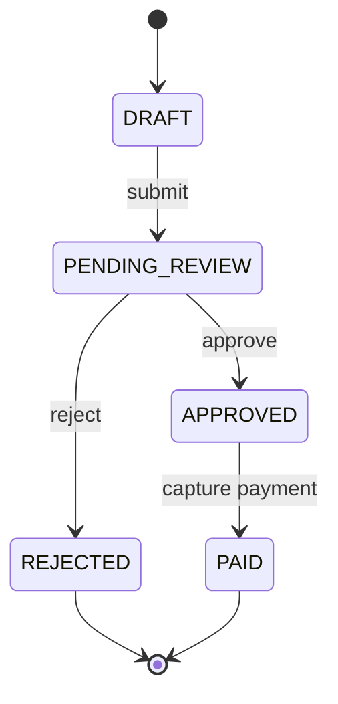

# Tấn công qua object ID, field, function và workflow

Trong mô hình đe dọa API, xác thực người gọi chỉ trả lời câu hỏi **ai đang gửi yêu cầu**. Nó chưa chứng minh người đó được phép đọc một đối tượng cụ thể, xem hoặc sửa từng thuộc tính, gọi một chức năng nhạy cảm hay thực hiện một bước trong quy trình nghiệp vụ. Một API có HTTPS, token hợp lệ và kiểm tra đăng nhập vẫn có thể làm lộ dữ liệu hoặc cho phép thao tác trái phép nếu thiếu các lớp kiểm soát này.

Với phạm vi `SECURITY_API_SECURITY`, cần thiết kế bảo mật theo từng endpoint, đối tượng dữ liệu và luồng nghiệp vụ. Bài này tập trung vào bốn bề mặt thường bị khai thác: **object ID**, **field/property**, **function/action** và **workflow**. Chúng có thể xuất hiện riêng lẻ hoặc kết hợp trong cùng một yêu cầu.

## 1. Bốn câu hỏi phải trả lời cho mỗi yêu cầu

Khi một request đi vào hệ thống, hãy kiểm tra lần lượt:

1. **Ai?** Danh tính đã được xác thực chưa, token còn hiệu lực không, và tenant/đơn vị của người gọi được xác định từ nguồn tin cậy nào?
2. **Đối tượng nào?** Người gọi có quyền trên đúng bản ghi, tài nguyên cha và các tài nguyên liên quan mà request tham chiếu không?
3. **Thuộc tính nào và hành động nào?** Người gọi được đọc hoặc thay đổi những field nào, và được thực hiện action nào trên đối tượng đó?
4. **Trong trạng thái nào?** Hành động có hợp lệ tại thời điểm hiện tại, đúng thứ tự, đúng điều kiện và không vượt giới hạn nghiệp vụ không?

Một kiểm tra quyền ở gateway hoặc controller thường chỉ bao phủ được một phần. Quyền truy cập cần được kiểm tra tại nơi có đủ ngữ cảnh về người gọi, tài nguyên, hành động và trạng thái nghiệp vụ; mọi đường vào cùng một nghiệp vụ phải tuân theo chính sách đó.

## 2. Tấn công qua object ID: Broken Object Level Authorization (BOLA)

### 2.1. Cách tấn công hoạt động

API thường nhận định danh tài nguyên qua path, query, body hoặc cấu trúc lồng nhau:

```http
GET /api/orders/4812
GET /api/accounts?accountId=4812
PATCH /api/orders/4812
POST /api/orders/4812/attachments
```

Kẻ tấn công thay ID trong request bằng ID của người dùng hoặc tenant khác. Nếu máy chủ chỉ kiểm tra token hợp lệ rồi truy vấn `findById(id)`, hệ thống có thể trả về hoặc cập nhật tài nguyên mà người gọi không sở hữu và không được cấp quyền truy cập.

Ví dụ, Alice có quyền xem đơn hàng `4812`. Cô ấy thay ID thành `4813`, là đơn hàng của Bob. Nếu API trả dữ liệu của Bob, đó là lỗi phân quyền mức đối tượng. Nếu API cho phép cập nhật hoặc xóa đơn hàng `4813`, tác động còn nghiêm trọng hơn.

ID tuần tự làm việc dò tìm dễ hơn, nhưng đổi sang UUID hoặc ID khó đoán không giải quyết lỗi phân quyền. ID khó đoán chỉ làm giảm khả năng khám phá; một ID bị lộ qua log, URL, liên kết chia sẻ hoặc dữ liệu khác vẫn có thể bị sử dụng.

### 2.2. Các vị trí cần kiểm tra

- ID trên URL và query string, bao gồm endpoint đọc, sửa, xóa, tải xuống và xuất dữ liệu.
- ID nằm trong JSON body, chẳng hạn `ownerId`, `accountId`, `projectId` hoặc `tenantId`.
- Tài nguyên lồng nhau, ví dụ `/projects/{projectId}/tasks/{taskId}`. Phải xác minh task thực sự thuộc project được chỉ định và người gọi có quyền trên cả quan hệ đó.
- Danh sách ID trong bulk request, import, export, báo cáo hoặc thao tác hàng loạt. Không được kiểm tra quyền cho phần tử đầu tiên rồi mặc định toàn bộ danh sách hợp lệ.
- GraphQL arguments, resolver, subscription và các tham chiếu được truyền qua nhiều service.
- Tác vụ bất đồng bộ. Quyền cần được xác định rõ tại thời điểm nhận lệnh và khi worker thực thi; không tin một ID do client cung cấp chỉ vì nó đã nằm trong hàng đợi.

### 2.3. Cách phòng vệ

**Giới hạn truy vấn ngay từ đầu vào dữ liệu.** Nếu dữ liệu thuộc tenant, truy vấn phải gắn với tenant lấy từ danh tính đã xác thực, không lấy `tenantId` tùy ý từ body:

```java
public Invoice getInvoice(UUID invoiceId, CurrentUser actor) {
    Invoice invoice = invoiceRepository
        .findByIdAndTenantId(invoiceId, actor.tenantId())
        .orElseThrow(NotFoundException::new);

    authorization.requireCanReadInvoice(actor, invoice);
    return invoice;
}
```

Truy vấn có phạm vi tenant ngăn việc vô tình lấy bản ghi ngoài tenant. Chính sách tiếp theo có thể xét thêm chủ sở hữu, thành viên dự án, quan hệ chia sẻ hoặc vai trò cụ thể. Nếu mô hình dữ liệu không có tenant, hãy truy vấn theo quan hệ sở hữu hoặc membership thích hợp.

**Kiểm tra quan hệ tài nguyên.** Với `projectId` và `taskId`, không chỉ kiểm tra hai ID tồn tại. Cần xác minh task thuộc đúng project và actor có quyền trên project/task theo chính sách. Tương tự, khi tải tệp đính kèm, phải kiểm tra quyền trên bản ghi cha và tệp được tham chiếu.

**Áp dụng cho mọi thao tác và mọi phần tử.** GET, PATCH, DELETE, download, export, batch và các endpoint phụ đều cần cùng nguyên tắc phân quyền. Đặt kiểm tra trong service hoặc lớp policy dùng chung giúp giảm nguy cơ một controller mới quên kiểm tra, nhưng vẫn phải truyền đủ ngữ cảnh và không bỏ qua kiểm tra ở các đường thực thi khác.

**Giảm rò rỉ thông tin.** Với tài nguyên không thuộc phạm vi truy cập, hệ thống có thể trả `404 Not Found` để che giấu sự tồn tại hoặc `403 Forbidden` để thể hiện rõ việc bị từ chối. Chọn một quy ước nhất quán theo chính sách sản phẩm; không để khác biệt về thông báo, thời gian phản hồi hoặc mã lỗi tiết lộ dữ liệu nhạy cảm ngoài ý muốn.

## 3. Tấn công qua field/property: Broken Object Property Level Authorization

Phân quyền đối tượng trả lời câu hỏi người gọi có thể truy cập bản ghi nào. Nó không tự động cấp quyền với mọi thuộc tính trong bản ghi đó. Một hồ sơ có thể chứa tên hiển thị, email, số điện thoại, vai trò, trạng thái xác minh, hạn mức, thông tin thanh toán hoặc cờ nội bộ. Mỗi field có thể có quy tắc đọc và ghi khác nhau.

### 3.1. Lộ field trong response

API trả nguyên entity hoặc serialize toàn bộ model có thể vô tình tiết lộ thuộc tính nội bộ:

```json
{
  "id": "inv-4812",
  "customerName": "Alice",
  "total": 1250000,
  "internalRiskScore": 87,
  "reviewNotes": "Manual review required",
  "paymentToken": "..."
}
```

Client chỉ cần xem một hóa đơn nhưng nhận cả điểm rủi ro, ghi chú nội bộ hoặc dữ liệu thanh toán. Việc giao diện không hiển thị field không bảo vệ được dữ liệu đã gửi đến trình duyệt.

**Phòng vệ:** tạo response DTO theo mục đích sử dụng và chỉ đưa vào các field cần thiết. Quyền xem field nhạy cảm phải được kiểm tra ở máy chủ theo actor, đối tượng và ngữ cảnh. Tránh trả entity ORM trực tiếp hoặc dựa vào việc ẩn field ở frontend.

### 3.2. Ghi field trái phép và mass assignment

Một endpoint cập nhật hồ sơ có thể chỉ định cho người dùng sửa `displayName`, nhưng nếu bind toàn bộ JSON vào entity, client có thể thêm các thuộc tính như `role`, `tenantId`, `isVerified`, `balance` hoặc `ownerId`:

```http
PATCH /api/users/me
Content-Type: application/json

{
  "displayName": "Alice",
  "role": "ADMIN",
  "isVerified": true
}
```

Nếu framework tự động bind các field tương ứng vào entity mà không có allowlist, đây là lỗi mass assignment/property authorization. Việc endpoint yêu cầu đăng nhập hoặc giới hạn đúng user object vẫn không ngăn được sửa field ngoài quyền.

**Phòng vệ:**

- Dùng request DTO riêng cho từng use case; chỉ khai báo field mà client được phép gửi.
- Gán field một cách tường minh trong service. Không copy toàn bộ map hoặc request object vào entity.
- Các field như `id`, `tenantId`, `ownerId`, `role`, `balance`, `status`, `createdAt`, `verifiedAt` và cờ kiểm soát phải do server quản lý, trừ khi có một chức năng riêng với chính sách quyền rõ ràng.
- Với field có quyền khác nhau theo vai trò, tenant hoặc trạng thái, kiểm tra từng field trước khi áp dụng thay đổi.
- Xác định rõ semantics của PATCH: field bị bỏ qua, field có giá trị `null` và field được xóa phải có ý nghĩa riêng, tránh vô tình xóa hoặc ghi đè dữ liệu.

Ví dụ minh họa với DTO chỉ chứa hai thuộc tính có thể sửa:

```java
public record UpdateProfileRequest(
    @Size(max = 80) String displayName,
    @Size(max = 30) String phoneNumber
) {}

public ProfileResponse updateProfile(
        UUID userId,
        UpdateProfileRequest request,
        CurrentUser actor) {
    User user = userRepository.findById(userId)
        .orElseThrow(NotFoundException::new);

    authorization.requireCanEditProfile(actor, user);

    if (request.displayName() != null) {
        user.setDisplayName(request.displayName());
    }
    if (request.phoneNumber() != null) {
        user.setPhoneNumber(request.phoneNumber());
    }

    return profileMapper.toResponse(user, actor);
}
```

Ví dụ này cần được bổ sung validation và quy tắc cập nhật `null` phù hợp với API thực tế. Điểm cốt lõi là DTO giới hạn đầu vào, service kiểm tra quyền trên object và chỉ gán các field được cho phép. `ProfileResponse` cũng cần lọc field theo quyền đọc.

### 3.3. Quyền đọc và quyền ghi không giống nhau

Một người có thể được xem trạng thái đơn hàng nhưng không được sửa trạng thái; nhân viên hỗ trợ có thể xem một phần thông tin khách hàng nhưng không được xem dữ liệu thanh toán; người tạo báo cáo có thể xem số liệu tổng hợp nhưng không được truy cập dữ liệu định danh từng cá nhân.

Do đó, mô hình quyền nên phân biệt ít nhất:

| Phạm vi | Ví dụ | Kiểm soát cần có |
|---|---|---|
| Object read | Xem hóa đơn của khách hàng | Quyền đọc trên hóa đơn cụ thể |
| Property read | Xem ghi chú kiểm duyệt | Quyền đọc field theo vai trò/ngữ cảnh |
| Object update | Sửa thông tin hóa đơn | Quyền cập nhật trên hóa đơn cụ thể |
| Property update | Sửa hạn thanh toán | Allowlist và quyền ghi field cụ thể |
| Sensitive operation | Thay tài khoản nhận tiền | Quyền chức năng, xác minh bổ sung và điều kiện nghiệp vụ |

## 4. Tấn công qua function/action: Broken Function Level Authorization (BFLA)

BFLA xảy ra khi người gọi được truy cập chức năng mà vai trò hoặc ngữ cảnh của họ không cho phép. Lỗi thường xuất hiện khi hệ thống kiểm tra quyền ở menu giao diện hoặc chỉ bảo vệ một số route phổ biến.

Ví dụ, giao diện người dùng thường chỉ hiển thị chức năng đọc đơn hàng. Nhưng API vẫn có endpoint `POST /api/orders/{id}/approve`, `DELETE /api/users/{id}` hoặc `GET /api/admin/export`. Người dùng có token hợp lệ có thể tự tạo request đến các endpoint này. Việc không nhìn thấy nút bấm không phải là một lớp bảo mật.

Các biến thể thường gặp:

- Người dùng thường gọi endpoint quản trị hoặc endpoint nội bộ.
- Có quyền đọc nhưng gọi được chức năng sửa, xóa, phê duyệt, hoàn tiền hoặc xuất dữ liệu.
- Endpoint có nhiều HTTP method nhưng chỉ một method được bảo vệ.
- Route phiên bản cũ, route phụ, endpoint debug hoặc GraphQL mutation thiếu kiểm tra.
- Một chức năng được gọi gián tiếp qua job, webhook hoặc service-to-service nhưng không xác minh danh tính dịch vụ và quyền của lệnh gốc.

**Phòng vệ:** định nghĩa quyền theo hành động nghiệp vụ, ví dụ `invoice:read`, `invoice:update`, `invoice:approve`, `payment:refund` và `user:manage`. Kiểm tra quyền ở server cho mọi route, method, resolver và message handler. Quyền chức năng vẫn phải kết hợp với quyền trên đối tượng: có `invoice:approve` không đồng nghĩa được duyệt mọi hóa đơn trong mọi tenant.

Ví dụ với Spring Security:

```java
@PreAuthorize("hasAuthority('invoice:approve')")
public void approveInvoice(UUID invoiceId, CurrentUser actor) {
    Invoice invoice = invoiceRepository
        .findByIdAndTenantId(invoiceId, actor.tenantId())
        .orElseThrow(NotFoundException::new);

    authorization.requireCanApproveInvoice(actor, invoice);
    invoiceWorkflow.approve(invoice, actor);
}
```

Annotation thể hiện quyền gọi chức năng. Truy vấn giới hạn tenant và policy trên hóa đơn vẫn cần thiết để ngăn người có quyền duyệt một hóa đơn truy cập hóa đơn ngoài phạm vi của họ. Tên quyền và cách cấu hình cụ thể phải nhất quán với hệ thống phân quyền đang dùng.

## 5. Tấn công qua workflow: bỏ qua hoặc đảo thứ tự quy trình

Một số chức năng chỉ an toàn khi các bước diễn ra theo đúng trình tự và điều kiện. Kẻ tấn công có thể gọi thẳng endpoint của bước sau, gửi lại một request cũ, thay đổi dữ liệu giữa hai bước hoặc thực hiện đồng thời nhiều request để vượt qua giới hạn.

Ví dụ một quy trình thanh toán:



Nếu API chỉ kiểm tra người gọi có quyền `payment:capture` mà không kiểm tra trạng thái hiện tại, người dùng có thể capture khi đơn còn `DRAFT`, hoặc capture lần thứ hai sau khi đã thanh toán. Nếu endpoint `approve` không xác minh người duyệt khác người tạo trong trường hợp nghiệp vụ yêu cầu tách nhiệm vụ, một người có thể tự tạo và tự duyệt giao dịch.

### 5.1. Những kiểu vượt quy trình phổ biến

- **Bỏ qua bước:** gọi endpoint hoàn tất mà chưa qua bước xác minh, phê duyệt hoặc thanh toán.
- **Đảo thứ tự:** thực hiện bước B trước bước A dù quy trình yêu cầu A thành công trước.
- **Replay:** gửi lại request hợp lệ để tạo nhiều lần thanh toán, cấp mã, phát hành coupon hoặc gửi thông báo.
- **Thay đổi dữ liệu giữa các bước:** đối tượng được duyệt khác với đối tượng được thực thi vì dữ liệu hoặc quyền đã thay đổi sau lúc kiểm tra.
- **Race condition:** hai request đồng thời cùng đọc trạng thái cũ rồi cùng thực hiện chuyển trạng thái, vượt hạn mức hoặc xử lý trùng.
- **Lạm dụng số lượng/tần suất:** tạo nhiều yêu cầu, mã giảm giá, lần thử OTP hoặc lượt đặt chỗ để vượt giới hạn nghiệp vụ.

### 5.2. Phòng vệ bằng state machine và invariant

Mô hình hóa trạng thái và chuyển trạng thái hợp lệ một cách tường minh. Mỗi lệnh cần kiểm tra:

1. Actor có quyền gọi action này không?
2. Actor có quyền trên đúng đối tượng không?
3. Trạng thái hiện tại có cho phép chuyển trạng thái không?
4. Các điều kiện nghiệp vụ có còn đúng tại thời điểm ghi dữ liệu không?
5. Lệnh đã được xử lý trước đó chưa, và việc thực thi có an toàn khi retry không?

Ví dụ:

```java
@Transactional
public void capturePayment(UUID orderId, CurrentUser actor, String idempotencyKey) {
    Order order = orderRepository.findByIdForUpdate(orderId)
        .orElseThrow(NotFoundException::new);

    authorization.requireCanCapturePayment(actor, order);

    if (order.status() != OrderStatus.APPROVED) {
        throw new InvalidStateTransitionException();
    }

    idempotency.requireFirstUse(idempotencyKey, orderId, "capture-payment");
    paymentGateway.capture(order);
    order.markPaid();
}
```

Đây là ví dụ khái niệm: `findByIdForUpdate` cần khóa phù hợp với cơ sở dữ liệu, và việc gọi cổng thanh toán phải được thiết kế để xử lý timeout/retry an toàn. Không nên dựa vào khóa trong bộ nhớ của một instance ứng dụng. Có thể dùng optimistic locking với version, pessimistic locking hoặc cập nhật có điều kiện tại database tùy tải và yêu cầu nhất quán. Idempotency key cần được ràng buộc với actor/tenant, action và tài nguyên; lưu khóa cùng kết quả xử lý bằng cơ chế có tính nguyên tử.

Với workflow nhiều dịch vụ, cân nhắc transactional outbox, saga hoặc cơ chế điều phối tương đương để trạng thái nghiệp vụ và message không lệch nhau. Mỗi consumer phải xác thực nguồn message, kiểm tra phạm vi lệnh, chống xử lý trùng và chỉ chấp nhận chuyển trạng thái hợp lệ.

## 6. Kết hợp các lớp kiểm soát trong một chính sách

Một quyết định truy cập đầy đủ có thể được mô tả bằng:

```text
ALLOW khi:
  danh tính hợp lệ
  AND actor thuộc tenant/phạm vi phù hợp
  AND actor có quyền trên object
  AND actor được phép thực hiện action
  AND các field được đọc/ghi nằm trong quyền cho phép
  AND trạng thái và điều kiện workflow hợp lệ
  AND giới hạn tài nguyên/ngữ cảnh được đáp ứng
```

Đây là phép kiểm tra tổng hợp, không nhất thiết phải nằm trong một hàm duy nhất. Có thể dùng RBAC cho quyền chức năng, ABAC cho thuộc tính actor/resource/context và relationship-based access control cho quan hệ sở hữu, thành viên hoặc chia sẻ. Dù chọn mô hình nào, chính sách cần được thực thi ở server và áp dụng nhất quán trên REST, GraphQL, background job, webhook và API nội bộ.

Ví dụ ma trận chính sách cho một hệ thống hóa đơn:

| Actor | Object | Action | Field | Điều kiện workflow |
|---|---|---|---|---|
| Khách hàng | Hóa đơn của mình | Read | Field công khai với khách hàng | Không yêu cầu trạng thái đặc biệt |
| Khách hàng | Hóa đơn của mình | Update | Địa chỉ nhận hóa đơn trước khi phát hành | Chưa phát hành |
| Nhân viên kế toán | Hóa đơn trong tenant được phân công | Read/update | Field kế toán được cấp | Theo nhiệm vụ được giao |
| Người phê duyệt | Hóa đơn chờ duyệt trong phạm vi | Approve/reject | Field phục vụ phê duyệt | Chưa được duyệt; đáp ứng nguyên tắc tách nhiệm vụ |
| Quản trị tenant | Dữ liệu trong tenant | Quản trị theo phạm vi | Field quản trị được cấp | Tuân theo kiểm soát thay đổi và audit |

Ma trận là điểm bắt đầu để thảo luận với chủ sở hữu nghiệp vụ. Cần bổ sung các trường hợp ngoại lệ, quyền chia sẻ, ủy quyền tạm thời, dữ liệu nhạy cảm và quy tắc theo từng trạng thái trước khi triển khai.

## 7. Quy trình lập threat model cho endpoint

Với mỗi endpoint hoặc nhóm endpoint, thực hiện các bước sau:

### Bước 1: Xác định tài sản và tác động

Liệt kê dữ liệu có giá trị, hành động có hậu quả và tài nguyên có giới hạn: hồ sơ cá nhân, hóa đơn, tệp, tiền, quyền quản trị, hạn mức, lượt đặt chỗ, OTP hoặc tài nguyên hạ tầng. Đánh giá tác động khi dữ liệu bị đọc, sửa, xóa, phát tán hoặc xử lý nhiều lần.

### Bước 2: Vẽ luồng dữ liệu và ranh giới tin cậy

Ghi lại client, gateway, API service, database, object storage, queue, worker và dịch vụ ngoài. Đánh dấu dữ liệu do client kiểm soát, claim từ token, dữ liệu nội bộ và dữ liệu nhận từ bên thứ ba. ID, tenant ID, role, URL và trạng thái do client gửi đều phải được xem là đầu vào cần xác minh.

### Bước 3: Liệt kê điểm quyết định quyền

Với mỗi thao tác, ghi rõ actor, object, action, field và trạng thái. Xác định nơi thực thi kiểm tra, nguồn dữ liệu dùng để ra quyết định và hành vi khi không đủ thông tin. Mặc định từ chối khi không có chính sách cho phép rõ ràng.

### Bước 4: Thử các biến thể của request

Thay ID bằng tài nguyên của người khác hoặc tenant khác; thêm field ngoài DTO; đổi method; gọi route quản trị; gửi ID lồng nhau không khớp; gọi thẳng bước cuối của workflow; gửi request lặp và gửi đồng thời. Thử cả endpoint chính lẫn export, download, batch, GraphQL và tác vụ bất đồng bộ.

### Bước 5: Đánh giá kiểm soát và bằng chứng

Ghi nhận policy, test chứng minh policy được áp dụng và log phục vụ điều tra. Mỗi rủi ro cần có chủ sở hữu, mức độ ảnh hưởng, cách giảm thiểu và điều kiện chấp nhận rủi ro nếu chưa thể xử lý.

## 8. Kiểm thử bảo mật có hệ thống

Không chỉ kiểm thử một tài khoản admin và một tài khoản user. Hãy tạo ma trận actor, tenant, object, action, field và trạng thái. Ví dụ tối thiểu:

| Tình huống | Request thử | Kết quả mong đợi |
|---|---|---|
| Đọc object của người khác | Đổi ID trên GET | Từ chối hoặc không tiết lộ object |
| Sửa object ngoài tenant | Đổi ID trong PATCH/DELETE | Không có thay đổi dữ liệu |
| Truy cập object lồng nhau sai quan hệ | Ghép `projectId` và `taskId` không khớp | Từ chối |
| Đọc field nhạy cảm | Gọi endpoint bằng vai trò thông thường | Field bị loại khỏi response |
| Ghi field quản trị | Thêm `role`, `tenantId`, `isVerified` vào JSON | Field bị từ chối hoặc bỏ qua theo hợp đồng API; dữ liệu không đổi |
| Gọi function đặc quyền | User thường gọi approve/refund/export | Từ chối ở server |
| Gọi bằng HTTP method khác | Thử GET/POST/PATCH/DELETE trên cùng tài nguyên | Mỗi method áp dụng đúng policy |
| Bỏ qua workflow | Gọi capture khi đơn chưa approved | Từ chối, không phát sinh giao dịch |
| Replay | Gửi lại cùng idempotency key | Không tạo tác động nghiệp vụ lần hai |
| Gửi đồng thời | Hai request cùng chuyển trạng thái hoặc dùng hạn mức | Invariant vẫn được giữ |

Nên kiểm tra cả hai chiều: người không có quyền phải bị từ chối, và người có quyền hợp lệ vẫn thực hiện được thao tác cần thiết. Kiểm thử âm tính quá rộng có thể khiến sản phẩm khóa nhầm luồng hợp lệ; kiểm thử dương tính giúp phát hiện điều đó.

Các lớp kiểm thử phù hợp gồm:

- Unit test cho policy và state transition, bao gồm trường hợp thiếu claim hoặc dữ liệu quan hệ không đầy đủ.
- Integration test qua HTTP/controller/service/database để xác minh kiểm tra quyền thực sự được gọi và không có side effect khi bị từ chối.
- Test theo ma trận nhiều actor và tenant, bao gồm quyền kế thừa, chia sẻ và thu hồi quyền.
- API security test/fuzzing để thay ID, field, method, content type, thứ tự bước và tần suất request.
- Test concurrency và retry cho thanh toán, đặt chỗ, cấp phát tài nguyên hoặc thao tác có giới hạn.

## 9. Giám sát và giảm thiểu tác động

Log bảo mật nên ghi nhận actor/service identity, tenant, action, loại object, kết quả quyết định, correlation ID và lý do từ chối ở mức đủ để điều tra. Tránh ghi access token, mật khẩu, dữ liệu thanh toán, nội dung bí mật hoặc toàn bộ payload nhạy cảm. Với field nhạy cảm, log tên field hoặc loại thao tác thay vì giá trị.

Theo dõi các tín hiệu như một actor thử nhiều object ID, truy cập chéo tenant, gửi field quản trị bất thường, gọi action hiếm, thất bại chuyển trạng thái, replay idempotency key hoặc tăng đột biến request hàng loạt. Kết hợp rate limit, giới hạn kích thước trang/tệp, timeout, quota và giới hạn số lần thử để giảm lạm dụng tài nguyên. Rate limit không thay thế phân quyền: người dùng bị giới hạn tần suất vẫn có thể truy cập trái phép nếu policy sai.

Nếu workflow nhận URL để import, tải tệp hoặc gọi callback, cần áp dụng kiểm soát SSRF ở luồng fetch: chỉ cho phép scheme/host cần thiết, chặn địa chỉ loopback/private/link-local và kiểm tra lại đích sau DNS resolution, giới hạn redirect, thời gian, kích thước và loại nội dung. Việc người gọi có quyền khởi chạy workflow không có nghĩa URL họ cung cấp là an toàn để server truy cập.

Khi phát hiện sự cố, cần có khả năng thu hồi token hoặc quyền, vô hiệu hóa liên kết/tác vụ đang chờ, khóa hoặc đảo trạng thái nghiệp vụ theo quy trình, và truy vết các object đã bị đọc hoặc thay đổi. Audit trail cần đủ tin cậy để xác định ai thực hiện hành động, trên tài nguyên nào và quyết định quyền dựa trên dữ liệu nào.

## 10. Checklist khi review API

- [ ] Danh tính và tenant được lấy từ nguồn đã xác thực; không tin ID hoặc role do client tự khai.
- [ ] Mọi object ID đều được kiểm tra quyền truy cập; truy vấn có scope phù hợp với tenant/owner/relationship.
- [ ] Tài nguyên lồng nhau và từng phần tử trong bulk request đều được kiểm tra quan hệ và quyền.
- [ ] Response chỉ chứa field cần thiết; field nhạy cảm có chính sách đọc riêng.
- [ ] Request DTO và allowlist giới hạn field được ghi; field server-managed không bị mass assignment.
- [ ] Mỗi function/action được bảo vệ ở server trên mọi route, method, resolver và message handler.
- [ ] Quyền chức năng được kết hợp với quyền trên object và quyền field.
- [ ] Workflow kiểm tra trạng thái, thứ tự, invariant, idempotency và cạnh tranh đồng thời.
- [ ] Validation, rate limit, quota, timeout và giới hạn kích thước phù hợp với rủi ro tài nguyên.
- [ ] Test bao gồm người dùng khác, tenant khác, field trái phép, function đặc quyền và đường đi tắt workflow.
- [ ] Log/audit hỗ trợ điều tra nhưng không làm lộ token hoặc dữ liệu nhạy cảm.

Một API an toàn cần trả lời đúng cả bốn câu hỏi: người gọi là ai, họ được truy cập đối tượng nào, được thao tác trên field/function nào và được thực hiện hành động đó ở trạng thái nào. Khi các quyết định này được mô hình hóa rõ, kiểm tra nhất quán ở server, kiểm thử bằng các tình huống đối kháng và giám sát sau triển khai, rủi ro BOLA, lỗi phân quyền thuộc tính, BFLA và lạm dụng workflow sẽ giảm đáng kể.
