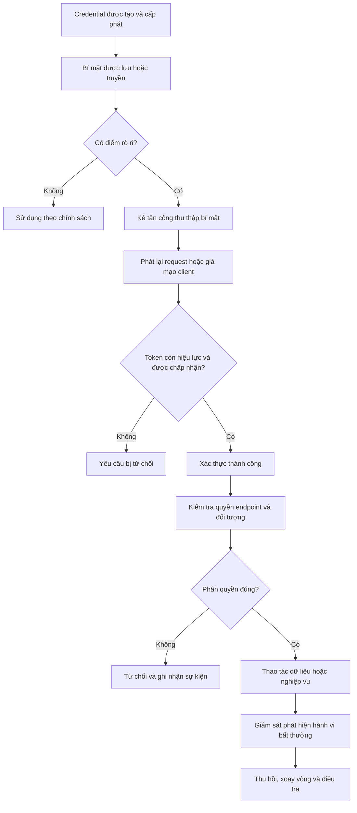

# Credential, token, API key và session bị lộ

Một API có thể dùng HTTPS, yêu cầu đăng nhập và vẫn bị chiếm quyền nếu mật khẩu, access token, API key hoặc session ID rơi vào tay người khác. Những giá trị này thường hoạt động như một tấm vé đại diện cho người dùng hoặc ứng dụng. Kẻ tấn công chỉ cần lấy được giá trị còn hiệu lực là có thể gửi yêu cầu như chủ thể hợp lệ, đôi khi mà không cần biết mật khẩu hay vượt qua bước đăng nhập.

Vì vậy, bảo vệ API phải bao gồm toàn bộ vòng đời của bí mật: tạo, cấp phát, lưu trữ, truyền, sử dụng, ghi log, gia hạn, thu hồi và ứng phó khi bị lộ. Sau khi xác thực danh tính, mỗi endpoint vẫn phải kiểm tra quyền thực hiện chức năng và quyền truy cập đúng đối tượng dữ liệu. Một token hợp lệ không đồng nghĩa với quyền truy cập mọi tài khoản, đơn hàng hay tenant.

## 1. Mục tiêu và phạm vi bảo vệ

Khi đánh giá nguy cơ credential bị lộ, cần xác định rõ tài sản nào có thể bị ảnh hưởng:

- **Danh tính:** tài khoản người dùng, quản trị viên, dịch vụ hoặc ứng dụng tích hợp.
- **Quyền truy cập:** role, scope, tenant, quyền đọc/ghi/xóa và quyền thực hiện thao tác nghiệp vụ.
- **Dữ liệu:** hồ sơ cá nhân, dữ liệu tài chính, thông tin nội bộ, dữ liệu khách hàng và bí mật của hệ thống khác.
- **Tính toàn vẹn nghiệp vụ:** tạo giao dịch, đổi thông tin nhận tiền, hoàn tiền, phát hành mã truy cập hoặc thay đổi cấu hình.
- **Hạ tầng:** cơ sở dữ liệu, message broker, kho lưu trữ, dịch vụ đám mây và pipeline triển khai.

Mục tiêu của biện pháp bảo vệ là giảm xác suất bí mật bị lấy cắp, giới hạn quyền và thời gian sử dụng nếu bí mật bị lộ, phát hiện việc sử dụng bất thường, rồi thu hồi và khôi phục an toàn.

## 2. Phân biệt credential, token, API key và session

Các khái niệm này có liên quan nhưng không thể dùng thay thế cho nhau. Cần biết giá trị nào xác minh danh tính, giá trị nào đại diện cho một phiên và giá trị nào cấp quyền gọi API.

| Loại | Vai trò thường gặp | Rủi ro khi bị lộ |
|---|---|---|
| Mật khẩu | Xác minh người dùng khi đăng nhập | Kẻ tấn công có thể đăng nhập, thử credential stuffing ở dịch vụ khác hoặc đổi thông tin khôi phục |
| Client secret / private key | Xác thực một ứng dụng hoặc workload với hệ thống khác | Kẻ tấn công có thể giả mạo ứng dụng, lấy token hoặc ký dữ liệu nếu có quyền tương ứng |
| Access token | Mang quyền truy cập API trong một khoảng thời gian | Có thể bị phát lại để gọi các endpoint nằm trong phạm vi token |
| Refresh token | Cấp access token mới mà không cần người dùng đăng nhập lại | Có thể duy trì quyền truy cập lâu dài; nguy cơ cao nếu không xoay vòng và phát hiện tái sử dụng |
| ID token | Chứng minh kết quả xác thực cho client trong OpenID Connect | Có thể làm lộ thông tin định danh hoặc bị dùng sai mục đích nếu API chấp nhận ID token như access token |
| API key | Nhận diện hoặc xác thực một ứng dụng/tích hợp với API | Có thể bị dùng để gọi API theo quota và quyền gắn với key |
| Session ID | Tham chiếu tới phiên đăng nhập đang hoạt động | Kẻ tấn công có thể chiếm phiên và hành động với quyền của người dùng |
| Signing key | Ký token hoặc thông điệp | Có thể cho phép giả mạo token/thông điệp trên diện rộng, tùy phạm vi khóa |

**Credential** là khái niệm rộng, bao gồm mật khẩu, khóa, secret và các bằng chứng xác thực khác. **Token** là một thông tin xác thực hoặc cấp quyền được phát hành cho một mục đích và thời hạn nhất định. **API key** thường gắn với một ứng dụng hoặc tích hợp. **Session ID** là mã tham chiếu tới trạng thái phiên do máy chủ quản lý.

Một số token có thể được dùng như *bearer token*: bất kỳ ai sở hữu token đều có thể trình token để sử dụng quyền của nó. Trong trường hợp này, việc bảo vệ token tương tự bảo vệ tiền mặt hoặc chìa khóa. Không nên giả định rằng người gửi request chính là chủ sở hữu hợp pháp chỉ vì request chứa token hợp lệ.

### Access token, refresh token và ID token

- **Access token** dành cho resource server/API. API phải kiểm tra token được phát hành cho chính API đó và chỉ cấp quyền nằm trong scope hoặc policy tương ứng.
- **Refresh token** dành cho authorization server để xin access token mới. Không gửi refresh token tới API nghiệp vụ và không đưa nó vào JavaScript, URL hoặc log.
- **ID token** dành cho client để hiểu người dùng đã xác thực. API không nên chấp nhận ID token thay cho access token; hai loại token có audience và mục đích khác nhau.

Token có thể là chuỗi opaque được tra cứu/introspect ở máy chủ hoặc JWT tự chứa các claim. JWT thường được ký để kiểm tra tính toàn vẹn; **chữ ký không mã hóa nội dung**. Người có JWT có thể đọc các claim không được mã hóa, vì vậy không đặt mật khẩu, API key hay dữ liệu bí mật vào payload.

## 3. Mô hình đe dọa khi bí mật bị lộ

Một mô hình đơn giản giúp đội phát triển phân tích sự cố theo chuỗi sau:



### Tài sản, tác nhân và ranh giới tin cậy

Khi lập threat model, hãy ghi lại:

1. **Tài sản:** loại bí mật, danh tính mà nó đại diện, dữ liệu và thao tác mà danh tính đó có thể truy cập.
2. **Tác nhân:** người ngoài, nhân viên có quyền quá rộng, mã độc trên thiết bị, nhà cung cấp bị xâm nhập hoặc hệ thống tích hợp bị cấu hình sai.
3. **Điểm đi qua:** trình duyệt, ứng dụng di động, reverse proxy, API gateway, log tập trung, CI/CD, kho mã nguồn, công cụ hỗ trợ và hệ thống phân tích.
4. **Ranh giới tin cậy:** client với API, API gateway với service, service với database, workload với cloud control plane và tổ chức với nhà cung cấp.
5. **Hậu quả:** đọc dữ liệu, sửa/xóa dữ liệu, giả mạo giao dịch, chiếm tài khoản, tăng quyền, tiêu hao quota hoặc dùng hệ thống làm bàn đạp tấn công nơi khác.

### Các tình huống tấn công thường gặp

| Tình huống | Đường tấn công | Hậu quả có thể xảy ra |
|---|---|---|
| Secret được commit lên Git | Kẻ tấn công quét repository, fork, bản clone hoặc lịch sử commit | Truy cập hệ thống bằng secret dù file đã bị xóa khỏi nhánh hiện tại |
| Token xuất hiện trong log | Log, trace hoặc hệ thống hỗ trợ lưu header/body đầy đủ | Người có quyền xem log có thể phát lại token |
| API key nằm trong frontend | Key được đóng gói vào JavaScript, mobile app hoặc source map | Người dùng có thể trích xuất key và dùng ngoài ứng dụng |
| Token nằm trong URL | Query string bị lưu trong browser history, proxy log hoặc Referer | Token bị phát tán qua nhiều hệ thống ngoài dự kiến |
| Session bị đánh cắp | XSS, malware, thiết bị dùng chung hoặc cookie bị bảo vệ kém | Kẻ tấn công tiếp quản phiên đang đăng nhập |
| Refresh token bị lấy | Token lưu lâu dài trong browser storage, backup hoặc log | Kẻ tấn công xin access token mới nhiều lần |
| Khóa ký bị lộ | Private key nằm trong image, máy build hoặc file cấu hình | Kẻ tấn công có thể tự tạo token giả nếu verifier tin khóa đó |
| Credential dùng chung | Nhiều người/dịch vụ dùng cùng một key không có định danh riêng | Khó truy vết, thu hồi gây gián đoạn và khó giới hạn phạm vi ảnh hưởng |

Điểm cần kiểm tra không chỉ là “có bí mật trong source code không”. Cần truy vết bí mật qua toàn bộ luồng: nơi tạo, nơi cấp, nơi lưu, nơi đọc, nơi ghi log, bản sao lưu và các hệ thống nhận nó.

## 4. Những nguyên nhân làm credential bị lộ

### 4.1. Lưu bí mật trong mã nguồn hoặc artifact

Các ví dụ phổ biến gồm mật khẩu database trong `application.yml`, API key trong file `.env` bị commit, private key trong Docker image, secret trong script triển khai hoặc credential thật được dùng trong test. Xóa dòng chứa secret khỏi phiên bản mới không làm secret biến mất khỏi lịch sử Git, fork, cache, artifact hay bản sao của người khác.

Biện pháp phù hợp:

- Lưu secret trong secret manager hoặc hệ thống quản lý cấu hình có kiểm soát truy cập; cấp secret lúc chạy thay vì đóng gói vào source hoặc image.
- Phân tách secret theo môi trường, ứng dụng và workload. Không dùng một key cho development, staging và production.
- Bật secret scanning cho pull request, repository và lịch sử khi có thể. Pre-commit hook giúp phát hiện sớm nhưng không thay thế kiểm tra ở CI hoặc nền tảng lưu mã.
- Dùng secret giả lập trong test và tài liệu. Nếu secret thật đã được commit, phải coi là bị lộ và xoay vòng; chỉ rewrite Git history là chưa đủ.

### 4.2. Ghi secret vào log, trace và hệ thống quan sát

Header `Authorization`, cookie, API key, refresh token, client secret và nội dung đăng nhập không được ghi nguyên văn vào log. Các hệ thống APM, reverse proxy, API gateway, crash report và công cụ phân tích có thể sao chép request mà lập trình viên không nhận ra.

Hãy cấu hình redaction ở nhiều lớp, kiểm tra cả log lỗi và trace. Khi cần liên kết sự kiện, hãy ghi `client_id`, key ID, subject ID đã được kiểm soát, request ID hoặc fingerprint một chiều phù hợp; không ghi giá trị bí mật. Tránh ghi toàn bộ body theo mặc định vì body có thể chứa mật khẩu, mã khôi phục hoặc dữ liệu cá nhân.

### 4.3. Đưa token vào URL hoặc chuyển qua kênh không phù hợp

Không đặt access token, refresh token, session ID hoặc API key trong query string hay fragment của URL. URL có thể xuất hiện trong lịch sử trình duyệt, access log, hệ thống analytics, ảnh chụp màn hình và header `Referer`. Ưu tiên header xác thực qua HTTPS và cấu hình hệ thống trung gian để không ghi header nhạy cảm.

Không gửi bí mật qua chat công khai, ticket không giới hạn quyền, email nhóm rộng hoặc file chia sẻ công khai. Khi cần trao đổi, dùng cơ chế cấp quyền tạm thời của secret manager và giới hạn người nhận.

### 4.4. Lưu token không an toàn ở client

JavaScript chạy trong trình duyệt có thể bị ảnh hưởng bởi XSS. Nếu access token hoặc refresh token được lưu trong `localStorage`, mã độc chạy cùng origin có thể đọc và gửi token ra ngoài. Ứng dụng di động cũng có thể làm lộ secret nếu nhúng key cố định trong binary: người dùng có thể giải mã hoặc phân tích ứng dụng.

Với ứng dụng web, cân nhắc mô hình Backend for Frontend (BFF), trong đó trình duyệt chỉ giữ cookie phiên được bảo vệ và server giữ token OAuth. Nếu client cần giữ token, giảm thời gian sống, giảm scope, tránh lưu refresh token ở nơi JavaScript đọc được và áp dụng CSP cùng biện pháp giảm XSS. Với mobile, dùng vùng lưu trữ bảo mật của hệ điều hành; vẫn phải giả định binary có thể bị phân tích và không coi secret nhúng trong ứng dụng công khai là bí mật.

### 4.5. Quản lý phiên yếu hoặc xác thực tài khoản yếu

Session ID dễ đoán, không đổi sau đăng nhập, không hết hạn, không bị thu hồi khi logout hoặc được truyền qua URL có thể tạo điều kiện cho session fixation và session hijacking. Mật khẩu yếu, tái sử dụng mật khẩu, thiếu MFA ở tài khoản nhạy cảm và không giới hạn thử đăng nhập làm tăng khả năng credential bị chiếm.

## 5. Biện pháp bảo vệ theo từng loại bí mật

### 5.1. Mật khẩu và thông tin đăng nhập

- Không lưu mật khẩu dạng plaintext hoặc mã hóa có thể giải mã để xác minh đăng nhập. Dùng password hashing chuyên dụng như Argon2id, scrypt hoặc bcrypt với cấu hình work factor phù hợp và salt riêng cho từng mật khẩu.
- Không tự xây dựng thuật toán hash mật khẩu. Theo dõi khả năng nâng cấp tham số khi phần cứng thay đổi.
- Bật MFA cho tài khoản quản trị và thao tác có tác động lớn; ưu tiên phương thức chống phishing khi có thể.
- Giới hạn tốc độ đăng nhập và khôi phục tài khoản; phát hiện credential stuffing, thử mật khẩu hàng loạt và đăng nhập bất thường.
- Không tiết lộ qua thông báo lỗi liệu username có tồn tại hay không. Luồng khôi phục phải có token ngẫu nhiên, thời hạn ngắn, dùng một lần và không ghi token vào log.

### 5.2. Access token và refresh token

**Giới hạn quyền và thời gian sống.** Access token chỉ nên có scope, audience, subject và thời hạn cần thiết cho tác vụ. Token dùng cho một API không được mặc nhiên chấp nhận ở API khác. Quyền càng cao thì thời hạn và phạm vi càng cần được cân nhắc chặt chẽ.

**Kiểm tra token ở resource server.** Với JWT, API cần xác minh chữ ký bằng khóa tin cậy, chỉ cho phép thuật toán đã cấu hình, kiểm tra `iss` (issuer), `aud` (audience), `exp` (hết hạn), `nbf` (chưa có hiệu lực), và các claim cần thiết như `scope`, `roles`, `sub` hoặc tenant. Không lấy thuật toán từ header JWT rồi chấp nhận tùy ý. Xử lý clock skew trong giới hạn nhỏ và từ chối token thiếu claim bắt buộc. Với opaque token, dùng introspection hoặc tra cứu trạng thái từ authorization server theo thiết kế.

**Xoay vòng refresh token.** Mỗi lần refresh thành công, phát hành refresh token mới và vô hiệu hóa token cũ. Nếu token cũ bị dùng lại, coi đó là tín hiệu có thể đã bị đánh cắp; thu hồi token family hoặc phiên liên quan và yêu cầu xác thực lại theo chính sách. Không chia sẻ refresh token giữa nhiều client.

**Có phương án thu hồi.** JWT tự chứa thường không thể bị thu hồi tức thời chỉ bằng cách xóa một bản ghi cục bộ ở resource server. Có thể dùng access token ngắn hạn, opaque token với introspection, denylist có thời hạn, token/session version hoặc cơ chế thu hồi tập trung tùy yêu cầu. Cần quyết định trước thời gian tối đa hệ thống chấp nhận một token đã bị lộ.

**Giảm khả năng phát lại.** Với luồng có rủi ro cao, cân nhắc sender-constrained token như mTLS hoặc DPoP nếu hệ sinh thái hỗ trợ. Các cơ chế này ràng buộc token với khóa của client, làm cho token bị sao chép đơn thuần khó sử dụng hơn; chúng không thay thế kiểm tra quyền và bảo vệ thiết bị.

### 5.3. API key và client secret

API key thường phù hợp để nhận diện ứng dụng tích hợp, áp quota hoặc xác thực workload đơn giản. Một key không nên đại diện cho nhiều người dùng cuối nếu hệ thống cần phân quyền theo từng người.

- Sinh key bằng bộ sinh số ngẫu nhiên mật mã, đủ entropy; không dùng chuỗi dễ đoán hoặc tự ghép từ tên ứng dụng.
- Cấp key riêng cho từng ứng dụng, môi trường và đối tác; gắn metadata như chủ sở hữu, mục đích, ngày tạo, ngày hết hạn và trạng thái.
- Cấp quyền tối thiểu, giới hạn endpoint, quota, tốc độ và mạng nguồn khi phù hợp. Key chỉ có quyền đọc không nên dùng để ghi hoặc quản trị.
- Truyền key qua header HTTPS, không đặt trong URL. Không đưa key vào frontend, ứng dụng mobile công khai hoặc tài liệu ví dụ.
- Nếu key có entropy cao, có thể chỉ lưu hash/HMAC của key để so sánh khi xác thực; lưu phần định danh không bí mật để tra cứu bản ghi. So sánh bí mật theo cách giảm rò rỉ qua thời gian xử lý và không đưa giá trị gốc vào log.
- Hỗ trợ tạo key mới, chuyển client sang key mới, xác nhận hoạt động rồi thu hồi key cũ. Có thể duy trì khoảng thời gian chồng lấp ngắn để tránh gián đoạn, nhưng phải đặt hạn kết thúc rõ ràng.

Một số API key chỉ là mã nhận diện công khai, không phải credential. Nếu key được thiết kế để công khai, không được dùng riêng nó làm bằng chứng xác thực hoặc cấp quyền nhạy cảm. Hạn mức, allowlist và quyền dữ liệu vẫn phải được áp dụng ở server.

### 5.4. Session và cookie

- Sinh session ID bằng bộ sinh số ngẫu nhiên mật mã với độ dài đủ lớn; không mã hóa thông tin người dùng vào session ID.
- Đổi session ID sau khi đăng nhập, đổi mật khẩu, nâng quyền hoặc thay đổi mức xác thực để giảm session fixation.
- Dùng cookie với `Secure`, `HttpOnly` và `SameSite` phù hợp. `Secure` giới hạn cookie ở HTTPS; `HttpOnly` ngăn JavaScript đọc cookie; `SameSite` giảm một số request cross-site.
- Với xác thực dựa trên cookie, triển khai CSRF token và/hoặc kiểm tra `Origin`/`Referer` theo mô hình ứng dụng. `SameSite` là một lớp bảo vệ, không phải lý do bỏ qua phân tích CSRF.
- Đặt `Domain` và `Path` hẹp nhất có thể; tránh chia sẻ cookie phiên trên các subdomain không cần thiết.
- Có idle timeout và absolute timeout. Thu hồi session ở server khi logout, đổi mật khẩu, phát hiện chiếm tài khoản hoặc quản trị viên yêu cầu.
- Không đặt session ID trong URL, không ghi cookie vào log và không chấp nhận session ID do client tự chọn trước khi đăng nhập.

## 6. Token hợp lệ vẫn phải qua phân quyền endpoint và đối tượng

Credential bị lộ thường cho phép kẻ tấn công hành động trong quyền của chủ thể. Nếu một API chỉ kiểm tra token hợp lệ rồi trả dữ liệu theo ID do client gửi, lỗ hổng Broken Object Level Authorization (BOLA/IDOR) có thể khiến thiệt hại vượt xa quyền dự kiến.

Ví dụ, người dùng A có token hợp lệ gọi:

```http
GET /api/accounts/8f.../transactions
Authorization: Bearer <access-token>
```

API phải kiểm tra đồng thời:

1. Token hợp lệ, đúng issuer và audience, còn hạn và được phép gọi API.
2. Chủ thể có scope hoặc quyền chức năng `transaction:read`.
3. Tài khoản thuộc tenant/phạm vi mà chủ thể được phép truy cập.
4. Chính sách nghiệp vụ cho phép đọc giao dịch của tài khoản đó.

Không tin `userId`, `tenantId`, role hoặc owner do client tự gửi trong request body/query. Hãy lấy danh tính từ principal đã được xác thực và đối chiếu quyền với dữ liệu phía server. Kiểm tra phân quyền tại service/domain layer để các đường gọi khác cũng tuân thủ chính sách.

Ví dụ Java minh họa việc ràng buộc truy vấn với tenant và kiểm tra quyền đối tượng:

```java
public List<TransactionDto> listTransactions(
        UUID accountId,
        AuthenticatedPrincipal principal) {

    Account account = accountRepository
            .findByIdAndTenantId(accountId, principal.tenantId())
            .orElseThrow(NotFoundException::new);

    authorizationService.requirePermission(
            principal, "transaction:read", account);

    return transactionRepository.findByAccountId(account.getId())
            .stream()
            .map(TransactionDto::from)
            .toList();
}
```

Đây là ví dụ về luồng kiểm tra, không phải một triển khai hoàn chỉnh cho mọi framework. `AuthenticatedPrincipal` phải được tạo từ cơ chế xác thực đáng tin cậy; `authorizationService` phải áp dụng policy thực tế; truy vấn phải bảo đảm tenant isolation. Trả `404` cho tài nguyên ngoài phạm vi có thể giúp tránh tiết lộ sự tồn tại của đối tượng, nhưng cần nhất quán với thiết kế API và yêu cầu kiểm toán.

Đối với endpoint nhạy cảm, cân nhắc xác thực lại hoặc step-up authentication, kiểm tra trạng thái tài khoản, giới hạn giá trị/tần suất giao dịch và yêu cầu phê duyệt bổ sung. Không để một token dài hạn có thể tự do thực hiện mọi thao tác chỉ vì nó được cấp khi người dùng đăng nhập.

## 7. Bảo vệ vòng đời secret trong hệ thống

### Cấp phát và lưu trữ

Ưu tiên workload identity hoặc cơ chế cấp credential ngắn hạn thay cho secret tĩnh dài hạn. Nếu buộc phải dùng secret tĩnh, lưu trong secret manager, giới hạn quyền đọc, ghi nhận ai/tr workload nào truy cập và kiểm soát việc export. Không dùng chung một secret cho nhiều service; tách khóa ký, khóa mã hóa và khóa xác thực theo mục đích.

### Truyền và sử dụng

Chỉ truyền credential qua kênh được bảo vệ như TLS đã cấu hình đúng. Tránh chuyển secret qua command line, URL, clipboard hoặc biến môi trường có thể bị lộ qua diagnostic dump nếu có lựa chọn an toàn hơn. Ở server, chỉ nhận credential từ vị trí đã định nghĩa; không âm thầm chấp nhận token từ nhiều nguồn khác nhau.

### Xoay vòng và thu hồi

Quy trình xoay vòng nên hỗ trợ key ID/version để server biết khóa nào đang được dùng. Phát hành khóa mới, cập nhật consumer, xác minh lưu lượng đã chuyển, sau đó thu hồi khóa cũ. Với khóa ký JWT, cần công bố và quản lý public key theo cơ chế rotation an toàn để verifier có thể xác minh token được ký bằng khóa còn hiệu lực trong giai đoạn chuyển tiếp.

### Giới hạn thiệt hại

- Áp least privilege cho user, service account, API key và workload identity.
- Tách quyền đọc, ghi, quản trị và quyền truy cập dữ liệu nhạy cảm.
- Dùng rate limit, quota, giới hạn kích thước request và timeout theo endpoint; giới hạn theo principal/client và theo IP khi phù hợp.
- Với endpoint có chi phí cao, đặt giới hạn đồng thời, phân trang và ngân sách tài nguyên để credential bị lộ không thể dễ dàng gây cạn kiệt dịch vụ.
- Kiểm tra dữ liệu đầu vào và kiểm soát URL/địa chỉ đích do người dùng cung cấp. Một credential hợp lệ không được phép biến API thành proxy truy cập mạng nội bộ hoặc dịch vụ metadata; áp dụng allowlist, chặn dải địa chỉ nội bộ và kiểm tra DNS/redirect khi có nguy cơ SSRF.

## 8. Phát hiện và ứng phó khi credential bị lộ

Hãy coi một secret đã xuất hiện ở nơi người không được phép có thể đọc là secret đã bị xâm phạm, kể cả khi chưa thấy dấu hiệu bị lạm dụng. Xóa file hoặc sửa quyền repository không làm vô hiệu bản sao đã bị lấy.

### Quy trình xử lý

1. **Xác nhận và phân loại:** xác định loại secret, chủ thể, môi trường, quyền, thời điểm và nơi bị lộ. Không sao chép secret vào ticket hoặc kênh điều tra mới.
2. **Khoanh vùng:** xác định service, endpoint, tenant, dữ liệu và hệ thống downstream mà credential có thể truy cập. Tìm các bản sao trong Git history, artifact, log, backup và hệ thống quan sát.
3. **Chặn sử dụng:** thu hồi API key/client secret; vô hiệu hóa session; thu hồi refresh token hoặc token family; khóa tài khoản hoặc workload nếu cần. Nếu nghi ngờ signing key bị lộ, chuyển sang khóa mới và đánh giá toàn bộ token được ký bằng khóa cũ.
4. **Xoay vòng phụ thuộc:** thay credential downstream có thể bị truy cập bằng secret đã lộ, ví dụ database password, cloud key hoặc webhook secret. Cập nhật consumer và xác minh dịch vụ hoạt động với credential mới.
5. **Điều tra dấu hiệu lạm dụng:** tìm request bất thường, IP/ASN mới, user agent lạ, địa lý bất thường, thời điểm đăng nhập, endpoint nhạy cảm, thay đổi quyền và thao tác dữ liệu. Bảo toàn log và bằng chứng theo chính sách tổ chức.
6. **Khôi phục và theo dõi:** kiểm tra quyền, session, token, webhook và tích hợp sau khi xoay vòng; theo dõi việc thử dùng secret cũ và hành vi bất thường.
7. **Khắc phục nguyên nhân:** loại bỏ đường rò rỉ, bổ sung secret scanning/redaction, điều chỉnh quyền, thêm kiểm thử và ghi nhận bài học sau sự cố.

Không nên chỉ xóa token khỏi log rồi kết thúc xử lý. Cần xác định ai có thể đã đọc log, log được sao chép tới đâu, credential có thể truy cập tài nguyên nào và liệu có dữ liệu bị đọc hoặc thay đổi hay không.

### Những gì cần giám sát

- Tần suất xác thực thất bại, refresh bất thường và refresh token cũ bị tái sử dụng.
- Một key/client đột ngột gọi endpoint mới, tăng lưu lượng, vượt quota hoặc truy cập ngoài giờ/mạng thường lệ.
- Một principal truy cập nhiều object/tenant, thử ID tuần tự hoặc có tỷ lệ `403`/`404` bất thường.
- Thay đổi role, tạo credential mới, thay đổi redirect URI, thêm public key hoặc tắt MFA.
- Secret scanning phát hiện key trong repository, artifact, log hoặc cấu hình triển khai.

Log phục vụ điều tra nên có timestamp, request ID, client/key ID, subject đã được kiểm soát, endpoint, kết quả authorization và metadata mạng phù hợp. Không ghi token, cookie, mật khẩu, private key hoặc API key nguyên văn. Giới hạn người có thể xem log và đặt thời hạn lưu theo yêu cầu vận hành/pháp lý.

## 9. Kiểm thử bảo mật

Kiểm thử cần bao gồm cả trường hợp credential hợp lệ và credential bị lộ, hết hạn, thu hồi hoặc dùng sai ngữ cảnh. Một bộ kiểm thử cho API nên có ít nhất các nhóm sau:

| Nhóm kiểm thử | Trường hợp cần xác minh | Kết quả mong đợi |
|---|---|---|
| Thiếu/sai credential | Không có token, token sai chữ ký, API key không tồn tại | Từ chối xác thực; không trả dữ liệu nhạy cảm |
| Token hết hạn/chưa hiệu lực | `exp` đã qua hoặc `nbf` ở tương lai | Từ chối theo chính sách thời gian |
| Sai issuer/audience | Token của hệ thống hoặc API khác được gửi tới endpoint | Từ chối token |
| Token bị thu hồi | Session, refresh token hoặc opaque token đã bị vô hiệu hóa | Không thể tiếp tục sử dụng quyền đã thu hồi theo giới hạn thiết kế |
| Sai scope/role | Token hợp lệ nhưng không có quyền chức năng | Trả lỗi authorization phù hợp |
| Truy cập chéo object/tenant | Người dùng đổi ID tài khoản, đơn hàng hoặc tenant trong request | Không đọc hoặc sửa được dữ liệu ngoài phạm vi |
| Session | Session ID trước đăng nhập, sau logout hoặc sau timeout | Session cũ không còn dùng được |
| Cookie/CSRF | Thiếu cookie flags hoặc request cross-site giả mạo | Cookie và thao tác được bảo vệ theo chính sách |
| Rò rỉ log | Gửi request có token giả lập rồi kiểm tra log/trace | Không xuất hiện giá trị credential nguyên văn |
| Lạm dụng tài nguyên | Gọi dồn dập, request lớn hoặc thao tác tốn kém bằng một key | Rate limit/quota/timeout được thực thi |

Trong CI, dùng secret giả có mẫu nhận diện rõ để kiểm tra redaction và secret scanning. Không đưa credential production vào test tự động. Kiểm tra cả cấu hình gateway, reverse proxy và APM vì ứng dụng có thể redaction đúng nhưng tầng trung gian vẫn ghi header.

## 10. Checklist thiết kế cho mỗi endpoint

Trước khi phát hành endpoint, đội phát triển nên trả lời được các câu hỏi sau:

- Endpoint chấp nhận loại credential nào và chỉ nhận ở vị trí nào?
- Credential được xác minh bởi thành phần nào? Có kiểm tra chữ ký, issuer, audience, thời hạn, trạng thái thu hồi và mục đích sử dụng không?
- Danh tính và quyền chức năng nào được yêu cầu? Scope/role có đủ hẹp không?
- Đối tượng dữ liệu được xác định từ đâu? Server có kiểm tra owner, tenant và quan hệ nghiệp vụ không?
- Nếu credential bị sao chép, kẻ tấn công có thể làm gì, trong bao lâu và với giới hạn tài nguyên nào?
- Secret có xuất hiện trong URL, log, trace, error message, analytics, source map, image hoặc artifact không?
- Có thể thu hồi hoặc xoay vòng credential mà không gây gián đoạn kéo dài không?
- Có cảnh báo khi key được dùng bất thường, token cũ bị phát lại hoặc một principal truy cập nhiều đối tượng không?
- Có kiểm thử cho token sai ngữ cảnh, quyền thiếu, truy cập chéo tenant, session hết hạn và log redaction không?

Một API an toàn cần nhiều lớp kiểm soát phối hợp: credential khó bị đánh cắp và có vòng đời rõ ràng; token được xác minh đúng mục đích; quyền được giới hạn ở endpoint và từng đối tượng; log không làm rò rỉ bí mật; lưu lượng được giới hạn; và tổ chức có thể phát hiện, thu hồi, xoay vòng khi sự cố xảy ra. HTTPS và đăng nhập là nền tảng cần thiết, nhưng không thể thay thế các lớp bảo vệ này.
