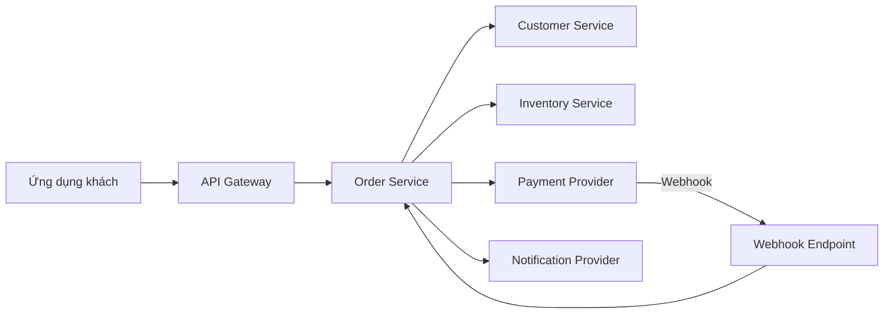
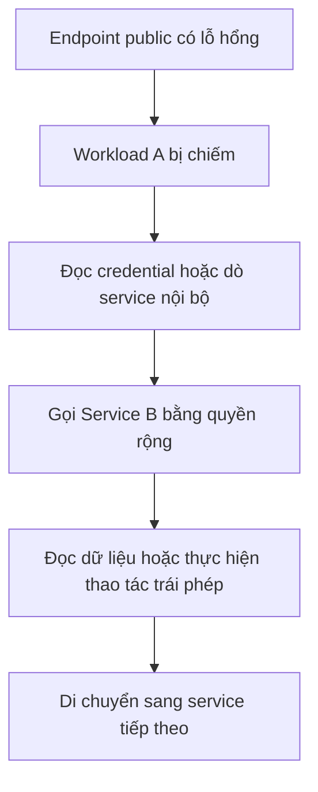
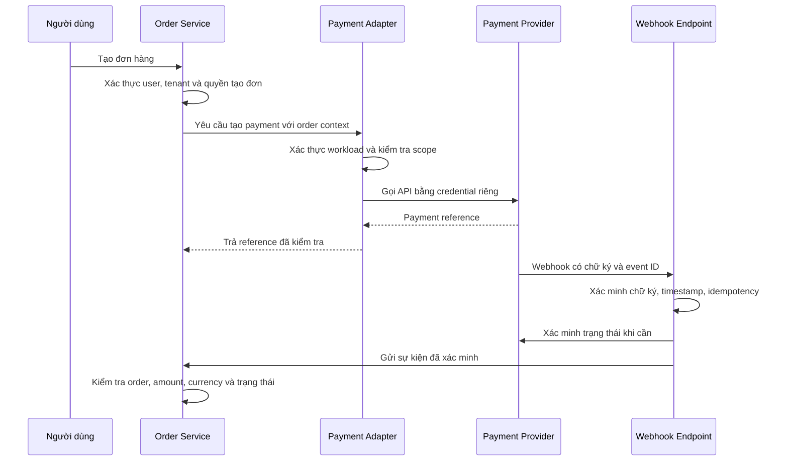

# Service nội bộ và third-party trở thành đường tấn công

Một API có thể được bảo vệ tốt ở cổng public nhưng vẫn bị xâm nhập qua một service nội bộ, một webhook hoặc một nhà cung cấp bên ngoài. Khi hệ thống được chia thành nhiều service, mỗi lời gọi giữa các thành phần tạo thêm một ranh giới tin cậy, một danh tính cần xác thực, một quyền cần kiểm tra và một đường dữ liệu cần kiểm soát.

Trong module `SECURITY_API_SECURITY`, bảo mật API được thiết kế theo từng endpoint, đối tượng dữ liệu và luồng nghiệp vụ. Vì vậy, không thể xem mạng nội bộ là vùng an toàn mặc định, cũng không thể coi một service đã xác thực là được phép thực hiện mọi thao tác. Mỗi service phải xác minh ai đang gọi, lời gọi được thực hiện thay mặt cho ai, dữ liệu nào đang được truy cập và hành động đó có hợp lệ trong ngữ cảnh nghiệp vụ hay không.

## Mục tiêu học tập

Sau bài này, người học có thể:

- Nhận diện service nội bộ, hệ thống third-party, webhook, hàng đợi và nền tảng dùng chung như các thành phần trong bề mặt tấn công API.
- Phân biệt xác thực danh tính service với phân quyền thao tác trên endpoint, tenant và đối tượng dữ liệu.
- Phân tích các đường tấn công như SSRF, leo thang quyền qua service trung gian, giả mạo webhook, lộ credential và cạn kiệt tài nguyên do lời gọi dây chuyền.
- Thiết kế luồng service-to-service và tích hợp bên ngoài theo nguyên tắc least privilege, kiểm tra ở phía nhận và giới hạn tác động khi một thành phần bị xâm phạm.
- Xây dựng kiểm thử và giám sát để phát hiện hành vi bất thường giữa các service và với nhà cung cấp.

## 1. Vì sao service nội bộ và third-party là bề mặt tấn công?

Một hệ thống API thường có nhiều thành phần hơn những gì người dùng nhìn thấy. Ví dụ, một yêu cầu xem đơn hàng có thể đi qua API Gateway, Order Service, Customer Service và Inventory Service. Khi thanh toán hoặc gửi thông báo, hệ thống còn gọi Payment Provider, Email Provider hay một nền tảng phân tích.



Các kết nối này tạo ra nhiều loại ranh giới tin cậy:

| Thành phần | Vì sao có rủi ro | Ví dụ dữ liệu hoặc quyền cần bảo vệ |
|---|---|---|
| Service nội bộ | Có thể được tin cậy quá mức vì nằm trong private network; một service bị chiếm quyền có thể dò tìm và gọi các service khác | Hồ sơ khách hàng, tồn kho, đơn hàng, quyền quản trị |
| API Gateway hoặc backend trung gian | Có thể chuyển tiếp danh tính sai, giữ token quá rộng hoặc biến thành confused deputy | Danh tính người dùng, tenant, quyền gọi endpoint |
| Hệ thống third-party | Nằm ngoài quyền kiểm soát trực tiếp; credential, cấu hình, nhân sự hoặc phần mềm của nhà cung cấp có thể bị xâm phạm | Dữ liệu thanh toán, thông tin liên hệ, trạng thái giao dịch |
| Webhook | Là request đi vào từ một hệ thống khác; nguồn gửi có thể bị giả mạo hoặc gửi lại sự kiện cũ | Sự kiện thanh toán, hoàn tiền, giao hàng |
| Message broker và worker | Message có thể bị giả mạo, phát lại, xử lý trùng hoặc tiêu thụ với quyền quá rộng | Lệnh nghiệp vụ, dữ liệu sự kiện, tác vụ nền |
| Service discovery, secrets và control plane | Có thể tiết lộ topology, credential hoặc cho phép thay đổi cấu hình định tuyến | Địa chỉ service, certificate, API key, policy |

Private network chỉ mô tả vị trí kết nối. Nó không chứng minh service đang gọi là hợp lệ, người dùng có quyền xem đối tượng hay dữ liệu trả về được phép chuyển sang nhà cung cấp. HTTPS hoặc mTLS bảo vệ kênh truyền và hỗ trợ xác định peer, nhưng không tự quyết định quyền nghiệp vụ.

## 2. Lập threat model cho các kết nối giữa hệ thống

Trước khi chọn giải pháp, hãy vẽ luồng dữ liệu và xác định ranh giới tin cậy. Với mỗi kết nối, trả lời các câu hỏi sau:

1. **Ai gọi?** Người dùng, workload identity của service, nhân viên vận hành, nhà cung cấp hay một webhook?
2. **Gọi thay mặt cho ai?** Service tự thực hiện tác vụ hệ thống hay đang thực hiện yêu cầu của một người dùng và tenant cụ thể?
3. **Gọi endpoint nào và làm hành động gì?** Đọc, tạo, cập nhật, hoàn tiền, xuất dữ liệu hay quản trị?
4. **Đối tượng nào bị tác động?** Đối tượng thuộc tenant nào, ai sở hữu và dữ liệu có mức nhạy cảm ra sao?
5. **Dữ liệu đi đâu?** Có được gửi sang third-party, ghi vào log, đưa vào message broker hoặc lưu ở vùng khác không?
6. **Nếu thành phần bị xâm phạm thì phạm vi ảnh hưởng là gì?** Kẻ tấn công có thể dùng credential đó gọi những service nào, đọc bao nhiêu dữ liệu hoặc tiêu thụ bao nhiêu tài nguyên?

Một threat model hữu ích ghi nhận tối thiểu các tài sản, danh tính, ranh giới tin cậy, đường dữ liệu, quyền được cấp và biện pháp phát hiện. Không nên chỉ liệt kê tên service; cần ghi rõ hành động và dữ liệu được phép đi qua từng kết nối.

### Danh tính cần được phân biệt

Trong một request liên service, có thể đồng thời tồn tại ba ngữ cảnh:

- **Danh tính workload:** service nào đang mở kết nối, ví dụ `order-service`.
- **Danh tính người dùng:** người đã khởi tạo nghiệp vụ, nếu request bắt nguồn từ người dùng.
- **Ngữ cảnh tenant và đối tượng:** request đang hoạt động trong tenant nào và nhắm tới đơn hàng, tài khoản hoặc tài nguyên nào.

Không gộp ba ngữ cảnh thành một header tùy ý như `X-User-Id` hoặc `X-Tenant-Id` rồi tin tưởng giá trị đó. Header do client kiểm soát có thể bị giả mạo. Service nhận phải lấy danh tính workload từ cơ chế xác thực đã thiết lập, lấy ngữ cảnh người dùng từ token hoặc cơ chế delegation đã được xác minh, rồi kiểm tra tenant và quyền trên đối tượng thực tế.

## 3. Các kịch bản tấn công thường gặp

### 3.1. Chiếm một service rồi di chuyển ngang

Giả sử một endpoint public có lỗi injection hoặc xử lý file không an toàn. Kẻ tấn công chiếm được một workload. Nếu mọi service trong private network đều có thể gọi nhau và cùng dùng một credential quyền rộng, workload bị chiếm có thể tiếp tục dò service discovery, gọi API quản trị, đọc dữ liệu hoặc tạo tài khoản dịch vụ mới.

Đường tấn công có thể diễn ra như sau:



Nguyên nhân thường là tin cậy dựa trên vị trí mạng, dùng chung service account, quyền gọi giữa các service quá rộng và thiếu kiểm tra quyền tại service nhận. Network segmentation giúp giảm đường đi nhưng không thay thế xác thực và phân quyền ở từng API.

**Cách giảm rủi ro:** cấp danh tính riêng cho từng workload; chỉ cho phép các cặp caller-callee cần thiết; dùng credential ngắn hạn; xác minh danh tính tại service nhận; giới hạn scope theo hành động; giới hạn egress; giám sát các quan hệ gọi service mới xuất hiện.

### 3.2. Service trung gian trở thành confused deputy

Một backend có quyền đọc tất cả đơn hàng gọi Order Service để phục vụ người dùng. Nếu backend chỉ truyền `orderId` mà không chuyển tiếp hoặc xác minh ngữ cảnh người dùng, Order Service có thể chỉ thấy một service account hợp lệ và trả về bất kỳ đơn hàng nào. Kẻ tấn công thay `orderId` trong request để đọc đơn hàng của tenant khác.

Đây là lỗi phân quyền mức đối tượng (BOLA/IDOR) xuất hiện qua ranh giới service. Service trung gian có quyền hợp lệ, nhưng đang dùng quyền của chính nó để thực hiện yêu cầu không được người dùng cho phép.

**Cách giảm rủi ro:** Order Service phải kiểm tra quyền trên từng đối tượng. Chính sách có thể yêu cầu đồng thời workload được phép gọi endpoint, người dùng được phép thực hiện hành động và đối tượng thuộc tenant mà người dùng có quyền truy cập. Nếu tác vụ thực sự là tác vụ nền do hệ thống khởi tạo, hãy dùng principal hệ thống riêng và scope chuyên biệt, không giả làm người dùng.

### 3.3. SSRF đi vào mạng nội bộ

Một API cho phép người dùng cung cấp URL để tải ảnh, kiểm tra webhook hoặc lấy dữ liệu từ đối tác. Nếu backend gọi URL đó trực tiếp, attacker có thể hướng request tới địa chỉ loopback, private network, link-local, cổng quản trị hoặc dịch vụ metadata của hạ tầng cloud. Kết quả là một endpoint public trở thành cầu nối tới tài nguyên nội bộ.

Ví dụ về thiết kế dễ bị lạm dụng:

```text
POST /image/import
{
  "url": "https://host-do-nguoi-dung-kiem-soat.example/image.png"
}
```

Ngay cả khi kiểm tra chuỗi URL ban đầu, hệ thống vẫn có thể bị vượt qua kiểm tra qua DNS rebinding, địa chỉ IPv6, redirect sang host khác, cách chuẩn hóa URL khác nhau hoặc proxy có quyền truy cập rộng.

**Cách giảm rủi ro:** ưu tiên chọn đối tác từ danh sách định danh cấu hình sẵn thay vì nhận URL tùy ý; chỉ cho phép scheme và port cần thiết; phân giải DNS và kiểm tra tất cả địa chỉ IPv4/IPv6; chặn loopback, private, link-local, multicast và địa chỉ dành riêng; kiểm tra lại sau redirect hoặc tắt redirect; giới hạn thời gian, kích thước response và số lần redirect; thực thi egress policy ở tầng mạng hoặc proxy. Với các lời gọi nội bộ, dùng client được cấu hình sẵn theo service name thay vì để người dùng điều khiển đích đến.

### 3.4. Giả mạo hoặc phát lại webhook

Webhook là API inbound từ nhà cung cấp. Nếu endpoint chỉ kiểm tra một trường như `status=paid`, bất kỳ ai biết URL đều có thể gửi request giả để đánh dấu đơn hàng đã thanh toán. Ngay cả request có chữ ký hợp lệ cũng có thể bị phát lại nếu không có timestamp, nonce hoặc cơ chế chống xử lý trùng.

**Cách giảm rủi ro:** xác minh chữ ký trên raw request body theo đúng đặc tả của nhà cung cấp; so sánh chữ ký theo cách constant-time; kiểm tra timestamp trong cửa sổ thời gian cho phép; dùng event ID hoặc idempotency key để chống phát lại; xác minh trạng thái giao dịch với API của nhà cung cấp trước khi thực hiện hành động có hậu quả tài chính; xử lý webhook bất đồng bộ và lưu dấu vết sự kiện. Không tin địa chỉ IP nguồn như cơ chế xác thực duy nhất.

### 3.5. Lộ hoặc sử dụng sai credential của third-party

API key của nhà cung cấp có thể bị lộ qua source code, log, image container, file cấu hình, ticket hỗ trợ hoặc máy của nhà phát triển. Nếu một key dùng chung cho nhiều môi trường và có quyền quản trị, việc lộ key có thể gây rò rỉ dữ liệu diện rộng.

**Cách giảm rủi ro:** lưu secret trong secret manager; cấp key riêng theo ứng dụng, môi trường và nhà cung cấp; giới hạn quyền, IP hoặc resource nếu nhà cung cấp hỗ trợ; đặt lịch xoay vòng và thu hồi; tránh đưa secret vào URL; che dữ liệu nhạy cảm trong log; theo dõi lần sử dụng key bất thường. Khi nghi ngờ lộ key, cần thu hồi hoặc xoay vòng credential và rà soát hoạt động phát sinh trong khoảng thời gian bị ảnh hưởng.

### 3.6. Token có audience hoặc scope không phù hợp

Một access token được phát hành cho `order-service` nhưng lại được `admin-service` chấp nhận là dấu hiệu kiểm tra audience chưa chặt. Tương tự, token chỉ cần quyền đọc tồn kho nhưng chứa scope quản trị có thể bị lạm dụng khi một service bị chiếm.

**Cách giảm rủi ro:** xác minh chữ ký, issuer, audience, thời hạn, thuật toán và các claim bắt buộc; từ chối token sai audience hoặc hết hạn; cấp scope tối thiểu theo service và hành động; xoay vòng signing key theo quy trình; không tự giải mã JWT rồi tin claim khi chưa xác minh chữ ký. Token của người dùng và token của workload cần có mục đích, audience và policy rõ ràng.

### 3.7. Cạn kiệt tài nguyên qua lời gọi dây chuyền

Một request tới API Gateway có thể tạo nhiều lời gọi tới các service và nhà cung cấp. Nếu mỗi tầng tự retry, một lỗi chậm ở third-party có thể nhân số request lên nhiều lần, làm đầy connection pool, thread, queue hoặc quota của đối tác. Kẻ tấn công có thể chủ động kích hoạt luồng tốn kém này.

**Cách giảm rủi ro:** đặt timeout và deadline tổng cho toàn luồng; giới hạn concurrency, fan-out, kích thước payload và số trang; dùng quota theo người dùng, tenant và workload; retry có giới hạn với exponential backoff và jitter; chỉ retry thao tác an toàn hoặc có idempotency; dùng circuit breaker và bulkhead; trả lỗi có kiểm soát khi phụ thuộc bên ngoài không sẵn sàng.

## 4. Nguyên tắc thiết kế bảo vệ service-to-service

### 4.1. Xác thực danh tính workload ở phía nhận

Mỗi workload nên có danh tính riêng, có thể được cấp qua nền tảng workload identity, certificate ngắn hạn hoặc token dịch vụ. mTLS giúp hai phía xác minh danh tính certificate và mã hóa kênh truyền. Khi dùng OAuth 2.0 client credentials hoặc token exchange, token phải có issuer, audience, thời hạn và scope phù hợp.

Service nhận cần kiểm tra tối thiểu:

- Danh tính caller có được phép gọi service này không?
- Token hoặc certificate có hợp lệ, còn hạn và được cấp bởi issuer tin cậy không?
- Audience có đúng service nhận không?
- Scope hoặc quyền có bao gồm endpoint và hành động hiện tại không?
- Credential có bị thu hồi hoặc vi phạm policy hiện hành không?

Không dùng một API key tĩnh duy nhất cho toàn bộ service. Không coi mTLS thành công là bằng chứng người gọi được quyền đọc mọi tài nguyên. Xác thực kênh truyền và phân quyền nghiệp vụ là hai bước riêng.

### 4.2. Phân quyền ở từng endpoint và từng đối tượng

Service nhận phải là nơi thực thi quyết định cuối cùng đối với dữ liệu mà nó sở hữu. Ví dụ, Order Service cần kiểm tra quyền `order:read` và quan hệ giữa principal với đơn hàng được yêu cầu. API Gateway có thể lọc request sớm, nhưng không nên là lớp duy nhất quyết định quyền truy cập đối tượng.

Một quyết định truy cập thường cần kết hợp:

| Thành phần | Câu hỏi kiểm tra |
|---|---|
| Workload principal | Service gọi có được phép sử dụng endpoint này không? |
| User/delegated principal | Người dùng khởi tạo có quyền thực hiện hành động không? |
| Tenant | Đối tượng có thuộc tenant đang được xác thực không? |
| Resource | Người dùng có quan hệ sở hữu, vai trò hoặc quyền chia sẻ phù hợp với đối tượng không? |
| Action | Hành động đọc, sửa, xóa, thanh toán hay quản trị có được cho phép không? |
| Context | Trạng thái nghiệp vụ, thời điểm và điều kiện bổ sung có cho phép hành động không? |

Ví dụ pseudocode cho thao tác đọc đơn hàng:

```text
function getOrder(request, orderId):
    workload = authenticateWorkload(request)
    require(workload.canCall("orders.read"))

    user = validateDelegatedUserContext(request)
    order = orderRepository.find(orderId)
    require(order exists)
    require(user.tenantId == order.tenantId)
    require(policy.allows(user, "order:read", order))

    return minimizeResponseFields(order, user)
```

Đây là pseudocode mô tả thứ tự kiểm tra, không phải một thư viện xác thực hoàn chỉnh. Trong triển khai thực tế, cần xử lý nhất quán trường hợp thiếu principal, token sai định dạng, đối tượng không tồn tại và lỗi policy; mặc định từ chối khi không thể đưa ra quyết định an toàn.

### 4.3. Truyền ngữ cảnh người dùng có kiểm soát

Nếu một service gọi service khác thay mặt cho người dùng, cần chọn rõ mô hình:

- **Delegation/token exchange:** service nhận token giới hạn audience và scope cho service đích, có thể truy vết được người dùng gốc.
- **Context đã ký:** chỉ dùng khi các service có quy ước xác minh chữ ký, issuer, thời hạn và nguồn phát hành đáng tin cậy.
- **System principal:** dùng cho tác vụ nền thật sự thuộc hệ thống, với quyền riêng và phạm vi hẹp.

Không chuyển tiếp access token của người dùng tới mọi service một cách mặc định. Điều đó có thể làm lộ token cho thành phần không cần biết và mở rộng audience ngoài dự kiến. Cũng không dùng header do client gửi làm bằng chứng delegation. Hãy xóa hoặc ghi đè các header định danh không đáng tin ở ranh giới public trước khi tạo context nội bộ.

### 4.4. Giới hạn kết nối và quyền của service

Áp dụng allowlist caller-callee, network policy và egress control để giới hạn đường đi. Một service chỉ nên truy cập những endpoint, cổng và host cần thiết cho nhiệm vụ. Tách tài khoản, secret và quyền theo môi trường; tránh dùng chung danh tính giữa production, staging và development. Service discovery phải được bảo vệ bằng xác thực và quyền đọc phù hợp, đồng thời thay đổi cấu hình định tuyến cần được kiểm soát và ghi nhận.

Network segmentation là lớp giảm thiểu tác động. Mỗi API vẫn cần xác thực và phân quyền độc lập vì một workload hợp lệ có thể bị chiếm quyền.

## 5. Bảo vệ tích hợp third-party và webhook

### 5.1. Kiểm soát dữ liệu gửi ra ngoài

Trước khi gửi dữ liệu tới nhà cung cấp, xác định mục đích nghiệp vụ, trường dữ liệu bắt buộc, thời gian lưu giữ và điều kiện chia sẻ. Chỉ gửi dữ liệu tối thiểu; loại bỏ token, secret, thông tin định danh hoặc dữ liệu nhạy cảm không cần thiết. Mã hóa khi truyền, xác minh chứng thư TLS và quản lý credential theo từng tích hợp.

Với outbound HTTP, nên dùng adapter riêng cho từng nhà cung cấp. Adapter chịu trách nhiệm cố định base URL, xác thực, timeout, giới hạn response, kiểm tra schema và ánh xạ lỗi. Không ghép URL từ dữ liệu không tin cậy rồi gửi bằng quyền mạng của backend. Nếu nghiệp vụ cần URL do người dùng cung cấp, xử lý theo quy trình chống SSRF ở mục 3.3.

### 5.2. Xác minh webhook an toàn

Một luồng webhook nên thực hiện theo thứ tự:

1. Giới hạn kích thước request và chỉ nhận method, content type cần thiết.
2. Đọc raw body đúng một lần theo cách tương thích với đặc tả chữ ký của nhà cung cấp.
3. Xác minh chữ ký và timestamp trước khi tin bất kỳ trường nghiệp vụ nào.
4. Kiểm tra event ID chưa được xử lý; ghi nhận idempotency để chống gửi trùng.
5. Kiểm tra trạng thái giao dịch hoặc resource với API nhà cung cấp khi nghiệp vụ yêu cầu bằng chứng độc lập.
6. Đưa sự kiện hợp lệ vào hàng đợi hoặc xử lý trong transaction phù hợp; cập nhật trạng thái có kiểm soát.
7. Ghi log mã sự kiện và kết quả xử lý, không ghi secret hoặc toàn bộ payload nhạy cảm.

Chữ ký hợp lệ chứng minh request được tạo bằng khóa mà hệ thống tin cậy, nhưng không tự chứng minh trạng thái nghiệp vụ vẫn còn đúng tại thời điểm xử lý. Vì vậy, với thanh toán, hoàn tiền hoặc cấp quyền, cần kiểm tra trạng thái và tính nhất quán của giao dịch trước khi hoàn tất.

### 5.3. Quản lý vòng đời credential

Mỗi tích hợp cần có chủ sở hữu, mục đích, danh sách quyền, nơi lưu secret, thời hạn, lịch xoay vòng và quy trình thu hồi. Tạo credential riêng cho từng môi trường và từng ứng dụng. Hạn chế người và service có thể đọc secret. Khi xoay vòng, hỗ trợ giai đoạn chuyển tiếp có kiểm soát nếu nhà cung cấp cho phép, sau đó thu hồi key cũ và xác minh key mới hoạt động.

## 6. Kiểm soát độ tin cậy và khả năng chịu lỗi

Service nội bộ và nhà cung cấp đều có thể lỗi, chậm hoặc trả dữ liệu sai định dạng. Các biện pháp sau giúp giới hạn tác động:

| Kiểm soát | Mục đích | Điểm cần chú ý |
|---|---|---|
| Timeout/deadline | Không để request chờ vô hạn | Truyền deadline tổng xuống các tầng; không để mỗi tầng tự đặt timeout dài hơn toàn luồng |
| Quota/rate limit | Giới hạn tốc độ theo principal, tenant và tích hợp | Bảo vệ cả API public lẫn endpoint nội bộ có thể bị gọi dây chuyền |
| Retry có giới hạn | Phục hồi lỗi tạm thời | Dùng backoff và jitter; tránh retry thao tác không idempotent |
| Idempotency | Ngăn tạo tác động trùng khi request được gửi lại | Lưu key cùng kết quả hoặc trạng thái xử lý trong phạm vi nghiệp vụ phù hợp |
| Circuit breaker | Ngừng tạm thời lời gọi tới phụ thuộc đang lỗi | Xác định rõ hành vi fallback và thời điểm thử phục hồi |
| Bulkhead/concurrency limit | Ngăn một phụ thuộc chiếm hết tài nguyên | Tách pool hoặc giới hạn đồng thời theo từng tích hợp |
| Giới hạn payload và response | Chặn dữ liệu quá lớn hoặc bất thường | Kiểm tra kích thước trước khi parse sâu; giới hạn số bản ghi và độ sâu cấu trúc |
| Schema validation | Phát hiện dữ liệu không đúng hợp đồng | Kiểm tra cả kiểu, miền giá trị và quan hệ nghiệp vụ; không chỉ kiểm tra JSON hợp lệ |

Không nên tự động fallback sang quyền rộng hơn hoặc bỏ qua kiểm tra phân quyền khi service phụ thuộc gặp lỗi. Nếu không xác minh được danh tính hoặc quyền, request phải bị từ chối an toàn.

## 7. Kiểm thử bảo mật cho luồng liên service

Kiểm thử cần bao phủ cả đường gọi bình thường và trường hợp một thành phần đã bị xâm phạm. Có thể dùng danh sách sau làm cơ sở cho integration test, contract test và security test:

| Nhóm kiểm thử | Tình huống cần xác minh | Kết quả mong đợi |
|---|---|---|
| Workload identity | Service không nằm trong allowlist gọi endpoint nội bộ | Bị từ chối và có log nhận diện caller |
| Token validation | Token hết hạn, sai issuer, sai audience, sai chữ ký hoặc thiếu scope | Bị từ chối ở service nhận |
| Delegation | Người dùng tenant A yêu cầu dữ liệu thuộc tenant B qua backend trung gian | Không trả dữ liệu của tenant B |
| Object authorization | Thay `orderId`, `accountId` hoặc resource ID sang đối tượng khác | Quyền được kiểm tra trên đối tượng đích; không dựa vào việc đã đăng nhập |
| SSRF | URL trỏ tới loopback, private, link-local, IPv6 nội bộ, redirect hoặc DNS thay đổi | Request bị chặn theo policy; không truy cập được tài nguyên bị cấm |
| Webhook | Chữ ký sai, timestamp cũ, event ID trùng, payload bị sửa | Không thực hiện tác động nghiệp vụ; sự kiện hợp lệ được xử lý idempotent |
| Credential | Key bị thu hồi hoặc thiếu quyền tại nhà cung cấp | Tích hợp thất bại có kiểm soát; không lộ secret trong log |
| Resilience | Third-party chậm, timeout, trả response quá lớn hoặc lỗi liên tục | Timeout, quota, circuit breaker và giới hạn tài nguyên hoạt động đúng |
| Message processing | Message giả mạo, sai schema, phát lại hoặc xử lý đồng thời | Xác minh nguồn, schema và idempotency; không tạo tác động trùng |
| Logging | Request chứa token, API key hoặc dữ liệu nhạy cảm | Log đã che hoặc loại bỏ dữ liệu nhạy cảm |

Nên có kiểm thử âm tính cho từng ranh giới tin cậy. Một test chỉ chứng minh request hợp lệ chạy thành công chưa đủ để chứng minh API an toàn.

## 8. Giám sát và phản ứng khi có dấu hiệu xâm nhập

Log và trace liên service cần giúp trả lời được caller nào gọi callee nào, bằng workload identity nào, thay mặt cho user hoặc tenant nào, tới endpoint nào, kết quả ra sao và mất bao lâu. Dùng correlation ID hoặc trace ID xuyên suốt request để liên kết sự kiện; không dùng ID này thay cho cơ chế xác thực.

Các tín hiệu cần theo dõi gồm:

- Một service lần đầu gọi tới service hoặc endpoint nhạy cảm.
- Tăng đột biến request bị từ chối, token sai audience hoặc scope không hợp lệ.
- Một workload truy cập tenant, loại dữ liệu hoặc khung giờ khác với hành vi thông thường.
- Outbound connection tới host, port hoặc vùng mạng không nằm trong policy.
- Tăng lỗi xác thực với third-party, webhook lặp lại, event ID trùng hoặc chữ ký không hợp lệ.
- Tăng retry, timeout, queue lag, concurrency hoặc mức sử dụng quota bất thường.
- Credential được sử dụng từ môi trường hoặc vị trí không dự kiến.

Log cần có đủ ngữ cảnh để điều tra nhưng phải che access token, API key, secret, dữ liệu thanh toán và thông tin cá nhân. Giới hạn quyền đọc log và thời gian lưu theo chính sách dữ liệu.

Khi nghi ngờ một service hoặc credential bị xâm phạm, quy trình phản ứng nên xác định workload và credential liên quan, giới hạn hoặc cô lập đường gọi, thu hồi/đổi credential, kiểm tra các service và dữ liệu có thể đã bị truy cập, rà soát message hoặc webhook bị phát lại, rồi khôi phục quyền theo allowlist tối thiểu. Ghi lại timeline và cập nhật threat model sau sự cố.

## 9. Ví dụ thiết kế: Order Service gọi Payment Provider

Giả sử người dùng tạo đơn hàng. Order Service cần yêu cầu Payment Adapter tạo giao dịch, sau đó nhận webhook báo kết quả.



Các điểm kiểm soát chính:

1. Order Service xác thực người dùng, tenant và quyền tạo đơn trước khi khởi tạo giao dịch.
2. Payment Adapter có workload identity riêng và chỉ được gọi các thao tác cần thiết của Order Service; credential của nhà cung cấp chỉ được adapter truy cập.
3. Adapter cố định endpoint của nhà cung cấp, kiểm tra schema response, timeout và giới hạn kích thước dữ liệu.
4. Webhook được xác minh độc lập. Không cập nhật đơn hàng chỉ vì payload có `status=success`.
5. Khi cập nhật trạng thái, Order Service kiểm tra payment reference gắn với đúng đơn hàng, số tiền, loại tiền và trạng thái hiện tại; sự kiện trùng không tạo tác động lần hai.
6. Log dùng event ID và correlation ID để truy vết, đồng thời che credential và dữ liệu thanh toán.

Ví dụ này cho thấy tích hợp an toàn cần phối hợp xác thực workload, phân quyền nghiệp vụ, xác minh dữ liệu, chống phát lại và kiểm soát tài nguyên. Chỉ mã hóa kết nối tới nhà cung cấp là chưa đủ.

## 10. Checklist rà soát

- [ ] Đã vẽ các luồng gọi giữa public API, service nội bộ, message broker, webhook và third-party.
- [ ] Mỗi workload có danh tính riêng; credential có thời hạn, phạm vi và quy trình thu hồi.
- [ ] Service nhận xác minh issuer, audience, thời hạn và scope của token hoặc danh tính workload.
- [ ] Quyền được kiểm tra tại endpoint và trên từng đối tượng, tenant, hành động nghiệp vụ.
- [ ] Ngữ cảnh người dùng được delegation có kiểm soát; không tin header do client tự gửi.
- [ ] Network policy và egress policy chỉ mở các kết nối cần thiết.
- [ ] URL và đích outbound không do dữ liệu không tin cậy điều khiển nếu chưa qua kiểm tra chống SSRF đầy đủ.
- [ ] Webhook xác minh chữ ký, timestamp và idempotency; nghiệp vụ nhạy cảm xác minh trạng thái giao dịch.
- [ ] Secret được lưu, giới hạn truy cập, xoay vòng và che khỏi log.
- [ ] Timeout, quota, retry, circuit breaker, concurrency và kích thước payload được giới hạn.
- [ ] Có kiểm thử âm tính cho token sai, truy cập chéo tenant, SSRF, webhook giả mạo và retry storm.
- [ ] Log và alert có thể truy vết caller-callee mà không làm lộ dữ liệu nhạy cảm.

## Kết luận

Service nội bộ và third-party là một phần của bề mặt tấn công API vì chúng trao đổi danh tính, quyền và dữ liệu qua nhiều ranh giới tin cậy. Thiết kế an toàn cần xác thực từng workload, phân quyền ở service sở hữu dữ liệu, truyền ngữ cảnh người dùng có kiểm soát, giới hạn kết nối, xác minh webhook và credential, đồng thời đặt giới hạn tài nguyên cho toàn bộ luồng. Khi một service hoặc nhà cung cấp bị xâm phạm, các lớp kiểm soát này giúp ngăn sự cố lan sang dữ liệu và nghiệp vụ khác.
