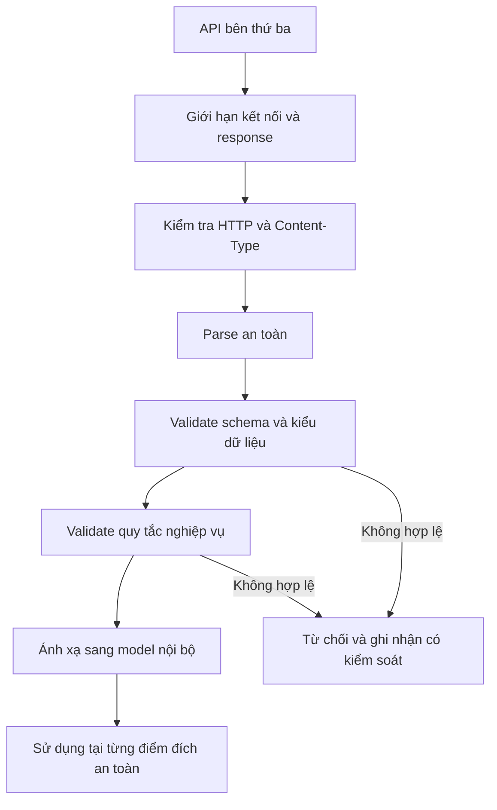

# Response từ bên thứ ba phải được validate như input

Trong chương **Unsafe consumption** của module `SECURITY_API_SECURITY`, một nguyên tắc quan trọng là: mọi dữ liệu đi vào hệ thống đều phải được xem xét tại ranh giới tin cậy, kể cả dữ liệu do một API đối tác trả về. HTTPS bảo vệ kênh truyền và xác thực máy chủ; API key hoặc chữ ký theo hợp đồng có thể xác thực bên gọi hay tính toàn vẹn payload. Tuy nhiên, các cơ chế đó không chứng minh rằng nội dung response luôn đúng cấu trúc, hợp lệ về nghiệp vụ hoặc an toàn khi ứng dụng sử dụng.

Module này thiết kế bảo mật API theo từng endpoint, đối tượng dữ liệu và luồng nghiệp vụ. Vì vậy, việc validate response bên thứ ba cần gắn với mục đích sử dụng cụ thể: dữ liệu nào được phép đi vào đối tượng nội bộ, trạng thái nào được phép làm thay đổi quy trình, và giá trị nào được phép dùng để gọi tiếp một dịch vụ khác.

## Vì sao response bên thứ ba là input không tin cậy?

Một response bên ngoài có thể bị kiểm soát hoặc thay đổi bởi nhiều nguyên nhân:

- Tài khoản, hệ thống hoặc hạ tầng của nhà cung cấp bị xâm nhập.
- API thay đổi schema, trả về dữ liệu thiếu, sai kiểu hoặc không tương thích với phiên bản mà ứng dụng đang dùng.
- Dữ liệu gốc của nhà cung cấp đến từ người dùng cuối. Ví dụ: tên người nhận, địa chỉ giao hàng, nội dung mô tả hoặc URL do người dùng nhập.
- Nhà cung cấp trả về nội dung quá lớn, lồng nhau quá sâu, sai định dạng hoặc chứa giá trị nằm ngoài miền nghiệp vụ.
- Response có trường URL, hostname hoặc redirect khiến ứng dụng gọi tiếp đến một địa chỉ không được phép.
- Một response cũ, bị phát lại hoặc thuộc về giao dịch khác được xử lý như kết quả mới.

Ví dụ, một dịch vụ thanh toán trả về `status: "PAID"`. Nếu ứng dụng chỉ kiểm tra HTTP status là `200` rồi đánh dấu đơn hàng đã thanh toán, kẻ tấn công có thể lợi dụng lỗi tích hợp, response giả hoặc dữ liệu không gắn với đúng giao dịch để làm sai lệch trạng thái đơn hàng. Tương tự, một dịch vụ vận chuyển có thể trả về tên người nhận chứa HTML hoặc JavaScript; nếu giao diện hiển thị trực tiếp nội dung đó, dữ liệu từ đối tác có thể trở thành nguồn gây XSS.

**TLS xác thực và bảo vệ kênh truyền; validation kiểm tra nội dung và ý nghĩa của dữ liệu.** Hai lớp này giải quyết các vấn đề khác nhau và cần được sử dụng cùng nhau.

## Xác định ranh giới tin cậy

Hãy coi response là dữ liệu bên ngoài cho đến khi nó vượt qua các bước kiểm tra phù hợp. Luồng xử lý điển hình:



Ranh giới này áp dụng cho cả API mà server chủ động gọi ra ngoài và webhook mà đối tác gửi vào. Với webhook, request đến từ Internet nên còn phải xác minh chữ ký, thời điểm phát sinh và chống phát lại trước khi tin vào nội dung.

## Các lớp validation cần có

### 1. Giới hạn kết nối và tài nguyên trước khi đọc body

Đặt các giới hạn ngay từ lúc tạo HTTP client và gửi request:

- Chỉ gọi scheme HTTPS và hostname nằm trong allowlist cấu hình. Không ghép URL đích trực tiếp từ dữ liệu người dùng hoặc từ một trường response chưa được kiểm tra.
- Xác minh chứng chỉ TLS; không tắt kiểm tra hostname hoặc chấp nhận mọi chứng chỉ để xử lý lỗi kết nối.
- Đặt connect timeout, request timeout và giới hạn số kết nối phù hợp.
- Tắt tự động follow redirect hoặc kiểm tra lại đích của từng redirect theo allowlist. Redirect từ đối tác không được tự động mở quyền truy cập tới host khác.
- Giới hạn kích thước body thực tế khi đọc stream. `Content-Length` chỉ là tín hiệu kiểm tra sớm vì header có thể vắng mặt hoặc không đáng tin; vẫn phải giới hạn số byte đọc được.
- Nếu bật giải nén, giới hạn cả dữ liệu sau giải nén để tránh zip bomb hoặc response nén có tỷ lệ phình lớn.
- Chỉ chấp nhận HTTP status và `Content-Type` mà hợp đồng API quy định. Không parse một trang HTML lỗi như JSON chỉ vì request đã thành công ở tầng HTTP.

Các giới hạn này giúp tránh việc một response độc hại hoặc lỗi cấu hình tiêu thụ quá nhiều bộ nhớ, CPU, thread hay kết nối.

### 2. Parse dữ liệu bằng parser an toàn

Chọn parser đúng với định dạng đã thỏa thuận. Với JSON, giới hạn độ sâu lồng nhau, độ dài chuỗi và độ dài số nếu thư viện hỗ trợ. Không bật cơ chế polymorphic deserialization hoặc default typing một cách rộng rãi; không deserialize Java native object từ dữ liệu bên ngoài.

Nếu tích hợp XML, phải tắt DTD và external entity để ngăn XXE. Nếu xử lý CSV hoặc định dạng văn bản khác, cần xác định encoding, quy tắc escape và giới hạn số dòng/cột. Không tự đoán định dạng từ nội dung rồi chuyển qua nhiều parser khác nhau.

Parse thành DTO dành riêng cho đối tác. Tránh deserialize trực tiếp vào JPA entity, domain object có setter nhạy cảm hoặc object chứa các trường quyền hạn như `role`, `ownerId`, `tenantId`, `isAdmin`. Việc dùng DTO giúp giới hạn rõ dữ liệu nào được phép đi qua ranh giới.

### 3. Validate schema và từng trường dữ liệu

Đối chiếu response với hợp đồng API đã thống nhất. Tùy mức độ ổn định của hợp đồng, kiểm tra:

| Nội dung | Điều cần kiểm tra | Ví dụ |
|---|---|---|
| Trường bắt buộc | Có mặt và không null | `transactionId`, `amount`, `status` |
| Kiểu dữ liệu | Đúng kiểu, không ép kiểu tùy tiện | `amount` phải là số thập phân, không nhận chuỗi tùy ý |
| Độ dài và kích thước | Có giới hạn trên | ID tối đa 64 ký tự, mô tả tối đa 2.000 ký tự |
| Miền giá trị | Nằm trong range hoặc enum cho phép | `status` chỉ nhận các trạng thái đã định nghĩa |
| Định dạng | Đúng quy tắc chuẩn | Mã tiền tệ, timestamp, email hoặc mã định danh |
| Cấu trúc lặp | Giới hạn số phần tử và tính duy nhất khi cần | Một response không chứa hàng triệu item |
| Trường không nhận diện | Xử lý theo chính sách schema | Từ chối nếu hợp đồng đóng; bỏ qua có kiểm soát nếu hợp đồng cho phép mở rộng |

Không nên chỉ kiểm tra trường có tồn tại. Ví dụ `amount: -500`, `quantity: 999999999` hoặc `status: "SUPER_ADMIN"` đều có thể parse thành công nhưng không hợp lệ với ứng dụng.

Chính sách với trường mới cần được quyết định theo hợp đồng. Nếu bật chế độ từ chối mọi trường lạ, thay đổi bổ sung từ nhà cung cấp có thể làm tích hợp ngừng hoạt động; nếu bỏ qua trường lạ, ứng dụng vẫn phải chỉ đọc và ánh xạ những trường đã cho phép. Trong cả hai trường hợp, không được tự động đưa trường lạ vào model nội bộ.

### 4. Validate ngữ nghĩa và quy tắc nghiệp vụ

Schema hợp lệ chưa chắc response thuộc đúng luồng nghiệp vụ. Cần kiểm tra các quan hệ mà schema đơn lẻ không thể biểu đạt:

- ID trong response có khớp với ID giao dịch hoặc tài nguyên đã gửi đi không?
- Đối tác có trả về đúng khách hàng, tenant, đơn hàng hoặc tài khoản đang xử lý không?
- Số tiền, loại tiền, số lượng và phí có nằm trong giới hạn dự kiến không? Với tiền tệ, dùng `BigDecimal` hoặc kiểu số thập phân chính xác thay vì `double`.
- Trạng thái có chuyển tiếp hợp lệ không? Ví dụ đơn hàng đã `CANCELLED` không được chuyển ngược sang `PAID` chỉ vì một response đến muộn.
- Timestamp có nằm trong khoảng thời gian chấp nhận được không? Response có quá cũ hoặc nằm ngoài thời hạn giao dịch không?
- Một response có bị xử lý lặp lại không? Dùng idempotency key hoặc mã sự kiện duy nhất khi nghiệp vụ yêu cầu.

Không dùng một trường `success: true` hoặc HTTP `200` làm bằng chứng duy nhất để thực hiện hành động có tác động tài chính hay thay đổi quyền truy cập. Phải đối chiếu danh tính tài nguyên, trạng thái trước đó và điều kiện chuyển trạng thái.

### 5. Ánh xạ có chọn lọc và bảo vệ tại điểm sử dụng

Sau khi validate, chuyển dữ liệu từ DTO bên ngoài sang model nội bộ bằng cách gán rõ từng trường được phép. Không bind toàn bộ response vào entity hoặc cập nhật hàng loạt thuộc tính theo tên trường. Cách ánh xạ allowlist ngăn đối tác vô tình hoặc cố ý ghi đè các thuộc tính nội bộ như chủ sở hữu, tenant, quyền hạn hay trạng thái kiểm duyệt.

Validation không thay thế biện pháp bảo vệ tại điểm sử dụng. Một chuỗi đã hợp lệ về độ dài vẫn có thể chứa nội dung nguy hiểm trong HTML. Vì vậy:

- Khi hiển thị HTML, encode theo đúng ngữ cảnh hoặc dùng cơ chế render an toàn; không nối chuỗi response vào HTML hay JavaScript.
- Khi truy vấn cơ sở dữ liệu, dùng prepared statement hoặc ORM parameter binding; không ghép chuỗi SQL.
- Khi gọi shell, template engine hoặc hệ thống biểu thức, tránh đưa trực tiếp dữ liệu response vào cú pháp lệnh hoặc biểu thức.
- Khi dùng URL từ response để tải ảnh, gọi callback hoặc lấy trang tiếp theo, kiểm tra scheme, hostname, port, địa chỉ IP và redirect theo chính sách egress. Đây là điểm có thể tạo SSRF.
- Khi lưu log, loại bỏ hoặc che dữ liệu nhạy cảm và giới hạn độ dài trường; không ghi nguyên body có thể chứa token, thông tin cá nhân hoặc payload độc hại.

## Ví dụ Java: đọc response JSON có giới hạn và kiểm tra hợp đồng

Ví dụ sau minh họa một request lấy báo giá từ đối tác. `HttpClient` cần được tạo với connect timeout và không tự follow redirect:

```java
HttpClient client = HttpClient.newBuilder()
    .connectTimeout(Duration.ofSeconds(2))
    .followRedirects(HttpClient.Redirect.NEVER)
    .build();
```

DTO chỉ chứa các trường mà luồng nghiệp vụ cần sử dụng:

```java
record PartnerQuote(
    String quoteId,
    BigDecimal amount,
    String currency,
    String status
) {}
```

Phần gọi API kiểm tra đích, status, content type và giới hạn số byte đọc từ stream. Ví dụ giả định endpoint đối tác đã được cấu hình cố định:

```java
private static final int MAX_BODY_BYTES = 256 * 1024;

static PartnerQuote fetchQuote(
        HttpClient client,
        ObjectMapper mapper,
        URI endpoint,
        String expectedQuoteId
) throws IOException, InterruptedException {
    if (endpoint == null
            || !"https".equalsIgnoreCase(endpoint.getScheme())
            || !"partner.example".equalsIgnoreCase(endpoint.getHost())
            || endpoint.getUserInfo() != null
            || (endpoint.getPort() != -1 && endpoint.getPort() != 443)) {
        throw new IllegalArgumentException("Partner endpoint is not allowed");
    }

    HttpRequest request = HttpRequest.newBuilder(endpoint)
        .timeout(Duration.ofSeconds(3))
        .header("Accept", "application/json")
        .GET()
        .build();

    HttpResponse<InputStream> response = client.send(
        request,
        HttpResponse.BodyHandlers.ofInputStream()
    );

    try (InputStream body = response.body()) {
        if (response.statusCode() != 200) {
            throw new IOException("Partner returned an unexpected HTTP status");
        }

        long contentLength = response.headers()
            .firstValueAsLong("Content-Length")
            .orElse(-1L);
        if (contentLength > MAX_BODY_BYTES) {
            throw new IOException("Partner response is too large");
        }

        String contentType = response.headers()
            .firstValue("Content-Type")
            .orElse("");
        String mediaType = contentType.split(";", 2)[0]
            .trim()
            .toLowerCase(Locale.ROOT);
        if (!mediaType.equals("application/json")
                && !mediaType.endsWith("+json")) {
            throw new IOException("Partner response has an unsupported content type");
        }

        // Giới hạn stream thực tế, kể cả khi Content-Length không có hoặc sai.
        byte[] payload = body.readNBytes(MAX_BODY_BYTES + 1);
        if (payload.length > MAX_BODY_BYTES) {
            throw new IOException("Partner response is too large");
        }

        PartnerQuote quote = mapper.readerFor(PartnerQuote.class)
            .with(DeserializationFeature.FAIL_ON_UNKNOWN_PROPERTIES)
            .readValue(payload);

        validateQuote(quote, expectedQuoteId);
        return quote;
    }
}

private static final BigDecimal MAX_AMOUNT = new BigDecimal("1000000000");
private static final Set<String> ALLOWED_CURRENCIES = Set.of("VND", "USD");
private static final Set<String> ALLOWED_STATUSES = Set.of("AVAILABLE", "UNAVAILABLE");

static void validateQuote(PartnerQuote quote, String expectedQuoteId)
        throws IOException {
    if (quote == null
            || quote.quoteId() == null
            || !quote.quoteId().matches("[A-Za-z0-9_-]{1,64}")) {
        throw new IOException("Partner response has an invalid quote ID");
    }

    if (expectedQuoteId == null || !expectedQuoteId.equals(quote.quoteId())) {
        throw new IOException("Partner response does not match the requested quote");
    }

    if (quote.amount() == null
            || quote.amount().signum() < 0
            || quote.amount().compareTo(MAX_AMOUNT) > 0) {
        throw new IOException("Partner response has an invalid amount");
    }

    if (quote.currency() == null
            || !ALLOWED_CURRENCIES.contains(quote.currency())) {
        throw new IOException("Partner response has an unsupported currency");
    }

    if (quote.status() == null
            || !ALLOWED_STATUSES.contains(quote.status())) {
        throw new IOException("Partner response has an unsupported status");
    }
}
```

Đoạn code là khung minh họa; cần bổ sung import và cấu hình `ObjectMapper` theo phiên bản thư viện đang dùng. Có thể bật `FAIL_ON_UNKNOWN_PROPERTIES` khi hợp đồng là schema đóng. Nếu nhà cung cấp có chính sách thêm trường tương thích ngược, có thể bỏ qua trường lạ nhưng vẫn phải deserialize vào DTO giới hạn và chỉ ánh xạ các trường đã được cho phép. Nên cấu hình thêm giới hạn độ sâu lồng nhau, độ dài chuỗi và độ dài số cho parser.

Giới hạn stream trong ví dụ bảo vệ bộ nhớ khi đọc body; kiểm tra `Content-Length` một mình là không đủ. Khi dùng `BodyHandlers.ofInputStream`, cần bảo đảm deadline đọc body và khả năng hủy request khi quá hạn; không nên mặc định rằng timeout của request đã thay thế mọi giới hạn thời gian đọc stream. Nếu ứng dụng bật giải nén response, cần áp dụng giới hạn trên luồng sau giải nén nữa. Endpoint allowlist trong ví dụ cũng phải được giữ ở cấu hình tin cậy; nếu URL được tạo từ dữ liệu động, cần thêm kiểm tra DNS/IP và chính sách chống SSRF cho từng lần kết nối.

## Riêng với webhook: xác minh nguồn và chống phát lại

Webhook là chiều ngược lại của API outbound: đối tác gửi request vào endpoint của hệ thống. Quy trình an toàn thường gồm:

1. Giới hạn kích thước body và thời gian nhận request.
2. Xác minh chữ ký trên **raw body** bằng secret đã lưu an toàn và thuật toán theo tài liệu nhà cung cấp. So sánh chữ ký theo cách constant-time.
3. Kiểm tra timestamp, nonce hoặc event ID; từ chối sự kiện quá cũ hoặc đã xử lý. Lưu event ID theo cơ chế idempotent để xử lý retry hợp lệ.
4. Sau khi xác minh chữ ký, parse body và thực hiện schema validation cùng business validation như với response API khác.
5. Chỉ cập nhật tài nguyên đúng tenant và đúng giao dịch; không suy ra danh tính người dùng từ một trường payload chưa được ràng buộc với dữ liệu nội bộ.

Chữ ký hợp lệ chứng minh payload được tạo bởi bên giữ secret và không bị sửa sau khi ký; nó không chứng minh payload đúng nghiệp vụ hoặc không bị phát lại. Do đó, chữ ký không thay thế schema validation, kiểm tra trạng thái và idempotency.

## Xử lý lỗi và giám sát

Khi response không hợp lệ, từ chối xử lý và giữ trạng thái nghiệp vụ ở trạng thái an toàn. Không tự chuyển sang kết quả thành công, không dùng dữ liệu một phần và không bỏ qua lỗi validation chỉ để luồng tích hợp tiếp tục chạy.

Phân loại lỗi để vận hành dễ điều tra: lỗi kết nối/timeout, HTTP status ngoài hợp đồng, content type không đúng, body quá lớn, parse thất bại, schema sai và business rule bị vi phạm. Ghi correlation ID, tên đối tác, endpoint logic, phiên bản hợp đồng và mã lỗi; tránh ghi secret, token, thông tin thanh toán hoặc toàn bộ response. Theo dõi tỷ lệ lỗi theo đối tác để phát hiện thay đổi schema hoặc sự cố nhà cung cấp.

Chỉ retry các lỗi có khả năng tạm thời như timeout hoặc một số HTTP 5xx, với số lần và backoff giới hạn. Không retry vô hạn đối với response sai schema hoặc sai nghiệp vụ. Với luồng quan trọng, dùng circuit breaker và cảnh báo khi tỷ lệ response không hợp lệ tăng bất thường.

## Kiểm thử các trường hợp bất thường

Ngoài response thành công, cần có test cho các tình huống sau:

| Tình huống | Kết quả mong đợi |
|---|---|
| Thiếu trường bắt buộc hoặc trường có giá trị `null` | Từ chối response |
| Sai kiểu, số âm, số vượt giới hạn hoặc enum lạ | Từ chối response |
| ID trả về không khớp request | Không cập nhật tài nguyên |
| HTTP status hoặc `Content-Type` ngoài hợp đồng | Không parse body như dữ liệu nghiệp vụ |
| Body vượt giới hạn, JSON lồng quá sâu hoặc chuỗi quá dài | Dừng đọc/parse và ghi nhận lỗi có kiểm soát |
| Trường lạ có tên giống thuộc tính nhạy cảm nội bộ | Không thể ghi đè model hoặc entity |
| Redirect hoặc URL trong response trỏ tới host/IP không được phép | Không thực hiện request tiếp theo |
| Nội dung chứa HTML/JavaScript được hiển thị | Được encode theo ngữ cảnh, không thực thi |
| Webhook sai chữ ký, quá hạn hoặc trùng event ID | Từ chối hoặc bỏ qua theo chính sách idempotency |
| Response hợp lệ về schema nhưng sai trạng thái chuyển tiếp | Không thay đổi trạng thái nghiệp vụ |

Test nên kiểm tra cả kết quả trả về lẫn side effect: database có bị cập nhật không, có phát sinh request tiếp theo không, và log có vô tình chứa dữ liệu nhạy cảm không.

## Checklist trước khi đưa tích hợp vào production

- [ ] Endpoint, TLS, redirect, timeout và giới hạn response đã được cấu hình.
- [ ] Parser an toàn và có giới hạn tài nguyên.
- [ ] DTO bên ngoài tách biệt với entity/domain model nội bộ.
- [ ] Trường bắt buộc, kiểu, độ dài, range, enum và cấu trúc lặp đã được kiểm tra.
- [ ] ID, tenant, số tiền, timestamp và trạng thái đã được đối chiếu với ngữ cảnh request.
- [ ] Chỉ trường được allowlist mới được ánh xạ vào model nội bộ.
- [ ] Dữ liệu được encode hoặc parameterize phù hợp tại từng điểm sử dụng.
- [ ] URL từ response không thể tùy ý điều khiển kết nối outbound.
- [ ] Webhook có xác minh chữ ký, chống replay và xử lý idempotent.
- [ ] Lỗi validation được ghi nhận có kiểm soát và không làm phát sinh side effect ngoài ý muốn.

Response từ đối tác là một đầu vào qua ranh giới tin cậy. Hệ thống chỉ nên sử dụng dữ liệu sau khi đã kiểm tra giới hạn tài nguyên, định dạng, schema, ngữ nghĩa nghiệp vụ và điều kiện tại điểm sử dụng. Cách tiếp cận này giúp API an toàn ngay cả khi dịch vụ bên ngoài thay đổi, gặp lỗi hoặc bị xâm nhập.
