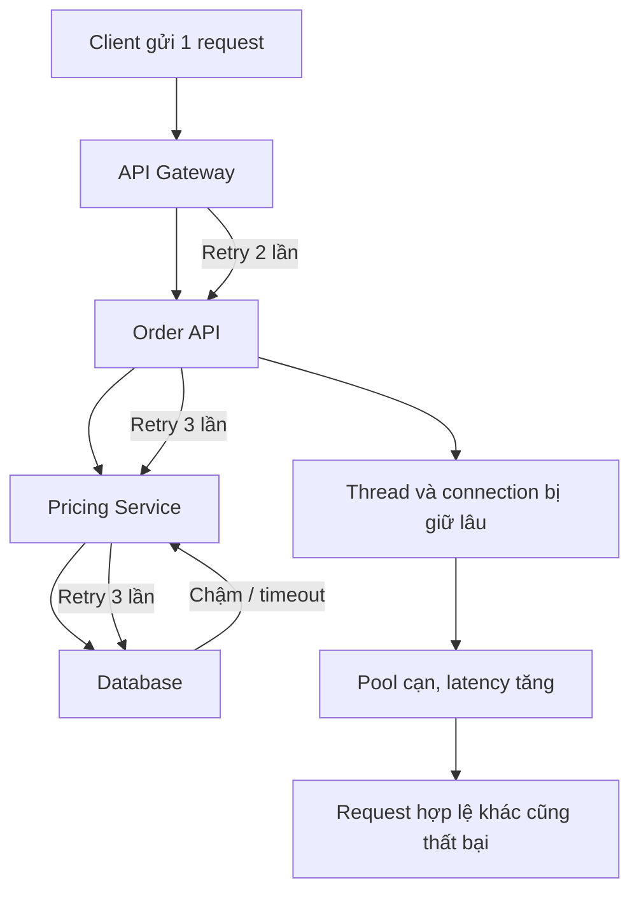
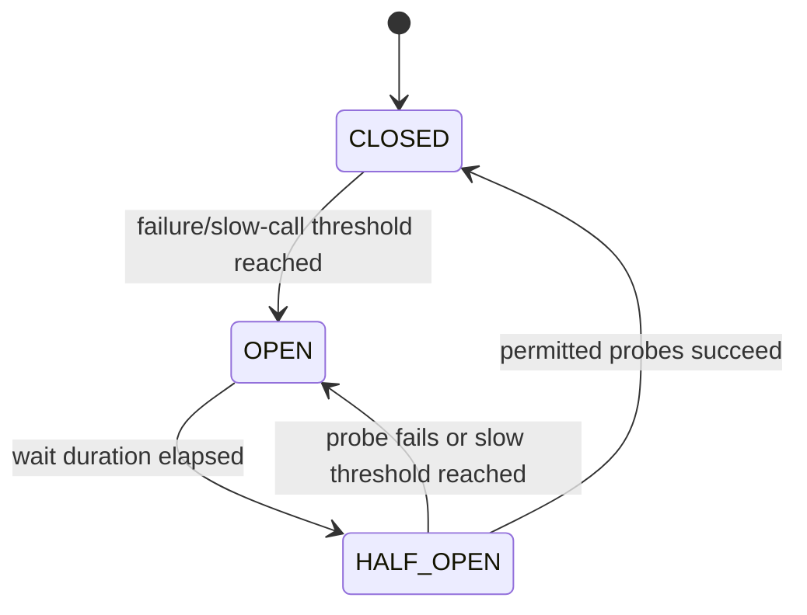

# Timeout, retry và circuit breaker cho dependency

Một API thường không xử lý request một mình. Service có thể gọi database, search engine, payment provider, identity service, object storage hoặc nhiều microservice khác. Khi một dependency chậm hoặc ngừng phản hồi, request đang chờ có thể giữ thread, connection, memory và slot xử lý. Nếu client hoặc các service phía trên tiếp tục retry không giới hạn, một sự cố cục bộ có thể lan thành sự cố toàn hệ thống.

Timeout, retry và circuit breaker là ba cơ chế phối hợp để giới hạn tác động đó:

- **Timeout** giới hạn thời gian một thao tác được phép chờ.
- **Retry** thử lại một thao tác thất bại tạm thời khi việc thử lại an toàn và còn thời gian/ngân sách.
- **Circuit breaker** tạm ngừng gọi dependency đang có dấu hiệu lỗi để tránh tiếp tục tạo tải lên hệ thống đã suy giảm.

Trong API Security, các cơ chế này cũng giúp chống *resource exhaustion* và retry amplification. Một endpoint có authentication hợp lệ vẫn có thể làm cạn tài nguyên nếu dependency bị gọi quá lâu, retry chồng lớp hoặc fallback thực hiện thêm công việc không giới hạn. Cấu hình phải dựa trên luồng nghiệp vụ, mức độ quan trọng của dữ liệu và khả năng chịu lỗi của từng dependency.

## 1. Vì sao một dependency chậm có thể làm sập cả API?

Giả sử endpoint `GET /api/orders/{id}` gọi Order Service, Inventory Service và Pricing Service. Nếu mỗi request giữ một thread trong 10 giây để chờ Pricing Service, lượng request đồng thời sẽ tăng nhanh. Thread pool hoặc connection pool có thể cạn trước khi service trả được response.

Một tình huống nguy hiểm hơn xảy ra khi nhiều tầng cùng retry:



Nếu mỗi tầng có thể thực hiện nhiều lần thử, tổng số lời gọi xuống dependency tăng theo tích số lần thử của các tầng. Ví dụ gateway thử 2 lần, service thử 3 lần và SDK thử 3 lần có thể tạo tới 18 lần gọi cho một request logic. Đây là *retry amplification*.

Hậu quả thường gặp:

- Thread, connection pool hoặc worker bị giữ quá lâu.
- Request mới xếp hàng và làm tăng latency p95/p99.
- Retry đồng loạt tạo burst mới khi dependency vừa phục hồi.
- Provider tính phí theo request tiếp tục nhận các lần gọi trùng.
- Client timeout nhưng server vẫn chạy công việc và tạo side effect.
- Một tenant hoặc endpoint đắt chiếm capacity của các chức năng khác.

Không nên chờ tới khi dependency hoàn toàn ngừng hoạt động mới bảo vệ service. Timeout, giới hạn concurrency và circuit breaker cần được thiết kế trước khi có sự cố.

## 2. Timeout phải được đặt ở nhiều lớp

Một HTTP call không chỉ có một khoảng thời gian chờ. Tùy client và giao thức, thời gian có thể gồm:

| Loại timeout | Giới hạn điều gì? | Ví dụ |
|---|---|---|
| Connection-pool acquire timeout | Thời gian chờ lấy connection có sẵn | Chờ tối đa 100 ms để lấy connection từ pool |
| DNS timeout | Thời gian phân giải hostname | Không chờ DNS vô hạn |
| Connect timeout | Thời gian thiết lập TCP connection | Kết nối tới provider trong tối đa 500 ms |
| TLS handshake timeout | Thời gian hoàn tất bắt tay TLS | Tránh giữ socket khi handshake bị treo |
| Response/read timeout | Thời gian chờ dữ liệu phản hồi hoặc giữa các lần đọc, tùy client | Chờ response header/body tối đa theo policy |
| Request/operation timeout | Tổng thời gian cho một lần gọi API | Một dependency call không vượt 2 giây |
| End-to-end deadline | Tổng ngân sách thời gian từ đầu request đến khi hoàn tất | Request API phải kết thúc trong 3 giây |

Tên và ngữ nghĩa timeout khác nhau giữa HTTP client. Cần đọc tài liệu của thư viện đang dùng để biết timeout áp dụng cho connection, lần đọc hay toàn bộ response. Đặt `read timeout` không nhất thiết giới hạn tổng thời gian của một response streaming dài.

### End-to-end deadline quan trọng hơn timeout riêng lẻ

Giả sử API có deadline 3 giây và cần gọi ba dependency tuần tự. Nếu mỗi dependency được phép chờ 3 giây, tổng request có thể kéo dài 9 giây hoặc hơn. Thay vào đó, mỗi lần gọi phải sử dụng phần ngân sách còn lại:

```text
Request deadline: 3,000 ms

Authentication + authorization: 100 ms
Inventory call:                 tối đa 700 ms
Pricing call:                   tối đa 900 ms
Order database work:            tối đa 800 ms
Response/serialization margin:  500 ms
```

Các con số trên chỉ minh họa. Khi bắt đầu một dependency call, tính thời gian còn lại tới deadline và chọn timeout nhỏ hơn giữa policy của dependency với ngân sách còn lại. Không bắt đầu một retry nếu không còn đủ thời gian để thực hiện và trả kết quả.

Deadline cần được truyền giữa các service theo một cơ chế tin cậy. Nếu dùng header nội bộ như `X-Request-Deadline`, gateway phải xóa giá trị do client tự gửi và tạo/giới hạn deadline theo policy của hệ thống. Không để client gửi deadline cực xa nhằm giữ tài nguyên vô thời hạn.

## 3. Chọn timeout theo SLO và đặc tính dependency

Không có một timeout chung phù hợp cho mọi dependency. Một service cache nội bộ thường cần phản hồi nhanh hơn một provider tạo báo cáo. Timeout cần dựa trên latency thực tế, SLO của endpoint và khả năng xử lý khi dependency không sẵn sàng.

Hãy xem xét:

- Latency p50, p95 và p99 của dependency trong điều kiện bình thường và giờ cao điểm.
- SLO end-to-end của endpoint gọi dependency.
- Số dependency được gọi tuần tự hay song song.
- Chi phí của thao tác và khả năng hủy công việc.
- Connection pool, thread pool và giới hạn của provider.
- Thời gian retry dự kiến và khoảng thời gian còn lại cho các bước khác.
- Hành vi khi timeout: request có thể đã được xử lý ở phía remote hay chưa?

Ví dụ, nếu SLO endpoint là 2 giây, không thể đặt timeout 5 giây cho một dependency bắt buộc rồi kỳ vọng endpoint luôn đáp ứng SLO. Có thể cần giảm timeout, xử lý bất đồng bộ, cache dữ liệu phù hợp hoặc thay đổi luồng nghiệp vụ.

Timeout quá ngắn gây lỗi giả khi hệ thống chỉ chậm nhất thời. Timeout quá dài giữ tài nguyên và làm sự cố lan rộng. Hãy đo, đặt ngưỡng, rollout có quan sát và điều chỉnh dựa trên số liệu.

## 4. Timeout không có nghĩa là remote operation đã dừng

Khi caller timeout, nó chỉ biết rằng không nhận được kết quả trong thời hạn. Server phía bên kia có thể vẫn tiếp tục xử lý. Với thao tác ghi, điều này đặc biệt quan trọng.

Ví dụ:

1. Order API gửi yêu cầu tạo payment.
2. Payment Provider nhận và tạo giao dịch.
3. Response bị chậm trên mạng.
4. Order API hết timeout và báo lỗi.
5. Client gửi lại request tạo payment.

Nếu không có idempotency key, hệ thống có thể tạo hai giao dịch dù caller chỉ nhìn thấy một lần timeout.

Vì vậy:

- Dùng idempotency key cho thao tác tạo giao dịch, tạo job, gửi lệnh hoặc các side effect có thể retry.
- Gắn key với principal/tenant, operation và nội dung request theo hợp đồng.
- Lưu kết quả idempotency bền vững đủ lâu để xử lý retry.
- Khi timeout ở thao tác không idempotent, tra cứu trạng thái hoặc dùng reconciliation trước khi gửi lệnh mới.
- Truyền cancellation tới dependency nếu client library và giao thức hỗ trợ, nhưng không giả định cancellation luôn dừng được remote work.

Timeout là giới hạn chờ của caller; idempotency và trạng thái nghiệp vụ mới kiểm soát được hậu quả khi kết quả chưa rõ.

## 5. Retry chỉ dành cho lỗi tạm thời và thao tác an toàn

Retry có thể cải thiện độ tin cậy khi lỗi chỉ xảy ra ngắn hạn. Nhưng retry mọi exception hoặc mọi status code sẽ tăng tải và có thể lặp side effect.

| Lỗi/kết quả | Chính sách thường dùng |
|---|---|
| DNS tạm thời, connection reset, lỗi kết nối ngắn hạn | Có thể retry giới hạn nếu còn deadline |
| Timeout | Chỉ retry nếu thao tác idempotent hoặc có idempotency key và trạng thái được kiểm soát |
| HTTP `502`, `503`, `504` | Có thể retry với backoff nếu dependency báo lỗi tạm thời |
| HTTP `429` | Tôn trọng `Retry-After` trong giới hạn deadline và retry budget |
| HTTP `400`, `401`, `403`, `404`, `422` | Thông thường không retry; sửa request/quyền hoặc xử lý theo nghiệp vụ |
| Validation/business rule failure | Không retry mù quáng |
| Certificate/hostname verification failure | Không retry để bỏ qua lỗi TLS; xử lý cấu hình hoặc trust issue |
| Circuit open | Không gọi dependency; trả lỗi/fallback theo policy, không retry liên tục |

Một số provider có quy tắc riêng. Ví dụ `404` có thể là eventual consistency trong một API cụ thể, hoặc `409` có thể báo trạng thái đang xử lý. Chỉ retry khi hợp đồng provider xác định rõ lỗi đó là tạm thời và thao tác lặp là an toàn.

Không retry `401`/`403` bằng cách liên tục refresh credential nếu lỗi thực chất là quyền bị thu hồi. Không tắt TLS verification để “khắc phục” lỗi kết nối.

## 6. Exponential backoff và jitter

Retry ngay lập tức khiến nhiều client cùng gặp lỗi sẽ gửi lại request gần như đồng thời. Điều này tạo burst đúng lúc dependency đang yếu.

Exponential backoff tăng thời gian chờ sau mỗi lần thử:

```text
attempt 1: gửi ngay
attempt 2: chờ khoảng 100 ms
attempt 3: chờ khoảng 200 ms
attempt 4: chờ khoảng 400 ms
```

Các giá trị chỉ là ví dụ. Công thức cơ bản:

```text
delay(n) = min(maxDelay, baseDelay * multiplier^(n - 1))
```

Thêm *jitter* để phân tán các lần retry. Một cách phổ biến là full jitter:

```text
actualDelay = random(0, delay(n))
```

Giới hạn đồng thời:

- Số lần thử tối đa, tính rõ lần đầu có được tính vào `maxAttempts` hay không.
- Tổng thời gian retry không vượt deadline.
- Tổng retry budget của service/dependency.
- Số request retry đồng thời.
- Tôn trọng `Retry-After` nhưng không chờ vượt deadline hoặc policy.

Không retry nếu thời gian chờ cộng với timeout của lần thử kế tiếp vượt phần deadline còn lại. Không dùng backoff không giới hạn vì request có thể giữ tài nguyên trong thời gian quá dài.

## 7. Retry amplification và retry budget

Mỗi tầng cần thống nhất ai là nơi sở hữu retry. Nếu SDK, service, gateway và client đều retry độc lập, tổng số lời gọi có thể tăng theo cấp số nhân.

Ví dụ ba tầng, mỗi tầng tối đa 3 lần thử:

```text
Client -> Gateway -> Order API -> Provider

3 x 3 x 3 = tối đa 27 lần gọi provider
```

Một cách giảm rủi ro:

- Chọn một tầng làm nơi retry chính cho mỗi dependency call.
- Các tầng khác chỉ retry khi có lý do rõ và tổng retry budget vẫn được giữ.
- Không retry request đã nhận `429` ngay lập tức.
- Đặt giới hạn retry theo dependency và theo tenant nếu workload có thể bị một tenant chi phối.
- Dùng metric để quan sát tỷ lệ retry so với request gốc.

Retry budget có thể được định nghĩa theo tỷ lệ, ví dụ tổng retry không vượt quá 10% số request gốc trong một cửa sổ, hoặc một số token retry được bổ sung theo thời gian. Khi budget cạn, request mới không được retry nữa dù lỗi có vẻ tạm thời.

Retry budget không phải rate limit cho client. Nó giới hạn phần tải bổ sung do hệ thống tự tạo ra khi dependency suy giảm.

## 8. Circuit breaker bảo vệ dependency như thế nào?

Circuit breaker theo dõi kết quả gọi dependency và chuyển trạng thái khi tỷ lệ lỗi hoặc lời gọi chậm vượt ngưỡng. Khi circuit mở, request mới bị từ chối nhanh mà không tiếp tục gọi dependency.

Ba trạng thái phổ biến:

**CLOSED** — Cho phép request đi qua và ghi nhận kết quả. Nếu lỗi/slow-call vượt ngưỡng, chuyển sang OPEN.

**OPEN** — Chặn lời gọi tới dependency trong một khoảng thời gian. Sau thời gian chờ, chuyển sang HALF_OPEN.

**HALF_OPEN** — Cho phép một số ít probe request để kiểm tra phục hồi. Nếu thành công đủ điều kiện, đóng circuit; nếu thất bại, mở lại.



Circuit breaker không sửa dependency và không bảo đảm request sẽ thành công. Nó ngăn service tiếp tục dồn tải vào dependency đang lỗi, giúp phần còn lại của hệ thống có cơ hội duy trì hoạt động.

## 9. Cấu hình circuit breaker có ý nghĩa

Các tham số cần hiểu:

| Tham số | Ý nghĩa |
|---|---|
| Sliding window type/size | Cửa sổ đo theo số lần gọi hoặc theo thời gian |
| Minimum number of calls | Số mẫu tối thiểu trước khi đánh giá tỷ lệ lỗi |
| Failure rate threshold | Tỷ lệ lỗi làm circuit mở |
| Slow call duration threshold | Ngưỡng xác định một call quá chậm |
| Slow call rate threshold | Tỷ lệ call chậm làm circuit mở |
| Wait duration in open state | Thời gian chặn trước khi thử HALF_OPEN |
| Permitted calls in half-open | Số probe được phép chạy khi kiểm tra phục hồi |
| Record/ignore exceptions | Phân loại lỗi nào được tính là failure hoặc bỏ qua |

Ví dụ, với một dependency nội bộ có latency p95 khoảng 300 ms, có thể bắt đầu thử nghiệm với slow-call threshold 1 giây, failure threshold 50%, cửa sổ 20 call và minimum 10 call. Đây chỉ là điểm bắt đầu để benchmark; không sao chép cấu hình này cho mọi dependency.

Phân loại exception rất quan trọng. Lỗi validation hoặc caller bị từ chối không phải lỗi dependency và không nên làm circuit mở. Ngược lại, timeout, connection failure và lỗi server của dependency thường cần được tính. Nếu ghi nhận mọi exception như failure, lỗi nghiệp vụ bình thường có thể làm circuit mở sai.

Circuit breaker thường được cấu hình theo dependency hoặc operation. Không nên dùng một circuit chung cho mọi service nếu sự cố của một provider có thể làm ngừng các dependency không liên quan.

## 10. Circuit breaker, rate limiter và bulkhead khác nhau

Các cơ chế này giải quyết những vấn đề khác nhau và thường cần kết hợp:

| Cơ chế | Giới hạn điều gì? | Khi nào từ chối? |
|---|---|---|
| Timeout | Thời gian chờ một thao tác | Khi thao tác vượt deadline/timeout |
| Retry | Số lần thử lại | Khi lỗi thuộc loại retryable nhưng hết attempt/budget |
| Circuit breaker | Lời gọi tới dependency đang suy giảm | Khi circuit OPEN |
| Rate limiter | Tốc độ request được nhận | Khi caller/tenant/global quota vượt ngưỡng |
| Bulkhead/concurrency limit | Số thao tác đồng thời | Khi hết slot/thread/connection dành cho dependency |
| Queue bound/backpressure | Số công việc đang chờ | Khi queue đạt capacity |

Circuit breaker không thay thế bulkhead. Khi circuit CLOSED, nhiều request vẫn có thể gọi dependency cùng lúc và làm cạn connection pool. Bulkhead giới hạn số call đồng thời, còn circuit breaker phản ứng theo tình trạng lỗi/chậm.

Rate limiter bảo vệ service khỏi lượng request quá lớn kể cả khi dependency khỏe. Timeout giới hạn thời gian mỗi request giữ tài nguyên. Các lớp cần phối hợp thay vì coi một cơ chế là đủ.

## 11. Fallback phải an toàn và không fail open

Khi circuit OPEN hoặc dependency timeout, ứng dụng có thể trả lỗi hoặc dùng fallback. Fallback phải phù hợp với tính đúng đắn và bảo mật của dữ liệu.

Các lựa chọn có thể chấp nhận:

- Trả dữ liệu cache gần nhất nếu nghiệp vụ cho phép và cache vẫn được kiểm tra tenant/permission.
- Trả trạng thái `PENDING` cho tác vụ bất đồng bộ thay vì giả vờ đã hoàn tất.
- Tắt một chức năng phụ không thiết yếu và thông báo rõ cho caller.
- Đưa công việc vào queue có giới hạn nếu còn capacity và có deadline xử lý.
- Trả `503 Service Unavailable` hoặc `504 Gateway Timeout` theo nguyên nhân và hợp đồng API.

Không dùng fallback kiểu:

- Nếu authorization service lỗi thì cho phép request.
- Nếu tenant mapping không đọc được thì dùng database mặc định.
- Nếu payment provider timeout thì trả `PAID` để giữ trải nghiệm.
- Nếu cache miss thì đọc dữ liệu không giới hạn từ một nguồn khác.
- Nếu dependency lỗi thì trả dữ liệu của tenant khác hoặc bỏ tenant filter.

Fallback không được bỏ qua authentication, function/object authorization, tenant isolation hoặc validation. Với dữ liệu nhạy cảm, fail closed thường là lựa chọn đúng. Nếu dùng stale cache, cache key phải bao gồm tenant/security context, dữ liệu phải còn trong giới hạn freshness và quyền truy cập phải được kiểm tra trước khi trả.

## 12. HTTP status và cách biểu đạt lỗi dependency

Response nên giúp client hiểu có thể thử lại hay cần sửa request:

| Tình huống | Status thường dùng | Ghi chú |
|---|---|---|
| Request không hợp lệ | `400` hoặc `422` | Không retry tự động |
| Caller thiếu credential | `401` | Cần xác thực lại theo flow |
| Caller không có quyền | `403` | Không retry để vượt quyền |
| Caller vượt quota | `429` | Có thể kèm `Retry-After` |
| Dependency tạm thời không sẵn sàng/circuit OPEN | `503` | Có thể kèm `Retry-After` nếu có ước lượng |
| Upstream không trả trong deadline | `504` | Gateway/service đã hết thời gian chờ upstream |
| Trạng thái nghiệp vụ đang xử lý | `202` hoặc response theo contract | Dùng khi công việc được tiếp nhận bất đồng bộ |

Không trả stack trace, hostname nội bộ, credential provider hoặc chi tiết topology. Response có thể chứa mã lỗi ổn định như `DEPENDENCY_UNAVAILABLE` và correlation ID. Log nội bộ ghi dependency name, timeout class, circuit state và trace ID nhưng không ghi token hoặc payload nhạy cảm.

## 13. Ví dụ cấu hình Resilience4j

Ví dụ YAML dưới đây minh họa policy riêng cho `pricingService`. Giá trị cần benchmark theo SLO và metric thực tế:

```yaml
resilience4j:
  circuitbreaker:
    instances:
      pricingService:
        slidingWindowType: COUNT_BASED
        slidingWindowSize: 20
        minimumNumberOfCalls: 10
        failureRateThreshold: 50
        slowCallDurationThreshold: 1s
        slowCallRateThreshold: 50
        waitDurationInOpenState: 10s
        permittedNumberOfCallsInHalfOpenState: 3
        automaticTransitionFromOpenToHalfOpenEnabled: true
        ignoreExceptions:
          - com.example.api.InvalidRequestException
          - com.example.api.AuthorizationDeniedException
  retry:
    instances:
      pricingService:
        maxAttempts: 3
        waitDuration: 100ms
        enableExponentialBackoff: true
        exponentialBackoffMultiplier: 2
        enableRandomizedWait: true
        randomizedWaitFactor: 0.5
        retryExceptions:
          - java.io.IOException
          - java.util.concurrent.TimeoutException
        ignoreExceptions:
          - com.example.api.InvalidRequestException
          - com.example.api.AuthorizationDeniedException
```

Trong Resilience4j, `maxAttempts` thường bao gồm lần gọi đầu tiên; `maxAttempts: 3` nghĩa là tối đa một lần đầu và hai lần retry. Xác minh phiên bản thư viện và cấu hình thực tế trước khi áp dụng. Danh sách exception ở trên chỉ là ví dụ; lỗi provider có thể được biểu diễn bằng exception khác hoặc cần predicate theo HTTP status.

Không nên retry mọi `IOException` nếu exception đó có thể biểu diễn lỗi không tạm thời. Hãy phân loại chính xác và chỉ retry thao tác idempotent. Cấu hình circuit breaker cần tính cả timeout được ném từ HTTP client; nếu timeout bị chuyển thành một fallback response thành công trước breaker, circuit có thể không nhận diện đúng lỗi.

## 14. Ví dụ WebClient với timeout

Với Spring WebFlux và Reactor Netty, có thể cấu hình connect timeout, response timeout và deadline cho publisher. Ví dụ minh họa:

```java
@Configuration
class PricingHttpClientConfiguration {

    @Bean
    WebClient pricingWebClient(WebClient.Builder builder) {
        HttpClient httpClient = HttpClient.create()
                .option(ChannelOption.CONNECT_TIMEOUT_MILLIS, 500)
                .responseTimeout(Duration.ofSeconds(2));

        return builder
                .baseUrl("https://pricing.internal.example.test")
                .clientConnector(new ReactorClientHttpConnector(httpClient))
                .build();
    }
}
```

Khi gọi:

```java
Mono<PricingResponse> getPrice(String sku, Duration remainingBudget) {
    Duration operationLimit = Duration.ofSeconds(2);
    Duration timeout = remainingBudget.compareTo(operationLimit) < 0
            ? remainingBudget
            : operationLimit;

    if (timeout.isZero() || timeout.isNegative()) {
        return Mono.error(new RequestDeadlineExceededException());
    }

    return pricingWebClient.get()
            .uri("/api/prices/{sku}", sku)
            .retrieve()
            .bodyToMono(PricingResponse.class)
            .timeout(timeout);
}
```

Ví dụ cần bổ sung error mapping và retry/circuit breaker theo policy của ứng dụng. `responseTimeout` trong Reactor Netty giới hạn thời gian chờ response theo ngữ nghĩa của client; `Mono.timeout` giới hạn publisher ở cấp operation. Cần xác minh behavior với response streaming và cancellation. Không coi timeout của publisher là bằng chứng remote server đã dừng xử lý.

Không đặt base URL từ dữ liệu client. Với dependency cố định, cấu hình destination trong service và kiểm soát egress. Nếu destination động, phải áp dụng SSRF protection riêng.

## 15. Thứ tự phối hợp retry, circuit breaker, timeout và bulkhead

Decorator order có thể thay đổi số lần lỗi được circuit breaker ghi nhận. Ví dụ:

- **CircuitBreaker bên trong Retry**: mỗi lần thử đi qua breaker; các lần retry thất bại có thể được tính là nhiều failure.
- **Retry bên trong CircuitBreaker**: breaker nhìn một thao tác logic tổng thể; chỉ kết quả cuối cùng có thể được ghi nhận.

Không có thứ tự đúng cho mọi trường hợp. Chọn theo mục tiêu đo lường và thử nghiệm với phiên bản thư viện đang dùng. Điều quan trọng là timeout bao phủ từng lần gọi và toàn bộ operation; retry không vượt deadline; circuit breaker nhận được tín hiệu lỗi/slow call thực; bulkhead giới hạn số call đồng thời.

Một thứ tự tư duy phổ biến:

1. Kiểm tra authentication, authorization và quota trước khi gọi dependency.
2. Reserve bulkhead/concurrency slot.
3. Thực hiện từng attempt với timeout nhỏ hơn deadline còn lại.
4. Retry lỗi tạm thời nếu thao tác an toàn và retry budget còn.
5. Circuit breaker quyết định có cho phép call mới hay không theo policy đã chọn.
6. Giải phóng slot và ghi metric/audit ở mọi đường thành công, lỗi hoặc cancellation.

Trong code, đảm bảo semaphore/permit được giải phóng trong `finally` hoặc reactive termination hook. Không giữ slot trong lúc backoff giữa các lần retry nếu thiết kế bulkhead không chủ đích giữ reservation. Giữ slot khi ngủ có thể làm cạn concurrency mà không có call nào đang thực thi.

## 16. Không để retry hoặc fallback vượt qua security policy

Mỗi lần thử lại vẫn phải gắn với cùng principal, tenant, action và object scope. Một số lỗi có thể khiến context thay đổi hoặc credential hết hạn trong khi retry.

Các quy tắc:

- Không retry bằng một service account rộng hơn chỉ vì credential caller bị từ chối.
- Không bỏ qua tenant filter ở fallback hoặc đường đọc cache.
- Không tự động mở rộng scope khi refresh token hoặc service credential lỗi.
- Với job bất đồng bộ, worker phải xác thực workload identity và kiểm tra tenant/job scope trước side effect.
- Nếu quyền bị thu hồi giữa các attempt, thao tác tiếp theo cần tuân theo policy cập nhật; không giữ quyền cũ vô hạn trong context lưu lâu.
- Không ghi raw token hoặc credential vào retry context, queue metadata hoặc exception.

Retry là cơ chế độ tin cậy, không phải cơ chế khôi phục quyền. Authorization failure cần được xử lý như quyết định bảo mật, không phải lỗi mạng tạm thời.

## 17. Metrics và cảnh báo

Để biết policy có hoạt động, theo dõi từng dependency và endpoint:

| Metric | Ý nghĩa |
|---|---|
| Request count và success/error rate | Mức sử dụng và tỷ lệ lỗi của dependency |
| Timeout count theo loại | Connect, response, operation hoặc deadline timeout |
| Retry attempts / original calls | Tỷ lệ tải bổ sung do retry |
| Retry budget exhausted | Số request không còn được retry |
| Circuit state transitions | Số lần CLOSED → OPEN → HALF_OPEN → CLOSED |
| Circuit rejected calls | Số request bị từ chối vì circuit OPEN |
| Slow-call rate | Tỷ lệ lời gọi vượt ngưỡng thời gian |
| Bulkhead rejected / active permits | Mức cạnh tranh và saturation |
| Connection pool pending/acquired | Áp lực lấy connection |
| Queue depth/oldest age | Công việc tích tụ và backpressure |
| Fallback count | Mức độ phụ thuộc vào degraded path |
| Tenant-level usage | Phát hiện noisy neighbor và phân bổ fairness |

Metric label nên có dependency name, operation và outcome. Tránh đưa token, email, user ID, object ID hoặc raw tenant identifier có cardinality lớn vào label. Nếu cần phân tích tenant, dùng aggregation an toàn hoặc log/audit có kiểm soát.

Alert khi timeout tăng, retry ratio vượt ngưỡng, circuit mở kéo dài, half-open liên tục thất bại, pool pending tăng hoặc fallback được dùng quá thường xuyên. Một circuit mở là tín hiệu vận hành, không nhất thiết là lỗi bảo mật; cần tương quan với traffic, deploy và provider status.

## 18. Kiểm thử timeout, retry và circuit breaker

Unit test policy là chưa đủ. Cần integration test với dependency giả lập có thể trả chậm, lỗi, phục hồi và xử lý side effect.

| Tình huống | Kết quả mong đợi |
|---|---|
| Dependency phản hồi trong timeout | Request hoàn tất bình thường |
| DNS/connect chậm vượt ngưỡng | Call kết thúc theo timeout; pool/permit được giải phóng |
| Response chậm vượt operation deadline | Request dừng chờ; không bắt đầu retry nếu hết budget |
| Dependency trả `503` tạm thời | Retry giới hạn theo backoff nếu thao tác an toàn |
| Dependency trả `400` hoặc `403` | Không retry |
| Dependency trả `429` với `Retry-After` | Chờ theo policy và deadline, không retry tức thì |
| POST timeout sau khi remote đã xử lý | Idempotency ngăn tạo side effect trùng |
| Nhiều request đồng thời gặp lỗi | Retry jitter và budget hạn chế retry storm |
| Circuit vượt failure threshold | Chuyển OPEN và từ chối call mới nhanh |
| Circuit ở HALF_OPEN | Chỉ số probe được cấu hình đi qua |
| Dependency phục hồi | Circuit đóng lại theo điều kiện thành công |
| Bulkhead hết slot | Request bị từ chối có kiểm soát; không làm cạn thread/connection khác |
| Fallback được dùng | Không bỏ qua tenant, permission hoặc data freshness |
| Authorization service lỗi | Request nhạy cảm fail closed, không gọi dependency nghiệp vụ |
| Client hủy request | Công việc được cancel nếu hỗ trợ; không giữ permit vô hạn |
| Retry ở nhiều tầng | Tổng số lời gọi không vượt retry budget dự kiến |

Có thể dùng WireMock, MockWebServer hoặc test server tương đương để điều khiển response delay, status và connection close. Dùng clock giả lập khi test backoff/circuit timing nếu thư viện hỗ trợ. Với concurrency, chạy nhiều request đồng thời để xác minh semaphore, pool và state transition thực tế.

Không chạy fault injection hoặc stress test lên provider production nếu chưa có phê duyệt và giới hạn tác động. Dùng sandbox hoặc dependency giả lập để kiểm tra timeout, retry storm và circuit recovery.

## 19. Rollout và vận hành khi circuit mở

Triển khai policy từng dependency thay vì bật một cấu hình chung cho toàn bộ hệ thống:

1. Đo baseline latency/error và connection pool trước khi thay đổi.
2. Đặt timeout ban đầu dựa trên SLO, rồi theo dõi timeout false positive.
3. Bật retry cho một số lỗi tạm thời và thao tác idempotent; đo retry ratio.
4. Bật circuit breaker với threshold đủ mẫu và quan sát state transition.
5. Thêm bulkhead/concurrency limit nếu dependency vẫn có thể bị dồn tải.
6. Xác minh fallback, status code và alert trong môi trường staging.
7. Rollout dần và giữ cấu hình rollback/feature flag.

Khi circuit mở kéo dài:

- Kiểm tra health, latency và error của dependency.
- Kiểm tra connection pool, DNS, TLS, network và thay đổi cấu hình gần nhất.
- Xem retry ratio có khuếch đại tải hay không.
- Không ép circuit đóng liên tục nếu dependency vẫn lỗi; việc đó tạo thêm traffic.
- Khi dependency phục hồi, để HALF_OPEN probe xác minh trước khi mở toàn bộ traffic.
- Nếu cần can thiệp thủ công, ghi lý do và người thực hiện; không vô hiệu hóa breaker lâu dài để che lỗi.

## 20. Checklist triển khai

- [ ] Mỗi dependency có timeout riêng và end-to-end deadline của endpoint được xác định.
- [ ] Connection, DNS, TLS, response và operation timeout có ngữ nghĩa rõ theo HTTP client.
- [ ] Deadline được truyền có giới hạn; client không thể yêu cầu thời gian vô hạn.
- [ ] Timeout không bị hiểu nhầm là remote operation đã dừng; thao tác ghi có idempotency/reconciliation.
- [ ] Retry chỉ áp dụng cho lỗi tạm thời và thao tác an toàn.
- [ ] Backoff có exponential delay, jitter, max attempts và tổng retry budget.
- [ ] `Retry-After` được tôn trọng trong giới hạn policy/deadline.
- [ ] Không retry lỗi authentication, authorization, validation hoặc TLS trust failure.
- [ ] Chỉ một tầng sở hữu retry chính; tránh retry amplification.
- [ ] Circuit breaker có sliding window, minimum calls, failure/slow threshold và HALF_OPEN probe.
- [ ] Exception nghiệp vụ bị loại khỏi failure count; timeout/dependency error được phân loại đúng.
- [ ] Bulkhead, connection pool và queue có giới hạn độc lập.
- [ ] Fallback không fail open, không bỏ tenant filter hoặc authorization.
- [ ] Retry/fallback giữ nguyên principal, tenant và operation scope.
- [ ] Có metric, alert và dashboard cho timeout, retry, circuit, pool, queue và tenant usage.
- [ ] Có test delay, transient failure, retry storm, duplicate side effect, circuit recovery và cancellation.
- [ ] Có rollout, stop/rollback và runbook vận hành rõ ràng.

## Kết luận

Timeout giới hạn thời gian một dependency được phép giữ tài nguyên; retry phục hồi lỗi tạm thời trong phạm vi idempotency, deadline và retry budget; circuit breaker ngăn request tiếp tục dồn vào dependency đang suy giảm. Các cơ chế này cần kết hợp với bulkhead, rate limit và queue bound để bảo vệ capacity. Fallback phải giữ nguyên authentication, authorization và tenant isolation. Khi policy được đo bằng latency, error, retry ratio, circuit state và pool saturation, service có thể suy giảm có kiểm soát thay vì để một dependency kéo sập toàn bộ API.
